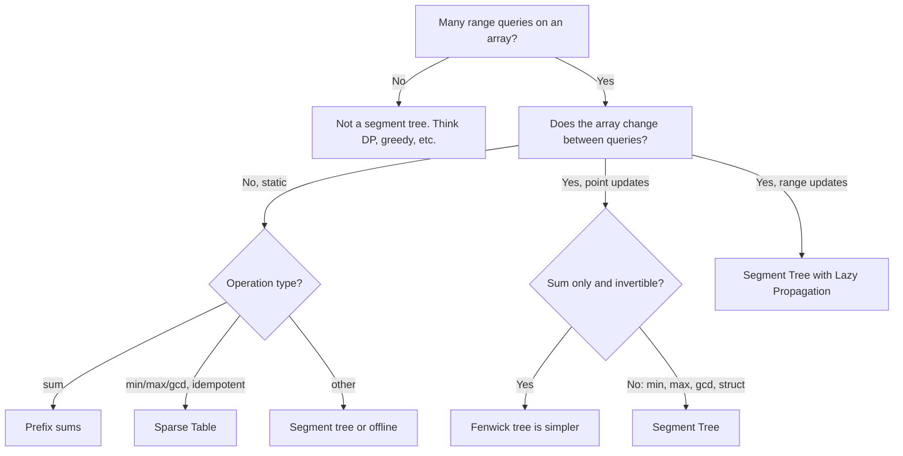

# Segment Trees: Beginner to Master (Java)

## Chapter 1: The problem that creates the need

You have an array. Two kinds of operations come in, mixed together:

1. **Query**: "What is the sum (or min, or max...) of elements from index `l` to `r`?"
2. **Update**: "Change the value at index `i`."

Let's try the simple solutions first.

| Approach | Query | Update | Problem |
|---|---|---|---|
| Plain array, loop each time | O(n) | O(1) | Slow queries |
| Prefix sums | O(1) | O(n) | Slow updates (must rebuild) |
| **Segment Tree** | **O(log n)** | **O(log n)** | Balanced |

With n = 10⁵ and q = 10⁵ operations:
- Naive: 10⁵ × 10⁵ = 10¹⁰. Too slow.
- Segment tree: 10⁵ × 17 ≈ 1.7×10⁶. Fast.

**One-line definition:** A segment tree is a binary tree where each node stores the answer for a *segment* (range) of the array. The root stores the whole array. Each child stores half of its parent's range.

---

## Chapter 2: The core intuition

Think of a company.

- The CEO knows the total sales of the whole company.
- Two VPs each know the sales of half of the company.
- Managers know their small teams.
- Employees know only their own number.

If someone asks, "What are the total sales from employee 2 to employee 5?", you don't ask every employee. You collect answers from a **few people at the right levels**. And if one employee's number changes, only their **chain of managers up to the CEO** needs to update. That chain has length log n.

Two ideas make it work:

1. **Divide**: any range splits into two halves, recursively, until a single element.
2. **Combine**: the answer of a parent = `combine(left answer, right answer)`.

The combine operation must be **associative**. For example `(a + b) + c = a + (b + c)`. Sum, min, max, gcd, xor, product, and counts all work.

---

## Chapter 3: The structure

Take `arr = [1, 3, 5, 7, 9, 11]` (indices 0 to 5) and store sums.

```
                         [0-5]=36
                        /        \
                 [0-2]=9          [3-5]=27
                 /     \           /     \
           [0-1]=4    [2]=5    [3-4]=16   [5]=11
           /    \               /    \
        [0]=1  [1]=3         [3]=7   [4]=9
```

Observations:
- Leaves are the original array elements.
- Each internal node = sum of its two children.
- The tree has height ≈ ⌈log₂ n⌉.
- It does not need to be a perfect tree. Odd sizes just split unevenly.

### Array representation

Like a heap, we store the tree in an array. For a node at index `i` (1-indexed root):

```
left child  = 2*i
right child = 2*i + 1
parent      = i / 2
```

```
Index:  1      2      3      4      5     6      7     8    9    10   11
Range: [0-5]  [0-2]  [3-5]  [0-1]  [2]   [3-4]  [5]   [0]  [1]  [3]  [4]
Value:  36     9      27     4      5     16     11    1    3    7    9
```

### Why size `4 * n`?

In the worst case, the tree height is ⌈log₂ n⌉ + 1, and indexes can go up to about 4n. Allocate `4 * n` and you are always safe. This is the standard rule to remember.

---

## Chapter 4: Build, Query, Update (the three operations)

### 4.1 Build: O(n)

```
build(node, l, r):
    if l == r:  tree[node] = arr[l]; return
    mid = (l + r) / 2
    build(left child,  l,     mid)
    build(right child, mid+1, r)
    tree[node] = combine(tree[left], tree[right])
```

Each node is visited once, and there are about 2n nodes, so it takes O(n).

### 4.2 Query: O(log n)

This is the heart of the structure. At each node, with node range `[l, r]` and query range `[ql, qr]`, there are exactly **three cases**:

```
Case 1: NO overlap       -> return identity (0 for sum, +INF for min)
Case 2: TOTAL overlap    -> return tree[node]   (node range fully inside query)
Case 3: PARTIAL overlap  -> recurse into both children, combine results
```

Visual for query `[1, 4]` on our tree. The query asks for 3 + 5 + 7 + 9 = 24.

```
                         [0-5]  partial
                        /        \
                 [0-2] partial    [3-5] partial
                 /     \           /     \
           [0-1]partial [2]FULL [3-4]FULL  [5]NONE
           /    \         =5      =16        =0
        [0]NONE [1]FULL
          =0      =3

Answer = 3 + 5 + 16 = 24
```

**Why is it O(log n)?** At each level, at most **2 nodes are "partial"**. The rest are fully inside or fully outside, and those stop immediately. So the work per level is a constant, and there are log n levels.

### 4.3 Point update: O(log n)

Walk from the root to the leaf, change it, and recompute the values on the way back up. This is a single root-to-leaf path.

---

## Chapter 5: Full Java implementation (sum)

```java
class SegmentTree {
    private final int n;
    private final long[] tree;

    public SegmentTree(int[] arr) {
        this.n = arr.length;
        this.tree = new long[4 * n];
        build(arr, 1, 0, n - 1);
    }

    private void build(int[] arr, int node, int l, int r) {
        if (l == r) {
            tree[node] = arr[l];
            return;
        }
        int mid = l + (r - l) / 2;
        build(arr, 2 * node, l, mid);
        build(arr, 2 * node + 1, mid + 1, r);
        tree[node] = tree[2 * node] + tree[2 * node + 1];
    }

    // public API
    public long query(int ql, int qr) {
        return query(1, 0, n - 1, ql, qr);
    }

    private long query(int node, int l, int r, int ql, int qr) {
        if (qr < l || r < ql) return 0;               // no overlap
        if (ql <= l && r <= qr) return tree[node];    // total overlap
        int mid = l + (r - l) / 2;                    // partial overlap
        return query(2 * node, l, mid, ql, qr)
             + query(2 * node + 1, mid + 1, r, ql, qr);
    }

    public void update(int idx, int val) {
        update(1, 0, n - 1, idx, val);
    }

    private void update(int node, int l, int r, int idx, int val) {
        if (l == r) {
            tree[node] = val;
            return;
        }
        int mid = l + (r - l) / 2;
        if (idx <= mid) update(2 * node, l, mid, idx, val);
        else            update(2 * node + 1, mid + 1, r, idx, val);
        tree[node] = tree[2 * node] + tree[2 * node + 1];
    }
}
```

**Things to notice**
- Use `long` for sums to avoid overflow.
- `l + (r - l) / 2` avoids integer overflow in `mid`.
- The three-case check in `query` is always in this order. Memorize it.
- `update` goes down **one** path only. `query` can go down two.

**Practice problem:** LeetCode 307, *Range Sum Query - Mutable*.

---

## Chapter 6: Generalizing (the "merge" mindset)

The shape of the code never changes. Only two things change:

1. What each node stores.
2. How two children combine (and the identity value for "no overlap").

| Problem | Node stores | Combine | Identity |
|---|---|---|---|
| Range sum | sum | `a + b` | 0 |
| Range min | min | `Math.min(a, b)` | `Integer.MAX_VALUE` |
| Range max | max | `Math.max(a, b)` | `Integer.MIN_VALUE` |
| Range GCD | gcd | `gcd(a, b)` | 0 |
| Range XOR | xor | `a ^ b` | 0 |
| Count of evens | count | `a + b` | 0 |

### A reusable generic template

```java
import java.util.function.LongBinaryOperator;

class GenericSegTree {
    private final int n;
    private final long[] tree;
    private final long identity;
    private final LongBinaryOperator combine;

    public GenericSegTree(long[] arr, long identity, LongBinaryOperator combine) {
        this.n = arr.length;
        this.tree = new long[4 * n];
        this.identity = identity;
        this.combine = combine;
        build(arr, 1, 0, n - 1);
    }

    private void build(long[] a, int node, int l, int r) {
        if (l == r) { tree[node] = a[l]; return; }
        int mid = (l + r) >>> 1;
        build(a, 2 * node, l, mid);
        build(a, 2 * node + 1, mid + 1, r);
        tree[node] = combine.applyAsLong(tree[2 * node], tree[2 * node + 1]);
    }

    public long query(int ql, int qr) { return query(1, 0, n - 1, ql, qr); }

    private long query(int node, int l, int r, int ql, int qr) {
        if (qr < l || r < ql) return identity;
        if (ql <= l && r <= qr) return tree[node];
        int mid = (l + r) >>> 1;
        return combine.applyAsLong(
            query(2 * node, l, mid, ql, qr),
            query(2 * node + 1, mid + 1, r, ql, qr));
    }

    public void update(int idx, long val) { update(1, 0, n - 1, idx, val); }

    private void update(int node, int l, int r, int idx, long val) {
        if (l == r) { tree[node] = val; return; }
        int mid = (l + r) >>> 1;
        if (idx <= mid) update(2 * node, l, mid, idx, val);
        else            update(2 * node + 1, mid + 1, r, idx, val);
        tree[node] = combine.applyAsLong(tree[2 * node], tree[2 * node + 1]);
    }
}

// Usage:
// new GenericSegTree(arr, Long.MAX_VALUE, Math::min);   // range min
// new GenericSegTree(arr, 0, Long::sum);                // range sum
```

For contests and interviews, writing the class by hand with `+` or `Math.min` is usually faster and clearer than lambdas.

---

## Chapter 7: Iterative (bottom-up) segment tree

This version is shorter, faster, and uses only `2n` memory. It is a favorite in competitive programming.

**Idea:** Put leaves at positions `n .. 2n-1`. The parent of `i` is `i/2`. No recursion.

```
n = 4, arr = [a b c d]

index:   1
        / \
       2   3
      / \ / \
     4  5 6  7        <- leaves = arr[0..3]
```

```java
class IterSegTree {
    private final int n;
    private final long[] t;

    public IterSegTree(int[] arr) {
        n = arr.length;
        t = new long[2 * n];
        for (int i = 0; i < n; i++) t[n + i] = arr[i];
        for (int i = n - 1; i >= 1; i--) t[i] = t[2 * i] + t[2 * i + 1];
    }

    public void update(int p, int val) {
        p += n;
        t[p] = val;
        for (p >>= 1; p >= 1; p >>= 1) t[p] = t[2 * p] + t[2 * p + 1];
    }

    // sum over [l, r)  (half-open!)
    public long query(int l, int r) {
        long res = 0;
        for (l += n, r += n; l < r; l >>= 1, r >>= 1) {
            if ((l & 1) == 1) res += t[l++];
            if ((r & 1) == 1) res += t[--r];
        }
        return res;
    }
}
```

**How the query loop thinks:** if `l` is a right child (odd), it can't be merged with its sibling, so take it and move right. If `r` is a right child, then `r-1` is a left child that must be taken. Then both go to their parents.

> Caution: for **non-commutative** operations (like string concatenation or matrix multiplication), keep a separate `resLeft` and `resRight` and combine in the right order. For sum/min/max, this simple version is fine.

---

## Chapter 8: Lazy propagation (range updates)

### The problem

What if the update is **"add 5 to every element in [l, r]"**?

A point-update loop would cost O(n log n) per update. That is too slow.

### The idea: be lazy

When an update **fully covers** a node, don't go down. Instead:
1. Update this node's value right away.
2. Leave a **note** (lazy tag) on the node: "my children still owe this update."
3. Only when a later operation needs to go **below** this node, **push** the note to the children.

Think of a manager who changes a policy for the whole team. He doesn't tell each employee today. He writes it on a sticky note. Only when someone needs to talk to a specific employee does the note get passed down.

### Lazy for "range add + range sum"

```java
class LazySegTree {
    private final int n;
    private final long[] tree, lazy;

    public LazySegTree(int[] arr) {
        n = arr.length;
        tree = new long[4 * n];
        lazy = new long[4 * n];
        build(arr, 1, 0, n - 1);
    }

    private void build(int[] a, int node, int l, int r) {
        if (l == r) { tree[node] = a[l]; return; }
        int mid = (l + r) >>> 1;
        build(a, 2 * node, l, mid);
        build(a, 2 * node + 1, mid + 1, r);
        tree[node] = tree[2 * node] + tree[2 * node + 1];
    }

    // apply "add val to whole segment" to this node
    private void apply(int node, int l, int r, long val) {
        tree[node] += val * (r - l + 1);   // sum grows by val * length
        lazy[node] += val;                 // remember for children
    }

    private void push(int node, int l, int r) {
        if (lazy[node] != 0) {
            int mid = (l + r) >>> 1;
            apply(2 * node, l, mid, lazy[node]);
            apply(2 * node + 1, mid + 1, r, lazy[node]);
            lazy[node] = 0;
        }
    }

    public void rangeAdd(int ql, int qr, long val) {
        rangeAdd(1, 0, n - 1, ql, qr, val);
    }

    private void rangeAdd(int node, int l, int r, int ql, int qr, long val) {
        if (qr < l || r < ql) return;
        if (ql <= l && r <= qr) { apply(node, l, r, val); return; }
        push(node, l, r);                       // IMPORTANT: push before going down
        int mid = (l + r) >>> 1;
        rangeAdd(2 * node, l, mid, ql, qr, val);
        rangeAdd(2 * node + 1, mid + 1, r, ql, qr, val);
        tree[node] = tree[2 * node] + tree[2 * node + 1];   // pull up
    }

    public long query(int ql, int qr) { return query(1, 0, n - 1, ql, qr); }

    private long query(int node, int l, int r, int ql, int qr) {
        if (qr < l || r < ql) return 0;
        if (ql <= l && r <= qr) return tree[node];
        push(node, l, r);                       // IMPORTANT: push before going down
        int mid = (l + r) >>> 1;
        return query(2 * node, l, mid, ql, qr)
             + query(2 * node + 1, mid + 1, r, ql, qr);
    }
}
```

### The lazy checklist (use it for every lazy problem)

Ask yourself four questions:

1. **What does a node store?** (sum, min, ...)
2. **What does a lazy tag mean?** (add x, assign x, ...)
3. **How does a tag change a node's value?** (`sum += x * len`, or `min += x`)
4. **How do two tags compose?** (add + add = add of sum; assign overrides everything)

| Operation | Node update | Tag composition |
|---|---|---|
| Range add, range sum | `sum += v * len` | `lazy += v` |
| Range add, range min/max | `min += v` | `lazy += v` |
| Range assign, range sum | `sum = v * len` | `lazy = v` (overrides) |
| Range assign + range add mixed | need `(type, value)` tags | careful ordering |

> For **assign** tags, the value `0` can be a legal assignment. Use a separate boolean `hasLazy[]`, or a sentinel like `Long.MIN_VALUE`, instead of testing `lazy != 0`.

### The three most common lazy bugs

1. Forgetting to `push` before recursing (in both update **and** query).
2. Forgetting to `pull` (recompute `tree[node]`) after recursing in update.
3. Using `lazy != 0` as "has a tag" when assign-to-0 is legal.

---

## Chapter 9: Storing richer data in nodes

Nodes don't have to store a single number. They can store a small **struct**, as long as you can merge two structs into one.

### Classic: Maximum Subarray Sum in a range

A node needs four values:

```
sum    = total of the segment
prefix = best sum of a prefix
suffix = best sum of a suffix
best   = best subarray sum anywhere inside
```

```
merge(L, R):
   sum    = L.sum + R.sum
   prefix = max(L.prefix, L.sum + R.prefix)
   suffix = max(R.suffix, R.sum + L.suffix)
   best   = max(L.best, R.best, L.suffix + R.prefix)
```

```java
class Node {
    long sum, pref, suf, best;
    Node(long v) { sum = pref = suf = best = v; }
    Node() {}
}

static Node merge(Node L, Node R) {
    Node res = new Node();
    res.sum  = L.sum + R.sum;
    res.pref = Math.max(L.pref, L.sum + R.pref);
    res.suf  = Math.max(R.suf, R.sum + L.suf);
    res.best = Math.max(Math.max(L.best, R.best), L.suf + R.pref);
    return res;
}
```

In a query you must handle the "no overlap" case by returning `null` and merging carefully, since a clean identity element is awkward here.

### Other struct examples

- **Min and count of min** in a range (store `(min, count)`).
- **Longest run of 1s** in a range (store prefix run, suffix run, best run, length).
- **Balanced brackets in a range** (store unmatched open and close counts).
- **Matrix product** of a range (non-commutative, order matters).
- **Hash of a substring** (store hash and length).

The skill here: **"Can I describe a segment's answer using a small summary, and combine two summaries into one?"** If yes, a segment tree fits.

---

## Chapter 10: Descending on the tree

Sometimes you don't want a range answer. You want to **find** something using the tree structure.

### Example: first index with value ≥ x (max tree)

```java
// returns first index i with arr[i] >= x, or -1
int findFirst(int node, int l, int r, long x) {
    if (tree[node] < x) return -1;          // nothing here can satisfy
    if (l == r) return l;
    int mid = (l + r) >>> 1;
    if (tree[2 * node] >= x) return findFirst(2 * node, l, mid, x);
    return findFirst(2 * node + 1, mid + 1, r, x);
}
```

Complexity is O(log n) because we pick one side at each level.

### Example: k-th smallest using a count tree

Store counts of values. At each node, if `left.count >= k`, go left. Otherwise subtract `left.count` from `k` and go right.

These **"walk down the tree"** searches appear in order statistics, scheduling, and "first available slot" problems.

---

## Chapter 11: Dynamic (sparse) segment tree

If the index range is huge (like 0 to 10⁹) but only a few points are used, you can't allocate `4 * 10⁹`. Create nodes **only when needed**.

```java
class DynamicSegTree {
    static class Node {
        Node left, right;
        long sum;
    }
    private final int lo, hi;
    private final Node root = new Node();

    DynamicSegTree(int lo, int hi) { this.lo = lo; this.hi = hi; }

    void add(int idx, long delta) { add(root, lo, hi, idx, delta); }

    private void add(Node node, int l, int r, int idx, long delta) {
        node.sum += delta;
        if (l == r) return;
        int mid = l + (r - l) / 2;
        if (idx <= mid) {
            if (node.left == null) node.left = new Node();
            add(node.left, l, mid, idx, delta);
        } else {
            if (node.right == null) node.right = new Node();
            add(node.right, mid + 1, r, idx, delta);
        }
    }

    long query(int ql, int qr) { return query(root, lo, hi, ql, qr); }

    private long query(Node node, int l, int r, int ql, int qr) {
        if (node == null || qr < l || r < ql) return 0;
        if (ql <= l && r <= qr) return node.sum;
        int mid = l + (r - l) / 2;
        return query(node.left, l, mid, ql, qr)
             + query(node.right, mid + 1, r, ql, qr);
    }
}
```

Each update creates at most ~log(range) new nodes, so memory is O(q log range).

**Use it for:** LeetCode 715 (*Range Module*), 732 (*My Calendar III*), 699 (*Falling Squares*), and problems with large coordinates where you don't want to compress.

---

## Chapter 12: How to identify a segment tree problem (the thinking process)

### The signal words

- "range sum / min / max / gcd / count between l and r"
- "update an element **and** query a range" (mixed operations)
- "update a **range**" plus "query" (lazy)
- "q queries, n up to 10⁵ or 10⁶"
- "online" queries (can't reorder them)

### Thought-process flowchart



### Questions to ask yourself

1. **What is a "segment" here, and what summary describes it?** If you can define a small summary that can be merged, the structure works.
2. **Is the merge associative?** If not, it breaks.
3. **Are updates points or ranges?** Points use plain trees. Ranges use lazy.
4. **Is the index space big or sparse?** Use dynamic nodes or coordinate compression.
5. **Can a simpler tool work?** (Prefix sum, Fenwick, sparse table, two pointers.)

### The "hidden" segment tree problems

Many problems don't mention ranges directly. The trick is to **make the data a range over something else**:

| Problem idea | The array is actually... |
|---|---|
| Count smaller elements after self (LC 315) | Array indexed by **value**, storing counts |
| Longest Increasing Subsequence II (LC 2407) | Array indexed by **value**, storing best LIS ending at that value; query max over `[x-k, x-1]` |
| Skyline (LC 218) | Array indexed by **x-coordinate**, storing max height |
| Rectangle Area II (LC 850) | Array indexed by **y-coordinate**, storing covered length (with sweep line) |
| Count of Range Sum (LC 327) | Array indexed by **prefix-sum rank**, storing counts |
| Reverse pairs (LC 493) | Array indexed by **value rank**, storing counts |

> This is the key insight for "mastery": **the segment tree's index doesn't have to be the position in the original array. It can be a value, a time, or a coordinate.** If a DP transition says "take the best over a *range of values*", think segment tree.

---

## Chapter 13: Worked examples

### Example A: Count smaller numbers after self (LC 315)

**Thinking:**
- For each `nums[i]`, count how many elements to its right are smaller.
- Process from right to left.
- Keep a structure indexed by value. Query "how many values in `[min, nums[i]-1]` have been inserted?" Then insert `nums[i]`.
- Values can be negative or large, so compress them to ranks `0..m-1`.

```java
public List<Integer> countSmaller(int[] nums) {
    int n = nums.length;
    int[] sorted = Arrays.stream(nums).distinct().sorted().toArray();
    int m = sorted.length;
    int[] tree = new int[4 * m];

    Integer[] ans = new Integer[n];
    for (int i = n - 1; i >= 0; i--) {
        int rank = Arrays.binarySearch(sorted, nums[i]);
        ans[i] = rank == 0 ? 0 : query(tree, 1, 0, m - 1, 0, rank - 1);
        update(tree, 1, 0, m - 1, rank);
    }
    return Arrays.asList(ans);
}

static void update(int[] t, int node, int l, int r, int idx) {
    if (l == r) { t[node]++; return; }
    int mid = (l + r) >>> 1;
    if (idx <= mid) update(t, 2 * node, l, mid, idx);
    else            update(t, 2 * node + 1, mid + 1, r, idx);
    t[node] = t[2 * node] + t[2 * node + 1];
}

static int query(int[] t, int node, int l, int r, int ql, int qr) {
    if (qr < l || r < ql) return 0;
    if (ql <= l && r <= qr) return t[node];
    int mid = (l + r) >>> 1;
    return query(t, 2 * node, l, mid, ql, qr)
         + query(t, 2 * node + 1, mid + 1, r, ql, qr);
}
```

Total time is O(n log n).

### Example B: Longest Increasing Subsequence II (LC 2407)

Constraint: adjacent elements in the subsequence differ by at most `k`.

**Thinking:**
- `dp[v]` = longest valid subsequence ending with value `v`.
- For a new number `x`: `dp[x] = 1 + max(dp[x-k .. x-1])`.
- That is a **range max query** over values, followed by a **point update** at `x`.
- This is a segment tree indexed by value, with max as the combine.

```java
public int lengthOfLIS(int[] nums, int k) {
    int maxV = 0;
    for (int x : nums) maxV = Math.max(maxV, x);
    int[] tree = new int[4 * (maxV + 1)];
    int ans = 1;
    for (int x : nums) {
        int best = (x == 1) ? 0 : query(tree, 1, 0, maxV, Math.max(1, x - k), x - 1);
        int cur = best + 1;
        update(tree, 1, 0, maxV, x, cur);   // set max at position x
        ans = Math.max(ans, cur);
    }
    return ans;
}
// update: leaf = max(leaf, val), parent = max(children)
// query : standard range max, identity 0
```

This is a great example of the "hidden segment tree" idea: a DP made fast with a range-max structure.

### Example C: My Calendar III (LC 732)

Each booking is a **range add +1**, and you need the **global max** of overlaps. That is a lazy segment tree (or dynamic tree) with range add and max. Look at the root after each update, and you have the answer.

---

## Chapter 14: Advanced topics (know they exist)

### 14.1 Segment tree vs. its cousins

| Structure | Build | Query | Update | Supports | Notes |
|---|---|---|---|---|---|
| Prefix sum | O(n) | O(1) | O(n) | sum | Static only |
| Sparse table | O(n log n) | O(1) | none | min, max, gcd | Static only |
| Fenwick (BIT) | O(n) | O(log n) | O(log n) | sum, invertible ops | Tiny code, fast |
| Segment tree | O(n) | O(log n) | O(log n) | any associative op | Most flexible |
| Sqrt decomposition | O(n) | O(√n) | O(√n) | many | Simpler, slower |

**Rule of thumb:** If Fenwick can do it, use Fenwick. If you need min/max, structs, or range updates, use a segment tree.

### 14.2 Merge Sort Tree

Each node stores the **sorted list** of its segment. This answers queries like "how many elements in `[l, r]` are ≤ x?" in O(log² n). It uses O(n log n) memory. It is static.

### 14.3 Persistent segment tree

Each update creates only O(log n) new nodes and shares the rest with the old version. Every version stays queryable. Used for "k-th smallest in range `[l, r]`" and "query the array as it was at time t."

### 14.4 2D segment tree

A segment tree of segment trees, for rectangle queries on a matrix. Memory is heavy, with O(log² n) per operation. For sums, a 2D Fenwick tree is usually preferred.

### 14.5 Segment Tree Beats

Handles updates like `a[i] = min(a[i], x)` over a range. It stores max, second max, and count of max. It is rare in interviews but common in advanced contests.

### 14.6 Segment tree + sweep line

Sweep a line across the plane. The segment tree tracks active intervals. Used in Rectangle Area II (LC 850), Skyline, and union-area problems.

---

## Chapter 15: Complexity summary

| Operation | Time | Space |
|---|---|---|
| Build | O(n) | O(4n) recursive, O(2n) iterative |
| Point update | O(log n) | |
| Range query | O(log n) | |
| Range update (lazy) | O(log n) | O(4n) for tree + O(4n) for lazy |
| Dynamic tree | O(log R) per op | O(q log R) nodes |

---

## Chapter 16: Common mistakes (debug checklist)

1. **Array too small.** Use `4 * n`.
2. **Wrong identity** for no-overlap (`0` for min is a bug; use `MAX_VALUE`).
3. **Integer overflow.** Use `long` for sums, especially with lazy `val * len`.
4. **Off-by-one** in `[l, r]` (inclusive) vs `[l, r)` (half-open). Pick one and stay consistent.
5. **Lazy:** forgetting `push` in `query`, forgetting to `pull` in `update`.
6. **Lazy assign** using `0` as "no tag."
7. **Non-associative combine** (for example, average). Store `(sum, count)` instead.
8. **Recursion depth.** It is only log n, so it is safe. Recursion is not the issue.
9. **Query range outside the array.** Validate `ql <= qr` and bounds.
10. **Mutating shared `Node` objects** in struct trees during merge. Always create a new `Node`.

---

## Chapter 17: Interview and contest strategy

**In an interview:**
1. Say the brute force first: O(n) per query.
2. Name the bottleneck: many queries and updates mixed.
3. Propose the segment tree and state what each node stores and how to merge.
4. Write the three-case query clearly.
5. State complexity: O(n) build, O(log n) per operation.
6. Mention alternatives (Fenwick for sums) to show range.

**Memorize this skeleton.** Almost every problem fills in only the blanks:

```
build  : leaf = value, internal = merge(children)
query  : no overlap -> identity | full overlap -> tree[node] | partial -> merge(both)
update : go to leaf -> set -> merge on the way back
lazy   : apply(node) / push(node) / pull(node)
```

---

## Chapter 18: Practice roadmap

**Level 1: Basics**
- LC 307 Range Sum Query - Mutable
- LC 303 / 304 (solve with prefix sums first, to feel the contrast)
- Range minimum query (classic, from any judge)

**Level 2: Value-indexed trees**
- LC 315 Count of Smaller Numbers After Self
- LC 493 Reverse Pairs
- LC 327 Count of Range Sum
- LC 2407 Longest Increasing Subsequence II
- LC 1649 Create Sorted Array through Instructions

**Level 3: Lazy propagation and dynamic trees**
- LC 732 My Calendar III
- LC 715 Range Module
- LC 699 Falling Squares
- LC 2569 Handling Sum Queries After Update

**Level 4: Struct nodes and sweep line**
- LC 53-style max subarray in a range (SPOJ GSS1)
- LC 218 The Skyline Problem
- LC 850 Rectangle Area II
- LC 1157 Online Majority Element In Subarray

**Level 5: Advanced**
- Persistent tree: k-th smallest in range (SPOJ MKTHNUM)
- Merge sort tree problems
- Segment Tree Beats (Codeforces problems tagged "segment tree beats")

---

## Final mental model

> A segment tree is a **precomputed answer for every "aligned" segment**. Any range can be built from at most about 2 log n of those segments. Updates only touch the log n segments that contain the changed point. Lazy propagation delays work until it is actually needed.

If you can answer these three questions about a problem, you can solve it with a segment tree:

1. **What does each segment remember?**
2. **How do two segments merge?**
3. **What is the "index" of the tree?** (position, value, time, or coordinate)

I can go deeper on any chapter next, such as lazy propagation with assign + add combined, or a persistent segment tree walkthrough. A good first step is to code Chapters 5 and 8 yourself, then try LC 307 and LC 315.

