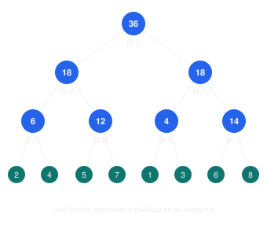
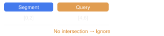

# Segment Trees — understand the idea, not memorize the code

The best way to understand a Segment Tree is to start with one question:

How can we answer questions about a range of an array quickly, even when the array keeps changing?

Once you understand the answer to that question, the structure, recursion, implementation, and even lazy propagation become much easier.

We'll build the intuition from scratch, using Java.

# 1. First understand the problem

Suppose we have this array:

```
index:  0   1   2   3   4   5   6   7
value:  2   4   5   7   1   3   6   8
```

Imagine we need to support two operations:

1. Find the sum of elements between indices `1` and `5`.
2. Update the element at index `3` from `7` to `10`.

For example:

```
sum(1, 5) = 4 + 5 + 7 + 1 + 3 = 20
```

Now imagine we receive thousands of such queries and updates.

How should we approach this?

## Approach 1: Use the array directly

To calculate a range sum, iterate through the range.

```
int rangeSum(int[] nums, int left, int right) {
    int sum = 0;

    for (int i = left; i <= right; i++) {
        sum += nums[i];
    }

    return sum;
}
```

Complexities:

| Operation    | Time |
| ------------ | ---- |
| Range sum    | O(n) |
| Point update | O(1) |

This is perfectly fine when there are very few queries.

But what if there are 100,000 queries on an array containing 100,000 elements?

Repeatedly scanning ranges becomes expensive.

## Approach 2: Prefix sums

We can precompute cumulative sums:

```
nums:          2   4   5   7   1   3   6   8
prefix:        2   6  11  18  19  22  28  36
```

Here:

```
prefix[i] = nums[0] + nums[1] + ... + nums[i]
```

Now a range sum can be calculated in constant time:

\\[ sum(L,R) = prefix[R] - prefix[L-1] \\]

For example:

\\[ sum(1,5) = prefix[5] - prefix[0] = 22 - 2 = 20 \\]

Great! We reduced range queries from O(n) to O(1).

But there is a problem.

What happens when an element changes?

Suppose:

```
nums[3] = 10
```

Every prefix sum from index `3` onward must be recalculated.

| Operation    | Time |
| ------------ | ---- |
| Range sum    | O(1) |
| Point update | O(n) |

Prefix sums work beautifully when the array doesn't change frequently.

But we need something that handles both operations efficiently.

This is where Segment Trees enter.

# 2. The central idea of a Segment Tree

Forget the implementation for a moment.

Think about this:

Suppose I divide the array into smaller segments and calculate the sum of each segment.

For our example:

```
Original array:

[2, 4, 5, 7, 1, 3, 6, 8]
```

First, divide it into two halves:

```
             [0 ... 7]
             /       \
         [0 ... 3]  [4 ... 7]
```

Divide each half again:

```
                 [0 ... 7]
                /         \
           [0 ... 3]     [4 ... 7]
           /     \        /     \
        [0..1] [2..3]  [4..5] [6..7]
```

Divide until each segment contains exactly one element.

```
                       [0 ... 7]
                      /         \
                 [0 ... 3]     [4 ... 7]
                 /     \        /     \
              [0..1] [2..3]  [4..5] [6..7]
              / \     / \     / \     / \
             2   4   5   7   1   3   6   8
```

This structure is a binary tree.

But here is the important part:

Each node stores information about the segment represented by that node.


For a range-sum Segment Tree:

```
A leaf stores one array element.

A parent stores the sum of its two children.
```

Let's calculate the values.

## A Segment Tree for range sums

Each node shows the sum of its interval. The interval labels are shown underneath.



For example, node [0,3] stores 2 + 4 + 5 + 7 = 18.

Notice that:

```
[0,1] = 2 + 4 = 6
[2,3] = 5 + 7 = 12

[0,3] = 6 + 12 = 18
```

Likewise:

```
[4,5] = 1 + 3 = 4
[6,7] = 6 + 8 = 14

[4,7] = 4 + 14 = 18
```

Finally:

```
[0,7] = 18 + 18 = 36
```

We have created a hierarchy of precomputed answers.

That is the central idea.

A Segment Tree doesn't store the original array repeatedly. It stores summaries of different segments of that array, arranged hierarchically.

And those summaries can be combined to answer larger range queries.

# 3. How does it answer a range query without visiting every element?

This is where the real intuition comes together.

Suppose we want:

```
sum(1, 5)
```

Our array is:

```
index:  0   1   2   3   4   5   6   7
value:  2   4   5   7   1   3   6   8
```

We need:

```
[1, 5] = 4 + 5 + 7 + 1 + 3 = 20
```

Look at the segments we have already calculated:

```
[0,1] = 6
[2,3] = 12
[4,5] = 4
[6,7] = 14
```

Our requested range `[1,5]` can be represented by three smaller, non-overlapping segments:

```
[1,1] = 4
[2,3] = 12
[4,5] = 4
```

Therefore:

```
sum(1,5) = 4 + 12 + 4 = 20
```

We didn't have to visit every element in the range individually.

We reused answers that had already been calculated and stored in the tree.

This is the most important insight about Segment Trees:

A range query is answered by finding a small collection of precomputed segments that exactly cover the requested range.

The segments must:

- Cover the entire requested range.
- Not include elements outside the requested range.
- Not overlap each other.

That's it.

## How does the recursion know which segment to use?

Every recursive call represents a segment:

```
[node, start, end]
```

And every query also represents a segment:

```
[queryLeft, queryRight]
```

There are exactly three possibilities.

Case 1: No overlap

The current segment has nothing to do with the requested range.



Return `0` for a sum query. The segment contributes nothing.

Case 2: Complete overlap

The current segment is entirely inside the requested range.


Return the aggregate stored in the current node. No need to visit its children.

Case 3: Partial overlap

The current segment and requested range intersect, but the current segment is not completely covered.


Divide the current segment into its left and right children, then calculate the answer from both.

These three cases are the entire query algorithm.

You don't need to memorize a complicated recursion. Just ask:

1. Is this segment outside the query? Ignore it.
2. Is this segment completely inside the query? Use its stored answer.
3. Otherwise, split it and ask the children.

For a sum query, the answers from the children are added together.

For a minimum query, they are combined using `Math.min()`.

For a maximum query, they are combined using `Math.max()`.

The traversal logic stays the same. Only the meaning of the stored information and the way we combine it change.

# 4. Let's implement it in Java

We'll start with the most understandable version: a Segment Tree for range sum queries with point updates.

Our operations will be:

```
build(values);          // Construct the tree
querySum(left, right);  // Find the range sum
update(index, value);   // Change an array element
```

Before writing the code, understand the four important pieces.

## 4.1 How do we represent the tree?

We don't need to create actual Java `Node` objects with left and right references.

We can use an array.

```
private final long[] tree;
```

We use the following convention:

```
Root node:       1
Left child:      2 * node
Right child:     2 * node + 1
```

For example:

```
              1
            /   \
           2     3
          / \   / \
         4   5 6   7
```

The tree array stores the aggregate value for each node.

Important: The index of a node in `tree` is not the same as an index in the original array.

The original array index tells us which element we're talking about.

The segment tree index tells us which tree node we're talking about.

Each node's represented interval is determined by the recursive `start` and `end` arguments.

Why allocate `4 * n` elements?

A binary segment tree with `n` leaves has O(n) total nodes. Allocating `4 * n` is a convenient, safe upper bound for the usual recursive array representation, even when `n` is not a power of two.

## 4.2 Building the tree

Think about the construction:

```
If the current segment contains one element:
    Store that element.

Otherwise:
    Divide the segment into two halves.
    Build the left half.
    Build the right half.
    Combine their answers.
```

That's our complete build algorithm.

For the sum tree:

```
tree[node] = tree[leftChild] + tree[rightChild];
```

## 4.3 Updating an element

Suppose:

```
nums[3] = 7
```

We want:

```
nums[3] = 10
```

Which tree nodes need updating?

Only the nodes whose segments contain index `3`.

```
                    [0,7]
                       |
                    [0,3]
                       |
                    [2,3]
                       |
                    [3,3]
```

We follow one path from the root to the leaf.

At the leaf, replace the value.

Then recompute each ancestor using its children.

```
Before:

[3,3] = 7
[2,3] = 12
[0,3] = 18
[0,7] = 36

After:

[3,3] = 10
[2,3] = 15
[0,3] = 21
[0,7] = 39
```

Everything outside that path remains unchanged.

This is why point updates are fast: we only need to repair one root-to-leaf path.

## 4.4 Complete Java implementation

```java

public class SegmentTree {

    private final int n;
    private final long[] tree;

    public SegmentTree(long[] values) {
        if (values == null || values.length == 0) {
            throw new IllegalArgumentException(
                "Input array must not be null or empty"
            );
        }

        this.n = values.length;
        this.tree = new long[4 * n];

        build(1, 0, n - 1, values);
    }

    // -------------------------------------------
    // BUILD
    // -------------------------------------------

    private void build(int node, int start, int end, long[] values) {

        // Base case: one element, so this node is a leaf.
        if (start == end) {
            tree[node] = values[start];
            return;
        }

        int mid = start + (end - start) / 2;

        int leftChild = 2 * node;
        int rightChild = 2 * node + 1;

        // Build the left and right segments.
        build(leftChild, start, mid, values);
        build(rightChild, mid + 1, end, values);

        // Combine the children's answers.
        tree[node] = tree[leftChild] + tree[rightChild];
    }

    // -------------------------------------------
    // RANGE SUM QUERY
    // -------------------------------------------

    public long querySum(int queryLeft, int queryRight) {
        validateRange(queryLeft, queryRight);

        return querySum(
            1, 0, n - 1, queryLeft, queryRight
        );
    }

    private long querySum(
        int node,
        int start,
        int end,
        int queryLeft,
        int queryRight
    ) {

        // Case 1: No overlap.
        if (queryRight < start || queryLeft > end) {
            return 0L;
        }

        // Case 2: Complete overlap.
        if (queryLeft <= start && end <= queryRight) {
            return tree[node];
        }

        // Case 3: Partial overlap.
        int mid = start + (end - start) / 2;

        long leftSum = querySum(
            2 * node,
            start,
            mid,
            queryLeft,
            queryRight
        );

        long rightSum = querySum(
            2 * node + 1,
            mid + 1,
            end,
            queryLeft,
            queryRight
        );

        return leftSum + rightSum;
    }

    // -------------------------------------------
    // POINT UPDATE
    // -------------------------------------------

    public void update(int index, long newValue) {
        if (index < 0 || index >= n) {
            throw new IndexOutOfBoundsException(
                "Invalid array index: " + index
            );
        }

        update(1, 0, n - 1, index, newValue);
    }

    private void update(
        int node,
        int start,
        int end,
        int index,
        long newValue
    ) {

        // We reached the leaf representing the target index.
        if (start == end) {
            tree[node] = newValue;
            return;
        }

        int mid = start + (end - start) / 2;

        if (index <= mid) {
            update(2 * node, start, mid, index, newValue);
        } else {
            update(2 * node + 1, mid + 1, end, index, newValue);
        }

        // Recalculate this node from its children.
        tree[node] = tree[2 * node] + tree[2 * node + 1];
    }

    private void validateRange(int left, int right) {
        if (left < 0 || right >= n || left > right) {
            throw new IllegalArgumentException(
                "Invalid range: [" + left + ", " + right + "]"
            );
        }
    }
}

```

## 4.5 Let's execute it

```java
public class Main {
    public static void main(String[] args) {

        long[] nums = {2, 4, 5, 7, 1, 3, 6, 8};

        SegmentTree st = new SegmentTree(nums);

        // Query [1, 5].
        System.out.println(st.querySum(1, 5)); // 20

        // Change nums[3] from 7 to 10.
        st.update(3, 10);

        // Query again.
        System.out.println(st.querySum(1, 5)); // 23

        // Query entire array.
        System.out.println(st.querySum(0, 7)); // 39
    }
}
```

Notice something important:

We didn't change every node during an update.

We didn't calculate every element during a query.

We used the hierarchy of precomputed answers to do both efficiently.

# 5. Why are the operations O(log n)?

Let's understand this rather than just accepting the complexity.

Every time we divide a segment, its size roughly becomes half.

For example:

```
8 elements
   |
   v
4 elements
   |
   v
2 elements
   |
   v
1 element
```

How many times can you divide `n` elements by two until you reach one element?

\\[ \log_2 n \\]

That gives us the tree height.

| Operation    | Complexity | Reason                                                    |
| ------------ | ---------- | --------------------------------------------------------- |
| Build        | O(n)       | Every tree node is constructed once.                      |
| Point update | O(log n)   | Visit one root-to-leaf path.                              |
| Range query  | O(log n)   | Visit a small number of relevant segments along the tree. |
| Space        | O(n)       | The tree contains O(n) nodes.                             |

One interesting detail about range queries:

Why doesn't the query visit every node?

At any level, only the segments touching the two boundaries of the requested range can be partially covered. Fully covered segments are accepted immediately, and completely unrelated segments are discarded.

Consequently, the number of visited nodes remains O(log n) for a single contiguous range query.

# 6. Segment Trees are NOT just for sums

This is where you should start recognizing the general pattern.

Our previous implementation used:

```java
tree[node] = leftValue + rightValue;
```

That is not a rule specific to Segment Trees.

It is simply the operation used to combine two smaller segments.

What if we want the minimum element in a range?

Instead of storing a sum, store the minimum.

```java
tree[node] = Math.min(leftValue, rightValue);
```

What if we want the maximum?

```java
tree[node] = Math.max(leftValue, rightValue);
```

What if we want XOR?

```java
tree[node] = leftValue ^ rightValue;
```

The tree's structure doesn't change.

Only the information stored and the combination operation change.

## Common Segment Tree variations

| Problem        | What each node stores | How children are combined |
| -------------- | --------------------- | ------------------------- |
| Range sum      | Sum                   | `left + right`            |
| Range minimum  | Minimum               | `Math.min(left, right)`   |
| Range maximum  | Maximum               | `Math.max(left, right)`   |
| Range GCD      | GCD                   | `gcd(left, right)`        |
| Range XOR      | XOR                   | `left ^ right`            |
| Range product  | Product               | `left * right`            |
| Count elements | Count                 | `left + right`            |

Let's take one example.

Array:

```
[8, 3, 6, 2, 9, 4]
```

Find the minimum between indices `1` and `4`.

```
[3, 6, 2, 9]
```

Answer:

```
2
```

The traversal is exactly the same as our range sum query.

The only difference:

```java
return Math.min(leftMin, rightMin);
```

And the identity value changes from `0` to positive infinity.

This leads us to an important mathematical concept.

# 7. The mathematical property behind Segment Trees: Associativity

There is a deeper reason why Segment Trees work for all those operations.

The operation used to combine segments should be associative.

Associativity means:

\\[ (a \circ b) \circ c = a \circ (b \circ c) \\]

For addition:

\\[ (2+3)+4 = 2+(3+4) \\]

For minimum:

\\[ min(min(8,3),2) = min(8,min(3,2)) \\]

For XOR:

\\[ (2 \oplus 3) \oplus 4 = 2 \oplus (3 \oplus 4) \\]

Why does this matter?

Because our tree divides ranges into different groups.

For example:

```
[0 ... 7]

       /       \
   [0 ... 3]  [4 ... 7]
```

We calculate the answers for the smaller groups and combine them.

Associativity guarantees that grouping the values this way doesn't change the final result.

## Another important concept: Identity

An identity value is a value that doesn't change the result when combined with another value.

For example:

```
Sum:       x + 0 = x
Minimum:   min(x, +infinity) = x
Maximum:   max(x, -infinity) = x
XOR:       x ^ 0 = x
Product:   x * 1 = x
GCD:       gcd(x, 0) = x
```

Remember our no-overlap case?

For sum:

```
return 0;
```

This isn't an arbitrary choice.

It's the identity for addition.

For minimum:

```
return Long.MAX_VALUE;
```

For maximum:

```
return Long.MIN_VALUE;
```

This is why you must change the no-overlap return value when implementing a different kind of Segment Tree.

An easy way to derive the correct value: Ask yourself, "What value can I combine with the answer without changing it?"

One more useful detail: not every valid aggregate must be commutative.

For example, string concatenation is associative:

```
("ab" + "cd") + "ef"
= "ab" + ("cd" + "ef")
```

But order matters.

A Segment Tree can handle this too, as long as you combine the left child's result before the right child's result.

This is useful for problems involving:

- String concatenation.
- Matrix multiplication.
- Function composition.
- Other ordered range aggregates.

The operation must be associative, but it does not necessarily have to be commutative.

# 8. Now the important part: Lazy Propagation

So far we've handled:

- Range queries.
- Point updates.

Let's introduce a more interesting problem.

Suppose the array is:

```
[2, 4, 5, 7, 1, 3, 6, 8]
```

We need to support:

1. Find the sum of any range.
2. Add `10` to every element in a given range.

For example:

```
add(1, 5, 10)
```

The resulting array should be:

```
[2, 14, 15, 17, 11, 13, 6, 8]
```

How would you update the Segment Tree?

## 8.1 The naive approach

We could update every individual element:

```java
for (int i = left; i <= right; i++) {
    update(i, nums[i] + value);
}
```

For a range containing `k` elements:

\\[ O(k \log n) \\]

This is not very efficient.

But look at the structure again.

Remember that a node stores the sum of its entire segment.

Consider:

```
Segment: [2, 3]
Values:  [5, 7]
Sum:     12
```

Now add `10` to every element of this segment.

New values:

```
[15, 17]
```

New sum:

```
32
```

Do we need to update both leaves immediately?

No.

We already know:

```
Old sum = 12
Number of elements = 2
Addition = 10
```

Therefore:

\\[ NewSum = OldSum + (NumberOfElements \times Addition) \\]

\\[ NewSum = 12 + (2 \times 10) = 32 \\]

We can update the parent directly!

That is the core intuition behind lazy propagation.

## 8.2 What does lazy propagation mean?

Suppose a node represents:

```
[2, 3]
```

We add `10` to the entire segment.

We update its stored aggregate:

```
Old sum: 12
New sum: 32
```

But we don't immediately update its children.

Instead, we store a pending instruction:

```
Apply +10 to my children when you next need to go down.
```

That's called a lazy value or lazy tag.

The node now contains two pieces of information:

```
tree[node] = 32
lazy[node] = 10
```

The aggregate is already correct.

The children haven't received the update yet.

When a future operation needs to descend into the children, we propagate the pending update to them.

Before the update

Node [2,3]

# 12

[2,2]

# 5

[3,3]

# 7

After applying +10 to the whole segment

Node [2,3]

# 32

Pending +10

[2,2]

# 5

Not propagated yet

[3,3]

# 7

Not propagated yet

When we need to visit the children

[2,2]

# 15

[3,3]

# 17

This is why it's called lazy propagation.

We postpone work until it is actually necessary.

We are not avoiding the work forever. We are avoiding doing it too early.

## 8.3 How to calculate the lazy update

For a range sum tree supporting range addition:

```java
tree[node] += delta * segmentLength;
lazy[node] += delta;
```

Why?

Because adding `delta` to every element in a segment increases its sum by:

\\[ delta \times segmentLength \\]

And we accumulate the pending changes in `lazy[node]`.

For example, if we add `10` and later add `5` to the same segment before propagating:

```java
lazy[node] = 10 + 5 = 15
```

So the children only need to receive one pending update of `+15`.

## 8.4 When do we propagate?

Before partially visiting a node's children.

For example:

```
Node [0,7]

Suppose this node has a pending +10.

Now someone asks for the sum of [1,2].
```

We cannot safely answer by examining the children unless they know about that pending `+10`.

So we push the update down:

```java
leftChild.sum  += 10 * leftChild.length
rightChild.sum += 10 * rightChild.length

leftChild.lazy  += 10
rightChild.lazy += 10

parent.lazy = 0
```

Now the children have the correct aggregate values.

The parent sum does not need to change because it was already correct.

We can safely continue the recursion.

## 8.5 Complete Java implementation: Range addition and range sum

This is a separate implementation from the earlier point-update tree. It supports:

```java
rangeAdd(left, right, delta);
querySum(left, right);
```

```java

public class LazySegmentTree {

    private final int n;
    private final long[] tree;
    private final long[] lazy;

    public LazySegmentTree(long[] values) {
        if (values == null || values.length == 0) {
            throw new IllegalArgumentException(
                "Input array must not be null or empty"
            );
        }

        n = values.length;
        tree = new long[4 * n];
        lazy = new long[4 * n];

        build(1, 0, n - 1, values);
    }

    // -------------------------------------------
    // BUILD
    // -------------------------------------------

    private void build(
        int node,
        int start,
        int end,
        long[] values
    ) {

        if (start == end) {
            tree[node] = values[start];
            return;
        }

        int mid = start + (end - start) / 2;

        build(2 * node, start, mid, values);
        build(2 * node + 1, mid + 1, end, values);

        pull(node);
    }

    // Recalculate parent from its children.
    private void pull(int node) {
        tree[node] = tree[2 * node] + tree[2 * node + 1];
    }

    // -------------------------------------------
    // APPLY A LAZY UPDATE TO A WHOLE SEGMENT
    // -------------------------------------------

    private void apply(
        int node,
        int start,
        int end,
        long delta
    ) {

        int segmentLength = end - start + 1;

        tree[node] += delta * segmentLength;

        // Remember the pending update for descendants.
        lazy[node] += delta;
    }

    // -------------------------------------------
    // PUSH PENDING UPDATE TO CHILDREN
    // -------------------------------------------

    private void pushDown(int node, int start, int end) {

        // Nothing is pending.
        if (lazy[node] == 0 || start == end) {
            return;
        }

        int mid = start + (end - start) / 2;

        long pending = lazy[node];

        // Apply the pending update to both children.
        apply(2 * node, start, mid, pending);

        apply(2 * node + 1, mid + 1, end, pending);

        // Parent's pending update has been propagated.
        lazy[node] = 0;
    }

    // -------------------------------------------
    // RANGE ADDITION
    // -------------------------------------------

    public void rangeAdd(
        int queryLeft,
        int queryRight,
        long delta
    ) {

        validateRange(queryLeft, queryRight);

        rangeAdd(
            1, 0, n - 1,
            queryLeft, queryRight, delta
        );
    }

    private void rangeAdd(
        int node,
        int start,
        int end,
        int queryLeft,
        int queryRight,
        long delta
    ) {

        // Case 1: No overlap.
        if (queryRight < start || queryLeft > end) {
            return;
        }

        // Case 2: Complete overlap.
        if (queryLeft <= start && end <= queryRight) {

            apply(node, start, end, delta);
            return;
        }

        // Case 3: Partial overlap.
        // Children must receive any pending updates first.
        pushDown(node, start, end);

        int mid = start + (end - start) / 2;

        rangeAdd(
            2 * node,
            start, mid,
            queryLeft, queryRight, delta
        );

        rangeAdd(
            2 * node + 1,
            mid + 1, end,
            queryLeft, queryRight, delta
        );

        // Recalculate parent after updating children.
        pull(node);
    }

    // -------------------------------------------
    // RANGE SUM QUERY
    // -------------------------------------------

    public long querySum(int queryLeft, int queryRight) {

        validateRange(queryLeft, queryRight);

        return querySum(
            1, 0, n - 1,
            queryLeft, queryRight
        );
    }

    private long querySum(
        int node,
        int start,
        int end,
        int queryLeft,
        int queryRight
    ) {

        // Case 1: No overlap.
        if (queryRight < start || queryLeft > end) {
            return 0L;
        }

        // Case 2: Complete overlap.
        if (queryLeft <= start && end <= queryRight) {
            return tree[node];
        }

        // Case 3: Partial overlap.
        // Make children up to date before examining them.
        pushDown(node, start, end);

        int mid = start + (end - start) / 2;

        long leftSum = querySum(
            2 * node,
            start, mid,
            queryLeft, queryRight
        );

        long rightSum = querySum(
            2 * node + 1,
            mid + 1, end,
            queryLeft, queryRight
        );

        return leftSum + rightSum;
    }

    private void validateRange(int left, int right) {
        if (left < 0 || right >= n || left > right) {
            throw new IllegalArgumentException(
                "Invalid range: [" + left + ", " + right + "]"
            );
        }
    }
}

```

Example:

```java
public class Main {
    public static void main(String[] args) {

        long[] nums = {2, 4, 5, 7, 1, 3, 6, 8};

        LazySegmentTree st = new LazySegmentTree(nums);

        System.out.println(st.querySum(1, 5));
        // 20

        // Add 10 to every element from index 1 to 5.
        st.rangeAdd(1, 5, 10);

        System.out.println(st.querySum(1, 5));
        // 70

        System.out.println(st.querySum(0, 7));
        // 96

        // Add 5 to indices 2 through 4.
        st.rangeAdd(2, 4, 5);

        System.out.println(st.querySum(1, 5));
        // 85
    }
}
```

The important difference:

| Operation    | Normal Segment Tree                     | Lazy Segment Tree |
| ------------ | --------------------------------------- | ----------------- |
| Build        | O(n)                                    | O(n)              |
| Range query  | O(log n)                                | O(log n)          |
| Point update | O(log n)                                | O(log n)          |
| Range update | O(k log n) using repeated point updates | O(log n)          |
| Space        | O(n)                                    | O(n)              |

Here, `k` is the number of elements being updated.

Lazy propagation is particularly useful when both range updates and range queries happen frequently.

### One critical detail about lazy propagation

The implementation above handles a specific combination:

```
Range addition + Range sum query
```

Don't assume that the same `lazy[node] += delta` logic works for every range update.

For example, consider:

```
Set every element in [L,R] to 5.
```

This is different from adding 5.

If a segment receives an assignment followed by an addition, the pending operations need to be combined correctly.

You need to understand how the pending operation affects the stored aggregate and how multiple pending operations compose.

This is the general principle:

A lazy tag must contain enough information to apply the update to a whole segment and correctly combine with previous pending updates.

# 9. How to recognize Segment Tree problems in interviews

Don't look for a problem statement containing the words "segment tree."

Instead, identify the problem structure.

Consider these situations.

| Problem description                                                            | Possible approach                             |
| ------------------------------------------------------------------------------ | --------------------------------------------- |
| Given an array, answer many range sum queries                                  | Prefix sums or Segment Tree                   |
| Given an array, answer range sum queries while elements change                 | Segment Tree / Fenwick Tree                   |
| Find minimum in a range, with point updates                                    | Segment Tree                                  |
| Add a value to a whole range, then query sums                                  | Lazy Segment Tree                             |
| Find the maximum in a range while values are updated                           | Segment Tree                                  |
| Answer range GCD queries with updates                                          | Segment Tree                                  |
| Maintain a range of matrix products                                            | Segment Tree                                  |
| Find the number of elements in a range satisfying some condition, with updates | Segment Tree, if the node summary supports it |

The most important word is range.

But a range alone doesn't mean you must use a Segment Tree.

Think about the operations.

## Ask yourself these four questions

Question 1: Am I repeatedly asking questions about intervals?

For example:

```
What is the sum of [L,R]?
What is the minimum of [L,R]?
What is the maximum of [L,R]?
```

Question 2: Does the underlying array change?

For example:

```
Update index 5.
Add something to [L,R].
Set every element in [L,R].
```

Question 3: Can I divide a range into smaller ranges and combine their answers?

For example:

```
sum([L,R]) =
    sum(left part) + sum(right part)
```

Or:

```
minimum([L,R]) =
    min(minimum(left part), minimum(right part))
```

Question 4: Is the combined information sufficient to answer the original question?

This is important.

You need to figure out what a node should store.

For simple sums, it stores one number.

For other problems, it might need to store multiple values.

If you can answer these questions, you can usually derive the Segment Tree solution rather than memorize it.

# 10. A more advanced example: Maximum subarray sum

Let's see why this is such a powerful data structure.

Suppose you are given an array and need to answer:

What is the maximum sum of a contiguous subarray within [L,R]?

For example:

```
[-2, 3, -1, 5, -6, 4]
```

The maximum-sum subarray of the entire array is:

```
[3, -1, 5]

Sum = 7
```

Can we store just the maximum subarray sum for each segment and combine the children?

No.

Why?

Consider two segments:

```
Left:  [ -2,  3 ]
Right: [ -1,  5 ]
```

The best subarray might:

- Be entirely in the left segment.
- Be entirely in the right segment.
- Cross the boundary between both.

If we only store the best subarray sum of each child, we cannot necessarily calculate the best crossing subarray.

We need more information.

For every segment, store four properties:

| Property | Meaning                   |
| -------- | ------------------------- |
| `sum`    | Sum of the entire segment |
| `prefix` | Maximum prefix sum        |
| `suffix` | Maximum suffix sum        |
| `best`   | Maximum subarray sum      |

Now we can combine two segments!

Suppose we have left and right summaries.

```
Combined sum:

left.sum + right.sum
```

The best prefix can either:

- Be entirely in the left segment.
- Cover the entire left segment and extend into the right segment.

Therefore:

\\[ prefix = max(left.prefix,\ left.sum + right.prefix) \\]

Similarly:

\\[ suffix = max(right.suffix,\ right.sum + left.suffix) \\]

And the best subarray can be:

1. Entirely in the left segment.
2. Entirely in the right segment.
3. Crossing the boundary.

Therefore:

\\[ best = max( left.best, right.best, left.suffix + right.prefix ) \\]

This is a beautiful example of Segment Tree thinking.

You didn't need to memorize a special Segment Tree algorithm.

You discovered what information each node needs, then worked out how to combine two segments.

That is how you solve more advanced Segment Tree problems.

# 11. Segment Tree vs Fenwick Tree vs Prefix Sum

These three are commonly confused.

They all help answer certain range-related queries, but they're not interchangeable in every problem.

| Feature               | Prefix Sum                    | Fenwick Tree (BIT)                            | Segment Tree     |
| --------------------- | ----------------------------- | --------------------------------------------- | ---------------- |
| Static range sum      | O(1)                          | O(log n)                                      | O(log n)         |
| Point update          | O(n) to rebuild prefix array  | O(log n)                                      | O(log n)         |
| Range sum query       | O(1)                          | O(log n)                                      | O(log n)         |
| Range minimum/maximum | Not directly supported        | Not generally supported for arbitrary updates | Supported        |
| Range updates         | Specialized techniques needed | Some variants                                 | Lazy propagation |
| Implementation        | Simplest                      | Moderate                                      | More flexible    |

My practical recommendation:

Use the simplest structure that supports all required operations.

- If the array never changes and you need range sums, use prefix sums.
- If you need point additions and prefix/range sums, a Fenwick Tree is often simpler.
- If you need multiple types of aggregates, point updates, or range updates, consider a Segment Tree.
- If the operation is static and idempotent, such as range minimum, a Sparse Table may give O(1) queries after O(n log n) preprocessing.

A Segment Tree is powerful, but it isn't automatically the best answer to every range-query problem.

# 12. Common mistakes to avoid

These are the mistakes worth understanding because they usually cause implementation bugs.

| Mistake                                                          | Why it's wrong                                                            |
| ---------------------------------------------------------------- | ------------------------------------------------------------------------- |
| Returning `0` for no overlap in a minimum tree                   | Zero is not the identity for minimum.                                     |
| Forgetting to recompute the parent after a point update          | Ancestor values become stale.                                             |
| Using `mid` in both child intervals                              | The left and right ranges overlap. Use `[start, mid]` and `[mid+1, end]`. |
| Confusing tree node index with original array index              | They represent different things.                                          |
| Updating every leaf for a range update                           | Lazy propagation can handle suitable updates more efficiently.            |
| Descending into children without pushing pending tags            | Child values may be stale.                                                |
| Forgetting to clear a propagated lazy tag                        | Updates could be applied twice.                                           |
| Using `int` for potentially large sums                           | Integer overflow. Prefer `long` when appropriate.                         |
| Assuming every aggregate can be combined from two simple answers | Some problems require richer node summaries.                              |

A few things are especially important:

### Inclusive intervals

Our implementations use:

```
[start, end]
```

Both endpoints are included.

Therefore:

```
int mid = start + (end - start) / 2;
```

The children are:

```
Left:  [start, mid]
Right: [mid + 1, end]
```

This prevents overlapping intervals and infinite recursion.

### Leaf nodes

A leaf represents exactly one original array element.

```
if (start == end) {
    // Base case
}
```

That's why we stop recursion there.

### Lazy updates

Before partially descending into children:

```
pushDown(node, start, end);
```

Always ensure that the children know about updates that affect them.

# 13. Practice problems: build your intuition progressively

Don't immediately jump into difficult lazy propagation problems.

Work through these in order.

## Level 1 — Understand the tree

Build, query, update and combine.

1. Range Sum Query – Mutable

   LeetCode 307 · Build a sum tree with point updates.

   [Practice problem](https://leetcode.com/problems/range-sum-query-mutable/?utm_source=chatgpt.com)
2. Range Minimum Query

   Implement range minimum with point updates. Focus on the identity value and combine operation.
3. Range Sum Query – Immutable

   LeetCode 303 · Understand when a Segment Tree is unnecessary.

   [Practice problem](https://leetcode.com/problems/range-sum-query-immutable/?utm_source=chatgpt.com)

## Level 2 — More powerful aggregates

Figure out what additional information each node should store.

1. Count of Smaller Numbers After Self

   LeetCode 315 · Coordinate compression and frequency-based range queries.

   [Practice problem](https://leetcode.com/problems/count-of-smaller-numbers-after-self/?utm_source=chatgpt.com)
2. Count of Range Sum

   LeetCode 327 · Prefix sums, compression and range counting.

   [Practice problem](https://leetcode.com/problems/count-of-range-sum/?utm_source=chatgpt.com)
3. Maximum Subarray Sum

   Build a Segment Tree with sum, prefix, suffix and best values.

## Level 3 — Lazy propagation

Understand deferred updates and how to combine pending operations.

1. Range Addition

   Add a value to an entire range and query range sums.
2. Range Sum Query – Mutable, extended

   Extend your implementation to support range additions.
3. Range updates with assignment

   Learn how pending assignment and addition operations interact.

# 14. The mental model to take away

You don't need to memorize the recursive implementation.

You need to understand these ideas:

1\. Divide

Divide the array into smaller segments until each segment contains one element.

2\. Store

Each node stores a summary of its segment.

3\. Combine

The parent summary is calculated from the two child summaries.

4\. Query

For a requested range:

- Ignore unrelated segments.
- Reuse fully covered segments.
- Divide partially covered segments.

5\. Update

For a point update, modify the leaf and recompute its ancestors.

6\. Optimize range updates

When an update affects an entire segment, update its summary directly and defer the work for its children using lazy propagation.

And whenever you encounter a new problem, ask yourself:

1. What does a node represent?
2. What information should it store?
3. How do I combine the left and right children?
4. How do I answer a query using fully covered segments?
5. How do I update the information efficiently?
6. Does a range update need lazy propagation?

When you can answer those questions, you can derive a Segment Tree for a new problem without memorizing a template.

The biggest shift in thinking is this: A Segment Tree is not primarily a tree data structure. It is a way of organizing precomputed summaries of intervals so that you can reuse them efficiently.

That idea is what makes it applicable to so many different problems.


Think of `mid` as the boundary that separates the current segment into two halves.

The `index` tells us which original array element we want to update.

We simply check which half contains that index.

Let's understand it visually.

## 1. Suppose our array has 8 elements

```
Index:  0   1   2   3   4   5   6   7
Value:  2   4   5   7   1   3   6   8
```

Initially, our recursive update function starts with:

```
update(1, 0, 7, index, newValue);
```

Which means:

- `node = 1`: Current Segment Tree node.
- `start = 0`: Current segment starts at index 0.
- `end = 7`: Current segment ends at index 7.
- `index`: The array index we want to update.

Our current segment is:

```
[0, 1, 2, 3, 4, 5, 6, 7]
```

We calculate:

```
int mid = start + (end - start) / 2;
```

Therefore:

```
mid = 0 + (7 - 0) / 2
    = 3
```

Now we have divided the segment into two halves:

## Current segment: [0, 7]

Left half

# [0, 3]

0, 1, 2, 3

Right half

# [4, 7]

4, 5, 6, 7

The midpoint 3 is the last index belonging to the left half.

Now look at the condition:

```
if (index <= mid)
```

It simply asks:

Is the index we're trying to update in the left half?

- Yes → Go left.
- No → Go right.

## 2. Let's take an actual example

Suppose we want to update:

```
update(5, 10);
```

Meaning:

```
Change nums[5] from 3 to 10.
```

Let's trace it.

Step 1: Current segment [0, 7]

```
start = 0
end   = 7
mid   = 3

index = 5
```

Our condition:

```
if (5 <= 3)  // false
```

So we go RIGHT.

```
update(2 * node + 1, mid + 1, end, index, newValue);
```

Our next call represents:

```
[4, 7]
```

Step 2: Current segment [4, 7]

```
start = 4
end   = 7
mid   = 5

index = 5
```

Condition:

```
if (5 <= 5)  // true
```

So we go LEFT.

Our next segment is:

```
[4, 5]
```

Step 3: Current segment [4, 5]

```
start = 4
end   = 5
mid   = 4

index = 5
```

Condition:

```
if (5 <= 4)  // false
```

So we go RIGHT.

Our next segment is:

```
[5, 5]
```

Step 4: We reached the leaf!

```
if (start == end) {
    tree[node] = newValue;
    return;
}
```

Here:

```
start = 5
end   = 5
```

We found the exact position. Update it!

The path we followed

[0, 7]

Right

[4, 7]

Left

[4, 5]

Right

[5, 5]

Found index 5!

## 3. Now the code should make more sense

```
int mid = start + (end - start) / 2;

if (index <= mid) {

    // Target index belongs to the left half.
    update(
        2 * node,
        start,
        mid,
        index,
        newValue
    );

} else {

    // Target index belongs to the right half.
    update(
        2 * node + 1,
        mid + 1,
        end,
        index,
        newValue
    );
}
```

The key is understanding that `mid` is not telling us anything special about the value stored in the array.

It is simply the boundary between two index ranges.

Think of it like searching for a house on one of two streets:

- If the house number is at or before the boundary, go left.
- Otherwise, go right.
- Keep dividing until you reach the exact house.

That's precisely what this recursion is doing.

## 4. Test your understanding

Question 1. Current segment is [0, 15]. What happens when we update index 12?

Go left

Go right

Question 2. Current segment is [4, 11]. What happens when we update index 7?

Go left

Go right

Question 3. Current segment is [6, 9]. What happens when we update index 9?

Go left

Go right

0 of 3 answered

Reset

Once this clicks, the same `mid` logic becomes natural in Segment Tree building, querying, and updating.

