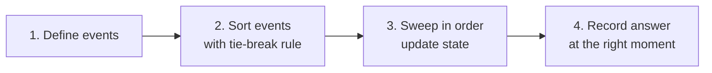
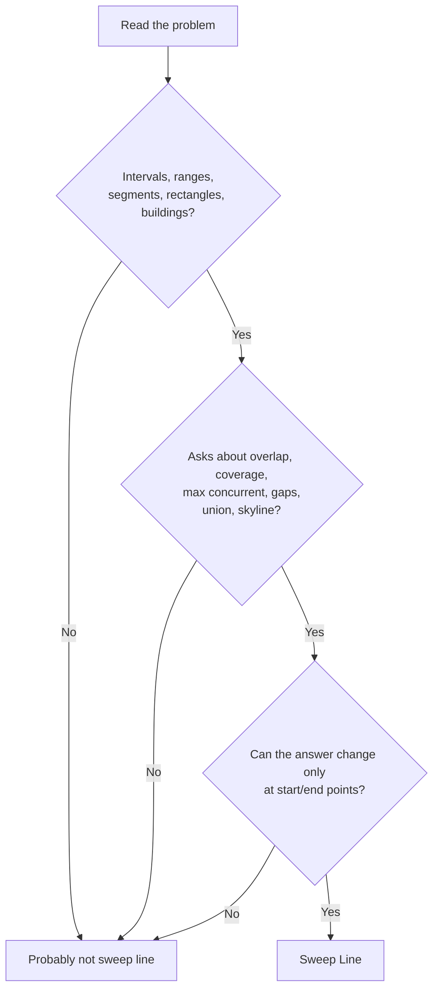
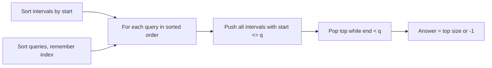
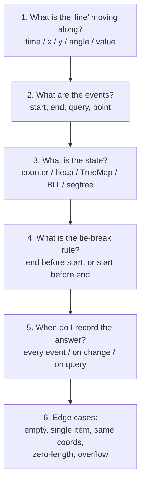

# Sweep Line Algorithm (Java): Beginner to Master

---

## Chapter 1: The Core Idea

Imagine a vertical line moving from left to right across a plane. As it moves, it stops only at **interesting points** (events). At each stop, you update a small **state** and maybe record an answer.

```
 time ──────────────────────────────────────────►
   |        |          |      |         |
   1        3          5      8         10
   ▲        ▲          ▲      ▲         ▲
 event    event      event  event     event
 (stop)   (stop)     (stop) (stop)    (stop)
```

Between two events, **nothing changes**. So you never look at the "boring" in-between points.

> **One-line definition:** Convert the problem into a list of events, sort them, walk through them in order, and maintain the state of "what is active right now".

---

## Chapter 2: Intuition

Take a simple question: *"At most how many meetings are happening at the same time?"*

```
Meeting A: [1, 5)
Meeting B: [2, 6)
Meeting C: [4, 8)
Meeting D: [7, 9)

time:  1  2  3  4  5  6  7  8  9
A:     ████████████
B:        ████████████
C:              ████████████
D:                       ██████
count: 1  2  2  3  2  2  2  1
                ▲
              max = 3
```

**Brute force:** for every time point, count the meetings covering it. That is O(T × n).

**Sweep line thinking:** the count changes only when a meeting **starts** (+1) or **ends** (−1). So you only need to look at those moments.

```
events: (1,+1) (2,+1) (4,+1) (5,-1) (6,-1) (7,+1) (8,-1) (9,-1)
running: 1      2      3      2      1      2      1      0
                       ▲
                     max=3
```

**Complexity:** O(n log n) for sorting, O(n) for the sweep.

The trick is to turn *space or time* into a *sorted list of changes*.

---

## Chapter 3: The Universal Template

Every sweep line solution has 4 steps:



**Step 1: Define events.** Each interval `[s, e)` becomes two events: `(s, +1)` and `(e, -1)`.

**Step 2: Sort.** By position first. Then by a **tie-break rule** (the most important detail, see Chapter 4).

**Step 3: Sweep.** Keep a *state*. The state can be:

| State type | Example |
|---|---|
| A counter | number of active meetings |
| A heap | active building heights (max) |
| A TreeMap / multiset | active values with counts |
| A set | active segments |
| A segment tree / BIT | active coverage on a range |

**Step 4: Record the answer.** Sometimes after every event, sometimes only when the state changes, sometimes only on specific events.

### Java skeleton

```java
List<int[]> events = new ArrayList<>();
for (int[] in : intervals) {
    events.add(new int[]{in[0], +1});   // start
    events.add(new int[]{in[1], -1});   // end
}

events.sort((a, b) -> a[0] != b[0]
        ? Integer.compare(a[0], b[0])   // by position
        : Integer.compare(a[1], b[1])); // tie-break: -1 (end) before +1 (start)

int active = 0, best = 0;
for (int[] e : events) {
    active += e[1];
    best = Math.max(best, active);
}
```

---

## Chapter 4: Tie-Breaking (Where Most Bugs Live)

What if one event ends at time 5 and another starts at time 5?

```
A: [1, 5)    B: [5, 8)     Do they overlap?
```

It depends on the **problem definition**:

| Intervals are... | At same time, process first | Why |
|---|---|---|
| Half-open `[s, e)` (meeting rooms) | **END** before START | Room is free at time 5 |
| Closed `[s, e]` (touching = overlap) | **START** before END | They overlap at point 5 |
| Skyline (building edges) | **START** before END | Avoid a fake dip in the skyline |

**Trick for encoding:** with `end = -1` and `start = +1`, sorting by the second value puts END first. To flip the rule, use `end = +1`, `start = -1` in the sort key, or negate it.

> **Habit:** before coding, write the tie-break rule on paper. Ask: *"If a start and an end happen at the same coordinate, which one should the sweep see first?"*

---

## Chapter 5: How to Identify This Pattern

### Trigger words and shapes



### Checklist (if 2 or more are true, think sweep line)

1. The input has **intervals / ranges / segments / rectangles**.
2. You need **overlap count, max concurrency, or coverage**.
3. You need **gaps / free time / union length / union area**.
4. Something is **"active" over a range**, then stops being active.
5. A naive solution loops over every coordinate or every pair (O(n²) or O(range)).
6. Queries can be answered **offline** (sorted, not in given order).
7. Coordinates are huge (10⁹), but there are few intervals. You need **compress to events**.

### Similar-looking patterns (how to tell apart)

| If the problem is... | Use |
|---|---|
| Merge overlapping intervals | Sort + one pass (a simple sweep) |
| Max overlap / count at a point | Sweep with counter or difference array |
| Active max/min changes over time | Sweep + heap / TreeMap |
| Pick max non-overlapping intervals | Greedy (sort by end) |
| Range updates, point queries | Difference array (a sweep in disguise) |
| Range updates + range queries, online | Segment tree |

---

## Chapter 6: Beginner Problems

### 6.1 Meeting Rooms I (can one person attend all?)

Sort by start. If any meeting starts before the previous one ends, there is overlap.

```java
boolean canAttend(int[][] intervals) {
    Arrays.sort(intervals, (a, b) -> Integer.compare(a[0], b[0]));
    for (int i = 1; i < intervals.length; i++) {
        if (intervals[i][0] < intervals[i - 1][1]) return false;
    }
    return true;
}
```

### 6.2 Meeting Rooms II (min rooms = max overlap)

**Version A: Events**

```java
int minMeetingRooms(int[][] intervals) {
    List<int[]> events = new ArrayList<>();
    for (int[] in : intervals) {
        events.add(new int[]{in[0], +1});
        events.add(new int[]{in[1], -1});
    }
    events.sort((a, b) -> a[0] != b[0]
            ? Integer.compare(a[0], b[0])
            : Integer.compare(a[1], b[1])); // END (-1) first

    int active = 0, best = 0;
    for (int[] e : events) {
        active += e[1];
        best = Math.max(best, active);
    }
    return best;
}
```

**Version B: Two sorted arrays (cleaner, no event objects)**

```java
int minMeetingRooms(int[][] intervals) {
    int n = intervals.length;
    int[] starts = new int[n], ends = new int[n];
    for (int i = 0; i < n; i++) {
        starts[i] = intervals[i][0];
        ends[i] = intervals[i][1];
    }
    Arrays.sort(starts);
    Arrays.sort(ends);

    int rooms = 0, j = 0;
    for (int i = 0; i < n; i++) {
        if (starts[i] < ends[j]) rooms++; // no room has freed up yet
        else j++;                         // reuse a freed room
    }
    return rooms;
}
```

Why it works: two pointers walk the "start stream" and the "end stream" in merged sorted order. It is the same sweep, just without building event objects.

### 6.3 Merge Intervals

```java
int[][] merge(int[][] intervals) {
    Arrays.sort(intervals, (a, b) -> Integer.compare(a[0], b[0]));
    List<int[]> res = new ArrayList<>();
    int[] cur = intervals[0];
    for (int i = 1; i < intervals.length; i++) {
        if (intervals[i][0] <= cur[1]) {          // overlap or touch
            cur[1] = Math.max(cur[1], intervals[i][1]);
        } else {
            res.add(cur);
            cur = intervals[i];
        }
    }
    res.add(cur);
    return res.toArray(new int[0][]);
}
```

State = the current merged block `cur`. Each interval either extends it or closes it.

### 6.4 Car Pooling (difference array)

Passengers get on at `from` and off at `to`. Can the car always stay within capacity?

```java
boolean carPooling(int[][] trips, int capacity) {
    int[] diff = new int[1001];
    for (int[] t : trips) {
        diff[t[1]] += t[0];   // get on
        diff[t[2]] -= t[0];   // get off (at 'to', they are gone)
    }
    int cur = 0;
    for (int d : diff) {
        cur += d;
        if (cur > capacity) return false;
    }
    return true;
}
```

**Difference array = a sweep when coordinates are small.** The prefix sum is the running state.

```
diff:   [0, +2, 0, +3, -2, 0, -3]
prefix: [0,  2, 2,  5,  3, 3,  0]   <- passengers on board
```

### 6.5 Range Addition (same idea)

```java
int[] getModifiedArray(int length, int[][] updates) {
    int[] diff = new int[length + 1];
    for (int[] u : updates) {
        diff[u[0]] += u[2];
        diff[u[1] + 1] -= u[2];     // inclusive end -> cancel after it
    }
    int[] res = new int[length];
    int run = 0;
    for (int i = 0; i < length; i++) {
        run += diff[i];
        res[i] = run;
    }
    return res;
}
```

**When to use a difference array vs events:**

| Coordinates | Use |
|---|---|
| Small (≤ ~10⁶) | Difference array |
| Huge (10⁹) or negative | Events + sort, or TreeMap |

---

## Chapter 7: Intermediate Problems

### 7.1 My Calendar III (max overlap, online)

Bookings arrive one by one, and after each you return the current max overlap. Events can't be pre-sorted, so use a **TreeMap** as the sorted event store.

```java
class MyCalendarThree {
    private final TreeMap<Integer, Integer> delta = new TreeMap<>();

    public int book(int start, int end) {
        delta.merge(start, 1, Integer::sum);
        delta.merge(end, -1, Integer::sum);

        int active = 0, best = 0;
        for (int d : delta.values()) {   // sweep in sorted order
            active += d;
            best = Math.max(best, active);
        }
        return best;
    }
}
```

Each `book` costs O(n) here. For better, use a segment tree with lazy propagation (Chapter 9).

### 7.2 Employee Free Time (find gaps)

Gaps exist where **no one is active**. Sweep by start time and track the furthest end seen.

```java
List<int[]> freeTime(List<List<int[]>> schedule) {
    List<int[]> all = new ArrayList<>();
    for (List<int[]> emp : schedule) all.addAll(emp);
    all.sort((a, b) -> Integer.compare(a[0], b[0]));

    List<int[]> res = new ArrayList<>();
    int maxEnd = all.get(0)[1];
    for (int i = 1; i < all.size(); i++) {
        int[] cur = all.get(i);
        if (cur[0] > maxEnd) res.add(new int[]{maxEnd, cur[0]}); // gap
        maxEnd = Math.max(maxEnd, cur[1]);
    }
    return res;
}
```

```
Emp1: [1,3]   [6,7]
Emp2:    [2,4]
Emp3:        [2,5]  [9,12]

sorted by start: [1,3] [2,4] [2,5] [6,7] [9,12]
maxEnd:           3     4     5     --gap(5,6)-- 7 --gap(7,9)-- 12
```

### 7.3 Minimum Number of Arrows to Burst Balloons

Sweep by end. Shoot an arrow at the end of the first balloon. It kills every balloon that starts at or before that point.

```java
int findMinArrowShots(int[][] points) {
    Arrays.sort(points, (a, b) -> Integer.compare(points_end(a), points_end(b)));
    int arrows = 1;
    int arrowPos = points[0][1];
    for (int i = 1; i < points.length; i++) {
        if (points[i][0] > arrowPos) {   // not covered by current arrow
            arrows++;
            arrowPos = points[i][1];
        }
    }
    return arrows;
}
private int points_end(int[] p) { return p[1]; }
```

This is the **greedy-sweep hybrid**. Sort by end, keep one "current decision". It looks like sweep, but the key idea is a greedy choice.

### 7.4 Number of Flowers in Full Bloom (counting with binary search)

Flower `[s, e]` (closed). For each person arriving at time `t`, count flowers in bloom.

```
bloom(t) = (# flowers with start <= t) - (# flowers with end < t)
```

```java
int[] fullBloomFlowers(int[][] flowers, int[] people) {
    int n = flowers.length;
    int[] starts = new int[n], ends = new int[n];
    for (int i = 0; i < n; i++) {
        starts[i] = flowers[i][0];
        ends[i] = flowers[i][1];
    }
    Arrays.sort(starts);
    Arrays.sort(ends);

    int[] res = new int[people.length];
    for (int i = 0; i < people.length; i++) {
        int t = people[i];
        res[i] = upperBound(starts, t) - lowerBound(ends, t);
    }
    return res;
}

// number of elements <= x
private int upperBound(int[] a, int x) {
    int lo = 0, hi = a.length;
    while (lo < hi) {
        int mid = (lo + hi) >>> 1;
        if (a[mid] <= x) lo = mid + 1; else hi = mid;
    }
    return lo;
}

// number of elements < x
private int lowerBound(int[] a, int x) {
    int lo = 0, hi = a.length;
    while (lo < hi) {
        int mid = (lo + hi) >>> 1;
        if (a[mid] < x) lo = mid + 1; else hi = mid;
    }
    return lo;
}
```

Idea: "active now" = "started so far" minus "already ended". This is the sweep idea, expressed as two sorted arrays.

---

## Chapter 8: Advanced Problems

### 8.1 The Skyline Problem (sweep + multiset)

This is the classic hard sweep line problem.

```
Buildings: [2,9,10] [3,7,15] [5,12,12] [15,20,10] [19,24,8]
(left, right, height)

height
  15 |    ┌──┐
  12 |    │  └──────┐
  10 | ┌──┘         │   ┌───┐
   8 | │            │   │   └──┐
   0 |─┘            └───┘      └──
       2  3  7  9  12 15 19 20 24

Skyline key points: (2,10) (3,15) (7,12) (12,0) (15,10) (20,8) (24,0)
```

**Thinking process**
1. Events: building start at `x` adds height `h`. Building end at `x` removes `h`.
2. State: the multiset of active heights. We need **max**, and need to **remove arbitrary values**. A `TreeMap<height, count>` handles both.
3. Answer: after each event, if the current max differs from the previous max, record `(x, newMax)`.

**Tie-break (very important):** at the same `x`, process **starts before ends**, taller starts first. Encode start as `-h`, end as `+h`, then sort by `(x, value)` ascending.

```java
List<List<Integer>> getSkyline(int[][] buildings) {
    List<int[]> events = new ArrayList<>();
    for (int[] b : buildings) {
        events.add(new int[]{b[0], -b[2]});  // start: negative height
        events.add(new int[]{b[1],  b[2]});  // end: positive height
    }
    events.sort((a, c) -> a[0] != c[0]
            ? Integer.compare(a[0], c[0])
            : Integer.compare(a[1], c[1]));

    TreeMap<Integer, Integer> heights = new TreeMap<>();
    heights.put(0, 1);                        // ground level
    int prev = 0;
    List<List<Integer>> res = new ArrayList<>();

    for (int[] e : events) {
        int x = e[0], h = e[1];
        if (h < 0) {
            heights.merge(-h, 1, Integer::sum);          // building starts
        } else {
            heights.merge(h, -1, Integer::sum);          // building ends
            if (heights.get(h) == 0) heights.remove(h);
        }
        int cur = heights.lastKey();                      // current max height
        if (cur != prev) {
            res.add(List.of(x, cur));
            prev = cur;
        }
    }
    return res;
}
```

**Why the negative-height trick works:**

| Same `x` | Encoded | Sorted order | Effect |
|---|---|---|---|
| Two starts, h=10 and h=15 | -10, -15 | -15, -10 | taller first, no useless point |
| A start and an end | -h vs +h | start first | no fake dip to ground |
| Two ends | +h1, +h2 | smaller first | correct final max |

**Alternative:** use a `PriorityQueue` with **lazy deletion** (mark removed, pop only when it reaches the top). `TreeMap` is simpler and safer in Java.

### 8.2 Rectangle Area II (union area of rectangles)

Sweep **left to right** over x. At each x-event, a rectangle's y-range turns on or off. Between two x-events, the covered height is constant, so:

```
area += coveredHeight × (currentX − previousX)
```

```
y
4 |  ┌─────┐
3 |  │  ┌──┼───┐
2 |  │  │  │   │
1 |  └──┼──┘   │
0 |     └──────┘
     x events: 0  1  2  3 ...
```

**Compress y**, keep `cnt[i]` = how many rectangles cover y-segment `i`:

```java
int rectangleArea(int[][] rects) {
    final int MOD = 1_000_000_007;
    int n = rects.length;

    // events: {x, type(+1 open / -1 close), y1, y2}
    int[][] events = new int[2 * n][];
    TreeSet<Integer> ySet = new TreeSet<>();
    int k = 0;
    for (int[] r : rects) {
        events[k++] = new int[]{r[0], +1, r[1], r[3]};
        events[k++] = new int[]{r[2], -1, r[1], r[3]};
        ySet.add(r[1]);
        ySet.add(r[3]);
    }
    Arrays.sort(events, (a, b) -> Integer.compare(a[0], b[0]));

    int[] ys = new int[ySet.size()];
    Map<Integer, Integer> idx = new HashMap<>();
    int i = 0;
    for (int y : ySet) { ys[i] = y; idx.put(y, i++); }

    int[] cnt = new int[ys.length - 1];     // cover count per y-segment
    long area = 0;
    int prevX = events[0][0];

    for (int[] e : events) {
        long covered = 0;                    // total covered height now
        for (int j = 0; j < cnt.length; j++) {
            if (cnt[j] > 0) covered += ys[j + 1] - ys[j];
        }
        area = (area + covered * (e[0] - prevX)) % MOD;

        for (int j = idx.get(e[2]); j < idx.get(e[3]); j++) {
            cnt[j] += e[1];
        }
        prevX = e[0];
    }
    return (int) area;
}
```

Complexity is O(n²). To reach O(n log n), replace `cnt[]` with a **segment tree** that stores "covered length" (Chapter 9).

### 8.3 Minimum Interval to Include Each Query (offline sweep + heap)

For each query `q`, find the **smallest** interval containing `q`.

**Key idea (offline):** sort queries and intervals. Sweep queries from small to large. This way the interval set only grows (by start) and expires (by end).

```java
int[] minInterval(int[][] intervals, int[] queries) {
    Arrays.sort(intervals, (a, b) -> Integer.compare(a[0], b[0]));

    Integer[] order = new Integer[queries.length];
    for (int i = 0; i < order.length; i++) order[i] = i;
    Arrays.sort(order, (a, b) -> Integer.compare(queries[a], queries[b]));

    // heap of {size, end}, smallest size on top
    PriorityQueue<int[]> pq = new PriorityQueue<>((a, b) -> Integer.compare(a[0], b[0]));
    int[] res = new int[queries.length];
    int i = 0;

    for (int qi : order) {
        int q = queries[qi];
        // add all intervals that have started
        while (i < intervals.length && intervals[i][0] <= q) {
            pq.offer(new int[]{intervals[i][1] - intervals[i][0] + 1, intervals[i][1]});
            i++;
        }
        // lazy-remove intervals that already ended
        while (!pq.isEmpty() && pq.peek()[1] < q) pq.poll();

        res[qi] = pq.isEmpty() ? -1 : pq.peek()[0];
    }
    return res;
}
```

This pattern is powerful. **Sort the queries, sweep, and keep a data structure of "currently valid candidates".** Lazy deletion works because an expired interval only matters if it reaches the top.



---

## Chapter 9: Master-Level Ideas

### 9.1 Sweep + Segment Tree

Use this when the state is "coverage over a coordinate range" and you need fast range updates plus global queries.

- Rectangle union area in O(n log n): the segment tree stores `count` and `coveredLength` per node.
- "Max overlap online" (My Calendar III): lazy segment tree with range add and global max.

**Core trick for the union-length node (no lazy push-down needed):**

```
if (cnt[node] > 0)        covered[node] = full length of node
else if (leaf)            covered[node] = 0
else                      covered[node] = covered[left] + covered[right]
```

### 9.2 Sweep + Fenwick Tree (BIT)

Use for **offline counting** problems: sort one dimension (sweep), and use a BIT for the second dimension.

Example: *count points dominated by each point* (or inversions). Sort by x, sweep, and query/update a BIT over y.

```java
class BIT {
    int[] t;
    BIT(int n) { t = new int[n + 2]; }
    void add(int i, int v) { for (i++; i < t.length; i += i & -i) t[i] += v; }
    int sum(int i) { int s = 0; for (i++; i > 0; i -= i & -i) s += t[i]; return s; }
}
```

This idea, "sweep one dimension, data-structure the other", turns a 2D problem into 1D.

### 9.3 Angular Sweep

The line **rotates around a point** instead of moving in a straight line. Example: *max points visible / max points inside a circle of radius r*.

1. For each point `p`, compute the angle to every other point within reach.
2. Each other point creates an interval of angles `[a−θ, a+θ]`.
3. Sweep those angle events and track max overlap.

It is the same events-plus-counter idea, in angle space.

### 9.4 Geometry Sweep (conceptual)

- **Shamos–Hoey** detects whether any two segments intersect. It keeps active segments in a balanced BST ordered by y at the sweep x. Only **neighbors** need to be checked.
- **Bentley–Ottmann** finds all intersections in O((n + k) log n). Intersections become new events.

Rarely needed in interviews, but this is the full form of the idea: **the sweep structure is a sorted set of active objects, and events are only where the order can change.**

### 9.5 Sweep over Value (offline sorted processing)

The "line" does not have to be spatial. You can sweep over a **value**:

- Sort queries by threshold, add elements in sorted order, and answer with Union-Find or a BIT.
- Example: "connected pairs under weight limit" = sort edges and queries, sweep, union edges up to the limit.

---

## Chapter 10: Thought Process Framework

Use this every time.



### Choosing the state structure

| Need | Structure |
|---|---|
| Just count active | `int` counter |
| Max/min of active, deletion rarely matters | `PriorityQueue` + lazy deletion |
| Max/min with exact deletion | `TreeMap<value, count>` |
| Ordered neighbors of active items | `TreeSet` / `TreeMap` |
| Coverage over coordinate range | Segment tree |
| Counting in 2nd dimension | Fenwick tree |
| Small coordinate range | Difference array |

---

## Chapter 11: Complexity Summary

| Problem | Time | Space |
|---|---|---|
| Meeting Rooms II | O(n log n) | O(n) |
| Merge Intervals | O(n log n) | O(n) |
| Difference array | O(n + R) | O(R) |
| Skyline (TreeMap) | O(n log n) | O(n) |
| Min Interval per Query | O((n + q) log(n + q)) | O(n + q) |
| Rectangle Area (naive) | O(n²) | O(n) |
| Rectangle Area (segment tree) | O(n log n) | O(n) |

Sorting usually dominates.

---

## Chapter 12: Common Mistakes

1. **Wrong tie-break.** This is the number one bug. Re-read whether the interval is `[s,e)` or `[s,e]`.
2. **Comparator overflow.** `a[0] - b[0]` can overflow with large values. Use `Integer.compare`.
3. **Forgetting to sort events at all.** Interval input is often unsorted.
4. **Recording the answer at the wrong time.** In Skyline, record only when the max *changes*.
5. **Removing from a PriorityQueue with `remove(obj)`.** It is O(n). Use lazy deletion or `TreeMap`.
6. **Treating a `TreeMap` count of 0 as present.** Remove the key when its count hits 0.
7. **Using a difference array with a huge range.** Switch to events or compress coordinates.
8. **Inclusive end.** For `[l, r]` closed ranges, the "cancel" goes at `r + 1`.
9. **Ignoring zero-length intervals** `[x, x]`. Decide how they behave.

---

## Chapter 13: Practice Roadmap

**Level 1: Basics**
- Merge Intervals, Insert Interval, Meeting Rooms I/II
- Non-overlapping Intervals, Minimum Arrows to Burst Balloons
- Car Pooling, Range Addition, Corporate Flight Bookings

**Level 2: Intermediate**
- My Calendar I/II/III
- Employee Free Time, Interval List Intersections
- Number of Flowers in Full Bloom
- Remove Covered Intervals, Maximum Population Year
- Describe the Painting

**Level 3: Advanced**
- The Skyline Problem
- Minimum Interval to Include Each Query
- Rectangle Area II
- Perfect Rectangle
- Maximum Number of Visible Points (angular sweep)
- Falling Squares (sweep + segment tree)

**Study method:** for each problem, write down the 6 steps from Chapter 10 *before* coding. Say out loud: *"The line moves along ___, events are ___, state is ___, tie-break is ___."*

---

## Chapter 14: Cheat Sheet

```
SWEEP LINE IN ONE PAGE
----------------------
Signal:    intervals + overlap/coverage/gaps/union/skyline
Idea:      only event points matter; between events nothing changes
Steps:     events -> sort -> sweep -> maintain state -> record answer
Tie-break: [s,e) => end first | [s,e] => start first | skyline => start first, taller first
State:     counter | heap | TreeMap | BIT | segment tree | diff array
Offline:   sort queries too, sweep once, keep valid candidates
Variants:  time sweep, x sweep, angular sweep, value sweep
Bugs:      tie-break, overflow in comparator, closed vs half-open ranges
```

---

If you want to go deeper, I can do one of these next:
1. A **segment-tree-based sweep** (Rectangle Area II in O(n log n)) with a full walkthrough.
2. A **problem-by-problem drill**. I give a problem, you write the 6-step plan, and I review it.
3. **Angular sweep** in detail, with the geometry worked out.


