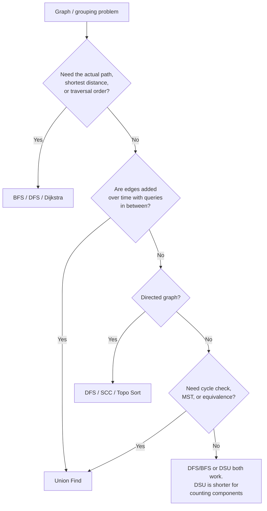

# Union Find (Disjoint Set Union) in Java: Beginner to Master

---

## Chapter 1: The Problem It Solves

Imagine a school with 1,000 students. At the start, nobody is friends with anyone. Then friendships are announced one by one:

- "Asha and Ben are friends."
- "Ben and Chen are friends."
- Someone asks: "Are Asha and Chen in the same friend group?"

Friendship is **transitive here**. A is friends with B and B with C, so A and C are in one group.

Union Find answers two questions very fast:

| Operation | Question it answers |
|---|---|
| `find(x)` | Which group does `x` belong to? |
| `union(a, b)` | Merge the groups of `a` and `b`. |

With these two you get `connected(a, b)`: are `find(a)` and `find(b)` the same?

**Key property:** groups only **merge**. They never split. This one-way nature is why the data structure can be so simple and fast.

---

## Chapter 2: The Core Intuition

Give every group **one leader** (the *root* or *representative*). Every person points to someone in their group, and following the pointers always ends at the leader.

```
Group A            Group B
   1                  5
  / \                / \
 2   3              6   7
     |
     4

parent: 1→1, 2→1, 3→1, 4→3, 5→5, 6→5, 7→5
```

- A root points to itself: `parent[1] = 1`.
- `find(4)`: 4 → 3 → 1. The leader is 1.
- `find(7)`: 7 → 5. The leader is 5.
- Are 4 and 7 connected? 1 ≠ 5, so no.

To **union** the two groups, make one leader point to the other leader:

```
union(4, 7):  find(4)=1, find(7)=5  →  parent[5] = 1

        1
      / | \
     2  3  5
        |  / \
        4 6   7
```

Now `find(7)` = 1. Everyone is in one group.

**One sentence to remember:** Union Find is a forest of trees, where each tree is one group and the root is the group's ID.

The array form is simple. `parent[i]` is the parent of node `i`, and `parent[i] == i` means `i` is a root.

---

## Chapter 3: The Naive Versions

### Version 1: Quick Find (store the group ID directly)

```java
class QuickFind {
    int[] id;
    QuickFind(int n) {
        id = new int[n];
        for (int i = 0; i < n; i++) id[i] = i;
    }
    int find(int x) { return id[x]; }              // O(1)
    void union(int a, int b) {                      // O(n)
        int ida = id[a], idb = id[b];
        if (ida == idb) return;
        for (int i = 0; i < id.length; i++)
            if (id[i] == ida) id[i] = idb;
    }
}
```

`find` is instant, but every `union` scans the whole array. That is **O(n) per union**.

### Version 2: Quick Union (use trees)

```java
int find(int x) {
    while (parent[x] != x) x = parent[x];
    return x;
}
void union(int a, int b) {
    parent[find(a)] = find(b);
}
```

`union` is now cheap, but trees can become **long chains**:

```
union(0,1), union(1,2), union(2,3), union(3,4)  (bad order)

0 → 1 → 2 → 3 → 4      find(0) walks 4 steps. With n nodes: O(n)
```

Both naive versions are O(n) per operation in the worst case. With 10⁵ operations, that is far too slow. We need two fixes, both about keeping trees **flat**.

---

## Chapter 4: The Two Magic Optimizations

### Optimization 1: Union by Size (or Rank)

**Rule:** when merging, attach the **smaller tree under the bigger tree's root**.

```
Tree A (size 4)      Tree B (size 2)

     1                   5
   / | \                 |
  2  3  4                6

Bad : parent[1] = 5  → tree gets taller
Good: parent[5] = 1  → B hangs under A, height barely changes

        1
     / / \ \
    2 3   4 5
              |
              6
```

**Why it works:** a node's depth only increases when its tree gets attached under a bigger one. When that happens, the size of its tree **at least doubles**. A set can only double about log₂(n) times. So the height is at most **log n**.

With this alone: `find` and `union` are **O(log n)**.

### Optimization 2: Path Compression

**Rule:** while running `find(x)`, make every node you pass point directly to the root.

```
Before find(4):              After find(4):

0 (root)                         0
|                            / / | \
1                           1  2  3  4
|
2
|
3
|
4
```

The first `find` pays for the long walk. Every later `find` on those nodes is one step. You are investing work now to make the future cheap.

Three common styles:

```java
// (a) Recursive full compression: shortest code
int find(int x) {
    if (parent[x] != x) parent[x] = find(parent[x]);
    return parent[x];
}

// (b) Iterative path halving: no recursion, very fast. My default.
int find(int x) {
    while (parent[x] != x) {
        parent[x] = parent[parent[x]]; // skip one level
        x = parent[x];
    }
    return x;
}

// (c) Two-pass: find root first, then repoint everyone.
int find(int x) {
    int root = x;
    while (parent[root] != root) root = parent[root];
    while (parent[x] != root) {
        int next = parent[x];
        parent[x] = root;
        x = next;
    }
    return root;
}
```

### Both Together = Almost O(1)

| Setup | Time per operation |
|---|---|
| Naive | O(n) |
| Union by size only | O(log n) |
| Path compression only | O(log n) amortized |
| **Both** | **O(α(n)) amortized** |

α(n) is the *inverse Ackermann function*. It grows so slowly that for any n you will ever meet (even 10⁸⁰), **α(n) ≤ 4**. Treat it as constant time.

Space is O(n).

---

## Chapter 5: The Standard Java Template

Memorize this. About 80% of problems use it unchanged.

```java
class DSU {
    private final int[] parent;
    private final int[] size;
    private int components;

    public DSU(int n) {
        parent = new int[n];
        size = new int[n];
        components = n;
        for (int i = 0; i < n; i++) {
            parent[i] = i;
            size[i] = 1;
        }
    }

    public int find(int x) {
        while (parent[x] != x) {
            parent[x] = parent[parent[x]]; // path halving
            x = parent[x];
        }
        return x;
    }

    // returns true if a merge happened, false if already connected
    public boolean union(int a, int b) {
        int ra = find(a), rb = find(b);
        if (ra == rb) return false;
        if (size[ra] < size[rb]) { int t = ra; ra = rb; rb = t; }
        parent[rb] = ra;
        size[ra] += size[rb];
        components--;
        return true;
    }

    public boolean connected(int a, int b) { return find(a) == find(b); }
    public int sizeOf(int x)               { return size[find(x)]; }
    public int count()                     { return components; }
}
```

Three things to notice:

1. `union` **returns a boolean**. `false` means the two nodes were already connected. This one return value powers cycle detection, redundant edges, and Kruskal.
2. `components` is maintained for free. It starts at `n` and drops by 1 on each successful merge.
3. `size` is only valid at **roots**. Always read it through `find`.

### Step-by-Step Trace

```
n = 6.  parent = [0,1,2,3,4,5]   components = 6

union(0,1): sizes equal → parent[1]=0, size[0]=2        comps=5
union(2,3): parent[3]=2, size[2]=2                      comps=4
union(0,2): size[0]=2 ≥ size[2]=2 → parent[2]=0,
            size[0]=4                                   comps=3
union(4,5): parent[5]=4                                 comps=2

Forest:
     0          4
   / | \        |
  1  2  ...     5
     |
     3

union(3,5): find(3)=0, find(5)=4 → sizes 4 vs 2 → parent[4]=0
connected(1,5)? find(1)=0, find(5)=0 → true
```

---

## Chapter 6: How to Recognize a Union Find Problem

### The Trigger Words and Situations

Ask: **"Is this about things being grouped, and do the groups keep merging?"**

| You see this in the problem | Think |
|---|---|
| "connected", "same group", "same component" | DSU |
| "merge", "combine", "join" | DSU |
| "friend circles", "provinces", "clusters", "islands" | DSU |
| Equivalence or transitive relations (a=b, b=c ⇒ a=c) | DSU |
| "Does adding this edge create a **cycle**?" (undirected) | DSU |
| "Find the **redundant** edge" | DSU |
| "Number of components after each operation" | DSU (online) |
| Minimum Spanning Tree | Kruskal + DSU |
| "Swap any pair from a list, any number of times" | DSU (indices in a group can be freely permuted) |
| Constraints like `a == b` and `a != b` | DSU |
| Queries mixed with edge additions, answered **in order** | DSU |

### The Three-Question Test

1. **Are there "elements" that can be put into groups?** (nodes, cells, emails, letters, numbers)
2. **Is there a "link" operation that merges groups?** (edge, adjacency, shared value, equation)
3. **Is the question about group membership, count, or size, and not about paths or order?**

If yes to all three, Union Find is a strong candidate.

### DSU vs DFS/BFS: How to Choose



### When NOT to Use Union Find

- You need the **path** between two nodes.
- You need **shortest distance** (use BFS or Dijkstra).
- **Directed** reachability (A reaches B does not mean B reaches A). Use DFS or SCC.
- **Edges get deleted** and you must answer online. DSU cannot split. See the tricks in Chapter 9.

---

## Chapter 7: The Thought Process (Step by Step)

For any new problem, walk through this checklist:

1. **What are my nodes?** If they are not integers 0..n-1, map them:
   - Grid cell `(r, c)` → `r * cols + c`
   - Strings or emails → `HashMap<String, Integer>`
   - Letters → `c - 'a'`
   - Large or sparse numbers → `HashMap`
2. **What makes two nodes merge?** (An edge, adjacent land, same email, an `==` equation.)
3. **What do I need to read out?** (Component count, size of the biggest group, "are X and Y connected", the first edge that closes a cycle.)
4. **Do I need extra data per group?** (Size, min, max, sum.) Store it at the root, like `size[]`.
5. **Does time matter?** If edges arrive over time, process them in order. If you need to remove things, think *reverse time* (Chapter 9).
6. **Pick the template.** Basic, weighted, parity, or rollback.

---

## Chapter 8: Classic Problems, Solved (Beginner → Intermediate)

All use the `DSU` class from Chapter 5.

### 8.1 Number of Provinces (LC 547)

*Given an adjacency matrix, count the connected groups.*

```java
public int findCircleNum(int[][] isConnected) {
    int n = isConnected.length;
    DSU dsu = new DSU(n);
    for (int i = 0; i < n; i++)
        for (int j = i + 1; j < n; j++)
            if (isConnected[i][j] == 1) dsu.union(i, j);
    return dsu.count();
}
```

**Insight:** the answer is just `components` after all unions.

### 8.2 Redundant Connection (LC 684): Cycle Detection

*A tree with one extra edge was given. Find the edge that creates the cycle.*

```java
public int[] findRedundantConnection(int[][] edges) {
    DSU dsu = new DSU(edges.length + 1);        // nodes are 1-indexed
    for (int[] e : edges)
        if (!dsu.union(e[0], e[1])) return e;   // already connected → cycle!
    return new int[0];
}
```

**Insight:** an edge closes a cycle exactly when its endpoints are already connected. `union` returning `false` tells you that. This is the most important idiom in DSU.

### 8.3 Graph Valid Tree (LC 261)

A graph is a tree if it has **no cycle** and is **fully connected**. Equivalently: exactly `n - 1` edges and no cycle.

```java
public boolean validTree(int n, int[][] edges) {
    if (edges.length != n - 1) return false;
    DSU dsu = new DSU(n);
    for (int[] e : edges)
        if (!dsu.union(e[0], e[1])) return false;
    return true;
}
```

### 8.4 Number of Islands (LC 200): Grid → 1D

```java
public int numIslands(char[][] grid) {
    int rows = grid.length, cols = grid[0].length;
    DSU dsu = new DSU(rows * cols);
    int lands = 0;
    for (int r = 0; r < rows; r++) {
        for (int c = 0; c < cols; c++) {
            if (grid[r][c] != '1') continue;
            lands++;
            int id = r * cols + c;
            // only look right and down; each pair gets checked once
            if (c + 1 < cols && grid[r][c + 1] == '1' && dsu.union(id, id + 1)) lands--;
            if (r + 1 < rows && grid[r + 1][c] == '1' && dsu.union(id, id + cols)) lands--;
        }
    }
    return lands;
}
```

**Pattern:** each land cell starts as its own island (`lands++`). Each successful merge removes one island (`lands--`).

For a static grid, DFS is just as good. DSU is **required** for the next one.

### 8.5 Number of Islands II (LC 305): The "Online" Case

Land appears one cell at a time. After each, report the island count.

```java
public List<Integer> numIslands2(int m, int n, int[][] positions) {
    DSU dsu = new DSU(m * n);
    boolean[] land = new boolean[m * n];
    int count = 0;
    List<Integer> res = new ArrayList<>();
    int[][] dirs = {{1,0},{-1,0},{0,1},{0,-1}};

    for (int[] p : positions) {
        int id = p[0] * n + p[1];
        if (!land[id]) {
            land[id] = true;
            count++;
            for (int[] d : dirs) {
                int r = p[0] + d[0], c = p[1] + d[1];
                if (r < 0 || c < 0 || r >= m || c >= n || !land[r * n + c]) continue;
                if (dsu.union(id, r * n + c)) count--;
            }
        }
        res.add(count);
    }
    return res;
}
```

**This is the textbook case for DSU.** DFS would redo the whole grid after every addition. DSU updates in near O(1).

### 8.6 Satisfiability of Equality Equations (LC 990)

Equations like `"a==b"`, `"b!=c"`. Is there a consistent assignment?

```java
public boolean equationsPossible(String[] equations) {
    DSU dsu = new DSU(26);
    for (String e : equations)
        if (e.charAt(1) == '=') dsu.union(e.charAt(0) - 'a', e.charAt(3) - 'a');
    for (String e : equations)
        if (e.charAt(1) == '!' && dsu.connected(e.charAt(0) - 'a', e.charAt(3) - 'a'))
            return false;
    return true;
}
```

**Pattern: two passes.** First apply all the "merge" facts. Then check all the "forbidden" facts against the result.

### 8.7 Accounts Merge (LC 721): Mapping Strings

Accounts that share any email belong to the same person.

```java
public List<List<String>> accountsMerge(List<List<String>> accounts) {
    int n = accounts.size();
    DSU dsu = new DSU(n);                           // nodes = account indices
    Map<String, Integer> emailOwner = new HashMap<>();

    for (int i = 0; i < n; i++) {
        for (int j = 1; j < accounts.get(i).size(); j++) {
            String email = accounts.get(i).get(j);
            if (emailOwner.containsKey(email)) dsu.union(i, emailOwner.get(email));
            else emailOwner.put(email, i);
        }
    }

    Map<Integer, TreeSet<String>> groups = new HashMap<>();
    for (var en : emailOwner.entrySet()) {
        int root = dsu.find(en.getValue());
        groups.computeIfAbsent(root, k -> new TreeSet<>()).add(en.getKey());
    }

    List<List<String>> res = new ArrayList<>();
    for (var en : groups.entrySet()) {
        List<String> row = new ArrayList<>();
        row.add(accounts.get(en.getKey()).get(0));  // name
        row.addAll(en.getValue());                  // sorted emails
        res.add(row);
    }
    return res;
}
```

**Pattern: "group by root."** After all unions, call `find` on every element and bucket by the result. This is how you extract the actual groups.

### 8.8 Smallest String With Swaps (LC 1202)

If you can swap pairs any number of times, all indices in one connected group can be arranged in any order. Sort the characters inside each group.

```java
public String smallestStringWithSwaps(String s, List<List<Integer>> pairs) {
    int n = s.length();
    DSU dsu = new DSU(n);
    for (List<Integer> p : pairs) dsu.union(p.get(0), p.get(1));

    Map<Integer, PriorityQueue<Character>> map = new HashMap<>();
    for (int i = 0; i < n; i++)
        map.computeIfAbsent(dsu.find(i), k -> new PriorityQueue<>()).add(s.charAt(i));

    StringBuilder sb = new StringBuilder();
    for (int i = 0; i < n; i++)
        sb.append(map.get(dsu.find(i)).poll());
    return sb.toString();
}
```

**Insight:** "Swap any pair, unlimited times" is a strong DSU signal. It means the reachable set of arrangements is *any permutation inside each component*.

### 8.9 Most Stones Removed (LC 947): The Clever Mapping

A stone can be removed if another stone shares its row or column. The key insight: **treat rows and columns as nodes, and each stone as an edge joining its row to its column.**

```java
public int removeStones(int[][] stones) {
    DSU dsu = new DSU(20002);                 // rows 0..10000, cols 10001..20001
    for (int[] s : stones) dsu.union(s[0], s[1] + 10001);
    Set<Integer> roots = new HashSet<>();
    for (int[] s : stones) roots.add(dsu.find(s[0]));
    return stones.length - roots.size();      // each component keeps exactly one stone
}
```

**Lesson:** sometimes the "nodes" are not the obvious objects. Ask: *what can I union so that connectivity captures the rule?*

### 8.10 Longest Consecutive Sequence (LC 128)

```java
public int longestConsecutive(int[] nums) {
    Map<Integer, Integer> idx = new HashMap<>();
    int n = 0;
    for (int x : nums) if (!idx.containsKey(x)) idx.put(x, n++);
    DSU dsu = new DSU(n);
    for (int x : idx.keySet())
        if (idx.containsKey(x + 1)) dsu.union(idx.get(x), idx.get(x + 1));
    int best = 0;
    for (int i = 0; i < n; i++) best = Math.max(best, dsu.sizeOf(i));
    return best;
}
```

A HashSet scan solves it too. This shows that **size tracking** gives you "largest group" for free.

---

## Chapter 9: Advanced Techniques

### 9.1 Kruskal's Minimum Spanning Tree

Sort edges by weight. Take an edge only if it connects two *different* components.

```java
public int kruskal(int n, int[][] edges) {          // edge = {u, v, w}
    Arrays.sort(edges, (a, b) -> Integer.compare(a[2], b[2]));
    DSU dsu = new DSU(n);
    int total = 0, used = 0;
    for (int[] e : edges) {
        if (dsu.union(e[0], e[1])) {
            total += e[2];
            if (++used == n - 1) break;
        }
    }
    return used == n - 1 ? total : -1;               // -1 → graph not connected
}
```

**Why it works:** the cheapest edge that does not form a cycle is always safe (the cut property). DSU makes the cycle check nearly free. Problems: LC 1584, 1135, 1168.

### 9.2 "Process Edges in Sorted Order" Variants

A family of problems all use the same trick: **sort edges (or cells) by a value, add them gradually, and stop when a condition becomes true.**

- **Swim in Rising Water (LC 778):** sort cells by height. Add them one by one, merging with already-added neighbors. The answer is the height at which `(0,0)` connects to `(n-1,n-1)`.
- **Path With Minimum Effort (LC 1631):** sort edges by height difference. Add until start and end connect.
- **Edge Length Limited Paths (LC 1697):** sort both the queries and the edges by limit, then sweep.

```
Sorted edges: e1(1) e2(2) e3(5) e4(7) ...
Query "limit < 6"?  Add e1, e2, e3 → check connected(u, v).
```

### 9.3 Reverse Time: Handling "Deletions"

DSU cannot split groups. But if the problem **removes** things over time, **run time backwards** and turn deletions into additions.

**Bricks Falling When Hit (LC 803):**

1. Apply all hits first (remove those bricks).
2. Build the DSU on what remains. Add a virtual "roof" node connected to the top row.
3. Process the hits in **reverse**. Add each brick back. The number of bricks that fall = (roof component size after adding) − (before) − 1.

```
Forward:  intact ──hit──► holes appear  (splitting, hard)
Reverse:  holes ──fill──► intact       (merging, easy with DSU)
```

**Rule of thumb:** *deletions + connectivity questions → try reversing time.*

### 9.4 Weighted Union Find (Relations With Values)

Sometimes each edge carries a ratio or difference. Store at each node its relation **to its parent**.

**Evaluate Division (LC 399):** `a / b = 2.0`, `b / c = 3.0`. Query `a / c`?

`weight[x]` = value of `x / parent[x]`. After compression, it becomes `x / root`.

```java
class WeightedDSU {
    Map<String, String> parent = new HashMap<>();
    Map<String, Double> weight = new HashMap<>();   // weight[x] = x / parent[x]

    void add(String x) {
        if (!parent.containsKey(x)) { parent.put(x, x); weight.put(x, 1.0); }
    }

    String find(String x) {
        String p = parent.get(x);
        if (!p.equals(x)) {
            String root = find(p);
            weight.put(x, weight.get(x) * weight.get(p)); // x/p * p/root = x/root
            parent.put(x, root);
        }
        return parent.get(x);
    }

    // a / b = v
    void union(String a, String b, double v) {
        add(a); add(b);
        String ra = find(a), rb = find(b);
        if (ra.equals(rb)) return;
        parent.put(ra, rb);
        // ra/rb = (a/b) * (b/rb) / (a/ra)
        weight.put(ra, v * weight.get(b) / weight.get(a));
    }

    double query(String a, String b) {
        if (!parent.containsKey(a) || !parent.containsKey(b)) return -1.0;
        if (!find(a).equals(find(b))) return -1.0;
        return weight.get(a) / weight.get(b);          // (a/root) / (b/root)
    }
}
```

The same idea works with **differences** (`weight` adds instead of multiplies), as in "A is 5 points above B" problems.

### 9.5 Parity Union Find (Two-Coloring / Bipartite)

Track whether a node has the **same** or **different** "color" as its parent. This detects odd cycles (Possible Bipartition, LC 886).

```java
class ParityDSU {
    int[] parent, parity;                 // parity[x]: 0 = same as parent, 1 = different
    ParityDSU(int n) {
        parent = new int[n]; parity = new int[n];
        for (int i = 0; i < n; i++) parent[i] = i;
    }

    int find(int x) {
        if (parent[x] == x) return x;
        int p = parent[x];
        int root = find(p);
        parity[x] ^= parity[p];           // now relative to the root
        parent[x] = root;
        return root;
    }

    // Declare a and b must be DIFFERENT colors. Returns false on contradiction.
    boolean union(int a, int b) {
        int ra = find(a), rb = find(b);
        if (ra == rb) return parity[a] != parity[b];
        parent[ra] = rb;
        parity[ra] = parity[a] ^ parity[b] ^ 1;
        return true;
    }
}
```

**Simpler trick for plain bipartite checks (LC 785):** all neighbors of a node must be in one group, and the node itself must be in a different one.

```java
public boolean isBipartite(int[][] graph) {
    DSU dsu = new DSU(graph.length);
    for (int u = 0; u < graph.length; u++) {
        for (int v : graph[u]) {
            if (dsu.connected(u, v)) return false;
            dsu.union(graph[u][0], v);
        }
    }
    return true;
}
```

### 9.6 DSU With Rollback (Offline Dynamic Connectivity)

For problems that **undo** merges in a stack-like order (for example, divide and conquer over time). Rules:

- **No path compression** (it changes too many pointers).
- Keep **union by size** so depth stays O(log n).
- Keep a history stack.

```java
class RollbackDSU {
    int[] parent, size;
    Deque<int[]> history = new ArrayDeque<>();
    int components;

    RollbackDSU(int n) {
        parent = new int[n]; size = new int[n]; components = n;
        for (int i = 0; i < n; i++) { parent[i] = i; size[i] = 1; }
    }

    int find(int x) {                       // no compression
        while (parent[x] != x) x = parent[x];
        return x;
    }

    boolean union(int a, int b) {
        int ra = find(a), rb = find(b);
        if (ra == rb) { history.push(new int[]{-1, -1}); return false; }
        if (size[ra] < size[rb]) { int t = ra; ra = rb; rb = t; }
        parent[rb] = ra;
        size[ra] += size[rb];
        components--;
        history.push(new int[]{ra, rb});
        return true;
    }

    void rollback() {                       // undo the most recent union() call
        int[] h = history.pop();
        if (h[0] == -1) return;
        int ra = h[0], rb = h[1];
        parent[rb] = rb;
        size[ra] -= size[rb];
        components++;
    }
}
```

Cost per operation is O(log n), a good trade for being able to undo. Interview use is rare, but it is a standard competitive-programming tool.

### 9.7 Extra Metadata at the Root

Keep any **mergeable** summary at the root: `min[]`, `max[]`, `sum[]`, `edgeCount[]`. When you merge, combine them.

```java
// inside union, after deciding ra is the new root:
sum[ra] += sum[rb];
min[ra] = Math.min(min[ra], min[rb]);
max[ra] = Math.max(max[ra], max[rb]);
```

Examples: "largest component size" (LC 952), "sum of each group", "does this group touch the border?"

### 9.8 A Virtual (Dummy) Node

Add an extra node to represent a special concept, then union real nodes into it.

- "Does this region touch the edge?" → add a `BORDER` node and union every border cell to it.
- "Is this brick attached to the roof?" → add a `ROOF` node (LC 803).
- Surrounded Regions (LC 130) works well this way.

### 9.9 Union Find on Implicit Structures

- **Regions Cut By Slashes (LC 959):** split each cell into 4 triangles and union them. A `/` or `\` decides which triangles merge.
- **Couples Holding Hands (LC 765):** each couple is an edge between two seats' pairs. Answer = `n − components`.
- **Sentence Similarity II (LC 737):** map words to ids, union synonyms.

---

## Chapter 10: Common Mistakes (and How to Avoid Them)

| Mistake | Fix |
|---|---|
| Comparing `parent[a] == parent[b]` | Always compare `find(a) == find(b)`. `parent[]` is not the root until you resolve it. |
| Counting groups by counting distinct `parent[i]` | Use `find(i)` for every `i`, or just use the maintained `components` counter. |
| Reading `size[x]` for a non-root | Use `size[find(x)]`. |
| Forgetting union by size or compression | Without them, worst case is O(n) per call, causing TLE on large tests. |
| Deep recursion in `find` | Use iterative path halving, or ensure union by size is on (depth ≤ log n). |
| 1-indexed nodes with a 0-indexed array | Allocate `n + 1`. |
| Wrong grid flattening (`r * rows + c`) | It is `r * cols + c`. |
| Trying to delete an edge | DSU cannot split. Try reverse time (9.3), rollback (9.6), or reconsider using DSU. |
| Using DSU on a **directed** graph | It models undirected connectivity only. Use DFS/SCC/topological sort. |
| Skipping `if (ra == rb) return` | You would corrupt `size` and `components`. |

---

## Chapter 11: Complexity Cheat Sheet

| Operation | Time (amortized) |
|---|---|
| `find` | O(α(n)) ≈ O(1) |
| `union` | O(α(n)) ≈ O(1) |
| `connected` | O(α(n)) |
| Build | O(n) |
| Space | O(n) |
| Kruskal | O(E log E) (dominated by sorting) |
| Rollback DSU, per op | O(log n) |

---

## Chapter 12: Practice Roadmap

**Level 1: Basics (learn the template)**
- LC 547 Number of Provinces
- LC 323 Number of Connected Components in an Undirected Graph
- LC 1319 Number of Operations to Make Network Connected
- LC 684 Redundant Connection
- LC 261 Graph Valid Tree

**Level 2: Mapping nodes (grids, strings, hashing)**
- LC 200 Number of Islands (DSU version)
- LC 990 Satisfiability of Equality Equations
- LC 721 Accounts Merge
- LC 1202 Smallest String With Swaps
- LC 947 Most Stones Removed
- LC 128 Longest Consecutive Sequence
- LC 1061 Lexicographically Smallest Equivalent String
- LC 839 Similar String Groups

**Level 3: Online and extra data**
- LC 305 Number of Islands II
- LC 827 Making A Large Island
- LC 952 Largest Component Size by Common Factor
- LC 1722 Minimize Hamming Distance After Swap Operations
- LC 2092 Find All People With Secret

**Level 4: MST and sorted processing**
- LC 1584 Min Cost to Connect All Points
- LC 1135 Connecting Cities With Minimum Cost
- LC 1168 Optimize Water Distribution in a Village
- LC 778 Swim in Rising Water
- LC 1631 Path With Minimum Effort
- LC 1697 Checking Existence of Edge Length Limited Paths
- LC 1579 Remove Max Number of Edges to Keep Graph Fully Traversable

**Level 5: Advanced variants**
- LC 399 Evaluate Division (weighted DSU)
- LC 785 / 886 Bipartite checks (parity DSU)
- LC 685 Redundant Connection II (directed, tricky)
- LC 803 Bricks Falling When Hit (reverse time)
- LC 959 Regions Cut By Slashes
- LC 765 Couples Holding Hands
- LC 924 / 928 Minimize Malware Spread

---

## Chapter 13: Final Mental Model

```
        ┌──────────────────────────────────────────────┐
        │ Things  +  "link" rule  +  group questions   │
        │            ↓                                 │
        │      Union Find (forest of trees)            │
        │                                              │
        │  find  → who is my leader?   (compress path) │
        │  union → join leaders        (smaller → big) │
        │                                              │
        │  union returns false ⇒ CYCLE / REDUNDANT     │
        │  components counter  ⇒ number of groups      │
        │  size[root]          ⇒ size of a group       │
        └──────────────────────────────────────────────┘
```

**Five rules to carry with you:**

1. Groups only merge, so use DSU. If they split, rethink (reverse time, or rollback).
2. `union` returning `false` means a cycle or redundant link.
3. Always use union by size and path compression together.
4. The hard part is the **mapping**: deciding what the nodes are and what the union means.
5. To get the groups out, call `find` on everyone and bucket by root.

---

If you'd like, we can go deeper on any one area next: a pure Kruskal/MST session, weighted and parity DSU with more examples, or a set of timed practice problems where you attempt first and I review your Java.


# Union Find Complexity: Deep but Easy to Remember

## 1. The One-Line Version

> **Space: O(n). Time per operation: O(α(n)), which is almost O(1).**

Everything below explains *why*, so you can rebuild the answer from scratch in an interview.

---

## 2. Space Complexity (The Easy Part)

```
parent[n]   → n integers
size[n]     → n integers
components  → 1 integer
─────────────────────────
Total: O(n)
```

That is it. No matter how many `union` or `find` calls you make, you never create new nodes. You only change pointers inside the same arrays.

**Two small things interviewers like to hear:**

- **Recursion stack in `find`:** a recursive `find` uses stack space equal to the tree height.
  - Without union by size: height can be n, so stack is **O(n)** (stack overflow risk).
  - With union by size: height ≤ log n, so stack is **O(log n)**.
  - Iterative `find` (path halving) uses **O(1)** extra space.
- **HashMap-based DSU** (for strings, big ids) is still O(n), but with a bigger constant.

---

## 3. Time Complexity: The Ladder

Think of it as a ladder where each trick lifts you up one rung.

```
Rung 0: Naive linking              → O(n)       per operation
Rung 1: + Union by size            → O(log n)   per operation
Rung 2: + Path compression too     → O(α(n))    amortized  ≈ O(1)
```

Now let's see why each rung works.

---

## 4. Rung 0: Why Naive Is O(n)

If you always attach in a careless order, the tree becomes a **chain**:

```
union(1,2), union(2,3), union(3,4), union(4,5)   (attaching root → new node)

1 → 2 → 3 → 4 → 5

find(1) walks 4 steps.  With n nodes → n-1 steps.
```

`find` cost = **height of the tree**. A chain has height n, so O(n).

**Remember this:** *the cost of find = height of the tree.* Everything else is about keeping the height small.

---

## 5. Rung 1: Why Union by Size Gives O(log n)

**Rule:** the smaller tree goes under the bigger tree.

### The Doubling Argument (the key proof)

Follow one node, say `x`. When does `x`'s depth increase by 1?

Only when `x`'s tree gets attached **under another tree's root**. By our rule, that only happens when `x`'s tree is the **smaller (or equal)** one.

So the new combined tree is **at least twice** as big as `x`'s old tree.

```
x's tree size:   1 → 2 → 4 → 8 → 16 → ... → n
x's depth:       0   1   2   3    4         ≤ log₂ n
```

A tree can double at most **log₂ n** times before it hits size n. So `x`'s depth can grow at most log₂ n times.

**Conclusion:** height ≤ log₂ n, so `find` is O(log n), and so is `union` (it is two finds plus O(1) work).

### The Worst Case Shape (n = 8)

You get the tallest tree by always merging two **equal-sized** trees:

```
Step 1: pairs         Step 2: pairs of pairs     Step 3: everything

 a   c   e   g           a       e                    a
 |   |   |   |          / \     / \                 / | \
 b   d   f   h         b   c   f   g               b  c  e
                           |       |                  |  / \
                           d       h                  d f   g
                                                           |
                                                           h
Height 1              Height 2                     Height 3 = log₂ 8
```

**Memory hook:** *"Small under big, so a node's tree doubles each time it sinks. Doubling can only happen log n times."*

---

## 6. Rung 2: Why Path Compression Gives Almost O(1)

### The Idea in Plain Words

When `find(x)` walks a long path, it has already done the hard work of discovering the root. So **use that knowledge**: point every node on the path directly to the root.

```
Before find(5):            After find(5):

0                              0
|                         / / | | \
1                        1 2  3 4  5
|
2
|
3
|
4
|
5
```

### The Bank Account Analogy

- A long walk is like a **big withdrawal**.
- But every long walk **flattens** the tree, which is like making a **deposit** that makes the next walks cheap.
- You cannot keep making expensive finds forever. The tree runs out of long paths to flatten.

This is called **amortized analysis**: the *average* cost over many operations is small, even if one single call is slow.

### What Is Guaranteed

| Setup | Cost for m operations on n elements |
|---|---|
| Path compression alone | O(m log n) |
| Union by size alone | O(m log n) |
| **Both together** | **O(m · α(n))** |

So per operation, amortized, it is **O(α(n))**.

**Important detail:** with both tricks, a *single* `find` can still take up to O(log n) in the worst case (the tree might be tall at that moment). It is the **average over a sequence** that is nearly constant. Say "amortized" in interviews.

---

## 7. What Is α(n)? (Without the Scary Math)

α(n) is the **inverse Ackermann function**.

The Ackermann function grows *absurdly* fast. Its inverse grows *absurdly* slowly:

```
n                              α(n)
─────────────────────────────  ────
1                              0 - 1
2 - 3                          2
4 - 7                          3
8 - 2047                       3-4  (roughly)
up to a number with
more digits than atoms in the
universe                       ≤ 4 or 5
```

**Practical meaning:**

> For every input you will ever see in an interview, a contest, or production, α(n) ≤ 4.

So write it as O(α(n)) to be precise, and *think* "constant."

**Fun fact:** it was proven (Fredman and Saks) that you **cannot** beat α(n) for this problem in general. Union Find is essentially optimal.

---

## 8. Total Cost for Real Problems

When the question says "n elements and m operations":

```
Initialization:   O(n)
m × (find/union): O(m · α(n))
─────────────────────────────
Total:            O(n + m · α(n))   ≈ O(n + m)
```

### Common Problems

| Problem | Total time | What dominates |
|---|---|---|
| Number of Provinces (matrix) | O(n²) | Reading the matrix. DSU is cheap. |
| Redundant Connection | O(E · α(V)) | Just the edges |
| Number of Islands (grid) | O(R·C · α) | Visiting each cell |
| Number of Islands II | O(R·C + k · α) | **Init is O(R·C)** even if k is small |
| Kruskal's MST | **O(E log E)** | **Sorting**, not DSU |
| Accounts Merge | O(N·K·α + K log K) | Sorting emails |
| Smallest String With Swaps | O(n log n) | Sorting chars in groups |

**Notice the pattern:** DSU is almost never the bottleneck. Sorting, hashing, or reading input usually is.

---

## 9. Special Variants

| Variant | Find / Union | Why |
|---|---|---|
| Standard (size + compression) | O(α(n)) amortized | Full power |
| **Rollback DSU** (size, no compression) | **O(log n)** worst | Compression breaks undo, so we lose it |
| Weighted / parity DSU | O(α(n)) amortized | Compression also updates weights |
| Quick Find (naive) | find O(1), union O(n) | Rewrites the whole array |

---

## 10. How to Remember It (Mnemonics)

### The Three Facts

```
1. find cost = HEIGHT of tree
2. Union by size  → height ≤ log n      ("small under big, size doubles")
3. Path compression → tree gets FLAT    ("walk once, flatten forever")
```

### The Story in One Breath

> "Union by size keeps trees **short**. Path compression keeps them **flat**. Short plus flat gives nearly zero height, so each operation is α(n)."

### Quick Self-Test

- *Why can't a node's depth grow more than log n times?* Each increase doubles its set size.
- *Why is path compression "free"?* It reuses the walk you already did.
- *Why does rollback DSU use O(log n)?* It cannot use compression, only union by size.
- *Why is Kruskal O(E log E)?* The sort dominates. DSU adds only O(E α(V)).
- *Is α(n) really constant?* Not mathematically, but ≤ 4 for any practical input.

---

## 11. Interview-Ready Answer (Say This)

> "Space is O(n) for the parent and size arrays. With union by size and path compression, each `find` and `union` takes amortized O(α(n)) time, where α is the inverse Ackermann function. It is at most 4 for any realistic input, so it is effectively constant. Union by size alone gives O(log n) because a node's tree doubles each time its depth increases. Path compression flattens trees so future finds are cheaper. Together they reach the α(n) bound, which is known to be optimal."

If you want, I can follow up with a short quiz on this, or trace compression and union by size on a concrete 10-node example step by step.


