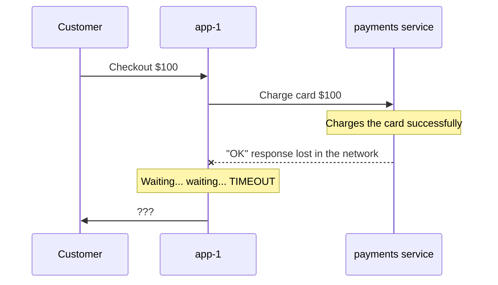
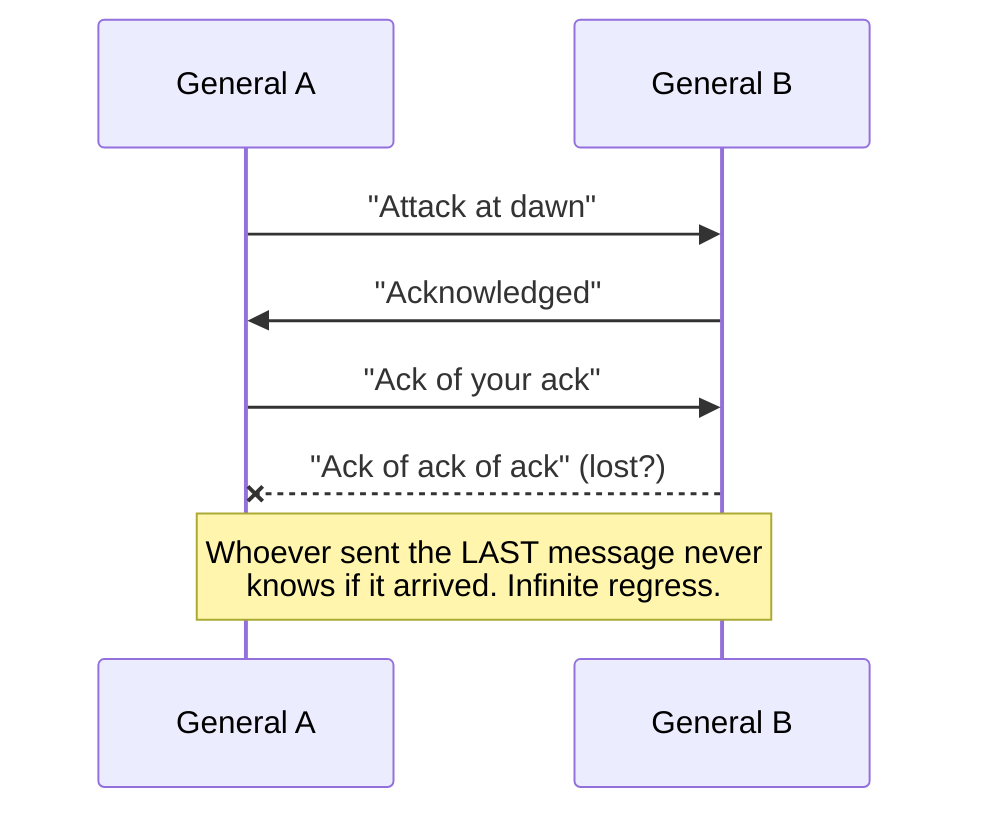
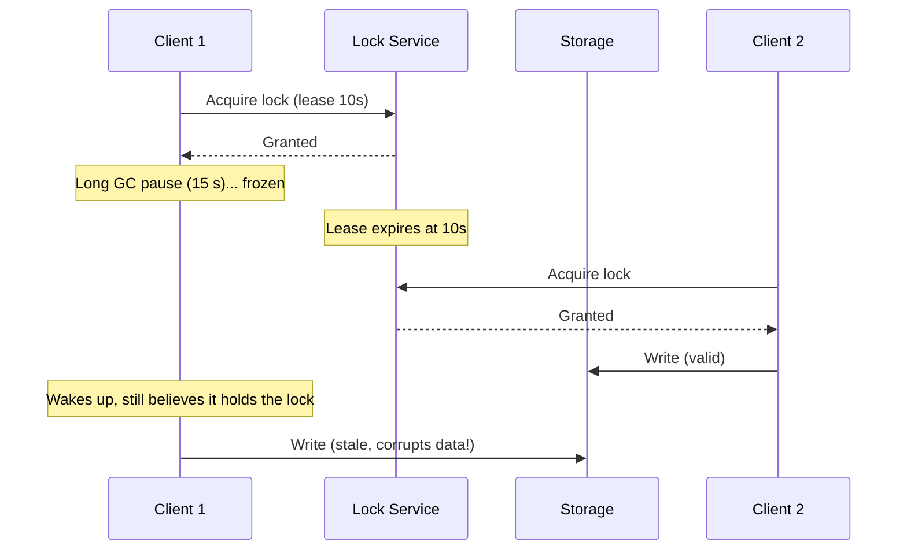

# Distributed Consensus: From First Principles to Interview Mastery

## Course Map

| # | Chapter | What you'll be able to explain afterward |
|---|---------|------------------------------------------|
| 1 | **Why Distributed Systems Are Hard** | Partial failure, unreliable networks, Two Generals, why timeouts can't tell you the truth |
| 2 | **Time, Clocks, and Ordering** | Why wall clocks lie, Lamport clocks, vector clocks, hybrid logical clocks |
| 3 | **Replication and the Need for Consensus** | Single-leader, multi-leader, leaderless; sync vs async; why replicas diverge |
| 4 | **Failure Detection and Leader Election** | Heartbeats, timeouts, phi-accrual, bully algorithm, why naive election breaks |
| 5 | **Split Brain, Quorums, and Fencing Tokens** | Majority quorums, overlap proof, fencing, lease pitfalls, GitHub's 2018 incident |
| 6 | **Atomic Commit: 2PC, 3PC, and Sagas** | Why 2PC blocks, why 3PC still fails, how real systems avoid them |
| 7 | **The Consensus Problem and FLP** | What "consensus" formally means, the impossibility result, how algorithms sidestep it |
| 8 | **Paxos** | Single-decree Paxos, proposers/acceptors/learners, dueling proposers |
| 9 | **Multi-Paxos** | From one decision to a replicated log, leader optimization, practical gaps |
| 10 | **Raft** | Leader election, log replication, safety, membership changes, snapshots |
| 11 | **ZAB and ZooKeeper** | Primary-backup atomic broadcast, ZK recipes (locks, election, config) |
| 12 | **Consistency Models** | Linearizability, sequential, causal, eventual, read-your-writes, and how to test them |
| 13 | **CAP and PACELC** | The correct (not the misquoted) version, with real system classifications |
| 14 | **Leaderless Replication and Cassandra/Dynamo** | Quorum reads/writes, hinted handoff, read repair, CRDTs, conflict resolution |
| 15 | **Real Systems I: etcd, Kafka (KRaft), Redis Sentinel/Cluster** | How each one actually uses consensus |
| 16 | **Real Systems II: MySQL/Postgres Replication, MongoDB** | Semi-sync, Patroni, replica sets, write concern, rollbacks |
| 17 | **Spanner, TrueTime, and CockroachDB** | Global consistency using clocks plus consensus |
| 18 | **Byzantine Faults (Intro)** | When nodes lie, PBFT intuition, why most companies don't need it |
| 19 | **Interview Playbook and Capstone** | A framework to apply all of this in HLD rounds, plus mock questions |

**Additions beyond your list:** Chapter 2 (time/ordering), Chapter 7 (FLP and formal consensus), Chapter 14 (leaderless/Dynamo-style), Chapter 18 (Byzantine), and Chapter 19 (interview playbook). Sagas are folded into Chapter 6.

---

# Chapter 1: Why Distributed Systems Are Hard

## 1.1 The Comfortable World of One Machine

Imagine it's 2005 and you run a small online store, **ShopFast**, on a single server. One process runs your app, one database holds your data.

When you write:

```
balance = balance - 100
```

one of two things happens: it works, or the whole machine crashes. There is no in-between that you can't observe. If the machine dies, **everything** dies together: the app, the database, the memory. When you reboot, you look at the disk and know the truth.

This property is so natural that we don't notice it. Call it **fate-sharing**: all the parts of your program live and die as one.

Also on a single machine:

- There is **one clock**. "Before" and "after" mean something.
- Function calls either **return a result or throw an error**. You always know what happened.
- Memory is shared, so two threads can look at the same variable.

Then ShopFast gets popular.

## 1.2 Why We Leave the Comfort Zone

Three pressures push you toward multiple machines:

1. **Capacity.** One machine can't handle 50,000 requests per second.
2. **Availability.** One machine is a **single point of failure**. If it dies at 2 a.m., you're down until someone wakes up.
3. **Latency/geography.** Your users in Mumbai are 200 ms from your Virginia server. Physics (the speed of light in fiber) says you need a server closer.

So you buy more machines and connect them with a network. And in doing so, you quietly give up every comfortable property above.

## 1.3 First Surprise: Partial Failure

On one machine, failure is **total**. In a cluster, failure is **partial**: some parts work while others don't, and the parts that work can't always tell which parts don't.

Let's make it concrete. ShopFast now has:

- `app-1` (handles checkout)
- `payments` (a separate payment service)
- `db` (a separate database server)



`app-1` sent the charge request and heard **nothing back**. What happened? There are at least **four** possibilities:

| Scenario | Did the charge happen? | Why `app-1` heard nothing |
|----------|------------------------|---------------------------|
| A | No | Request lost on the way to `payments` |
| B | No | `payments` crashed before processing |
| C | **Yes** | `payments` processed it, then crashed before replying |
| D | **Yes** | `payments` processed it and replied, but the *reply* was lost |
| E | Maybe | `payments` is just very slow (overloaded, GC pause); the answer is coming later |

From `app-1`'s point of view, **all five look identical**: silence.

This is the single most important idea in this course:

> **In a distributed system, you cannot distinguish a crashed node, a lost message, and a slow node. Silence is ambiguous.**

Everything else in this course (heartbeats, quorums, Raft, Paxos) is an elaborate machine built to cope with that one sentence.

## 1.4 The Naive Solutions and Why They Fail

### Naive Fix #1: "Just retry"

`app-1` times out and retries the charge. In scenarios A and B, great, the retry works. In scenarios C and D, the customer is **charged twice**.

### Naive Fix #2: "Don't retry, just report failure"

Now in scenarios C and D, the customer was charged but sees "Payment failed". They try again manually. Charged twice, plus an angry support ticket.

### Naive Fix #3: "Wait longer"

How long? 1 second? 30 seconds? If you wait too short, you wrongly declare healthy-but-slow nodes dead. If you wait too long, real failures leave users staring at spinners. **No timeout value is correct**, because a slow node and a dead node are indistinguishable until the answer arrives (or never does).

### What the industry settled on (preview)

- **Idempotency keys:** make retries safe by attaching a unique ID so the payment service can say "I've already done this one" (Stripe does exactly this).
- **Consensus and quorums:** for cases where the *system itself* must agree on a fact (who is the leader? is this transaction committed?), we need something stronger. That's the rest of the course.

For now, remember: **retries are only safe when operations are idempotent.**

## 1.5 Second Surprise: The Network Is Not a Function Call

On one machine, `result = f(x)` either returns or throws. Over a network, there's a third outcome: **neither, for an unknown time**.

Engineers in the 1990s (Peter Deutsch at Sun, later formalized) collected the **Eight Fallacies of Distributed Computing**, false assumptions people make:

1. The network is reliable
2. Latency is zero
3. Bandwidth is infinite
4. The network is secure
5. Topology doesn't change
6. There is one administrator
7. Transport cost is zero
8. The network is homogeneous

Fallacies 1 and 2 cause most outages. A network can:

- **Drop** packets (congestion, a bad switch)
- **Delay** packets (queueing, retransmission, an overloaded NIC)
- **Duplicate** packets (retransmission after a lost ACK)
- **Reorder** packets (different routes)
- **Partition** (split into islands that can't talk to each other, though each island is healthy)

### The Network Partition

```
      Before                          During partition

 [N1]---[N2]---[N3]            [N1]---[N2]   X   [N3]
   \     |     /                  \     |         |
    \    |    /                    \    |         |
     [N4]---[N5]                    [N4]---[N5]   (N3 isolated)
```

Here N3 is alive and running. N1, N2, N4, N5 can't reach it. Equally, **N3 believes the other four are dead**. Both sides are healthy; each thinks the *other* has failed. We'll see in Chapter 5 how this causes **split brain**.

**Real incident (GitHub, October 2018):** a roughly 43-second loss of connectivity between GitHub's US East Coast network hub and its primary East Coast data center. During that window, an automated MySQL failover tool (Orchestrator) promoted replicas on the West Coast to primary. When connectivity returned, **both coasts had accepted writes the other didn't have**. Reconciling that took roughly 24 hours of degraded service. A 43-second network blip became a day-long incident, purely because of the partition-plus-failover interaction. We'll dissect this fully in Chapter 5.

## 1.6 The Two Generals Problem: A Proof That Certainty Is Impossible

Here's the classic thought experiment that shows why this isn't just an engineering inconvenience, but a fundamental limit.

Two armies, led by **General A** and **General B**, sit on opposite hills with an enemy city in the valley between them. They win only if they attack **at the same time**. If only one attacks, it loses.

Their only communication: messengers who must cross the valley, where they might be **captured** (messages lost).

- A sends: "Attack at dawn."
- Did B get it? A doesn't know. So B sends back: "Got it, attack at dawn."
- Did A receive *that*? B doesn't know. A sends: "Got your confirmation."
- Did B get *that*? ...



**The result:** no finite number of messages gives both generals certainty. Whoever sent the last message can't know if it arrived, so they can't be sure the other will act. This is provably unsolvable over an unreliable channel.

**What it means for you:** TCP's handshakes, database commits, payment confirmations, they all face this. We never achieve certainty. We achieve **"sufficiently confident"** through retries, timeouts, and idempotency. Later, consensus algorithms will give us a *weaker but useful* guarantee: instead of "both certain at once," we get "agree eventually, safely, as long as a majority can talk."

## 1.7 Third Surprise: Clocks Are Liars

On one machine, there's one clock. In a cluster, **every machine has its own**, and they disagree.

### Why clocks drift

Each server has a quartz crystal oscillator. Real-world crystals drift roughly **10 to 200 parts per million**, depending on temperature and quality. At 50 ppm, that's about **4.3 seconds per day** of drift. To correct this, machines sync with time servers via **NTP**, but:

- NTP over a network has **variable delay**, so accuracy is typically a few to tens of milliseconds, and can be hundreds of ms or worse under bad conditions.
- NTP can **step the clock backward** when it corrects a fast clock.
- Leap seconds have caused real outages (Linux kernel and Java issues in 2012, Cloudflare's 2017 outage from a negative time value in their DNS code).

### Two kinds of clocks (know this distinction cold)

| | **Time-of-day clock** (wall clock) | **Monotonic clock** |
|---|---|---|
| Example | `System.currentTimeMillis()` | `System.nanoTime()` |
| Meaning | Date and time (calendar) | Time since an arbitrary point (e.g., boot) |
| Can jump backward? | **Yes** (NTP correction) | **No** |
| Comparable across machines? | Roughly, with error | **Never** |
| Use for | Timestamps for humans | Measuring durations/timeouts on one machine |

**Rule of thumb:** use monotonic clocks to measure elapsed time; never trust wall clocks to *order events across machines*.

### A concrete failure: Last-Write-Wins with skewed clocks

Cassandra (in its default conflict handling) resolves conflicting writes to the same cell by **keeping the one with the higher timestamp**, which is often the client's or coordinator's wall-clock time. Suppose:

| Real time | Event | Node clock reading |
|-----------|-------|--------------------|
| 10:00:00.000 | Alice (server X, clock **accurate**) writes `name = "Alice"` | ts = 10:00:00.000 |
| 10:00:00.100 | Bob (server Y, clock **5 seconds fast**) writes `name = "Bob"` | ts = 10:00:05.100 |
| 10:00:00.200 | Alice's server (accurate) tries to update `name = "Alicia"` | ts = 10:00:00.200 |

Final result: `"Bob"` wins over `"Alicia"`, even though Alicia's update happened *later in real time*. Alicia's write is **silently discarded**. No error, no log line. Data loss from clock skew.

### Process pauses: the clock isn't even the only problem

Even with a perfect clock, your **process** can freeze without knowing it:

- A **stop-the-world GC pause** in the JVM (seconds in bad cases)
- A VM live-migration or hypervisor pause
- Laptop lid closed, `SIGSTOP`, swap thrashing, slow disk I/O

Here's the dangerous pattern (Martin Kleppmann popularized this example), previewing Chapter 5:



Client 1 checked "do I hold the lock?" *before* pausing, and acted *after*. **Between the check and the action, time passed without the client noticing.** This is why we'll need **fencing tokens** (Chapter 5).

## 1.8 Putting It Together: A 5-Node Walkthrough

Let's run a small scenario so these ideas feel real. You have a 5-node cluster, N1 through N5. N1 is the **leader**; it replicates data to the others. Every node sends N1 a heartbeat-style check, and N1 pings the others every 1 second. A node is considered dead if it hasn't responded in **3 seconds**.

| Time | What actually happens | What N1 sees |
|------|----------------------|--------------|
| t=0 | All healthy | 5/5 responding |
| t=10.0 | N3's process crashes | N3's ping sent |
| t=11.0 | | no reply from N3 (1s) |
| t=12.0 | | no reply (2s) |
| t=13.0 | | no reply (3s), **N1 declares N3 dead** ✅ *correct* |

Now a *different* run of the same cluster:

| Time | What actually happens | What N1 sees |
|------|----------------------|--------------|
| t=0 | All healthy | 5/5 responding |
| t=10.0 | N3 hits a **4-second GC pause** | N3's ping sent |
| t=13.0 | N3 still paused | **N1 declares N3 dead** ❌ *wrong* |
| t=14.0 | N3 wakes up, thinks it's still a member, continues serving | N1 already started re-replicating N3's data elsewhere |

**Same observable symptom, opposite truth.** N1 now has a node it believes is dead but is actually alive and may be serving stale data or even accepting writes. This is the seed of every split-brain bug.

A key lesson: **a failure detector is a *guess*, never a fact.** The best you can do is make guesses that are *safe even when wrong*. That is the guiding principle for consensus algorithms: **safety must never depend on timing; only progress (liveness) may depend on timing.** Keep this sentence; it returns in Chapters 7 and 10.

## 1.9 A Taxonomy of Failures

When engineers say "fault-tolerant," they must say **tolerant of what**. From weakest to strongest assumptions:

| Failure model | Meaning | Example |
|---|---|---|
| **Crash-stop** | Node stops forever | Hardware death |
| **Crash-recovery** | Node crashes, may come back (remembering only what it wrote to disk) | Process restart. **Raft and Paxos assume this** |
| **Omission** | Node drops some messages | Overloaded NIC |
| **Timing/performance** | Node responds, but too slowly | GC pauses |
| **Byzantine** | Node behaves arbitrarily or maliciously | Bit-flips, compromised nodes, bugs |

Most databases (etcd, ZooKeeper, Kafka, MongoDB) assume **crash-recovery with an unreliable network**, **not** Byzantine. Blockchains assume Byzantine. We'll cover this in Chapter 18.

And the network model:

- **Synchronous:** known upper bound on delay (doesn't exist on the internet)
- **Asynchronous:** no bound at all (the harshest; our proofs often use this)
- **Partially synchronous:** usually bounded, sometimes not. **This is the realistic model** and what Raft/Paxos target: *safe always, live when the network behaves.*

## 1.10 The Roadmap: How the Rest of the Course Reacts to These Problems

| Problem from this chapter | Where we solve it |
|---|---|
| Can't tell dead from slow | Ch 4: failure detectors, Ch 5: quorums |
| Clocks can't order events | Ch 2: logical clocks |
| Retries cause duplicates | Idempotency (Ch 1 preview), Ch 6 |
| Two nodes both think they're leader | Ch 5: quorums, fencing |
| Multiple machines must agree | Ch 7 to 11: consensus |
| What does "correct" even mean? | Ch 12 and 13: consistency models, CAP |

---

## Key Takeaways

1. **Partial failure** is the defining difficulty: parts fail while others keep running.
2. **Silence is ambiguous:** a lost request, a crashed node, a lost reply, and a slow node look identical.
3. Networks **drop, delay, duplicate, reorder, and partition**. Never assume otherwise.
4. The **Two Generals problem** proves perfect certainty over an unreliable channel is impossible; we settle for *safe* agreement via retries, idempotency, and consensus.
5. **Clocks drift and jump.** Use monotonic clocks for durations; never rely on wall clocks to order events across machines.
6. **Processes pause** (GC, VM migration), so a node can act on stale beliefs without knowing.
7. A **failure detector is a guess**; design systems whose **safety doesn't depend on guessing right**.
8. Always state your **failure model** (crash-stop, crash-recovery, Byzantine) and **network model** (async, partially synchronous).

---

## Interview Questions and Model Answers

**Q1. Why is building a distributed system harder than a single-machine system?**
*Model answer:* On one machine, failures are total and clocks and memory are shared, so you always know the state. In a distributed system we get **partial failures**, an **unreliable asynchronous network**, and **unsynchronized clocks**. The core issue is that a node can't distinguish a crashed peer from a slow one or a lost message, so we can never be sure of remote state. We design around it with timeouts, retries plus idempotency, quorums, and consensus protocols that keep safety even when failure detection is wrong.

**Q2. A service calls a payment API and times out. What should it do?**
*Model answer:* The outcome is unknown: the charge may or may not have happened. Don't blindly retry or blindly fail. Use an **idempotency key** so the retry is safe, and/or query the payment's status by that key before retrying. For long workflows, record intent durably first (a write-ahead record) so a reconciliation job can resolve ambiguous states. Stripe's idempotency keys are the canonical example.

**Q3. Can you use timestamps to order events across servers? What goes wrong?**
*Model answer:* Not reliably. Wall clocks drift (tens of ppm) and NTP corrections can make them jump backward. Skew of even milliseconds can reorder concurrent writes; with Last-Write-Wins (e.g., Cassandra default) a skewed node can overwrite newer data and silently discard writes. Alternatives: **logical/vector clocks** (Chapter 2), **consensus-ordered logs** (Raft), or bounded-uncertainty clocks (**Spanner TrueTime**, Chapter 17).

**Q4. What is the difference between a crash failure and a Byzantine failure? Which do most databases assume?**
*Model answer:* Crash failure: a node stops or restarts but follows the protocol while alive. Byzantine: a node may behave arbitrarily, including lying or sending conflicting messages. Most production databases (etcd, ZooKeeper, Kafka, MongoDB, Cassandra) assume crash(-recovery) faults, because they run in a trusted environment and Byzantine tolerance costs more nodes (3f+1 instead of 2f+1) and more messages. Blockchains and some safety-critical systems assume Byzantine.

**Q5. What's the difference between `System.currentTimeMillis()` and `System.nanoTime()`, and why does it matter?**
*Model answer:* The first is a wall clock that NTP can adjust (including backward); the second is monotonic with an arbitrary origin, so it's only meaningful for measuring elapsed time *within one JVM*. Use monotonic for timeouts, leases, and latency measurement; never compare either across machines for ordering.

**Q6. Explain the Two Generals Problem and why it matters in practice.**
*Model answer:* Two parties must coordinate over a channel that can lose messages. No finite exchange of acknowledgments can give both *certainty* that the other will act, because the sender of the last message never knows if it arrived. In practice it means no protocol, from TCP to commit protocols, provides absolute certainty. We use timeouts, retries, idempotent operations, and consensus to get *safe* outcomes.

**Q7. What is a network partition and why is it dangerous?**
*Model answer:* The network splits into groups of healthy nodes that can't communicate. Each group may conclude the other has failed and continue operating independently (e.g., electing its own leader). When the partition heals, you have divergent state (split brain). GitHub's 2018 incident (a 43-second partition plus automated failover) is the classic example.

---

## Trade-offs: "When Would You Choose X over Y?"

| Decision | Choose X when... | Choose Y when... |
|---|---|---|
| **Short timeout vs long timeout** | Short: you need fast failover and can tolerate false positives (e.g., stateless services behind a load balancer) | Long: false positives are expensive (e.g., a primary DB failover with a huge re-sync cost) |
| **Retry vs fail fast** | Retry: operation is idempotent, transient errors common | Fail fast: not idempotent, or retry storms could take the system down (use backoff + jitter + circuit breakers) |
| **Wall clock timestamps vs logical clocks** | Wall: human-readable logs, loose ordering is fine | Logical: you need causality or correct conflict resolution |
| **Crash-fault vs Byzantine-fault tolerance** | Crash: trusted internal infrastructure (almost all backends) | Byzantine: untrusted participants (blockchains), or critical systems with hardware-corruption risk |

---

## Common Mistakes and Misconceptions

1. ❌ **"A timeout means the request failed."** ✅ It means you don't know. The operation may have succeeded.
2. ❌ **"The network is reliable inside our data center."** ✅ Partitions, packet loss, and switch failures occur in every large deployment (see GitHub 2018, and many published postmortems).
3. ❌ **"NTP keeps our clocks in sync, so timestamps are good enough."** ✅ NTP gives bounded-but-unknown, variable accuracy and can step backward.
4. ❌ **"If the health check fails, the node is dead."** ✅ It may be paused, overloaded, or just unreachable from *you*. It may be happily serving others.
5. ❌ **"Retrying is always safe."** ✅ Only for idempotent operations; otherwise you cause duplicates.
6. ❌ **"A lock/lease check guarantees I still hold it when I act."** ✅ Time can pass between check and action (GC pause). You need fencing (Chapter 5).
7. ❌ **"Exactly-once delivery exists."** ✅ Over an unreliable network, you get at-most-once or at-least-once; "exactly-once" is built by at-least-once delivery + idempotent processing (e.g., Kafka's idempotent producer and transactions).
8. ❌ **"Distributed systems are just many single-machine systems."** ✅ The failure semantics are fundamentally different.

---

## Check Your Understanding (before "next")

Try answering these in your head, and I'll happily review your answers if you share them:

1. In the 5-node walkthrough, N3 was wrongly declared dead after a 4-second GC pause. What are two *different* harms this could cause?
2. Why can't you fix the "slow vs dead" problem simply by choosing a clever timeout value?
3. Why does Last-Write-Wins with wall-clock timestamps lose data, even when every server is healthy?

---

**Next up: Chapter 2, Time, Clocks, and Ordering.** We'll start with a simple question: *if clocks can't be trusted, how can two machines ever agree which event happened first?* That leads us to Lamport's beautiful idea of ordering events without clocks at all.

Say **"next"** when you're ready.
