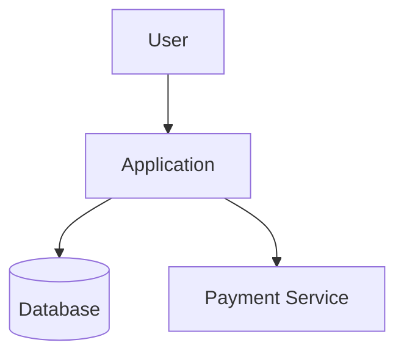
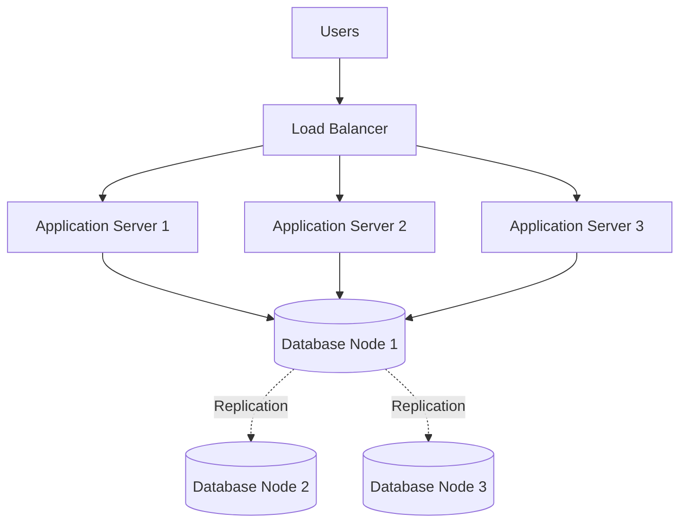
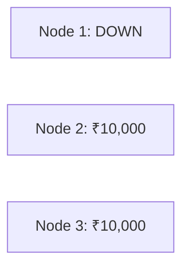
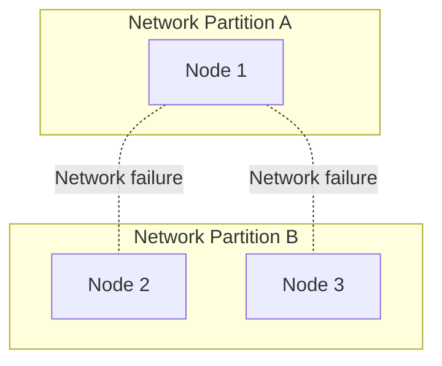
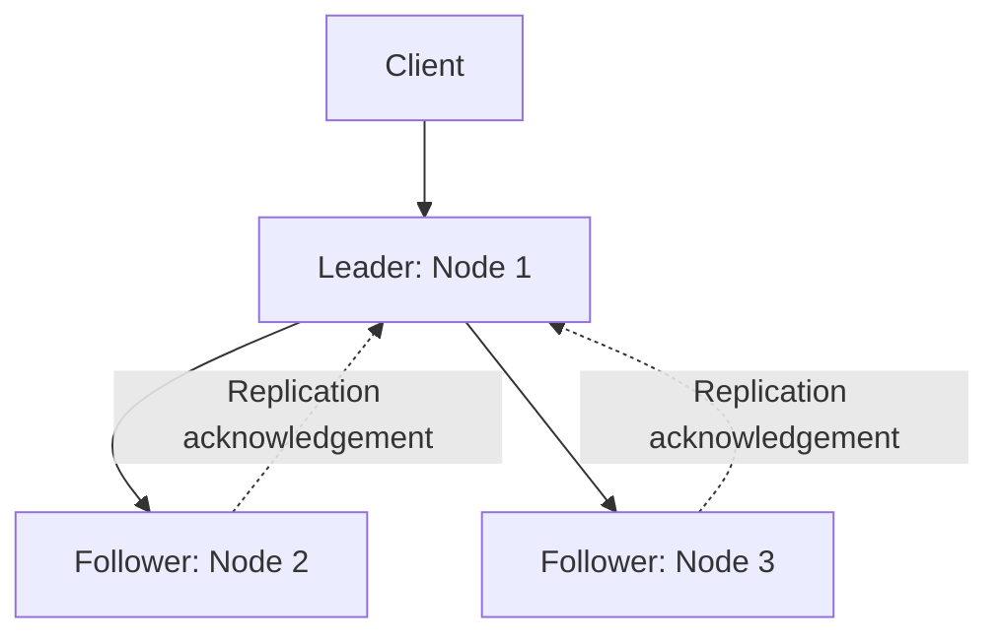
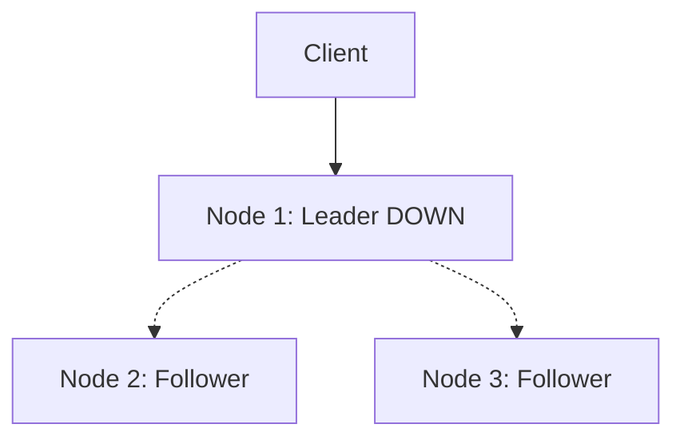
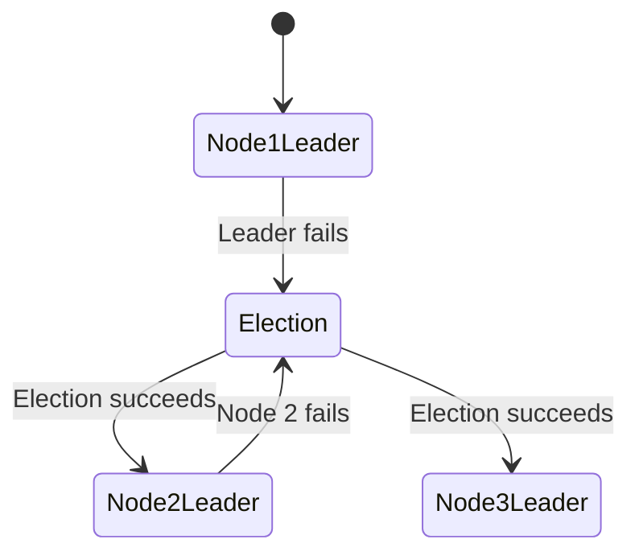
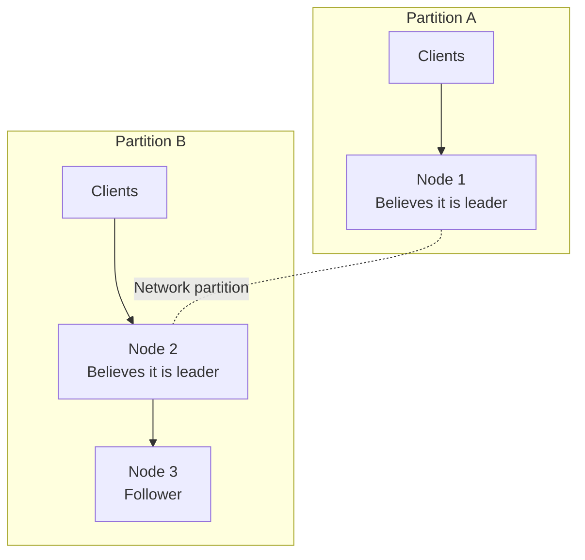

# Course: Distributed Consensus, Leader Election, Split Brain, and Distributed Coordination

We will approach this as a System Design mastery course, starting from the fundamental problems and gradually progressing to algorithms, database internals, production architecture, and real-world failure scenarios.

The goal is not just to understand terms like Raft, Paxos, quorum, leader election, and split brain. The goal is to understand why these problems exist, what guarantees different solutions provide, how they work internally, and when to use each approach when designing production systems.

We will use databases, distributed caches, message brokers, Kubernetes, payment systems, and real-world examples throughout.

I will structure this like the HTTP course: build intuition first, identify the problem, understand why simpler solutions fail, and then derive the solution step by step. We will go deep into implementation details rather than memorising definitions.

## Course roadmap

| Chapter | Topics                                                                                            |
| ------- | ------------------------------------------------------------------------------------------------- |
| 1       | Foundations: Why distributed systems need coordination                                            |
| 2       | The fundamental challenges: network failures, partial failures, timeouts, clocks, and uncertainty |
| 3       | Distributed consensus: What it means and what problem it solves                                   |
| 4       | Leader election: Why we need leaders and how election works                                       |
| 5       | Split brain: How it happens, why it is dangerous, and how to prevent it                           |
| 6       | Quorum: Majority voting, read/write quorums, and failure tolerance                                |
| 7       | Paxos: Understanding the original consensus problem and algorithm                                 |
| 8       | Raft: Leader election, log replication, commitment, and safety                                    |
| 9       | Distributed databases: Primary-replica replication, failover, and consistency                     |
| 10      | Consensus in practice: PostgreSQL, etcd, ZooKeeper, MongoDB, CockroachDB, and Redis               |
| 11      | Distributed locking, leases, fencing tokens, and stale leaders                                    |
| 12      | Consensus in message brokers: Kafka, RabbitMQ, and coordination                                   |
| 13      | Consensus in Kubernetes and distributed infrastructure                                            |
| 14      | Failure scenarios: Network partitions, leader crashes, rolling restarts, and recovery             |
| 15      | Advanced concepts: CAP theorem, linearizability, consistency models, and FLP impossibility        |
| 16      | Production system design: Choosing architectures, trade-offs, and handling real incidents         |

We'll move chapter by chapter when you say next.

# Chapter 1: Foundations — Why Distributed Systems Need Coordination

Before understanding consensus, leader election, and split brain, we need to understand one fundamental problem:

How do multiple independent computers agree on what is happening in a distributed system?

This sounds simple.

But it is one of the hardest problems in distributed computing.

Let's build the intuition.

## 1.1 Start with a single-machine application

Imagine you're building an e-commerce application.

You have:

- An application server.
- A database.
- A payment service.

Initially, everything runs on one machine.



Suppose a user purchases a product.

The application executes:

1. Check product availability.
2. Reduce inventory.
3. Create an order.
4. Process payment.

Because the database is one logical system, it can coordinate concurrent operations using transactions, locks, and constraints.

For example:

```
BEGIN;

UPDATE inventory
SET quantity = quantity - 1
WHERE product_id = 101
  AND quantity > 0;

INSERT INTO orders (...);

COMMIT;
```

The database provides mechanisms to coordinate concurrent transactions.

You don't need to elect a database leader yourself in this architecture. The database handles its internal coordination.

But now let's change the architecture.

## 1.2 What happens when we introduce multiple machines?

Your application becomes successful.

Traffic increases.

One application server is no longer sufficient.

You introduce multiple application servers.

You also want database high availability, so you introduce multiple database nodes.



Now we have multiple machines.

Each machine has:

- Its own CPU.
- Its own memory.
- Its own operating system.
- Its own local state.
- Its own view of the system.

And importantly, there is no shared memory between them.

They communicate over a network.

This changes everything.

### Problem 1: Machines do not automatically share information

Suppose three database nodes maintain copies of the same customer account.

The account balance is ₹10,000.

```
Database Node 1: ₹10,000
Database Node 2: ₹10,000
Database Node 3: ₹10,000
```

A customer transfers ₹2,000.

The system needs to update the account balance.

The desired result is:

```
Database Node 1: ₹8,000
Database Node 2: ₹8,000
Database Node 3: ₹8,000
```

But how does every database node know about the update?

Updating one machine's memory or disk does not automatically update the other machines.

We need a communication and replication mechanism.

### Problem 2: Machines can fail independently

Suppose Node 1 crashes.




What should happen now?

Should Node 2 take over?

Should Node 3 take over?

Can both take over?

Who decides?

The decision itself needs coordination.

### Problem 3: The network can fail independently of the machines

This is even more interesting.

Suppose all three database nodes are running.

Their CPU, memory, and disks are healthy.

But the network between them experiences a problem.



Node 1 cannot communicate with Nodes 2 and 3.

However, Node 1 does not necessarily know why.

From Node 1's perspective:

- Did Node 2 crash?
- Did Node 3 crash?
- Is the network down?
- Are the messages just delayed?
- Are the other nodes busy?
- Is there a temporary routing issue?

It cannot reliably distinguish these situations just by waiting.

This is a fundamental characteristic of distributed systems.

Not receiving a response does not prove that another machine has failed.

Keep this principle in mind. It will explain many of the problems we discuss later.

## 1.3 Why can't every node independently make decisions?

Let's use an inventory example.

Suppose there is exactly one product left.

```
Available inventory = 1
```

Two users attempt to purchase the product at almost the same time.

Request A reaches Node 1.

Request B reaches Node 2.

Both nodes have a local view of the inventory:

```
Node 1: Inventory = 1
Node 2: Inventory = 1
```

Both check:

```
Is inventory greater than zero?
```

Both receive:

```
YES
```

Both decrement their local inventory.

```
Node 1: Inventory = 0
Node 2: Inventory = 0
```

Both accept the purchase.

But there was only one product!

We've oversold the inventory.

This example assumes the nodes independently make decisions based on their own state.

The fundamental issue is that they have not coordinated their decisions.

We need a mechanism that ensures conflicting operations are ordered or agreed upon.

There are different possible solutions depending on the architecture:

- A single authoritative database that serializes the operations.
- A leader that coordinates writes.
- Distributed transactions.
- Consensus-based replication.
- Distributed locking or another coordination protocol.

We'll examine the trade-offs of these approaches throughout the course.

# 1.4 What exactly is coordination?

Coordination means that multiple independent components work together according to agreed rules.

For example, consider three database nodes.

They need to agree on:

| Question                                  | Why agreement matters          |
| ----------------------------------------- | ------------------------------ |
| Who is allowed to accept writes?          | Avoid conflicting writers      |
| What is the current value of the account? | Avoid inconsistent data        |
| Which update happened first?              | Preserve operation ordering    |
| Who becomes the next leader?              | Recover after failures         |
| Which updates are committed?              | Avoid losing acknowledged data |
| When is it safe to perform failover?      | Avoid two active primaries     |

Notice something important.

These are not all the same problem.

For example:

- Leader election determines who should coordinate.
- Consensus helps nodes agree on decisions.
- Replication copies data between nodes.
- Quorum establishes how many nodes must participate in a decision.
- Split-brain prevention ensures multiple conflicting authorities do not operate simultaneously.

They are related, but they are not interchangeable.

We'll keep these distinctions clear.

# 1.5 What is a leader, and why do distributed systems use one?

Let's consider a database cluster consisting of three nodes.

Instead of allowing all three nodes to independently accept writes, we designate one node as the leader.



The leader becomes the authoritative coordinator for certain operations.

For example, when a client submits:

```
UPDATE accounts
SET balance = balance - 1000
WHERE account_id = 101;
```

The request goes to the leader.

The leader coordinates the write and replicates the change to followers according to the database's replication protocol.

Why is this useful?

Because there is one clear authority for ordering writes.

Suppose two requests arrive:

```
Request A: Deduct ₹1,000
Request B: Deduct ₹2,000
```

The leader can establish an order:

```
1. Request A
2. Request B
```

Followers replicate that order.

This can significantly simplify distributed write coordination.

### But now we have another problem.

What happens if the leader crashes?




The system cannot simply stop forever.

It needs another node to become the leader.

This brings us to the next important concept.

# 1.6 What is leader election?

Leader election is the process by which a group of distributed nodes selects one node to act as their leader.

For example:

Initially:

```
Node 1: Leader
Node 2: Follower
Node 3: Follower
```

Node 1 crashes.

The remaining nodes detect that the leader is unavailable and start an election.

After the election:

```
Node 1: Down
Node 2: Leader
Node 3: Follower
```

Node 2 now coordinates operations.



But here is the important question:

How do we guarantee that only one node becomes the leader?

Imagine Node 1 is not actually dead.

It is simply disconnected from Nodes 2 and 3.

Node 1 thinks:

```
I am the leader.
```

Nodes 2 and 3 think:

```
The leader is unavailable.
We need a new leader.
```

They elect Node 2.

Now:

```
Node 1: I am the leader.
Node 2: I am the leader.
```

We have two leaders.

This is called the split brain problem.

And it is one of the most dangerous situations in distributed systems.

# 1.7 What is split brain?

Split brain happens when two or more parts of a distributed system independently believe they have authority to perform operations that should be coordinated by a single authority.

Consider this database cluster:



Both leaders accept writes.

Node 1 receives:

```
Account balance = ₹10,000

Withdraw ₹2,000

New balance = ₹8,000
```

Node 2 receives:

```
Account balance = ₹10,000

Withdraw ₹3,000

New balance = ₹7,000
```

Both sides believe their writes are legitimate.

Now the network recovers.

How do we merge the results?

Which balance is correct?

₹8,000?

₹7,000?

₹5,000?

There is no universally correct answer based only on the final values.

The system needs a protocol that prevents conflicting histories or defines how conflicts are resolved.

This is why preventing split brain is often much more important than simply detecting a crashed node.

### Where else does split brain occur?

This problem is not limited to databases.

It can happen in:

Distributed caching

Two cache nodes both believe they can coordinate updates to the same key.

Payment processing

Two active workers process the same logical payment because they both believe they own the job.

Scheduled jobs

Two application instances execute a job that should run only once.

Distributed storage

Two nodes accept conflicting writes to the same data.

Kubernetes and infrastructure

Multiple control-plane components may have conflicting views of leadership or cluster state if coordination guarantees are not maintained.

We'll return to these scenarios when we discuss real-world implementations.

# 1.8 The critical difference: Failure detection is not consensus

This is one of the most important distinctions to understand.

Suppose Node 1 is the leader.

Node 2 sends a heartbeat request.

```
Node 2 -> Node 1: Are you alive?
```

Node 1 does not respond.

Can Node 2 conclude that Node 1 has crashed?

No.

It can only conclude that Node 1 did not respond within the expected time.

Possible reasons:

1. Node 1 crashed.
2. Node 1 is overloaded.
3. The network is slow.
4. A network partition occurred.
5. The response got lost.
6. Node 1 is alive but temporarily unable to process requests.

A timeout is an observation, not proof of failure.

And even if Node 2 suspects Node 1 has failed, that does not automatically give Node 2 the authority to become leader.

The system needs a safe election process.

This gives us two separate concepts:

| Concept           | Purpose                                       |
| ----------------- | --------------------------------------------- |
| Failure detection | Suspect that a node is unavailable            |
| Leader election   | Select a new leader according to the protocol |

A failure detector can make mistakes.

A consensus protocol must be designed so that those mistakes do not violate its safety guarantees.

This distinction becomes particularly important when we study Raft and Paxos.

# 1.9 Real-world analogy: Three bank managers

Imagine a bank with three branches.

Each branch maintains information about customers.

One branch is responsible for approving certain account balance changes.

Let's say the Mumbai branch is the primary authority.

The other two branches receive updates.

```
Mumbai: Primary authority
Delhi: Replica
Hyderabad: Replica
```

Now imagine the communication line between Mumbai and the other two branches breaks.

The Mumbai branch is still open.

The Delhi and Hyderabad branches are also open.

Who should be allowed to approve account balance changes?

There are two possible approaches.

Approach A: Both sides continue operating independently.

Mumbai accepts transactions.

Delhi and Hyderabad also accept transactions.

This maximizes availability, but conflicting updates can occur.

Approach B: Require sufficient agreement before accepting authoritative writes.

Suppose a decision requires agreement from at least two out of three branches.

Delhi and Hyderabad can communicate with each other.

They can form a majority.

Mumbai cannot communicate with either.

Therefore, Mumbai cannot form the required majority and must stop performing operations that require that authority.

This sacrifices some availability to preserve consistency and prevent conflicting decisions.

This is the basic intuition behind quorum-based consensus.

We'll derive it properly in the quorum chapter.

# 1.10 Five concepts you must not confuse

Before we move on, let's separate five terms.

| Concept         | Meaning                                                                   |
| --------------- | ------------------------------------------------------------------------- |
| Replication     | Keeping copies of data on multiple machines                               |
| Coordination    | Ensuring multiple machines act according to compatible rules              |
| Leader election | Selecting one node as the leader                                          |
| Consensus       | Getting a group of nodes to agree on a value or decision under a protocol |
| Split brain     | Multiple nodes or groups incorrectly acting as independent authorities    |

For example, having three replicated databases does not mean you have consensus.

Having a leader does not automatically mean you have a safe leader election protocol.

Having a leader election protocol does not automatically prevent an old leader from continuing to accept writes.

These distinctions will be essential when we study actual database architectures.

## 1.11 The mental model to remember

Think of a distributed system as a group of independent people trying to operate one organisation.

They don't share the same brain.

They cannot instantly communicate.

They may receive messages late.

Some may disappear.

Some may believe another person has disappeared when they have not.

And some may have outdated information.

The system must answer:

1. Who has authority?
2. How is authority selected?
3. How do we agree on decisions?
4. How do we prevent conflicting decisions?
5. How do we recover when a participant fails?
6. How do we ensure the system does not lose committed operations?

These questions lead us to distributed consensus, leader election, quorum, replication protocols, and split-brain prevention.

## Chapter 1 — Interview and system-design checkpoints

1\. Why do distributed systems need coordination?

Because individual nodes have independent state and can receive different information. Without coordination, they can make conflicting decisions about shared resources.

2\. Why is a timeout not proof that a node has failed?

Because the node may be alive but unable to communicate due to network delays, packet loss, overload, or a network partition.

3\. Does replication solve the consistency problem?

No. Replication copies data, but a separate protocol is needed to coordinate updates and determine which operations are authoritative.

4\. Why do databases use leaders?

A leader provides an authoritative point for coordinating writes and establishing their order, simplifying replication and consistency.

5\. What is split brain?

When multiple nodes or partitions independently believe they have authority to perform operations that should be controlled by a single authority.

6\. Is leader election sufficient to prevent split brain?

Not by itself. An old leader might still be running and accepting requests after a new leader has been elected. A complete design needs additional safety mechanisms, such as terms, quorum rules, fencing, or equivalent protections.

## What comes next?

Chapter 2: The Fundamental Challenges of Distributed Systems

We'll go deeper into the reasons distributed coordination is difficult:

- Partial failures and why they are different from complete failures.
- Network partitions and delayed messages.
- Why distributed systems cannot reliably distinguish a slow node from a dead node.
- Heartbeats and failure detectors.
- Synchronous vs asynchronous networks.
- Clock problems: clock drift, clock skew, and why timestamps cannot always establish ordering.
- Why `sleep(5000)` and timeout-based solutions are dangerous.
- How these problems appear in databases, distributed locks, and production applications.

These foundations will make the consensus algorithms much easier to understand.
