# Chapter 2: The Fundamental Challenges of Distributed Systems

Before we study consensus algorithms, we need to understand something fundamental:

Why is it so difficult for multiple computers to agree on anything?

In a normal application, we often assume that operations happen in a predictable order, that a function eventually returns, that timeouts indicate failures, and that the system has a reasonably accurate clock.

In distributed systems, these assumptions can break.

A machine might be alive but unreachable. A message might be delayed for 30 seconds. A response might be lost even though the operation succeeded. Two machines might disagree about the current time.

These are not unusual corner cases. They are normal conditions that production distributed systems must handle.

We'll understand these problems individually and then connect them to databases, payment systems, message queues, distributed locks, and leader election.

# 2.1 The most important concept: Partial failure

Let's start with a simple application.

You have three database nodes:

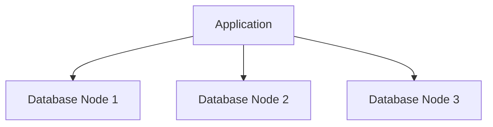

Now imagine Node 1 crashes.

What happens?

The application cannot communicate with Node 1.

The other nodes might also detect that Node 1 is unavailable.

This is relatively straightforward.

But distributed systems have a more difficult problem.

Imagine Node 1 is working perfectly.

Its:

- CPU is healthy.
- Memory is healthy.
- Disk is healthy.
- Database process is running.

However, the network connection between Node 1 and Node 2 is broken.

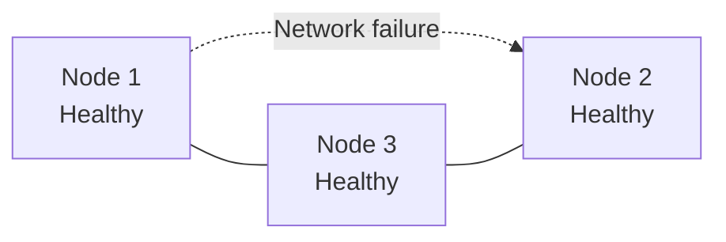

From Node 2's perspective, Node 1 is unavailable.

From Node 1's perspective, Node 2 might be unavailable.

But both machines are actually healthy.

This is called a partial failure.

### What is partial failure?

A partial failure occurs when some components of a distributed system fail or become unreachable while other components continue operating.

This is one of the defining characteristics of distributed systems.

In a single-machine application, a process failure might bring down the entire application.

In a distributed application, one component can fail while other components continue running independently.

That sounds like an advantage, and it is.

But it creates a serious challenge:

Different parts of the system might have different views of reality.

### Real-world example: Payment processing

Suppose your application sends a payment request to a payment gateway.

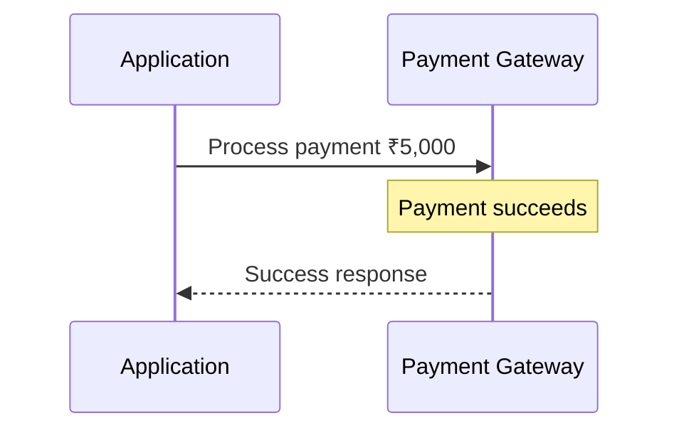

Everything works.

But consider another situation:

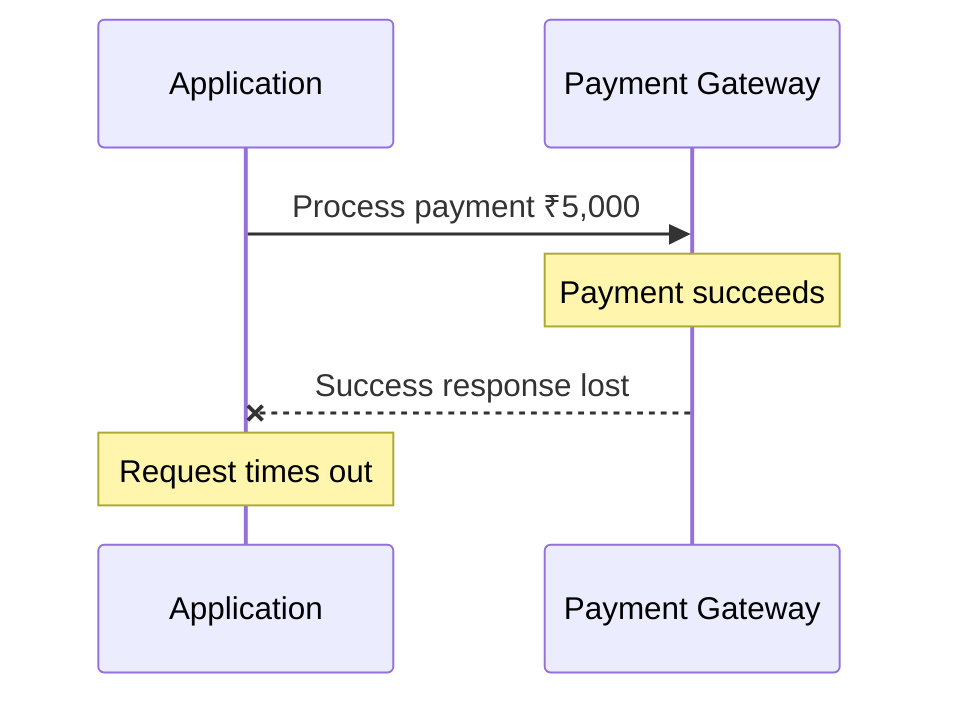

The application observes a timeout.

What does the application know?

It knows that it did not receive the response.

It does NOT know whether the payment succeeded.

This distinction is extremely important.

The payment gateway may have successfully charged the customer, even though the application did not receive the acknowledgement.

If the application simply retries the payment, the customer might be charged twice.

This is a partial failure.

The payment gateway succeeded, but communication between the two systems failed.

System design lesson: A timeout does not mean an operation failed. It means the outcome is unknown to the caller.

We'll revisit this when we study consensus, replication, and distributed transactions.

# 2.2 Types of failures in distributed systems

Not all failures are the same.

Understanding the type of failure helps us choose the correct recovery strategy.

## A. Crash failure

A process or machine completely stops working.

Example:

```
Database Node 1

Before:
    Process running
    Requests accepted

After:
    Process terminated
    No requests accepted
```

The node stops responding because it has crashed.

A crash-stop model assumes that after crashing, the node never comes back.

A crash-recovery model allows the node to restart later, possibly retaining some durable state.

Real-world examples:

- Database process crashes.
- EC2 instance terminates.
- Kubernetes pod gets killed.
- Application server runs out of memory and exits.

## B. Omission failure

A node or communication component fails to send or receive messages that it should have handled.

There are two useful categories.

Send omission:

A node should send a message but fails to send it.

Receive omission:

A node should receive or process a message but does not.

Example:

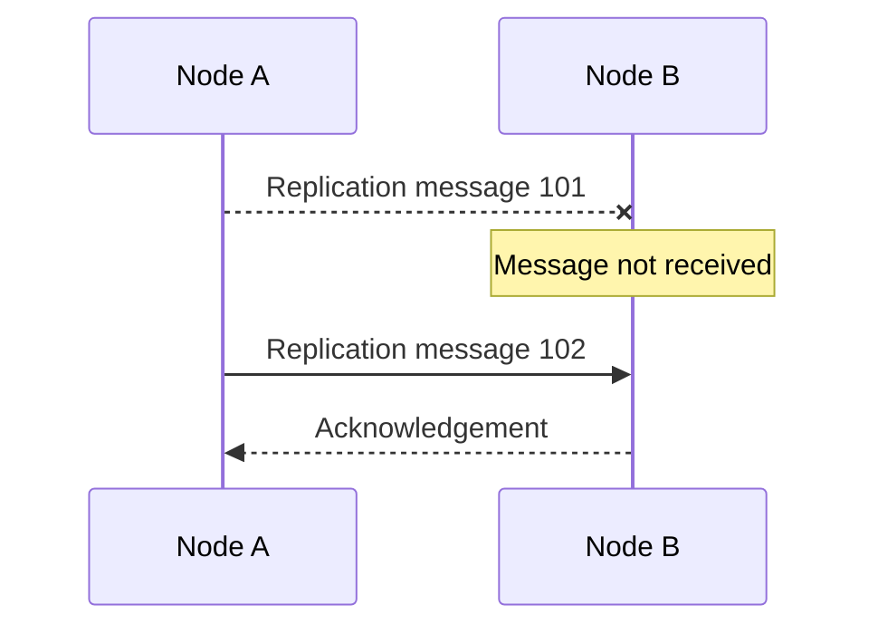

Node B receives message 102, but message 101 is missing.

Now the system must determine how to recover the missing information.

Databases commonly solve related problems using log sequence numbers, replication positions, retransmission, and log replay.

We'll explore those when we study database replication.

## C. Network partition

A network partition happens when communication between groups of nodes becomes unavailable.

Consider five nodes:

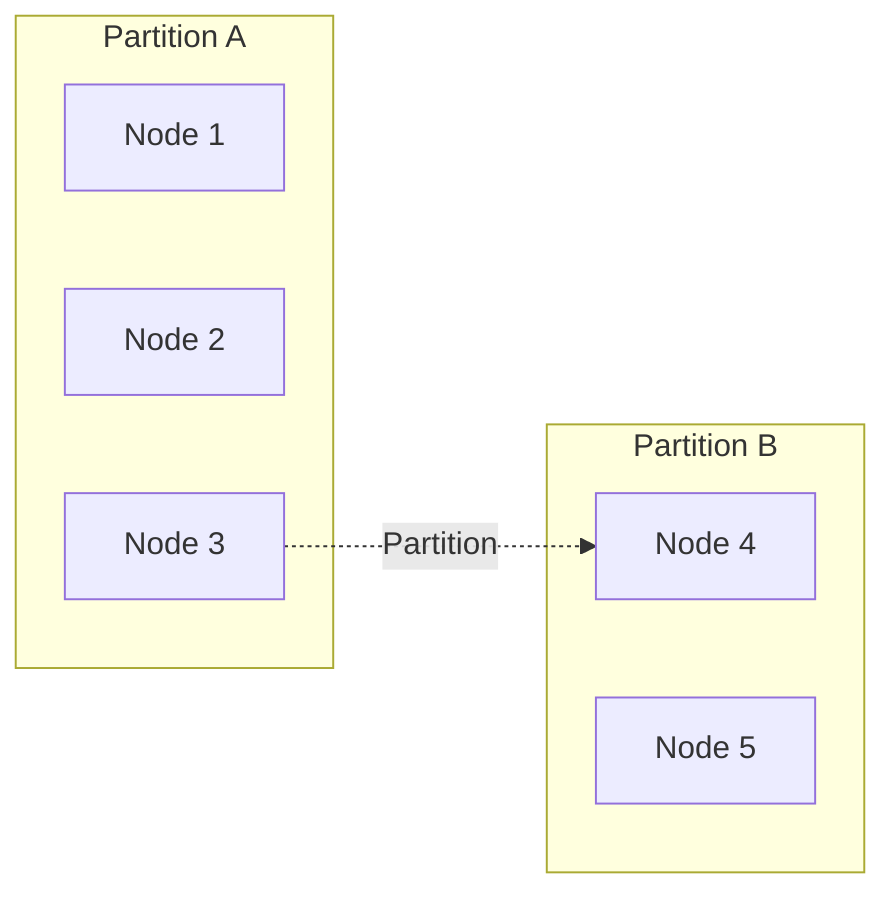

All five nodes might still be running.

However, Node 1, 2, and 3 cannot communicate with Node 4 and 5.

This creates two independent communication groups.

A network partition is particularly dangerous for leader-based systems because both groups might make conflicting assumptions about leadership.

We will study how quorum prevents this in a later chapter.

## D. Timing failure

A response arrives later than the expected deadline.

Example:

```
Request sent:     10:00:00.000
Expected response:10:00:00.500
Actual response:  10:00:05.000
```

The response arrived five seconds later.

Was the server dead?

No.

It was just slow, overloaded, or experiencing network delays.

But the client may already have declared the operation unsuccessful.

This is why timing failures are particularly difficult.

## E. Byzantine failure

This is a more advanced category.

A Byzantine node can behave arbitrarily.

For example:

- Send incorrect information.
- Send different information to different nodes.
- Violate the expected protocol.
- Behave maliciously.

Imagine Node 1 tells Node 2:

```
Current leader = Node 1
```

But tells Node 3:

```
Current leader = Node 2
```

The node is behaving inconsistently.

Byzantine fault-tolerant algorithms are designed to handle a defined number of such arbitrary faulty or malicious participants.

Most conventional database replication and Raft deployments primarily address crash failures, not Byzantine failures.

Important distinction: Byzantine consensus is a different and more expensive problem than ordinary crash-fault consensus.

We'll focus primarily on crash faults in this course, but we'll understand Byzantine consensus later.

### Failure comparison

| Failure           | What happens                    | Example                            |
| ----------------- | ------------------------------- | ---------------------------------- |
| Crash             | Node stops                      | Database process crashes           |
| Omission          | Message is not sent or received | Replication message is lost        |
| Network partition | Groups cannot communicate       | Cross-region network outage        |
| Timing            | Message arrives too late        | Slow database response             |
| Byzantine         | Node behaves arbitrarily        | Malicious or incorrect participant |

# 2.3 The most difficult problem: Slow vs dead

This is probably the most important concept in this chapter.

Let's assume we have two database nodes.

Node 1 is the leader.

Node 2 is the follower.

Node 2 expects a heartbeat every second.

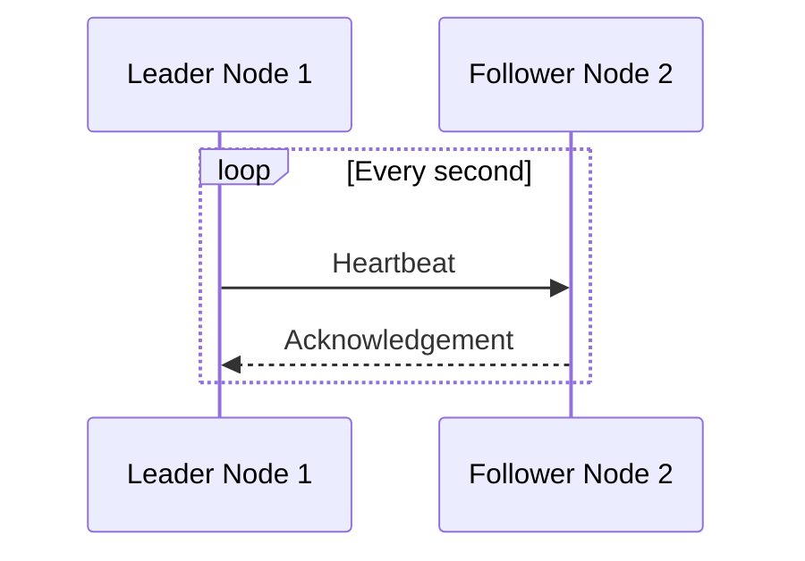

Everything is working.

Now suddenly Node 2 doesn't receive a heartbeat.

It waits one second.

Nothing.

It waits two seconds.

Nothing.

It waits five seconds.

Nothing.

What should Node 2 conclude?

There are two possible situations.

### Situation A: The leader has crashed

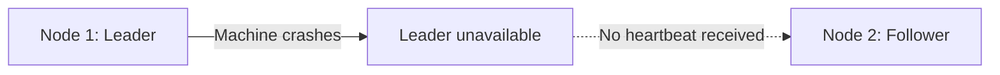

Node 1 is genuinely unavailable.

Node 2 should eventually help trigger a new election.

### Situation B: The leader is alive, but the network is delayed

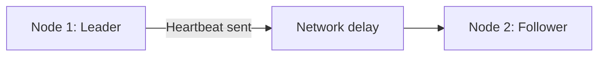

Node 1 is alive.

The heartbeat is simply delayed.

But Node 2 observes exactly the same thing:

```
No heartbeat received.
```

How can it distinguish the two situations?

It cannot reliably do so in a fully asynchronous network.

This is not an implementation bug.

It is a fundamental limitation of distributed computing.

### Why is this important for leader election?

Imagine Node 2 suspects Node 1 has crashed.

Node 2 starts an election.

Node 2 becomes the new leader.

But Node 1 was never actually dead.

Now:

```
Node 1: I am the leader.
Node 2: I am the leader.
```

We have potential split brain.

This is why failure detection and leader election are separate mechanisms.

Failure detection determines when a node should be suspected.

The election protocol determines whether a candidate can safely become leader.

And an additional mechanism must prevent a former leader from continuing to act as an authoritative leader.

We'll study these mechanisms in depth.

# 2.4 Heartbeats: How do nodes detect failures?

A heartbeat is a periodic message sent by one component to another to indicate that it is still alive and participating in the system.

Example:

```
Leader -> Follower: HEARTBEAT
Follower -> Leader: ACK

Leader -> Follower: HEARTBEAT
Follower -> Leader: ACK

Leader -> Follower: HEARTBEAT
Follower -> Leader: ACK
```

A heartbeat can contain:

```
{
  "nodeId": "node-1",
  "term": 12,
  "commitIndex": 1050,
  "timestamp": 1790000000
}
```

The exact contents depend on the protocol.

The important thing is that the receiver can use heartbeats to monitor communication and liveness.

## How does timeout work?

Suppose:

```
Heartbeat interval = 1 second
Failure timeout = 5 seconds
```

Node 2 expects periodic heartbeats.

If it doesn't receive one within the configured timeout, it suspects Node 1 is unavailable.

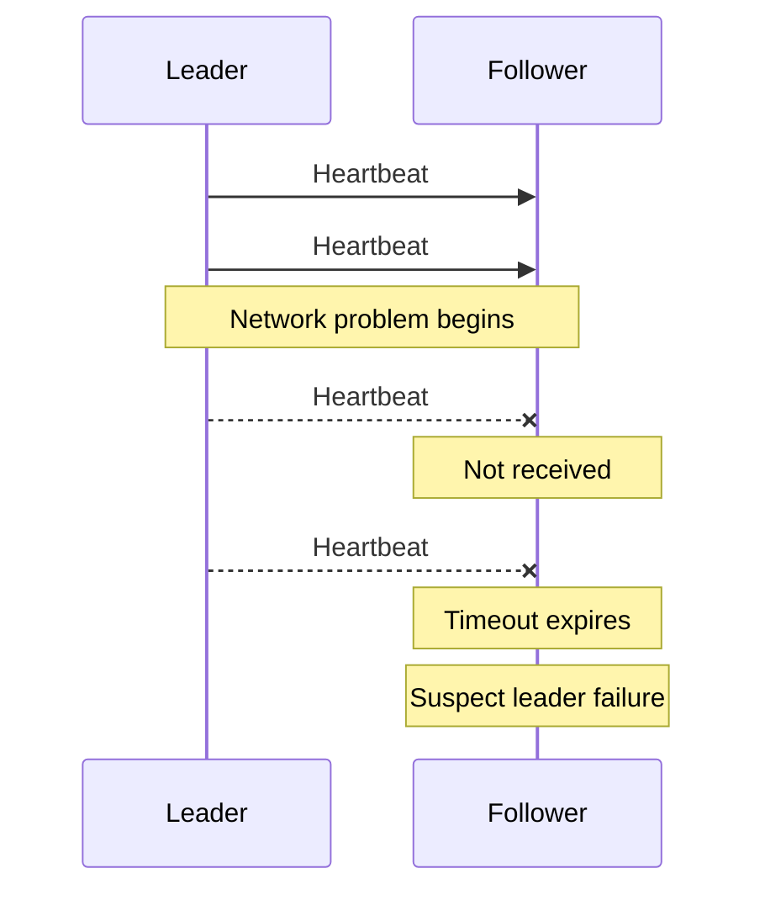

Notice the word suspect.

Not prove.

This is an important distinction.

## Choosing a timeout

Timeout selection is a trade-off.

Consider three configurations.

| Timeout    | Advantage                        | Disadvantage                          |
| ---------- | -------------------------------- | ------------------------------------- |
| Very short | Detects failures quickly         | More false suspicions                 |
| Moderate   | Balances detection and stability | Still sensitive to network conditions |
| Very long  | Tolerates temporary delays       | Slow failover                         |

Imagine a production database cluster.

You configure an extremely aggressive failure timeout.

A temporary network delay occurs.

A healthy leader misses a heartbeat deadline.

Followers suspect failure.

An election begins.

The database experiences an unnecessary leadership transition.

This is called a false positive failure detection.

Now imagine an extremely long timeout.

The leader crashes.

Followers take a long time to detect it.

This creates unnecessary downtime.

There is no universally perfect timeout.

The system designer must balance detection speed and false suspicions.

### A slightly more advanced concept: Accrual failure detectors

Traditional failure detectors often use a fixed timeout.

More advanced approaches can estimate how suspicious a node's lack of response is.

One example is a phi-accrual failure detector.

Instead of saying:

```
Node is dead after 5 seconds.
```

It calculates a suspicion level based on the observed heartbeat arrival distribution.

Conceptually:

```
φ = 1    -> Low suspicion
φ = 2    -> More suspicion
φ = 8    -> Very high suspicion
```

The exact interpretation depends on the implementation and chosen threshold.

This is useful in systems where network delays vary and a fixed timeout may create too many false positives.

The key insight:

Failure detectors provide suspicions, not absolute truth.

# 2.5 Synchronous vs asynchronous distributed systems

Now let's understand an important theoretical foundation.

When two machines communicate, how long can a message take?

Consider:

```
Node A -> Network -> Node B
```

There are two broad models to understand.

## A. Synchronous system

In a synchronous system, we assume known upper bounds on certain timing properties.

For example:

```
Maximum message delay = 100 ms
Maximum processing delay = 50 ms
Maximum clock drift = 1 ms per second
```

If a node does not respond within the known bounds, we can make stronger conclusions about its failure.

This makes coordination relatively easier.

However, real distributed systems rarely have perfectly predictable timing.

Network congestion, operating system scheduling, garbage collection, hardware failures, and regional outages can all affect timing.

## B. Asynchronous system

In an asynchronous system, there is no known upper bound on how long a message may take.

A message could arrive:

```
1 ms
100 ms
5 seconds
30 seconds
Or much later
```

Likewise, a process might be delayed arbitrarily.

Suppose Node A sends a request to Node B.

Node A waits.

And waits.

And waits.

It cannot determine whether:

- Node B crashed.
- Node B is overloaded.
- The message is delayed.
- The response is delayed.
- The network is partitioned.

This makes failure detection difficult.

## C. Partially synchronous system

This is the practical model behind many real distributed systems.

A partially synchronous system allows unpredictable delays, but assumes that timing becomes sufficiently well-behaved under certain conditions.

For example:

- The network may be slow temporarily.
- Processes may experience pauses.
- Eventually, communication becomes sufficiently reliable and bounded.

Consensus protocols such as Raft are designed to make progress under appropriate timing assumptions.

When network conditions are poor, the system may temporarily stop making progress rather than violate safety.

This is exactly the kind of trade-off we want.

### Comparison

| Property            | Synchronous                         | Asynchronous                | Partially synchronous             |
| ------------------- | ----------------------------------- | --------------------------- | --------------------------------- |
| Message delay       | Known upper bound                   | No known upper bound        | Eventually sufficiently bounded   |
| Process execution   | Bounded                             | May be arbitrarily delayed  | Eventually sufficiently bounded   |
| Failure detection   | Easier                              | Fundamentally uncertain     | Possible under timing assumptions |
| Practical relevance | Theoretical/controlled environments | Important theoretical model | Common practical model            |

### Why should a system designer care?

Suppose you design a consensus system.

You configure:

```
Heartbeat interval = 500 ms
Election timeout = 2 seconds
```

You are assuming the environment usually allows these messages to arrive within reasonable time.

When the network becomes unstable, those assumptions may no longer hold.

Therefore, an election timeout is not merely a random configuration.

It is part of the protocol's timing assumptions.

We'll examine how Raft uses these timeouts.

# 2.6 Clock problems: Why distributed systems cannot blindly trust time

Now we move to another extremely important topic.

Clocks.

Suppose two database nodes execute an operation.

Node A records:

```
10:00:00.100
```

Node B records:

```
10:00:00.090
```

Which operation happened first?

You might say Node B.

But what if Node B's clock is 500 milliseconds ahead?

The actual ordering may be completely different.

This is called the clock synchronization problem.

## 2.6.1 Clock skew

Clock skew means the difference between the readings of two clocks at a particular point in time.

For example:

```
Actual time: 10:00:00.000

Node A clock: 10:00:00.010
Node B clock: 10:00:00.500
```

Node B is 490 milliseconds ahead of Node A.

The clocks disagree.

This can happen because of hardware clock differences and clock synchronization errors.

## 2.6.2 Clock drift

Clock drift refers to clocks running at slightly different rates.

For example:

```
Node A gains 2 ms every second.
Node B loses 1 ms every second.
```

Over time, their readings diverge.

Even if both clocks are initially synchronized, they may become unsynchronized.

## 2.6.3 Why does NTP not completely solve the problem?

Network Time Protocol (NTP) helps synchronize machine clocks.

For example:

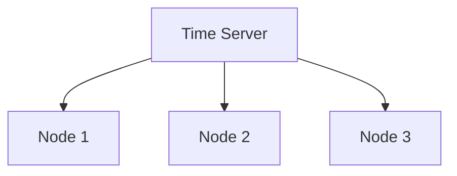

Machines periodically synchronize their clocks with time servers.

This is useful.

But synchronization is not perfect because:

- Network delays are variable.
- Time synchronization messages can be delayed.
- Clock adjustments take time.
- Different machines may have different synchronization errors.

Therefore, we should not assume:

```
Node A timestamp < Node B timestamp
```

necessarily means Node A's event happened first.

### Real-world database example

Consider two replicas.

Initially:

```
Customer name = Alice
```

Node A receives:

```
Customer name = Bob
Timestamp = 10:00:00.100
```

Node B receives:

```
Customer name = Charlie
Timestamp = 10:00:00.090
```

Suppose the replication conflict resolution strategy uses Last Write Wins (LWW).

It compares timestamps and chooses the newest update.

It selects Bob.

But what if Node B's clock was ahead?

The actual update ordering might be different.

This demonstrates why timestamp-based conflict resolution needs carefully understood clock assumptions.

A physical timestamp is not automatically a globally correct ordering of events.

# 2.7 Wall-clock time vs monotonic time

This distinction is very important for backend engineering.

There are two common ways of working with time.

### A. Wall-clock time

Wall-clock time represents calendar time.

Example:

```
2026-11-03 16:30:00
```

It answers:

"What time is it?"

Examples:

- Java `Instant.now()`.
- Python `datetime.now()`.
- System clock synchronized using NTP.

Wall-clock time can be adjusted.

For example:

```
Before correction: 10:00:05
After correction:  10:00:03
```

The clock moved backwards.

That can cause problems when measuring elapsed durations.

### B. Monotonic time

Monotonic time is intended for measuring elapsed time.

It moves forward consistently within the relevant clock domain and is not subject to ordinary wall-clock adjustments.

Example in Java:

```
long start = System.nanoTime();

// Perform some operation.

long elapsed = System.nanoTime() - start;
```

Example in Python:

```
import timestart = time.monotonic()# Perform some operation.elapsed = time.monotonic() - start
```

Use monotonic time for:

- Measuring request duration.
- Measuring execution time.
- Implementing local timeout deadlines.
- Calculating elapsed time.

Use wall-clock time for:

- Recording business timestamps.
- Displaying dates and times.
- Audit records.
- Human-readable event timestamps.

### Important distinction

Monotonic time on two different machines does not give you a globally comparable timestamp.

For example:

```
Node A monotonic time: 5,000,000
Node B monotonic time: 7,000,000
```

You cannot conclude that Node B's event happened after Node A's event.

They are different clock domains.

This is a local timing mechanism, not a distributed ordering mechanism.

# 2.8 Why timestamps cannot always establish event ordering

Let's understand an interesting distributed systems problem.

Suppose two application servers handle different events.

```
Node A:
    User creates an order.

Node B:
    Payment is processed.
```

The events are logically related.

The order must happen before payment processing.

But their wall-clock timestamps might be:

```
Order created:    10:00:00.500
Payment processed:10:00:00.300
```

Does this mean payment happened before the order?

Not necessarily.

The clocks could be skewed.

What we actually care about is the logical relationship between events.

Distributed systems use mechanisms such as:

- Sequence numbers.
- Log positions.
- Logical clocks.
- Version numbers.
- Consensus-based ordering.
- Hybrid logical clocks.

We'll study Lamport clocks, vector clocks, and hybrid logical clocks later.

For now, remember:

Physical time tells us what a machine's clock reads. Logical ordering tells us how events relate to each other.

These are different things.

# 2.9 Why `sleep(5000)` is not a distributed coordination mechanism

Imagine a backend application implementing a distributed lock.

The code looks something like:

```
acquireLock();

Thread.sleep(5000);

performOperation();

releaseLock();
```

The developer assumes that the operation will complete within five seconds.

But what happens when the application experiences:

- Garbage collection pauses.
- Thread scheduling delays.
- CPU starvation.
- Slow database responses.
- Network interruptions.

The operation may take more than five seconds.

Meanwhile, the lock might expire.

Another application instance acquires the same lock.

Now both instances believe they have the right to execute the protected operation.

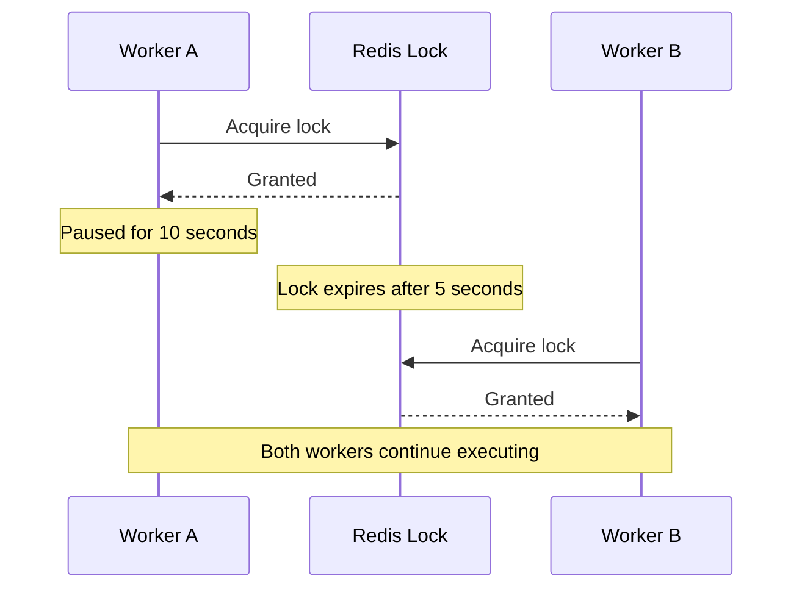

This can cause duplicate processing or conflicting writes.

The problem is not merely choosing a longer sleep duration.

The real problem is that the system has no reliable mechanism to prevent an expired lock holder from performing stale operations.

This leads to a powerful concept called fencing tokens.

We'll study it in detail in the distributed locking chapter.

For now, understand that timeouts and sleeps alone cannot establish distributed authority.

# 2.10 Message delivery problems: Lost, duplicated, and reordered messages

Let's study another fundamental issue.

Imagine Node A sends three messages to Node B.

```
Message 1: Create order
Message 2: Deduct inventory
Message 3: Send confirmation
```

We might expect Node B to receive:

```
1 -> 2 -> 3
```

But distributed communication introduces different failure possibilities.

### Case A: Message loss

```
Node A -> Message 1 -> Node B
Node A -> Message 2 -X
Node A -> Message 3 -> Node B
```

Node B never receives Message 2.

### Case B: Duplicate delivery

```
Node A -> Message 1 -> Node B
Node A -> Message 1 -> Node B
```

Node B receives the same logical message twice.

### Case C: Reordering

```
Node A sends: 1 -> 2 -> 3

Node B receives: 2 -> 1 -> 3
```

The application must determine whether this ordering is acceptable.

### How does TCP help?

TCP provides an ordered, reliable byte stream over an established connection.

For a single TCP connection, it handles retransmission and in-order delivery of bytes.

But there are important limitations.

TCP does not provide:

- Exactly-once execution of business operations.
- Exactly-once processing across application retries.
- Global ordering across different connections.
- Atomicity across multiple services.
- Guaranteed delivery after a process or machine failure.

Consider this:

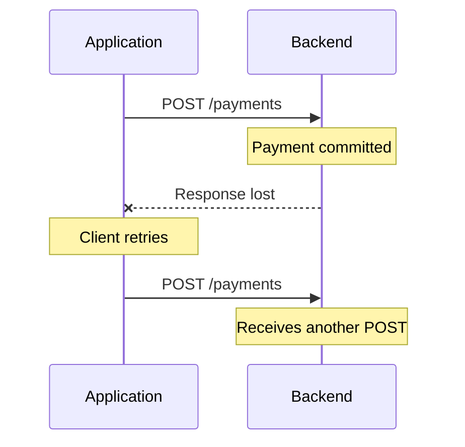

TCP may have successfully delivered the first request.

The application-level response was lost.

The client retries using a new request.

The backend receives the operation again.

This is why application-level idempotency is important.

### Common delivery semantics

| Delivery guarantee | Meaning                                                                                              |
| ------------------ | ---------------------------------------------------------------------------------------------------- |
| At-most-once       | An operation is delivered or processed zero or one time                                              |
| At-least-once      | An operation may be delivered multiple times, but retries aim to ensure delivery                     |
| Exactly-once       | The defined processing effect occurs exactly once within the scope of a protocol or system guarantee |

Be careful with the phrase exactly-once.

Many systems provide exactly-once processing guarantees only within a specific scope, such as a transactional log-processing workflow.

End-to-end exactly-once effects across arbitrary external services are much harder.

A common production approach is:

1. Use at-least-once delivery.
2. Assign every logical operation a unique identifier.
3. Make the processing idempotent.
4. Persist the result or processing status.
5. Deduplicate repeated requests.

For example:

```
CREATE TABLE processed_payments (
    payment_id UUID PRIMARY KEY,
    status VARCHAR(30) NOT NULL
);
```

The application uses the unique `payment_id` to ensure that the same logical payment is not processed twice.

This is closely related to the payment example we discussed earlier.

# 2.11 Putting everything together: A realistic database failure

Now let's combine the concepts.

Suppose we have a PostgreSQL-like primary-replica architecture.

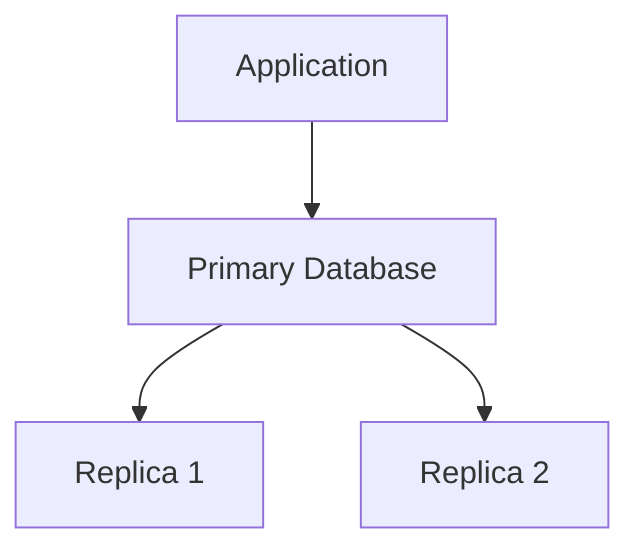

The application performs:

```
UPDATE accounts
SET balance = balance - 1000
WHERE account_id = 101;
```

Consider this sequence.

Step 1: The application sends the write.

```
Application -> Primary:
Deduct ₹1,000
```

Step 2: The primary commits the transaction.

The primary has successfully committed the transaction locally.

Step 3: The primary sends replication information to its replicas.

Depending on the replication configuration, the write may or may not have reached the replicas.

Step 4: The primary crashes before the application receives confirmation.

Now the application observes a timeout or lost connection.

What does the application know?

Nothing definitive about the outcome.

What do the replicas know?

That depends on replication progress.

One replica may have received the change.

Another may not have received it.

Step 5: A failover mechanism must select a replacement primary.

But which replica is safe to promote?

Promoting a replica that lacks an acknowledged transaction can cause data loss.

Promoting another node without properly fencing the old primary can cause split brain.

Notice how many distributed systems concepts appear in this one incident:

| Problem                                | Relevant concept            |
| -------------------------------------- | --------------------------- |
| Primary stops responding               | Failure detection           |
| Replica selection                      | Leader election             |
| Choosing a safe replacement            | Consensus / coordination    |
| Replicas have different logs           | Replication consistency     |
| Old primary might still run            | Split brain                 |
| Application doesn't know write outcome | Ambiguous operation outcome |
| Avoiding duplicate retry               | Idempotency                 |

This is why distributed consensus is so important for database architecture.

It is not just about electing a leader.

It is about maintaining a coherent system despite failures.

# 2.12 A useful summary: The assumptions that distributed systems break

Here is a comparison of assumptions programmers commonly make and what actually happens.

| Common assumption                           | Distributed systems reality                            |
| ------------------------------------------- | ------------------------------------------------------ |
| No response means the server is dead        | The server might just be slow or unreachable           |
| A timeout means the operation failed        | The operation might have succeeded                     |
| Machines have the same time                 | Their clocks can differ                                |
| Messages arrive exactly once                | Messages can be retried and processed more than once   |
| Messages arrive in global order             | Ordering is limited and must be explicitly established |
| A leader that lost contact is dead          | It might still be alive                                |
| A lock timeout means the old worker stopped | The old worker might still be running                  |
| Replicas have the same data                 | They might be at different replication positions       |
| Restarting a node solves failure            | It might return with stale state                       |

Keep this table. It captures many of the fundamental challenges of distributed systems.

# 2.13 Interview questions and answers

### Q1. What is a partial failure?

A partial failure occurs when one component or communication path fails while other parts of a distributed system continue operating.

Unlike a single-machine application, a distributed system cannot assume that every component will fail together.

### Q2. Why can't we distinguish a slow node from a failed node?

Because a delayed response and a failed node can produce the same observation: no response within the expected time.

In a fully asynchronous network, there is no known maximum message delay that allows us to distinguish the two with certainty.

### Q3. What is the purpose of heartbeats?

Heartbeats are periodic messages used to monitor the liveness and communication status of distributed components.

They allow nodes to detect missing communication and suspect failures.

However, they cannot prove that another node has crashed.

### Q4. What happens when the failure timeout is too low?

Healthy nodes might be incorrectly suspected of failure due to temporary network delays, slow processing, or scheduling pauses.

This can cause unnecessary elections, leadership changes, and instability.

### Q5. Why do distributed systems need logical clocks?

Physical clocks are not perfectly synchronized.

Logical clocks help establish event relationships and ordering without relying exclusively on physical timestamps.

### Q6. Why is `System.currentTimeMillis()` not ideal for measuring execution duration?

Because it uses wall-clock time, which can be adjusted.

`System.nanoTime()` is designed for measuring elapsed time and is generally the appropriate choice for local duration measurements.

### Q7. Does TCP guarantee exactly-once processing?

No. TCP provides reliable, ordered byte-stream delivery within a connection, but it cannot guarantee that a business operation executes exactly once.

Application retries can cause duplicate processing.

### Q8. Why is a timeout dangerous in payment processing?

The payment might have succeeded even though the response was lost.

Blindly retrying can charge the customer twice.

Idempotency keys and payment-status reconciliation help handle this situation.

### Q9. What is the difference between clock skew and clock drift?

Clock skew describes the difference between clocks at a given moment.

Clock drift describes how their rates differ over time.

### Q10. What is the biggest challenge of distributed systems?

One of the biggest challenges is that nodes can fail independently and communication is unreliable, while each node has only a partial view of the overall system.

The system must coordinate decisions despite this uncertainty.

# What you should be able to explain before moving forward

Try to explain these in your own words:

1. Why can a healthy database node appear dead to another node?
2. Why is a heartbeat timeout only a suspicion?
3. Why can a payment succeed even when the application receives a timeout?
4. Why can't we blindly use timestamps to determine which distributed operation happened first?
5. Why doesn't TCP solve duplicate payment processing?
6. Why is increasing a distributed lock's timeout not a complete solution?

You don't need to memorise definitions. You should understand the underlying failure scenarios.

## Next: Chapter 3 — Distributed Consensus: The Core Problem

This is where we'll start understanding the central concept of the course.

We'll cover:

- What exactly is consensus?
- What does it mean for multiple nodes to agree?
- Consensus vs replication vs synchronization.
- Agreement, validity, and termination properties.
- Why leader election alone is not consensus.
- How multiple nodes agree on a single value.
- How consensus establishes an authoritative sequence of operations.
- Why databases need consensus.
- Consensus in etcd, ZooKeeper, and distributed SQL databases.
- What happens when nodes disagree or a majority becomes unavailable.

We'll first derive consensus from simple examples before introducing Paxos and Raft.

