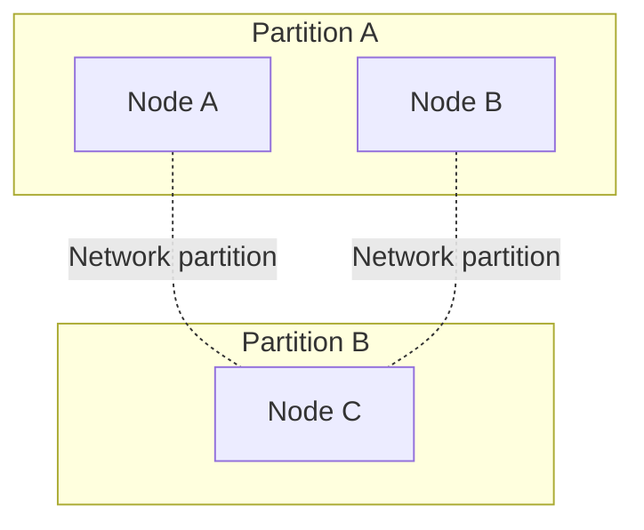
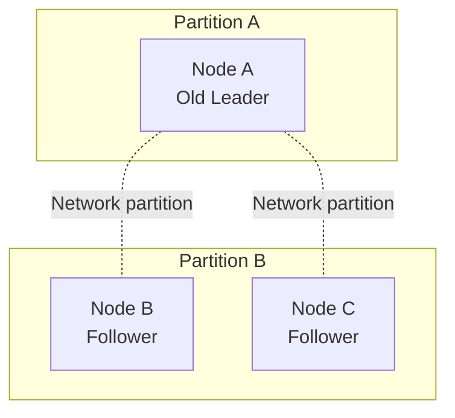
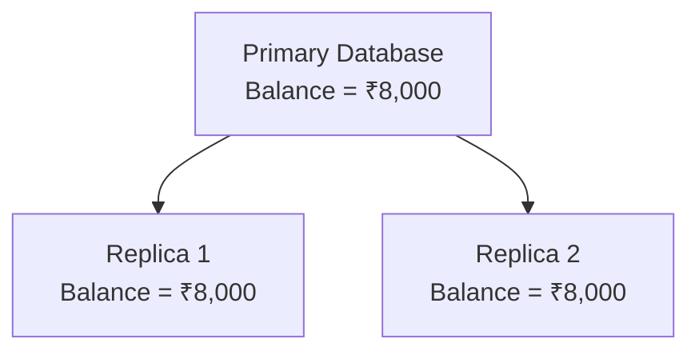
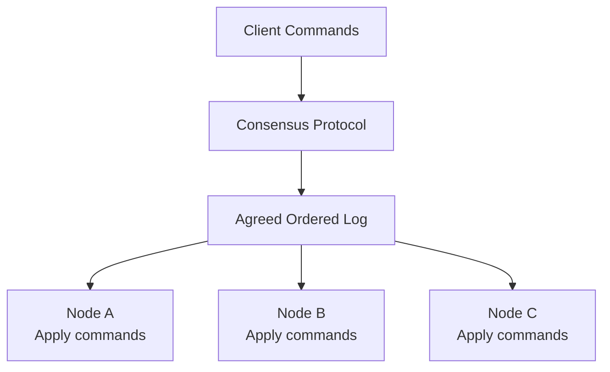
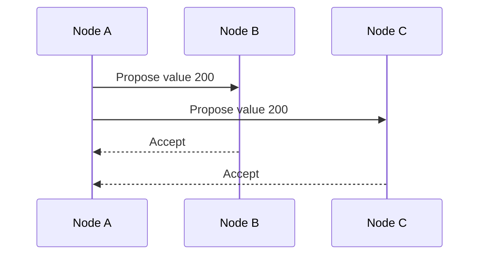
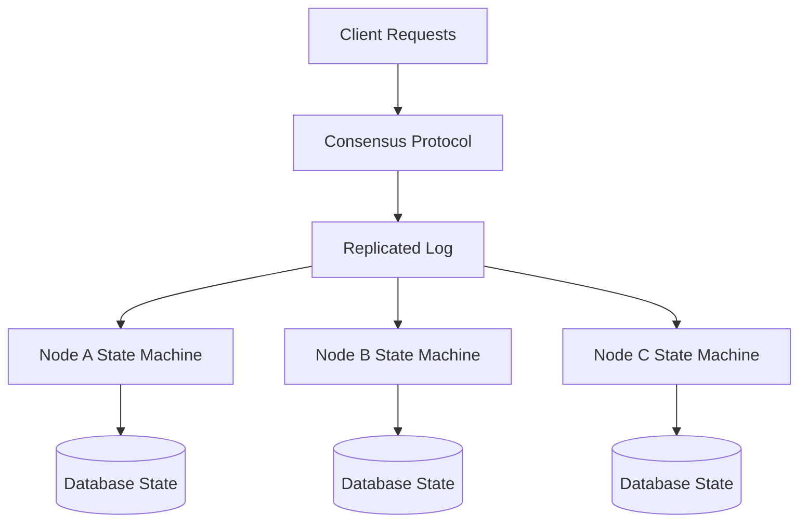
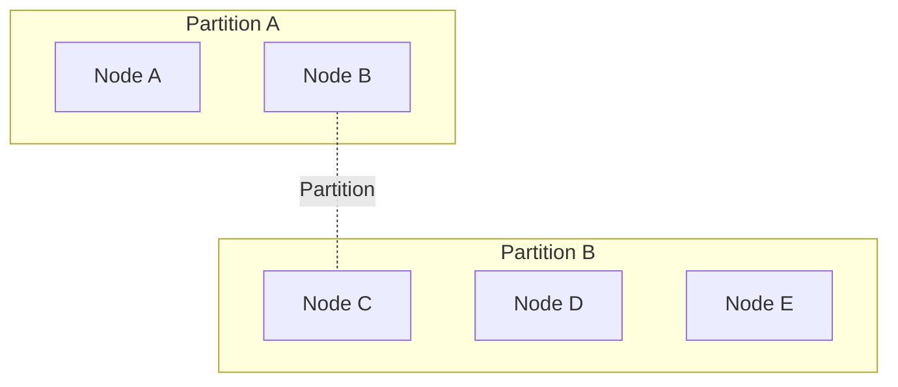
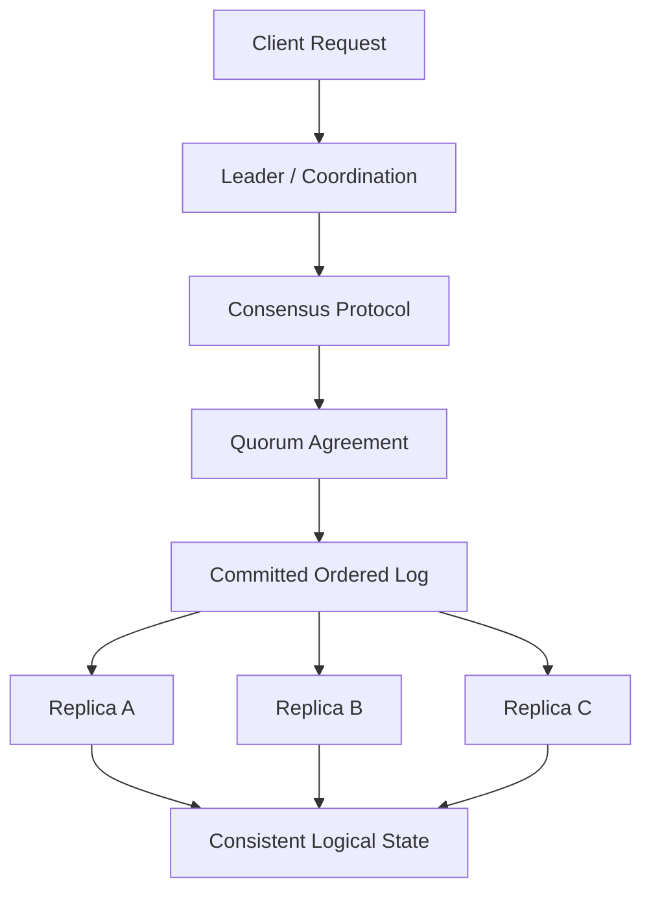

# Chapter 3: Distributed Consensus — The Core Problem

This is probably the most important chapter in this course.

Leader election, split-brain prevention, quorum, Raft, Paxos, distributed databases, and many other concepts are closely related to distributed consensus.

Before learning any consensus algorithm, we need to understand exactly what problem consensus solves.

We'll derive it from simple examples, understand its guarantees, and then connect it to real database architectures.

# 3.1 Start with a simple problem: Three databases must agree

Imagine you are building a banking application.

You have three database nodes:

```
Node A
Node B
Node C
```

All three nodes maintain replicated account information.

Initially:

```
Account 101 balance = ₹10,000

Node A: ₹10,000
Node B: ₹10,000
Node C: ₹10,000
```

Now a customer requests:

```
Withdraw ₹2,000
```

The expected result is:

```
Account 101 balance = ₹8,000
```

We need all database nodes to agree on the outcome.

Seems simple, right?

But consider these situations.

### Situation 1: Nodes receive conflicting requests

Node A receives:

```
Withdraw ₹2,000
```

Node B receives:

```
Withdraw ₹3,000
```

Both requests are based on the same initial balance.

Which operation should take effect first?

Should both happen?

Should one be rejected?

What should all three replicas eventually believe?

Without coordination, the nodes might independently process different operations.

### Situation 2: Nodes have different information

Suppose Node A receives the withdrawal request.

It sends the update to Node B and Node C.

But Node C does not receive the message.

```
Node A: Withdrawal ₹2,000 received
Node B: Withdrawal ₹2,000 received
Node C: No information about withdrawal
```

Now the nodes have different information.

### Situation 3: Node A crashes

Node A received the request and processed it.

However, before the other nodes received the update, Node A crashed.

```
Node A: DOWN
Node B: Balance ₹10,000
Node C: Balance ₹10,000
```

Should Node B conclude that the withdrawal never happened?

What if Node A had actually committed the transaction before crashing?

What if the transaction had reached Node B but not Node C?

The remaining nodes need a way to determine which state and decisions are authoritative.

This is the problem we are trying to solve.

Distributed consensus is the process through which multiple distributed participants agree on a decision despite failures and unreliable communication, subject to the protocol's assumptions.

Let's understand this definition piece by piece.

# 3.2 What exactly is consensus?

Consensus means agreement.

In a distributed system, multiple independent nodes participate in deciding something.

For example:

```
Node A proposes: Value = 100
Node B proposes: Value = 200
Node C proposes: Value = 300
```

The system must decide one value.

A successful consensus protocol ensures that the participating nodes do not make conflicting decisions.

For example:

```
Node A decides: 200
Node B decides: 200
Node C decides: 200
```

All correct participants agree on the decision.

Notice something interesting.

The nodes did not initially have to propose the same value.

They only need to agree on one valid decision.

This is an important characteristic of consensus.

### A real-world analogy

Imagine three bank managers must decide which branch will be responsible for processing a particular day's transactions.

Each manager proposes a different branch.

```
Manager A: Mumbai
Manager B: Delhi
Manager C: Hyderabad
```

They need a protocol that ensures they all reach the same decision.

It doesn't matter that they initially disagreed.

What matters is that:

- They don't end up with multiple conflicting decisions.
- The decision follows the protocol's rules.
- They eventually reach a decision when the required conditions are satisfied.

This is the essence of consensus.

# 3.3 Consensus is more than just choosing one value

There are three fundamental properties commonly used to explain consensus.

1. Agreement
2. Validity
3. Termination

Let's understand each in detail.

## A. Agreement

Agreement means:

No two correct nodes should decide on different values.

Suppose three nodes participate.

```
Node A proposes: 100
Node B proposes: 200
Node C proposes: 300
```

After running consensus:

```
Node A decides: 200
Node B decides: 200
Node C decides: 200
```

This satisfies agreement.

But consider:

```
Node A decides: 200
Node B decides: 200
Node C decides: 300
```

This violates agreement.

Different nodes have decided on conflicting values.

In a database, this can be dangerous.

Suppose the agreed decision represents the next operation in a replicated database log.

Node A believes the next operation is:

```
Withdraw ₹2,000
```

Node C believes the next operation is:

```
Withdraw ₹3,000
```

They will create different database histories.

Agreement prevents this kind of conflicting decision.

Important: Agreement concerns the decisions made by participants. It does not automatically mean every replica is always holding identical physical data at every instant.

## B. Validity

Validity means:

The value chosen by consensus must satisfy the protocol's validity rules.

In a basic consensus model, a decided value must have been proposed by some participant.

For example:

```
Node A proposes: 100
Node B proposes: 200
Node C proposes: 300
```

A valid decision could be:

```
200
```

But an arbitrary value such as:

```
999999
```

cannot be chosen unless it was proposed or otherwise permitted by the protocol's validity rules.

In practical systems, validity rules can be more specific.

For a leader election system:

```
Only an eligible candidate can become leader.
```

For a replicated database:

```
Only an operation permitted by the protocol can be committed.
```

For a configuration management system:

```
The selected configuration must be one of the valid proposed configurations.
```

The exact validity condition depends on the consensus problem being solved.

## C. Termination

Termination means:

Every correct participant eventually decides on a value, provided the protocol's required operating assumptions hold.

Suppose:

```
Node A: Running
Node B: Running
Node C: Running
```

They start the consensus process.

Eventually:

```
Node A decides: 200
Node B decides: 200
Node C decides: 200
```

That is termination.

But suppose the system requires a majority of nodes and only one node is available.

The protocol may be unable to make progress.

That does not necessarily violate the safety guarantees.

The protocol may deliberately stop accepting decisions until it can establish sufficient authority.

This distinction between safety and progress is extremely important.

# 3.4 Safety vs Liveness

This is one of the most important concepts in distributed systems interviews.

Consensus protocols must balance two broad categories of guarantees.

## Safety

Safety means:

Nothing bad happens.

Examples:

- Two nodes do not decide conflicting values.
- Two conflicting leaders do not commit incompatible histories.
- A committed database operation is not silently replaced by a conflicting decision.
- The protocol does not violate its ordering guarantees.

Safety is about correctness.

## Liveness

Liveness means:

Something good eventually happens.

Examples:

- A new leader eventually gets elected.
- A database eventually resumes accepting writes.
- Replication eventually makes progress.
- A pending operation eventually gets decided.

Liveness is about progress.

### A simple banking example

Suppose three database nodes are running.

The system requires a majority to commit a write.

Now the network partitions:



Nodes A and B can communicate.

Node C is isolated.

The majority partition has two out of three nodes.

It can continue making progress, assuming the protocol's other requirements are satisfied.

The isolated node cannot independently commit new decisions.

Why?

Because allowing it to make independent decisions could create conflicting histories.

The system sacrifices progress on the minority side to preserve safety.

This gives us a fundamental rule:

When the system cannot safely establish agreement, it should not invent an agreement just to remain available.

### Comparison

| Property                       | Safety                          | Liveness                       |
| ------------------------------ | ------------------------------- | ------------------------------ |
| Focus                          | Correctness                     | Progress                       |
| Question                       | Can something bad happen?       | Can the system move forward?   |
| Example                        | No conflicting committed values | New leader eventually elected  |
| Can be sacrificed temporarily? | Should not be violated          | May be temporarily unavailable |

A well-designed consensus protocol prioritizes safety and makes progress when its assumptions allow it.

# 3.5 Why do we need consensus if we already have a leader?

This is a very important interview question.

A common misunderstanding is:

"We elect one leader, so the leader can decide everything. Why do we need consensus?"

Let's understand why.

Suppose three nodes exist:

```
Node A: Leader
Node B: Follower
Node C: Follower
```

The leader receives a write:

```
Update account balance to ₹8,000.
```

The leader applies the update locally.

But imagine the network is partitioned:



Node A cannot communicate with B or C.

B and C suspect that A is unavailable.

They might elect B as a new leader.

Now:

```
Node A: I am the leader.
Node B: I am the leader.
```

If both accept writes, we have split brain.

Just having a leader does not solve this.

We need rules governing:

- Who is allowed to become leader.
- How leaders are elected.
- Which leader has authority.
- How writes are replicated.
- When a write is considered committed.
- How an old leader is prevented from making conflicting decisions.

Consensus protocols provide the mechanisms to establish and preserve these guarantees.

### Important distinction

A leader is a role.

Consensus is a guarantee established through a protocol.

A system can have a leader without having a safe consensus mechanism.

For example, imagine using a simple database configuration flag:

```
is_leader = true
```

Two nodes might independently set this flag to true.

The flag itself provides no distributed safety.

The nodes need a protocol to agree on leadership and the decisions made under that leadership.

# 3.6 Consensus vs Leader Election

These concepts are related, but they are not the same.

Let's compare them carefully.

### Leader election

Leader election answers:

Who should be the leader?

Example:

```
Node A
Node B
Node C
```

After an election:

```
Node B = Leader
Node A = Follower
Node C = Follower
```

### Consensus

Consensus answers:

What decision should the distributed group agree upon?

For example:

```
Which database operation is next?

Which configuration should be active?

Which value should be committed?

Which leader election result is valid?
```

### Comparison

| Leader election                                  | Consensus                                              |
| ------------------------------------------------ | ------------------------------------------------------ |
| Selects a leader                                 | Establishes agreement on a decision                    |
| Determines authority                             | Determines an agreed outcome                           |
| Often implemented using consensus                | Can be implemented using consensus                     |
| Does not automatically guarantee consistent data | Can coordinate replicated decisions and data histories |

There is an important nuance.

Leader election can itself be implemented as a consensus problem.

For example, a consensus system can agree on a leader identity.

But electing a leader once is not sufficient to guarantee that every subsequent database operation is safely replicated and committed.

That requires additional protocol rules.

Think of it this way:

- Leader election decides who coordinates.
- Consensus establishes which decisions are authoritative.
- Replication distributes the agreed decisions to copies of the data.

# 3.7 Consensus vs Replication

Another very important distinction.

These two concepts are often confused.

## What is replication?

Replication means maintaining copies of data across multiple machines.

For example:



The primary sends changes to replicas.

The replicas update their own data.

Replication is about keeping copies of information.

## What is consensus?

Consensus is about agreeing on decisions.

For example:

```
Node A proposes: Operation 1
Node B proposes: Operation 2
Node C proposes: Operation 3
```

The consensus protocol establishes which operation is accepted as the next decision in the replicated history.

### How do they work together?

A replicated state machine uses consensus to agree on an ordered sequence of commands.

The nodes then apply those commands to their local state machines.

For example:

```
Agreed operation 1: Create account
Agreed operation 2: Deposit ₹10,000
Agreed operation 3: Withdraw ₹2,000
Agreed operation 4: Transfer ₹1,000
```

Each replica applies the same commands in the same order.



Eventually, the replicas should reach the same logical state.

This is the core idea behind State Machine Replication (SMR).

We'll understand it deeply in the next chapter.

### Comparison

| Replication                                     | Consensus                                                       |
| ----------------------------------------------- | --------------------------------------------------------------- |
| Copies data across nodes                        | Establishes agreement on decisions                              |
| Focuses on data propagation                     | Focuses on correctness of decisions                             |
| Can be asynchronous                             | Usually coordinates decisions before treating them as committed |
| Does not inherently prevent conflicting updates | Provides agreement guarantees under protocol assumptions        |
| Example: PostgreSQL streaming replication       | Example: Raft-based replicated log                              |

One important detail:

Not all replication requires consensus.

For example, asynchronous primary-replica replication can simply stream changes from the primary to the replicas.

Consensus becomes important when the system needs a safe, coordinated decision about authoritative state, leadership, or committed operation ordering.

# 3.8 How consensus works: A simple three-node example

Now let's construct an intuitive consensus protocol.

We will not implement Raft yet.

We first want to understand the basic idea of agreement.

Imagine three nodes:

```
A, B, C
```

They need to agree on the next value.

Node A proposes:

```
100
```

Node B proposes:

```
200
```

Node C proposes:

```
300
```

We introduce a simplified voting mechanism.

### Step 1: A candidate proposes a value

Node A proposes:

```
Proposed value = 200
```

### Step 2: Nodes communicate



### Step 3: A majority agrees

There are three nodes.

A majority is:

\\[ \left\lfloor \frac{3}{2} \right\rfloor + 1 = 2 \\]

Two nodes have accepted the proposal.

The proposal has received a majority.

### Step 4: The decision is established

The consensus protocol can establish the decision according to its rules.

```
Agreed value = 200
```

The important result:

The system has an agreed decision rather than allowing each node to independently choose a different value.

Important qualification: This is an intuition-building example, not a complete consensus algorithm. Simply receiving two `ACCEPT` messages is not sufficient for a safe protocol in every failure scenario. We need rules governing competing proposals, leadership changes, and previously accepted decisions. Paxos and Raft provide these rules.

# 3.9 What is quorum, and why is majority important?

We just used the term majority.

Let's understand it.

A quorum is the minimum number of participating nodes required to satisfy a particular protocol decision.

For a simple majority quorum:

\\[ Q = \left\lfloor \frac{N}{2} \right\rfloor + 1 \\]

Where:

- \\(N\\) = total number of voting nodes.
- \\(Q\\) = majority quorum.

Let's calculate.

| Total nodes | Majority quorum |
| ----------- | --------------- |
| 1           | 1               |
| 2           | 2               |
| 3           | 2               |
| 4           | 3               |
| 5           | 3               |
| 6           | 4               |
| 7           | 4               |

Why do we use a majority?

Because any two majorities of the same fixed voting configuration must have at least one node in common.

Let's understand why this matters.

### Example: Five nodes

```
A, B, C, D, E
```

Majority quorum:

```
3 nodes
```

Suppose the first decision is accepted by:

```
A, B, C
```

A second decision requires another majority.

It could obtain:

```
C, D, E
```

Notice the overlap:

```
First quorum:  A, B, C
Second quorum: C, D, E

Common node: C
```

There is always at least one common participant.

This overlap is fundamental to many consensus protocols.

It allows information about earlier decisions to constrain later decisions.

However, overlap alone does not guarantee consensus.

The protocol must also ensure that nodes retain and respect the appropriate accepted or committed information.

We will explore this when we study Paxos and Raft.

# 3.10 How many nodes can fail?

For a majority-based crash-fault-tolerant consensus group:

\\[ F = \left\lfloor \frac{N-1}{2} \right\rfloor \\]

Where:

- \\(N\\) = total voting nodes.
- \\(F\\) = maximum number of unavailable nodes the system can tolerate while retaining a majority.

Examples:

| Nodes | Quorum | Tolerated failures |
| ----- | ------ | ------------------ |
| 3     | 2      | 1                  |
| 5     | 3      | 2                  |
| 7     | 4      | 3                  |
| 9     | 5      | 4                  |

Let's understand this with three database nodes.

```
Node A
Node B
Node C
```

Majority quorum:

```
2 nodes
```

### One node crashes

```
A: UP
B: UP
C: DOWN
```

Two nodes are available.

The system still has a majority.

It can potentially continue making decisions.

### Two nodes crash

```
A: UP
B: DOWN
C: DOWN
```

Only one node is available.

It does not have a majority.

It must not independently commit new consensus decisions.

This is how majority-based protocols protect against conflicting decisions.

### Why not use two nodes?

Imagine a cluster with:

```
A
B
```

A majority requires both nodes.

If either node fails, the cluster cannot form a quorum.

So although two nodes can provide replication, they do not provide useful availability against a single crash under a majority-based consensus protocol.

This is an important architectural consideration.

For many consensus-based systems, three or five voting nodes are common choices.

More nodes are not automatically better.

More nodes mean more communication, more coordination, and potentially more operational complexity.

# 3.11 How consensus helps databases maintain a consistent history

Now let's connect everything to database internals.

Suppose we have three database nodes.

We want to execute these transactions:

```
T1: Create customer account
T2: Deposit ₹10,000
T3: Withdraw ₹2,000
T4: Transfer ₹1,000
```

The nodes need to agree on the operation order.

For example:

```
T1 -> T2 -> T3 -> T4
```

Why does ordering matter?

Because operations can produce different outcomes depending on their execution order.

Consider an account with ₹10,000.

Two operations arrive:

```
A: Withdraw ₹8,000
B: Withdraw ₹5,000
```

Assume overdrafts are prohibited.

If A happens first:

```
₹10,000 - ₹8,000 = ₹2,000
```

Then B fails.

If B happens first:

```
₹10,000 - ₹5,000 = ₹5,000
```

Then A fails.

Both executions have one successful withdrawal, but the result is different.

The distributed replicas need to apply an agreed ordering so they don't independently create different histories.

### Replicated log

Many consensus-based database systems use a replicated log.

A log is an ordered sequence of operations.

For example:

```
Index 1: CREATE_ACCOUNT(101)
Index 2: DEPOSIT(101, 10000)
Index 3: WITHDRAW(101, 8000)
Index 4: WITHDRAW(101, 5000)
```

The consensus protocol establishes which entries are accepted and committed.

Each replica applies the committed entries in the same order.



Eventually, assuming deterministic state-machine execution and that replicas apply the same committed sequence, their logical states converge.

This is the foundation of State Machine Replication.

We'll dedicate an entire chapter to it.

# 3.12 What happens when consensus loses its majority?

This is an important production scenario.

Suppose you have five consensus nodes.

```
A, B, C, D, E
```

Majority:

```
3
```

Now a network partition occurs.



Partition A contains two nodes.

Partition B contains three nodes.

Which partition can continue making consensus decisions?

Partition A:

```
2 / 5
No majority
```

Partition B:

```
3 / 5
Majority available
```

Partition B can potentially continue making progress.

Partition A must stop making decisions that require the consensus quorum.

This prevents both partitions from independently creating conflicting committed histories.

Now imagine a different partition:

```
Partition A: A, B
Partition B: C, D
Partition C: E
```

No partition has three nodes.

Therefore, none can independently form a majority.

The system loses the ability to make new consensus decisions until communication is restored or membership is safely reconfigured.

### This is a deliberate trade-off.

A consensus-based database cluster might reject writes temporarily rather than accept conflicting writes.

That is not necessarily a failure of the architecture.

It is the architecture preserving its correctness guarantees.

# 3.13 What exactly does consensus guarantee? What does it not guarantee?

This is where many system design explanations become misleading.

Let's be precise.

Consensus does guarantee, under the protocol's assumptions:

- Agreement on decisions.
- Validity of decisions.
- Protection against conflicting decisions.
- A mechanism for progress when the required conditions are met.

However, consensus alone does not automatically guarantee:

1\. Every replica always has identical data.

Replicas can temporarily lag behind.

2\. Every node is always available.

A minority partition may be unable to make progress.

3\. Every write is durable forever.

Durability depends on storage guarantees, acknowledgements, replication rules, and failure assumptions.

4\. Zero latency.

Consensus requires communication and can increase write latency.

5\. Exactly-once business execution.

An application can retry a request even after consensus has committed it. Idempotency is still necessary.

6\. Protection against arbitrary malicious nodes.

Ordinary crash-fault consensus protocols are not automatically Byzantine fault tolerant.

7\. Global agreement across an unlimited number of systems.

Consensus groups have defined membership and fault assumptions. Adding or removing voters requires careful membership management.

These distinctions are essential when evaluating production database architectures.

# 3.14 Where is consensus actually used?

Now let's connect the theory to real technologies.

| Technology  | How consensus/coordination is used                      |
| ----------- | ------------------------------------------------------- |
| etcd        | Uses Raft to replicate its cluster state                |
| ZooKeeper   | Uses Zab for coordination and replicated state          |
| CockroachDB | Uses Raft-based replication for data ranges             |
| TiDB        | Uses Raft-based replication through TiKV                |
| MongoDB     | Uses replica-set elections and replication coordination |
| Kafka       | Uses a Raft-based metadata quorum in KRaft mode         |
| Kubernetes  | Uses etcd as its consistent cluster-state store         |

These systems do not all use consensus in exactly the same way.

For example:

- etcd uses Raft as its core replication and consensus mechanism.
- ZooKeeper uses Zab, a different protocol.
- Kafka's KRaft mode uses Raft for metadata management.
- MongoDB uses replica-set election and replication mechanisms, with its own protocol rules.
- PostgreSQL commonly uses streaming replication with external high-availability coordination; ordinary PostgreSQL streaming replication should not simply be equated with Raft consensus.

We'll examine these systems individually in later chapters.

# 3.15 The most important mental model

Let's bring everything together.

Imagine three database nodes maintaining replicated customer information.



Think of the responsibilities this way:

| Component          | Responsibility                                |
| ------------------ | --------------------------------------------- |
| Leader             | Coordinates operations                        |
| Consensus protocol | Establishes safe agreement                    |
| Quorum             | Ensures sufficient participation              |
| Replicated log     | Maintains an ordered history of decisions     |
| State machine      | Applies committed operations                  |
| Failure detection  | Detects suspected node unavailability         |
| Election mechanism | Selects a replacement leader when appropriate |

Not every consensus algorithm uses precisely this architecture, but this is a useful mental model for understanding leader-based replicated systems such as Raft.

# 3.16 Interview Questions

Q1. What is distributed consensus?

Distributed consensus is the process through which multiple independent nodes agree on a single decision despite communication failures and node crashes, subject to the protocol's assumptions.

Q2. What are the three fundamental properties of consensus?

Agreement, validity, and termination.

Agreement prevents conflicting decisions. Validity ensures decisions follow the permitted proposal rules. Termination ensures correct participants eventually decide when the required conditions hold.

Q3. What is the difference between safety and liveness?

Safety means the system never violates its correctness guarantees. Liveness means the system eventually makes progress.

Q4. Is leader election the same as consensus?

No. Leader election selects a coordinator. Consensus establishes agreement on decisions. Leader election can itself be implemented using consensus, but electing a leader does not automatically ensure safe replication of all subsequent operations.

Q5. Is replication the same as consensus?

No. Replication maintains copies of data across nodes. Consensus establishes agreement on decisions or operation ordering. A distributed database may use consensus to coordinate how replicated data is updated.

Q6. Why is majority quorum used?

Because any two majorities of the same fixed voting configuration must overlap by at least one node. This intersection helps preserve information about previous decisions across successive consensus rounds.

Q7. Can a three-node consensus cluster tolerate two node failures?

No. A three-node majority quorum requires two nodes. It can tolerate one unavailable node while retaining the ability to make decisions.

Q8. What happens if a consensus cluster loses its majority?

It generally cannot commit new consensus decisions. It sacrifices progress rather than risk conflicting decisions.

Q9. Does consensus mean every replica always contains the same data?

No. Replicas can temporarily have different states due to replication lag. The protocol ensures agreement on committed decisions and provides rules for applying them.

Q10. Why is consensus important for a distributed database?

It allows database nodes to agree on committed operations and their order, helping replicas maintain a consistent logical history despite node failures and network partitions.

# Chapter 3 — Knowledge Check

Before moving forward, make sure you can reason through these scenarios.

Scenario 1:

You have five database nodes. The system requires a majority quorum.

Two nodes crash.

Can the remaining nodes continue committing consensus decisions?

Scenario 2:

You have three nodes:

```
A: Leader
B: Follower
C: Follower
```

A network partition isolates A from B and C.

Can A safely continue committing writes independently?

Why?

Scenario 3:

A leader has replicated a transaction to one follower and then crashes.

The remaining two nodes have different replication positions.

Why can't the system simply promote whichever node responds first?

Scenario 4:

A consensus protocol is preserving safety, but the cluster has lost its majority.

Is the system behaving incorrectly because it cannot accept writes?

Explain the difference between safety and liveness.

## Next Chapter: State Machine Replication (SMR) — How Consensus Actually Powers Databases

Before jumping into Paxos and Raft, I want you to understand one architectural concept that will make both algorithms much easier.

We will cover:

1. What is a state machine?
2. What is deterministic state-machine execution?
3. How replicated state machines work internally.
4. Why operations must execute in the same order.
5. What is a replicated log?
6. How nodes move from receiving an operation to committing it.
7. Difference between proposed, replicated, committed, and applied entries.
8. How a database recovers after a node crashes.
9. Why an old leader cannot safely overwrite committed history.
10. How etcd and distributed SQL databases use this architecture.

This chapter is particularly important because it connects the abstract concept of consensus to the actual architecture of production distributed databases.
