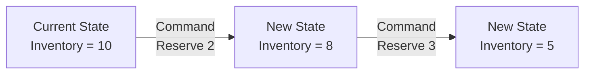
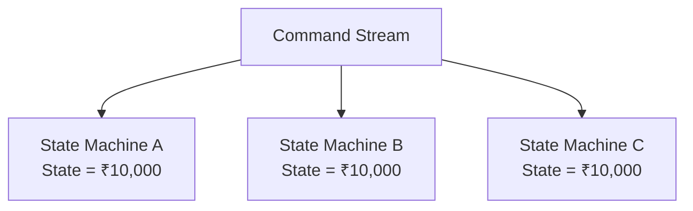
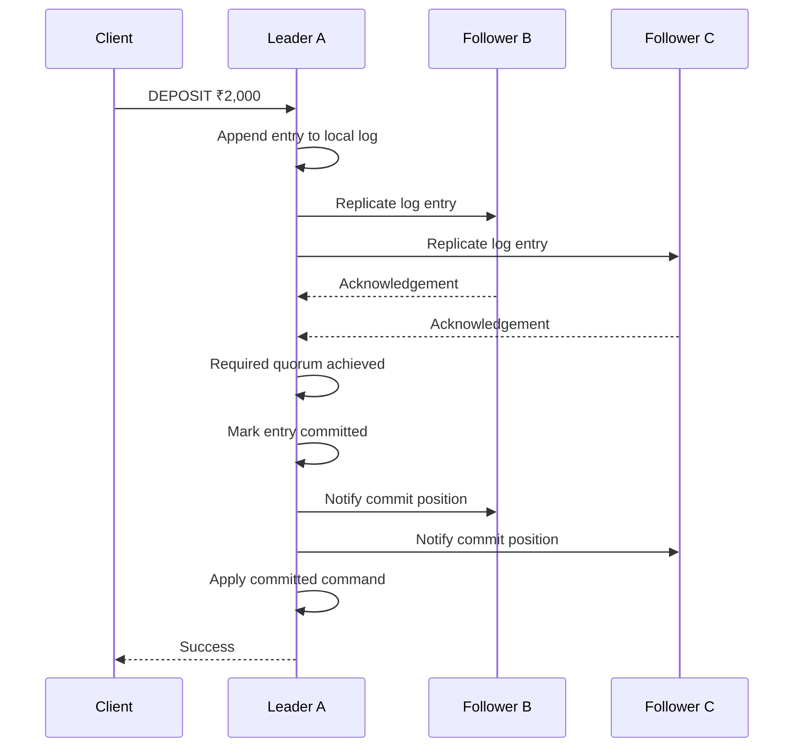
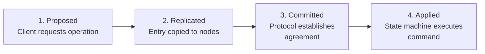
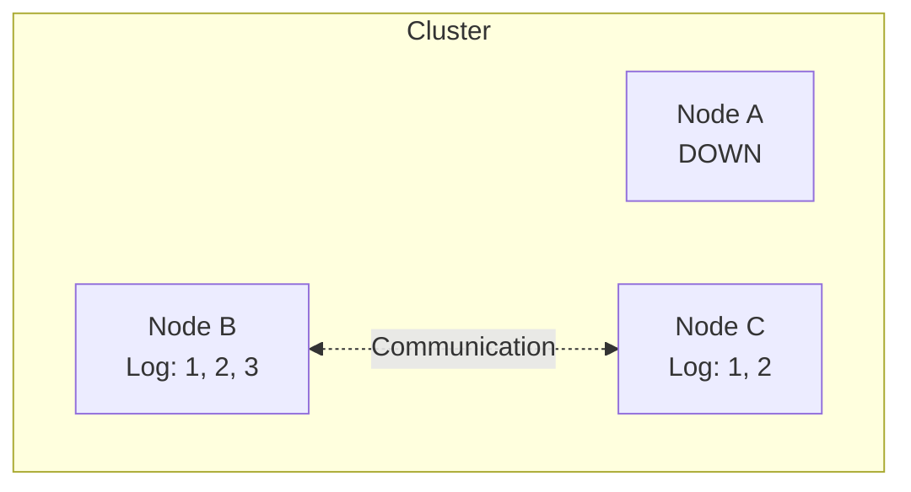
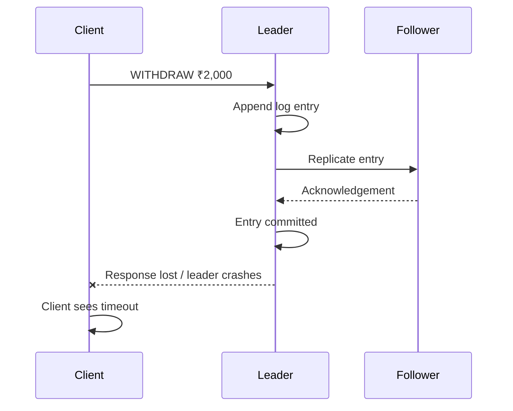
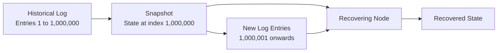
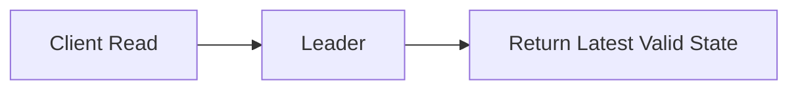
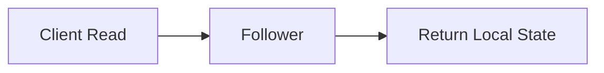
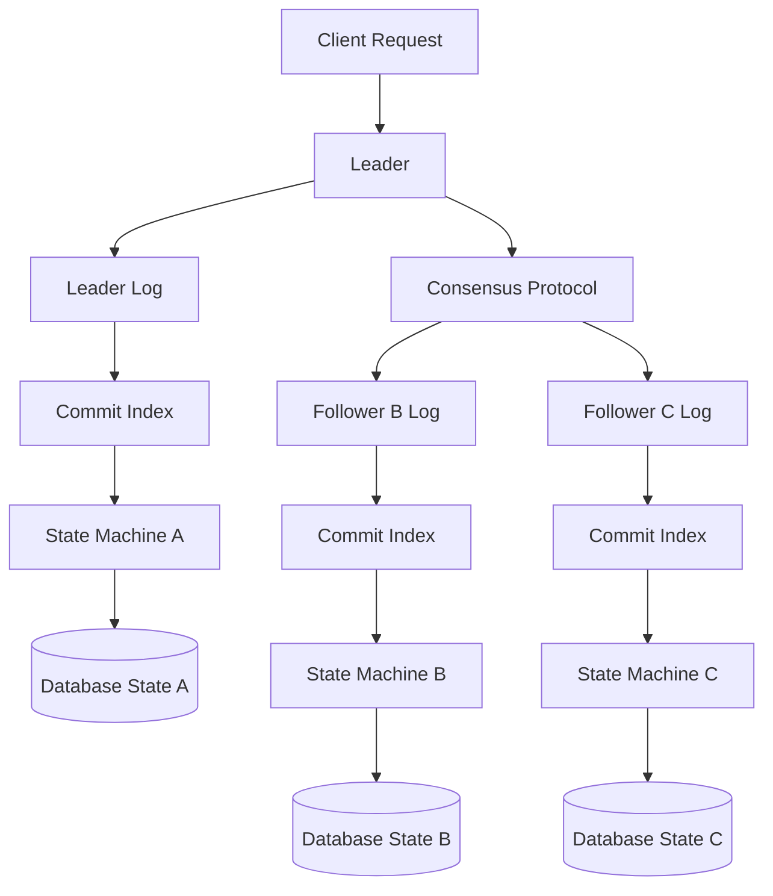

# Chapter 4: State Machine Replication (SMR) — How Consensus Actually Powers Distributed Databases

In the previous chapter, we learned what distributed consensus means and why multiple nodes need to agree on decisions.

Now let's understand how this agreement is actually used to build a distributed database.

This chapter introduces a very important architectural pattern:

State Machine Replication (SMR).

Once you understand SMR, concepts like Raft, Paxos, replicated logs, committed entries, database recovery, and leader-based replication will become much easier.

We'll build this from scratch.

# 4.1 First, what is a State Machine?

Before understanding State Machine Replication, let's understand what a state machine is.

A state machine is a system that:

1. Maintains some state.
2. Receives an operation or command.
3. Processes that command.
4. Transitions from its current state to a new state.

Let's take a simple bank account.

Initial state:

```
Account balance = ₹10,000
```

The account receives a command:

```
DEPOSIT ₹2,000
```

The state machine processes it.

```
Current state = ₹10,000

Command = DEPOSIT ₹2,000

New state = ₹12,000
```

Another command arrives:

```
WITHDRAW ₹3,000
```

The state machine processes it.

```
Current state = ₹12,000

Command = WITHDRAW ₹3,000

New state = ₹9,000
```

This is a state transition.

We can represent it mathematically:

\\[ S\_{new} = F(S\_{current}, Command) \\]

Where:

- \\(S\_{current}\\) is the current state.
- \\(Command\\) is the operation.
- \\(F\\) is the state transition function.
- \\(S\_{new}\\) is the resulting state.

For example:

\\[ F(10000, DEPOSIT(2000)) = 12000 \\]

And:

\\[ F(12000, WITHDRAW(3000)) = 9000 \\]

The important thing is that the state changes according to the commands it receives.

## Another real-world example: Inventory

Suppose an inventory management system has:

```
Product ID = 101
Quantity = 10
```

It receives:

```
RESERVE_PRODUCT(101, 2)
```

The state transition is:

```
Quantity before = 10
Reserved = 2
Quantity after = 8
```

If another request arrives:

```
RESERVE_PRODUCT(101, 3)
```

The quantity becomes:

```
Quantity = 5
```

We can model this as:



This is a state machine.

It doesn't necessarily need a database or a distributed system. Even a simple application can be modelled as a state machine.

But now let's make this interesting.

# 4.2 What if we have multiple copies of the same state machine?

Imagine a banking application running across three database nodes.

All three nodes maintain the same account information.

```
Node A: Account balance = ₹10,000
Node B: Account balance = ₹10,000
Node C: Account balance = ₹10,000
```

These nodes are independent machines.

Each has its own memory and storage.

We want all three to process the same commands and reach the same result.

For example:

```
Command 1: DEPOSIT ₹2,000
Command 2: WITHDRAW ₹3,000
Command 3: DEPOSIT ₹1,000
```

If every node processes exactly these commands in exactly the same order, what will happen?

Node A:

```
10000
+ 2000
- 3000
+ 1000
------
10000
```

Node B:

```
10000
+ 2000
- 3000
+ 1000
------
10000
```

Node C:

```
10000
+ 2000
- 3000
+ 1000
------
10000
```

All three nodes reach the same final state.

This is the fundamental idea behind State Machine Replication.

State Machine Replication means maintaining multiple replicas of a state machine and ensuring they process the same commands in the same order.



But there are two critical requirements:

1. All replicas must receive the same commands.
2. All replicas must process the commands in the same order.

There is also an important third requirement that we will discuss next.

# 4.3 Why must all replicas execute commands in the same order?

This is where the concept becomes interesting.

Let's assume the account balance is:

```
₹10,000
```

We receive two operations:

```
A: Withdraw ₹8,000
B: Withdraw ₹5,000
```

Our business rule says that the account cannot have a negative balance.

Consider two execution orders.

### Execution order 1: A, then B

Initial balance:

```
₹10,000
```

Execute A:

```
Withdraw ₹8,000

Balance = ₹2,000
Success
```

Execute B:

```
Withdraw ₹5,000

Balance = ₹2,000
Failure: Insufficient funds
```

Final balance:

```
₹2,000
```

### Execution order 2: B, then A

Initial balance:

```
₹10,000
```

Execute B:

```
Withdraw ₹5,000

Balance = ₹5,000
Success
```

Execute A:

```
Withdraw ₹8,000

Balance = ₹5,000
Failure: Insufficient funds
```

Final balance:

```
₹5,000
```

Notice something?

The same two commands produced different results because their execution order was different.

| Execution order                 | Final balance |
| ------------------------------- | ------------- |
| Withdraw 8,000 → Withdraw 5,000 | ₹2,000        |
| Withdraw 5,000 → Withdraw 8,000 | ₹5,000        |

Now imagine:

```
Node A executes: A → B

Node B executes: B → A

Node C executes: A → B
```

Their states will differ.

That breaks the entire purpose of replication.

Therefore:

All replicas must process the same commands in the same agreed order.

This is why consensus is so important.

Consensus provides a mechanism for establishing the order of operations.

SMR uses that agreed order to keep the replicas logically consistent.

# 4.4 The third requirement: Deterministic execution

We have established that all replicas must process the same commands in the same order.

But this alone is not sufficient.

They must also execute the commands deterministically.

What does that mean?

Suppose all three replicas receive:

```
GENERATE_RANDOM_NUMBER
```

Node A generates:

```
42
```

Node B generates:

```
87
```

Node C generates:

```
15
```

All three received the same command.

All three executed it.

But they produced different results.

This violates the requirement for deterministic state-machine execution.

### What is deterministic execution?

A state transition is deterministic when the same initial state and same command produce the same result.

Formally:

\\[ F(S,C)=S' \\]

For identical \\(S\\) and \\(C\\), the result \\(S'\\) must be identical.

Consider these examples.

| Operation                                   | Deterministic?  |
| ------------------------------------------- | --------------- |
| Add 100 to balance                          | Yes             |
| Subtract 50 from inventory                  | Yes             |
| Generate a random number locally            | No              |
| Read the current local system time          | Not necessarily |
| Make an HTTP request to an external service | Not necessarily |
| Calculate SHA-256 of fixed input            | Yes             |
| Read an uncoordinated local file            | Not necessarily |

### Why is this important?

Imagine three replicas process:

```
SET_ACCOUNT_STATUS(ACTIVE)
```

The operation is deterministic.

All replicas produce:

```
Account status = ACTIVE
```

But suppose the command is:

```
SET_ACCOUNT_UPDATED_AT_TO_CURRENT_TIME
```

Each replica reads its own clock.

Node A:

```
10:00:00.100
```

Node B:

```
10:00:00.130
```

Node C:

```
10:00:00.090
```

They produce different states.

We must avoid this.

### How do production systems handle nondeterministic operations?

There are several approaches.

Approach 1: Put the nondeterministic result inside the command.

Instead of sending:

```
GENERATE_ORDER_ID
```

Send:

```
CREATE_ORDER(
    order_id = "ORD-123",
    created_at = "2026-11-03T16:00:00Z"
)
```

The identifier and timestamp are generated by the client or coordinating component and included in the agreed command.

Every replica receives the same values.

Approach 2: Move external operations outside the replicated state machine.

For example, don't have every replica call a payment provider independently.

Instead:

1. Agree on a command to initiate a payment.
2. One controlled execution component performs the external call.
3. The outcome is recorded as a new command.
4. The replicas apply the recorded outcome deterministically.

Approach 3: Record nondeterministic inputs.

For certain operations, the system can record the external result or input in a durable log so replicas replay the same information.

This is especially important in systems that perform deterministic replay.

### Production engineering lesson

When designing replicated systems, ask:

- Does this operation depend on local time?
- Does it use random numbers?
- Does it make an external HTTP call?
- Does it depend on local machine configuration?
- Does it depend on the order of concurrent local operations?

These are all potential sources of nondeterminism.

# 4.5 Now let's introduce the most important component: Replicated Log

We understand the state machine.

We understand why commands must be executed in the same order.

But how do we ensure every replica receives the same ordered commands?

This brings us to the replicated log.

A log is an ordered sequence of records.

For example:

```
Index 1: CREATE_ACCOUNT(101)
Index 2: DEPOSIT(101, 10000)
Index 3: WITHDRAW(101, 2000)
Index 4: DEPOSIT(101, 500)
Index 5: WITHDRAW(101, 1000)
```

Think of it as a historical record of operations.

Each entry has a position.

```
+-------+----------------------------------+
| Index | Command                          |
+-------+----------------------------------+
| 1     | CREATE_ACCOUNT(101)              |
| 2     | DEPOSIT(101, 10000)              |
| 3     | WITHDRAW(101, 2000)              |
| 4     | DEPOSIT(101, 500)                |
| 5     | WITHDRAW(101, 1000)              |
+-------+----------------------------------+
```

The important characteristic is that the log has a defined order.

Every replica should maintain a compatible copy of this ordered history.

### Why not directly update the database?

You might wonder:

Why do we need a log?

Why can't the leader simply update its database and send the final state to followers?

Because sending only the final state loses important information.

Consider:

Initial balance:

```
₹10,000
```

Operations:

```
DEPOSIT ₹2,000
WITHDRAW ₹1,000
```

Final balance:

```
₹11,000
```

If we only send:

```
Balance = ₹11,000
```

The follower doesn't know:

- Which operations occurred.
- In which order they occurred.
- Whether an operation was duplicated.
- How to reconstruct the history.
- Which operations were committed.
- How to recover incrementally.

A log provides an ordered history.

It also makes recovery and replication much easier.

# 4.6 How a replicated log works

Let's create three nodes.

```
Node A
Node B
Node C
```

Assume Node A is currently the leader.

A client submits:

```
DEPOSIT ₹2,000
```

The leader coordinates the operation.

The conceptual process is:

### Step 1: Client sends a command to the leader

```
Client → Node A

DEPOSIT ₹2,000
```

### Step 2: Leader appends the command to its local log

```
Node A Log:

Index 1: DEPOSIT ₹2,000
```

At this point, the entry is locally recorded but may not yet be committed.

### Step 3: Leader replicates the entry

```
Node A → Node B
Node A → Node C
```

The followers append the entry to their own logs.

```
Node A:
Index 1: DEPOSIT ₹2,000

Node B:
Index 1: DEPOSIT ₹2,000

Node C:
Index 1: DEPOSIT ₹2,000
```

### Step 4: The leader obtains the required acknowledgements

For a three-node majority-based group, a majority is two.

Suppose Node A and Node B have recorded the entry.

The protocol's commitment rules may now allow this entry to be committed.

### Step 5: The entry becomes committed

The leader advances its commit position.

Followers learn about the committed position through protocol messages.

### Step 6: Replicas apply the committed command

All replicas execute:

```
DEPOSIT ₹2,000
```

Their account state becomes:

```
₹12,000
```

Here is the overall flow.



This is the basic architecture of leader-based replicated state machines.

The actual details of commitment, acknowledgement, and recovery depend on the consensus algorithm.

We'll examine Raft's exact implementation later.

# 4.7 Four important stages: Proposed, Replicated, Committed, Applied

This is a critical topic.

These four terms are often confused, especially in system design interviews.

Let's understand them separately.

Imagine a client sends:

```
WITHDRAW ₹2,000
```

The operation goes through several stages.

## Stage 1: Proposed

A client requests an operation.

```
Client → Leader

WITHDRAW ₹2,000
```

The leader receives the request.

The operation has been proposed for inclusion in the replicated history.

But it is not necessarily durable or committed yet.

## Stage 2: Replicated

The leader writes the entry into its log and sends it to followers.

```
Leader Log:
Index 10: WITHDRAW ₹2,000

Follower 1 Log:
Index 10: WITHDRAW ₹2,000

Follower 2 Log:
Index 10: WITHDRAW ₹2,000
```

The entry has been copied to other nodes.

But an important distinction:

Replicated does not necessarily mean committed.

An entry might exist on multiple nodes but still be unsafe to treat as committed.

Why?

Because the replication might not satisfy the consensus protocol's commitment conditions.

## Stage 3: Committed

The protocol has established that the entry is committed.

The entry is now part of the agreed history and must not be replaced by a conflicting history under the protocol's safety guarantees.

For Raft, commitment depends on its quorum and log-term rules, which we will study later.

## Stage 4: Applied

The replica executes the committed entry against its state machine.

For example:

```
Previous balance = ₹10,000

Command = WITHDRAW ₹2,000

New balance = ₹8,000
```

This is when the local application state is updated.

### Visualising the stages



### Why are these stages separate?

Imagine an entry has reached three nodes.

One might assume it is safe.

But perhaps the nodes don't all represent the same election term, or the entry could still be superseded according to the protocol.

Consensus algorithms need precise rules to determine when an entry is safe.

This is why we distinguish replication from commitment.

### Important nuance

The terms accepted, persisted, replicated, committed, and applied do not have identical meanings in every distributed protocol.

The four-stage model above is particularly useful for understanding Raft-style replicated logs.

Also, a production system may acknowledge the client immediately after commitment without waiting for every replica to apply the entry. The system's read and acknowledgement guarantees determine what the client can safely assume.

# 4.8 What is the Commit Index?

Let's introduce another important concept.

Consider this replicated log:

```
Index 1: CREATE_ACCOUNT
Index 2: DEPOSIT ₹10,000
Index 3: WITHDRAW ₹2,000
Index 4: DEPOSIT ₹5,000
Index 5: WITHDRAW ₹1,000
```

Suppose the system has established that entries 1, 2, and 3 are committed.

Then:

```
Commit Index = 3
```

The commit index represents the highest log position known to be committed.

Conceptually:

```
Log:
+-------+------------------+------------+
| Index | Operation        | Status     |
+-------+------------------+------------+
| 1     | CREATE_ACCOUNT   | COMMITTED  |
| 2     | DEPOSIT 10000    | COMMITTED  |
| 3     | WITHDRAW 2000    | COMMITTED  |
| 4     | DEPOSIT 5000     | Pending    |
| 5     | WITHDRAW 1000    | Pending    |
+-------+------------------+------------+

Commit Index = 3
```

The state machine should only apply entries that are committed.

Once entries 1, 2, and 3 are applied:

```
State:
Initial balance = 0

CREATE_ACCOUNT
DEPOSIT 10000
WITHDRAW 2000

Current balance = ₹8,000
```

Entries 4 and 5 are not applied yet.

### What is the Last Applied Index?

This is another important concept.

It identifies the highest log position the state machine has already executed.

Suppose:

```
Commit Index = 5
Last Applied Index = 3
```

The system knows entries up to index 5 are committed.

But its local state machine has only applied entries up to index 3.

It needs to apply:

```
Index 4
Index 5
```

Eventually:

```
Commit Index = 5
Last Applied Index = 5
```

### Why maintain both?

Because commitment and execution are different activities.

A node can know that entries are committed but may still be catching up on applying them.

This distinction is useful for:

- Monitoring replication progress.
- Detecting application lag.
- Restart recovery.
- Understanding read availability.
- Diagnosing slow followers.

# 4.9 What happens when a node crashes?

Now let's study one of the most important production scenarios.

Assume we have three nodes.

```
A: Leader
B: Follower
C: Follower
```

Their logs are initially empty.

A client sends three operations:

```
1. DEPOSIT ₹10,000
2. WITHDRAW ₹2,000
3. DEPOSIT ₹5,000
```

The leader replicates them.

After some time:

```
Node A:
1. DEPOSIT 10000
2. WITHDRAW 2000
3. DEPOSIT 5000

Node B:
1. DEPOSIT 10000
2. WITHDRAW 2000
3. DEPOSIT 5000

Node C:
1. DEPOSIT 10000
2. WITHDRAW 2000
```

Suppose entries 1 and 2 are committed.

Entry 3 has not yet been committed.

Now the leader crashes.



What happens?

First, the system must establish a new leader through its election protocol.

The new leader must recover the committed history correctly.

Entries 1 and 2 must be preserved.

Entry 3 requires special handling because it was not committed.

Depending on the protocol and election outcome, an uncommitted entry may be retained or discarded.

The system must never discard committed history in favour of a conflicting history.

### Why not simply select the node with the longest log?

Because the longest log is not necessarily the safest log.

Consider:

```
Node B:
1, 2, 3, 4, 5

Node C:
1, 2, 3
```

Perhaps entries 4 and 5 were written by a former leader but never committed.

A longer log does not prove that it contains the authoritative history.

The consensus protocol needs to consider additional information, such as election terms and log freshness.

Raft uses rules involving term numbers and log positions to prevent candidates with stale histories from becoming leaders.

We'll study this in the leader-election and Raft chapters.

# 4.10 A crucial scenario: The leader crashes after committing but before responding

This scenario is particularly important for backend engineers.

Consider a payment or banking operation.

The client sends:

```
WITHDRAW ₹2,000
```

The leader:

1. Receives the request.
2. Appends it to its log.
3. Replicates it.
4. Gets the required quorum.
5. Commits the entry.

But before sending the success response to the client, the leader crashes.



Now the client observes:

```
Request timed out.
```

What should the client do?

It might retry.

But the original withdrawal might already have been committed.

If the system blindly executes the retry, it could withdraw another ₹2,000.

This demonstrates an important fact:

Consensus can guarantee agreement on an operation without guaranteeing that the caller received the result.

How should we handle this?

Use an idempotency key.

For example:

```
{
  "transactionId": "TXN-12345",
  "accountId": 101,
  "amount": 2000,
  "operation": "WITHDRAW"
}
```

The system ensures that `TXN-12345` represents one logical operation.

A retry with the same identifier should return the existing result rather than execute another withdrawal.

This is an important combination:

- Consensus protects the agreed operation history.
- Idempotency protects against duplicate logical requests.
- Durable storage preserves the transaction record.

They solve different problems.

# 4.11 State Machine Replication and Write-Ahead Logging

Now let's connect SMR with something familiar from relational databases.

You may already know about Write-Ahead Logging (WAL).

Databases such as PostgreSQL use WAL to record changes before considering the corresponding data pages safely persisted.

Why?

Because the database needs to recover after a crash.

Conceptually:

```
Transaction
    |
    v
Write WAL record
    |
    v
Persist WAL
    |
    v
Update data pages
```

After a crash, the database can replay the WAL to recover committed changes.

This looks similar to a replicated log.

But there is an important distinction.

### Local WAL

Local WAL primarily helps one database instance maintain durability and recoverability.

It records local database changes.

### Replicated consensus log

A replicated consensus log coordinates an ordered history across multiple independent nodes.

It establishes which operations are authoritative according to the consensus protocol.

### Comparison

| Local WAL                                | Consensus replicated log                       |
| ---------------------------------------- | ---------------------------------------------- |
| Maintains local recovery history         | Maintains distributed agreed history           |
| Supports crash recovery                  | Supports distributed coordination and recovery |
| Usually belongs to one database instance | Exists across multiple consensus participants  |
| Helps restore durable local state        | Helps replicas agree on operation ordering     |

Some distributed databases use both ideas together.

For example, a distributed database might maintain consensus-replicated log entries and persist them locally using a WAL-like mechanism.

Do not confuse local write-ahead logging with distributed consensus.

A local WAL alone does not elect a leader or establish agreement among independent machines.

# 4.12 What if the log becomes very large?

Consider a database that has been running for five years.

It has accumulated billions of log entries.

```
Index 1
Index 2
Index 3
...
Index 8,000,000,000
```

Should every new node replay billions of entries when it joins the cluster?

Obviously not.

This introduces another important concept: Snapshots.

A snapshot captures the state machine's state at a particular log position.

Suppose:

```
Index 1 to 1,000,000 have been applied.
```

The database creates a snapshot:

```
Snapshot at index 1,000,000

Account 101 = ₹50,000
Account 102 = ₹20,000
Account 103 = ₹75,000
```

Now, instead of replaying the complete log, a recovering node can:

1. Obtain the snapshot.
2. Restore the snapshot state.
3. Replay entries after index 1,000,000.



This significantly reduces recovery time and storage requirements.

### Why is the snapshot position important?

The snapshot must represent a well-defined state corresponding to a particular point in the log.

For example:

```
Snapshot covers entries 1–1000.
```

The node must then replay:

```
1001, 1002, 1003...
```

It must not accidentally replay entry 1000 again or skip entry 1001.

### Where is this used?

Snapshotting and log compaction are common techniques in systems such as:

- etcd.
- Raft implementations.
- Distributed databases.
- Event-sourced applications.
- State machine replication frameworks.

A useful distinction:

An event-sourced application may retain business events as a long-term domain history.

A consensus replicated log often exists primarily to maintain the distributed system's authoritative operation history and may be compacted after snapshots.

These purposes overlap, but they are not identical.

# 4.13 Read operations in State Machine Replication

So far, we have focused primarily on writes.

What about reads?

Imagine the database has three replicas.

```
Leader balance = ₹8,000
Follower 1 balance = ₹8,000
Follower 2 balance = ₹10,000
```

Suppose the follower has not yet applied the latest committed operation.

A client reads from Follower 2.

It receives:

```
₹10,000
```

But the latest committed balance is:

```
₹8,000
```

This is a stale read.

So how should a distributed database handle reads?

There are several approaches.

### Approach 1: Read from the leader



This is relatively simple.

However, the leader must ensure that its read satisfies the database's consistency requirements.

In Raft, a leader must establish that it still has the necessary authority before serving a linearizable read. Merely being the node that last believed it was leader is not sufficient.

### Approach 2: Read from followers



This can reduce load on the leader and improve read scalability.

But the read may be stale.

This is often acceptable for:

- Product catalogue browsing.
- Analytics dashboards.
- Non-critical reporting.
- Certain feed and profile views.

It may not be acceptable for:

- Account balance verification before withdrawal.
- Inventory availability checks where overselling must be prevented.
- Financial transaction status checks requiring strong consistency.

### Approach 3: Quorum or protocol-coordinated reads

Some systems use quorum-based or consensus-aware mechanisms to establish a sufficiently fresh read.

For example, a Raft-based system may use a ReadIndex mechanism to establish that the leader is still authoritative and obtain a safe read position.

Another approach is a valid leader lease, under carefully defined timing and clock assumptions.

We'll study these approaches when we cover Raft and consistency models.

### Important distinction

Consensus for writes does not automatically make every read from every replica linearizable.

Read consistency needs its own design.

# 4.14 Putting everything together: Full SMR architecture

Let's now look at the complete architecture.

We have three database nodes:

```
Node A: Leader
Node B: Follower
Node C: Follower
```

Each node maintains:

1. A replicated log.
2. A commit position.
3. An applied position.
4. A state machine.
5. Persistent storage.

The client submits commands to the leader.

The leader coordinates log replication.

The consensus protocol determines when entries are committed.

The replicas apply committed entries in order.



The central idea:

Consensus establishes the committed command history. State Machine Replication applies that history consistently across replicas.

This is the architecture you should have in your mind when studying Raft.

# 4.15 Real-world applications

Let's connect SMR to actual technologies.

| Technology  | Connection to SMR                                                                   |
| ----------- | ----------------------------------------------------------------------------------- |
| etcd        | Replicates an ordered state-changing log using Raft                                 |
| CockroachDB | Uses Raft-replicated ranges to maintain replicated data                             |
| TiKV        | Uses Raft groups to replicate and coordinate data                                   |
| Consul      | Uses Raft for consistent server-side state                                          |
| Kafka KRaft | Uses a Raft-based metadata log                                                      |
| ZooKeeper   | Uses a different atomic broadcast protocol (Zab) to replicate ordered state changes |

A useful point about Kafka:

In KRaft mode, Raft is used for the metadata quorum. This does not mean every Kafka topic partition is simply one Raft group.

Likewise, CockroachDB and TiKV use distributed consensus at the data-replication layer, but their complete database architectures contain many additional components.

# 4.16 Interview Questions and Answers

### Q1. What is State Machine Replication?

State Machine Replication is a distributed systems technique where multiple replicas maintain copies of the same state and process the same commands in the same agreed order.

If execution is deterministic, all replicas reach the same logical state.

### Q2. Why must state machine execution be deterministic?

Because replicas process the same commands. If the same command produces different results on different replicas, their states diverge.

### Q3. Why do we need a replicated log?

A replicated log provides an ordered history of operations that can be consistently applied across replicas. It also supports recovery and replication tracking.

### Q4. What is the difference between replicated and committed?

Replicated means an entry has been copied to one or more nodes.

Committed means the consensus protocol has established that the entry belongs to the authoritative history according to its commitment rules.

An entry can be replicated without being committed.

### Q5. What is the difference between committed and applied?

Committed means the operation is part of the agreed history.

Applied means the local state machine has executed that operation and updated its state.

### Q6. What is a commit index?

It is the highest log position known to be committed.

### Q7. What is a last applied index?

It is the highest log position already executed by the local state machine.

### Q8. What happens when a leader crashes?

A new leader must be elected using the consensus protocol. The new leader must preserve committed history and reconcile any uncommitted entries according to the protocol's rules.

### Q9. Why can't we just select the node with the longest log?

Because a longer log might contain uncommitted entries. Log length alone does not establish which history is authoritative.

### Q10. What is snapshotting?

Snapshotting captures the state machine's state at a particular log position. New or recovering replicas can restore the snapshot and replay only later log entries instead of replaying the entire history.

### Q11. Does consensus guarantee that all replicas always have identical states?

No. Replicas can temporarily lag. Consensus protects the agreed committed history, while replication and application processes bring replicas up to date.

### Q12. Can an application still execute a committed operation twice?

Yes, if it retries after losing the response. Consensus does not automatically provide end-to-end exactly-once business execution. Idempotency is still required.

# 4.17 Knowledge Check: Think Like a Distributed Systems Engineer

Consider these scenarios.

Scenario 1: Different command ordering

Three nodes receive:

```
DEPOSIT ₹2,000
WITHDRAW ₹5,000
```

Two nodes execute the deposit first, while one executes the withdrawal first.

Why is this dangerous?

What mechanism prevents it?

Scenario 2: Nondeterministic execution

All three nodes receive:

```
SET updated_at = CURRENT_TIMESTAMP
```

Why might their states diverge?

How would you redesign the command?

Scenario 3: Replicated but not committed

An operation exists on two out of three nodes.

The leader crashes.

Can you automatically assume that the operation is committed?

Why not?

Scenario 4: Committed but not applied

A node has:

```
Commit Index = 100
Last Applied Index = 95
```

What does this tell you?

Which entries does the node still need to process?

Scenario 5: Leader crashes after commit

The leader commits a ₹5,000 withdrawal, but crashes before returning a response.

The client retries the request.

How do you prevent the customer from being charged twice?

# What you must remember from this chapter

There are six concepts that form the foundation of the next chapters.

| Concept                  | Remember this                                            |
| ------------------------ | -------------------------------------------------------- |
| State Machine            | Maintains state and changes it through commands          |
| Determinism              | Same initial state + same command = same result          |
| Replicated State Machine | Multiple replicas execute the same ordered commands      |
| Replicated Log           | Maintains the ordered history of commands                |
| Commit Index             | Highest log position known to be committed               |
| Applied Index            | Highest log position executed by the local state machine |

The most important relationship is:

\\[ \boxed{\text{Consensus} \rightarrow \text{Agreed Log} \rightarrow \text{State Machine Replication}} \\]

Consensus establishes the agreed history.

The replicated log stores that history.

State Machine Replication applies it to maintain consistent logical state.

# Next Chapter: Chapter 5 — Leader Election in Depth

Now that we understand why distributed databases maintain replicated logs, let's examine how they select the node responsible for coordinating that replication.

We'll cover:

1. Why a leader is needed.
2. Why a leader cannot simply declare itself leader.
3. Heartbeat-based leader detection.
4. Election timeouts.
5. Terms, epochs, and generation numbers.
6. Candidate, follower, and leader states.
7. How voting works.
8. How nodes prevent multiple leaders.
9. What happens when two candidates start elections simultaneously.
10. What happens when an old leader comes back after a network partition.
11. Why a leader with a stale log must not become authoritative.
12. How Raft handles leader election internally.

We'll build the algorithm step by step before introducing the complete Raft protocol.

One particularly important concept we'll derive: why a node can be alive, still believe it is the leader, and yet no longer have the authority to commit writes.
