# Chapter 5: Leader Election in Depth — How Distributed Systems Select a Leader

Now we are getting into one of the most important practical concepts in distributed systems.

We already understand:

- Why distributed systems need coordination.
- Why nodes cannot reliably distinguish a slow machine from a crashed machine.
- What consensus means.
- Why quorum is important.
- How State Machine Replication uses an agreed log to maintain consistent state.

Now let's understand:

How does a group of independent machines select one leader, ensure that the leader has authority, and safely replace it when it fails?

This is the problem of Leader Election.

We'll build the concepts from scratch and gradually derive the Raft leader election algorithm.

By the end of this chapter, you should be able to reason about leader election in database clusters, distributed caches, message brokers, and coordination services.

# 5.1 Why do distributed systems need a leader?

Let's start with a database architecture.

Suppose we have three database nodes:

```
Node A
Node B
Node C
```

All three maintain copies of the same logical data.

A client wants to execute:

```
UPDATE accounts
SET balance = balance - 1000
WHERE account_id = 101;
```

Here is a potential problem.

What happens if all three nodes independently accept writes?

```
Node A receives: Withdraw ₹1,000
Node B receives: Withdraw ₹2,000
Node C receives: Deposit ₹5,000
```

Each node has its own view of the operations.

They might produce different histories.

We need a mechanism to establish a single authoritative ordering of operations.

One approach is to designate one node as the leader.

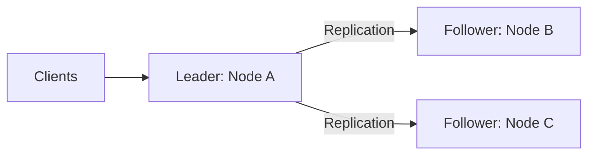

The responsibilities become:

Leader

- Coordinates write operations.
- Establishes the ordering of operations.
- Replicates log entries to followers.
- Tracks replication acknowledgements.
- Coordinates commitment according to the consensus protocol.

Followers

- Receive replicated log entries.
- Maintain their own replicated logs.
- Apply committed entries.
- Participate in elections.
- Vote for eligible candidates.

The leader makes coordination simpler because there is one primary authority responsible for ordering operations.

But this introduces another problem.

What happens if the leader crashes?

We need a mechanism to select another leader.

That is leader election.

# 5.2 Why can't a node simply declare itself the leader?

Imagine a cluster consisting of three nodes.

```
Node A
Node B
Node C
```

Initially:

```
A: Leader
B: Follower
C: Follower
```

Now A stops sending heartbeats.

B notices that it hasn't received a heartbeat for some time.

B thinks:

```
The leader might have crashed.
I should become the leader.
```

At the same time, C also notices the missing heartbeat.

C thinks:

```
The leader might have crashed.
I should become the leader.
```

Suppose both independently declare themselves leaders.

```
A: Leader (possibly still running)
B: Leader
C: Leader
```

Now we have three leaders!

This is obviously dangerous.

Therefore, a node cannot become a leader simply because it thinks the existing leader has failed.

It needs to obtain authority from the other nodes.

This is where voting and quorum come into play.

Leader election must be a coordinated decision, not a local decision.

# 5.3 The fundamental idea: Voting

Let's use our three-node cluster.

```
A
B
C
```

Suppose A is the current leader.

A crashes.

B and C detect that the leader is unavailable.

They need to select a replacement.

A simple way to think about this is an election.

Each node gets a vote.

For three nodes:

\\[ Q = \left\lfloor \frac{3}{2} \right\rfloor + 1 = 2 \\]

A candidate needs at least two votes.

Consider this election:

```
B requests votes from A and C.

B votes for itself.
C votes for B.

Total votes = 2
```

B obtains a majority.

B becomes the leader.

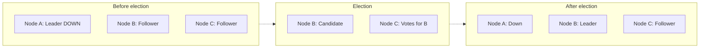

But we need to answer some deeper questions:

1. How do nodes know an election should start?
2. How do they prevent multiple candidates from winning?
3. Can a node vote more than once?
4. What happens if two candidates start an election simultaneously?
5. What happens if the old leader returns?
6. What if a candidate has an outdated database log?

A real leader election protocol must address all of these.

# 5.4 Terms / Epochs / Generation Numbers

This is one of the most important concepts in leader election.

Let's say Node A is the leader.

It becomes the leader during election number 1.

We can associate a number with this election:

```
Term = 1
```

Later, A crashes.

Node B becomes the leader.

This is a new election:

```
Term = 2
```

Later, B crashes.

Node C becomes the leader.

```
Term = 3
```

So the cluster progresses through terms.

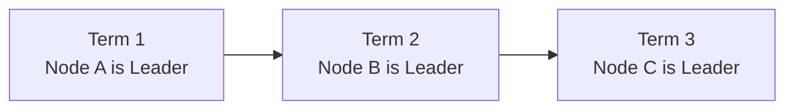

A term identifies an election epoch.

It helps the nodes distinguish old leadership from newer leadership.

### Why do we need terms?

Consider this situation.

Node A was the leader during term 5.

A network partition occurs.

B and C cannot communicate with A.

B and C start a new election.

B wins.

```
A: Leader, Term 5
B: Leader, Term 6
C: Follower, Term 6
```

Now the network recovers.

A starts communicating with B and C again.

A sends a message:

```
I am the leader.
My term is 5.
```

B responds:

```
My current term is 6.
Your term is outdated.
```

Node A learns that a newer election has occurred.

It steps down and becomes a follower.

```
A: Follower, Term 6
B: Leader, Term 6
C: Follower, Term 6
```

This is extremely powerful.

The old leader does not remain authoritative simply because it was previously the leader.

A higher term indicates a newer leadership epoch.

### What if a node receives a message with a higher term?

In Raft, a server that discovers a higher term updates its current term and becomes a follower, regardless of whether it was previously a candidate or leader.

For example:

```
Current term = 7

Received message:
Term = 8
```

The node updates:

```
Current term = 8
State = FOLLOWER
```

This rule prevents an old-term leader from continuing to participate in the protocol as the current leader after learning about newer authority.

### Important: Terms are not timestamps

A term is not a wall-clock timestamp.

It is a monotonically increasing logical generation number.

For example:

```
Term 1
Term 2
Term 3
Term 4
```

It tells us about the protocol's election history, not the physical time at which something happened.

This distinction is important because distributed clocks are not perfectly synchronized.

# 5.5 What information does each node maintain?

To understand leader election internally, let's look at the information maintained by a Raft server.

A simplified Raft node maintains:

| Field         | Meaning                                        |
| ------------- | ---------------------------------------------- |
| `currentTerm` | Latest term known to the node                  |
| `votedFor`    | Candidate voted for in the current term        |
| `log`         | Replicated operation history                   |
| `commitIndex` | Highest log index known to be committed        |
| `lastApplied` | Highest log index applied to the state machine |
| `role`        | Follower, Candidate, or Leader                 |

Let's understand the three most important fields for elections.

### 1. currentTerm

Example:

```
currentTerm = 8
```

This node knows about election term 8.

### 2. votedFor

Example:

```
votedFor = Node B
```

This means the node has already voted for B in the current term.

A Raft server grants at most one vote per term.

This is an essential rule.

### 3. log

Example:

```
Index 1: CREATE_ACCOUNT
Index 2: DEPOSIT 10000
Index 3: WITHDRAW 2000
```

The log contains the operations the node has received.

The log is important during leader election because a candidate must not be elected with a history that is too stale to safely preserve committed entries.

We'll explore this shortly.

# 5.6 The three states of a Raft node

In Raft, every server operates in one of three states:

1. Follower
2. Candidate
3. Leader

Let's understand them.

## A. Follower

A follower is a normal non-leader node.

It:

- Receives heartbeats from the leader.
- Receives replicated log entries.
- Responds to voting requests.
- Monitors the leader's communication.
- Starts an election when its election timeout expires without valid leader communication.

Initially, nodes generally start as followers.

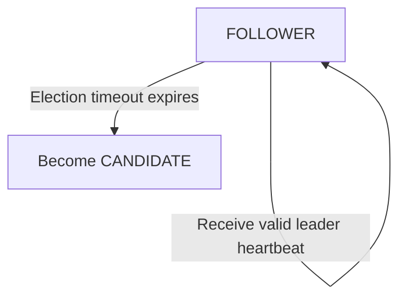

## B. Candidate

A candidate is a node trying to become leader.

It:

- Starts a new election term.
- Votes for itself.
- Requests votes from other nodes.
- Waits to collect a majority.

If it receives the required majority, it becomes leader.

If it discovers a higher term, it becomes a follower.

If it doesn't obtain a majority, it may start another election after another timeout.

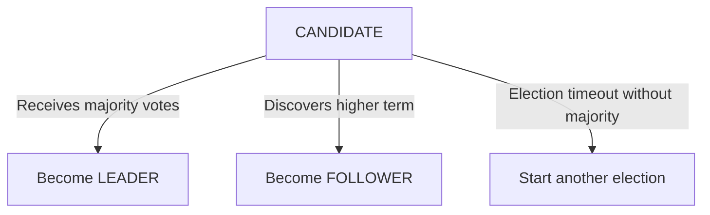

## C. Leader

The leader coordinates the cluster.

It:

- Sends heartbeats.
- Accepts or coordinates client operations.
- Replicates log entries.
- Tracks follower progress.
- Coordinates commitment.
- Responds to valid protocol messages.

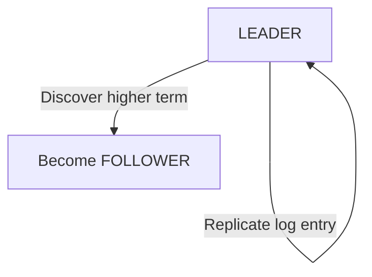

### Complete state transition model

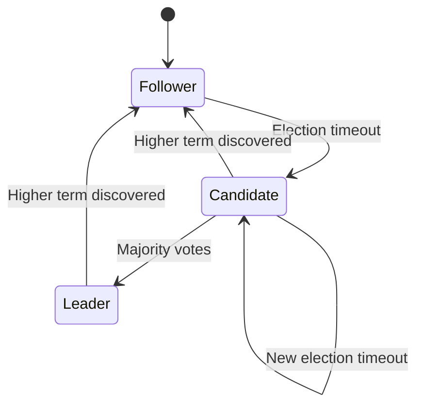

One important observation:

A follower doesn't become a leader directly.

It must first become a candidate and participate in an election.

# 5.7 Heartbeats and Election Timeouts

We discussed heartbeats in Chapter 2.

Now let's understand their role in leader election.

Suppose Node A is the leader.

It periodically sends heartbeat messages to B and C.

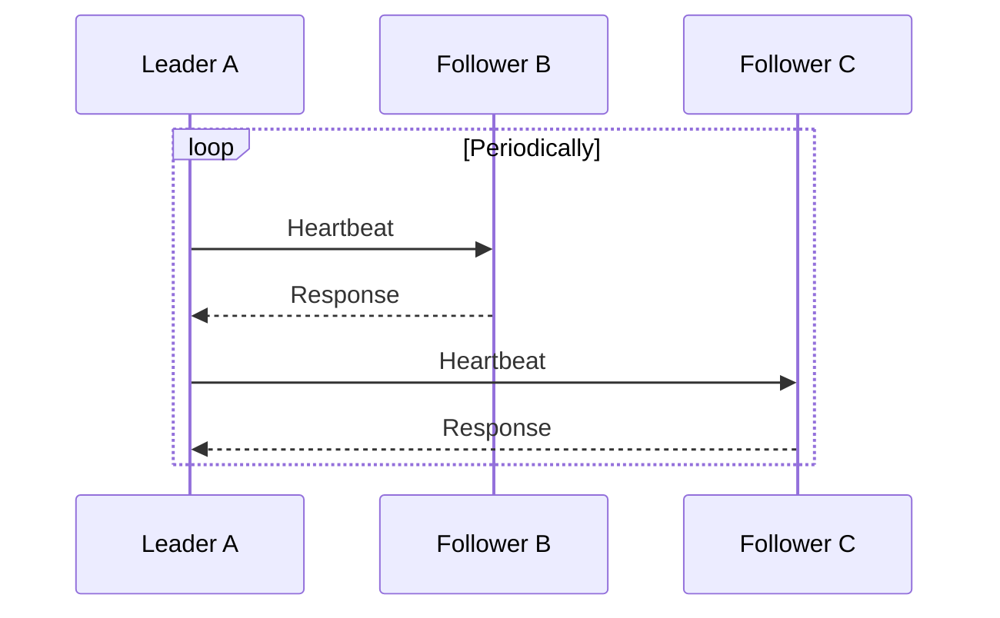

In Raft, heartbeats are represented using AppendEntries RPCs, including ones that contain no new log entries.

Followers use these messages to know that an elected leader is communicating.

Now imagine A crashes.

```
A: No heartbeat
B: No heartbeat
C: No heartbeat
```

B and C wait for their election timeouts.

When a follower's election timeout expires, it starts an election.

### What is an election timeout?

It is the amount of time a follower waits without receiving valid communication from a leader before starting an election.

For illustration:

```
Heartbeat interval: 100 ms
Election timeout: 500–900 ms
```

These are example values, not universal defaults.

A Raft implementation typically uses a randomized election timeout range.

Why randomization?

We will discuss that in the next section.

### Why must the election timeout be greater than the heartbeat interval?

Suppose:

```
Heartbeat interval = 500 ms
Election timeout = 200 ms
```

The follower might start an election before the next expected heartbeat arrives.

That would cause unnecessary elections.

So the election timeout must be meaningfully longer than the expected heartbeat interval, with enough allowance for network and processing delays.

Real deployments also need to consider network latency, scheduling pauses, storage delays, and the actual timing assumptions of the consensus protocol.

# 5.8 What happens if two candidates start an election simultaneously?

This is an interesting problem.

Suppose we have three nodes:

```
A
B
C
```

The current leader crashes.

B and C both detect its absence at almost the same time.

Both start elections.

```
B: Candidate
C: Candidate
```

Now B requests votes.

```
B -> A: Vote for B?
B -> C: Vote for B?
```

At the same time, C requests votes.

```
C -> A: Vote for C?
C -> B: Vote for C?
```

What happens?

Each node can vote at most once in the same term.

Suppose:

```
A votes for B.
B votes for itself.
C votes for itself.
```

The voting outcome:

```
B: 2 votes
C: 1 vote
```

B wins.

But there are situations where the votes get split.

## Split vote

Let's imagine a five-node cluster.

```
A, B, C, D, E
```

Majority required:

```
3 votes
```

B and C start elections simultaneously.

Voting:

```
B receives: B, D
C receives: C, A
E has not yet voted
```

Neither candidate has three votes.

```
B: 2 votes
C: 2 votes
E: No vote
```

Nobody becomes leader.

This is called a split vote.

The cluster cannot elect a leader in this election term.

### How does Raft solve this?

It uses randomized election timeouts.

For example:

```
Node B timeout = 700 ms
Node C timeout = 850 ms
Node D timeout = 620 ms
Node E timeout = 910 ms
```

These values are illustrative.

Different nodes are likely to start elections at different times.

Suppose D times out first.

D becomes a candidate.

It requests votes.

If it obtains a majority, it becomes the leader.

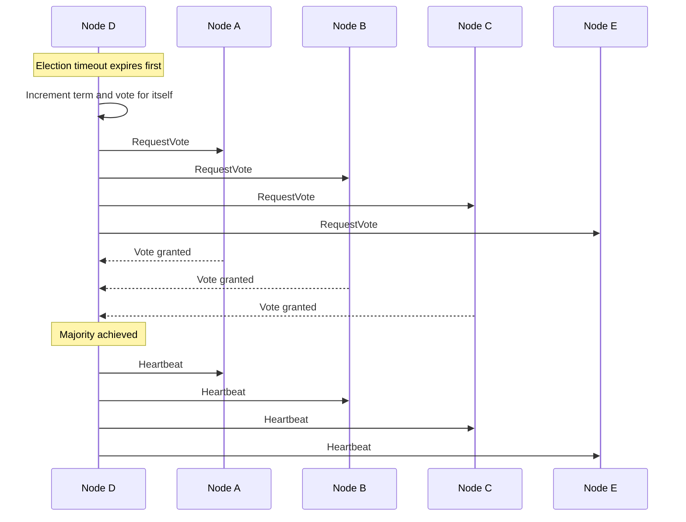

Once the other nodes receive valid leader communication, they stop their election attempts and follow D.

### Important insight

Randomized timeouts don't guarantee that split votes will never happen.

They make simultaneous elections less likely.

If a split vote happens, another election can occur with new randomized timeouts.

This is one way Raft improves the likelihood of electing a leader quickly.

# 5.9 Voting rules: Can a node vote for multiple candidates?

Let's understand a critical safety rule.

Suppose there are three nodes:

```
A, B, C
```

Current term:

```
Term = 10
```

Node C receives two voting requests.

First:

```
A asks C to vote for A.
```

C grants the vote.

```
C.votedFor = A
```

Then:

```
B asks C to vote for B.
```

Should C grant it?

No.

Because C has already voted in term 10.

```
C.votedFor = A
```

It must reject B's request in the same term.

In Raft:

A server grants at most one vote per term.

This is a fundamental rule that prevents two candidates from both obtaining votes from the same server in the same election term.

### Why does this matter?

For three nodes, a majority requires two votes.

Suppose A and B both try to become leaders in term 10.

If C could vote for both, the following could happen:

```
A receives votes from A and C.
B receives votes from B and C.
```

Both would obtain two votes.

This would violate the one-leader-per-term safety property.

The one-vote-per-term restriction prevents this.

The vote must also be persisted so that a server does not accidentally grant another vote in the same term after restarting.

This is an important implementation detail.

# 5.10 Raft Leader Election: The actual algorithm

Now that we understand the individual concepts, let's put them together.

Raft defines a relatively simple leader election mechanism.

We will examine it step by step.

Assume three servers:

```
A
B
C
```

Initially:

```
Term = 1

A: Leader
B: Follower
C: Follower
```

## Step 1: Leader stops sending heartbeats

A crashes.

B and C stop receiving valid heartbeats.

```
A: DOWN
B: Follower
C: Follower
```

## Step 2: A follower's election timeout expires

Suppose B's timeout expires first.

B starts an election.

It:

1. Increments its current term.
2. Changes its state to Candidate.
3. Votes for itself.
4. Sends RequestVote RPCs to other nodes.

```
B.currentTerm = 2
B.role = CANDIDATE
B.votedFor = B
```

## Step 3: B sends RequestVote messages

B sends:

```
RequestVote(
    term = 2,
    candidateId = B,
    lastLogIndex = 10,
    lastLogTerm = 1
)
```

The message contains information about:

- The candidate's election term.
- The candidate's identity.
- Its latest log position.
- Its latest log term.

Why does it include log information?

Because voters need to ensure that a candidate is sufficiently up to date before granting their votes.

We'll examine this shortly.

## Step 4: Other nodes evaluate the request

Node C receives the request.

It checks:

- Is the candidate's term current enough?
- Have I already voted for someone else in this term?
- Is the candidate's log at least as up to date as mine?

Suppose all conditions are satisfied.

C grants the vote.

```
C.votedFor = B
C.currentTerm = 2
```

A is unavailable.

B has:

```
B's own vote + C's vote = 2
```

A majority.

## Step 5: B becomes the leader

B changes its role:

```
B.role = LEADER
```

It begins sending periodic heartbeats.

```
B -> A: Heartbeat
B -> C: Heartbeat
```

A is unavailable.

C recognizes B as the leader.

```
B: Leader
C: Follower
A: Down
```

The new leader is established.

### Complete flow

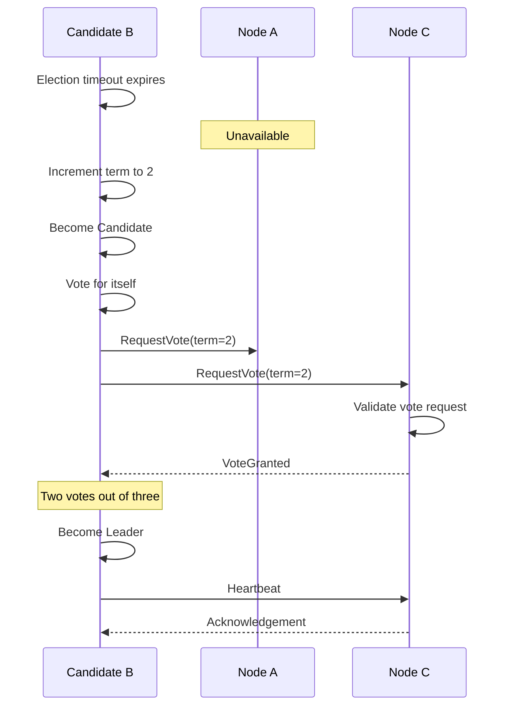

This is the core of Raft leader election.

# 5.11 Why does a candidate need an up-to-date log?

This is one of the most important and frequently misunderstood parts of Raft.

Suppose we have three nodes:

```
A
B
C
```

Their replicated logs are:

```
Node A:
1. CREATE_ACCOUNT
2. DEPOSIT 10000
3. WITHDRAW 2000

Node B:
1. CREATE_ACCOUNT
2. DEPOSIT 10000
3. WITHDRAW 2000

Node C:
1. CREATE_ACCOUNT
2. DEPOSIT 10000
```

Assume the first three entries have been committed.

A and B contain the complete committed history.

C is missing an entry.

Now suppose B crashes.

C attempts to become leader.

Should the other nodes elect C?

No, because C does not have the full committed history.

If C became leader and replaced the previous history, the committed withdrawal could be lost.

That would violate consensus safety.

Therefore, Raft includes a log freshness check during elections.

### How does Raft determine whether a log is up to date?

It compares:

1. The term of the candidate's last log entry.
2. The index of the candidate's last log entry.

The comparison is lexicographical.

First compare the last log terms.

If the terms are equal, compare the last log indices.

The log with the higher last-log term is considered more up to date.

If the last-log terms are equal, the longer log is more up to date.

### Example 1: Same last log term

```
Node A:
Index 1, Term 1
Index 2, Term 1
Index 3, Term 2
Index 4, Term 2

Node B:
Index 1, Term 1
Index 2, Term 1
Index 3, Term 2
```

Both have last log term 2.

Compare indices:

```
A: Index 4
B: Index 3
```

A's log is more up to date.

### Example 2: Different last log terms

```
Node A:
Last index = 5
Last term  = 3

Node B:
Last index = 4
Last term  = 4
```

Which log is more up to date?

B.

Even though B has fewer entries, its last entry belongs to a newer term.

```
A: (term 3, index 5)
B: (term 4, index 4)
```

Raft first compares terms.

Since 4 is greater than 3, B's log is more up to date according to Raft's comparison rule.

This is why simply choosing the node with the longest log is incorrect.

### Why is this log freshness rule important?

It helps preserve committed history when leadership changes.

A candidate that is too far behind cannot obtain votes from servers that hold a more up-to-date log.

The voting restriction and majority intersection work together to protect committed entries.

# 5.12 The Old Leader Returns: What happens?

Now let's study one of the most important scenarios in distributed systems.

We have three nodes:

```
A: Leader, Term 5
B: Follower, Term 5
C: Follower, Term 5
```

A network partition occurs.

A gets isolated from B and C.

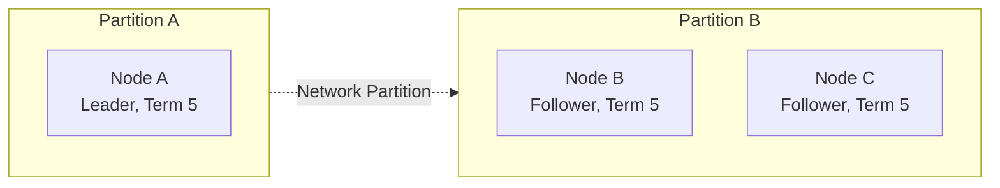

A still believes it is the leader.

It hasn't crashed.

It may continue running.

Meanwhile, B and C don't receive heartbeats.

Eventually, one of them starts an election.

B requests votes.

B obtains the majority of two nodes:

```
B: Vote for itself
C: Vote for B
```

B becomes the leader in term 6.

```
A: Leader, Term 5
B: Leader, Term 6
C: Follower, Term 6
```

Now the network recovers.

A and B can communicate again.

What happens?

B sends a message containing:

```
Current Term = 6
```

A receives this message.

A compares:

```
My term = 5
Received term = 6
```

A learns that it is outdated.

It updates:

```
currentTerm = 6
role = FOLLOWER
votedFor = null for the new term, subject to its persisted state
```

It no longer acts as a Raft leader.

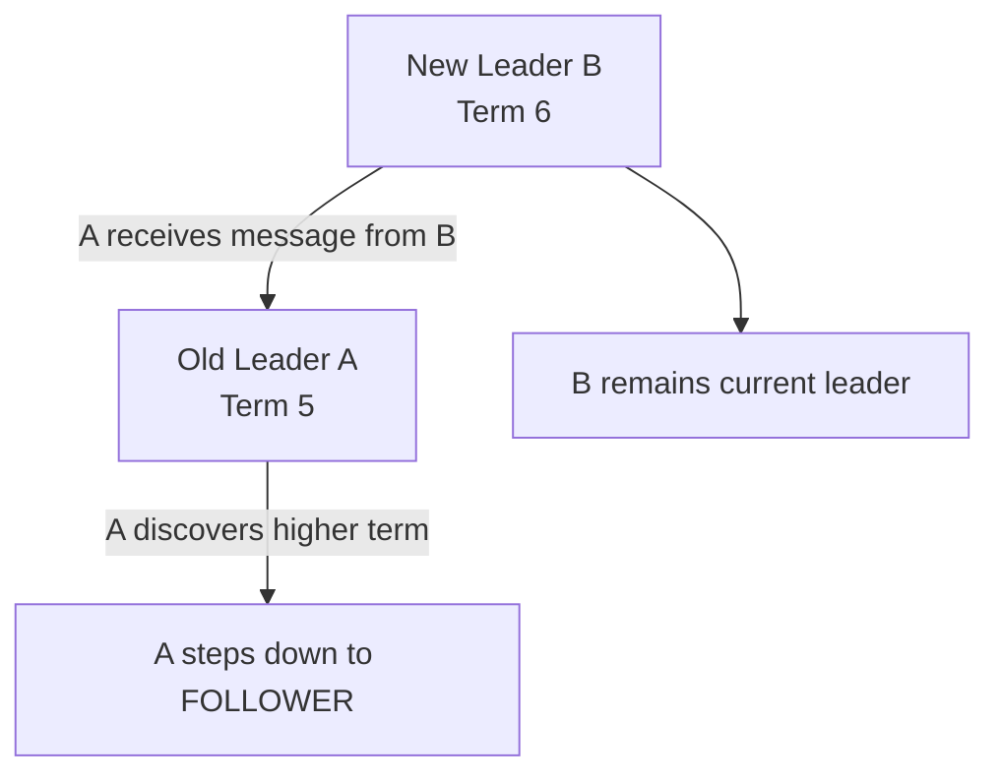

This is one of the most important safety mechanisms in Raft.

### But what if A has already accepted writes?

This is where we need to be precise.

A could have appended entries to its local log while isolated.

But it cannot commit new entries without obtaining the required majority.

The minority partition cannot independently establish a new committed decision.

When the network recovers, A's log will be reconciled with the authoritative leader's log.

Some uncommitted entries from A might be discarded.

Committed history must be preserved.

This is a crucial difference: being able to run code and append to a local log does not mean the node still has distributed authority to commit operations.

# 5.13 Can two leaders exist at the same time?

This is a very common interview question.

The answer needs some nuance.

For a fixed Raft voting configuration:

At most one leader can be elected in a given term.

Why?

Because:

1. A server grants at most one vote per term.
2. A leader needs a majority.
3. Any two majorities must overlap.
4. A shared voter cannot grant its single vote to two different candidates in the same term.

Therefore, two different candidates cannot both obtain a majority in the same term.

However, there is another important distinction.

A partitioned old leader can continue to believe that it is leader in an old term.

For example:

```
Node A: Leader, Term 5
Node B: Leader, Term 6
```

This may occur temporarily from the local perspectives of the nodes.

But they are not two equally authoritative leaders in the same Raft term.

Node B has been elected by a majority in a newer term.

A cannot commit new entries without a majority.

When A learns about term 6, it must step down.

### Interview answer

Raft guarantees at most one elected leader per term. During network partitions, an old leader may still locally believe it is leader, but it cannot commit new entries without a majority. When it discovers a higher term, it steps down.

This is a much better answer than simply saying:

"There can never be two leaders."

It distinguishes actual protocol authority from a node's local belief.

# 5.14 What happens when the network partition leaves no majority?

Consider a five-node cluster.

```
A, B, C, D, E
```

Majority:

\\[ Q = 3 \\]

Now the cluster splits:

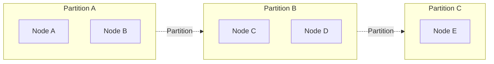

No partition has a majority.

```
Partition A = 2 nodes
Partition B = 2 nodes
Partition C = 1 node
```

What happens?

No partition can elect a legitimate new leader using the majority rule.

Therefore, the cluster cannot safely make new consensus decisions.

This sacrifices availability.

The nodes may continue serving certain operations that do not require consensus, depending on the system design.

But they cannot independently commit new consensus-backed writes.

This is one of the practical consequences of quorum-based leader election.

# 5.15 Important: What happens if the leader is alive but overloaded?

Consider a production cluster.

The leader is not crashed.

But it experiences:

- CPU saturation.
- Long garbage collection pauses.
- Disk I/O delays.
- Thread scheduling delays.
- Network congestion.

It cannot send heartbeats within the expected interval.

Followers suspect a failure.

They start an election.

A new leader may be elected.

But the previous leader might become responsive again.

This is called a false suspicion or false failure detection.

### What can happen next?

Repeated elections can cause cluster instability.

Imagine:

```
10:00:00 Leader A
10:00:02 Leader B
10:00:04 Leader A
10:00:06 Leader C
10:00:08 Leader B
```

Leadership changes repeatedly.

This is sometimes described as leadership churn.

It can affect:

- Write availability.
- Write latency.
- Replication progress.
- Client retries.
- Database throughput.

### How do real systems mitigate this?

Common approaches include:

1. Carefully tuning heartbeat and election timeouts.
2. Monitoring CPU, memory, network, and disk performance.
3. Avoiding unnecessarily aggressive failure detection.
4. Using randomized election timeouts.
5. Ensuring leaders are not overloaded with unrelated work.
6. Monitoring election frequency and replication lag.

One important lesson:

A healthy consensus algorithm can still experience poor availability if its deployment environment violates its timing assumptions too frequently.

# 5.16 Election vs Failover: Are they the same?

These terms are closely related but describe different things.

### Leader election

Leader election determines which node should become the new leader.

Example:

```
A fails.
B and C participate in voting.
B wins.
```

### Failover

Failover is the broader process of moving operations from an unavailable or unhealthy primary to a replacement.

A failover workflow may involve:

1. Detecting the failure.
2. Running leader election.
3. Selecting a replacement.
4. Ensuring the replacement has suitable state.
5. Promoting the replacement.
6. Updating routing or client discovery.
7. Recovering the old node when it returns.

So:

Leader election is often one part of failover, but failover involves more than leader election.

This distinction matters in database system design.

A PostgreSQL primary-replica deployment, for example, may use an external HA manager to detect failures, coordinate promotion, and update the routing configuration.

PostgreSQL's ordinary streaming replication mechanism alone does not automatically provide a complete consensus-based failover architecture.

# 5.17 A production architecture: Database leader election

Let's put everything together.

Imagine an architecture with three database nodes.

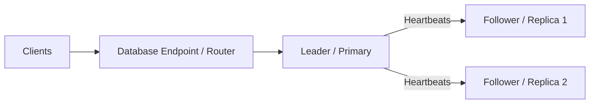

Initially:

```
A = Primary
B = Replica
C = Replica
```

A fails.

The remaining nodes suspect failure.

They initiate an election.

B receives a majority.

Now:

```
B = New Primary
C = Replica
A = Down
```

The application needs to send writes to B.

The routing layer must discover or be informed about the new primary.

When A returns:

1. A discovers that a newer term or leader exists.
2. A steps down or is reconfigured as a follower.
3. Its log is reconciled.
4. It catches up with the authoritative history.
5. It can eventually serve as a replica again.

Notice that leadership and client routing are different concerns.

Electing B does not automatically make every application server aware that B is the new write endpoint.

Production deployments need a mechanism for clients and proxies to discover the current leader.

# 5.18 What leader election does NOT guarantee

It is important not to overestimate what leader election solves.

| Leader election provides                                | Leader election alone does not provide       |
| ------------------------------------------------------- | -------------------------------------------- |
| A way to select a leader                                | Guaranteed zero downtime                     |
| Voting and quorum-based authority                       | Every replica being fully caught up          |
| Terms to distinguish elections                          | Protection against arbitrary malicious nodes |
| A process for replacing failed leaders                  | Exactly-once business processing             |
| Protection against two elected leaders in the same term | Automatic client routing                     |
| A way to reject stale-term protocol messages            | Automatic fencing of every external resource |

The last point deserves particular attention.

Suppose a leader coordinates work involving an external payment provider.

A network partition happens.

A new leader is elected.

The old leader is still running.

Although Raft prevents the old leader from committing new consensus entries without a majority, that does not automatically prevent an already-running old process from making arbitrary HTTP calls to an external service.

The external service may know nothing about Raft terms.

This is why systems performing external side effects sometimes need fencing tokens, idempotency keys, or explicit authority checks.

We'll study this in the distributed locking and fencing chapter.

# 5.19 Interview Questions and Answers

### Q1. What is leader election?

Leader election is the process through which distributed nodes select one node to coordinate operations on behalf of the group.

### Q2. Why can't a node become a leader simply because it detects that the existing leader has failed?

Because failure detection is uncertain. A node might be alive but unreachable. A candidate must obtain authority through a coordinated election protocol, such as receiving a majority of votes.

### Q3. What is a term in Raft?

A term is a monotonically increasing logical number that identifies an election epoch. It helps nodes distinguish newer leadership from older leadership.

### Q4. Why does Raft use randomized election timeouts?

Randomized timeouts reduce the probability of multiple followers starting elections simultaneously and producing repeated split votes.

### Q5. Can a node vote for two candidates in the same term?

No. In Raft, a node grants at most one vote per term.

### Q6. What happens if two candidates start an election simultaneously?

They may split the votes, and neither may obtain a majority. They wait for another election timeout and retry. Randomized timeouts make it more likely that one candidate starts the next election earlier.

### Q7. Why does RequestVote contain log information?

To ensure that a candidate is sufficiently up to date before other nodes grant their votes. This helps prevent a stale candidate from becoming leader and losing committed history.

### Q8. Is the longest log always the most up to date?

No. Raft compares the last log term first and then the last log index. A shorter log with a newer last log term can be considered more up to date.

### Q9. What happens when an old leader comes back?

If it discovers a higher term, it updates its term and becomes a follower. Its uncommitted entries may be overwritten during log reconciliation, while committed entries must be preserved.

### Q10. Can two Raft leaders exist simultaneously?

At most one candidate can be elected leader in a given term under a fixed voting configuration. An isolated old leader might still believe it is leader, but it cannot commit new entries without a quorum.

### Q11. What happens if the cluster loses its majority?

It cannot elect a legitimate new leader or commit new consensus-backed entries until it regains a majority.

### Q12. What is the difference between leader election and failover?

Leader election selects a replacement leader. Failover is the broader operational process of detecting the failure, selecting and promoting a replacement, redirecting clients, and recovering the failed node.

# 5.20 Knowledge Check — Think Through These Scenarios

These are worth reasoning about before we move into split brain.

Scenario 1: Simultaneous elections

You have five nodes.

B and C become candidates at the same time.

B obtains votes from B and D.

C obtains votes from C and E.

A hasn't voted.

Can either candidate become leader?

What happens next?

Scenario 2: Old leader returns

Node A was leader in term 5.

Node B was elected leader in term 6.

A comes back and sends messages with term 5.

What should B do?

What should A do when it discovers term 6?

Scenario 3: Stale log

You have three nodes.

```
A: Last log term 4, index 10
B: Last log term 5, index 8
C: Last log term 4, index 10
```

B wants to become leader.

Is B's shorter log automatically a reason to reject its vote request?

Apply Raft's log comparison rule.

Scenario 4: Minority leader

Node A is the old leader in a three-node cluster.

A becomes isolated.

B and C elect a new leader.

Can A continue appending local entries?

Can it commit them?

What happens when the network recovers?

Scenario 5: Overloaded leader

The leader is healthy but repeatedly misses heartbeat deadlines because of long pauses.

What happens to the cluster?

Why might aggressively reducing the election timeout make the system less stable?

# Chapter 5 — The Concepts You Should Retain

| Concept            | Core idea                                       |
| ------------------ | ----------------------------------------------- |
| Leader             | Coordinates distributed operations              |
| Follower           | Participates in replication and elections       |
| Candidate          | Attempts to become leader                       |
| Term               | Logical election generation                     |
| `votedFor`         | Tracks the node voted for in the current term   |
| Heartbeat          | Indicates ongoing leader communication          |
| Election timeout   | Triggers a suspected failure and election       |
| Randomized timeout | Reduces simultaneous elections                  |
| Majority           | Required voting authority                       |
| Log freshness      | Prevents stale candidates from becoming leaders |
| Higher term        | Forces outdated nodes to step down              |

The most important relationship is:

```
Leader failure suspected
        |
        v
Election timeout expires
        |
        v
Follower becomes candidate
        |
        v
Increment term and vote for itself
        |
        v
Request votes from other nodes
        |
        v
Obtain majority?
        |
   Yes  |  No
        |
        v
     Leader
```

# Next Chapter: Chapter 6 — Split Brain Problem in Depth

Now we will focus on the problem that motivates many of these safety mechanisms.

We'll cover:

1. What split brain really means internally.
2. How network partitions create split brain.
3. Active-active vs active-passive architectures.
4. Why two primary databases are dangerous.
5. Split brain in payment processing and distributed job execution.
6. Why heartbeats alone cannot prevent split brain.
7. Why a leader election timeout alone is insufficient.
8. How quorum prevents conflicting leadership.
9. Fencing tokens and the stale-leader problem.
10. STONITH (Shoot The Other Node In The Head).
11. Split-brain recovery and conflict resolution.
12. Real-world database and infrastructure examples.

One particularly important question we'll answer:

Suppose Node A was the leader, Node B becomes the new leader, and then Node A comes back. How do we guarantee that Node A cannot accidentally overwrite or corrupt the work performed by Node B?

That takes us from basic leader election into the deeper engineering of split-brain prevention.
