# Chapter 6: Split Brain Problem in Depth — Causes, Prevention, Fencing, and Recovery

This is one of the most important chapters in distributed systems.

We've already encountered split brain while discussing leader election. Now we're going to understand it at a much deeper level.

In production, split brain can cause:

- Conflicting database updates.
- Lost financial transactions.
- Duplicate payment processing.
- Inconsistent inventory.
- Corrupted distributed storage.
- Multiple workers executing the same supposedly exclusive job.
- Data divergence that is difficult or impossible to reconcile automatically.

The most important lesson of this chapter is:

Having a leader is not enough. You must also ensure that an old leader loses the ability to perform operations when a new leader takes over.

We'll understand how to achieve that using quorum, fencing tokens, leases, watchdogs, and STONITH.

## 6.1 First, understand the exact problem

Let's start with a database cluster.

You have three nodes:

```
Node A: Primary
Node B: Replica
Node C: Replica
```

The application sends all writes to Node A.

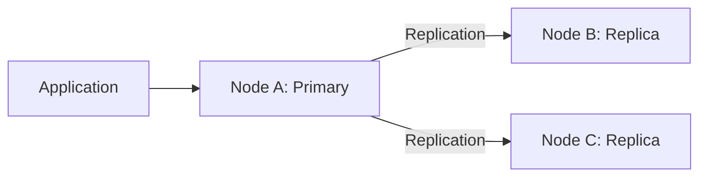

Everything works correctly.

Now imagine the network between A and the other two nodes breaks.

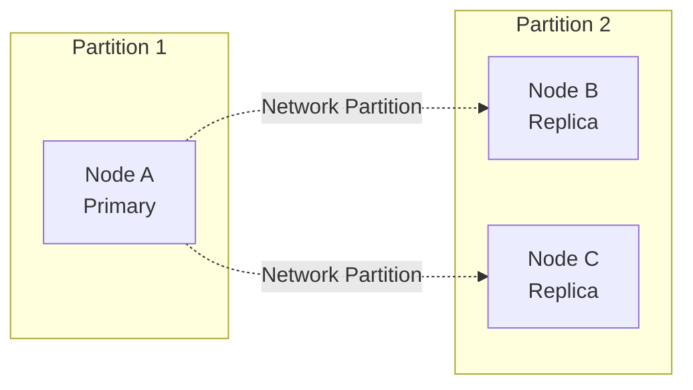

Notice something important:

Node A has not crashed.

Its database process is running.

Its operating system is running.

Its disk is working.

It can still receive requests from application servers that can reach it.

But B and C cannot communicate with A.

From B and C's perspective, the primary has become unavailable.

They might conclude:

```
The primary is unavailable.
We need a new primary.
```

They promote B.

Now the system looks like this:

```
Node A: Primary (old)
Node B: Primary (new)
Node C: Replica of B
```

We have two independent primaries.

This is split brain.

### Why is this dangerous?

Suppose the customer account initially has ₹10,000.

Application Group A can communicate with Node A.

Application Group B can communicate with Node B.

Both groups execute transactions.

```
Node A:
Initial balance = ₹10,000

Withdraw ₹2,000

New balance = ₹8,000
```

At the same time:

```
Node B:
Initial balance = ₹10,000

Withdraw ₹3,000

New balance = ₹7,000
```

Both transactions succeed locally.

Now the network recovers.

What should happen?

Should the balance become:

- ₹8,000?
- ₹7,000?
- ₹5,000?

There is no safe answer from the final values alone.

We have two different histories:

```
History A:
₹10,000 -> Withdraw ₹2,000 -> ₹8,000
```

```
History B:
₹10,000 -> Withdraw ₹3,000 -> ₹7,000
```

We cannot simply merge these histories without understanding which transactions were valid, which were acknowledged, and what consistency guarantees the system promised.

This is the actual danger of split brain.

The problem is not merely that two nodes have the same primary flag. The problem is that two independent authorities can create conflicting histories.

## 6.2 Why does split brain happen?

There are several contributing factors.

### Reason 1: Network partitions

This is the most common scenario we discuss.

Two groups of machines cannot communicate.

Each group has a different understanding of the cluster.

### Reason 2: Incorrect failure detection

A node assumes that another node has crashed because it did not receive a heartbeat.

But the other node might simply be experiencing network delays.

### Reason 3: Independent promotion decisions

Two failover controllers might independently decide that they should promote different replicas.

This is especially dangerous when the promotion process does not use a properly coordinated authority mechanism.

### Reason 4: Lease expiration without stopping the old process

Suppose Node A holds a leadership lease for 30 seconds.

It becomes temporarily paused for 40 seconds.

The lease expires.

Node B acquires a new lease and becomes the primary.

But Node A resumes after 40 seconds.

What happens?

Node A's database process might still be running and accepting writes.

The lease expired, but the process did not magically stop.

This is a subtle but extremely important problem.

### Reason 5: Multiple independent control planes

Imagine two independent systems:

```
Control Plane A:
Primary = Node A
```

```
Control Plane B:
Primary = Node B
```

If they do not share a reliable coordination mechanism, they might make conflicting decisions.

### Summary

| Cause                   | What goes wrong                                            |
| ----------------------- | ---------------------------------------------------------- |
| Network partition       | Nodes cannot communicate                                   |
| False failure detection | Healthy node is suspected to be dead                       |
| Unsafe promotion        | New primary is selected without safely fencing old primary |
| Lease expiration        | Old process continues after losing its lease               |
| Independent controllers | Multiple systems make conflicting leadership decisions     |

## 6.3 Split brain vs normal multi-primary architecture

Before continuing, we need to clear up an important distinction.

You might be thinking:

"What about databases where multiple nodes are intentionally allowed to accept writes?"

That's a valid question.

Multiple writable nodes do not automatically mean split brain.

There is a difference between designed multi-primary operation and uncontrolled split brain.

### A. Single-primary architecture

One node is the authoritative writer.

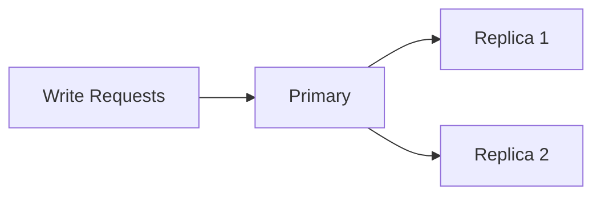

This is an active-passive arrangement.

Only one node is expected to coordinate authoritative writes.

### B. Deliberate multi-primary architecture

Multiple nodes are intentionally permitted to accept writes.

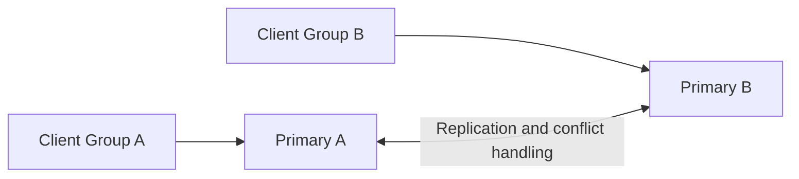

This is an active-active or multi-primary arrangement.

It can be a valid architecture when the system explicitly handles concurrent updates.

For example:

Strategy 1: Partition ownership

Assign different customers to different writable nodes.

```
Node A owns customers 1–1000.
Node B owns customers 1001–2000.
```

Both accept writes, but they do not independently own the same records.

Strategy 2: Conflict resolution

Allow multiple nodes to accept concurrent writes and resolve conflicts using versioning, application-specific rules, or merge algorithms.

Strategy 3: CRDTs

Use conflict-free replicated data types for data structures whose operations are designed to merge consistently.

We'll explore CRDTs later when discussing consistency models.

### C. Uncontrolled split brain

Here, multiple nodes independently believe they are the single authority for the same resource.

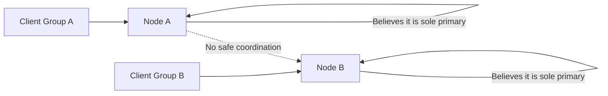

Both nodes can update the same account or inventory record without an agreed conflict-handling strategy.

This is dangerous.

### Comparison

| Single primary               | Designed multi-primary                   | Uncontrolled split brain        |
| ---------------------------- | ---------------------------------------- | ------------------------------- |
| One authoritative writer     | Multiple intentional writers             | Multiple accidental authorities |
| Centralized write ordering   | Conflict handling or partition ownership | No reliable conflict handling   |
| Easier consistency model     | More complex consistency model           | Inconsistent histories          |
| Leader election often needed | Depends on architecture                  | Unsafe failover or coordination |

Important: Active-active is an architecture choice. Split brain is a coordination failure.

## 6.4 The first solution: Quorum-based leadership

Let's return to our three-node database cluster.

```
A, B, C
```

We require a majority to establish leadership and commit consensus-backed writes.

\\[ Q = \left\lfloor \frac{N}{2} \right\rfloor + 1 \\]

For three nodes:

\\[ Q = 2 \\]

Now a network partition occurs.

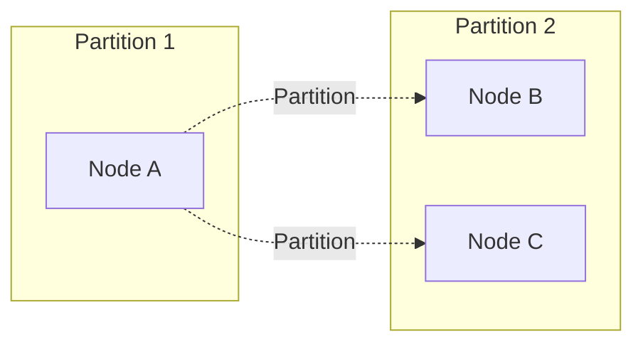

Let's examine both sides.

Partition 1: Node A

Available nodes:

```
1 out of 3
```

Majority required:

```
2
```

A does not have a quorum.

It cannot commit new operations through the consensus protocol.

Partition 2: Nodes B and C

Available nodes:

```
2 out of 3
```

They have a majority.

They can elect a new leader and continue making progress, assuming their logs satisfy the election requirements.

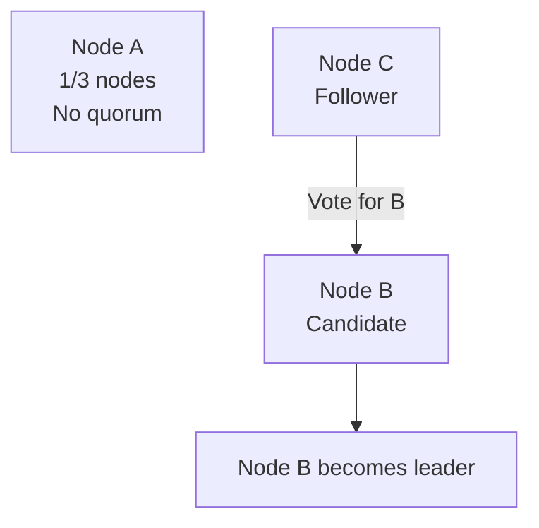

Now there is only one group that can establish new consensus decisions.

This prevents the two partitions from independently committing conflicting histories.

### Why does majority solve this?

Because any two majorities of the same fixed voting configuration overlap.

For three nodes:

```
Majority 1: A, B
Majority 2: B, C
```

They share:

```
B
```

The shared node cannot violate the protocol's voting and commitment rules.

This overlap helps ensure that a later leader cannot ignore an earlier committed decision.

### Five-node example

Suppose:

```
A, B, C, D, E
```

Quorum:

```
3
```

Partition:

```
Group 1: A, B
Group 2: C, D, E
```

Group 1 cannot commit consensus-backed writes.

Group 2 can potentially continue.

Now consider:

```
Group 1: A, B, C
Group 2: D, E
```

Group 1 has the majority.

Group 2 does not.

Again, only one side can make consensus progress.

### Does quorum completely solve split brain?

It solves a very important part of the problem: preventing two disjoint groups from independently obtaining the required majority under the same voting configuration.

But there is a crucial qualification.

The safety guarantee applies to operations that actually go through the consensus protocol.

Imagine the old leader has a separate connection to an external payment gateway.

Even without a majority, its application process might still send an HTTP request to the gateway.

Raft cannot automatically stop arbitrary external side effects.

Likewise, a database deployment using an external failover controller needs to ensure that the old primary stops accepting writes when it loses leadership.

This leads us to a stronger concept: fencing.

## 6.5 The most important solution: Fencing

Now let's understand one of the most powerful mechanisms for preventing stale leaders from modifying shared resources.

The concept is called Fencing.

First, understand the problem.

Suppose:

```
Node A = Leader
```

A receives a lock or leadership lease.

It starts processing a job.

Suddenly, A experiences a long pause.

Perhaps:

- Garbage collection takes 20 seconds.
- The VM is paused.
- The operating system is overloaded.
- The application process is suspended.

Meanwhile, the lease expires.

Node B acquires a new lease.

```
Node A: Old owner
Node B: New owner
```

B starts processing the same resource.

But A eventually resumes.

A doesn't necessarily know that its lease expired.

It continues executing its previous operation.

Now both A and B are working on the same resource.

This is the stale-owner problem.

### Why can't we just tell A that its lease expired?

Because A might not receive the message.

It might be disconnected.

It might be paused.

It might be unable to communicate with the coordination service.

We cannot depend on the old process voluntarily stopping.

We need a mechanism at the resource being protected.

That is fencing.

### 6.5.1 What is a fencing token?

A fencing token is a monotonically increasing number issued whenever a new owner acquires authority over a resource.

For example:

```
First lock acquisition  -> Token 41
Second lock acquisition -> Token 42
Third lock acquisition  -> Token 43
Fourth lock acquisition -> Token 44
```

Every new owner receives a higher token.

The resource being protected remembers the highest token it has accepted.

It rejects operations carrying an older token.

Let's understand this step by step.

### 6.5.2 Example: Two workers and one shared resource

Suppose two workers process orders.

```
Worker A
Worker B
```

Both need exclusive access to a shared order-processing resource.

Initially, Worker A acquires the lock.

The coordination service issues:

```
Worker A -> Token 41
```

A starts processing.

```
Worker A:
Token = 41
Status = Processing
```

Now A pauses unexpectedly.

The lock expires.

Worker B acquires the lock.

The coordination service issues:

```
Worker B -> Token 42
```

B starts processing.

Before doing any work, B registers its higher fencing token with the protected resource.

The resource now remembers:

```
Highest accepted token = 42
```

Now A resumes.

It attempts an operation:

```
Worker A:
Token = 41

Update order status = COMPLETED
```

The resource checks:

```
Incoming token = 41
Highest accepted token = 42
```

It rejects the request.

```
REQUEST REJECTED

Reason: Stale fencing token
```

Worker B can continue.

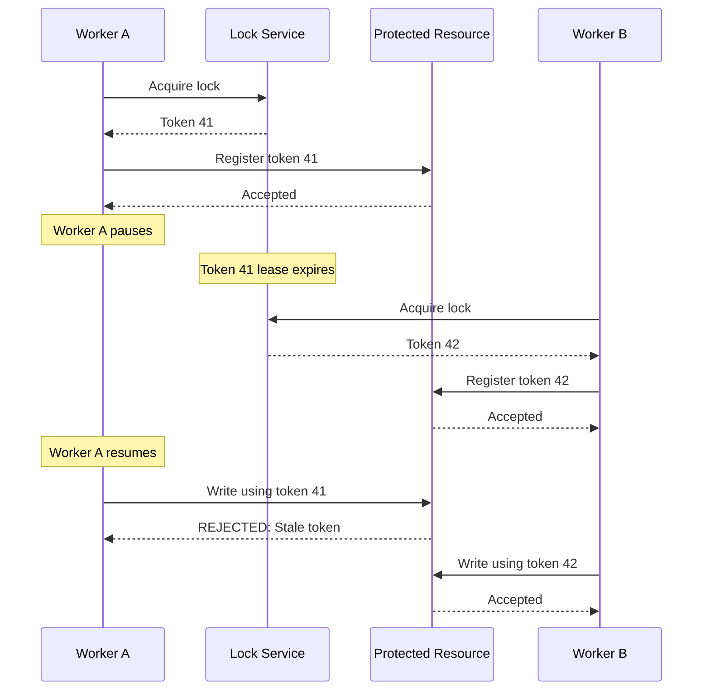

This is the central intuition behind fencing tokens.

The protected resource, not merely the lock service, must enforce the ownership generation.

### 6.5.3 How does the resource validate a fencing token?

Imagine a database table:

```
CREATE TABLE order_processing (
    order_id BIGINT PRIMARY KEY,
    status VARCHAR(30),
    fencing_token BIGINT NOT NULL
);
```

Suppose the current record is:

```
order_id       = 101
status         = PROCESSING
fencing_token  = 42
```

Worker A sends:

```
order_id = 101
new_status = COMPLETED
token = 41
```

The database can reject the stale operation:

```
UPDATE order_processing
SET status = 'COMPLETED',
    fencing_token = 41
WHERE order_id = 101
  AND fencing_token <= 41;
```

Because the existing token is 42, the update affects zero rows.

Worker B sends:

```
order_id = 101
new_status = COMPLETED
token = 42
```

The operation can be accepted:

```
UPDATE order_processing
SET status = 'COMPLETED',
    fencing_token = 42
WHERE order_id = 101
  AND fencing_token <= 42;
```

The database enforces the ordering.

In an actual implementation, the token validation and protected business update should be performed atomically in the same transaction.

Also consider whether equal-token retries are safe. A fencing token establishes ownership generation; it does not automatically make business operations idempotent.

### 6.5.4 An important subtlety: When does fencing actually take effect?

There is a detail that is frequently missed.

Suppose B obtains token 42.

But the protected resource has not yet seen token 42.

A resumes and submits a request with token 41.

The resource still remembers 41.

It might accept A's request!

Therefore, merely issuing a newer token is not sufficient.

A robust design must establish the newer token at the protected resource before allowing the new owner to begin its protected work.

The order should be:

```
1. B obtains token 42.
2. B registers token 42 at the resource.
3. Resource acknowledges token 42.
4. B starts protected operations.
```

For strict protection from the exact moment ownership changes, the resource must also validate authority against the coordination mechanism on each operation, or the old owner must be physically fenced before the new owner is activated.

This distinction matters in production systems.

Fencing tokens provide powerful protection, but their enforcement must be designed correctly.

### 6.5.5 Where should fencing tokens come from?

They need to be generated by an authority that provides monotonically increasing, correctly ordered generations.

Possible sources include:

- A consensus-backed coordination store's revision or generation.
- A ZooKeeper sequence associated with lock acquisition.
- A database sequence maintained by a properly coordinated authority.
- A monotonically increasing election term, when it is suitable for the protected resource.

Do not blindly use a local counter on every application server.

Two independent counters might generate the same value.

Also, a counter that can roll back during failover might reuse old tokens.

The token-generation mechanism is part of the safety design.

# 6.6 Fencing tokens vs distributed locks vs leases

These three concepts are closely related, but they solve different aspects of the problem.

Let's compare them.

### Distributed lock

A distributed lock provides exclusive ownership according to a coordination service.

Example:

```
Worker A acquires lock.
Worker B cannot acquire the same lock.
```

### Lease

A lease is time-limited ownership.

Example:

```
Worker A receives ownership for 30 seconds.
It must renew the lease to continue.
```

After expiration, another worker may acquire it.

### Fencing token

A fencing token protects the resource against stale owners.

Example:

```
Worker A has token 41.
Worker B has token 42.

Resource rejects operations using token 41
after it has accepted token 42.
```

### Comparison

| Concept          | Main responsibility                        |
| ---------------- | ------------------------------------------ |
| Distributed lock | Coordinate ownership                       |
| Lease            | Limit ownership duration                   |
| Fencing token    | Reject stale ownership generations         |
| Quorum           | Establish sufficient distributed authority |
| Leader election  | Select the coordinator                     |

A strong distributed locking architecture often combines these mechanisms.

For example:

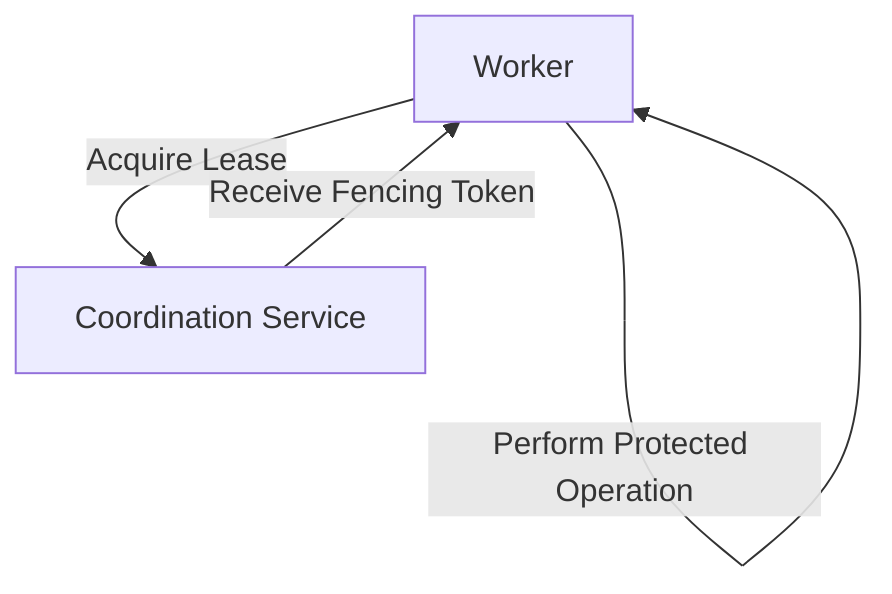

Remember: A lease expiration does not physically stop a paused process.

A fencing token gives the protected resource a way to reject stale operations.

# 6.7 STONITH — Shoot The Other Node In The Head

Now let's discuss another production-level technique.

STONITH stands for:

Shoot The Other Node In The Head.

The name is dramatic, but the idea is straightforward.

When the cluster decides that an old primary must no longer operate, it forcibly shuts down or isolates that machine before allowing another node to take over.

Imagine:

```
Node A = Old Primary
Node B = New Primary candidate
```

B wants to become the new primary.

But A might still be running.

Instead of simply assuming A is dead, the system physically fences it.

For example:

```
1. Cluster detects that A is unavailable.
2. Cluster triggers a fencing mechanism.
3. A is powered off or isolated from storage.
4. Cluster confirms fencing succeeded.
5. B is promoted.
```

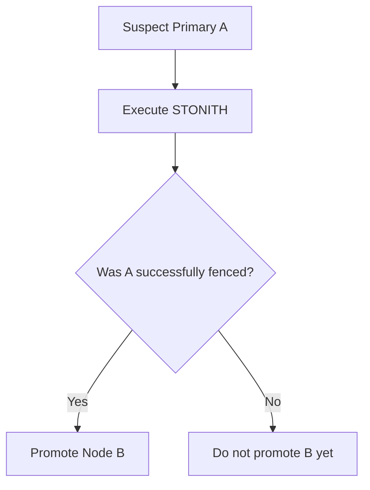

The key point:

Do not activate a replacement writer while the previous writer can still modify the protected resource.

This is especially important in shared-storage clusters.

## 6.7.1 How can we physically fence a node?

There are several approaches.

### A. Power fencing

The cluster forcibly powers off or resets the old node.

This can be achieved through:

- IPMI.
- iDRAC.
- Hardware management controllers.
- Remote power distribution units.
- Cloud infrastructure management APIs.

For example:

```
Node A: Running
       |
       v
Fencing controller sends power-off command
       |
       v
Node A: Powered OFF
       |
       v
Node B: Promoted
```

The idea is that the old node cannot continue executing writes.

### B. Storage fencing

This is particularly important when multiple nodes access shared storage.

Imagine:

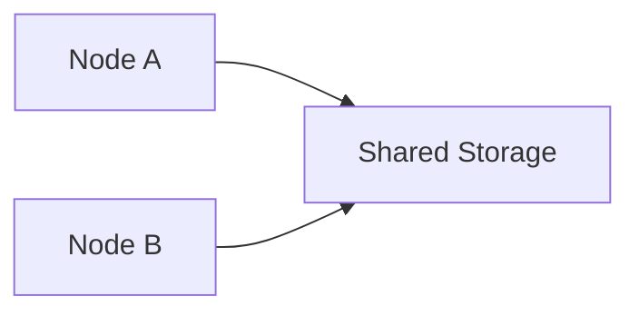

Node A and Node B can both access the same storage.

A network partition occurs.

Both might believe they should write to the shared disk.

That can corrupt filesystem metadata or application data.

Storage fencing prevents the old node from accessing the shared storage.

Some mechanisms include:

- SCSI Persistent Reservations.
- Storage-level access revocation.
- Controlled volume detachment.
- Storage reservation mechanisms.

The exact technique depends on the storage platform.

### C. Network fencing

The cluster isolates the old node from the relevant communication paths.

However, network fencing must be carefully designed.

Blocking just the cluster heartbeat network might not be sufficient.

The old node could still have access to:

- Client networks.
- Storage networks.
- Application networks.
- External service endpoints.

The fencing mechanism must eliminate the old node's ability to interfere with the protected resource.

### Comparison

| Method          | What it blocks                       |
| --------------- | ------------------------------------ |
| Power fencing   | Entire machine                       |
| Storage fencing | Access to protected storage          |
| Network fencing | Relevant network communication paths |

## 6.7.2 What if fencing fails?

Suppose Node B attempts to power off Node A.

But the management interface is unreachable.

Can B safely assume A is powered off?

No.

It should not simply promote itself while an unfenced old primary might still write to the same resource.

This is an important engineering trade-off.

The system may need to remain unavailable rather than risk data corruption.

Failing closed is often the correct choice for a system with strong consistency requirements.

# 6.8 Watchdogs — Another protection against stale leaders

Now let's understand how watchdogs help prevent split brain.

A watchdog is a mechanism that monitors whether a process or machine is functioning correctly.

If it does not receive a periodic keepalive within a configured interval, it triggers a predefined action.

For example:

```
Watchdog timeout = 10 seconds

Node A must periodically send keepalive messages.

If no keepalive arrives:
    Watchdog resets the machine.
```

Imagine:

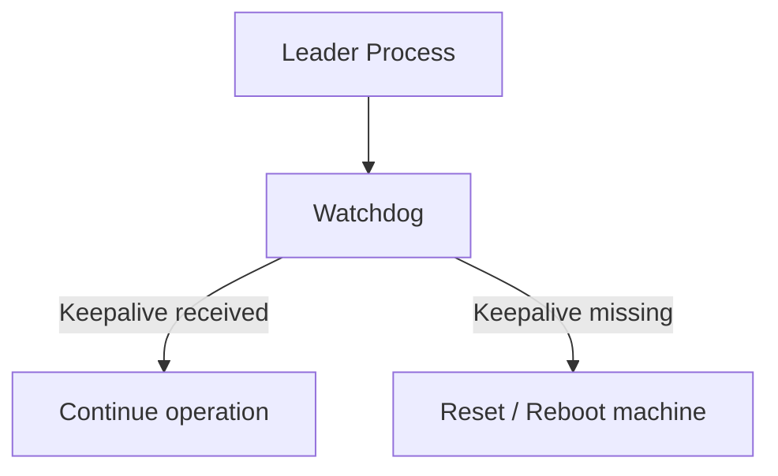

This is useful when the application responsible for demoting the old primary might itself become unresponsive.

For example:

- The process crashes.
- The VM gets paused.
- The machine is overloaded.
- The shutdown operation takes too long.

A watchdog provides an additional safety layer.

### Real production example: PostgreSQL + Patroni

Consider a typical PostgreSQL high-availability architecture using Patroni.

Patroni coordinates PostgreSQL primary/standby roles using a Distributed Configuration Store (DCS), such as etcd, Consul, or ZooKeeper.

Conceptually:

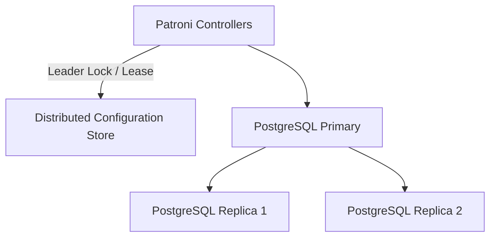

The current primary must keep renewing its leadership key.

If the leadership key expires or cannot be renewed, Patroni attempts to stop PostgreSQL so that the old primary cannot continue accepting transaction commits.

But stopping PostgreSQL is not infallible.

The Patroni process itself might crash, PostgreSQL shutdown might be slow, or the machine might be paused.

Patroni therefore supports a watchdog mechanism as an additional safety layer.&#x20;

[image](https://www.google.com/s2/favicons?domain=https://github.com\&sz=32)

GitHub+1


The important architectural lesson is:

```
DCS:
    Determines leadership ownership.

Patroni:
    Enforces the database's primary/standby role.

Watchdog:
    Adds protection when the normal demotion mechanism cannot run.
```

This is a good example of why coordination and resource-level enforcement must work together.

# 6.9 Why heartbeats alone cannot prevent split brain

Let's revisit heartbeats.

Suppose Node A is the primary.

It sends:

```
HEARTBEAT
HEARTBEAT
HEARTBEAT
```

Node B receives them.

Everything works.

Now a network partition occurs.

B doesn't receive heartbeats.

B concludes that A might be unavailable.

But A is still working.

Let's say B becomes the new primary.

What stops A from accepting writes?

Nothing, unless another mechanism prevents it.

A heartbeat is only an indication of communication.

It is not a mechanism that physically or logically revokes the old leader's authority.

This is why the following architecture is insufficient:

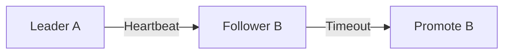

This shows how B detects missing communication.

It doesn't show what happens to A.

A robust architecture must also include one or more of:

- Consensus quorum restrictions.
- Leadership term checks.
- Fencing tokens.
- Explicit primary demotion.
- Watchdog resets.
- STONITH.
- Resource-level authorization.

### The central lesson

Failure detection tells you when to suspect a leader. Fencing ensures that the old leader cannot continue modifying protected state.

These are different responsibilities.

# 6.10 Split Brain in Payment Processing

Let's take a realistic backend engineering example.

Suppose you operate a distributed payment-processing system.

You have three application workers:

```
Worker A
Worker B
Worker C
```

A scheduled job should process pending payouts.

Only one worker should coordinate a particular payout batch.

You implement a distributed lock.

```
payout_batch_101
```

Worker A acquires the lock.

It starts processing.

```
Worker A:
Lock acquired.
Processing payout batch 101.
```

Worker A experiences a long pause.

Its lease expires.

Worker B acquires the lock.

```
Worker B:
Lock acquired.
Processing payout batch 101.
```

Worker A resumes.

Both workers are now processing payouts.

Imagine:

```
Worker A sends ₹10,000 to Customer X.
Worker B sends ₹10,000 to Customer X.
```

The customer receives ₹20,000 instead of ₹10,000.

How do we prevent this?

We need several layers.

### Layer 1: Distributed lease

Only one worker should normally own the batch.

### Layer 2: Fencing token

Every new owner receives a newer generation number.

The payout system rejects stale generations.

### Layer 3: Idempotency key

Each logical payout has a stable identifier:

```
PAYOUT-101-CUSTOMER-X
```

The payment provider or our payment ledger ensures that duplicate requests don't create duplicate financial effects.

### Layer 4: Durable transaction state

The application records:

```
Payout ID
Amount
Status
Fencing generation
Provider reference
```

The system can safely recover after a worker crash.

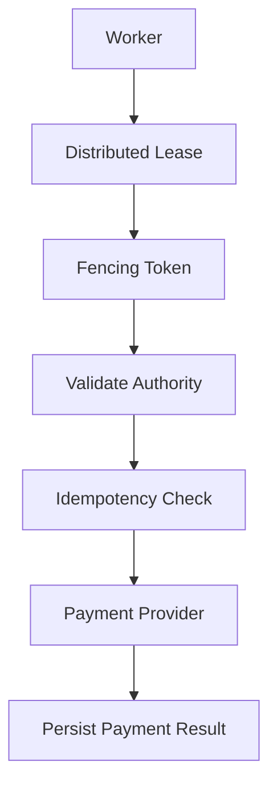

Notice something important.

A fencing token and idempotency key solve different problems.

| Mechanism         | Prevents                                                             |
| ----------------- | -------------------------------------------------------------------- |
| Fencing token     | Stale worker acting after a newer ownership generation is recognized |
| Idempotency key   | Re-execution of the same logical business operation                  |
| Distributed lease | Multiple workers normally acquiring ownership simultaneously         |
| Durable state     | Losing knowledge of completed processing                             |

In production systems, you often need all of them.

# 6.11 Split Brain in Distributed Storage

Now let's examine an even more dangerous scenario.

Imagine two storage servers access the same shared filesystem.

```
Storage Node A
Storage Node B
       |
       v
   Shared Disk
```

Initially:

```
A = Active
B = Standby
```

A network failure occurs.

Both nodes believe the other is unavailable.

A continues writing.

B gets promoted and starts writing.

Now both access shared storage.

Possible consequences:

- Filesystem corruption.
- Inconsistent metadata.
- Lost writes.
- Broken storage structures.
- Unrecoverable data.

This is why clustered storage systems often require strong fencing mechanisms.

In such systems, merely electing a leader isn't enough.

The system must guarantee that the former owner cannot write to the shared resource.

This is one of the traditional use cases for STONITH and storage reservations.

# 6.12 How quorum, terms, fencing, and STONITH work together

Let's consolidate everything.

These mechanisms are complementary.

| Mechanism        | Question it answers                                  |
| ---------------- | ---------------------------------------------------- |
| Heartbeat        | Is the node communicating?                           |
| Failure detector | Should I suspect the node?                           |
| Leader election  | Who should become leader?                            |
| Term / epoch     | Which leadership generation is newer?                |
| Quorum           | Is there sufficient authority to commit a decision?  |
| Lease            | Has the time-limited ownership period expired?       |
| Fencing token    | Can the resource reject stale owners?                |
| STONITH          | Can we forcibly make the old node unable to operate? |
| Idempotency      | Can duplicate logical requests be safely handled?    |

A well-designed system uses the appropriate combination of these mechanisms.

Consider this sequence:

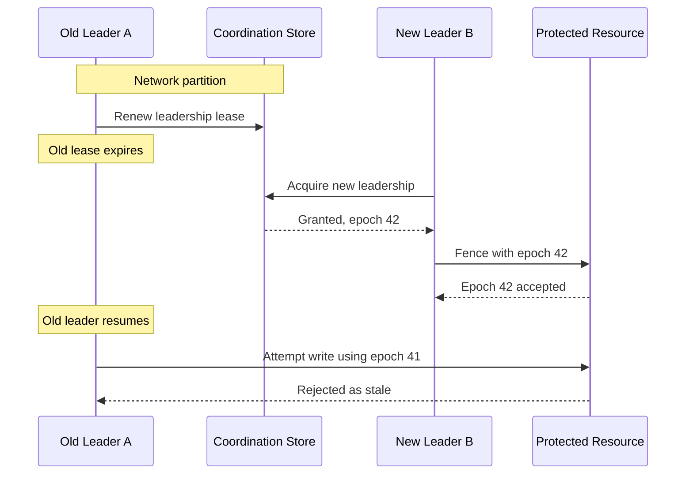

This demonstrates the intended relationship between leadership generations and resource-level enforcement.

For systems requiring strict physical isolation, successful fencing of the old node may need to happen before the replacement is activated.

# 6.13 Recovery after split brain: What do we do when it has already happened?

This is a very important real-world problem.

Imagine two PostgreSQL primaries have been accepting writes for 30 minutes.

The network has recovered.

Both databases have diverged.

What should we do?

The worst thing you can do is blindly reconnect them and hope replication resolves the conflicts.

There is no universal merge operation for two independently modified database histories.

A careful recovery procedure is needed.

## Step 1: Stop conflicting writes

First, prevent further divergence.

Make sure only the selected authoritative database can accept new writes.

Use the appropriate fencing or demotion mechanism.

## Step 2: Preserve the divergent data

Do not immediately delete or overwrite the old primary's data directory.

Capture the available logs, database state, and transaction history.

You may need them to investigate lost or conflicting operations.

## Step 3: Determine the authoritative history

This decision must be based on the system's consistency protocol and durability guarantees.

For a consensus-based replicated state machine, the committed history is authoritative.

For a conventional asynchronous primary-replica database deployment, the situation can be more difficult.

The previous primary might have acknowledged transactions that were never replicated to the promoted primary.

You need to determine which transactions were acknowledged and which were lost during failover.

Do not simply choose the database with:

- The highest number of rows.
- The latest wall-clock timestamp.
- The largest file size.
- The highest transaction count.

These do not prove correctness.

## Step 4: Reconcile business operations

Suppose the databases contain:

```
Database A:
Payout X = COMPLETED
Payout Y = COMPLETED

Database B:
Payout X = COMPLETED
Payout Z = COMPLETED
```

You need to establish:

- Which payouts actually happened?
- Which were committed?
- Were any payments duplicated?
- Were any operations acknowledged but lost?
- Do external provider records confirm the operations?

This may require reconciliation with external systems.

## Step 5: Rebuild the former primary

Once the authoritative history is determined, the old primary should be resynchronized from the correct source.

Depending on the database, this may involve:

- Log reconciliation.
- Database rewind.
- Reinitializing the replica.
- Restoring from a snapshot.
- Replaying the authoritative transaction history.

## Step 6: Restore the intended topology

Finally:

```
Node B = Primary
Node A = Replica
Node C = Replica
```

Verify that only the intended primary accepts writes.

Verify replication positions and health.

Verify that the fencing mechanism works.

Then restore normal application traffic.

### Recovery flow

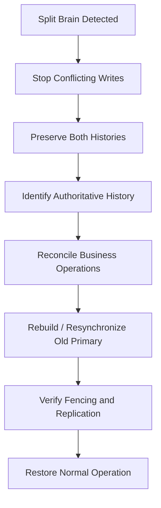

### Important: Asynchronous replication can introduce data loss

Suppose PostgreSQL primary A acknowledges a transaction.

But the WAL record has not yet reached replica B.

A crashes or becomes isolated.

B gets promoted.

The acknowledged transaction might be missing from B.

This is why asynchronous replication has an inherent durability trade-off during failover.

Synchronous replication can reduce this risk by waiting for acknowledgements from designated synchronous standbys, though the precise guarantees depend on the configured acknowledgement mode.

For example, PostgreSQL distinguishes between waiting for WAL receipt, flush, and application.

We will examine these details in the database replication chapter.

Patroni also provides failover candidate checks based on replication lag and timeline information, illustrating that choosing a replacement primary requires more than checking whether a server responds.&#x20;

[image](https://www.google.com/s2/favicons?domain=https://github.com\&sz=32)

GitHub+1


# 6.14 Real-world architecture: How PostgreSQL HA handles this

Let's put the concepts together using PostgreSQL and Patroni.

A common deployment looks like this:

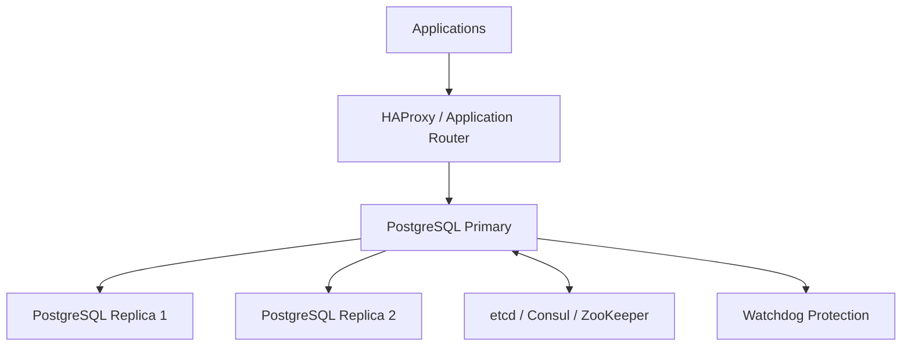

The broad responsibilities are:

PostgreSQL

- Stores application data.
- Executes transactions.
- Writes WAL.
- Replicates WAL to standbys according to configuration.

Patroni

- Manages the PostgreSQL cluster's primary and standby roles.
- Coordinates leadership through the DCS.
- Monitors cluster health.
- Handles promotion and demotion.

DCS

\- Provides the coordination mechanism for cluster leadership and shared configuration.

Watchdog

\- Provides an additional fail-safe against a node continuing to operate when its normal leadership-management process cannot enforce demotion.

HAProxy or another router

\- Sends write traffic to the current primary.

The exact implementation and configuration determine the safety guarantees.

In particular, routing traffic to a new primary does not itself disable the old primary. That is why the demotion and watchdog mechanisms matter.

The Patroni documentation explicitly describes the risk of two PostgreSQL servers accepting primary transactions and explains why watchdog protection is used as an additional safeguard.&#x20;

[image](https://www.google.com/s2/favicons?domain=https://github.com\&sz=32)

GitHub+1


# 6.15 Design exercise: Design a split-brain-resistant job-processing system

Let's apply everything we've learned.

Your requirement:

You have 10 application instances.

A scheduled job should reconcile customer payments.

Only one instance should coordinate a given reconciliation batch.

The job might run for 20 minutes.

Instances might crash.

The network might partition.

A process might pause for 30 seconds and then resume.

How would you design it?

### A possible architecture

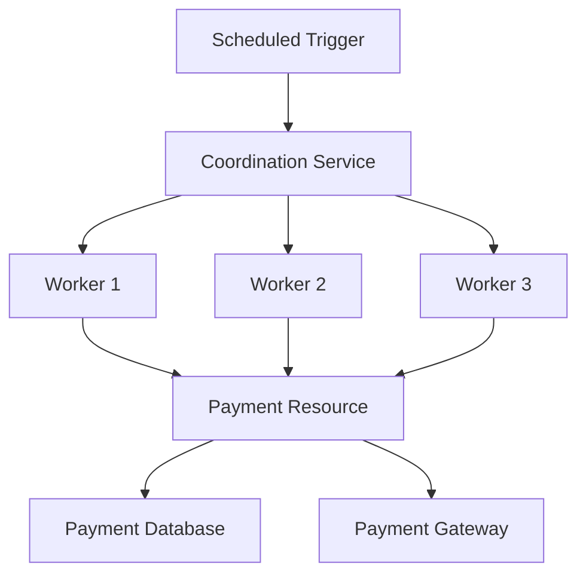

A robust design would include:

1\. Coordination

Workers acquire ownership through a shared coordination service.

2\. Lease

The worker must periodically renew its ownership.

3\. Monotonically increasing fencing generation

Every new owner receives a higher token.

4\. Resource-level validation

The database or payment-processing service validates the generation.

5\. Idempotency

Each payout has a stable unique identifier.

6\. Durable processing state

The database stores the status of every payout.

7\. Recovery

A new worker can identify unfinished operations and safely resume them.

### Example processing record

```
CREATE TABLE payout_jobs (
    payout_id UUID PRIMARY KEY,
    customer_id BIGINT NOT NULL,
    amount NUMERIC(12, 2) NOT NULL,
    status VARCHAR(30) NOT NULL,
    fencing_token BIGINT NOT NULL,
    provider_reference VARCHAR(100),
    updated_at TIMESTAMPTZ NOT NULL
);
```

The worker must validate ownership and idempotency before performing business operations.

For external payment calls, use the stable payout identifier as an idempotency key where supported.

This way, even if two workers temporarily execute code, the protected resource can reject stale ownership and prevent duplicate logical payments.

# 6.16 Advanced Design Insights

Let's address a few deeper questions that distinguish an experienced distributed-systems engineer from someone who has only memorized the terminology.

### 1. Does quorum replace fencing?

Not always.

Quorum restricts which group can make authoritative consensus decisions.

But an isolated old leader might still:

- Serve stale reads.
- Call external APIs.
- Continue executing previously started tasks.
- Write to a resource outside the consensus protocol.

Fencing protects those external resources when they enforce ownership generations.

### 2. Does fencing replace quorum?

No.

A fencing token protects a particular resource from stale generations.

It doesn't independently establish agreement about who should become the next leader.

You still need a safe authority or coordination mechanism to issue tokens.

### 3. Does STONITH replace consensus?

No.

STONITH can physically isolate a node.

It doesn't establish the ordered history of operations or decide which transactions should be committed.

It complements consensus and other cluster coordination mechanisms.

### 4. Can leases completely eliminate stale leaders?

A lease defines a time-limited ownership period.

But a paused process does not automatically stop when that period expires.

The resource still needs enforcement, or the old machine needs to be reliably fenced.

### 5. Can DNS updates prevent split brain?

No.

DNS or a load balancer can redirect clients toward a new primary.

But the old primary might still accept writes through existing connections or other network paths.

Routing and authority enforcement are separate concerns.

### 6. Is a database read from an old leader safe?

Not necessarily.

An old leader isolated from quorum may have stale information.

A system requiring linearizable reads must establish that the serving node still has valid authority, often through a quorum-backed read protocol or a correctly implemented lease.

Merely checking:

```
role = LEADER
```

is not sufficient.

# 6.17 Interview Questions and Answers

### Q1. What is split brain?

Split brain occurs when multiple nodes or partitions independently behave as authoritative leaders for the same logical resource without a correct conflict-handling protocol.

It can result in divergent database histories and lost updates.

### Q2. What causes split brain?

Common causes include network partitions, unreliable failure detection, unsafe failover, expired leases without effective demotion, and independent control planes.

### Q3. How does quorum prevent split brain?

A majority-based consensus system requires sufficient participation to elect leaders and commit decisions. Any two majorities in the same fixed voting configuration overlap, preventing two independent majorities from safely establishing conflicting committed histories.

### Q4. What is a fencing token?

A monotonically increasing generation number issued when ownership changes. The protected resource remembers the newest accepted generation and rejects stale operations.

### Q5. Why is a distributed lock not sufficient?

Because a lock might expire while the old holder is paused or unable to communicate. That process can resume and continue performing operations unless the protected resource enforces ownership.

### Q6. What is STONITH?

STONITH means Shoot The Other Node In The Head. It is a fencing mechanism that forcibly shuts down or isolates an old node before another node takes over.

### Q7. What is the difference between fencing and failover?

Failover selects and activates a replacement. Fencing prevents the old owner from continuing to affect protected resources.

### Q8. What is the purpose of a watchdog?

A watchdog detects when a node or process stops providing expected keepalives and triggers a predefined recovery action, such as resetting the machine.

### Q9. Does leader election prevent all split-brain scenarios?

No. Election protocols establish leadership according to their rules, but stale processes may still interact with external resources. Those resources may require fencing and explicit authority validation.

### Q10. Is active-active architecture a form of split brain?

No. Active-active is intentional multi-primary operation. It can be safe when data ownership, conflict resolution, and consistency are explicitly designed.

### Q11. Why shouldn't we simply choose the database with the newest timestamp after split brain?

Because distributed clocks can be skewed, and timestamps do not necessarily reveal the authoritative transaction history. Recovery must use the consistency protocol, replication records, and business evidence.

### Q12. Why does Patroni use watchdog support?

Because Patroni might not successfully stop PostgreSQL after losing leadership. A watchdog adds another layer of protection against a former primary continuing to accept transactions.&#x20;

[image](https://www.google.com/s2/favicons?domain=https://github.com\&sz=32)

GitHub+1


# 6.18 Final Mental Model: The Complete Split-Brain Prevention Architecture

This is the architecture I want you to remember.

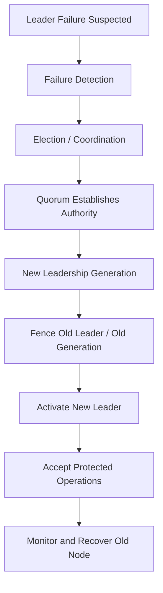

Each mechanism has a separate responsibility.

| Mechanism          | Responsibility                          |
| ------------------ | --------------------------------------- |
| Failure detection  | Suspects unavailability                 |
| Election           | Selects a new leader                    |
| Consensus / quorum | Establishes distributed authority       |
| Term / epoch       | Identifies leadership generation        |
| Fencing token      | Rejects stale owners at the resource    |
| STONITH            | Physically isolates the old node        |
| Watchdog           | Provides an additional fail-safe        |
| Idempotency        | Prevents duplicate business effects     |
| Recovery           | Restores a single authoritative history |

The most important principle:

Never assume that the old leader has stopped operating just because a new leader has been elected.

# Chapter 6 — Practical Knowledge Check

Try reasoning through these scenarios.

Scenario 1: Old leader resumes

Node A owns a lock with token 41.

A pauses.

The lock expires.

Node B obtains token 42.

A resumes and tries to update a shared database.

What should happen?

Why is storing the highest accepted token at the resource important?

Scenario 2: Fencing token limitation

B acquires token 42, but has not yet registered it with the protected resource.

A sends a write with token 41.

Could that write be accepted?

What would you change in the acquisition protocol?

Scenario 3: Three-node quorum

You have three database nodes.

A is isolated.

B and C elect a new leader.

A is still accepting client connections.

Why does quorum alone not protect an external payment API from calls made by A?

Scenario 4: STONITH

A database cluster has shared storage.

B wants to take over from A.

The cluster cannot confirm that A has stopped accessing the disk.

Should B be promoted immediately?

Explain why.

Scenario 5: Payment processing

Two workers temporarily execute the same payout.

One has fencing token 10, the other has token 11.

How would you combine fencing tokens, idempotency keys, and durable processing state to protect the payment?

# What comes next?

## Chapter 7: Quorum in Depth — Majority, Read Quorum, Write Quorum, and Failure Tolerance

Now that we understand split brain and its prevention mechanisms, let's study quorum more deeply.

We'll cover:

1. What exactly is a quorum?
2. Why do we need majority intersection?
3. Mathematical derivation of quorum.
4. Majority quorum vs read/write quorum.
5. How many nodes can fail?
6. Quorum in 3-node, 5-node, and 7-node clusters.
7. What happens when a network partition occurs?
8. Why two nodes are problematic for consensus-based HA.
9. What is a witness node?
10. How quorum works in distributed databases.
11. Quorum reads and writes in Cassandra and Dynamo-style databases.
12. How Raft quorum differs from database read/write quorum.
13. Quorum during membership changes.
14. Multi-region quorum placement and latency trade-offs.
15. Production architecture design exercises.

One important question we'll derive: Why does a three-node cluster tolerate one failure, while a two-node cluster cannot maintain majority-based availability after either node fails?

We'll also distinguish two meanings of quorum that system design interviews frequently mix up: consensus voting quorum and database read/write quorum.
