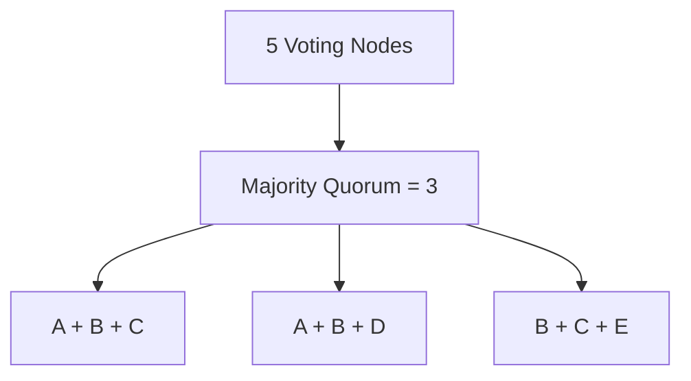
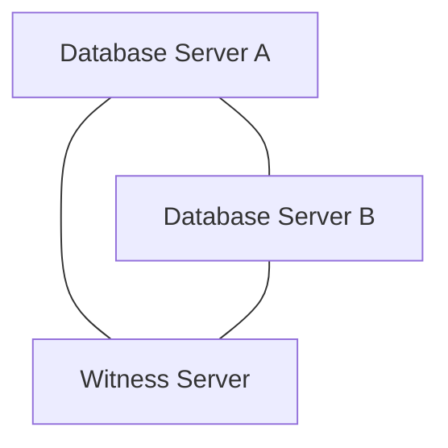
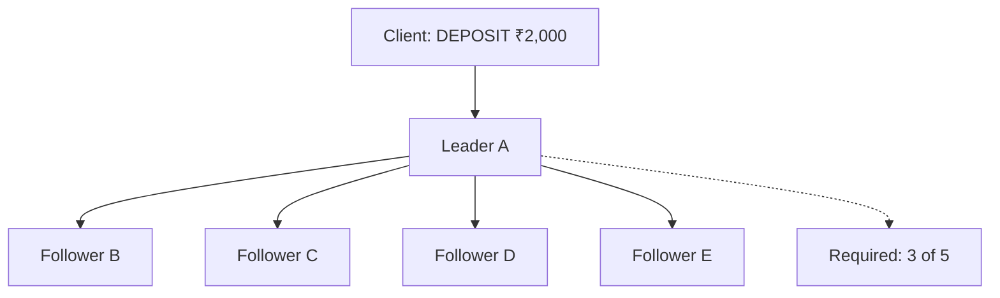
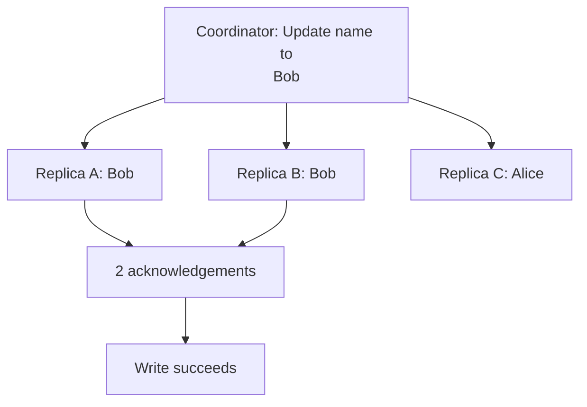
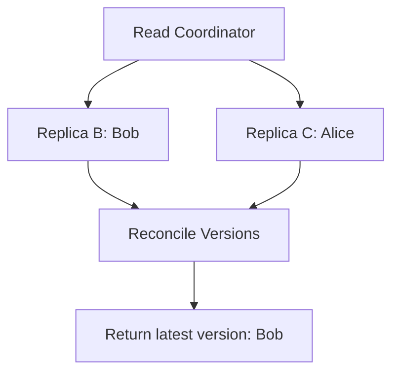
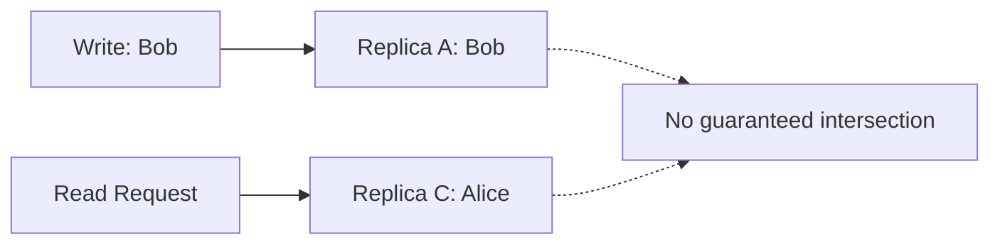
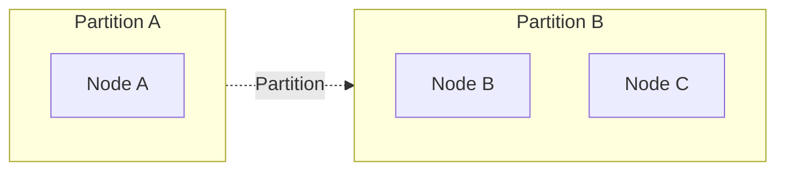
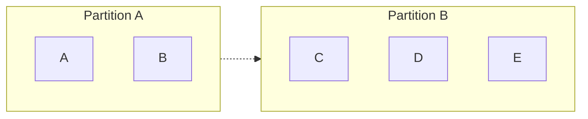
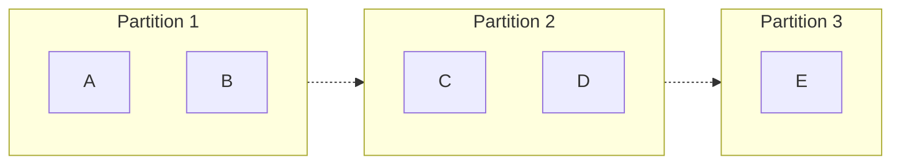
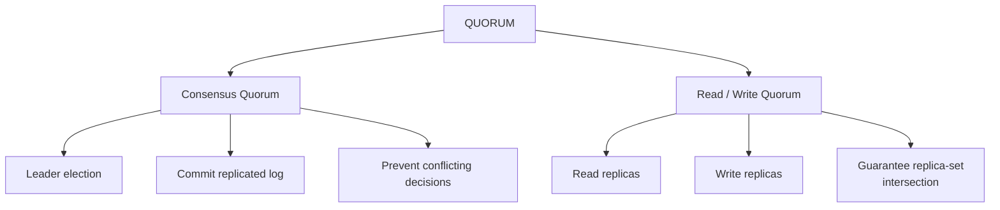

# Chapter 7: Quorum in Depth — Majority, Read Quorum, Write Quorum, and Failure Tolerance

Quorum is one of the most important concepts in distributed systems.

It is used in:

- Distributed consensus algorithms such as Raft and Paxos.
- Distributed databases such as Cassandra.
- Distributed key-value stores.
- Distributed coordination systems.
- Database replication and high-availability architectures.
- Multi-region system design.

However, there is a common source of confusion:

A quorum in a consensus algorithm is not necessarily the same thing as a read or write quorum in a distributed database.

Both involve groups of nodes agreeing or participating, but their guarantees and purposes can be very different.

We'll understand both separately and then connect them.

By the end of this chapter, you should be able to calculate quorum, determine failure tolerance, reason about network partitions, design multi-region clusters, and explain why certain database architectures use three or five nodes instead of two.

# 7.1 First, what exactly is a quorum?

Imagine you have five database nodes:

```
Node A
Node B
Node C
Node D
Node E
```

The nodes maintain replicated information.

Suppose they need to make an important decision:

```
Who should become the leader?
```

Or:

```
Should this operation be committed?
```

Should we require all five nodes to participate?

That would be unnecessarily restrictive.

What happens if one node crashes?

We would be unable to make progress even though the other four nodes are healthy.

What about requiring just one node?

That is too permissive. Different nodes might independently make conflicting decisions.

We need a threshold.

That threshold is called a quorum.

A quorum is the minimum set or number of participants whose participation is sufficient to satisfy a particular protocol's decision rules.

For a majority-based consensus protocol:

\\[ Q = \left\lfloor \frac{N}{2} \right\rfloor + 1 \\]

Where:

- \\(N\\) = total number of voting nodes.
- \\(Q\\) = majority quorum.

For five nodes:

\\[ Q = \left\lfloor \frac{5}{2} \right\rfloor + 1 = 3 \\]

Therefore, three nodes are sufficient for a majority decision.



Notice that a quorum does not necessarily require every node to participate.

The system can tolerate some unavailable nodes while preserving its coordination guarantees.

## A real-world analogy: Bank board meeting

Imagine a bank has five board members.

A particular decision requires a majority.

```
Total members = 5
Required votes = 3
```

Three members can approve the decision.

Two members cannot.

If two members are unavailable, the remaining three can still make the decision.

But if three members are unavailable, the remaining two cannot.

This is the basic intuition behind majority quorum.

There is one important difference between the analogy and distributed systems:

In distributed systems, nodes can become partitioned, messages can be delayed, and participants can have different knowledge of previous decisions.

Therefore, quorum must be combined with carefully designed protocol rules.

# 7.2 Why do we need a majority instead of requiring all nodes?

Let's compare three possible strategies using five database nodes.

### Strategy A: Require all five nodes

```
Required votes = 5
```

Advantage:

Every node participates in each decision.

Disadvantage:

Even one node failure prevents progress.

```
A: UP
B: UP
C: UP
D: UP
E: DOWN

Available = 4
Required = 5

Cannot proceed.
```

This provides very poor availability.

### Strategy B: Require only one node

```
Required votes = 1
```

Advantage:

Any available node can make progress.

Disadvantage:

Multiple partitions could independently make decisions.

For example:

```
Partition 1: A, B
Partition 2: C, D, E
```

Both partitions could independently select leaders or accept conflicting decisions.

This creates serious split-brain risks.

### Strategy C: Require a majority

```
Required votes = 3
```

Now:

```
Partition 1: A, B
Available = 2
Cannot proceed.

Partition 2: C, D, E
Available = 3
Can proceed.
```

Only one partition can obtain the majority of the original five-node configuration.

This is the important property we want.

| Strategy     | Availability after one failure | Protection against conflicting majorities |
| ------------ | ------------------------------ | ----------------------------------------- |
| All nodes    | No                             | Yes, but restrictive                      |
| Any one node | Yes                            | No                                        |
| Majority     | Yes                            | Yes, under the protocol's assumptions     |

Majority quorum gives us a useful balance between safety and fault tolerance.

# 7.3 Why does majority quorum actually work?

This is the mathematical foundation of quorum.

Suppose you have five nodes:

```
A, B, C, D, E
```

Majority quorum:

```
Q = 3
```

Consider two decisions.

Decision 1 obtains votes from:

```
A, B, C
```

Decision 2 obtains votes from:

```
C, D, E
```

The two groups overlap:

```
Decision 1: A, B, C
Decision 2: C, D, E

              |
              v
          Common node C
```

Let's prove why this must always happen.

A quorum must contain more than half the nodes:

\\[ Q > \frac{N}{2} \\]

Suppose two quorums do not overlap.

Their combined membership would be at least:

\\[ Q + Q > N \\]

But there are only \\(N\\) nodes.

That's impossible.

Therefore:

\\[ \boxed{2Q > N} \\]

This guarantees that any two majority quorums overlap by at least one node.

More generally, if two different quorum sizes are used:

\\[ \boxed{Q_1 + Q_2 > N} \\]

Then they must overlap.

### Why is this overlap useful?

Imagine Node C has accepted an important decision in the first quorum.

When another quorum is formed, at least one node from the earlier quorum participates again.

The consensus protocol uses this overlap and the information retained by participating nodes to prevent an incompatible decision from replacing an earlier one.

For example:

- In Paxos, acceptors retain accepted proposals.
- In Raft, voting rules and log freshness protect committed entries.
- In other consensus protocols, different mechanisms preserve the same essential safety property.

Important: Quorum intersection alone does not prove consensus safety. The protocol must define what the overlapping node remembers, what it is allowed to accept, and how later decisions must respect earlier ones.

# 7.4 How many nodes can fail?

Now let's calculate failure tolerance.

For majority-based consensus:

\\[ Q = \left\lfloor \frac{N}{2} \right\rfloor + 1 \\]

The maximum number of nodes that can fail while retaining a quorum is:

\\[ F = N-Q \\]

Therefore:

\\[ \boxed{F = \left\lfloor \frac{N-1}{2} \right\rfloor} \\]

Let's calculate.

| Total nodes | Required quorum | Maximum tolerated failures |
| ----------- | --------------- | -------------------------- |
| 1           | 1               | 0                          |
| 2           | 2               | 0                          |
| 3           | 2               | 1                          |
| 4           | 3               | 1                          |
| 5           | 3               | 2                          |
| 6           | 4               | 2                          |
| 7           | 4               | 3                          |
| 8           | 5               | 3                          |
| 9           | 5               | 4                          |

This table is extremely important for system design.

It explains why distributed systems frequently use three, five, or seven voting nodes.

For example, etcd's official documentation provides the same majority and failure-tolerance relationships and recommends odd-sized clusters for efficient fault tolerance.&#x20;

[image](https://www.google.com/s2/favicons?domain=https://etcd.io\&sz=32)

etcd


## 7.4.1 Why are odd numbers preferred?

Compare these configurations:

Three nodes

```
N = 3
Q = 2
F = 1
```

Four nodes

```
N = 4
Q = 3
F = 1
```

You added a fourth machine.

But the system still tolerates only one failure.

You spent resources without increasing failure tolerance.

Now compare:

Five nodes

```
N = 5
Q = 3
F = 2
```

By adding a fifth node to a four-node configuration, you increased the failure tolerance from one to two.

This is why odd-sized clusters are often more resource-efficient.

But be precise:

Odd numbers aren't inherently more reliable. They are generally more efficient when the system uses simple majority quorum.

For example:

```
3 nodes: tolerate 1 failure
4 nodes: tolerate 1 failure

5 nodes: tolerate 2 failures
6 nodes: tolerate 2 failures
```

An additional node only improves fault tolerance when it increases the number of failures that can occur while preserving quorum.

# 7.5 Why are two-node clusters problematic?

This is a particularly important system-design question.

Suppose you have two database nodes:

```
Node A
Node B
```

The majority calculation:

\\[ Q = \left\lfloor \frac{2}{2} \right\rfloor + 1 = 2 \\]

Both nodes must participate.

Now Node A crashes.

```
A: DOWN
B: UP
```

Available nodes:

```
1
```

Required quorum:

```
2
```

Node B cannot form a majority.

It cannot safely elect a replacement leader or commit consensus-backed decisions.

This is why a two-voter cluster does not tolerate a single voter failure.

### But can't Node B just become the leader?

It could simply declare itself leader, but consider the alternative:

Perhaps A did not crash. Perhaps the network between A and B broke.

Now:

```
A: I am the leader.
B: I am the leader.
```

Both might accept conflicting writes.

The system has no way to establish which side has the required authority.

So the protocol refuses to make progress.

### What is the solution?

Use three voting members.

```
A
B
C
```

Now:

```
Q = 2
```

If A becomes unavailable:

```
B + C = 2
```

The remaining nodes retain quorum.

This gives you meaningful fault tolerance.

# 7.6 What is a witness node?

Now let's look at an interesting solution used in certain high-availability architectures.

Suppose you have two database servers:

```
Database A
Database B
```

You don't want to deploy a third full database replica.

But you need a third participant to help determine which side has authority.

You introduce a witness.



Conceptually:

```
A = Data-bearing node
B = Data-bearing node
W = Witness / tie-breaker
```

There are now three voting participants.

A majority requires two votes.

For example, if A becomes unavailable, B and the witness may establish a majority, depending on the particular clustering implementation.

### What does a witness store?

This depends on the technology.

A witness might store:

- Membership information.
- Cluster voting state.
- Arbitration information.
- A small amount of coordination metadata.

It may not store a complete copy of application data.

### Important limitation

A witness is not a replacement for a data replica.

Suppose:

```
A: Database data
B: Database data
W: Voting metadata only
```

A and B have different responsibilities from W.

The witness can help arbitrate ownership, but it cannot reconstruct database records that were lost from both data-bearing nodes.

Also, standard Raft voting members normally maintain the replicated log. A witness-only participant is not automatically interchangeable with a normal Raft voter.

Witness support depends on the specific clustering technology.

System design takeaway: A witness can help resolve voting or arbitration problems, but it does not automatically increase data durability.

# 7.7 Two fundamentally different types of quorum

Now we reach a very important distinction.

There are two common quorum concepts.

### Type 1: Consensus quorum

Used in systems such as:

- Raft.
- Paxos.
- etcd.
- Distributed coordination services.

It establishes agreement on decisions, leadership, or committed log entries.

### Type 2: Read/write quorum

Used in systems inspired by Dynamo, including Apache Cassandra.

It determines how many replicas must participate in a particular read or write operation.

These concepts share mathematical intersection properties, but they do not provide identical guarantees.

Let's explore each.

# 7.8 Consensus quorum: How Raft uses majority

Consider a five-node Raft cluster.

```
A, B, C, D, E
```

Majority:

```
Q = 3
```

Suppose A is the leader.

A receives a client operation:

```
DEPOSIT ₹2,000
```

The leader appends the operation to its replicated log.

It sends the log entry to followers.



Suppose:

```
A: Entry recorded
B: Entry recorded
C: Entry recorded
D: Unavailable
E: Unavailable
```

Three nodes have recorded the entry.

The leader can satisfy the majority requirement.

Under Raft's commitment rules, the entry can be committed.

Now suppose only A and B recorded it.

```
A: Entry recorded
B: Entry recorded
C: Unavailable
D: Unavailable
E: Unavailable
```

Only two nodes.

The operation does not have the required majority.

It cannot be committed yet.

### What does Raft quorum protect?

It protects the authoritative replicated history.

It is used in:

1. Leader election.
2. Log replication.
3. Establishing committed entries.
4. Safe membership transitions.

A Raft quorum isn't merely saying:

"Two or three database replicas answered my read request."

It is participating in a consensus protocol with specific safety rules.

The Raft paper describes how overlapping majorities support both its replicated log and safe membership changes.&#x20;

[image](https://www.google.com/s2/favicons?domain=https://raft.github.io\&sz=32)

raft.github.io+1


# 7.9 Read/write quorum: Understanding Dynamo-style databases

Now let's switch architectures.

Consider a distributed database that maintains multiple copies of each record.

Suppose a particular customer's data is replicated across three nodes.

```
Replica A
Replica B
Replica C
```

Replication factor:

\\[ N = 3 \\]

Here, N means the number of replicas holding a particular piece of data, not necessarily the number of nodes in the entire cluster.

For a write, we define:

\\[ W = \text{Number of replica acknowledgements required} \\]

For a read:

\\[ R = \text{Number of replica responses required} \\]

The important condition is:

\\[ \boxed{R + W > N} \\]

Why?

Because it ensures that the read quorum and write quorum must have at least one replica in common.

Let's understand this with examples.

## 7.9.1 Write operation with W = 2

Initial state:

```
Customer name = Alice
```

The application updates the name:

```
Customer name = Bob
```

It sends the update to all three replicas.



Two replicas acknowledge the update.

Therefore:

```
W = 2
N = 3
```

The coordinator can return success according to that write consistency level.

Replica C might receive the update later.

## 7.9.2 Read operation with R = 2

Now the application reads the customer's name.

It requests two replicas.

Suppose the coordinator queries B and C.



The read quorum is:

```
R = 2
```

The read set and write set overlap:

```
Write set: A, B
Read set:  B, C

Common replica: B
```

Replica B has the newer write.

The read coordinator can reconcile the returned versions and return the latest version according to the database's conflict-resolution rules.

Therefore:

\\[ R+W=2+2=4 \\]

\\[ 4>3 \\]

The read and write quorums must overlap.

This is the core mathematical principle.

# 7.10 What happens when R + W is not greater than N?

Consider:

```
N = 3
W = 1
R = 1
```

The write reaches only Replica A.

```
Write set = A
```

The read goes to Replica C.

```
Read set = C
```

There is no overlap.



Calculate:

\\[ R+W=1+1=2 \\]

\\[ 2 \not> 3 \\]

The read might return the stale value.

This does not mean every read will be stale.

It means the quorum sizes provide no mathematical guarantee that every acknowledged write intersects every subsequent read.

### Compare different configurations

Assume RF = 3.

| Write quorum (W) | Read quorum (R) | R + W | Guaranteed intersection? |
| ---------------- | --------------- | ----- | ------------------------ |
| 1                | 1               | 2     | No                       |
| 1                | 2               | 3     | No                       |
| 1                | 3               | 4     | Yes                      |
| 2                | 1               | 3     | No                       |
| 2                | 2               | 4     | Yes                      |
| 3                | 1               | 4     | Yes                      |
| 3                | 2               | 5     | Yes                      |
| 3                | 3               | 6     | Yes                      |

Notice that neither the read quorum nor the write quorum has to be a majority individually.

The important condition for this form of read/write quorum intersection is:

\\[ R+W>N \\]

For example:

```
W = 3
R = 1
N = 3
```

This guarantees intersection even though the read only waits for one replica.

But it has a trade-off: every write needs all three replicas.

# 7.11 Quorum and availability: What happens when replicas fail?

Let's use:

```
Replication Factor = 3
```

Our replicas:

```
A, B, C
```

Consider different consistency configurations.

### Configuration A: W = 3

All three replicas must acknowledge a write.

Suppose C is unavailable.

```
A: UP
B: UP
C: DOWN
```

The write cannot succeed.

### Configuration B: W = 2

Two replicas must acknowledge.

```
A: UP
B: UP
C: DOWN
```

The write can succeed.

### Configuration C: W = 1

Only one replica needs to acknowledge.

This allows greater availability during replica failures, but offers weaker read-after-write guarantees unless reads use a sufficiently large quorum and other consistency conditions are satisfied.

### The trade-off

| Configuration | Write availability | Write latency    | Read-after-write protection                   |
| ------------- | ------------------ | ---------------- | --------------------------------------------- |
| W = 1         | Higher             | Usually lower    | Depends on read quorum                        |
| W = 2         | Moderate           | Usually moderate | Stronger with R + W > N                       |
| W = 3         | Lower              | Usually higher   | Strong intersection protection with any R ≥ 1 |

These are relative tendencies, not absolute performance guarantees.

Actual behavior depends on network latency, disk performance, failure handling, and database implementation.

Important: A higher quorum isn't automatically better for every workload.

You must select consistency levels based on the application's correctness requirements.

# 7.12 Real-world example: Apache Cassandra

Now let's connect read/write quorum to an actual distributed database.

Apache Cassandra follows a Dynamo-inspired architecture.

It has some important properties:

- Data is partitioned using consistent hashing.
- Each partition is replicated according to its replication factor.
- Multiple replicas can accept mutations.
- Clients select consistency levels for reads and writes.
- The coordinator determines how many replica responses are needed before returning success.

Cassandra's architecture documentation describes its multi-master replication model, per-operation consistency levels, and the use of replica-set intersection.&#x20;

[image](https://www.google.com/s2/favicons?domain=https://cassandra.apache.org\&sz=32)

Apache Cassandra Documentation+1


Let's understand a concrete example.

Suppose:

```
Replication Factor = 3
```

The three replicas for a partition are:

```
A, B, C
```

You execute:

```
INSERT INTO customers (id, name)
VALUES (101, 'Bob');
```

Suppose you configure:

```
Consistency Level = QUORUM
```

For an RF of 3, the coordinator needs acknowledgements from at least two replicas.

```
A: Acknowledged
B: Acknowledged
C: Still processing
```

The coordinator can return success.

Similarly, a read at `QUORUM` requires at least two replica responses.

The read coordinator compares the returned data and reconciles versions.

The official Cassandra documentation defines `QUORUM` as a majority of the relevant replicas and explains how reads and writes intersect when their consistency levels satisfy the required relationship.&#x20;

[image](https://www.google.com/s2/favicons?domain=https://cassandra.apache.org\&sz=32)

Apache Cassandra Documentation


## 7.12.1 Cassandra's important consistency levels

| Consistency level | Meaning                                                             |
| ----------------- | ------------------------------------------------------------------- |
| `ONE`             | One replica must respond                                            |
| `TWO`             | Two replicas must respond                                           |
| `THREE`           | Three replicas must respond                                         |
| `QUORUM`          | Majority of replicas must respond                                   |
| `ALL`             | All replicas must respond                                           |
| `LOCAL_QUORUM`    | Majority of replicas in the local datacenter                        |
| `EACH_QUORUM`     | Majority in every datacenter for a write                            |
| `LOCAL_ONE`       | One local replica must respond                                      |
| `ANY`             | A write can succeed with a replica acknowledgement or a stored hint |

A particularly important distinction:

`ANY` is a write-only consistency level in Cassandra. A coordinator can acknowledge after storing a hint even if none of the actual data replicas has acknowledged the mutation. The hint is intended for later delivery.&#x20;

[image](https://www.google.com/s2/favicons?domain=https://cassandra.apache.org\&sz=32)

Apache Cassandra Documentation


## 7.12.2 Does Cassandra use Raft for every normal write?

No.

This is a very important distinction.

Cassandra's normal replication model is not simply a Raft leader-and-follower architecture.

It uses a coordinator and multi-master replication.

Replicas can independently accept mutations.

Conflict resolution uses timestamp-based last-write-wins behavior.

The documentation explicitly describes this multi-master design and its conflict-resolution model.&#x20;

[image](https://www.google.com/s2/favicons?domain=https://cassandra.apache.org\&sz=32)

Apache Cassandra Documentation


So when you write:

```
Consistency Level = QUORUM
```

you are choosing the minimum replica participation required for that operation.

You are not automatically running a Raft leader election for each ordinary write.

## 7.12.3 Does Cassandra QUORUM give you full linearizability?

No.

This is one of the most important distinctions.

Read/write quorum intersection helps ensure that a subsequent read overlaps with a successful write.

But it does not automatically serialize all concurrent conditional updates.

Consider:

```
Current inventory = 1
```

Two clients concurrently execute:

```
Client A: Reserve 1
Client B: Reserve 1
```

Both need to ensure that inventory never becomes negative.

Ordinary quorum reads and writes alone are not a substitute for an atomic compare-and-set operation.

Cassandra provides Lightweight Transactions (LWT), which use Paxos to implement linearizable conditional operations.&#x20;

[image](https://www.google.com/s2/favicons?domain=https://cassandra.apache.org\&sz=32)

Apache Cassandra Documentation+1


This is a crucial example of the relationship between read/write quorum and consensus.

The database uses different mechanisms for different consistency requirements.

# 7.13 Consensus quorum vs Read/Write quorum: Complete comparison

Let's make the difference absolutely clear.

| Property                       | Consensus quorum                                     | Read/write quorum                               |
| ------------------------------ | ---------------------------------------------------- | ----------------------------------------------- |
| Primary purpose                | Agreement on decisions                               | Ensure read/write replica overlap               |
| Used by                        | Raft, Paxos, etcd                                    | Cassandra, Dynamo-style systems                 |
| Nodes involved                 | Voting members of a consensus group                  | Replicas of a particular data item or partition |
| Formula                        | Majority for common crash-tolerant protocols         | R + W > N for intersection                      |
| Leader required?               | Depends on algorithm; Raft uses a leader             | Not necessarily                                 |
| Used for                       | Leader election, committed log decisions             | Per-operation read/write consistency            |
| Guarantees                     | Consensus safety under protocol assumptions          | Replica-set intersection under its assumptions  |
| Does it imply serializability? | Not by itself for arbitrary application transactions | No                                              |

### The key difference

Consensus quorum answers:

"Does this group have sufficient authority to establish an agreed decision?"

Read/write quorum answers:

"Do the replicas participating in this read and write overlap?"

These are different questions.

Don't mix them up in system design interviews.

# 7.14 Quorum during network partitions

Let's study realistic network partition scenarios.

## Scenario A: Three nodes

```
A, B, C
```

Quorum:

```
2
```

Network partition:



Partition A:

```
1/3
No quorum
```

Partition B:

```
2/3
Has quorum
```

Only B and C can continue making consensus decisions.

## Scenario B: Five nodes

```
A, B, C, D, E
```

Quorum:

```
3
```

Network partition:



Partition A:

```
2/5
No quorum
```

Partition B:

```
3/5
Has quorum
```

Partition B continues.

## Scenario C: No majority partition

Five nodes:

```
A, B, C, D, E
```

Partition:



No partition has three nodes.

Therefore, no partition can independently commit consensus decisions.

The system must wait until sufficient communication is restored.

This is the availability trade-off of majority-based consensus.

# 7.15 Why quorum placement matters in multi-region architecture

Now let's connect quorum to your multi-region system design learning.

Suppose you deploy a three-node consensus cluster.

```
Region A: 2 nodes
Region B: 1 node
```

Total:

```
N = 3
Q = 2
```

What happens if Region A becomes unavailable?

```
Region A: DOWN
Region B: 1 node
```

Remaining votes:

```
1
```

No quorum.

The cluster stops making consensus decisions.

But if Region B becomes unavailable:

```
Region A: 2 nodes
Region B: DOWN
```

Region A retains quorum.

The cluster can continue.

This architecture is asymmetric.

It tolerates the loss of one region but not the other.

### A better five-node example

Suppose you have:

```
Region A: 2 nodes
Region B: 2 nodes
Region C: 1 node
```

Total:

```
N = 5
Q = 3
```

Now consider losing any one entire region.

| Failed region | Remaining nodes | Quorum available? |
| ------------- | --------------- | ----------------- |
| Region A      | 3               | Yes               |
| Region B      | 3               | Yes               |
| Region C      | 4               | Yes               |

This placement can tolerate the loss of any single region, provided the remaining nodes can communicate and the system's other failure assumptions hold.

### What is the trade-off?

Consensus writes need acknowledgements from a majority.

If the leader is in Region A and the quorum includes nodes in other regions, the operation incurs cross-region network latency.

The more geographical distance between participating nodes, the more expensive coordination becomes.

This is especially important for synchronous consensus replication.

The etcd documentation explicitly describes the latency and bandwidth costs of cross-region consensus deployments.&#x20;

[image](https://www.google.com/s2/favicons?domain=https://etcd.io\&sz=32)

etcd


### Three nodes distributed across three regions

Another possible placement:

```
Region A: 1
Region B: 1
Region C: 1
```

Quorum:

```
2
```

This provides tolerance for the loss of one region.

However, each successful quorum-backed write needs participation from at least two regions.

This can increase latency significantly.

### Design principle

Don't distribute voting nodes just to make the architecture look geographically distributed.

Decide which failures the system must tolerate:

- One machine?
- One availability zone?
- One entire region?
- A regional network partition?
- Two independent failures?

Then place quorum members accordingly.

# 7.16 Quorum and replication factor are not the same

Another common source of confusion.

Suppose Cassandra has 100 physical nodes.

Does that mean its read quorum is based on 100?

Not necessarily.

Suppose the replication factor for a particular partition is three.

```
Partition X:

Replica A
Replica B
Replica C
```

The quorum calculation is based on those three replicas.

```
RF = 3
QUORUM = 2
```

Another partition might be stored on:

```
Replica D
Replica E
Replica F
```

Its quorum is also calculated from its replication factor.

In a distributed database, quorum is often scoped to a specific data partition or replica set.

In a consensus cluster such as etcd, majority quorum is calculated from the configured voting membership of the cluster.

| System                       | Quorum population                |
| ---------------------------- | -------------------------------- |
| Raft cluster                 | Voting members                   |
| etcd cluster                 | Cluster members                  |
| Cassandra partition          | Replicas for that partition      |
| Dynamo-style key-value store | Replicas responsible for the key |

This distinction matters enormously when estimating failure tolerance.

# 7.17 Membership changes: What happens when we add or remove nodes?

Now let's discuss an advanced topic.

Suppose you start with three nodes:

```
A, B, C
```

Your quorum is:

```
2
```

You want to add Node D.

Now you have four nodes.

The new quorum becomes:

```
3
```

What if the cluster simply updates its membership configuration without a safe transition?

Different nodes might use different membership configurations.

Some might calculate quorum using:

```
Old configuration: 3 nodes
Required: 2
```

Others might calculate:

```
New configuration: 4 nodes
Required: 3
```

These inconsistent configurations can lead to dangerous decisions.

### How does Raft handle membership changes?

One approach described in the Raft paper is called Joint Consensus.

Instead of switching directly from the old configuration to the new one, Raft introduces an intermediate configuration.

Conceptually:

```
C_old
   |
   v
C_old,new
   |
   v
C_new
```

During the joint configuration, decisions require a majority of both the old and new configurations.

For example:

Old configuration:

```
A, B, C
Quorum = 2
```

New configuration:

```
A, B, C, D, E
Quorum = 3
```

During the joint phase, an operation must satisfy:

```
At least 2 votes from C_old

AND

At least 3 votes from C_new
```

This overlap prevents the old and new configurations from independently establishing conflicting leadership.

The Raft paper describes joint consensus as a mechanism for safely changing cluster membership using overlapping majorities.&#x20;

[image](https://www.google.com/s2/favicons?domain=https://raft.github.io\&sz=32)

raft.github.io+1


### Why shouldn't we manually add five nodes at once?

Because a membership update is itself a distributed coordination problem.

The cluster must agree on the configuration change.

For example, etcd's current documentation requires a working majority for runtime reconfiguration and specifically warns about unsafe changes to small clusters.&#x20;

[image](https://www.google.com/s2/favicons?domain=https://etcd.io\&sz=32)

etcd+1


System design lesson: Cluster membership is part of the replicated system state. You cannot safely treat it as an ordinary local configuration edit.

# 7.18 Quorum does not replace backups

This is another important real-world consideration.

Suppose you have a five-node database cluster.

```
A, B, C, D, E
```

You have quorum.

A developer accidentally executes:

```
DELETE FROM customers;
```

The delete replicates to all five nodes.

All replicas now contain the deleted state.

Did quorum protect you?

No.

The cluster operated correctly according to its replication protocol.

But the application data was destroyed.

Quorum helps protect consistency across failures.

It does not protect against:

- Accidental deletion.
- Malicious modifications.
- Application bugs.
- Corrupted business logic.
- Incorrect schema migrations.
- Logical data corruption propagated to replicas.

You still need:

- Backups.
- Point-in-time recovery.
- Snapshots.
- Disaster recovery procedures.
- Appropriate retention policies.

Replication is not backup. Quorum is not backup.

These mechanisms solve different problems.

# 7.19 Production system design: Choosing the right quorum

Let's solve some architecture problems.

### Problem A: A coordination service for Kubernetes

Requirement:

- Store cluster configuration.
- Maintain one consistent cluster state.
- Survive one machine failure.
- Avoid split brain.

Architecture:

```
3 etcd voting members
Quorum = 2
Failure tolerance = 1
```

Place them across three independent availability zones where practical.

The system cannot commit new consensus operations if it loses a majority.

### Problem B: A highly available distributed database

Requirement:

- RF = 3.
- Read-after-write behavior for acknowledged operations.
- Allow one replica to be unavailable.

One suitable configuration is:

```
W = 2
R = 2
N = 3
```

Check:

\\[ R+W=4>3 \\]

The read and write sets overlap.

One unavailable replica can still leave two available replicas.

However, for operations requiring strict serialization or conditional atomic updates, use the appropriate stronger transaction mechanism.

### Problem C: Multi-region metadata service

Requirement:

- Five voting members.
- Survive any single region failure.
- Maintain consensus-backed writes.

One possible placement:

```
Region A: 2 members
Region B: 2 members
Region C: 1 member

Quorum = 3
```

Losing any single region leaves at least three members.

But cross-region communication increases commit latency.

### Problem D: Two-node database HA

Requirement:

- Two database servers.
- Continue after one server failure.
- Avoid split brain.

A plain two-voter majority cluster cannot satisfy this requirement.

A third independent voting witness may help with arbitration, depending on the technology.

However, the data durability and replication design must still be considered separately.

# 7.20 Common mistakes in understanding quorum

| Misconception                                | Correct understanding                                                    |
| -------------------------------------------- | ------------------------------------------------------------------------ |
| Quorum always means majority                 | Majority is common, but some systems use different quorum configurations |
| Three replicas mean three-node consensus     | Not necessarily                                                          |
| Replication factor is total cluster size     | It is the number of copies for a particular partition                    |
| Any two nodes can agree safely               | Only if the protocol's quorum conditions are satisfied                   |
| Quorum guarantees linearizability            | Not automatically                                                        |
| Quorum guarantees durability forever         | No                                                                       |
| More nodes always improve availability       | More voters also increase quorum requirements                            |
| A witness is a full data replica             | Not necessarily                                                          |
| Read/write quorum is the same as Raft quorum | No                                                                       |
| Losing quorum means data is lost             | Not necessarily; the cluster might simply be unable to make progress     |

# 7.21 Interview Questions and Answers

### Q1. What is quorum in distributed systems?

Quorum is the minimum number of participants required for a particular distributed decision or operation to satisfy its protocol rules.

In majority-based consensus:

\\[ Q=\lfloor N/2 \rfloor+1 \\]

### Q2. Why is majority quorum used?

Because any two majority sets must overlap. This allows protocols to preserve information from previous decisions and prevent incompatible committed histories.

### Q3. How many nodes can fail in a five-node Raft cluster?

The quorum is three.

The cluster can tolerate two unavailable voting members while retaining a majority.

### Q4. Why is a three-node cluster preferred over a two-node cluster?

A three-node majority quorum requires two nodes and can tolerate one failure.

A two-node majority quorum requires both nodes and cannot tolerate either node becoming unavailable.

### Q5. Why are odd-sized clusters more efficient?

Even-sized clusters often provide the same failure tolerance as the previous odd-sized cluster.

For example, three and four nodes both tolerate one failure, while five and six nodes both tolerate two.

### Q6. What is a witness node?

A witness is a voting or arbitration participant that may not store a complete application-data replica. It helps determine authority but does not automatically provide data durability.

### Q7. What is read/write quorum?

It is a mechanism where a read operation waits for R replicas and a write waits for W replicas.

For a simple replica-intersection guarantee:

\\[ R+W>N \\]

Where N is the replication factor.

### Q8. What is the difference between Raft quorum and Cassandra quorum?

Raft quorum participates in a consensus protocol to establish leadership and committed log decisions.

Cassandra read/write consistency levels control the number of replicas participating in individual read and write operations.

### Q9. Does Cassandra QUORUM guarantee linearizable consistency?

Not for all ordinary operations. Read/write quorum intersection provides useful consistency guarantees, but concurrent conditional operations requiring linearizability use Cassandra Lightweight Transactions based on Paxos.

### Q10. What happens when a cluster loses quorum?

It generally cannot make new decisions requiring quorum. It may retain local data, but the system sacrifices progress to preserve consistency.

### Q11. What is the purpose of joint consensus?

It enables safe transitions between cluster membership configurations by requiring agreement from both old and new configurations during the transition.

### Q12. Does quorum protect against accidental deletion?

No. A deletion can be correctly replicated to every replica. Backups and point-in-time recovery are required.

# 7.22 Knowledge Check — System Design Scenarios

Try solving these without looking at the answers in the chapter.

Scenario 1:

You have seven consensus nodes.

How many votes are required?

How many nodes can fail while maintaining quorum?

Scenario 2:

You have a four-node consensus cluster.

One node crashes.

Can the remaining nodes continue?

What if one more crashes?

Scenario 3:

You have RF = 5.

You configure:

```
W = 3
R = 3
```

Is there guaranteed read/write quorum intersection?

What is the minimum possible overlap?

Scenario 4:

You have RF = 3.

You configure:

```
W = 2
R = 1
```

Does the intersection guarantee hold?

Why or why not?

Scenario 5:

You have a five-node cluster:

```
Region A: 3 nodes
Region B: 2 nodes
```

What happens if Region A goes completely offline?

Why is this placement not resilient to the loss of Region A?

Scenario 6:

A Cassandra cluster has 100 physical nodes and RF = 3 for a particular partition.

What is its `QUORUM` for that partition?

Why isn't the answer based on 100 nodes?

Scenario 7:

A five-node consensus cluster loses three nodes.

The remaining two nodes still have their data.

Can they elect a new leader?

Does having the data mean they have authority to make new decisions?

# Chapter 7 — Final Mental Model

There are two important mathematical relationships to retain.

Consensus majority quorum:

\\[ \boxed{Q=\left\lfloor\frac{N}{2}\right\rfloor+1} \\]

Read/write quorum intersection:

\\[ \boxed{R+W>N} \\]

And remember the difference:



The most important lesson:

Quorum is not just about counting machines. It is about establishing the minimum participation needed to preserve a particular correctness guarantee.

## Next Chapter: Chapter 8 — Paxos: Understanding the Original Distributed Consensus Algorithm

Now we're ready to study the first major consensus algorithm in depth.

We'll cover:

1. Why consensus is such a difficult problem.
2. The Two Generals Problem and its limitations.
3. The FLP impossibility result and what it means.
4. What is Paxos?
5. Proposers, Acceptors, and Learners.
6. Prepare and Promise phases.
7. Accept and Accepted phases.
8. Proposal numbers and why they matter.
9. How Paxos prevents conflicting decisions.
10. What happens when two proposers compete?
11. How Paxos handles node crashes.
12. Single-decree Paxos vs Multi-Paxos.
13. How leader optimization reduces repeated coordination.
14. Paxos compared with Raft.
15. Where Paxos appears in production systems.

We'll derive Paxos through real scenarios rather than jumping straight into the algorithm.

One particularly important question we'll answer: If two nodes propose different values simultaneously, how can Paxos guarantee that they cannot both get different values accepted as the final decision?

That is where the real beauty of distributed consensus begins.
