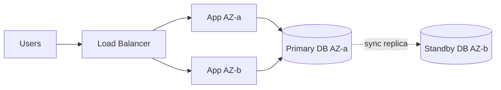
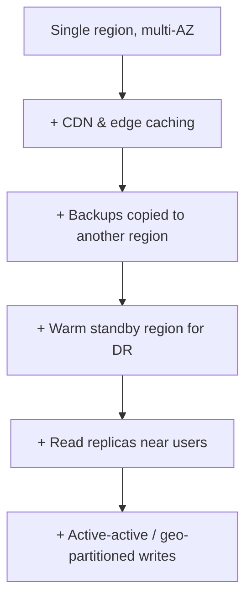

# Multi-Region Architecture: The Course

## Course Map

| # | Chapter | The question it answers |
|---|---------|------------------------|
| 1 | **Why go multi-region (and why not)** | What actually forces you out of one region? |
| 2 | **Single-region foundation** | What must be true *before* you expand? |
| 3 | **Multi-AZ vs multi-region, and the RTO/RPO vocabulary** | What do we promise, and in what units? |
| 4 | **Deployment topologies** | Active-passive, active-active, pilot light, warm standby, cell-based |
| 5 | **Traffic routing & load balancing** | How does a user reach the right region? |
| 6 | **Database replication** | Primary, replicas, sync vs async, backups |
| 7 | **Consistency, latency & conflict resolution** | The CAP/PACELC reality, CRDTs, last-writer-wins |
| 8 | **Failover, DR & regional outages** | Detection, promotion, split-brain, failback, game days |
| 9 | **Users across regions & moving users** | Home region, geo-partitioning, travelers, data migration |
| 10 | **Data synchronization beyond the DB** | Caches, queues, object storage, search, events |
| 11 | **Compliance: GDPR & data residency** | What may leave a region, and how to prove it |
| 12 | **Inter-region communication & security** | Backbone, mTLS, encryption, key management, secrets |
| 13 | **Deployment & release strategy** | Rolling regions, canaries, config, schema migrations |
| 14 | **Observability & operational complexity** | What to monitor, cost, org impact |
| 15 | **Patterns, pitfalls, anti-patterns** | The cheat sheet |
| 16 | **Interview playbook** | Clarifying questions, a full walkthrough, recall aids |

I added chapters 3, 10, 13 and 16 because they are usually missing from material on this topic, and they decide whether you can actually run the system or pass the interview. Each chapter follows the same loop: **a trigger (something breaks), the solution (gained, given up, rejected), and the implementation.** Reply **"next"** to advance.

---

# Chapter 1: Why Go Multi-Region (and Why Not)

## 1.1 The starting point

You run **ShopSphere**, an e-commerce app in one cloud region, say `ap-south-1` (Mumbai). The setup is already decent:



It survives a server dying and even a whole **Availability Zone (AZ)** failing. A region is a cluster of AZs, which are physically separate data centers with independent power and networking, a few milliseconds apart. For most companies this is where the story ends, and that is a perfectly respectable answer.

So why would anyone leave it? There are only **four real reasons**, and in an interview you should be able to name which one is driving the design.

## 1.2 The four triggers

### Trigger A: Latency ("the speed of light is not negotiable")

Your users are now in Frankfurt and São Paulo, and every request crosses an ocean.

| Path | Typical round-trip time (RTT) |
|------|------------------|
| Same AZ | < 1 ms |
| Cross-AZ, same region | 1-2 ms |
| Mumbai ↔ Singapore | ~60 ms |
| Mumbai ↔ Frankfurt | ~120-130 ms |
| Mumbai ↔ São Paulo | ~300 ms |

A page load that needs 6 sequential round trips costs the Frankfurt user roughly 750 ms **before your server does any work**. You cannot buy your way out of this with faster servers. The only fix is to move compute and data closer to the user.

**Key insight:** latency is about **round trips**, not bandwidth. A chatty protocol (many sequential calls) hurts far more than a big payload.

### Trigger B: Availability / disaster recovery ("a region can die")

Multi-AZ protects against a data center failing. It does **not** protect against:

- A regional control-plane failure (the cloud's own APIs, IAM, or load balancer service breaking)
- A bad deployment or config push that is region-wide
- Fire, flood, or a major network partition affecting the region
- A regional dependency outage (the managed DB service itself, DNS, a certificate authority)

If the business says "we cannot be down for 4 hours, ever," a second region is the answer. This trigger is quantified with **RTO and RPO** (Chapter 3).

### Trigger C: Compliance and data residency

German customers' personal data must stay in the EU. India's payment data may need to stay in India. Some governments require a citizen's records to be physically stored in-country. **No amount of engineering cleverness removes this**; it is a legal constraint that forces a regional footprint.

### Trigger D: Scale and blast-radius isolation

One region can run out of capacity (the cloud literally cannot give you more instances), or you want to limit damage so a failure only hurts a slice of users. This is the **cell/shard-by-region** idea we revisit in Chapter 4.

## 1.3 Map the trigger to the architecture

This is the most valuable table in the chapter, because the **trigger decides the topology**.

| Primary driver | What you need | Cheapest approach that works |
|---|---|---|
| Latency for reads (content, catalog) | Data near users | CDN + read replicas in other regions |
| Latency for writes | Writers near users | Active-active or geo-partitioned writes |
| Disaster recovery | A second copy ready to take over | Active-passive (warm standby) |
| Residency | Data never leaves a jurisdiction | Regional silos / geo-partitioning |
| Capacity / blast radius | Independent isolated units | Cell-based architecture |

## 1.4 What you give up (be honest about it)

Multi-region is not a free upgrade. Going from one region to two typically brings:

| You gain | You pay |
|---|---|
| Survive regional outage | **Much harder data consistency** |
| Lower latency for far users | 2-3x infrastructure cost (more with active-active) |
| Legal compliance | Operational complexity: more deploys, more dashboards, more on-call burden |
| Blast-radius control | A larger testing surface, with cross-region failure modes you can't test on a laptop |

Many outages in large companies are caused by the *failover machinery itself* (split-brain, bad failover, replication lag), not by the original failure. Complexity is a risk you buy, so you must earn it.

## 1.5 What we reject (and why this matters in interviews)

- **"Multi-region for everything from day one."** Rejected. Premature. You pay 2-3x cost and a permanent complexity tax for a problem you do not have yet.
- **"Multi-AZ is the same as multi-region."** Rejected. They protect against different failure classes (Chapter 3).
- **"We'll just replicate the database and we're done."** Rejected. Replication is one of about ten problems: routing, caches, queues, sessions, secrets, deploys, compliance, and failback all matter too.

## 1.6 The decision rule (memorize this)

> Add regions **only in response to a measured, named pressure**: latency numbers, an RTO/RPO target from the business, a legal requirement, or capacity limits. Move up the ladder one rung at a time:



Each step is **cheaper and simpler** than the next. A senior answer in an interview is: *"I'd go as far down this ladder as the requirements force me to, and no further."*

## 1.7 Implementation: the cheapest first move

Before any second region, do the two things that cost almost nothing and fix a lot:

**1. CDN for static and cacheable content** (latency trigger, read-heavy part):

```hcl
# Terraform: CloudFront in front of the app (illustrative)
resource "aws_cloudfront_distribution" "shop" {
  enabled = true
  origin {
    domain_name = aws_lb.app.dns_name
    origin_id   = "mumbai-alb"
  }
  default_cache_behavior {
    target_origin_id       = "mumbai-alb"
    viewer_protocol_policy = "redirect-to-https"
    cache_policy_id        = data.aws_cloudfront_cache_policy.optimized.id
  }
}
```

**2. Cross-region backup copy** (a DR floor):

```hcl
resource "aws_backup_plan" "cross_region" {
  name = "shop-backups"
  rule {
    rule_name         = "daily"
    target_vault_name = aws_backup_vault.primary.name
    schedule          = "cron(0 2 * * ? *)"
    copy_action {
      destination_vault_arn = aws_backup_vault.eu_central.arn  # second region
    }
  }
}
```

With these two, a Frankfurt user gets fast static assets from the edge, and a total loss of Mumbai is no longer *permanent* data loss. RPO will be about 24 hours and RTO many hours, but you have something. Often that is genuinely enough.

## 1.8 Chapter 1 recall sheet

- **Four triggers:** Latency, Availability/DR, Compliance, Scale/blast-radius. The mnemonic is **LACS**.
- Trigger decides topology. Name your trigger first in any interview.
- Multi-AZ ≠ multi-region.
- Climb the ladder one rung at a time. Complexity is a cost, not a feature.
- Latency problem = round trips × distance; fix by moving data and compute, not by faster CPUs.

---

Reply **"next"** for **Chapter 2: Single-Region Foundation**, covering what must be true of your app (statelessness, config, IaC, data layout) before expansion is even possible, and why most failed multi-region projects fail *here*.
