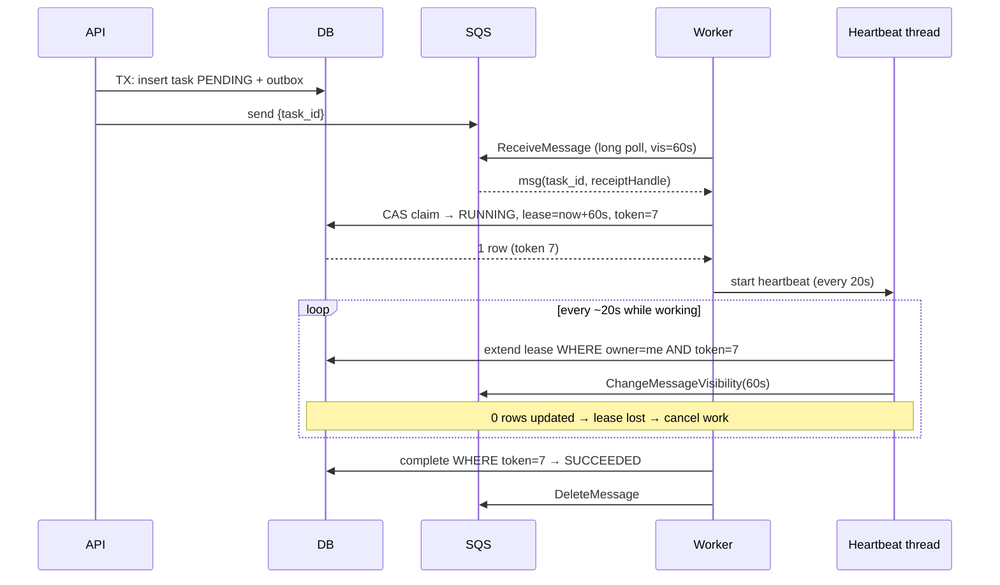
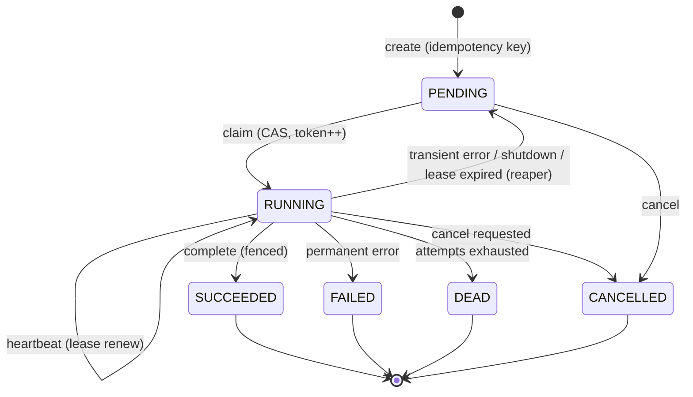
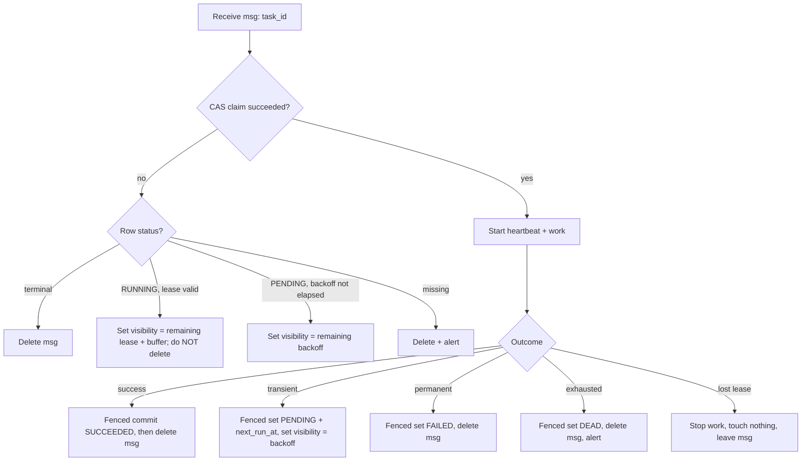

# Reliable Task Processing with DB + SQS: The Full Story

## Part 0: The ground truth (no assumptions)

Everything below depends on a few facts about SQS (Standard queue).

| Fact | Consequence |
|---|---|
| **At-least-once delivery** | The same message can be delivered more than once, even with no failures. |
| **Visibility timeout** | When a worker receives a message, SQS hides it for N seconds (default 30s). If the worker doesn't **delete** it in that window, it reappears. |
| **Delete requires the receipt handle** | Each *receive* gives a new handle. Only the latest handle is reliably valid. |
| **`ChangeMessageVisibility`** | Extends the hide window. The total is capped at **12 hours** from the first receive. |
| **`ApproximateReceiveCount`** | Counts every receive, including ones where the worker did nothing. |
| **Redrive policy → DLQ** | After `maxReceiveCount` receives, SQS moves the message to a dead-letter queue. |
| **No ordering, no priority (Standard)** | FIFO queues add ordering per `MessageGroupId` and 5-minute dedup, but still don't solve crashes or timeouts. |
| **Message ≤ 256 KB, retention ≤ 14 days** | Messages can expire or be purged. The queue is not durable truth. |

**The core mental model:**

> **The queue is a doorbell. The database is the truth.**
>
> SQS only answers "who should look at this task, and when?". It never answers "is this task done, and who owns it right now?". The DB answers that.

Every design decision below follows from this split.

---

## Part 1: The naive version, and how it breaks

```
API:     INSERT task → send to SQS
Worker:  receive → process → delete
```

| # | Failure | What happens |
|---|---|---|
| 1 | **Dual write**: DB commit succeeds, SQS send fails (or the reverse) | Orphan task in the DB, or a message with no row. |
| 2 | **Worker crashes mid-task** | Message reappears and is retried. That's fine only if the work is safe to repeat. |
| 3 | **Task outlives the visibility timeout** | A second worker gets the same message while the first is still running. Two workers run the same task. |
| 4 | **Crash after the side effect, before delete** | Side effect runs twice (double email, double charge). |
| 5 | **Poison message** (always fails) | Loops forever and burns capacity. |
| 6 | **Slow vs dead is indistinguishable** | You can't tell a stuck worker from a dead one. |
| 7 | **Duplicate task creation** (client retries the API call) | Two rows, two messages, two executions. |
| 8 | **No visibility** | Nobody can answer "what is task 123 doing?". |

The rest of the design fixes these one at a time.

---

## Part 2: Chapter 1, Make task creation atomic (fixes #1, #7)

**Problem:** you can't write to a DB and SQS in one transaction.

**Fix: transactional outbox plus a reconciler.**

1. Client sends an `idempotency_key`. A `UNIQUE` constraint on it means a retried request returns the existing task.
2. In **one DB transaction**: insert the task as `PENDING` and insert an `outbox` row.
3. A relay (or the API right after commit) publishes `{task_id}` to SQS and marks the outbox row sent.
4. If publishing fails, the row stays `PENDING` and the **reaper** (Chapter 7) re-publishes it.

**Message content: only `task_id`** (plus maybe a schema version). Never the payload or state. The message is a pointer, and the DB is read at processing time. That means a stale or duplicate message can't carry stale data.

```sql
CREATE TABLE tasks (
  id               UUID PRIMARY KEY,
  idempotency_key  TEXT UNIQUE NOT NULL,
  type             TEXT NOT NULL,
  payload          JSONB NOT NULL,
  status           TEXT NOT NULL,     -- PENDING|RUNNING|SUCCEEDED|FAILED|DEAD|CANCELLED
  attempt          INT  NOT NULL DEFAULT 0,
  max_attempts     INT  NOT NULL DEFAULT 5,
  owner            TEXT,              -- worker id holding the lease
  fencing_token    BIGINT NOT NULL DEFAULT 0,
  lease_expires_at TIMESTAMPTZ,
  next_run_at      TIMESTAMPTZ,       -- for backoff
  last_heartbeat   TIMESTAMPTZ,
  progress         JSONB,             -- checkpoint / counter
  result           JSONB,
  last_error       TEXT,
  created_at       TIMESTAMPTZ NOT NULL DEFAULT now(),
  started_at       TIMESTAMPTZ,
  finished_at      TIMESTAMPTZ
);
CREATE INDEX ON tasks (status, lease_expires_at);
CREATE INDEX ON tasks (status, next_run_at);
```

---

## Part 3: Chapter 2, Claiming a task (fixes #3 partially, #4)

**Problem:** two workers may hold a message for the same task. Who actually owns it?

**Fix: the claim is a compare-and-set (CAS) on the DB row. The database is the arbiter, not SQS.**

```sql
UPDATE tasks
SET status           = 'RUNNING',
    owner            = :workerId,
    attempt          = attempt + 1,
    fencing_token    = fencing_token + 1,
    lease_expires_at = now() + interval '60 seconds',
    last_heartbeat   = now(),
    started_at       = COALESCE(started_at, now())
WHERE id = :taskId
  AND ( status = 'PENDING'
        OR (status = 'RUNNING' AND lease_expires_at < now()) )   -- steal expired lease
  AND (next_run_at IS NULL OR next_run_at <= now())
RETURNING fencing_token, attempt, payload;
```

Use the **DB's `now()`**, never the worker's clock. Worker clocks drift.

**Decision table after the claim attempt:**

| Result | Meaning | Action on the SQS message |
|---|---|---|
| 1 row returned | You own it. | **Keep it in flight** and start working. |
| 0 rows, status `SUCCEEDED`, `FAILED`, `DEAD` or `CANCELLED` | Already finished. | **Delete** the message (it's a harmless duplicate). |
| 0 rows, status `RUNNING` with a valid lease | Another worker is on it. | **Do not delete.** Set visibility to roughly the remaining lease plus a small buffer. If the owner dies, this message returns after the lease expires and acts as the retry trigger. |
| 0 rows, `PENDING` but `next_run_at` in the future | Backoff not elapsed. | Set visibility to the remaining backoff. |
| Row not found | Orphan message. | Delete and alert. |

Why not delete when someone else holds the lease? That message may be the only retry trigger if the owner crashes. The reaper is a backstop, but don't rely only on it.

---

## Part 4: Chapter 3, Long jobs: lease plus heartbeat (fixes #3, #6)

**Problem:** the job takes 20 minutes. What visibility timeout do you pick?

- **Long (30 min):** if the worker dies at minute 1, the task sits dead for 29 minutes.
- **Short (60s):** healthy long jobs get duplicated.

**Fix: keep the lease short and renew it continuously.** A short lease gives fast failure detection, and renewal gives unlimited job length.



**The two clocks and how they relate**

| Clock | Lives in | Purpose | Authority |
|---|---|---|---|
| Visibility timeout | SQS | Decides **when the message gets redelivered** | Trigger only |
| Lease (`lease_expires_at`) | DB | Decides **who owns the task** | **Authoritative** |

Keep them aligned: both are extended together on each heartbeat, and the lease is never longer than the visibility. If they drift, the DB lease still protects you.

**Heartbeat rules:**
- **Interval = lease / 3.** That tolerates two missed beats from network blips before the lease expires.
- Run it on a **separate thread**, since the worker thread may be busy.
- **Heartbeat must be conditional:** `WHERE id=:id AND owner=:me AND fencing_token=:tok`. If 0 rows are updated, you've lost ownership, so **stop work cooperatively** (interrupt the thread or set a cancel flag).
- Also use the heartbeat response to learn about cancellation (e.g. status flipped to `CANCEL_REQUESTED`).
- Keep the 12-hour SQS cap in mind. Jobs that could exceed it must be **chunked and checkpointed** into continuation tasks.

**Liveness is not progress.** A heartbeat thread keeps beating even if the main thread is deadlocked, which makes a zombie that is "alive" forever. So the heartbeat should only fire if progress moved. Have the worker bump an `AtomicLong progressCounter`, and let the heartbeat skip renewal (or flag it) if the counter hasn't changed within a stall threshold. Then the lease expires and the task gets rescued.

---

## Part 5: Chapter 4, Zombies and fencing (fixes #3, #4 for real)

**Problem:** Worker A freezes (GC pause, VM stall, network partition) past its lease. Worker B steals the task. A wakes up and thinks it still owns the task.

You can't tell "dead" from "slow" in a distributed system. So don't try. **Make a late worker harmless.**

**Fencing token:** every claim increments `fencing_token`. Every write A makes carries its token, and the DB rejects stale ones.

```sql
-- Completion: only the current owner can finish
UPDATE tasks
SET status='SUCCEEDED', result=:r, finished_at=now(), owner=NULL, lease_expires_at=NULL
WHERE id=:id AND owner=:me AND fencing_token=:tok AND status='RUNNING';
```

If 0 rows are updated, A was fenced out. It discards its result, does **not** delete the message, and stops.

**External side effects need the same protection.** Pass an **idempotency key** derived from `task_id` (plus a step name for multi-step jobs) to downstream systems (e.g. a payment API's idempotency key). If the downstream can verify fencing tokens, send the token too.

---

## Part 6: Chapter 5, Failures and retries (fixes #2, #5)

**Classify errors first:**

| Class | Examples | Action |
|---|---|---|
| **Transient** | Timeouts, 5xx, throttling, deadlock | Retry with backoff |
| **Permanent** | Validation error, 4xx, missing entity | `FAILED` immediately, no retry |
| **Poison / unknown** | Crashes the worker, OOM | Retry limit, then `DEAD` |
| **Worker shutdown** | SIGTERM, deploy | Release without burning an attempt |

**Transient failure path:**

1. Worker writes `status='PENDING'`, `next_run_at = now() + backoff`, `last_error=...` (fenced, as above).
2. Backoff is **exponential with full jitter**: `delay = random(0, min(cap, base * 2^attempt))`. Jitter prevents a thundering herd of retries.
3. Worker calls `ChangeMessageVisibility(delay)` (max 12h). For longer delays, delete the message and let the reaper re-enqueue at `next_run_at`.

**Exhausted attempts** (`attempt >= max_attempts`): set `DEAD`, delete the message, and send to your own DLQ or alert.

**SQS redrive policy is a second safety net, not the primary mechanism.** Remember `ApproximateReceiveCount` also counts lock-denied duplicates and expiries. Set `maxReceiveCount` comfortably **above** `max_attempts` (e.g. 3x), so the DB's attempt counter normally decides first. Also:
- Run a **DLQ consumer** that marks the DB row `DEAD`. Otherwise the row says `RUNNING` forever.
- Give the DLQ a **longer retention** than the main queue.
- Offer **redrive** (replay) tooling after bugs are fixed.

**Graceful shutdown (SIGTERM):** stop polling, then either finish within the grace period, or release the task: `status='PENDING'`, `attempt = attempt - 1`, `ChangeMessageVisibility(0)`. A deploy shouldn't count as a failure.

---

## Part 7: Chapter 6, Safety nets: the reaper (fixes #1, lost messages)

Queues lose things in practice: a purged queue, retention expiry, a publish that failed, an operator mistake. Because the DB is the truth, a periodic **reaper** can repair all of it.

| Scan | Condition | Action |
|---|---|---|
| Expired leases | `status='RUNNING' AND lease_expires_at < now() - grace` | If attempts remain → `PENDING` and re-enqueue. Otherwise → `DEAD`. |
| Unpublished tasks | `status='PENDING'` and no publish recorded, older than X | Re-publish `{task_id}`. |
| Stuck PENDING | `PENDING` for more than T with `next_run_at` passed | Re-enqueue (duplicates are safe). |
| Long-running | `RUNNING` longer than a max-runtime SLA | Alert or force-cancel. |

Run it on a schedule (e.g. every 30s) and make it **idempotent and safe to run concurrently** (use CAS updates or `FOR UPDATE SKIP LOCKED`).

---

## Part 8: The complete state machine



And the worker's per-message decision flow:



---

## Part 9: Worker skeleton (Java-style pseudocode)

```java
while (running) {
  List<Message> msgs = sqs.receive(maxMessages = 1..N, waitSeconds = 20, visibility = 60);
  for (Message m : msgs) {
    pool.submit(() -> handle(m));   // concurrency bounded to what you can actually process
  }
}

void handle(Message m) {
  UUID id = parse(m);
  Optional<Claim> claim = repo.tryClaim(id, workerId, LEASE_SECS);   // the CAS above
  if (claim.isEmpty()) { handleNotClaimed(m, id); return; }

  Claim c = claim.get();                       // has fencing token + attempt + payload
  AtomicLong progress = new AtomicLong();
  Heartbeat hb = new Heartbeat(id, workerId, c.token(), progress, LEASE_SECS / 3,
      () -> sqs.changeVisibility(m, LEASE_SECS),
      lost -> Thread.currentThread().interrupt());   // cancel on lost lease
  hb.start();
  try {
    Result r = processor.process(c.payload(), c.idempotencyKey(), progress);
    if (repo.complete(id, workerId, c.token(), r))   // fenced
      sqs.delete(m);                                  // delete only AFTER durable commit
  } catch (TransientException e) {
    repo.retryLater(id, workerId, c.token(), backoff(c.attempt()), e);
    sqs.changeVisibility(m, backoff(c.attempt()));
  } catch (PermanentException e) {
    if (repo.fail(id, workerId, c.token(), e)) sqs.delete(m);
  } finally {
    hb.stop();
  }
}
```

**Ordering rule: durable DB commit first, SQS delete second.** If the worker crashes between them, the message returns, the next worker sees `SUCCEEDED`, and just deletes it. Reversing the order would lose the task.

---

## Part 9b: Tuning cheat sheet

| Parameter | Typical value | Reasoning |
|---|---|---|
| Lease / initial visibility | 60s (use ~6x p99 for short jobs) | Defines the failure detection time. |
| Heartbeat interval | lease / 3 | Survives two missed beats. |
| `max_attempts` | 3 to 5 | Beyond that it's probably not transient. |
| Backoff | Full jitter, base 5s, cap ~15 min | Avoids retry storms. |
| SQS `maxReceiveCount` | ~3x `max_attempts` | Backstop only. |
| Reaper grace | Around 1 lease | Avoids racing healthy slow heartbeats. |
| Long poll | 20s | Fewer empty receives, lower cost. |
| Receive batch | Only what you can start immediately | Visibility **starts at receive**, so prefetched messages burn their timeout while queued locally. |

---

## Part 10: Does it fit every real-world scenario?

| Scenario | Adjustment |
|---|---|
| **Short jobs (< 30s)** | Skip heartbeats. Set visibility to ~6x p99. Keep the CAS claim and fenced completion. |
| **Long jobs (minutes to hours)** | Full lease and heartbeat as above. |
| **Jobs that could exceed 12h** | Chunk into continuation tasks and checkpoint in `progress`. Consider Step Functions or a workflow engine (Temporal, etc.) at this point. |
| **Non-idempotent side effects (payments, email)** | Idempotency key per step, record "step done" in the DB, and make the effect safe to repeat. Exactly-once effects don't exist, so aim for **at-least-once delivery plus idempotent effects**. |
| **Per-entity ordering** | FIFO queue with `MessageGroupId`, or serialize in the DB (`WHERE NOT EXISTS running task for the same entity`). |
| **Priorities** | Separate queues per priority, with workers polling high before low. |
| **Huge payloads** | Store in S3 and put the key in the DB row. |
| **High throughput** | The DB becomes the bottleneck. Batch heartbeats, lengthen the lease, shard by `task_id`, or skip per-task rows for fire-and-forget work. |
| **Multi-tenant fairness** | Per-tenant concurrency caps in the claim query, or per-tenant queues. |
| **Cancellation** | Set `CANCEL_REQUESTED`. The heartbeat response tells the worker to stop and finalize. |
| **Observability** | Metrics for queue age, DLQ depth, retries per task, lease steals, fenced-out writes, and time in each status. Alert on queue age rather than depth. |

---

## The 8 invariants to remember

1. **DB is truth, queue is a doorbell.** Messages carry only `task_id`.
2. **Claim by CAS**, never by "I got the message".
3. **Lease is short and renewed**, and the DB lease is authoritative over the SQS timeout.
4. **Every write is fenced** by owner and token. A zombie can't corrupt anything.
5. **Commit to DB, then delete from SQS**, in that order only.
6. **Effects are idempotent**, keyed by `task_id` (plus step).
7. **Retries are classified, bounded, backed off with jitter**, and end in a DLQ that updates the DB.
8. **A reaper repairs anything the queue loses**, because the DB can always re-derive what's needed.

If you'd like, I can go deeper on any one piece next: the Java `Heartbeat` class with the progress watchdog, the `SKIP LOCKED` reaper query, the DynamoDB version of the claim (conditional writes instead of SQL), or a failure walkthrough that traces each crash point step by step.

