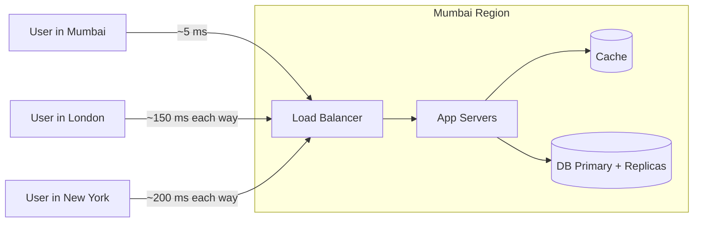
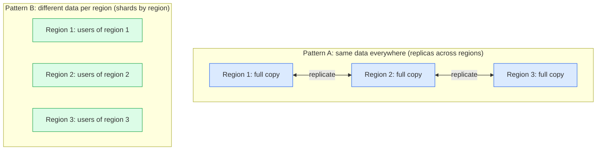
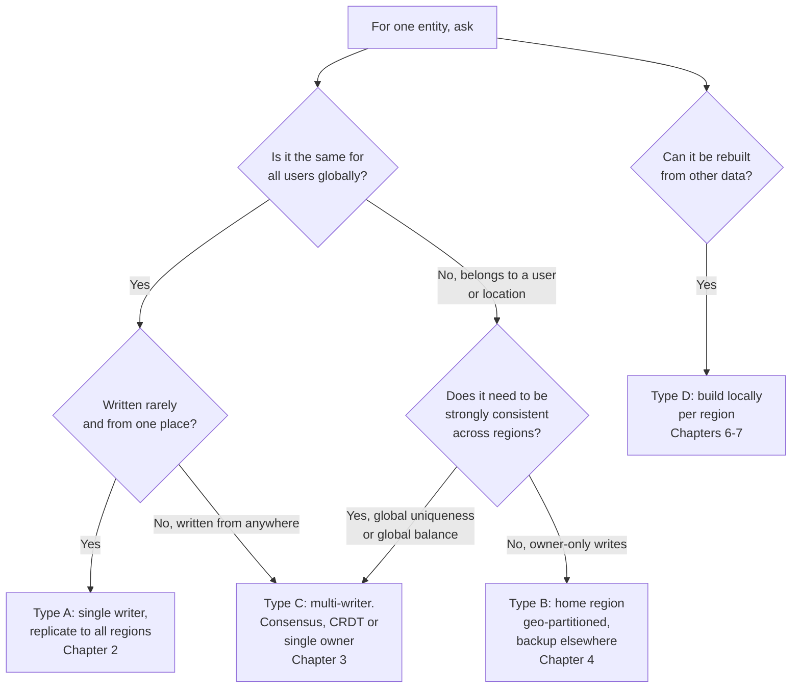
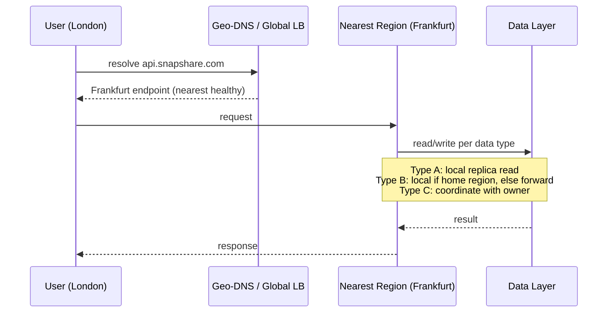

# Multi-Region Design: Chapter 1 — The Mental Model

I'll go one chapter at a time. This chapter builds the foundation that every later chapter uses.

## Course roadmap

| Ch | Topic | Question it answers |
|---|---|---|
| **1** | **The mental model (this one)** | What actually changes when you go multi-region, and how do I classify any piece of data? |
| 2 | Same data everywhere, one writer | Global catalog/config: how do reads and writes flow? |
| 3 | Same data everywhere, many writers | Write from any region: conflicts, quorum, consensus |
| 4 | Different data per region | Geo-partitioning, home region, shards and replicas inside each region, backups |
| 5 | Cross-region queries | User travels, global lookups, scatter-gather, global indexes |
| 6 | Caches across regions | What to cache where, and how to invalidate |
| 7 | Queues and events across regions | Regional queues, cross-region replication, idempotency |
| 8 | Routing, failover, putting it together | Traffic steering, disaster scenarios, interview template |

---

## 1. Why single-region stops being enough

Take a photo-sharing app, "SnapShare", running in one region (say Mumbai).

Three things hurt, and each one is a separate reason to go multi-region:

| Pain | What it means | Why one region can't fix it |
|---|---|---|
| **Latency** | London users wait about 300 ms round trip before your server does any work | You can't beat the speed of light. A CDN helps for static files but not for dynamic reads and writes |
| **Availability** | If the Mumbai region goes down, the whole product is down | Multiple AZs protect you from a data-center failure, not from a whole-region failure |
| **Compliance / data residency** | EU laws (GDPR) and India's data rules may require some data to stay in-country | The data's physical location is the requirement |

In an interview, say which of these three is driving the design. It decides the architecture.

### Vocabulary (so nothing is assumed)

- **Region**: a geographic area (Mumbai, Frankfurt, Virginia) containing several data centers.
- **AZ (Availability Zone)**: one isolated data center inside a region. AZs in a region are connected by fast links.
- **Intra-region latency**: about 1–2 ms. **Cross-region latency**: about 50–250 ms. This 100x gap is the root of every multi-region difficulty.
- **Shard (partition)**: splits data. Different rows live on different shards. Shard A is not a copy of shard B.
- **Replica**: copies data. Every replica holds the same rows.
- **Leader / primary**: the one node allowed to accept writes for a piece of data. **Follower**: a node that copies the leader.
- **Sync vs async replication**: sync means the write waits until the copy confirms (slow across regions, but no data loss). Async means the write returns immediately and the copy catches up later (fast, but the copy can lag).
- **RPO**: how much data you can afford to lose in a disaster. **RTO**: how long you can afford to be down.

---

## 2. The one truth that drives everything

In one region, a write costs about 1 ms of coordination. Across regions it costs about 100+ ms. So every multi-region design is a negotiation between:

1. **Fast**: serve users from a nearby region.
2. **Correct**: everyone sees consistent data.
3. **Available**: keep working when a region or the network between regions fails.

You can't have all three for the same piece of data. The mistake beginners make is picking one global answer, for example "make everything multi-leader." Strong designs pick a different answer per kind of data.

---

## 3. The master question

For every entity in your system, ask three questions:

> **Q1. Who is allowed to write this data?** (one place, or anywhere?)
> **Q2. Where do the copies live?** (every region, or one region plus backups?)
> **Q3. How does a read find the right copy?** (nearest, or the owner?)

The answers fall into a small number of patterns.

---

## 4. The four kinds of data

This is the classification to apply to every design.

| Type | Example | Written by | Who reads it | Pattern |
|---|---|---|---|---|
| **A. Global reference data** | Product catalog, feature flags, currency rates, app config | A few admins, from one place | Every region, constantly | One writer, replicated everywhere. Chapter 2 |
| **B. Regional / user-owned data** | User profile, orders, messages, photos | The user, from their home region | Mostly that user's region | Partitioned by region (geo-sharding). Chapter 4 |
| **C. Globally contended data** | Username uniqueness, bank balance, last seat or last item in stock | Anyone, anywhere | Anyone, anywhere | Single owner or consensus. Chapter 3 |
| **D. Derived / ephemeral data** | Cache, sessions, feeds, search index, analytics | The system itself | Local | Rebuildable per region. Chapters 6–7 |

Your two questions map onto this:

- **"Same data in multiple regions"** is type A, and sometimes C.
- **"Different data in different regions"** is type B.
- A real system has all four at once. The skill is labeling each table or entity correctly.

### Example: labeling SnapShare

| Entity | Type | Decision |
|---|---|---|
| `photo_filters` (list of filters) | A | One writer, copies in all regions |
| `users`, `photos`, `comments` | B | Each user has a home region, and their data lives there |
| `usernames` (unique across the world) | C | Needs a global check. Chapter 3 |
| `home_feed`, `sessions`, cache | D | Rebuilt locally in each region |

---

## 5. Shards vs replicas in multi-region

This is the point that confuses most people. In one region, sharding and replication are two separate steps. In multi-region, they are two axes on a grid.

- **Pattern A (replicate across regions):** every region holds the whole dataset. This is for reading it locally.
- **Pattern B (shard by region):** each region holds only its own slice. This is for low latency and compliance. Inside each region, that slice is still sharded and replicated the way you already know. The extra step is a **backup copy in another region** so a regional disaster doesn't lose that slice.

So Pattern B is your single-region design, repeated in each region, with a cross-region backup added.

### Every data item has a home

For each piece of data:

- **Home region (owner):** the only region that accepts writes for it. This is what avoids conflicts.
- **Replica regions:** read-only copies, or backup copies.

Pattern A is "one home, copies in every region." Pattern B is "different homes for different data." Pattern C, covered in Chapter 3, is "no single home, so we need coordination."

---

## 6. The master decision flow

---

## 7. The routing layer

Whatever the data pattern, a request goes through the same pipeline:

A few terms:

- **Geo-DNS / global load balancer:** sends the user to the nearest healthy region.
- **Anycast:** many regions announce the same IP address, and the network delivers the packet to the closest one.
- **Regional stack:** each region has its own full stack (load balancer, app servers, cache, DB, queue) that can run independently. This is called **cell-based** or **regional isolation**.

---

## 8. Rules to remember

1. Don't ask "how do I make my DB multi-region?" Ask "for each entity, who writes, where are the copies, and how does a read find them?"
2. Every item has one home. This removes most conflicts.
3. Reads can be local and async-stale. Writes are the expensive part.
4. Each region should be able to serve its traffic if the link to other regions breaks.
5. Cross-region calls are slow, so keep them off the hot path where possible.
6. Pick the consistency level per data type. Never use one global setting.

---

## Interview one-liner for this chapter

> "First I'd identify why we need multi-region: latency, availability, or compliance. Then I'd classify the data into global reference, user-owned, globally contended, and derived. Reference data gets one writer and replicas everywhere. User data gets a home region. Contended data gets a single owner or consensus. Derived data is rebuilt per region."

---

## Next: Chapter 2

Chapter 2 covers **Pattern A: same data in every region with one writer**. It follows the full read and write flow with a Mermaid sequence diagram, covers replication lag, read-your-writes problems, what happens when the writer region dies, and which real systems use this.

Say **"next"** to continue. If anything in this chapter is unclear, ask before moving on, since every later chapter builds on the home-region idea and the four data types.

