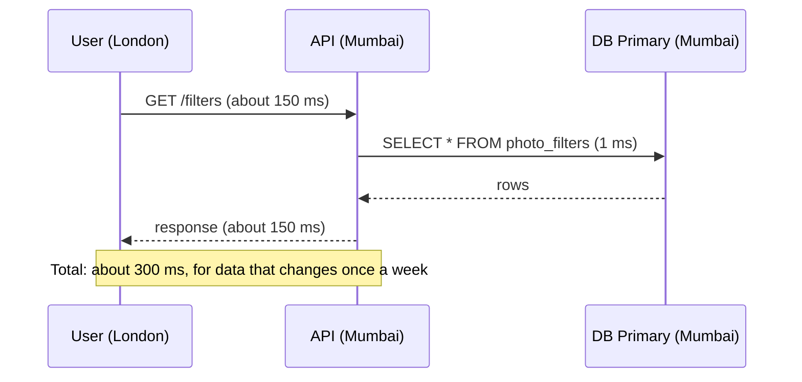
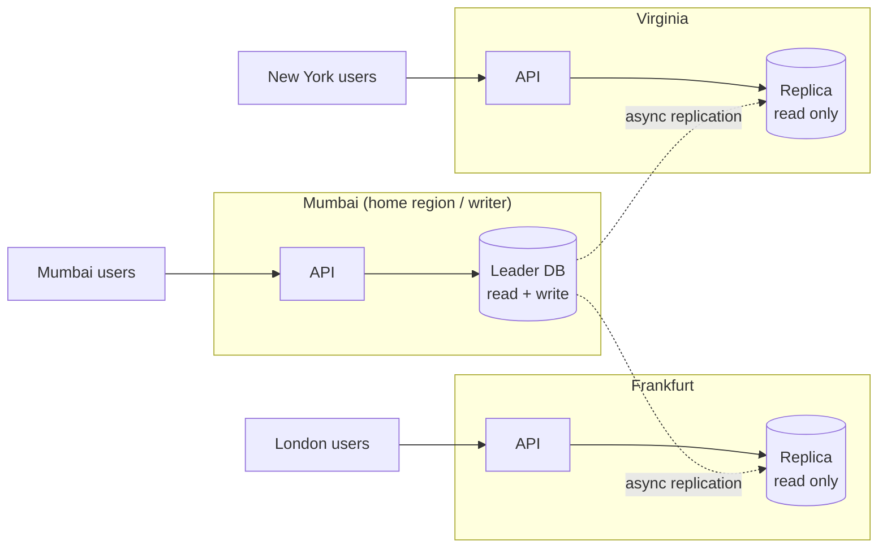
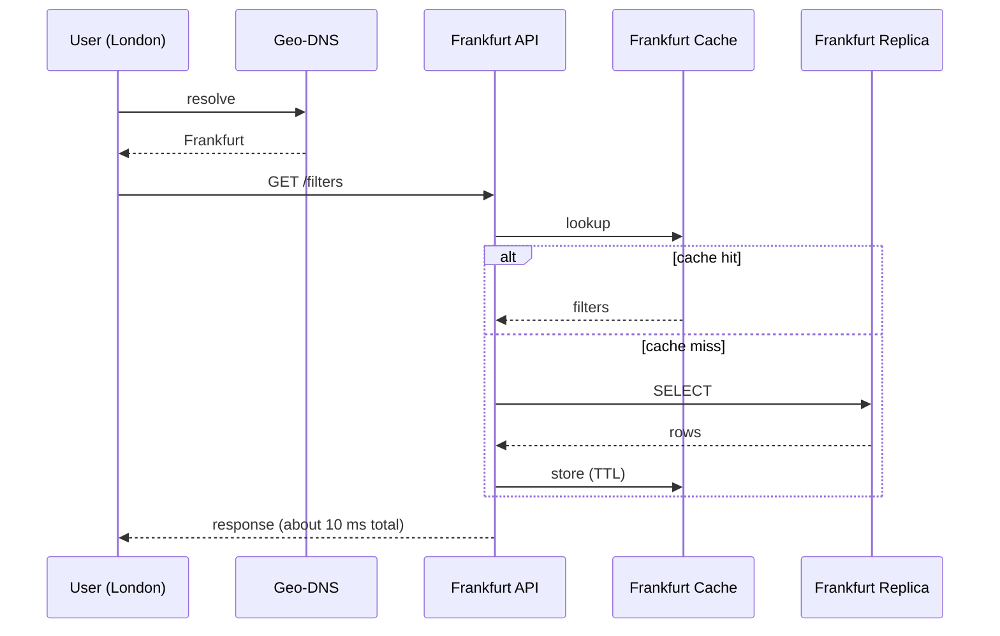
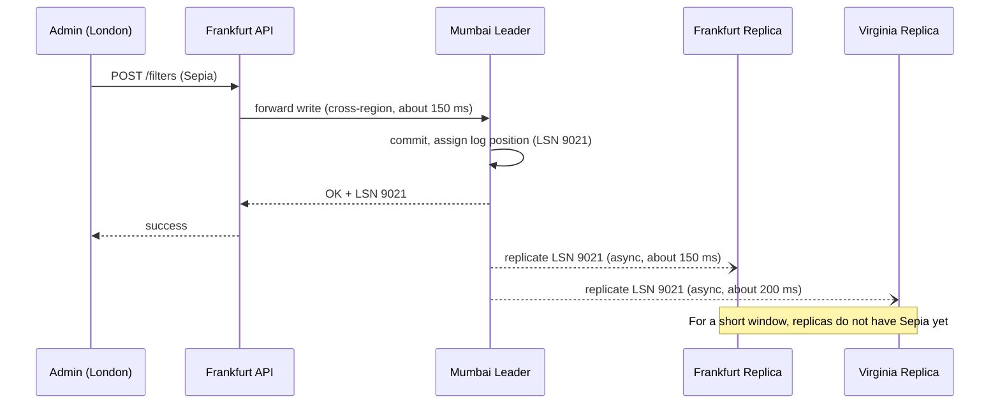
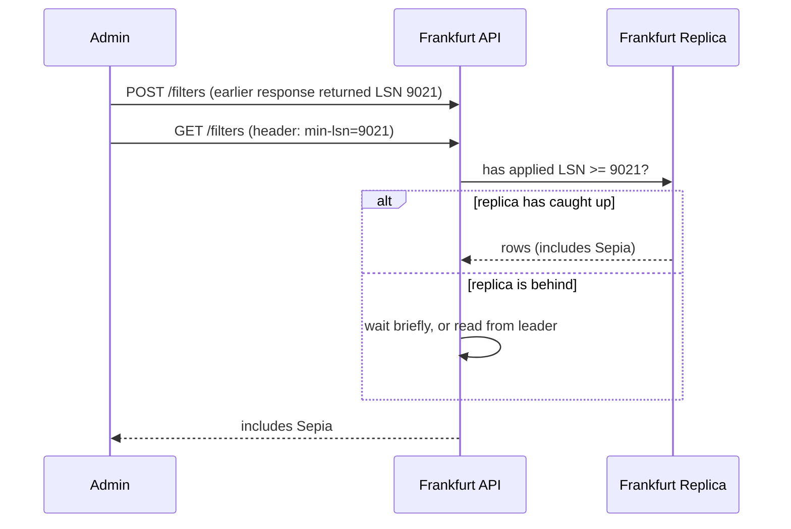
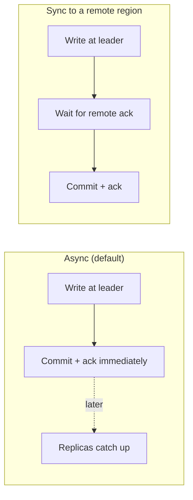
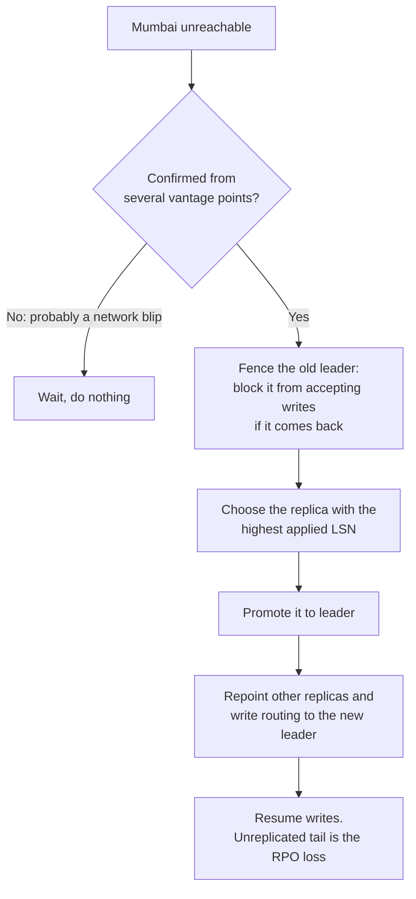

# Chapter 2: Same Data Everywhere, One Writer

This is **Pattern A** from Chapter 1. It covers type A data: product catalog, feature flags, config, currency rates, and the list of photo filters. It is read everywhere, constantly, and written rarely.

## 1. The story: from Mumbai-only to global reads

### Version 1: single region

SnapShare keeps its `photo_filters` table in Mumbai. A London user opens the app, and the app asks for the filters.



**What breaks:** London users pay 300 ms for data that almost never changes. Every request crosses the ocean for nothing.

### Version 2: a read replica in each region

Put a full copy of the data in Frankfurt and Virginia, and run an API stack next to each copy. Keep **one** writer (the leader) in Mumbai.



**What we gained:** reads are local (about 5 ms) in every region.
**What we gave up:** replicas are slightly behind the leader (replication lag), and writes still travel to Mumbai.
**What we rejected, and why:** letting every region write. That needs conflict handling, which is Chapter 3. For rarely written data it is not worth the complexity.

---

## 2. The read flow



A read **never leaves its region**. This is the core of Pattern A. There are two layers of local reading, the cache and the replica, and both are in-region.

---

## 3. The write flow

An admin in London adds a new filter called "Sepia".



**Why accept a 150 ms write?** The data is written rarely and by few people, so slow writes cost almost nothing in total. The tradeoff is intentional: **fast common path (reads), slow rare path (writes)**.

A non-admin user's data (profile, photos) is a different story. That is type B, and it is not forwarded to Mumbai. It goes to the user's home region (Chapter 4).

---

## 4. Replication lag and the three bugs it causes

Async replication means a replica can be behind by milliseconds or, under load, by seconds. This causes three well-known anomalies.

| Bug | What the user sees | Example |
|---|---|---|
| **Stale read** | Reads old data | A London user doesn't see "Sepia" for 1 second. Usually harmless |
| **Read-your-writes violation** | You write something and then can't read it | The admin adds "Sepia", the page reloads, and "Sepia" is missing. Looks like a bug |
| **Non-monotonic reads** | Data appears, then disappears | One request hits replica 1 (up to date), the next hits replica 2 (behind) |

### Fixes

**Fix 1: Read-your-writes with an LSN token (best for interviews)**

The write returns the leader's log position. The client sends it back on later reads, and the replica waits until it has caught up.



**Fix 2: Read from the leader for a short window after a write.** For example, route that user's reads to Mumbai for the next 5 seconds. This is simple, but it costs latency.

**Fix 3: Sticky routing for monotonic reads.** Hash the user to one replica (or one session to one replica) so they never go backward in time.

**Fix 4: Write-through to the local cache.** After the forwarded write succeeds, the local API puts the new value in its own cache. The user then sees it immediately. Other regions catch up through replication.

Which fix to use depends on how bad staleness is. For a filter list, ignore it. For a price change, use Fix 1.

---

## 5. Sync vs async across regions



| Mode | Write latency | Data loss if leader region dies (RPO) | Used for |
|---|---|---|---|
| **Async** | Local (fast) | Possibly last few seconds of writes | Most systems, including catalogs and content |
| **Semi-sync** (sync to 1 other region, async to the rest) | +100 to 200 ms | Near zero | Higher-value data, a middle ground |
| **Sync to all** | Slowest region sets the speed | Zero | Rare. The cost is too high, and one slow region stalls writes |

**Interview line:** "Async by default. If the business can't lose data, I'd make one nearby region synchronous and keep the rest async."

---

## 6. When the writer region dies

Mumbai goes down. Frankfurt and Virginia still serve reads from their replicas, so **reads keep working**. Only writes stop. For rare-write data, that is often acceptable for a while. When it isn't, we **fail over**.



Details that matter:

- **Fencing prevents split brain.** If Mumbai wasn't dead, only unreachable, and comes back thinking it is still the leader, you would have two writers diverging. Use a fencing token or epoch number: the new leader gets epoch 8, and any write carrying epoch 7 is rejected. Chapter 3 and the consensus course cover this in depth.
- **Why many companies fail over manually.** Automatic cross-region failover can trigger on a false alarm and lose data. Many teams require a human approval step, or use a consensus-based coordinator.
- **The lost tail.** Writes that Mumbai committed but never replicated are lost, or must be recovered from Mumbai's logs when it returns and merged by hand. This is the RPO from Chapter 1.
- **Old leader returns.** It must be demoted and re-synced as a follower. Never let it rejoin as leader.

---

## 7. Implementation sketch

**Database (PostgreSQL streaming replication):**

```
# Leader (Mumbai)
wal_level = replica
max_wal_senders = 10
synchronous_standby_names = ''          # async to everyone
# For semi-sync to Frankfurt only:
# synchronous_standby_names = 'FIRST 1 (frankfurt_replica)'

# Replica (Frankfurt)
hot_standby = on                        # allows read queries
primary_conninfo = 'host=mumbai-db port=5432 user=repl ...'
```

**Application routing (Java-style pseudocode):**

```java
class CatalogService {
    DataSource localReplica;   // reads, same region
    DataSource homeLeader;     // writes, always the home region

    List<Filter> readFilters(Optional<Long> minLsn) {
        if (minLsn.isPresent() && !replicaHasApplied(minLsn.get())) {
            return query(homeLeader);          // read-your-writes fallback
        }
        return query(localReplica);            // normal path: local read
    }

    long addFilter(Filter f) {
        return write(homeLeader, f);           // cross-region write, returns LSN
    }
}
```

**Managed equivalents (name-drop in interviews):** Aurora Global Database (storage-level replication to other regions, typically under one second of lag) and Cloud SQL or Azure cross-region read replicas. The architecture is the same.

---

## 8. Other pieces in this pattern

- **Cache:** each region has its own cache, filled from its local replica. When the leader changes data, local caches expire by TTL or are invalidated by the replicated change feed. Chapter 6 covers this fully.
- **CDN:** if the data is public and cacheable (a catalog page, say), put it behind a CDN. The CDN edge then acts as one more read replica.
- **Queues and events:** if other systems must react to a catalog change, publish a change event at the leader and replicate it to the other regions. Chapter 7 covers this.
- **Schema migrations:** make every change backward compatible. Apply it to the leader and let it replicate, or apply it to replicas first. Never ship code that needs a column that a lagging replica doesn't have yet.
- **Bandwidth:** replicating huge tables to every region costs money. Replicate only what the region needs.

---

## 9. Where this pattern fits

| Fits | Does not fit |
|---|---|
| Product catalog, config, feature flags, currency rates, ad metadata, lookup tables | Data that every region writes frequently (needs Chapter 3) |
| Read-to-write ratio of 100:1 or higher | Data with strict "never read stale" requirements everywhere (needs the leader or consensus) |
| Tolerates seconds of staleness | User-owned data with residency rules (needs Chapter 4) |

---

## 10. Rules from this chapter

1. One writer, many readers. A read never leaves its region.
2. Replication is async by default, so design for lag.
3. Fix read-your-writes with an LSN token, leader-read window, or local write-through.
4. A regional outage of a replica loses nothing but capacity. An outage of the leader region stops writes until failover.
5. Fence the old leader before promoting a new one.
6. Writing is slow and rare here. If it isn't rare, this is the wrong pattern.

---

## Interview one-liner

> "For global reference data like the catalog, I'd keep a single leader in the home region and async read replicas in every region, with a regional cache on top. Reads are always local. Writes go to the leader and replicate with sub-second lag. I'd handle read-your-writes with an LSN token. If the leader region fails, I'd fence it, promote the most caught-up replica, and accept a small RPO."

---

## Next: Chapter 3

Chapter 3 covers the harder case, **same data everywhere, but writes can come from any region**. Think of a shared document, a shopping cart, or a "like" counter. It covers why simple multi-leader replication creates conflicts, and the real options: last-write-wins, CRDTs, quorum, and consensus (Spanner and CockroachDB style). It also covers which one to pick for which kind of data, and how to handle the type C data like globally unique usernames.

Say **"next"** to continue. Ask now if any part of the leader, replica, lag, or failover flow isn't clear.

