# Chapter 3: Same Data Everywhere, Writes from Anywhere

In Chapter 2, one region owned all writes. That works for rarely written data. This chapter covers what to do when every region needs to accept writes for the same dataset. This is the hardest chapter in the course, and the rest of the course depends on it.

## 1. The story: why one writer stops working

SnapShare adds features:

| Feature | Written how often | Written from where |
|---|---|---|
| Shared photo albums (friends in different countries add photos) | Often | Anywhere |
| Like counter on a viral photo | Thousands per second | Anywhere |
| Username registration | Once per user, but globally unique | Anywhere |
| Shared shopping cart on the merch store | Often | Anywhere |

If these all forward to the Mumbai leader (Chapter 2):

- Every write from London and New York pays about 150–200 ms.
- If Mumbai dies, **nobody can write**, even though 2 of 3 regions are healthy.
- If the link to Mumbai breaks, remote regions' users get errors.

So we let each region accept writes locally.

### Version 3: multi-leader (every region is a writer)

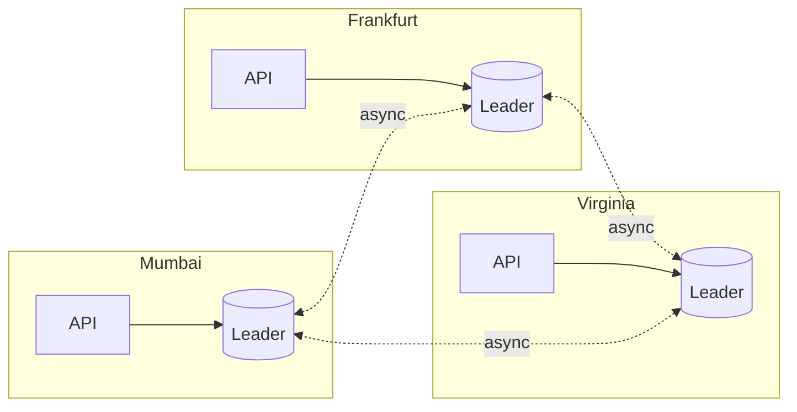

**What we gained:** local writes (about 5 ms), and writes survive any single region failing.
**What we gave up:** two regions can now change the same data at the same time without knowing about each other. This is a **conflict**.
**What we are NOT doing:** pretending conflicts won't happen. They will, and every strategy below is a way to handle them.

---

## 2. What a conflict looks like

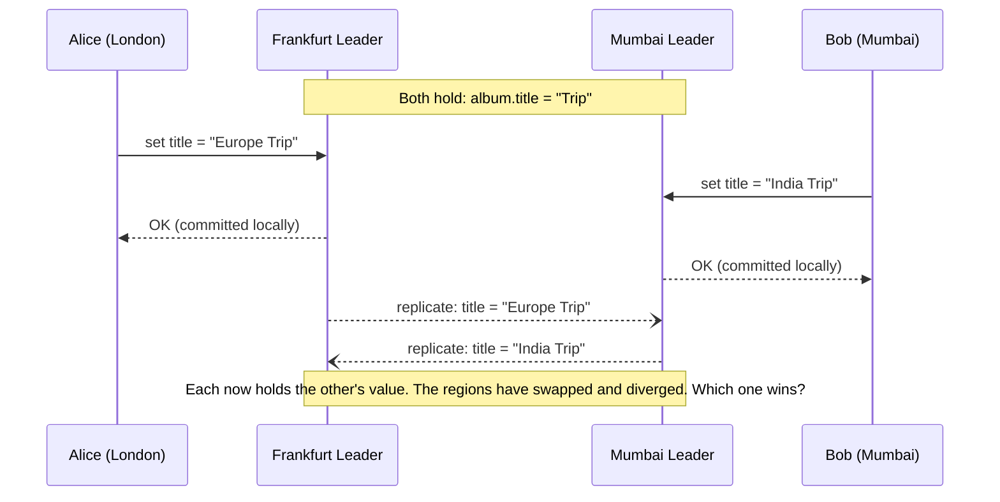

Both writes were acknowledged as successful. Neither user did anything wrong, and the system must still decide what the title is.

### The five kinds of conflicts

| Kind | Example | Why it's tricky |
|---|---|---|
| **Overwrite** | Two titles for the same album | One value must win, or both must be kept |
| **Concurrent increment** | Two likes at once, both read 100 and write 101 | A write is lost: the real count is 102 |
| **Set add/remove** | Alice adds photo X while Bob removes it | Order decides the outcome, but there is no shared order |
| **Uniqueness** | Two users register `@riya` at the same time in different regions | Each region saw the name as free |
| **Invariant** | Balance must stay at least 0, and two regions each approve a withdrawal | Each approval was valid locally, but not combined |

The first three can be fixed by **merge rules**. The last two cannot be fixed after the fact, because a promise has already been made to the user. They need **coordination before the write**. This split drives the rest of the chapter.

---

## 3. The strategy menu

Six strategies. Pick one per kind of data.

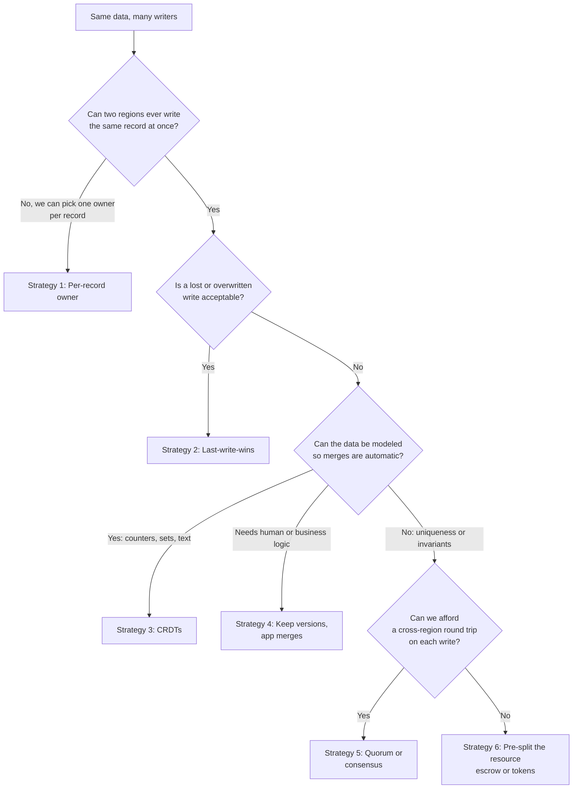

---

### Strategy 1: Per-record owner (avoid the conflict entirely)

The most important idea in the chapter. You don't need all regions to write all records. You need all regions to be **able** to write, with each **record** having one owner.

- Each record (album, cart, account) has a **home region**, stored on the record or derived from a hash or user ID.
- Writes for that record go to its home region. Other regions only read or forward.
- Different records have different homes, so overall every region is writing, and no single record has two writers.

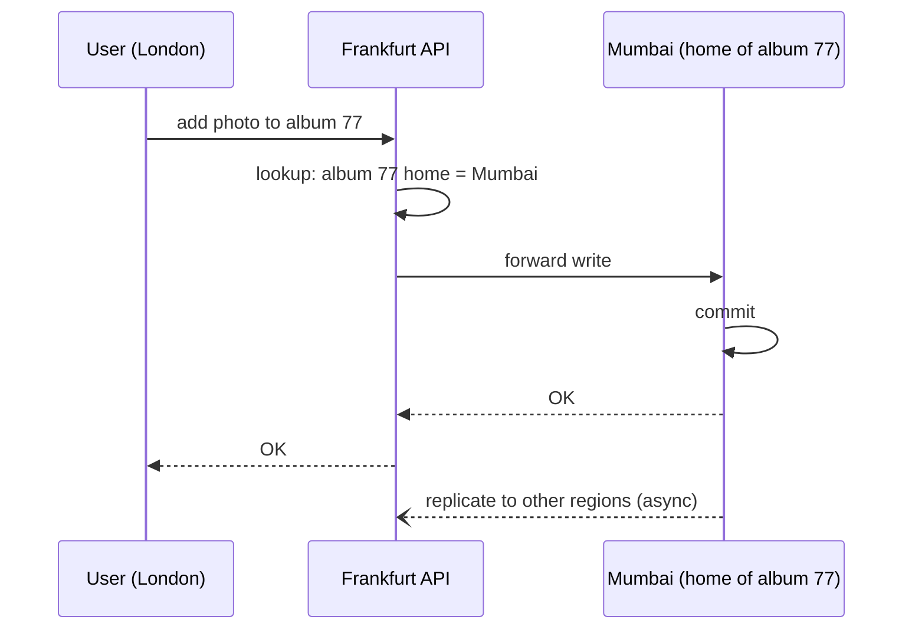

**Gain:** zero conflicts, simple, strong consistency per record.
**Give up:** writes for non-home records pay a cross-region trip, and if the home region is down, those records can't be written until failover.
**Fix for the cost:** assign the home near the user who writes it most. An album created by a London user gets Frankfurt as home. This is the bridge to Chapter 4, where home is chosen by user.

This is also how many "multi-region active-active" systems really work: active in every region, but not for the same row.

---

### Strategy 2: Last-write-wins (LWW)

Every write carries a timestamp. When two versions meet, the newer timestamp wins and the older is discarded.

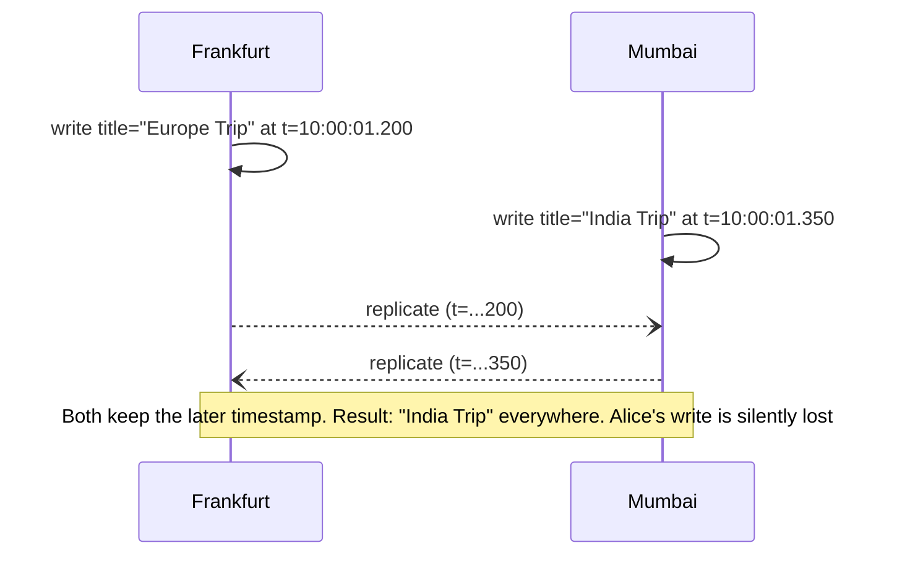

**Gain:** very simple and fast. No coordination.
**Give up:**

- **Silent data loss.** The losing write was acknowledged and then vanishes.
- **Clock skew.** Servers' clocks differ by milliseconds or more. A region with a clock running fast wins every conflict, even for writes made earlier. Use hybrid logical clocks (HLC) to reduce this, but it is still an arbitrary winner.

**Use for:** data where the latest value is truly the right answer and losing one overwrite is harmless: user presence, "last seen", profile settings, caching of derived data.
**Real systems:** DynamoDB Global Tables, Cassandra's default per-cell resolution.

---

### Strategy 3: CRDTs (conflict-free replicated data types)

A CRDT is a data structure designed so that **merging any two copies, in any order, any number of times, always gives the same result**. No conflict can arise, because the merge rule is built into the type.

**Example: a like counter (G-Counter)**

Instead of one number, keep one slot per region. Each region only increments its own slot. The total is the sum. The merge is the per-slot maximum.

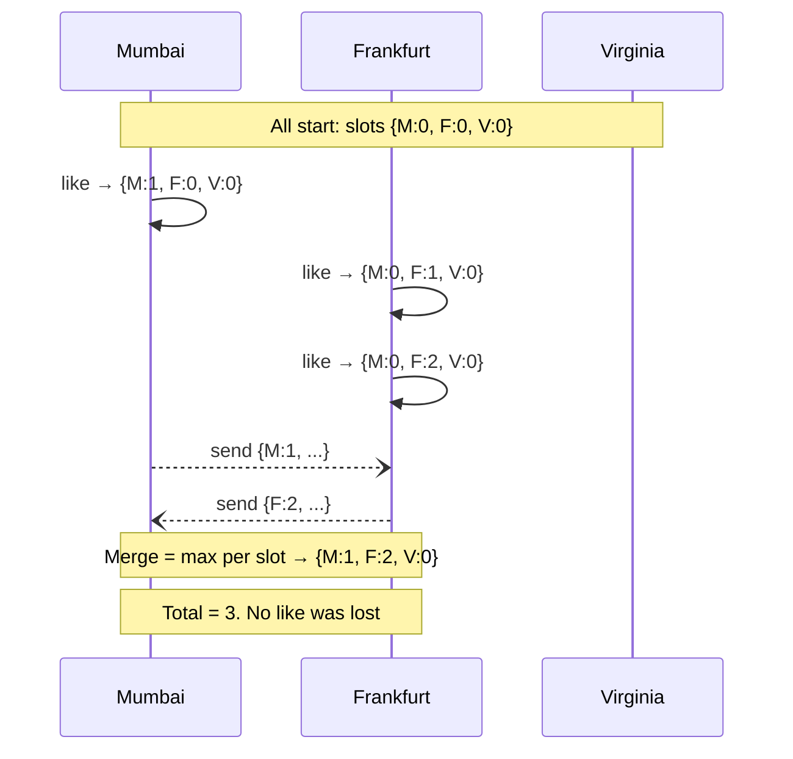

For decrements use a PN-Counter (two G-Counters, one for adds and one for removes).

| CRDT | Solves | Example |
|---|---|---|
| G-Counter / PN-Counter | Concurrent increments | Likes, views, inventory counts that can drift |
| G-Set / OR-Set | Add and remove on sets | Shopping cart items, friend lists, album membership |
| LWW-Register | Single value (this is LWW again) | Profile fields |
| Sequence / text CRDTs | Collaborative editing | Docs, notes |

**Shopping cart with an OR-Set:** every add creates a unique tag. A remove deletes only the tags it has seen. If Alice adds X while Bob removes the older X, both operations survive: Bob's remove deleted the old tag, and Alice's new tag remains, so X is still in the cart. This rule is called **add-wins**.

**Gain:** no lost updates, local writes, works while partitioned.
**Give up:** you must model data to fit a CRDT, state can grow (metadata for every tag and slot), and **CRDTs cannot enforce invariants**. A counter can't promise "never below zero."
**Real systems:** Redis Enterprise active-active, Riak, Azure Cosmos DB (some modes), collaborative editors.

---

### Strategy 4: Keep both versions and let the application merge

The system detects that two writes were concurrent (using **version vectors**, a map of region to counter that shows which writes each version has seen) and keeps both as **siblings**. The next reader, or a background job, merges them with business logic.

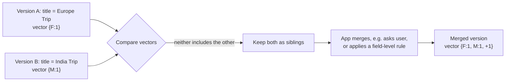

**Gain:** nothing silently lost, merge can use real business rules.
**Give up:** more code, reads may return multiple versions, and merge logic is hard to get right.
**Real systems:** Amazon's original Dynamo (the shopping cart), Riak.

---

### Strategy 5: Quorum or consensus (coordinate before writing)

For data that must be correct (uniqueness and invariants), merge rules aren't enough. You must agree **before** acknowledging the write.

**5a. Quorum (leaderless, Dynamo/Cassandra style)**

Keep N replicas, one per region. A write must be acknowledged by W of them, and a read must consult R of them. If **W + R > N**, every read set overlaps every write set, so a read sees the latest acknowledged write.

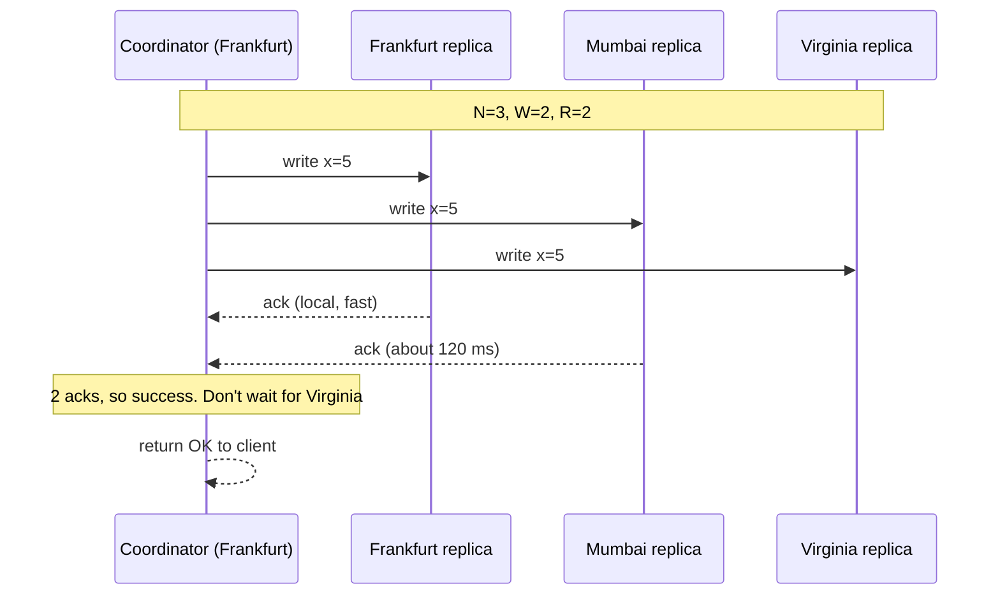

With 3 regions and W=R=2, each operation waits for **one** remote region, the nearest. If one region fails, the other two still form a majority.

Cassandra consistency levels worth knowing: `LOCAL_QUORUM` (majority within one region, fast, for data that is partitioned by region), `QUORUM` (majority across all, one cross-region wait), `EACH_QUORUM` (majority in every region, slowest).

**5b. Consensus (Paxos/Raft, Spanner and CockroachDB style)**

A leader per data range, with replicas in several regions. A write is committed only when a **majority** of replicas has it, using a consensus protocol. This is stronger than a plain quorum: it gives one agreed order of writes (linearizability) and handles leader changes safely.

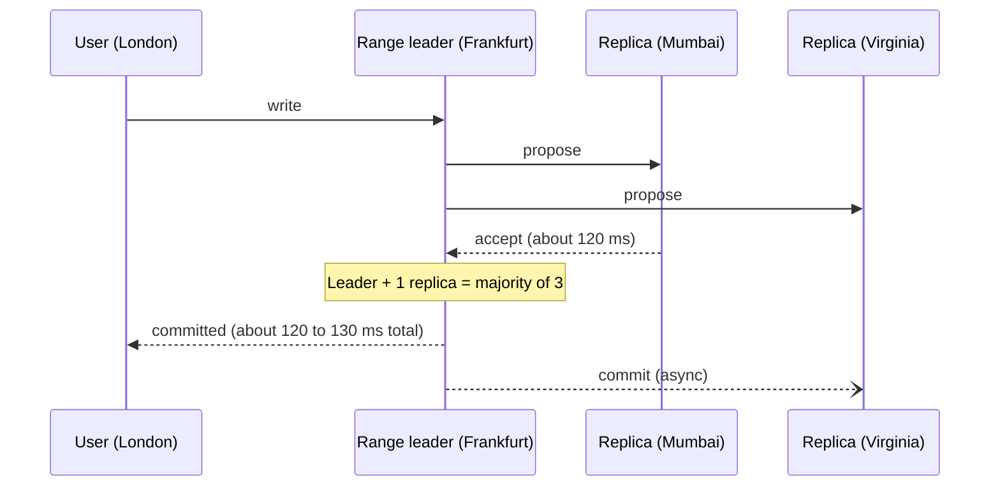

**The key insight:** a write needs one round trip to the nearest majority partner. So you choose where replicas are placed to control that cost. Three regions on the same continent might give 20–30 ms. Three continents give 100–150 ms.

Spanner adds **TrueTime** (bounded clock uncertainty, with the commit waiting out that uncertainty) for globally consistent timestamps. CockroachDB uses hybrid logical clocks and Raft per range, with configurable placement ("survive region failure" vs "survive zone failure").

**Reads in consensus systems:**

| Read type | How | Latency | Freshness |
|---|---|---|---|
| Strong read | Via the leader (or a lease holder) | Local if the leader is nearby, else cross-region | Always latest |
| Stale / bounded-staleness read | From the nearest replica, "as of 10 seconds ago" | Local | Slightly old |
| Follower read | Replica serves after checking its applied position | Local | Latest known safe point |

**Gain:** correctness. Uniqueness and invariants hold. Survives losing a region (a majority remains).
**Give up:** every write pays a cross-region round trip, and **during a partition the minority side cannot write**. That is the CAP tradeoff: choose consistency, lose availability on the minority side.
**Use for:** money, inventory, uniqueness, identity, permissions, anything where being wrong costs more than being slow.

---

### Strategy 6: Pre-split the resource (escrow / tokens)

When you can't afford a cross-region trip on each write but still need an invariant, split the resource **in advance** so each region can spend its share locally.

**Example:** a flash sale with 1,000 units in stock.

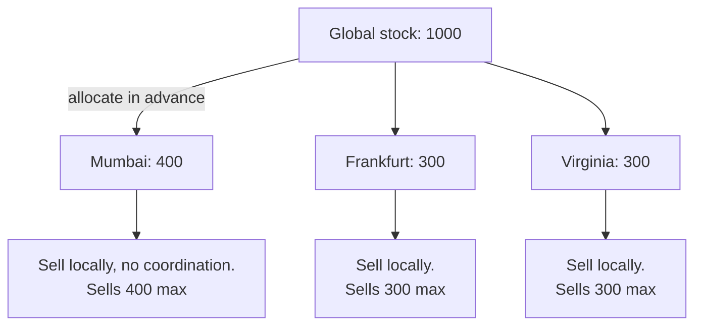

Each region sells from its own allocation. If a region runs out while others have stock left, it requests a transfer from another region (a slower, coordinated step), or rebalances in the background.

**Gain:** the common path is local and fast, and overselling is impossible.
**Give up:** extra logic to rebalance, and some customers see "sold out" in a region while others still have stock.
**Real systems:** ticketing, flash sales, rate limits shared across regions, quota systems, ad budgets.

---

## 4. Type C deep dive: the "hard" cases

### 4.1 Globally unique usernames

Problem: two regions both think `@riya` is free.

**Option 1: partition the uniqueness check by hash.**

Define `home(username) = hash(username) mod regions`. The *username registry* (not the user data) is sharded across regions by that hash. Registering `@riya` always goes to its hash-home, which is a single writer, so there is no conflict.

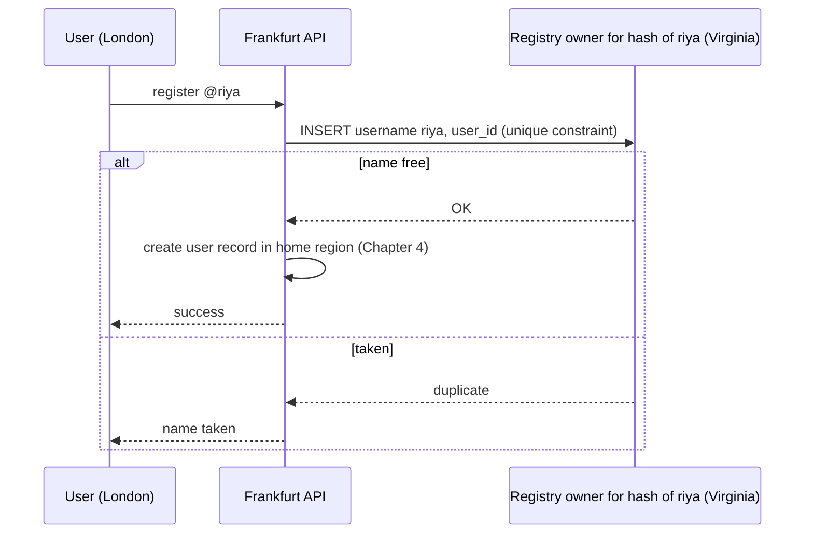

Cost: one cross-region round trip, paid **once per registration**. That is acceptable, since signup is rare.

**Option 2: a globally consistent table.** Put the `usernames` table in a consensus database (Spanner, CockroachDB), so the unique constraint is enforced globally.

**Option 3: tolerate and repair.** Allow local registration, detect duplicates later, and force one user to rename. Use this only if the product accepts it. For usernames it usually isn't acceptable.

### 4.2 Bank balance or wallet

- **Best:** each account has a home region (Strategy 1), and balance updates run there as an ordinary single-region transaction. Transfers between accounts in different regions use a cross-region protocol (2PC or sagas, covered in the consensus course).
- **Or:** a consensus database.
- **Never:** multi-leader with LWW. It will lose money.

### 4.3 Inventory

- Pre-split (Strategy 6) for hot items.
- A consensus database for low-volume, high-value items.

### 4.4 Rate limits and quotas shared across regions

- Per-region limits that add up to the global limit (a pre-split).
- Or an approximate global counter built from CRDT counters, accepting slight overshoot.

---

## 5. Network partition: what each strategy does

Suppose Frankfurt loses its link to Mumbai and Virginia, but both Frankfurt users and its servers are fine.

| Strategy | Frankfurt keeps accepting writes? | After the link heals |
|---|---|---|
| Per-record owner | Only for records it owns | Nothing to reconcile |
| LWW | Yes | Timestamps decide, and some writes are lost |
| CRDT | Yes | Merge restores one consistent state, nothing lost |
| Version vectors | Yes | Siblings appear and need merging |
| Quorum / consensus | **No**, Frankfurt is the minority (1 of 3) | Nothing to reconcile, writes were never accepted |
| Pre-split | Yes, until its allocation is spent | Rebalance |

This table is **CAP in practice**. Strategies that accept writes during a partition give up consistency, and strategies that refuse writes give up availability. Even without a partition, the cost is **PACELC**: with no partition, the choice is between lower **L**atency and stronger **C**onsistency. Interviewers like to hear this.

---

## 6. Caches and queues for this pattern

- **Caches:** keep a regional cache. For multi-writer data, a stale cache is more likely, so keep TTLs short. Invalidate from the replicated change stream rather than from the local write alone. For consensus data, cache only with a version or timestamp check. Chapter 6 covers details.
- **Queues:** if multi-writer data triggers events (an album changes, so notify members), consumers see events from many regions. Events can arrive **out of order and duplicated**. Make consumers **idempotent** and order-aware (use a version number on each event). Chapter 7 covers details.

---

## 7. Choosing a strategy: the cheat sheet

| Data | Needs | Strategy | Real example |
|---|---|---|---|
| Profile settings, presence | Last value is fine | LWW | DynamoDB Global Tables |
| Like / view counters | No lost increments | CRDT counter | Redis active-active |
| Shopping cart, album membership | Add and remove survive | OR-Set CRDT, or version vectors | Dynamo cart |
| Collaborative document | Merge edits | Text CRDT or operational transform | Docs apps |
| Orders, albums with one natural owner | Simple and correct | Per-record owner | Most real systems |
| Username, email uniqueness | Global uniqueness | Hash-partitioned registry, or consensus | Any large signup flow |
| Money, permissions | Never wrong | Per-account owner, or consensus | Spanner, CockroachDB |
| Flash-sale stock, quotas | Fast and no overselling | Pre-split tokens | Ticketing |

---

## 8. Rules from this chapter

1. Multi-writer means two regions can change the same data at once. Decide how each kind of data resolves that.
2. Prefer avoiding conflicts (one owner per record) over resolving them.
3. Merge rules (LWW, CRDT, versions) work for overwrite, counter, and set conflicts. They **cannot** protect uniqueness or invariants.
4. Uniqueness and invariants need coordination (quorum, consensus, or an owner) or a pre-split.
5. LWW silently loses writes. Know when that is acceptable.
6. Consensus costs one round trip to the nearest majority. Place replicas to control that cost.
7. During a partition, you either refuse writes on the minority side or accept divergence. State which one you pick.

---

## Interview one-liner

> "For data written from multiple regions, I first try to give each record one owner so there are no conflicts. Where that isn't possible, I choose by the kind of conflict: CRDTs for counters and sets, LWW only where losing an overwrite is harmless, and consensus or a hash-partitioned owner for uniqueness and invariants like usernames and balances. Hot limited resources like flash-sale stock get pre-split across regions. And I'd say explicitly that during a partition, the consensus side refuses writes on the minority."

---

## Next: Chapter 4

Chapter 4 covers **Pattern B: different data in different regions**. This is the geo-partitioned design used by most real systems: user data lives in its home region, with sharding and replication inside each region and a backup in another region. It covers how a user's home region is chosen and stored, how reads and writes flow, what happens when a user travels or moves, how in-region shards and replicas combine with cross-region backup, and how GDPR residency fits in.

Say **"next"** to continue. Ask now if the conflict types or the six strategies need another pass.
