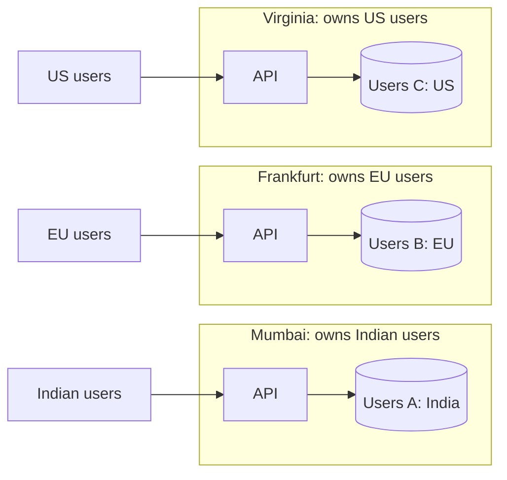
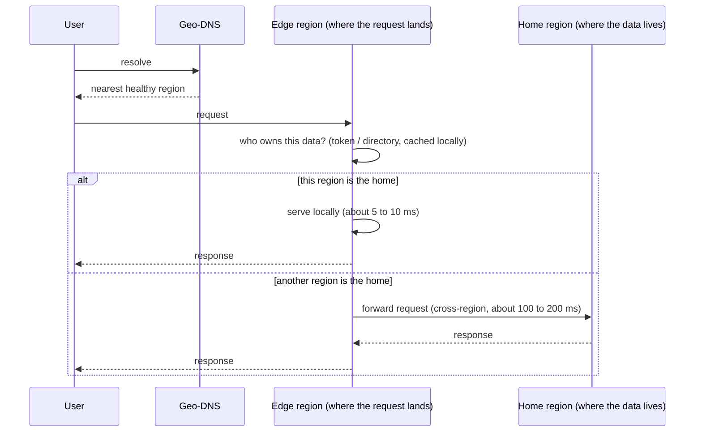
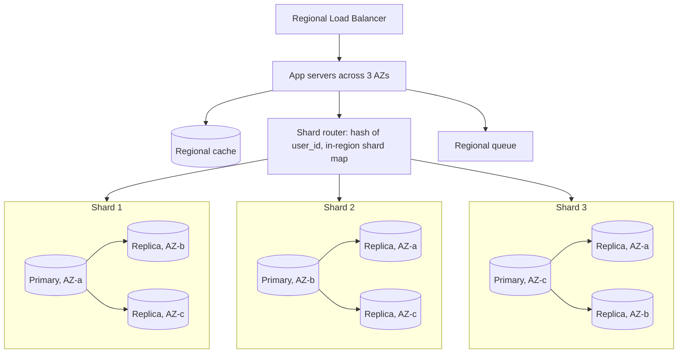
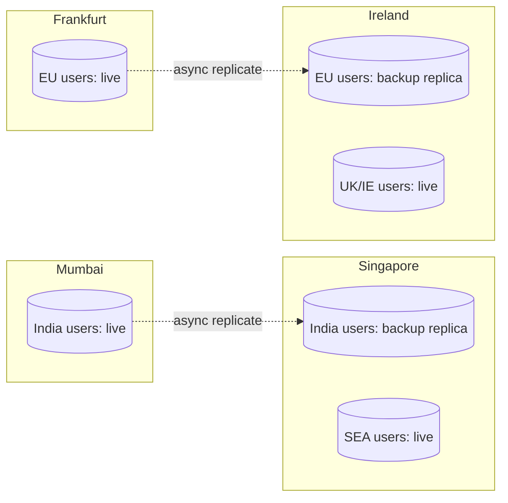
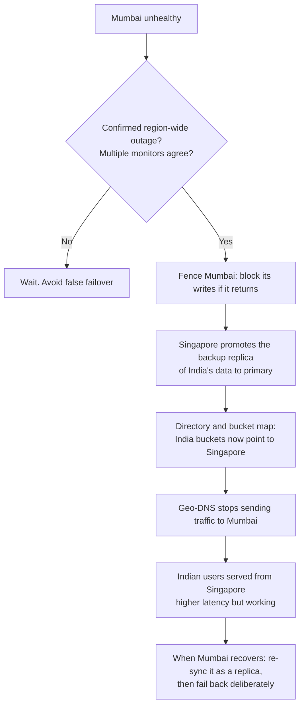
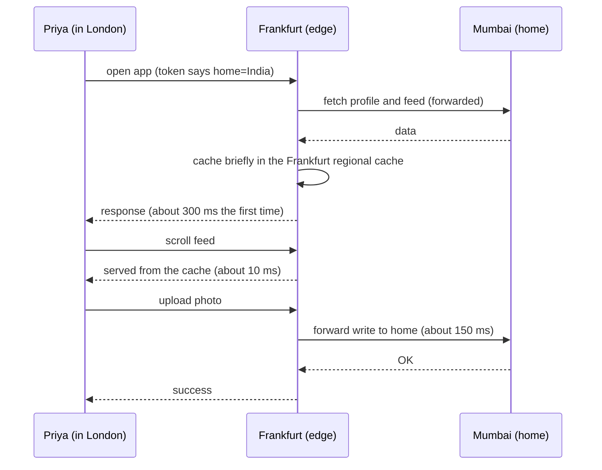
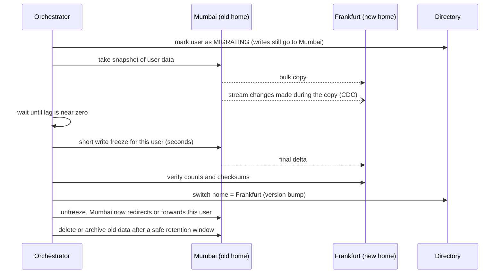
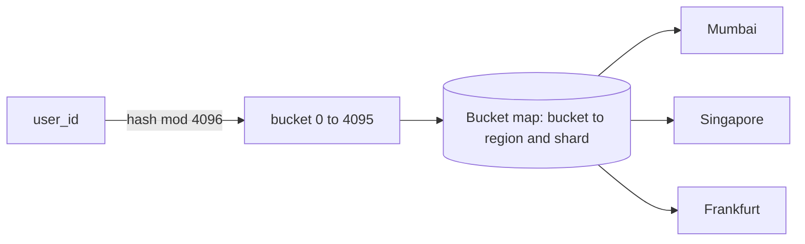

# Chapter 4: Different Data in Different Regions

This is **Pattern B** from Chapter 1, for type B data: user profiles, photos, comments, orders, messages. It is the pattern behind most real multi-region systems, and it answers your question about "different data in different regions, with shards and replicas for backup."

## 1. The story: giving every user a home

In Chapter 3 we learned that the safest way to allow writes everywhere is to give each record **one owner**. For user data there is a natural owner: **the user's home region**.

### Version 4: geo-partitioning

Each user is assigned to one region. All of that user's data (profile, photos, comments, orders) lives there and is written there.

**What we gained:**

- Local reads **and** local writes (about 5 ms) for most users, since most users use the app from home.
- No write conflicts: each record has exactly one writer.
- Data residency for free: EU users' data never leaves the EU.
- A regional outage affects only that region's users, not everyone.

**What we gave up:**

- Cross-region operations are now special cases (a traveling user, or a comment on someone else's photo).
- A regional outage still takes that region's users down unless we also keep a backup elsewhere.
- Uneven regions: one region may hold far more users than another.

**What we rejected:** multi-leader replication of everything (Chapter 3). It buys nothing here, because each user's data is written almost only by that user.

---

## 2. The three questions, answered for type B

| Question | Answer for Pattern B |
|---|---|
| Who writes? | The home region only |
| Where are the copies? | Full data in the home region (sharded, replicated across AZs). A **backup copy** in a paired region |
| How does a read find it? | Look up the user's home region, then go there |

The third question is the new problem here. Chapters 2 and 3 never needed it.

---

## 3. How does the system know a user's home region?

The system must answer "where does user 4711 live?" on **every** request, so this lookup must be fast and reliable. There are four ways to do it.

| Method | How it works | Pros | Cons |
|---|---|---|---|
| **A. Encode in the ID** | `user_id = "eu-4711"` or a region prefix in the ID bits | No lookup at all, instant | Moving a user changes their ID, which is painful |
| **B. Directory service** | A small global table `user_id → home_region` | Flexible, users can move | Another global dependency that must be highly available |
| **C. Token claim** | After login, the auth token carries `home=eu` | No lookup per request | Stale if the user moves, and doesn't help when another user's ID arrives in the request |
| **D. Bucket map** | `bucket = hash(user_id) mod 4096`, and a small table maps `bucket → region` | Rebalancing moves whole buckets, not single users | Slightly more machinery |

**What real systems do:** a combination. The token carries the home region (method C) for the user's own requests. A directory or bucket map (B or D) handles lookups of **other** users. Many large systems use D because it makes rebalancing easy (see section 9).

### The directory is itself multi-region data

The directory is small, read constantly, and written rarely (on signup and on moves). That makes it **type A**: one writer, replicated to every region (Chapter 2), cached aggressively. It can also be a consensus database if you want strong correctness for moves.

**Compliance warning:** keep personal data out of the directory. `user_id → region` is fine. `email → user_id → name` is personal data and must stay in-region. The login problem below shows how to handle that.

### The login problem

At login, the user types an email, and we don't yet know their home region. Options:

1. **Global hashed-email directory:** store `hash(email) → region` globally. A hash with a secret salt is generally treated as less sensitive than the email itself, but check with your compliance team.
2. **Region-specific login endpoints:** `eu.snapshare.com` and `in.snapshare.com` (the user picks, or the app remembers).
3. **Ask every region** (fan-out) and use whichever one recognizes the email. This costs latency, so use it only as a fallback.

---

## 4. The request flow

A request lands in the nearest region. That region checks whether it is the user's home region.

Two ways to send a request to the home region:

| Method | Description | Use when |
|---|---|---|
| **Proxy (forward)** | The edge region calls the home region on the user's behalf over a private backbone and returns the result | Default. The client needn't know about regions |
| **Redirect** | The edge replies "go to `in.snapshare.com`" and the client reconnects | Long-lived connections (WebSockets, uploads), or when the client can remember its home endpoint |

Best practice: after the first redirect, the client **remembers its home endpoint**, so later requests go straight there. Most users then always hit their home region, and forwarding is the exception.

---

## 5. Inside one region: the single-region design you already know

Each region is a complete, independent stack. This is the sharding and replication you already know, repeated per region.

Two levels of partitioning now exist:

1. **Region level:** which region owns this user? (directory or bucket map)
2. **Shard level:** inside that region, which shard? (`hash(user_id)` and an in-region shard map)

Replicas **inside** the region (across AZs) serve two purposes: high availability against an AZ failure, and read scaling. They replicate synchronously or near-synchronously, because AZs are within about 1–2 ms of each other.

**Important isolation rule:** resharding in Mumbai (adding a shard) never affects Frankfurt. Each region manages its own shard map, so regions scale independently.

---

## 6. Cross-region backup: the missing piece

Everything above protects against an AZ failure. It does nothing for a **whole region** failure (fire, power, network, a bad deploy, a cloud provider incident). For that, each region's data also needs a copy in **another region**.

### Paired regions

Each region has a **backup region** that holds an asynchronous copy of its data.

Notice that a region can host **both** its own live data and another region's backup. Singapore holds live data for Southeast Asia and the standby copy of Mumbai's data. This uses hardware efficiently: backup capacity isn't idle.

### Choosing the pair

| Constraint | Rule |
|---|---|
| **Compliance** | The backup must be in an allowed jurisdiction. EU data backs up to another EU region (Frankfurt to Ireland), not to Virginia |
| **Distance** | Far enough to avoid shared disasters, close enough for tolerable replication lag. Different power grid, different flood zone |
| **Capacity** | The backup region must be able to absorb the failed region's traffic |

### Failover: Mumbai dies

Things to be aware of:

- **RPO:** async replication means the last seconds of Mumbai writes may be lost. If that is unacceptable, use semi-sync to the backup region for critical data (Chapter 2, section 5).
- **The directory update is the switch.** Because every region asks the directory where a user lives, updating `India buckets → Singapore` redirects everything consistently. This is a strong reason to have a directory or bucket map.
- **Fail back is deliberate and slow.** Re-sync first, verify, then move traffic back during a quiet period. Avoid flapping.
- **Backups also protect against bad data**, not just outages. For corruption or accidental deletion, you also need point-in-time recovery snapshots, since replication copies the corruption. A replica is not a backup.

---

## 7. A user travels

Priya from Mumbai flies to London and opens SnapShare. She lands in Frankfurt's edge but her data is in Mumbai.

The rule: **don't move the user's data for a temporary trip.** Instead:

| Technique | Effect |
|---|---|
| Forward to the home region | Correct and simple. Costs about 150 ms per uncached request |
| Short-lived cache in the visited region | Repeated reads become local. Keep TTL short, and invalidate on writes |
| Put media on a CDN | Photos and videos are served from the nearest edge, not from Mumbai |
| Keep the session token small and region-aware | No directory lookup needed per request |
| Direct upload to the home region (presigned URL pointing at Mumbai storage) | Avoids routing big files through the edge |

The traveler's experience is slightly slower but correct. For most apps, this is the right tradeoff, because most users spend most time near home.

---

## 8. A user moves permanently

Priya relocates to the UK and her home should change from Mumbai to Frankfurt. This is a **migration**, a rare and carefully controlled operation.

Important details:

- **The brief write freeze** is what guarantees no write lands in the wrong place. Only that one user is frozen, not the region.
- **Compliance:** if the move crosses a jurisdiction boundary (India to EU), confirm what may be copied and for how long. Deleting the old copy is mandatory, so the delete step is part of the flow, not an afterthought.
- **Idempotent and resumable:** the orchestrator must survive crashes. Keep migration state in a table.
- **Old tokens:** tokens that say `home=India` will route to Mumbai, which forwards for a while. Expire them quickly.
- **If the user's ID encodes the region (method A):** you must keep a mapping from the old ID to the new one, which is why many systems choose the directory instead.

---

## 9. Balancing regions: the bucket map

A problem you will hit: Mumbai has 10x as many users as Singapore. If a region has too much, you need to move some users, but moving them one by one is messy.

**Solution: indirection with buckets.**

- Each user maps to one of 4096 buckets by a hash. A bucket map assigns each bucket to a region (and a shard).
- To rebalance, move **whole buckets** between regions, using the same migration flow as section 8, but for a batch of users at once.
- The map is small (4096 rows), replicated everywhere (type A), and cached.

**Geo-affinity caveat:** hashing spreads users randomly, which breaks "users live near their data." If locality matters, assign buckets by where users sign up (so a bucket contains users from one area), or assign by user instead and use the directory (method B). Many systems blend the two: choose region at signup by location, and hash within the region for shards.

**Compliance caveat:** if residency rules apply, buckets must respect them. An EU user must be assignable only to EU regions, so the bucket map needs a constraint column.

---

## 10. What lives where, summarized for SnapShare

| Data | Type | Where |
|---|---|---|
| User profile, photos metadata, comments on own photos | B | Home region, sharded in-region, backup in the paired region |
| Photo files (blobs) | B | Home region's object storage, with CDN in front |
| Directory / bucket map | A | All regions, replicated, cached |
| Photo filters list | A | All regions (Chapter 2) |
| Usernames registry | C | Hash-partitioned or consensus (Chapter 3) |
| Feed, sessions, cache | D | Built locally per region |

---

## 11. Common failure modes of Pattern B

| Failure | Result | Mitigation |
|---|---|---|
| Directory unavailable | Can't find any user's home | Replicate it everywhere, cache aggressively, fall back to the token's claim |
| Wrong directory entry (stale cache after a move) | Request lands in the old home | Old home forwards to the new one, and caches expire quickly |
| Hot region | Overloaded region while others idle | Rebalance buckets, scale the region |
| Backup lag at failover | Last writes missing | Semi-sync for critical data, reconcile later |
| Cross-region forwarding storms | The home region is hammered by edge regions | Rate limit, cache, and use CDN for heavy reads |
| Both regions think they own a user (split brain) | Divergent data | Fencing tokens, versioned directory entries |

---

## 12. Rules from this chapter

1. Give each user (or tenant) one home region. This removes write conflicts and gives data residency.
2. Keep a fast directory or bucket map to find the home. Treat it as type A data, and keep personal data out of it.
3. Inside the region, do exactly what you do in single-region design: shards, replicas across AZs, cache, queue.
4. Back up each region to a paired region within the same jurisdiction. A replica is not a backup, so also keep point-in-time snapshots.
5. For failover, update the directory. It is the single switch that moves traffic.
6. Travelers are forwarded to their home. Don't move data for a trip.
7. Permanent moves are migrations: copy, stream, freeze briefly, cut over, verify, delete.
8. Use buckets so rebalancing moves groups, not individuals.

---

## Interview one-liner

> "For user-owned data I'd geo-partition: each user has a home region, chosen at signup, recorded in a replicated directory or bucket map and carried in their token. Inside each region I'd run the normal sharded, AZ-replicated stack. Each region replicates asynchronously to a paired region in the same jurisdiction for disaster recovery, with failover done by fencing the old region and flipping the directory. Travelers get forwarded to their home region with a short-lived local cache, and permanent moves are a controlled migration."

---

## Next: Chapter 5

Chapter 5 covers **cross-region queries**: what happens when a request needs data from more than one home region. This includes Alice (EU) commenting on Bob's photo (India), a global search or leaderboard, a feed that mixes friends from different regions, and admin or analytics queries over all users. We will cover the options (forward to owner, scatter-gather, global secondary indexes, replicate or denormalize, async materialized views) with a decision flow for choosing between them.

Say **"next"** to continue. Ask now if anything about homes, the directory, backups, or migrations needs another pass.
