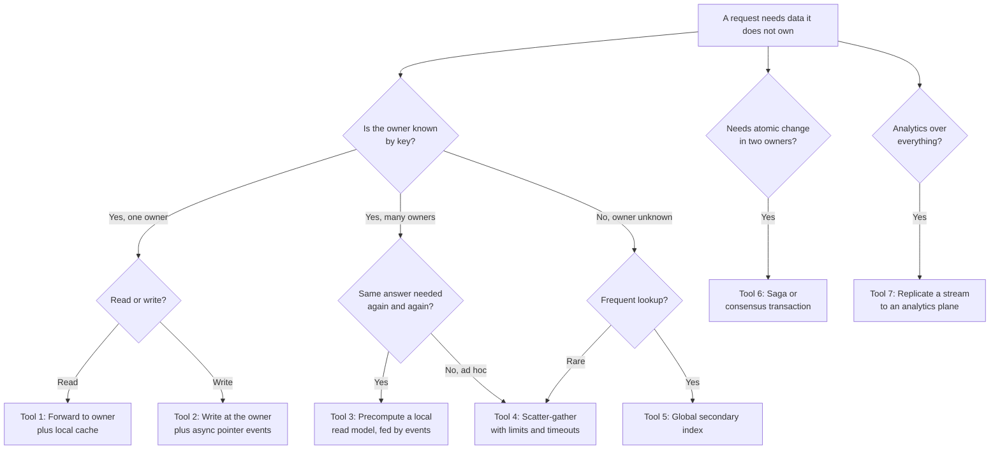
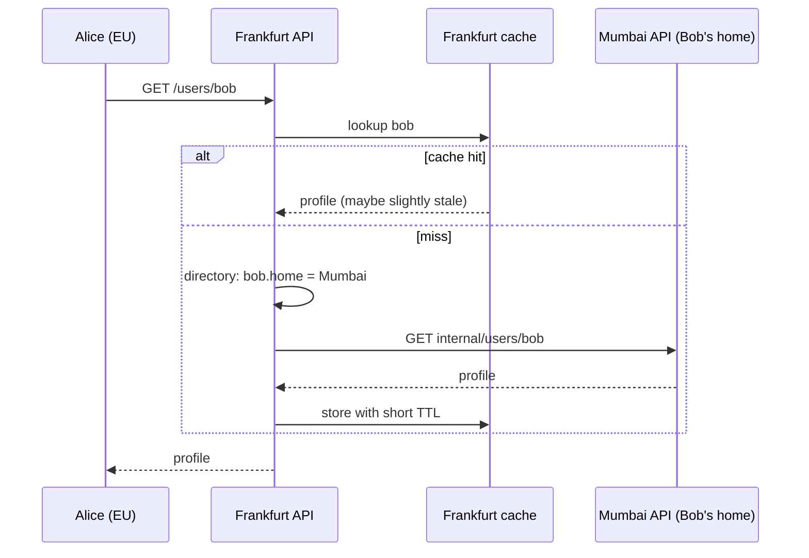
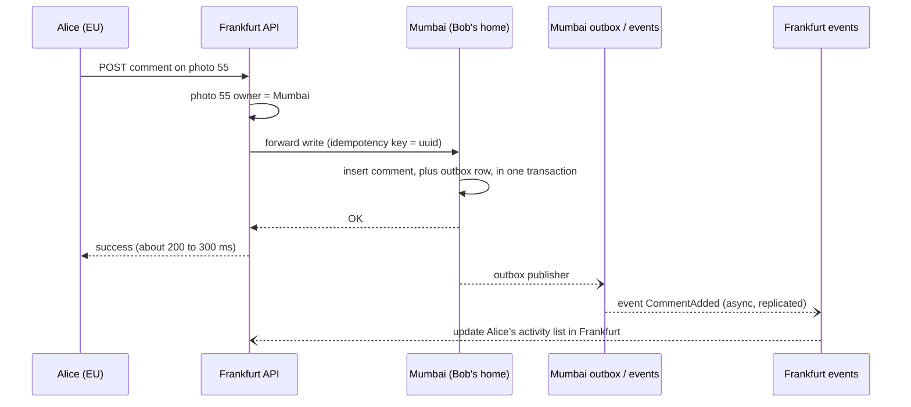
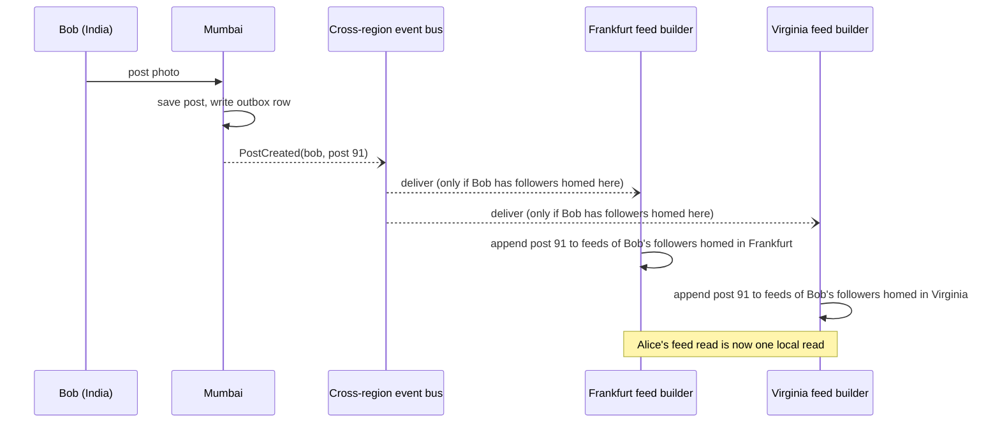
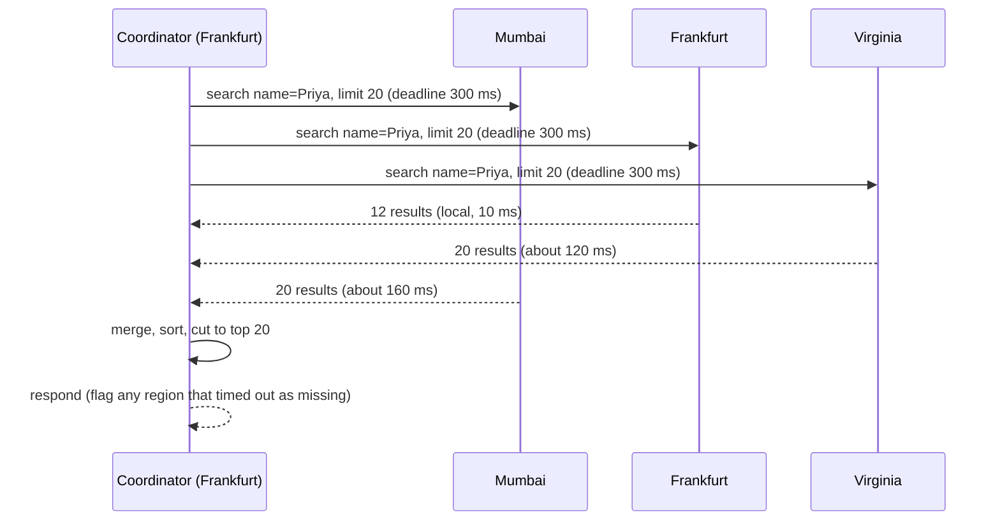
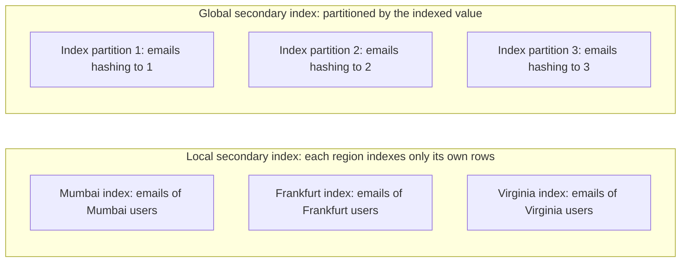
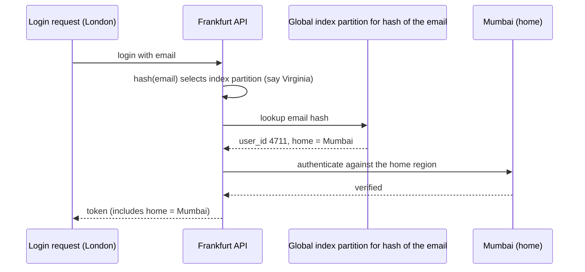
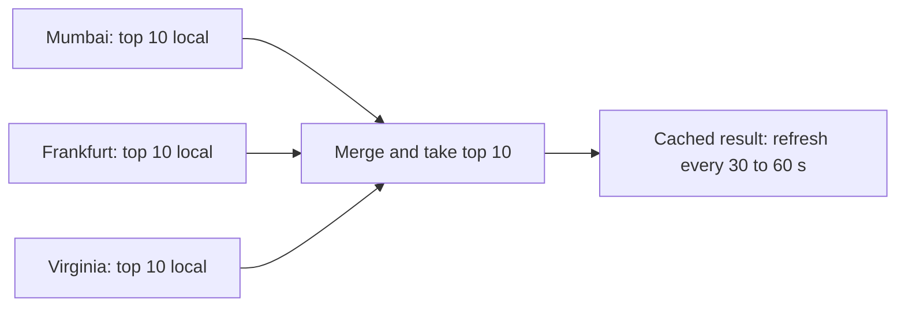
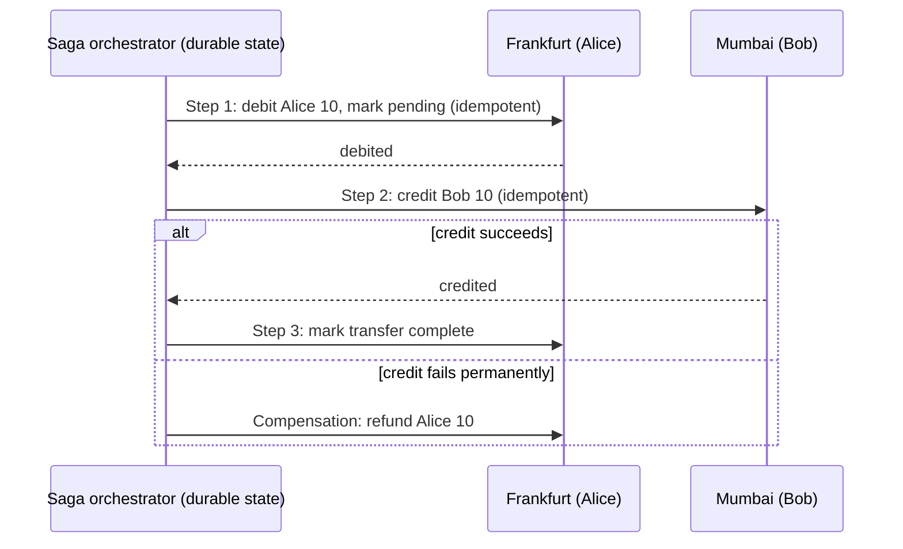
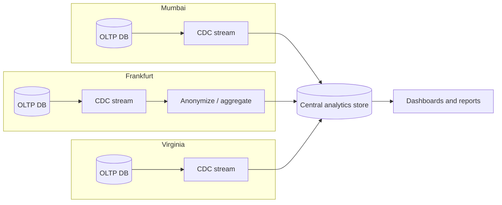

# Chapter 5: Cross-Region Queries

In Chapter 4, each user has one home region, and most requests touch only the user's own data. Real products are social, though. Users interact with other users, whose data lives in other regions. This chapter covers every way a request can need data from more than one region, and the tool for each.

## 1. The story: when a request touches two homes

SnapShare now runs with geo-partitioned homes (Mumbai, Frankfurt, Virginia). Product asks for features that cross those boundaries:

| Feature | Why it crosses regions |
|---|---|
| Alice (EU) comments on Bob's photo (India) | Writer and data owner are in different regions |
| Home feed of Alice's friends | Friends are spread over all regions |
| Search "find user by email or hashtag" | The search key isn't the partition key, so you don't know the region |
| Global leaderboard: top 10 photos this week | The answer needs data from every region |
| Admin dashboard: total signups per country | Aggregation over all users |
| Gift credits from Alice (EU) to Bob (India) | Two accounts, two homes, one atomic action |

If every one of these does a live query across regions, you get 150–250 ms per hop, tail-latency spikes, and a dependency on every region being up. Alice's request fails when Mumbai is slow, even if her own data is fine. So the goal of this chapter is:

> **Keep cross-region calls rare, off the hot path, and designed to degrade gracefully.**

---

## 2. The six kinds of cross-region needs

| # | Need | Example | Core tool |
|---|---|---|---|
| 1 | Point read of someone else's data (key known) | View Bob's profile | Forward to owner, plus cache |
| 2 | Interaction write touching another owner's data | Comment on Bob's photo | Write to the data's owner, plus async pointers |
| 3 | Fan-out read across many owners | Home feed | Precomputed regional read model |
| 4 | Lookup by a non-partition key | Find user by email or tag | Global secondary index |
| 5 | Global aggregate or top-N | Leaderboard, counts | Partial aggregation per region, then merge |
| 6 | Atomic change across two owners | Credit transfer | Saga or consensus transaction |

Everything else in this chapter is how to build these six well.

---

## 3. The tool menu

Walk through each.

---

## 4. Tool 1: Forward to the owner (point reads)

Alice opens Bob's profile. The edge region looks up Bob's home (directory or bucket map from Chapter 4) and forwards.

Design points:

- **Cache the result in the requesting region** with a short TTL, since profiles tolerate seconds to minutes of staleness. This turns most cross-region reads into local ones.
- **Use a private backbone** between regions (cloud provider's inter-region network), not the public internet.
- **Timeouts and fallbacks:** if Mumbai is slow or down, serve the stale cached copy or a degraded view (name only, no stats). Never let one slow region hang the page.
- **Return only permitted fields.** If Bob's data is residency-restricted, the owning region decides what leaves (for example, public profile fields only).

---

## 5. Tool 2: Interaction writes (comment on Bob's photo)

First, decide **who owns the new data**. A comment is a fact about Bob's photo, so the most natural owner is the photo's home region.

| Option | Where the comment lives | Pros | Cons |
|---|---|---|---|
| **A. Photo owner's region (recommended)** | Mumbai (Bob's home) | The photo and its comments live together, so showing a photo is a single-region read | Alice's write pays a cross-region trip |
| **B. Commenter's region** | Frankfurt (Alice's home) | Fast write for Alice | Displaying Bob's photo needs a scatter-gather across every commenter's region. Slow and fragile |

Use option A. Reads of a photo (frequent) stay single-region, and the rare write pays the trip.

Key ideas:

- **Single write in the owner's region.** The comment is committed atomically with its outbox row, so the event is never lost (the **transactional outbox**, covered in Chapter 7).
- **Idempotency key.** Alice's request may be retried (network timeout), so the owner dedups by the key and never creates two comments.
- **Pointers in the other region are async copies.** "My comments" on Alice's profile is a lightweight reference in Alice's home, built from the event. If it lags by a second, nobody notices.
- **Don't write two regions in the request path.** A synchronous dual write ("write to Mumbai and Frankfurt, fail if either fails") turns two regions' availability into one multiplied dependency. Write to **one** owner, and let events carry the rest.

---

## 6. Tool 3: Precomputed local read models (feeds)

Alice's feed contains posts from 300 friends spread over three regions. Querying 300 friends live across regions is impossible at feed latency. Instead, **build the feed in advance, inside Alice's own region**, from events.

There are two classic strategies, and both cross regions via events.

### Fan-out on write (push)

When Bob posts, send an event to each follower's region, and each region appends to its followers' feeds.

Optimization: send **one event per region**, not one per follower. The regional feed builder fans out to its local followers inside the region. This is cheap, since the cross-region bandwidth is one message per region, not millions.

### Fan-out on read (pull)

At read time, fetch recent posts from each followed account (scatter-gather) and merge. Simple, but slow across regions.

### Hybrid (what large systems do)

| Account type | Strategy | Why |
|---|---|---|
| Normal users (few followers) | Push | Cheap to fan out, makes reads instant |
| Celebrity (millions of followers) | Pull at read time, merged into the pushed feed | Fan-out of one post to millions of feeds is too costly |

The celebrity's recent posts can themselves be cached in **every** region as hot, read-mostly data (type A-like, replicated).

Consistency expectation: the feed is **type D**, derived and eventually consistent. A post appearing a few seconds late is fine. The feed can always be rebuilt from the posts, which are the source of truth.

---

## 7. Tool 4: Scatter-gather (ad hoc queries across owners)

When you can't precompute and don't know the owner, ask **every** region and merge. Example: an admin searches all users named "Priya."

What makes scatter-gather safe:

| Concern | Rule |
|---|---|
| **Tail latency** | The response is as slow as the slowest region. Use a deadline and return partial results with a "some regions did not respond" flag |
| **Fan-out cost** | Cost is multiplied by the number of regions. Reserve this for rare queries, not hot paths |
| **Pagination** | Each region must return its top K sorted rows, and the coordinator merges. Deep pages (offset 10,000) are expensive, so use cursor-based pagination and cap depth |
| **Hedged requests** | If a region is slow, retry against its replica or backup after a short delay |
| **Failures** | One region down means incomplete results. Decide whether partial is acceptable (search: yes, billing: no) |
| **Load** | A bad query can hit every region at once. Add rate limits and timeouts |

Scatter-gather is the fallback tool. If a query is frequent, replace it with a global index (Tool 5) or a precomputed model (Tool 3).

---

## 8. Tool 5: Global secondary indexes (lookups by a non-partition key)

Users are partitioned by `user_id`, but login and search use `email`, `username`, or `phone`. A query by email doesn't say which region owns the user.

### Local vs global index

| | Local index | Global index |
|---|---|---|
| **Query by email** | Must ask every region (scatter-gather) | Ask **one** index partition, which returns user_id and home region |
| **Write cost** | Local and cheap | A user write must also update an index partition that may be in another region |
| **Consistency** | Always consistent with its own region | Lags behind the data unless updated transactionally |
| **Use for** | Rare or admin queries | Frequent lookups: login, search by username, find by phone |

### How a global index works

Rules for a global index:

- **Store minimal data in the index:** `email_hash → (user_id, home_region)`. Not the profile.
- **Keep the index highly available:** replicate each index partition across regions (it is small and read-heavy), and cache lookups.
- **Update path:** when a user changes email, update the home region first and then the index, using an outbox event. Accept that for a brief window the old email still resolves. For uniqueness (Chapter 3, usernames), the index write is the coordinated step.
- **Compliance:** the index crosses borders, so it must not hold personal data in raw form. Use salted hashes or tokens, and have counsel confirm.

### Search by text or hashtag

Full-text and tag search usually uses a search engine (Elasticsearch, OpenSearch). Two models:

| Model | How | Use when |
|---|---|---|
| **Regional search clusters, scatter-gather** | Each region indexes its own data. A query fans out to all, and results merge | Small number of regions, results can be a bit slower |
| **Replicated search index** | A stream of changes feeds a search cluster in each region that holds the **public** content from all regions | Public content (public photos, hashtags) where local speed matters |

Public vs private content decides which model you may use. Private or residency-restricted data stays in its region's cluster.

---

## 9. Tool 5b: Global aggregates and top-N

### Leaderboard: top 10 photos this week

Each region computes its **own top 10**, and the coordinator merges. The global top 10 can only come from the union of regional top 10s, so no region needs to send more.

Better yet, **precompute it**: a scheduled job merges regional top lists every minute, stores the result in every region's cache, and every request becomes a local read. Leaderboards almost never need real-time global accuracy.

### Counts and sums

- **Total likes on one photo:** that photo has one home, and the count is kept there. Other regions show a cached count.
- **Global totals** (all signups, total uploads): each region keeps its own counter and a periodic job sums them. Or use a CRDT counter (Chapter 3, Strategy 3), which lets any region read the merged total locally.
- **Percentiles, distinct counts:** use mergeable sketches (HyperLogLog for distinct counts, t-digest for percentiles). They are small, mergeable across regions, and approximate.

The principle: **push the computation to the data, and move only small partial results.** Never ship raw rows across regions to aggregate them.

---

## 10. Tool 6: Atomic changes across owners

Alice (EU) sends 10 credits to Bob (India). Alice's account is owned by Frankfurt, and Bob's by Mumbai. It must not lose or duplicate money.

Three options, from most to least preferred.

| Option | How | Tradeoff |
|---|---|---|
| **Avoid it** | Redesign so the operation touches one owner (a shared ledger account, or a payment provider as the single owner) | Best, if the product allows |
| **Saga** | A sequence of local transactions with compensations on failure | Eventually consistent, with a short window where money has left Alice but not reached Bob |
| **Distributed transaction** | 2PC, or a consensus database (Spanner, CockroachDB) | Correct and atomic, but slow and blocking on failure |

### Saga flow

Keys to a safe saga:

- **Every step is idempotent** (retry-safe), using a transfer ID.
- **The orchestrator's state is durable**, so a crash resumes the saga.
- **Compensations exist** for every step that can't be undone.
- **Show an honest intermediate state** ("pending") to users.

The consensus course covers 2PC and sagas in depth. Here, the rule is: **cross-region atomicity is a last resort.** Most designs avoid it by choosing owners well (Tool 2).

---

## 11. Tool 7: Analytics and admin queries

An admin dashboard asking "signups per country per day" shouldn't hit production OLTP databases in three regions.

- **CDC (change data capture)** streams database changes without loading the OLTP database.
- **The analytics plane is separate**: a warehouse or lake with its own scaling, with data minutes to hours behind. That's fine for analytics.
- **Compliance gate:** EU data is anonymized or aggregated **inside the EU** before it leaves. Raw personal data does not travel to the central store unless the law and consent allow it.
- Alternatively, run regional analytics and merge only aggregates (the pattern from section 9).

---

## 12. Choosing the right tool

| Query | Tool | Latency profile | Consistency |
|---|---|---|---|
| View another user's profile | 1: Forward + short cache | 5 ms cached, 150 ms miss | Seconds stale |
| Comment on another's photo | 2: Write at owner + events | 150 to 300 ms | Strong at owner, async elsewhere |
| Home feed | 3: Precomputed regional feed | 10 ms | Eventual |
| Admin user search, rare | 4: Scatter-gather | Slowest region | Per region |
| Login by email, find by username | 5: Global index | 1 cross-region hop, cached | Slightly lagging |
| Leaderboard, totals | 5b: Partial aggregates, precomputed | 10 ms (cached) | Eventual |
| Money transfer across regions | 6: Saga or consensus | Hundreds of ms | Atomic or compensated |
| Dashboards | 7: CDC to analytics plane | Minutes of lag | Eventual |

---

## 13. Handling slow and failed regions

Cross-region calls fail more than local ones, so design for it.

| Technique | Purpose |
|---|---|
| **Timeouts per call** | Never wait unbounded. Set a deadline far below the user's patience |
| **Circuit breaker** | If Mumbai is failing, stop calling it for a short time and use fallbacks |
| **Stale cache fallback** | Serve the last known value when the owner is unreachable |
| **Partial results** | Return what you have, with an indicator of what's missing |
| **Degraded features** | Hide the "comments" panel instead of failing the whole page |
| **Bulkheads** | Cross-region calls use their own thread pool and connection limits, so a slow region can't exhaust the capacity serving local traffic |
| **Retries with idempotency keys and jitter** | Safe retries without duplicates or retry storms |
| **Request budgets** | A request may make at most N cross-region calls (ideally 1) |

A design review rule of thumb: **each user-facing request path should have zero or one cross-region hop.** Two or more, and you should reshape the data or precompute.

---

## 14. Common mistakes

| Mistake | Why it hurts | Fix |
|---|---|---|
| Synchronous dual writes to two regions | Availability multiplies down, and partial failures leave inconsistent data | One owner, async events |
| Scatter-gather on a hot path | Slowest region sets latency, cost multiplies | Precompute or index |
| Placing comments in the commenter's region | Showing a photo needs a fan-out over all commenters' regions | Co-locate with the photo's owner |
| Shipping raw rows to aggregate | Bandwidth, cost, compliance risk | Aggregate locally, send partials |
| Global index with personal data | Residency violations | Hashed or tokenized entries |
| Treating derived data (feeds, indexes) as the source of truth | A feed bug becomes data loss | Keep a source of truth, rebuild derived data from it |
| No timeouts on cross-region calls | One slow region stalls everything | Deadlines, breakers, bulkheads |

---

## 15. Rules from this chapter

1. Cross-region calls are slow and failure-prone. Keep them off hot paths and aim for at most one per request.
2. Put each piece of data with the entity that owns it. A comment lives with the photo, not with the commenter.
3. Reads of others' data: forward to the owner and cache in the requesting region.
4. Writes touching others' data: write once at the owner, and propagate the rest through events.
5. Feeds and similar views are local, precomputed, derived data fed by events. Never compute them live across regions.
6. For lookups by non-partition keys, use a global index that stores only minimal, compliant data, or scatter-gather if rare.
7. Aggregate locally and merge small partial results.
8. Cross-region atomicity is a last resort. Prefer one owner, then sagas, then consensus.
9. Analytics runs on a separate plane fed by CDC, with compliance filtering at the border.
10. Every cross-region call needs a timeout, a fallback, and idempotency.

---

## Interview one-liner

> "For cross-region queries, I first try to avoid them by putting data with its owner, so a comment lives with the photo it belongs to. For reads of other users' data I forward to the owner and cache locally. Feeds are precomputed per region from events, with a push and pull hybrid for celebrities. Lookups by email go through a small global index that maps to a home region. Aggregates are computed per region and merged as small partial results. Cross-region atomic operations use sagas, and analytics runs on a separate CDC-fed plane. Every cross-region call has a timeout, a fallback, and an idempotency key."

---

## Next: Chapter 6

Chapter 6 covers **caches in multi-region systems**: what to cache in each region, how cache-aside works when the source is in another region, invalidation across regions (TTL, change-stream invalidation, versioning), cache stampedes after failover, session storage, CDN as a global cache, and a cache strategy table for each of the four data types.

Say **"next"** to continue. Ask now if anything about the six needs or the tools isn't clear.

