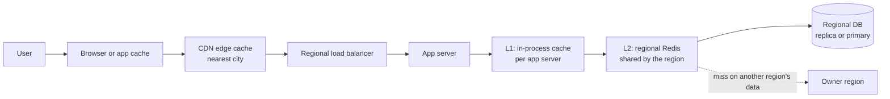
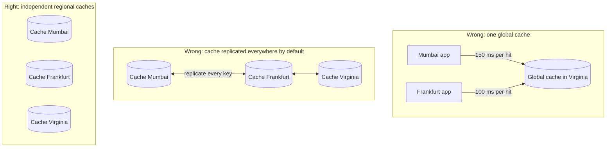
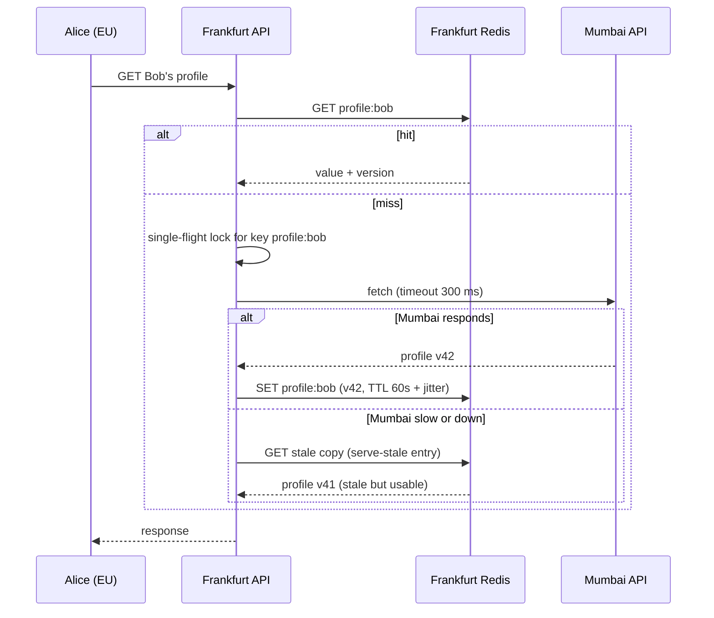
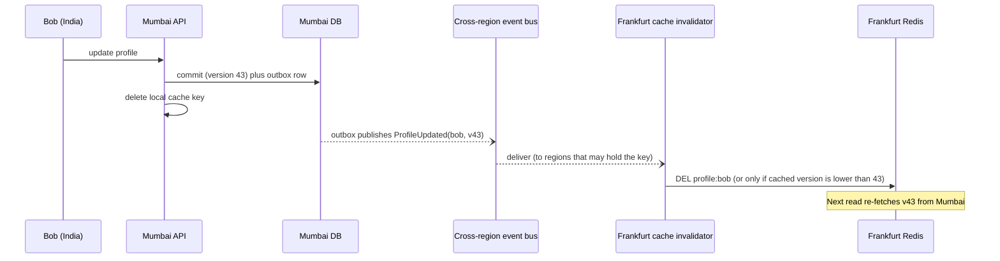
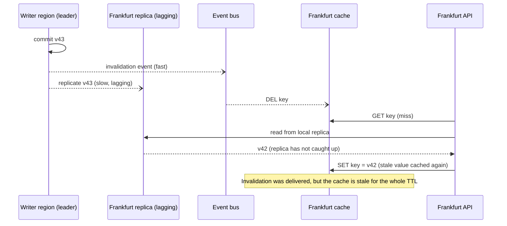
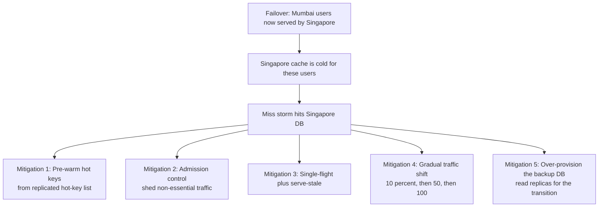
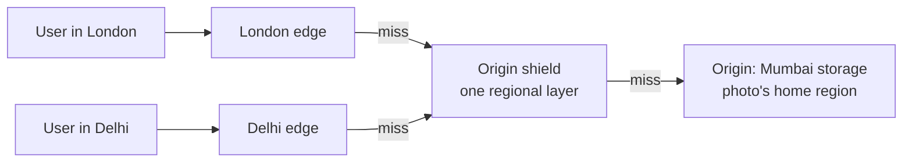

# Chapter 6: Caches in Multi-Region Systems

So far, caches appeared in passing as "a regional cache on top." In multi-region designs they matter more, and they are easier to get wrong. A cache miss that costs 1 ms in a single region can cost 150 ms or more when the source of truth is in another region. A stale cache that was a minor annoyance can now be stale for minutes.

## 1. The story: why caches become critical

In Chapter 5, we said Alice (EU) reads Bob's profile (India) by forwarding to Mumbai and caching the result in Frankfurt. That one cache is what makes the design affordable.

| Situation | Without cache | With a regional cache (90% hit) |
|---|---|---|
| Alice views Bob's profile | 150 ms every time | 10 ms on 9 of 10 requests |
| Mumbai request load | Every view from every region | One request per key per TTL per region |
| Mumbai goes slow | Alice's page hangs | Alice sees cached data |

So in multi-region the cache has three jobs:

1. **Speed:** turn remote reads into local reads.
2. **Protection:** shield the owner region from read traffic from every other region.
3. **Resilience:** keep serving when the owner region is slow or unreachable.

---

## 2. The cache layers



| Layer | Scope | Typical TTL | Holds |
|---|---|---|---|
| Browser / app | One device | Seconds to days | Static assets, rarely changing responses |
| CDN edge | Worldwide edges | Seconds to a year | Media, public pages, public API responses |
| L1 in-process | One server | 1 to 10 seconds | Very hot keys, config |
| L2 regional Redis | One region | Seconds to minutes | Profiles, lookups, computed views |
| DB buffer pool | One DB | Automatic | Hot pages |

---

## 3. The first rule: caches are regional

There are two tempting designs, and both are usually wrong.



| Design | Problem |
|---|---|
| **Global cache** | Every cache hit becomes a cross-region call, which defeats the purpose. It also fails with one region |
| **Cache replicated everywhere** | Replicates garbage and cold data, burns bandwidth, copies stale values, and creates conflicts when two regions write the same key |
| **Independent regional caches (default)** | Hits are local, failures are isolated, and each region stores only what its own users ask for |

Each region fills its cache **on demand** from the authoritative source, and invalidation is a separate mechanism (section 6). The exceptions where cross-region cache replication is justified are listed in section 9.

---

## 4. What to cache, by data type

This ties back to the four types from Chapter 1.

| Type | Example | Where it's cached | Fill from | TTL guidance | Invalidation |
|---|---|---|---|---|---|
| **A: global reference** | Photo filters, config, flags | Every region's L1 + L2, and CDN if public | The local replica | Minutes to hours | Replicated change event, or TTL |
| **B: own user data** | Alice's own profile in her home region | Home region L2 | The local primary or replica | Minutes | Write-through or delete on write |
| **B: others' data** | Bob's profile seen from Frankfurt | Viewer's regional L2 | The owner region, forwarded | Short: 30 to 120 s | TTL, plus event if freshness matters |
| **C: contended** | Balance, stock, unique names | Rarely. Cache only with version checks | Consensus store or owner | Very short, or none | Version compare |
| **D: derived** | Feeds, search results, leaderboards | Regional L2, **precomputed** | Local builder | Refresh-based | Rebuild on schedule or event |

The key principle: **the more critical the correctness, the less you cache.** Money and inventory reads that decide an action must go to the authority. A display of "about 3 left" can be cached.

---

## 5. Cache-aside across regions

The pattern you know: check the cache, on a miss load from the source, then store. The multi-region addition is that **the source may be another region**, and the miss path needs extra care.



Three additions compared to single-region cache-aside:

1. **Single-flight (request coalescing):** if 500 concurrent requests miss on the same key, only **one** goes cross-region and the other 499 wait for its result. This protects the owner from a stampede.
2. **Serve-stale on failure:** keep the entry for longer than its freshness window (for example, fresh for 60 s, but stored for 24 h). If the owner can't answer, serve the stale copy. This is **stale-if-error**.
3. **Timeouts:** a cross-region fetch has its own short deadline.

---

## 6. Invalidation across regions

This is the hardest part of multi-region caching. Four approaches, from simplest to strongest.

### Approach 1: TTL only

Every entry expires after N seconds. No invalidation messages at all.

- **Pros:** trivial, robust, no coordination.
- **Cons:** data is stale up to N seconds, and short TTLs mean more cross-region misses.
- **Use when:** staleness of seconds to a minute is acceptable (others' profile views, public counts).

### Approach 2: Delete on write, in the owner region only

The owner updates the DB and deletes its **local** cache key. Other regions still hold stale copies until the TTL expires.

- **Pros:** correct for the owner's own users (read-your-writes in the home region).
- **Cons:** remote regions stay stale until TTL.
- **Use when:** combined with a short TTL for remote regions.

### Approach 3: Event-driven invalidation (recommended for freshness)

The owner emits a change event, such as `ProfileUpdated(bob, version 43)`, through the cross-region event bus. Each region subscribes and deletes or refreshes its cache entry.



Key point: events are **at-least-once and possibly out of order**, so invalidation must be **idempotent**. Deleting a key twice is harmless, and "delete if cached version < event version" is safe in any order.

### Approach 4: Versioned keys (immutable cache entries)

Put the version in the key: `profile:bob:v43`. A pointer `profile:bob:current → v43` is the only mutable thing. Old versions simply stop being read and expire.

- **Pros:** no race between invalidation and fill, since a value for a given key never changes.
- **Cons:** needs a small pointer lookup, and extra memory for old versions until they expire.
- **Used heavily for:** static assets (`app.3f9a1c.js`), media, and config bundles.

### The race you must know about: stale refill

This is the classic multi-region cache bug.



The invalidation arrived **before** the replica did, so the cache refilled with old data.

**Fixes:**

| Fix | How |
|---|---|
| **Version-aware fill** | The invalidation event carries `v43`. Remember it as `min_version[key] = 43` (a tombstone). On refill, only cache a value whose version is at least 43. Otherwise read from the owner or don't cache |
| **Delayed second delete** | Delete again after a short delay (for example, 1 to 2 seconds, longer than typical replica lag) |
| **Invalidate after replication** | Publish the event from the replica's change feed, so it fires only once the replica has the data |
| **Short TTL as a backstop** | Bounds the damage of any race |

Interview tip: naming this race and one fix (version tombstone) shows depth.

---

## 7. Stampedes and cold caches

### Stampede protection

Cache stampede means many requests miss at once, all hitting the source. Cross-region makes it worse, because the source is distant and the owner region is shared by everyone.

| Technique | What it does |
|---|---|
| **Single-flight** | One in-flight fetch per key per server (or per region with a lock) |
| **TTL jitter** | TTL = 60 s plus a random 0 to 10 s, so entries don't all expire together |
| **Stale-while-revalidate** | Serve the expired entry immediately and refresh it in the background |
| **Probabilistic early refresh** | A request refreshes an entry slightly before it expires, with probability that rises as expiry nears |
| **Negative caching** | Cache "not found" for a short time (for example, 10 s), so repeated lookups of non-existent keys don't hammer the owner |

### Cold cache after failover

When Mumbai fails and Singapore takes over (Chapter 4), Singapore's caches have never seen Mumbai's users. Suddenly millions of requests all miss, and the database is hit with the full load.



Capacity planning should include the cold-cache scenario. A backup region that handles normal load but falls over when the cache is empty has not really backed up anything.

---

## 8. Sessions

Sessions are **type D**: if lost, the user logs in again. Choose by how painful that would be.

| Approach | How | Failover behavior | Notes |
|---|---|---|---|
| **Stateless signed tokens (JWT)** | Token carries user ID, home region, expiry, and a signature. Every region verifies with shared public keys | Works in any region, with no session store at all | Best default. Revocation is the hard part (below) |
| **Regional session store** | Redis per region, with sessions keyed by ID | Users in a failed region must log in again | Simple, and acceptable for many apps |
| **Replicated session store** | Sessions copied async to a paired region | Sessions survive failover (small loss of recent updates) | Extra cost, use for apps where re-login is costly |
| **Sticky routing to home** | Session lives in the home region, and others forward | Depends on home | Adds cross-region hops for travelers |

**Revocation** (logout everywhere, a stolen token): keep short-lived access tokens (5 to 15 minutes) plus refresh tokens. For immediate revocation, publish a small **denylist** of revoked token IDs to all regions through events. It is tiny and expires with the tokens. Chapter 7 covers the event side. Your auth study covers tokens in depth.

---

## 9. Global-ish caching: CDN and the exceptions

### The CDN as a global cache

A CDN is the one "global" cache that is worth having, because edges are everywhere and hold **static or public** content.



| Technique | Why |
|---|---|
| **Origin shield** | A single intermediate layer collapses misses from many edges into one request to the origin, protecting the home region |
| **Immutable content with versioned URLs** | `photo/91/v3.jpg` can be cached for a year, with no invalidation needed |
| **`s-maxage` and `stale-if-error`** | Control CDN freshness and fall back to stale on origin failure |
| **Purge by tag or key** | For mutable public content, trigger a purge from the change event |
| **Signed URLs / cookies** | For private media. The edge validates the signature, so private photos can still be cached at the edge safely, with a short expiry |
| **Origin selection by home** | The CDN routes `/media/<id>` to the correct home region's storage |

### Exceptions: when replicating cache data across regions makes sense

| Case | Why |
|---|---|
| **CRDT counters and sets** (Redis active-active) | Merge semantics make multi-writer safe (Chapter 3). Good for likes, rate-limit counters, presence |
| **Tiny, hot, global lookup tables** | Directory and bucket map from Chapter 4, replicated by the database or event stream, not by the cache |
| **Hot-key broadcast** | A few keys that every region reads constantly (for example, a trending list), pushed from one place |

Even then, the replication is a **designed data flow**, not "turn on cross-region cache sync for everything."

---

## 10. Cache and compliance

Caching creates **copies of data in other places**, which matters under data residency rules.

| Risk | Example | Mitigation |
|---|---|---|
| EU user's profile cached in the US because an American viewed it | Personal data now sits outside the EU | Cache only the **public** projection of the profile, never restricted fields. Or don't cache in non-EU regions at all for residency-restricted data, and accept the forward |
| CDN edge holds private media | Photos cached at edges in any country | Private media: signed URLs with short expiry, or no-store. Public media only gets long caching |
| Cache backups and snapshots | Redis persistence files leave the region | Keep persistence in-region, or disable it for restricted data |
| Logs of cached payloads | Debug logs contain personal data | Scrub logs |

Rule: **decide cacheability per field and per data class**, and mark it in the owning region's API response (for example, `Cache-Control: no-store` or a "restricted" flag that proxies honor).

Also include the tenant or user identity and permission scope in the cache key (for example, `profile:bob:viewer-visible-fields`), so a cache never serves one viewer's privileged view to another.

---

## 11. Hot keys

A celebrity's profile or a viral photo can overwhelm one cache node.

| Technique | How |
|---|---|
| **L1 in-process cache** | A tiny TTL (1 to 5 s) cache on every app server absorbs most of the traffic |
| **Key replication** | Store the hot key as `key#0 ... key#N` across Redis nodes and read a random one |
| **Request coalescing** | One load per key |
| **CDN for public hot content** | Edge absorbs it |
| **Counters** | Per-region counters merged periodically, instead of a single hot counter |

---

## 12. Read-your-writes with caches

Alice updates her own profile and immediately reloads. In her home region:

- **Write path:** update the DB, then delete (or write-through) the cache key in the same region.
- **Read path:** reads hit the primary or an up-to-date replica via the LSN token (Chapter 2).

If Alice is traveling and the write was forwarded to her home, the visited region should **write-through** the returned value into its local cache, so her next read there reflects her change even before the invalidation event arrives.

---

## 13. Implementation sketch

**Versioned cache entry and fill (Java-style pseudocode):**

```java
record Entry<T>(T value, long version, long freshUntilMs, long staleUntilMs) {}

class RegionalCache<T> {
    Redis redis;                       // regional only
    ConcurrentMap<String, CompletableFuture<Entry<T>>> inflight = new ConcurrentHashMap<>();
    Map<String, Long> minVersion;      // tombstones from invalidation events (short-lived)

    T get(String key, Loader<T> ownerLoader) {
        Entry<T> e = redis.get(key);
        long now = clock.millis();
        if (e != null && now < e.freshUntilMs()) return e.value();        // fresh hit

        // stale or miss: coalesce loads, one per key
        CompletableFuture<Entry<T>> f = inflight.computeIfAbsent(key, k ->
            CompletableFuture.supplyAsync(() -> ownerLoader.load(key), crossRegionPool)
                .orTimeout(300, MILLISECONDS)
                .whenComplete((r, ex) -> inflight.remove(key)));
        try {
            Entry<T> fresh = f.join();
            if (fresh.version() >= minVersion.getOrDefault(key, 0L)) {     // avoid stale refill
                redis.set(key, fresh.withTtl(60_000 + jitter(10_000), 24 * HOURS));
            }
            return fresh.value();
        } catch (Exception ex) {
            if (e != null && now < e.staleUntilMs()) return e.value();    // stale-if-error
            throw ex;
        }
    }

    void onInvalidation(String key, long eventVersion) {                  // idempotent
        minVersion.merge(key, eventVersion, Math::max);
        Entry<T> e = redis.get(key);
        if (e != null && e.version() < eventVersion) redis.del(key);
    }
}
```

**Redis settings worth naming:** `maxmemory-policy allkeys-lru` (or `allkeys-lfu` for skewed popularity), replicas across AZs inside the region for availability, and no cross-region replication for ordinary keys.

**HTTP headers for CDN and browsers:**

```
Cache-Control: public, max-age=60, s-maxage=300, stale-while-revalidate=30, stale-if-error=86400
Cache-Control: private, no-store                     # restricted or personal data
Cache-Control: public, max-age=31536000, immutable   # versioned media URL
```

---

## 14. Failure modes

| Failure | What happens | Mitigation |
|---|---|---|
| Regional Redis down | All reads fall to the DB | Cluster across AZs, L1 as a buffer, rate-limit DB access, shed load |
| Owner region down | Misses fail for others' data | Stale-if-error, circuit breaker, degraded views |
| Invalidation event lost | Stale data until the TTL | TTL backstop, event retries, periodic reconciliation |
| Events out of order | Older version overwrites newer | Version compare on every write to the cache |
| Stampede after TTL expiry | Owner overwhelmed | Single-flight, jitter, stale-while-revalidate |
| Cold cache after failover | Backup DB overwhelmed | Pre-warm, gradual shift, shed load |
| Stale refill race | Long-lived stale entry | Version tombstones, delayed delete |
| Restricted data cached abroad | Compliance breach | Field-level cacheability, `no-store`, in-region only |

---

## 15. Rules from this chapter

1. Caches are regional and independent. Do not run one global cache or replicate cache contents by default.
2. The more critical the correctness, the less you cache. Money and inventory decisions read from the authority.
3. Cache-aside across regions needs single-flight, a timeout, and serve-stale on failure.
4. Invalidate with events carrying versions, and make invalidation idempotent and order-independent. Always keep a TTL as the backstop.
5. Beware the stale refill race: use version tombstones.
6. Plan for stampedes and for cold caches after failover.
7. Prefer stateless tokens for sessions. Sessions are rebuildable (type D).
8. Use the CDN with an origin shield, versioned URLs, and signed URLs for private media.
9. Cache decisions follow compliance: cache only what may leave the region, and put identity or permission scope in the key.
10. Replicate cache data across regions only for CRDT-style structures or deliberate hot-key broadcasts.

---

## Interview one-liner

> "Each region has its own L1 and L2 cache, filled on demand, never a single global cache. For other regions' data I cache the forwarded result with a short TTL, single-flight on misses, and serve stale if the owner is unreachable. Invalidation is event-driven and version-aware, with TTL as a backstop, and I'd guard against the stale-refill race with version tombstones. Sessions are stateless tokens, media goes through a CDN with an origin shield and versioned URLs, and anything residency-restricted is either not cached abroad or cached only in a public projection. For failover I'd plan for a cold cache with pre-warming and gradual traffic shift."

---

## Next: Chapter 7

Chapter 7 covers **queues and events across regions**: why queues are regional, how work is processed in each region, how events cross regions (the transactional outbox, CDC, a replicated log such as Kafka MirrorMaker or cluster linking), ordering and duplicates, idempotent consumers, dead-letter queues, handling regional outages and replays, and exactly which patterns to use for the feed, cache invalidation, and saga flows from earlier chapters.

Say **"next"** to continue. Ask now if the invalidation race, the stampede, or the session options need another pass.

