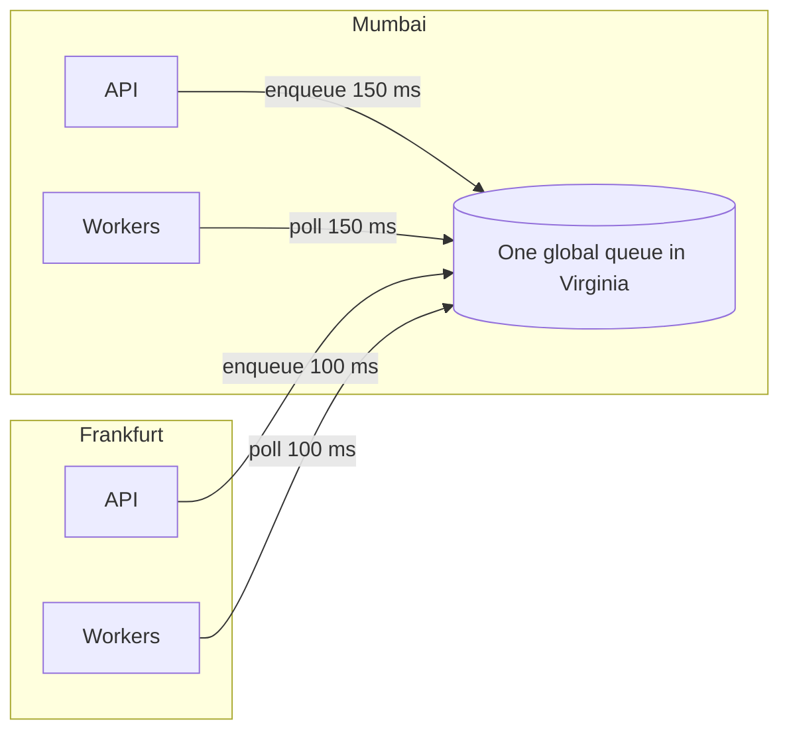
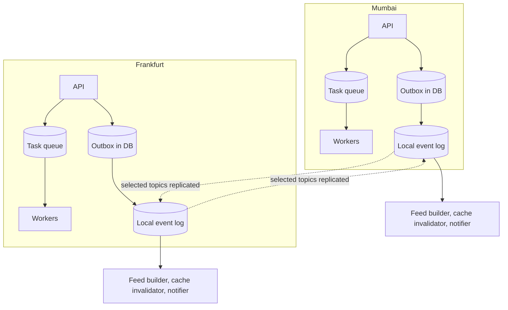
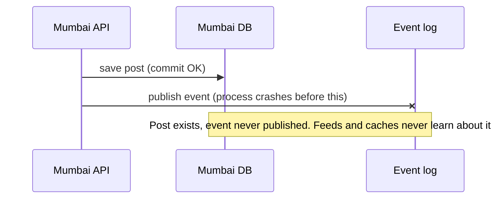
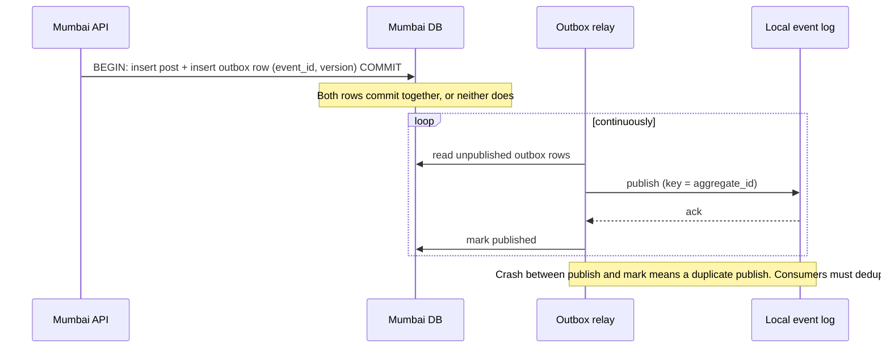
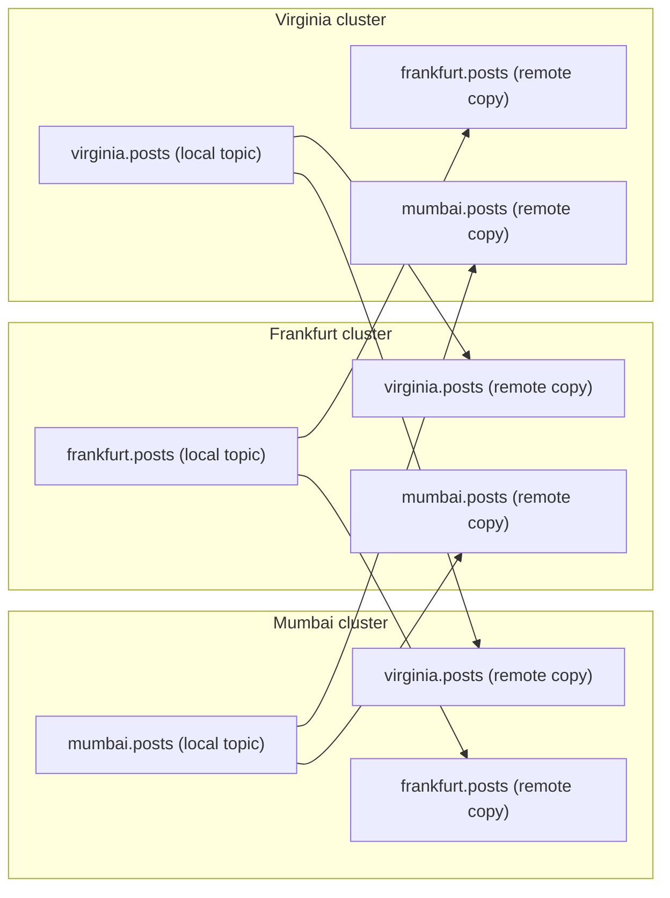
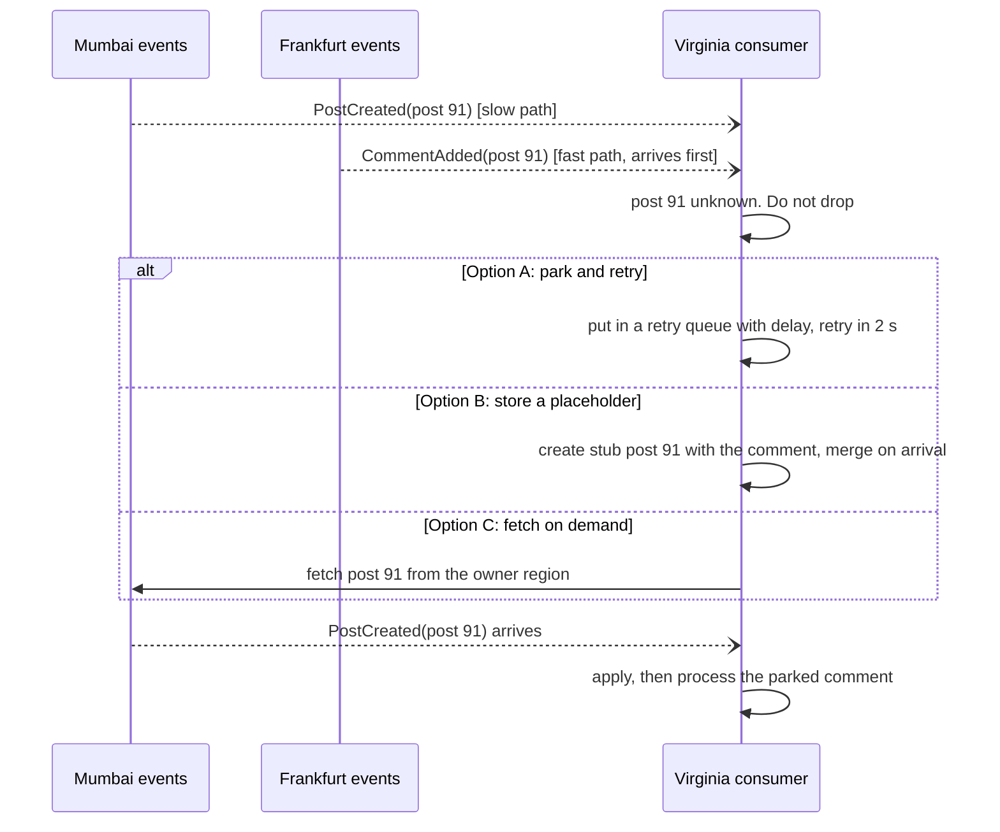
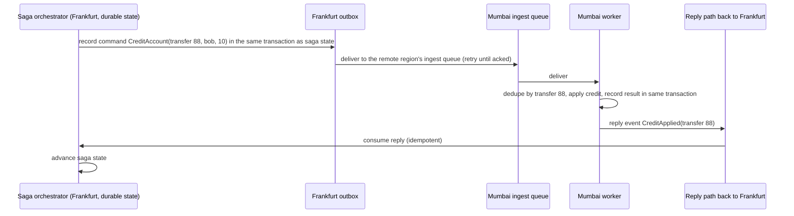
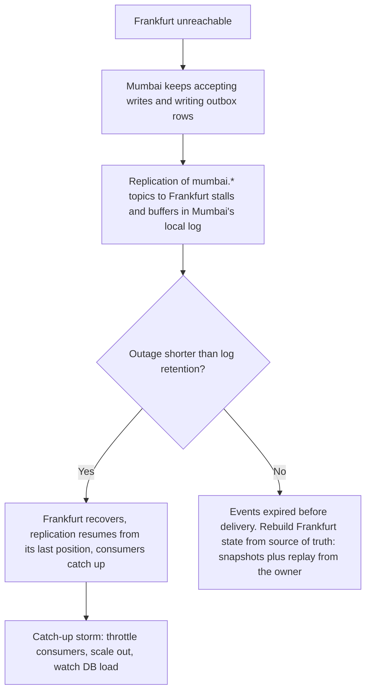

# Chapter 7: Queues and Events Across Regions

In earlier chapters, queues showed up as "a regional queue" and "events carry the rest." This chapter makes that precise. Queues and event streams are how regions talk without blocking on each other, and they are where most subtle bugs hide: lost events, duplicates, out-of-order delivery, and replays after outages.

## 1. The story: background work appears

SnapShare's background work has grown:

| Work | Trigger | Where it must run |
|---|---|---|
| Generate thumbnails | Photo uploaded | Next to the photo's storage (home region) |
| Send push notification | Comment added | Near the notified user's device |
| Build followers' feeds | Post created | In every region that has followers |
| Invalidate caches | Profile updated | In every region that may hold the key |
| Credit transfer saga steps | Transfer started | In each account's home region |
| Nightly cleanup, reports | Schedule | Exactly one place per job |

Some of this is **work to do** (one worker should do it once). Some of it is **facts that happened** (many regions want to know). These need different tools.

### Two kinds of messaging

| | Task queue | Event stream (log) |
|---|---|---|
| **Meaning** | "Do this job" (a command) | "This happened" (a fact) |
| **Consumers** | One worker handles each message | Many independent subscribers, each sees every event |
| **After consumption** | Message is deleted | Message stays for a retention period, and subscribers track their own position |
| **Replay** | Not normally | Yes, rewind and reprocess |
| **Examples** | SQS, RabbitMQ, Cloud Tasks | Kafka, Kinesis, Pub/Sub |
| **Typical use** | Thumbnails, emails, retries | Feed fan-out, invalidation, analytics, CDC |

In multi-region designs, the split matters because the two cross regions differently.

---

## 2. The first rule: task queues are regional, events cross regions

### Version 1: one global queue (wrong)



What breaks:

- Every enqueue and every poll is a cross-region call.
- If Virginia is down, **every region** loses background processing.
- Workers in Mumbai may pick up jobs for Frankfurt data, then reach across the ocean to do them.
- Residency: job payloads leave their region.

### Version 2: regional queues, with a cross-region event bus (right)



The shape:

1. **Work happens where the data lives.** Each region has its own task queue and workers.
2. **Facts leave a region through a local event log**, which is fed from the database's outbox (section 4).
3. **Replication copies selected topics** to the other regions' logs.
4. **Consumers read their local copy.** They never reach across regions.

What we gained: each region keeps working if any other region is down, consumers have local latency, and each region controls what leaves it.
What we gave up: events arrive in other regions with delay (typically sub-second to a few seconds), and consumers must handle duplicates and ordering.
What we rejected: stretching one queue across regions, and synchronous calls to other regions for side effects.

---

## 3. Inside a region (quick recap)

The in-region task queue pattern is the one you already know: a database row records the task, a queue message points at it, a worker claims it with a lease, and failures retry and finally land in a dead-letter queue. The multi-region part is only what changes around it:

- **The database is the source of truth for tasks, and the queue is a delivery mechanism.** This matters for failover (section 9).
- **Every worker is idempotent**, since at-least-once delivery means a task may run twice.
- **DLQs are per region**, owned by that region's on-call team, and personal data in failed messages stays in the region.

---

## 4. Getting events out reliably: the dual-write problem

Bob posts a photo in Mumbai. We must (1) save the post and (2) tell the world. The naive code:

```java
db.save(post);          // step 1
kafka.publish(event);   // step 2
```



Reverse the order and you get the opposite failure: an event for a post that doesn't exist. Two systems cannot be updated atomically without help.

### Fix 1: transactional outbox

Write the event into an **outbox table in the same database transaction** as the data. A separate relay publishes outbox rows to the event log.



### Fix 2: CDC (change data capture)

A tool such as Debezium reads the database's transaction log and publishes row changes to the event log. No relay code, and no polling. Many teams use CDC to tail the outbox table, which combines both fixes.

| | Outbox + polling relay | CDC on the outbox table |
|---|---|---|
| Moving parts | Your relay process | A CDC connector |
| Latency | Poll interval (100 ms to 1 s) | Tens of milliseconds |
| Load on DB | Polling queries | Reads the log, cheap |
| Operational burden | Low | Medium |

Either way, the guarantee is **at-least-once publishing**: no loss, but possible duplicates. That sets the rule for the whole chapter: **every consumer must tolerate duplicates.**

---

## 5. Crossing the region boundary

### Transport options

| Option | How | Good for | Watch out for |
|---|---|---|---|
| **Replicated log** (Kafka MirrorMaker 2, cluster linking, Confluent Replicator) | A tool copies topics from one cluster to another | High volume, ordered streams, replay | Operating it, offset translation (section 9) |
| **Managed bus** (SNS cross-region subscriptions, EventBridge global endpoints, Pub/Sub) | Cloud-native fan-out | Low-to-medium volume, little operations | Ordering and replay limits vary |
| **Direct push to a remote ingest queue** | The relay calls the remote region's queue or API | Commands to one specific region (saga steps) | Retries, auth, dependence on the remote |
| **DB-level replication / CDC to a remote consumer** | Stream rows directly | Analytics, search indexing | Schema coupling |

Most designs mix them: a replicated log for broadcast facts, and direct pushes for targeted commands.

### Topology



The key convention: **each region writes only to its own topic**, and remote topics are read-only copies prefixed with the origin region's name (this is MirrorMaker 2's default naming). That convention gives you two properties:

- **No replication loops.** A copy of `mumbai.posts` in Frankfurt is never copied back to Mumbai, because the tool skips topics that already carry the origin prefix.
- **Clear ownership.** Every event has exactly one origin region, and consumers can read "all regions' posts" by subscribing to all prefixed topics.

For a small number of regions, a full mesh like this is fine. For many regions, a hub-and-spoke layout reduces the number of links.

### Replicate selectively

Don't mirror everything to everywhere.

| Rule | Reason |
|---|---|
| Replicate only topics that another region truly consumes | Bandwidth and cost |
| Prefer one event per **region** over one per **recipient** | Regional consumers fan out locally (Chapter 5) |
| Filter by interest where possible (only regions with followers of this author) | Less traffic |
| Keep payloads thin: IDs, versions, and public fields | Compliance, smaller messages |
| Replicate raw personal data only if law and consent allow | Residency |

### Thin events and compliance

An event that crosses a border should not become a personal-data leak.

```json
{
  "event_id": "7f3c1e5a-...",
  "type": "PostCreated",
  "aggregate_id": "post-91",
  "version": 1,
  "origin_region": "mumbai",
  "author_id": "user-4711",
  "occurred_at": "2026-11-09T10:15:03Z",
  "public": { "caption_id": "cap-77", "media_ref": "media/91/v1" }
}
```

The event says what happened and where to fetch details. A consumer that is allowed to see the full post fetches it from the owner region (Chapter 5, Tool 1). A consumer that is not allowed, doesn't.

---

## 6. Delivery guarantees: duplicates and ordering

### "Exactly-once" is really at-least-once plus idempotency

Across regions, you cannot get true exactly-once delivery. Systems that claim it (Kafka transactions, for example) provide it **within one cluster**. Across a mirror, retries and failovers can redeliver. So the working rule is:

> **At-least-once delivery + idempotent consumers = effectively-once results.**

### Idempotent consumer: three techniques

| Technique | How | Use when |
|---|---|---|
| **Dedup table** | Insert `event_id` into a table with a unique constraint, in the **same transaction** as the effect. If the insert fails, it's a duplicate, so skip | Effects that are not naturally idempotent (send email, add a row, increment) |
| **Natural idempotency** | The operation gives the same result when repeated (`SET status = 'shipped'`, `PUT`, upserts by key) | Whenever you can design it that way |
| **Version compare** | Apply only if `event.version > stored.version` | State replication, cache invalidation, projections |

```java
@Transactional
void handle(Event e) {
    // Unique constraint on processed_events(event_id) makes this safe under redelivery and races
    if (!processedEvents.insertIfAbsent(e.eventId(), clock.now())) {
        return;                       // duplicate: already applied
    }
    applyEffect(e);                   // same transaction: either both commit or neither
}
```

Prune the dedup table by age (keep it longer than the maximum redelivery window, such as retention plus failover time).

For side effects that live outside your database (sending an email, calling a payment API), pass the event ID as the **idempotency key** to the external system, so a retry is deduped there.

### Ordering

| Scope | What you get |
|---|---|
| Within one partition of one log | Strict order |
| Per key (when key picks the partition) | Order of events for one entity, such as one post or one user |
| Across partitions or across topics | **No order** |
| Across regions | **No global order** at all |

Design around that:

1. **Key events by aggregate ID** (`post-91`), so all events for one entity travel in order through the same partition, and the mirror preserves that grouping. (Verify that your replication tool keeps partitioning, and don't assume it.)
2. **Never rely on cross-entity or cross-region order.** If event B only makes sense after event A on a *different* entity, handle it explicitly.
3. **Put a version on every event** so the consumer can detect gaps and reordering.

### Handling out-of-order arrival

Alice's comment event (on post 91) can arrive in Virginia before Bob's `PostCreated` for post 91, since they come from different regions on different paths.



Pick one policy per consumer: park-and-retry with backoff, placeholder records, or fetch from the owner. And always give up eventually to a DLQ, so a missing parent doesn't block a partition forever.

---

## 7. Commands across regions

An event says "this happened" and has many possible readers. A **command** says "region X, do this," and has exactly one target. A saga step (Chapter 5, Tool 6) is a command.



Rules for cross-region commands:

- **Durable sender state:** the command is written to the sender's database (outbox) before sending, so retries survive a crash.
- **Correlation ID** on every command and reply (`transfer 88`), so replies match requests.
- **Receiver dedupes** by the command ID. Retries are expected.
- **Timeouts and compensation:** if no reply arrives within a deadline, the saga takes its compensation path or escalates.
- **Authenticate and authorize** the sending region. An ingest queue is an attack surface. Use mutual TLS or signed messages, and validate inputs as if they came from the internet.

---

## 8. Mapping the earlier chapters onto queues and events

| Earlier pattern | Messaging design |
|---|---|
| **Feed fan-out** (Ch 5) | `PostCreated` on the origin region's topic is mirrored to regions with followers. A regional feed builder consumes locally and fans out to local followers. Key by author ID. Idempotent append by `(feed_id, post_id)` |
| **Comment pointers** (Ch 5) | `CommentAdded` event updates a lightweight reference list in the commenter's home region. Idempotent upsert by `comment_id` |
| **Cache invalidation** (Ch 6) | `ProfileUpdated(version)` on a profile-events topic. Consumers delete the key if the cached version is older. Loss is tolerable because of the TTL, so it can use a cheaper, lossy-ish bus |
| **Token denylist** (Ch 6) | A tiny `TokenRevoked(jti, expires_at)` topic broadcast to all regions. Entries expire with the token |
| **Directory / bucket map changes** (Ch 4) | `BucketMoved(bucket, region, version)` events. Consumers apply only if the version is higher. This one needs reliability, so reconcile with a periodic full sync |
| **Global index updates** (Ch 5) | `EmailChanged` events update the index partition. Version-compare idempotency |
| **Saga steps** (Ch 5) | Commands via ingest queues with correlation IDs (section 7) |
| **Analytics** (Ch 5) | CDC stream into the analytics plane, anonymized in-region first |
| **Thumbnails, emails** | Regional task queues only. Never cross regions |

---

## 9. Outages, failover, and replay

### A remote region is down (Frankfurt unreachable)



Design points:

- **Store-and-forward is the default.** The producer side never blocks on the consumer region. The local log (and the outbox behind it) is the buffer.
- **Retention must exceed your worst realistic outage.** Seven days is common, and outbox retention should be at least as long.
- **For anything longer, you need a rebuild path.** Derived state (feeds, indexes, caches) is rebuilt from the source of truth, which is exactly why Chapter 1 labeled it type D.
- **Catch-up storms:** after recovery, hours of backlog arrive at once. Rate-limit consumers, autoscale, and prioritize fresh events over old ones where the product allows.

### A whole region fails and its backup takes over

Remember Chapter 4: Singapore promotes its replica of Mumbai's data. What happens to messaging?

1. **Task queues:** Mumbai's regional queue (SQS or similar) is not replicated, so its in-flight messages are gone. This is acceptable **if the task state lives in the database** (section 3). After failover, a **sweeper** in Singapore scans the replicated DB for unfinished tasks and re-enqueues them. The queue was only a delivery hint, and the database is the truth.
2. **Outbox rows:** these live in the replicated database, so unpublished events are still there. After promotion, Singapore's relay publishes them. Some may have been published before the failure, so duplicates occur, and consumers dedupe.
3. **Event log consumers:** a consumer group's position (offset) in one cluster means nothing in another cluster. Replication tools translate offsets with checkpoint data, so a consumer moving to the backup cluster resumes close to where it was, **slightly earlier**, never later. Expect duplicates (idempotency again), and test this path.
4. **Lost tail:** events committed in Mumbai but not yet replicated are the RPO loss (Chapters 2 and 4). Any state derived from those events elsewhere is ahead of the recovered source, so after failover, run a reconciliation job for critical data.

### Poison messages and DLQs

| Situation | Policy |
|---|---|
| A message fails repeatedly because of a bug | After N retries with backoff, move to the regional DLQ. Alert. Fix the code, then redrive |
| A message fails because its prerequisite hasn't arrived | Retry with a delay, then DLQ (out-of-order case) |
| A message is malformed or unauthorized | DLQ immediately, and investigate (possible attack) |
| Consumers keep falling behind | Alert on **lag** (age of the oldest unprocessed event), not just queue depth |

Redrive must be safe, because messages will be processed twice. That is what idempotency is for.

---

## 10. Scheduled jobs: run once, not once per region

A nightly cleanup job configured in three regions runs three times. Pick one model per job.

| Model | How | Use for |
|---|---|---|
| **Owner-partitioned** | Each region runs the job for **its own** data | Most jobs: cleanup, expiry, per-user digests |
| **Single global leader** | One region holds a lease from a consensus store (etcd, ZooKeeper, a Spanner row) and runs the job. If it dies, the lease expires and another takes over, with a **fencing token** so the old leader's late actions are rejected | Truly global jobs: cross-region reports, global rebalancing |
| **Idempotent anywhere** | The job is safe to run in all regions at once | Cheap refreshes |

Avoid the trap of using a regional cron plus "if I am the primary region" checks, since a stale notion of "primary" during a partition causes double runs.

---

## 11. Implementation sketch

**Outbox table and relay query (PostgreSQL):**

```sql
CREATE TABLE outbox (
  id            BIGSERIAL PRIMARY KEY,
  event_id      UUID NOT NULL UNIQUE,
  aggregate_id  TEXT NOT NULL,           -- partition key, e.g. 'post-91'
  event_type    TEXT NOT NULL,
  version       BIGINT NOT NULL,
  payload       JSONB NOT NULL,
  created_at    TIMESTAMPTZ NOT NULL DEFAULT now(),
  published_at  TIMESTAMPTZ
);

-- Relay: several relay instances can run in parallel without clashing
SELECT * FROM outbox
WHERE published_at IS NULL
ORDER BY id
FOR UPDATE SKIP LOCKED
LIMIT 100;
-- publish each row to the local log (key = aggregate_id), then:
UPDATE outbox SET published_at = now() WHERE id = ANY(:ids);
```

Parallel relays with `SKIP LOCKED` can publish a single aggregate's events out of order. If per-aggregate order matters, shard relays by `aggregate_id` hash so one relay handles each aggregate, or use CDC, which preserves log order.

**Producer in the API path:**

```java
@Transactional
void createPost(Post p) {
    posts.save(p);
    outbox.save(new OutboxRow(UUID.randomUUID(), "post-" + p.id(),
                              "PostCreated", p.version(), toThinPayload(p)));
    // no direct broker call here: the relay publishes after commit
}
```

**Replication configuration (MirrorMaker 2 style, verify against your version's docs):**

```
clusters = mumbai, frankfurt, virginia

mumbai->frankfurt.enabled = true
mumbai->frankfurt.topics = post-events, profile-events, token-revocations
mumbai->virginia.enabled = true
mumbai->virginia.topics = post-events, profile-events, token-revocations

# keep consumers' positions translatable for failover
emit.checkpoints.enabled = true
sync.group.offsets.enabled = true

replication.factor = 3
# do NOT replicate internal, personal-data, or restricted topics
```

**Consumer settings worth naming:** disable auto-commit and commit offsets only after the effect is durably applied, set a bounded retry with backoff, and publish lag metrics per consumer group.

---

## 12. Failure modes

| Failure | Result | Mitigation |
|---|---|---|
| Crash between DB write and publish | Lost event | Transactional outbox or CDC |
| Relay crash after publish, before marking | Duplicate event | Idempotent consumers |
| Replication link down | Remote region stale | Store-and-forward, retention above worst outage, TTL backstops |
| Events out of order | Wrong final state | Per-key partitioning, versions, park-and-retry |
| Duplicate on failover | Double side effect | Dedup table, idempotency keys |
| Consumer too slow | Lag grows, state stale | Alert on lag, autoscale, shed low-priority work |
| Catch-up storm after recovery | DB overload | Throttle, prioritize fresh events |
| Poison message | Partition blocked | Bounded retries and DLQ |
| Replication loop in active-active | Infinite copies | Origin-prefixed topics, loop-skipping replication |
| Personal data in events | Residency breach | Thin events, field filters, review schemas |
| Task queue lost with the region | In-flight tasks vanish | Tasks recorded in the DB, plus a re-enqueue sweeper |
| Cron runs in every region | Duplicate jobs | Owner-partitioned jobs or a leased leader with fencing |

---

## 13. Rules from this chapter

1. Task queues are regional. Work runs where the data lives.
2. Facts cross regions through an event log, replicated selectively and read locally.
3. Never dual-write. Use a transactional outbox or CDC.
4. Every region writes its own topic. Remote copies are read-only and origin-prefixed, which prevents loops.
5. Delivery is at-least-once. Make every consumer idempotent with a dedup table, natural idempotency, or version compare.
6. Order exists only per key within a partition. Key by aggregate ID, put versions on events, and handle out-of-order arrival explicitly.
7. Events are thin: IDs, versions, and public fields. Fetch details from the owner when allowed.
8. Commands to another region go through its ingest queue, with a correlation ID, retries, and receiver-side dedup.
9. The database is the source of truth. Queues are delivery hints, and derived state can be rebuilt.
10. Size retention above your worst outage, and plan for catch-up storms, offset translation on failover, and DLQs.
11. Run each scheduled job in exactly one place: by owner, or by a fenced leader.

---

## Interview one-liner

> "Background work uses regional task queues, so jobs run next to their data. Facts leave a region via a transactional outbox into a local event log, and a replicator copies only the needed topics to other regions, where consumers read them locally. Delivery is at-least-once, so every consumer is idempotent with dedup keys or version checks, events are keyed by aggregate for per-entity ordering, and we never assume global order. Commands to another region go through its ingest queue with correlation IDs. If a region is down, the log buffers and replays, and if a region fails, the database holds the tasks and outbox so a sweeper and relay can resume them, with consumers tolerating duplicates."

---

## Next: Chapter 8 (final)

Chapter 8 pulls everything together: **routing, failover, and a complete interview template**. It covers how traffic is steered to regions (geo-DNS, anycast, global load balancers, health checks), active-passive vs active-active choices, failure drills (AZ, region, partition, bad deploy), deployment across regions (staged rollouts, config, schema changes), security and observability, a full end-to-end SnapShare design with every pattern from Chapters 1 to 7, and a step-by-step checklist you can apply to any system design question (chat app, e-commerce, ride-sharing, payments, and so on).

Say **"next"** to continue. Ask now if the outbox, idempotency, ordering, or failover sections need another pass.

