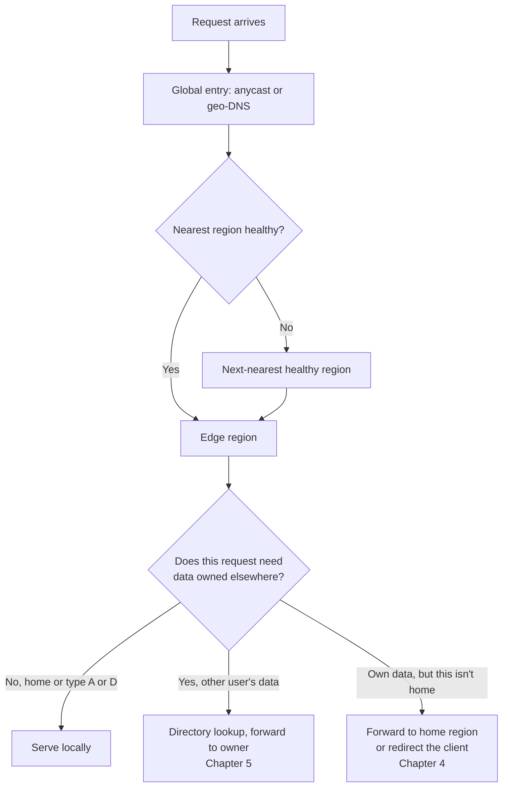
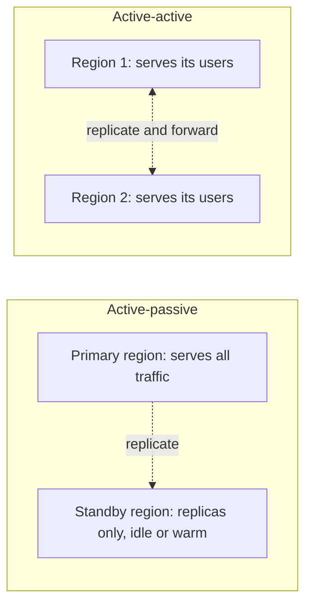
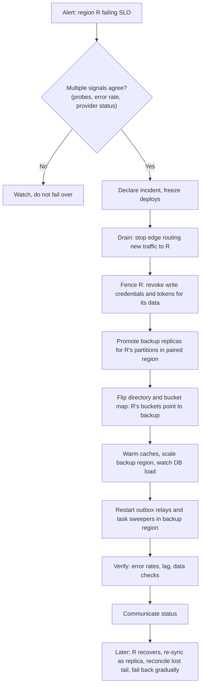
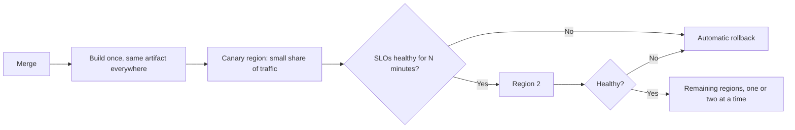
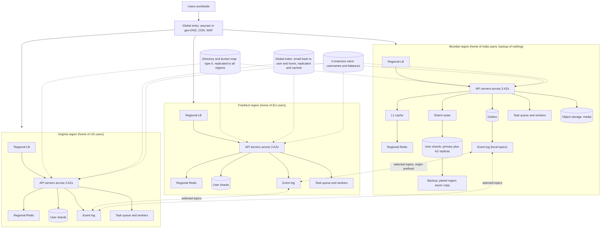
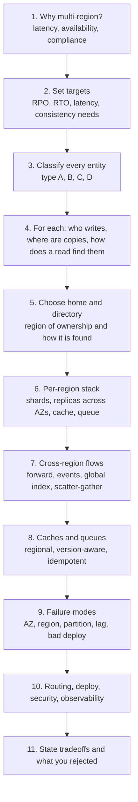

# Chapter 8: Routing, Failover, and the Full Playbook

This chapter covers how traffic reaches the right region, how the system survives failures, and how to deploy and operate it. It then assembles Chapters 1 to 7 into one design and gives you a repeatable checklist for any interview question.

## 1. Routing: getting each request to the right region

Every earlier chapter assumed "the request lands in the nearest healthy region." This section is how that happens.

### The steering tools

| Tool | How it works | Strength | Weakness |
|---|---|---|---|
| **Geo / latency-based DNS** | DNS answers with the region closest to the resolver, or with the lowest measured latency | Simple, cheap, works everywhere | Clients and resolvers cache answers (TTL), so failover is not instant. Locates the DNS resolver, not the user |
| **Anycast / global load balancer** | The same IP is announced from many regions, and the network delivers each packet to the closest one (for example, AWS Global Accelerator, Cloudflare, Google Cloud global LB) | Fast failover (seconds), no DNS caching problem, traffic enters the provider's backbone near the user | Cost, provider dependency |
| **CDN / edge compute in front** | The edge terminates TLS near the user, then routes over the private backbone | Best user latency, absorbs attacks | Another layer to configure |
| **Client-side routing** | The app holds a list of regional endpoints, remembers the home endpoint, and retries elsewhere on failure | Failover without waiting for DNS | Needs client logic, and old app versions linger |
| **Service mesh / internal routing** | Edge region forwards to the home region over mTLS | Used for the forwarding in Chapters 4 and 5 | Operational complexity |

A common production stack: **anycast or global LB at the front, geo-DNS as a backup path, and client retry logic as a third line.**

### The routing decision

Two layers of routing exist and people confuse them:

1. **Edge routing** picks the region **nearest and healthy** (geo-DNS, anycast). It cares about the user's location.
2. **Data routing** picks the region that **owns the data** (directory or bucket map). It cares about the data's home.

For most requests these match. When they don't (a traveler, a cross-user read), the extra hop from Chapters 4 and 5 applies.

### Health checks: the most dangerous part

Bad health checks cause more outages than they prevent.

| Practice | Why |
|---|---|
| **Check from several vantage points** | One failing probe location must not evict a healthy region |
| **Shallow check for the edge, deep check for the decision** | A deep check that touches the database can take **every** region out at once if a shared dependency blips |
| **Region-level health based on user-facing SLOs** (error rate and latency over a window), not a single ping | Avoids flapping |
| **Hysteresis** (require N consecutive failures to fail out, M successes to fail back) | Prevents oscillation |
| **Cap automatic evictions** (never auto-remove more than a fraction of capacity) | Stops a bad check from removing everything |
| **Manual override and a "drain" mode** | Operators can shift traffic deliberately |
| **Fail back slowly** | Gradual ramp (5, 25, 50, 100 percent) |

A classic disaster: the health check calls a global dependency (say, the directory service). The directory has a blip, every region's check fails, and the global LB removes all regions. The fix is to keep checks local, and to decide "fail open" (keep serving) when all checks fail at once.

---

## 2. Active-passive vs active-active

| Model | What runs in the second region | RTO | Cost | Complexity | Fits |
|---|---|---|---|---|---|
| **Backup and restore** | Nothing. Backups only | Hours | Lowest | Low | Internal tools, non-critical |
| **Pilot light** | Data replicated, compute off or minimal | Tens of minutes | Low | Low-medium | Cost-sensitive systems |
| **Warm standby** | Scaled-down full stack, ready to scale | Minutes | Medium | Medium | Many business apps |
| **Active-passive (hot)** | Full capacity, but takes no traffic | Seconds to minutes | High (idle capacity) | Medium | Strict RTO, single-writer data |
| **Active-active** | Full capacity, **serving real traffic** | Near zero for reads, seconds for writes | High but used | **Highest** | Global products, low latency, large scale |

Active-active comes in two kinds:

- **Active-active with partitioned writes (Chapter 4 geo-partitioning).** All regions serve traffic, but each record has one home. This is the practical, common form.
- **Active-active with multi-writer conflict handling (Chapter 3).** Any region writes any record, with CRDTs or consensus. Reserve this for the few data types that truly need it.

**Recommendation to say in interviews:** "Active-active at the stack level, so every region serves traffic and none sits idle. Data is partitioned by home region for conflict-free writes, with type A data replicated everywhere, and only genuinely contended data using consensus."

### Capacity: the survivor must absorb the load

If one region fails, the others take its traffic. So each region cannot run near full capacity.

| Regions | Max normal utilization per region (so that losing one is survivable) |
|---|---|
| 2 | 50% |
| 3 | about 66% |
| 4 | 75% |
| 5 | 80% |

More regions make resilience cheaper (less idle headroom per region), but add operational and data-placement complexity. Also remember that the cold-cache case from Chapter 6 needs extra headroom during transition.

---

## 3. Failure drills: what happens and what you do

Every design should answer "what if X fails?" for each of these. This table is your interview safety net.

| Failure | Blast radius | What keeps working | What degrades | Response |
|---|---|---|---|---|
| **One server or pod** | Tiny | Everything | Nothing | Load balancer ejects it |
| **One AZ** | Part of one region | The region (spread across 3 AZs) | Capacity | Autoscale, nothing to do |
| **Regional cache cluster down** | One region | Everything, slower | Latency, DB load | L1 cache, rate limit DB, shed load (Ch 6) |
| **Regional DB primary fails** | One shard in one region | Other shards, reads from replicas | Writes to that shard | In-region automatic failover to a replica in another AZ (seconds) |
| **Whole region down** | All of that region's users | Other regions' users | Home-region users need failover, type B data unavailable until promotion | Fence, promote backup, flip directory, shift traffic (Ch 4) |
| **Network partition between regions** | Cross-region features | Each region serves its own users and its local reads | Forwarded reads and writes, consensus writes on the minority side, replication lag | Timeouts, stale-if-error, circuit breakers, queue buffering (Ch 5, 6, 7) |
| **Replication lag spike** | Reads in replica regions | Everything, with stale reads | Read-your-writes, failover RPO | LSN tokens, alert on lag, lag-aware routing |
| **Directory / bucket map unavailable** | Routing of non-token requests | Requests with token claims, cached entries | New lookups | Replicated everywhere, long-lived caches, fallback to token (Ch 4) |
| **Event replication stalls** | Cross-region derived state | Core reads and writes | Feeds, invalidation, indexes lag | Store-and-forward, TTL backstops, alert on lag (Ch 7) |
| **Bad deploy** | Whatever the rollout reached | Regions not yet deployed | Affected regions | Staged rollout, automatic rollback (section 4) |
| **Bad data or deletion** | Replicated everywhere (replication spreads bugs) | Nothing is safe | Everything | Point-in-time recovery, immutable backups, delayed replica |
| **Cloud control-plane or provider-wide issue** | All regions of one provider | Data plane often continues | Scaling, deploys, new resources | Avoid depending on control-plane calls at runtime, static stability, multi-cloud only if justified |
| **Certificate or secret expiry** | Possibly all regions at once | Nothing | Everything | Automated rotation, expiry alerts, staggered rollout |
| **Dependency in one region (payment provider)** | Features using it | Others | That feature | Fallback provider, queue and retry, degrade gracefully |

### Region failover runbook

Principles behind it:

- **Static stability:** the failover must work using what is already deployed. If recovery needs a control plane that may itself be down, it isn't reliable. Pre-provision capacity and keep runbooks automated and rehearsed.
- **Fencing before promotion:** no two writers for one partition, ever.
- **Rehearse it.** Run game days where you really fail a region (or simulate it) quarterly. Untested failover is wishful thinking.
- **Decide automatic vs manual in advance.** Intra-region failover is automatic. Cross-region failover often needs a human or a high-confidence automated decision, because a false positive costs data.

---

## 4. Deploying across regions

A single bad release shouldn't hit every region at once. Regions are your blast-radius boundaries, so use them.

| Practice | Why |
|---|---|
| **Same artifact, region-specific config** | What you tested is what you ship |
| **Stagger regions** (start with a small region, or the lowest-traffic one) | Limits the damage of a bad release |
| **Progressive traffic inside each region** (canary, then percent ramp) | Catches problems early |
| **Automatic rollback on SLO breach** | Speed |
| **Feature flags as type A data** | Roll out by region, percentage, or tenant without a deploy |
| **Config changes are deployments too** | A bad config pushed globally in one second is the most common cause of global outages. Stage them like code |
| **Region-isolated control plane where possible** | A global control-plane bug shouldn't take down every region |

### Schema and version skew

During a rollout, different regions run different code versions at the same time, and events, APIs, and database schemas cross between them.

| Rule | How |
|---|---|
| **Expand, then contract** | Step 1: add new columns or fields (old code ignores them). Step 2: deploy code that writes and reads both. Step 3: backfill. Step 4: switch reads to the new form. Step 5: remove the old after all regions are done |
| **Backward and forward compatible events** | Add optional fields only. Never rename or repurpose a field. Use a schema registry with compatibility checks |
| **Tolerant readers** | Consumers ignore unknown fields |
| **Versioned APIs between regions** | A region at version N must talk to a region at N-1 |
| **Replica-safe migrations** | Don't ship code needing a column that a lagging replica doesn't have yet (Chapter 2) |

---

## 5. Security across regions

| Area | Practice |
|---|---|
| **Inter-region traffic** | Private backbone or VPN, **mutual TLS** between services, no public endpoints for internal APIs |
| **Authentication between regions** | Service identities (SPIFFE or workload identity), short-lived credentials |
| **Authorization** | Least privilege. A region can read and write only what it must: its own data plus the narrow cross-region APIs. Compromise of one region must not expose all data |
| **Encryption** | In transit (TLS everywhere) and at rest. Use **per-region keys** (KMS keys that stay in the region), so residency holds and a key compromise has a limited radius |
| **User tokens** | Signed tokens verified with public keys distributed to all regions (a small type A dataset). Rotate keys with overlap |
| **Secrets** | Per-region secret stores, rotation automated and staggered |
| **Data residency enforcement** | Classify data, enforce in code and at the platform level (deny policies on cross-region replication for restricted buckets and topics), and audit |
| **Backups** | Encrypted, immutable, and stored within the allowed jurisdiction |
| **DDoS and abuse** | Rate limit at the edge, per region and per user. A global limit needs a shared counter (CRDT or pre-split quota, Chapter 3) |
| **Audit logs** | Per-region, tamper-evident, and shipped to a central store in a compliant form |

---

## 6. Observability

You cannot run what you can't see, and multi-region adds new things to see.

| Signal | What to track | Why it matters |
|---|---|---|
| **Per-region SLIs** | Availability, latency (p50, p99), error rate, saturation | Spots one region degrading while others are fine |
| **User-perspective probes** | Synthetic requests from each geography to each region | Detects routing and network issues that internal metrics miss |
| **Replication lag** | DB replication delay, per replica and per region pair | Drives read-your-writes bugs, RPO, and failover safety |
| **Event lag** | Age of the oldest unprocessed event per consumer group, mirror lag per topic | Feed staleness, invalidation delay |
| **Cross-region call rate and latency** | Count, p99, error rate per region pair | Finds accidental hot-path cross-region calls |
| **Cache hit ratio** | Per region, per key class | A drop warns of stampedes and cold caches |
| **Directory staleness** | Version and age of the directory and bucket map per region | Detects mis-routing risk |
| **Queue depth and age, DLQ size** | Per region | Backlog and poison messages |
| **Capacity headroom** | Utilization vs the survivable maximum | Tells you if a region loss is survivable right now |
| **Data health** | Reconciliation checks between source and derived data | Catches silent divergence |

Tracing: propagate a trace ID and a region tag through every hop, including events. A request that touches three regions should be one trace.

Alerting: alert on **symptoms** (user-visible SLO burn) and on **leading indicators** (lag, headroom). Don't page on every internal blip.

---

## 7. The full SnapShare design, assembled

Here is the whole system with every pattern in place.

### Which pattern handles which data

| Data | Type | Pattern | Chapter |
|---|---|---|---|
| Filter list, config, feature flags | A | One writer, replicas in every region, regional cache | 2 |
| Directory and bucket map, token public keys | A | Same, with versioned updates and a long-lived cache | 2, 4 |
| User profile, photos metadata, comments on own photos | B | Home region, in-region shards and replicas, paired-region backup | 4 |
| Media files | B | Home region object storage plus CDN with origin shield | 4, 6 |
| Comment on someone else's photo | B (owned by photo's home) | Write at the owner, events for pointers | 5 |
| Home feed | D | Local read model built from events, push and pull hybrid | 5 |
| Likes on a post | B per post, or C | Count at the post's home, or CRDT counter | 3, 5 |
| Username uniqueness | C | Hash-partitioned registry or consensus | 3 |
| Login by email | Index | Global index to home region | 5 |
| Credits, balances | C | Per-account owner plus saga, or consensus | 3, 5 |
| Flash-sale stock | C | Pre-split allocation | 3 |
| Sessions | D | Stateless tokens, denylist events | 6, 7 |
| Leaderboards, global totals | D | Regional partials merged, precomputed | 5 |
| Cache | D | Regional, version-aware invalidation | 6 |
| Background jobs | work | Regional queues, task state in DB | 7 |
| Analytics | D | CDC to a separate plane, anonymized at the border | 5 |

### Read and write walk-through

| Scenario | Flow |
|---|---|
| **Indian user views own feed** | Edge to Mumbai, the feed read model in Mumbai Redis, about 10 ms |
| **EU user posts a photo** | Frankfurt API, write to EU shard plus outbox, media to Frankfurt storage, event mirrored to followers' regions, feeds updated there |
| **EU user comments on an Indian user's photo** | Frankfurt API, directory lookup, forward to Mumbai, write there with an idempotency key, outbox event, pointer updated in Frankfurt asynchronously |
| **Traveling Indian user in London** | Edge Frankfurt, token says home is Mumbai, forwarded and cached briefly, media from CDN, writes go to Mumbai |
| **Mumbai region fails** | Fence, promote Singapore's replica, flip directory, shift traffic, warm caches, restart relays and sweepers |
| **Global username check** | Hash to a registry partition, one cross-region call at signup only |

---

## 8. The universal checklist

Use these steps, in order, for any "make it multi-region" design question.

### The one-page table to fill in during an interview

| Entity | Type | Writer | Copies | Read path | Consistency | Failure behavior |
|---|---|---|---|---|---|---|
| (fill in each) | A / B / C / D | Home / any / owner | Replicas / paired backup / none | Local / forward / index | Strong / eventual / bounded | Stale-if-error / fail over / refuse |

Filling this table for four or five entities is most of the interview.

### Questions to ask the interviewer (multi-region specific)

1. What is the primary driver: latency, availability, or compliance?
2. Where are the users? Is the traffic concentrated or truly global?
3. What are the RPO and RTO? Can we lose a few seconds of writes in a region disaster?
4. Which data must never be stale or duplicated (money, inventory, uniqueness)?
5. Are there residency requirements that restrict where data and backups may live?
6. How much do users interact across regions (global social graph vs mostly local)?
7. What is the read-to-write ratio, and which operations are latency sensitive?

---

## 9. The checklist applied to common interview systems

### Chat app (WhatsApp-style)

| Entity | Type | Decision |
|---|---|---|
| User accounts, contacts | B | Home region per user, directory replicated |
| Messages | B | Stored at **each participant's home** (or the conversation's home); the sender's region writes to the recipient's region through an event with an idempotency key |
| Delivery and read receipts | D / events | Events, idempotent, per-message version |
| Presence | D | CRDT or LWW, regional, heartbeat-based, approximate |
| Active connections | D | WebSockets terminate in the nearest region, and a connection registry maps user to region for routing messages |
| Message ordering | Per conversation | Single sequencer per conversation (its home region) to assign sequence numbers |
| Group chats spanning regions | C-ish | Conversation home region orders messages, and members' regions get copies via events |
| Media | B | Home storage plus CDN, signed URLs |

Key insight: **ordering per conversation is solved by giving each conversation one owner.**

### E-commerce

| Entity | Type | Decision |
|---|---|---|
| Product catalog, prices | A | One writer, replicas everywhere, cached, CDN |
| Cart | B or CRDT | Home region for logged-in users, or an OR-Set CRDT for add-wins carts |
| Inventory | C | Pre-split across regions for hot items, a consensus store for scarce items. Reservations with expiry |
| Orders | B | Home region of the buyer (or of the fulfillment warehouse region), saga across inventory, payment, and shipping |
| Payments | C | Single provider-facing owner per payment, idempotency keys everywhere |
| Search and recommendations | D | Regional indexes fed by events |

### Ride-sharing

| Entity | Type | Decision |
|---|---|---|
| Driver and rider location | B / D | **Geo-partition by city or geographic cell**, not by user. A trip is local to a city, so region equals the city's region |
| Matching | B | Done within the city's region (a single owner per city or cell), avoiding cross-region coordination |
| Trip state | B | Owned by the trip's city region |
| Pricing, surge | A / D | Computed per city, config replicated |
| Payments, accounts | C | Per-account owner plus sagas |
| Users who travel | | The user directory is global (type A), and trips use the local city's region |

Key insight: **choose the partition key by the access pattern (city), not by the user's home.**

### Payments / banking

| Entity | Type | Decision |
|---|---|---|
| Accounts and ledger | C | Strong consistency: a single owner per account with synchronous replication to a nearby region, or a consensus database. RPO zero |
| Transfers across accounts | C | Saga or 2PC with idempotency keys and a double-entry ledger |
| Idempotency records | C | Must be in the same consistency scope as the payment |
| Fraud signals | D | Streamed, approximate, local plus global aggregates |
| Compliance data | B | Strict residency |

Key insight: **correctness outranks latency, so pay the cross-region round trip and accept lower availability on partition.**

### Other quick mappings

| System | Core multi-region idea |
|---|---|
| Video streaming | Metadata type A, media on CDN with an origin shield, per-region encoding pipelines, watch history type B |
| URL shortener | Reads: replicated mapping everywhere (type A, written once). Writes: unique code generation partitioned by region prefix, which avoids collisions with no coordination |
| Social feed / Twitter | Chapters 5 and 7: events, regional fan-out, a celebrity pull hybrid |
| Collaborative docs | Per-document home plus a CRDT or operational transform for multi-writer editing |
| Distributed file storage | Object home per owner, cross-region replication policies per bucket, versioned objects |
| Leaderboards / gaming | Regional play servers, partial aggregates merged, a global top-N cache |

---

## 10. Interview delivery template

### The five-minute structure

1. **Frame (30 s):** "The drivers here are X, Y, Z. Targets: RPO ..., RTO ..., latency ..."
2. **Classify data (1 min):** the table of entities and types A, B, C, D.
3. **Architecture (1.5 min):** regions as full stacks, home region plus directory, data replicated by type, the routing layer.
4. **Key flows (1.5 min):** one read, one write, one cross-region interaction, using the correct pattern for each.
5. **Failure and tradeoffs (1 min):** region failure, partition behavior (CAP choice), what was rejected and why.
6. **Operations (30 s):** staged rollout, observability, headroom.

### Phrases that signal depth

- "I would give each record one owner to avoid conflicts, instead of resolving conflicts after the fact."
- "Merge rules handle overwrites and counters, but uniqueness and invariants need coordination."
- "Reads stay in-region, writes go to the owner, and everything else travels as events."
- "A replica is not a backup."
- "At-least-once delivery plus idempotent consumers."
- "Fence before promoting."
- "Each request path should have at most one cross-region hop."
- "Derived data is rebuildable, so only the source of truth needs the strongest guarantees."
- "During a partition, the minority side refuses writes for consensus data and keeps serving reads."

### Common follow-up questions and answers

| Question | Strong answer |
|---|---|
| "Why not multi-master everywhere?" | Conflicts. Only data with natural merge semantics suits it. Everything else gets one owner per record, with consensus for the few invariants |
| "What if the user's home region is down?" | Fail over to the paired region by fencing, promoting the replica, and flipping the directory. Mention RPO from async lag |
| "How do you handle a user traveling?" | Forward to home, cache briefly, CDN for media. Don't migrate for a trip |
| "How do you keep the global username unique?" | Hash-partitioned registry or consensus. It costs one cross-region trip at signup only |
| "How do you avoid stale caches?" | Short TTL, version-aware event invalidation, tombstones against stale refill |
| "What if events arrive twice or out of order?" | Idempotent consumers, dedup by event ID, version compare, per-key partitioning |
| "How do you test this?" | Game days with real or simulated region failures, chaos tests for partitions and lag, load tests for the cold-cache case, reconciliation jobs |
| "How does this change with 10 regions?" | Hub-and-spoke replication, more careful placement of replicas, tiered regions (full and edge-only), cell-based architecture |
| "How would you migrate an existing single-region system?" | Stage it. Add read replicas and regional caches first (type A), then CDN, then regional stacks for a subset of users, then geo-partition user data with a directory and a migration tool |

---

## 11. Common pitfalls (the whole course in one list)

| Pitfall | Chapter | Fix |
|---|---|---|
| "Make the DB multi-region" as a single decision | 1 | Classify each entity |
| Synchronous cross-region calls on the hot path | 5 | One owner, local reads, events |
| Treating all data as multi-writer | 3 | Per-record owners |
| LWW on money or counters | 3 | CRDT, owner, or consensus |
| One global cache or queue | 6, 7 | Regional, independent |
| Dual writes to DB and broker | 7 | Outbox or CDC |
| Assuming exactly-once or global ordering | 7 | Idempotency, per-key order, versions |
| Replica treated as backup | 4 | Point-in-time recovery and immutable backups |
| Failover without fencing | 2, 4 | Epoch or fencing tokens |
| No capacity headroom | 8 | Size for N-1 plus cold caches |
| Health check that depends on global dependencies | 8 | Local checks, fail-open, hysteresis |
| Global config push | 8 | Staged config rollout |
| Personal data in events, caches, or indexes | 5, 6, 7 | Thin events, field-level cacheability, hashed indexes |
| Never rehearsing failover | 8 | Game days |

---

## 12. The whole course on one page

| Chapter | Core idea | One line to remember |
|---|---|---|
| 1. Mental model | Classify data into A (global reference), B (user-owned), C (contended), D (derived) | Don't ask "how is the DB multi-region?" Ask who writes, where the copies are, how a read finds them |
| 2. Same data, one writer | Leader in a home region, async replicas everywhere | Reads local, writes to the leader, fix read-your-writes with an LSN token |
| 3. Same data, many writers | Avoid conflicts (owner per record), else CRDT, LWW, or consensus, pre-split for hot resources | Merge rules fix overwrites. Uniqueness needs coordination |
| 4. Different data per region | Geo-partition by home region, a directory, in-region shards and replicas, paired-region backup | The directory is the switch for routing and failover |
| 5. Cross-region queries | Forward to the owner, events, regional read models, global index, partial aggregates, sagas | Zero or one cross-region hop per request |
| 6. Caches | Regional, independent, event-invalidated with versions | Stale-if-error, single-flight, tombstones |
| 7. Queues and events | Regional task queues, outbox, replicated event logs, idempotent consumers | At-least-once plus idempotency equals effectively-once |
| 8. Routing, failover, ops | Anycast or geo-DNS, active-active with partitioned writes, staged deploys, headroom, rehearsal | Design for N-1, fence before promote, rehearse |

---

## 13. How to practice from here

The fastest way to lock this in is to apply the checklist to systems you haven't seen it used on. A few ways to continue:

1. **Pick any system** (chat app, ride-sharing, e-commerce checkout, a payments ledger, a video platform) and I'll walk through a complete multi-region design for it, using the table from section 8 and the interview structure from section 10.
2. **Mock interview style:** give me a prompt like "Design WhatsApp for global users" and answer it yourself. I'll review your data classification, flows, and failure handling against this playbook and point out gaps.
3. **Deep dive on a weak spot:** if any piece (CRDTs, consensus placement, the outbox, failover, cache invalidation races) still feels shaky, name it and I'll redo it with a different worked example.
4. **Connect to your other topics:** the distributed consensus course, the SQS worker pattern, and the file upload design each have multi-region extensions. For example, how a lease-based task worker behaves across regions, or how a presigned-URL upload design changes when users upload from far away.

Tell me which direction you want.
