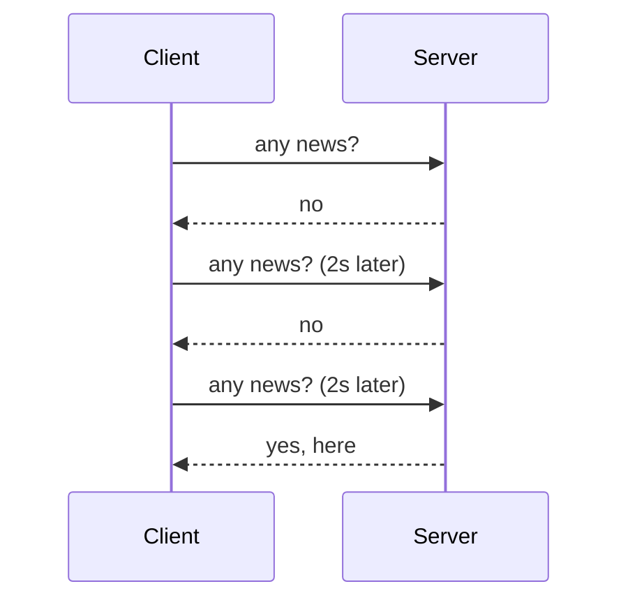
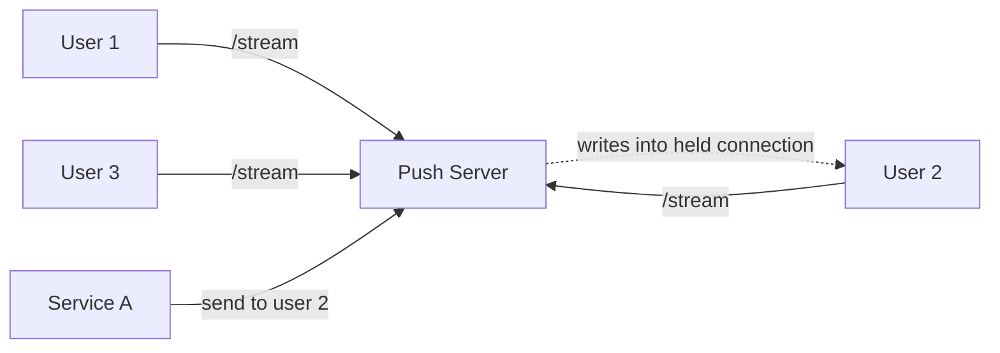
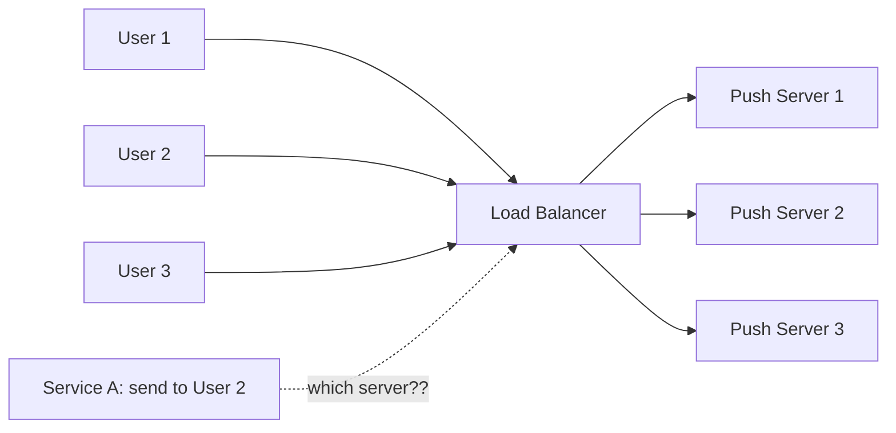

# Real-Time Push Service: Course Outline

I'll go one chapter at a time. Say **"next"** to advance.

| # | Chapter | The question it answers |
|---|---|---|
| **1** | **Why push exists, and the first working server** | What is a persistent connection, and why does it change everything? |
| 2 | The connection registry and routing | A user is connected to *some* server. Which one? |
| 3 | Pattern A: broadcast (pub/sub) | Same message to everyone |
| 4 | Pattern B: per-user events | One message to one user, with many servers |
| 5 | Pattern C: groups | Group chat, shared docs, and how to avoid a million topics |
| 6 | Delivery guarantees | Best-effort vs durable, ack, sequence numbers, resume |
| 7 | Heartbeats, dead connections, presence | What if the user silently vanishes? |
| 8 | Failures | Push server crash, reconnect storms, broker failure |
| 9 | Retries, duplicates, ordering, idempotency | Making delivery safe |
| 10 | Storage choices | What to store, where, and which DB |
| 11 | Scale | Millions of connections, slow consumers, backpressure |
| 12 | Decision framework | Requirements → design, with interview walkthroughs |

---

# Chapter 1: Why push exists, and the first working server

## 1.1 The problem

HTTP is a **request → response** protocol. The client always speaks first. The server can never say "hey, something just happened" on its own.

But many products need exactly that:

- A cricket score changes. Users should see it now.
- A friend sends you a chat message.
- A teammate moves a shape on a shared canvas.
- Your cab driver arrives.

The question is: **how does the server get information to the client at the moment it happens?**

## 1.2 Evolution of attempts

**Attempt 1: Short polling.** The client asks every N seconds, "anything new?"



- Latency is up to N seconds.
- Most requests are wasted. With 1M users polling every 2s, that's 500K requests/sec, nearly all returning "no".
- Cutting N lowers latency but multiplies the waste.

**Attempt 2: Long polling.** The client asks, and the server **holds the request open** until it has something (or a timeout), then responds. The client immediately asks again.

- Latency is near real time and no empty responses are wasted.
- But every message costs a full new HTTP request, with headers, auth, and a new routing decision. It is awkward for high-frequency messages.

**Attempt 3: Keep one connection open for the whole session.** This is the real insight. Don't re-ask. Open **one long-lived connection** and let the server write into it whenever it wants. There are two standard ways to do this.

## 1.3 SSE vs WebSocket

| | **SSE (Server-Sent Events)** | **WebSocket** |
|---|---|---|
| Direction | Server → client only | Bidirectional |
| Protocol | Plain HTTP (`text/event-stream`) | HTTP upgrade, then its own framing |
| Reconnect | **Built-in** auto-reconnect | You build it |
| Resume | **Built-in** `Last-Event-ID` header | You build it |
| Data | Text only | Text and binary |
| Proxies/LB/CDN | Works like normal HTTP | Needs upgrade support |
| Client → server | Separate normal HTTP calls | Same connection |
| Browser connection limit | ~6 per domain on HTTP/1.1 (fine on HTTP/2) | Not an issue |

**How to choose, in plain words:**

- Does the client mostly *listen* (notifications, scores, feeds, progress bars, dashboards)? Use **SSE**. It's simpler and its resume semantics are already designed for you.
- Does the client talk back at high frequency with low latency (chat typing, multiplayer games, collaborative cursors)? Use **WebSocket**.
- Everything else in this course (routing, pub/sub, durability) is **identical for both**. Only the last hop to the client differs. So from here I'll just say "connection".

## 1.4 The first working version: one server

Build the simplest thing that works.



Inside the server, there is **one in-memory map**:

```
connections: Map<userId, Connection>
```

```java
// Spring SSE, minimal
Map<String, SseEmitter> connections = new ConcurrentHashMap<>();

@GetMapping("/stream")
SseEmitter stream(@RequestHeader("X-User-Id") String userId) {
    SseEmitter emitter = new SseEmitter(0L);            // no timeout
    connections.put(userId, emitter);
    emitter.onCompletion(() -> connections.remove(userId));
    emitter.onError(e -> connections.remove(userId));
    return emitter;
}

@PostMapping("/internal/send")                           // Service A calls this
void send(String userId, String payload) throws IOException {
    SseEmitter e = connections.get(userId);
    if (e != null) e.send(payload);                      // push through the open connection
}
```

That's the whole idea: **a map from user to open socket, plus a method that writes into it.** It works for 1 server.

## 1.5 The key mental shift: these servers are *stateful*

Your normal API servers are **stateless**. Any request can go to any server, and servers can be killed and replaced freely.

A push server is different. The thing that makes it valuable, **the open connection to user 2**, lives *only in that one server's memory*.

| Normal API server | Push server |
|---|---|
| Request is short, done in ms | Connection lives minutes to hours |
| Any server can answer any request | Only **one specific server** can reach user 2 right now |
| Kill it, nobody notices | Kill it, all its users are disconnected |
| Scale by adding servers behind LB | Adding servers creates a **routing problem** |

**Everything in the rest of this course is a consequence of this one fact.**

## 1.6 Where the first version breaks

Now scale to the real world. One server can hold maybe 50K to 500K idle connections (it depends on memory and tuning), so you need N servers.



The load balancer placed User 2 on, say, Push Server 2 when they connected. Later, Service A wants to message User 2.

**Problems:**

1. Service A doesn't know that User 2 is on Server 2.
2. If Service A sends through the LB, the LB picks a random server, probably the wrong one. That server's map has no entry for User 2, so the message is lost.
3. For a broadcast ("send to everyone"), Service A would have to call every server itself. It would need to know the list of servers and handle servers joining and leaving.
4. Service A shouldn't need to care about any of this. It should just say "deliver this to User 2" and move on.

**This is the central design problem of a push service:**

> Decouple *who produces a message* from *which server holds the connection*.

## 1.7 Preview of the toolbox

The remaining chapters build solutions from five ingredients. Let me name them now so nothing is a surprise.

| Ingredient | What it does | Chapter |
|---|---|---|
| **Connection registry** | Records "user X is on server Y" | 2 |
| **Pub/Sub** | Fans one message out to many servers, fire-and-forget | 3 |
| **Durable log or queue (Kafka, SQS)** | Remembers messages so they can be replayed or retried | 4, 6 |
| **Per-user inbox / sequence numbers** | Lets clients resume after a disconnect without loss | 6 |
| **Heartbeats** | Detects dead connections | 7 |

And one question you'll learn to ask for **every** feature:

> *"If this user is offline, or this server dies, or this message arrives twice: what should happen?"*

The answer to that question, **best-effort or durable**, is what decides your architecture.

## 1.8 Chapter 1 summary

- Push needs a **long-lived connection**; polling is wasteful and slow.
- **SSE** for listen-only, **WebSocket** for chatty two-way. Everything else in the design is the same.
- A push server is **stateful**: the open connection exists in one server's memory only.
- Multiple servers create the core problem: **producers don't know which server holds the user**.
- The rest of the course is: how to route, fan out, and survive failure without coupling producers to servers.

---

**Next: Chapter 2, the connection registry and routing.** I'll cover how the LB should connect users to servers, what to store about each connection, and the two routing strategies (look up where the user is, vs. let every server filter). Say **"next"** when ready.
