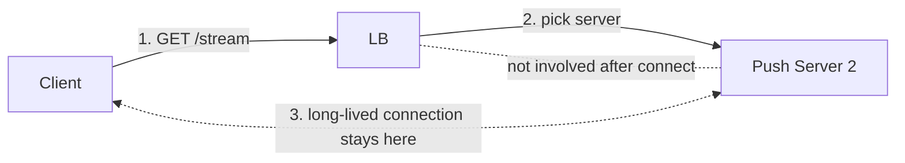
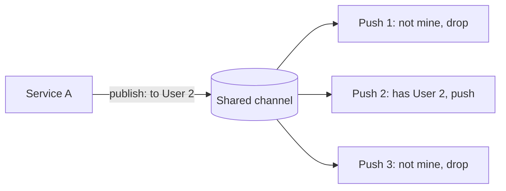
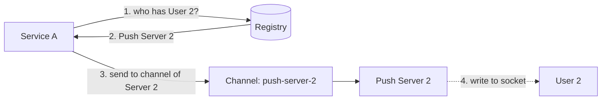
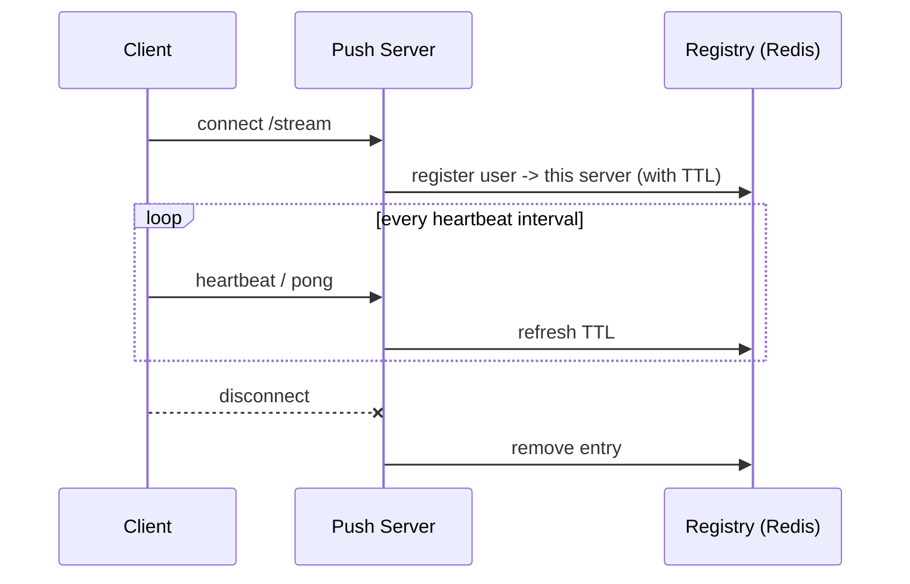

# Chapter 2: The connection registry and routing

## 2.1 Where we left off

We have N stateful push servers. Each holds some users' connections in its own memory. Service A wants to say "deliver to User 2", but doesn't know which server holds User 2.

There are really **two separate routing problems**, and people often mix them up:

| | Problem | Who solves it |
|---|---|---|
| **Inbound routing** | When a user connects, which push server gets them? | Load balancer |
| **Outbound routing** | When a message is produced, which push server holds the target user? | Registry or pub/sub (this chapter) |

## 2.2 Inbound routing: how users reach a push server

The user's `/stream` request hits the load balancer once, at connect time. The LB picks a server, and from then on the connection is pinned to that server for its whole life, because TCP is a single pipe.



**L4 vs L7 here:**

| | L4 (TCP) | L7 (HTTP) |
|---|---|---|
| Sees | IP and port only | Headers, path, cookies |
| Cost per connection | Very low | Higher (parses HTTP) |
| Can route by path/header | No | Yes |
| Can terminate TLS | Passthrough or terminate | Yes |
| Typical use | Huge connection counts, raw WebSocket | Auth checks, path routing, SSE/WS upgrade |

Neither is "right". L7 is common because you often want to authenticate at the edge and route `/stream` to the push fleet and everything else to API servers. At very large scale, people put L4 in front for raw throughput.

**Balancing algorithm:** use **least connections**, not round-robin. Connections are long-lived and uneven, so round-robin can pile up load on old servers. Least-connections keeps the number of open connections roughly even.

**Do you need sticky sessions?** Not for the first connect, because any server can accept any user. The "stickiness" is inherent: the connection *is* the stickiness. You'd only need stickiness for something like long polling fallback, where each poll is a fresh request.

**Important consequence:** the LB is not on the push path. Messages flow server → client over the already-open connection. This is why one LB can front millions of users. It only sees connection *setup*.

## 2.3 What a push server holds locally

Each push server keeps **in memory only**:

```
localConnections: Map<connectionId, {
    userId, deviceId, socket/emitter,
    connectedAt, lastHeartbeatAt, lastAckedSeq
}>
userIndex: Map<userId, Set<connectionId>>   // a user can have many devices/tabs
```

Note: **a user can have multiple connections** (phone, laptop, two tabs). So the key is never just `userId`. Design for a *set* of connections from day one, or you'll rewrite it later.

This local state is only a cache of reality. It's lost if the server dies, and that's fine, because clients reconnect (Chapter 8).

## 2.4 Outbound routing: two strategies

Service A says: "deliver to User 2". Two ways to get it to the right server.

### Strategy 1: Broadcast-and-filter (no registry)

Every push server subscribes to **one shared channel**. Service A publishes the message. **Every** server receives it, checks its local map, and only the server holding User 2 acts on it. Everyone else drops it.



- Simple. No registry, no state to keep consistent.
- Cost: every server processes **every** message. With 100 servers and 100K msgs/sec, each server ingests 100K msgs/sec to deliver about 1K. Wasteful, and it **does not scale** beyond small fleets.
- Good for: small fleets, or genuinely global messages (Chapter 3).

### Strategy 2: Registry lookup + targeted delivery

Keep a shared **connection registry**: `userId → which server(s) hold this user`. Now you only touch the one right server.



Each push server has its **own inbox**, such as a pub/sub channel or topic named after the server (`push-server-2`). A router looks up the registry, then sends only to that inbox.

- Each server only receives messages for its own users. Load scales with *its users*, not with total traffic.
- Cost: you must keep the registry accurate (next sections), and you have an extra lookup per message.

**Rule of thumb:**

| Scenario | Strategy |
|---|---|
| Message for *everyone* | Broadcast (Strategy 1 shape, Chapter 3) |
| Message for *one user* | Registry lookup (Strategy 2, Chapter 4) |
| Message for *a group* | Hybrid (Chapter 5) |

## 2.5 What the registry stores

```
Key:    conn:user:{userId}
Value:  set / hash of { deviceId/connId → serverId }
TTL:    ~ 2-3x heartbeat interval, refreshed on each heartbeat
```

Example in Redis:

```
HSET conn:user:42  conn-a1 push-server-2   conn-b7 push-server-5
EXPIRE conn:user:42 90
```

That says user 42 has two connections, one on server 2 and one on server 5.

**Lifecycle:**



**Two ways an entry disappears:**

1. **Clean disconnect:** the server explicitly deletes it.
2. **Crash or silent death:** nobody deletes it. The **TTL expires** and the entry vanishes by itself. This is why the TTL matters: it is your self-healing mechanism.

## 2.6 The registry will sometimes be wrong, so design for that

Between a crash and TTL expiry, the registry **points to a dead server**. Between a client reconnecting elsewhere and the update landing, it can point to the **old** server.

So:

> **The registry is a hint, not truth.** Treat "delivered to the registry's server" as *best effort*, and never as proof that the user got the message.

Consequences you must remember:

- A message sent to a stale server is lost unless you add durability (Chapter 6).
- Never use the registry to decide "is the user online?" for anything critical. It's accurate to within the TTL window.

This is the exact reason Chapter 6 exists: **the real guarantee comes from the client being able to ask "what did I miss?", not from perfect routing.**

## 2.7 Which store for the registry?

Requirements: very fast reads and writes, TTLs, small values, tolerates loss (it self-rebuilds as clients reconnect).

| Option | Fit |
|---|---|
| **Redis** (or Redis Cluster) | The usual answer: TTL, hashes, sub-ms latency |
| Memcached | Works, but no sets/hashes |
| DynamoDB with TTL | Good if you're all-AWS and want fully managed; slower per op |
| ZooKeeper/etcd | Overkill and wrong shape for millions of short-lived entries |
| SQL | Too slow and heavy for this write rate |

The registry holds **ephemeral data**. If Redis dies, you lose nothing permanent, because connections re-register as clients reconnect. That is why an in-memory store is acceptable here.

## 2.8 Should the push server do business logic?

**No. Keep it thin.**

| Push server does | Push server does NOT do |
|---|---|
| Accept and authenticate connections | Business rules (who should be notified) |
| Maintain connection maps | Compute the message content |
| Heartbeat, register in registry | Write business data |
| Consume messages and write to sockets | Call other services synchronously in the push path |
| Apply simple per-connection filters | Long-running work |

**Why:** a push server's job is to hold huge numbers of idle connections cheaply. If you add heavy logic, a slow handler stalls delivery for thousands of users sharing that process. And when you deploy business-logic changes, you'd restart the server and drop every connection. Keep the connection tier **dumb, stable, rarely deployed**. Put intelligence upstream, where "Service A decides who gets what", and keep the push tier a delivery pipe.

**Does it connect to a DB?** Only for small, specific things:

- Authenticate the token (cache this, don't hit a DB per connect).
- Possibly read a per-user inbox for catch-up on reconnect (Chapter 6).

Not for business operations. We'll cover storage in Chapter 10.

## 2.9 Authentication at connect time

Connection setup is the only moment you can easily authenticate:

- The client sends a token (header, cookie, or query param for WebSocket in browsers).
- The server (or the L7 LB) validates it **once**, then attaches `userId` to the connection.
- The connection stays authenticated for its life, so you need a plan for **token expiry**: either close and reconnect with a fresh token, or let the client send a refresh message over the connection.

Don't skip this. An unauthenticated push server lets anyone subscribe to any user's stream.

## 2.10 Chapter 2 summary

| Concept | Remember as |
|---|---|
| LB's job | Place the user **once** at connect; least-connections; then it steps out |
| Local state | `connId → socket`, plus a `userId → set(connId)` index. Multiple devices per user |
| Registry | `userId → {connId → serverId}` in Redis with TTL, refreshed by heartbeats |
| TTL | The self-healing mechanism for crashed servers |
| Registry accuracy | A **hint**, not truth, so you need durability for guarantees |
| Broadcast-and-filter | Simple, wasteful, only fine for small fleets or global messages |
| Registry lookup | Targeted, scales, costs a lookup and some staleness |
| Push server scope | Thin: connections and delivery only, no business logic |

---

**Next: Chapter 3, Pattern A: broadcast.** Global data (live scores, top-100 leaderboard, announcements): why pub/sub fits perfectly here, why Kafka is the wrong tool for this one, and what to do about the "slow new joiner" who connects mid-stream. Say **"next"** when ready.
