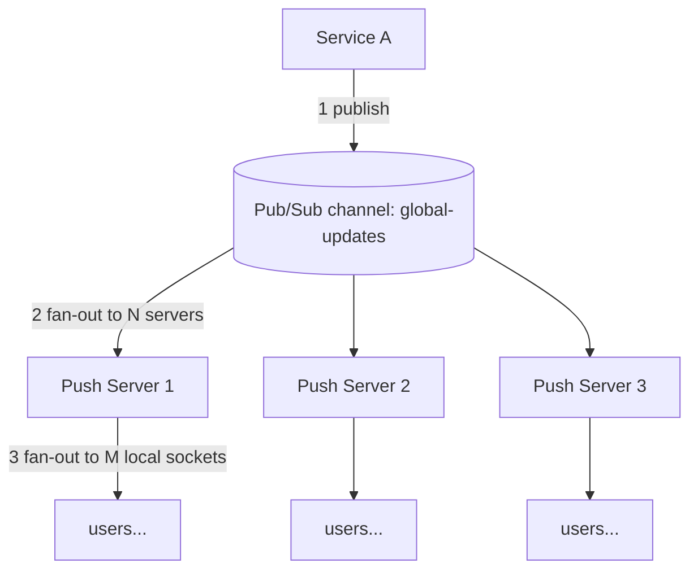
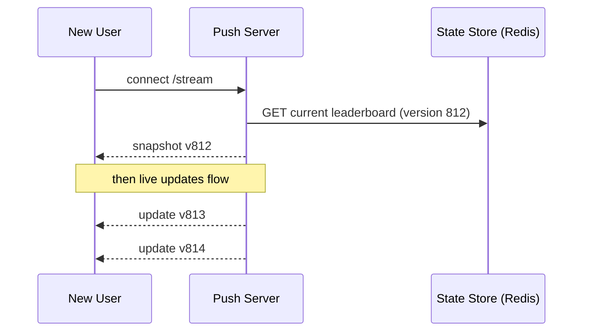

# Chapter 3: Pattern A, Broadcast

## 3.1 The scenario

One message, **every connected user** should see it:

- Live score update
- Global leaderboard top 100
- "Maintenance in 10 minutes" banner
- Stock price tick for a market index

Nobody here is special. The audience is "all of them", so we don't need the registry at all. We only need to get the message **to every push server**, and each server then writes it to all of its own sockets.

## 3.2 The two-level fan-out

This is the core shape of broadcast. Learn it once and it reappears in every pattern.



| Level | Who does it | Fan-out size |
|---|---|---|
| Level 1 | The broker copies the message to every subscribed push server | N (number of servers, tens to hundreds) |
| Level 2 | Each push server writes to every local connection | M (connections per server, up to 100K+) |

**Why this is the key insight:** the broker never knows about the millions of end users. It only knows about N servers. The expensive per-user fan-out happens **inside** each server, in parallel across the fleet. This is how you reach 10M users without a 10M-subscriber broker.

## 3.3 Why pub/sub fits, and why Kafka is the wrong default here

Ask the three questions from Chapter 1 about a live score:

| Question | Answer for live score |
|---|---|
| User offline when it's sent? | They'll fetch current state when they return. The old score is useless anyway |
| Server dies mid-delivery? | The next update (seconds later) supersedes it |
| Message arrives twice? | Harmless, same score |

So **loss is tolerable**, because the *next* message overwrites the meaning of this one. The data is "latest value wins", and there's no need to replay history.

That points to a **fire-and-forget pub/sub**.

| | Pub/Sub (Redis Pub/Sub, NATS, SNS, etc.) | Kafka |
|---|---|---|
| Delivery to subscribers | Pushes to all *currently* connected subscribers | Consumers pull from a stored log |
| Stores messages? | No (or very short) | Yes, retention-based |
| Every subscriber gets every message? | **Yes, natural** | Only if each server has its **own consumer group** |
| Per-subscriber offset tracking | None | Yes (cost: offset commits, group coordination) |
| Latency | Very low | Low, but batching adds some |
| Fits broadcast? | Natural fit | Possible, but you pay for durability you don't need |

**The Kafka mismatch in detail:** Kafka's default consumer-group model is *competing consumers*: each message goes to **one** member of the group (that's for work distribution). For broadcast you need **every** server to get **every** message, which means giving each push server a **unique consumer group id**.

Then:

- Every server tracks offsets for a stream it doesn't need to replay.
- Servers are ephemeral (autoscaling), so you accumulate dead consumer groups that clutter the cluster.
- A restarted server resumes from its old offset and receives a **backlog of stale scores**, which is the opposite of what you want.

You *can* make it work, with a fresh random group id per boot and `auto.offset.reset=latest`, but then you're using Kafka as a pub/sub and ignoring everything it's good at.

**When Kafka *is* right for broadcast:** if the broadcast must be durable and ordered, such as an audit-grade announcement feed or a stream the same servers must be able to replay after restarts. That's the exception.

## 3.4 The new-joiner problem (this is what makes broadcast tricky)

Pub/sub only delivers messages published **after** you subscribe. So:

- User connects at 3:00:07. The last leaderboard update was published at 3:00:05.
- They sit with a blank leaderboard until the next update (maybe 30 seconds away).

**Fix: snapshot, then stream.** Keep the current state somewhere readable (usually Redis or the DB), and on connect send it first.



### The race hidden in that diagram

What if update v813 is published **between** "I read the snapshot" and "I start forwarding live updates"? You'd miss it.

Fix with **versions** and the right ordering:

1. Push server **is already subscribed** to the channel at boot (so it always sees live updates).
2. When a user connects, **start buffering** live updates for that connection.
3. Read the snapshot (it has version `v`).
4. Send the snapshot, then flush buffered updates with `version > v`, and discard the rest.
5. From then on, forward live updates directly.

```java
void onConnect(Connection c) {
    c.startBuffering();                          // live updates go to a buffer
    Snapshot snap = stateStore.get("leaderboard");   // has snap.version
    c.send(snap);
    for (Update u : c.drainBuffer()) {
        if (u.version > snap.version) c.send(u); // skip anything the snapshot already includes
    }
    c.stopBuffering();                           // switch to direct forwarding
}
```

Every update carries a **monotonic version** (or timestamp or sequence). The client also ignores anything with `version <= currentVersion`. This makes **duplicates and reordering harmless**, and we'll reuse the idea in Chapters 6 and 9.

Who writes the snapshot? Whoever publishes the update also writes the new state to the store, ideally atomically, or the state store is the source of truth and the publish is triggered from it. The detail depends on your producer, but the principle is that **the snapshot and the stream must share one version counter**.

## 3.5 Coalescing: when updates are too frequent

A top-100 leaderboard might change 5,000 times per second. Pushing every change to 5M users is pointless, because humans can't read at that speed and bandwidth is wasted.

**Coalesce (throttle) at the source or in the push server:**

- Only keep the **latest** state and send it every 500ms to 1s.
- Send the **full state** (top 100 is small), or a **diff** if the state is large.

| Data shape | Send |
|---|---|
| Small state (top 100, a score) | Full state, simplest and self-healing |
| Large state, small changes | Diffs with versions, plus a periodic full snapshot to recover from gaps |

Full-state sends also give you free self-healing: if a client missed one, the next one fixes it. Diffs need gap detection (client sees v815 after v813, so it asks for a resync).

## 3.6 Serialize once

At level 2 a server writes the same payload to maybe 100K sockets. **Serialize the message to bytes once** and reuse the buffer, instead of encoding JSON 100K times. This is a real CPU saver at scale, and a good thing to mention in an interview.

## 3.7 Failure behavior of broadcast

| Failure | What happens | Is it OK? |
|---|---|---|
| Push server briefly loses its broker subscription | Misses some updates | Yes, resubscribe, then **re-send the current snapshot to all its connections** to heal the gap |
| Push server crashes | Its users reconnect elsewhere, and get a snapshot on connect | Yes, snapshot-on-connect covers it |
| Broker restarts | Same as above, all servers resubscribe and resync | Yes |
| Duplicate message | Version check discards it | Yes |

The theme: broadcast state can be **rebuilt from the snapshot**, so failures are cheap. That's why it's the *easiest* pattern. If your message is **not** rebuildable from a snapshot, such as a chat message or payment notification, you're in a different pattern (Chapter 6).

## 3.8 One topic or many?

For pure global broadcast you need **few topics**, one per *kind* of global data:

```
global.leaderboard
global.announcements
global.stock-index
```

A handful of topics, created at deploy time and not per user. Push servers subscribe to all of them at boot.

A related shape: "live score for match 123 is only wanted by people *watching match 123*". That isn't global anymore, and it's the first step toward **interest-based groups**. That's Chapter 5. For now: global means few static topics.

## 3.9 Chapter 3 summary

| Concept | Remember as |
|---|---|
| Two-level fan-out | Broker to N servers, then each server to M sockets. The broker never sees end users |
| Tool | Fire-and-forget pub/sub, because the data is "latest wins" and loss is tolerable |
| Kafka here | Awkward: needs a unique consumer group per server, and replays stale backlog |
| New joiner | Snapshot-then-stream, with buffering and a shared **version** to avoid the race |
| High update rate | Coalesce, then send full state (small) or diffs plus periodic snapshot (large) |
| CPU | Serialize once, reuse the buffer |
| Failure | Heal by resending the snapshot, since state is rebuildable |
| Topics | Few, static, one per kind of global data |

---

**Next: Chapter 4, Pattern B: per-user events.** "Your order shipped", "Alice liked your post", "payment failed": one message, one user, many servers. We'll build the registry-lookup flow properly, and see why a **per-server inbox** beats a per-user topic, where Kafka becomes the right tool, and what happens when the user is offline. Say **"next"** when ready.
