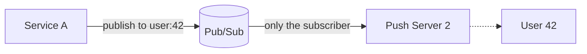
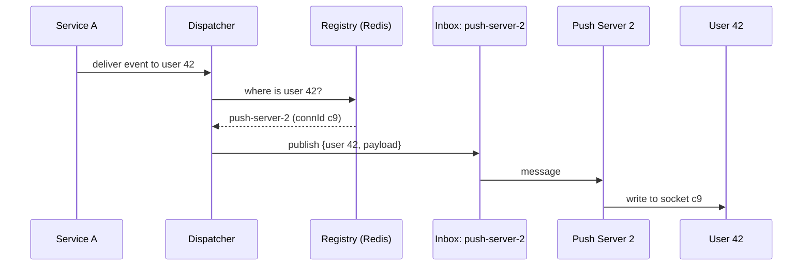
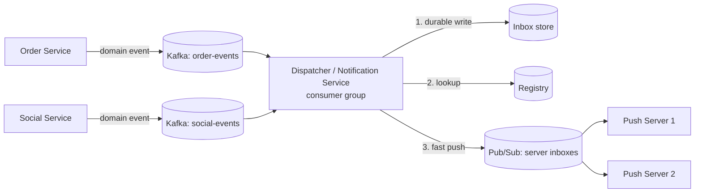
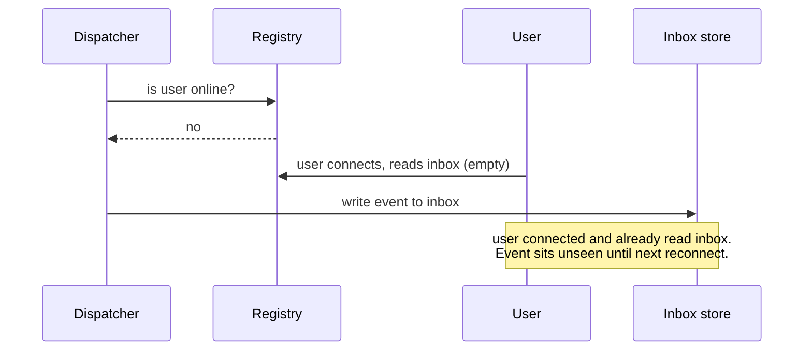

# Chapter 4: Pattern B, Per-user events

## 4.1 The scenario

One message, **one user**, and the fleet has many servers:

- "Your order shipped"
- "Alice liked your post"
- "Payment failed"
- A chat message to one person (1:1 chat)

In Chapter 3 the message was *rebuildable* (resend the snapshot). Here it usually isn't. "Your order shipped" is an **event**. If it's lost, there is nothing to resend unless you stored it.

So before choosing any architecture, classify the event:

| Class | Example | If lost? | Needs durability? |
|---|---|---|---|
| **Ephemeral** | Typing indicator, "user is online", live progress % | Nobody cares, the next one replaces it | No |
| **Important** | Notification, chat message, payment status | User misses something real | **Yes** |

This classification drives everything below. Ephemeral events take the fast path only. Important events need a durable record **plus** the fast path.

## 4.2 Three ways to route a per-user message

We need "message for User 42" to reach the one push server holding User 42.

### Option A: One channel per user (dynamic subscribe)

When User 42 connects to Push Server 2, that server **subscribes** to channel `user:42`. Service A just publishes to `user:42`.



- Producers are dead simple. No registry, no lookup.
- But every connect is a subscribe, and every disconnect is an unsubscribe. With 5M users and reconnect storms, that is a huge churn on the broker.
- Millions of channels. This is **fine for Redis pub/sub** (a channel is a tiny in-memory entry, so it scales to millions), but **terrible for Kafka**, where a topic is a heavyweight object (partitions, files, metadata). A million Kafka topics will melt the cluster.
- Note: classic Redis Cluster pub/sub broadcasts every message to **all** nodes. Use sharded pub/sub (Redis 7+) or this stops scaling.

### Option B: Registry lookup + one inbox per *server*

This is the Chapter 2 design. The channel count equals the number of **servers** (tens to hundreds), not users.



- Small, static set of channels (`inbox:push-server-N`).
- Cost: an extra registry lookup per message, and the registry can be stale (Chapter 2.6).
- If the user has 3 devices on 3 servers, the dispatcher sends to **each distinct server**.

### Option C: Deterministic routing (hash on userId)

Make routing computable with no lookup: `server = hash(userId) % N`. The LB uses **consistent hashing on userId** at connect time, so User 42 always lands on the same server. The dispatcher computes the same hash to find the server.

- No registry needed. No stale entries.
- Downside: adding or removing servers **moves users**, which means mass disconnects and reconnects. Consistent hashing limits the movement but doesn't remove it.
- Downside: hot or uneven users can't be rebalanced easily.
- Good for: stable fleets, or systems where the LB is already hash-aware.

### Comparison

| | A: channel per user | B: registry + server inbox | C: hash routing |
|---|---|---|---|
| Channels/topics | Millions | Tens to hundreds | Tens to hundreds |
| Extra state | None | Registry (Redis) | None |
| Producer complexity | Lowest | Needs a dispatcher | Needs the hash function |
| Connect cost | Subscribe per connect | Registry write per connect | Nothing extra |
| Staleness risk | Low | Medium (TTL window) | Low |
| Scaling servers | Easy | Easy | Moves users |
| Typical choice | Moderate scale, Redis | **Large scale default** | Stable fleets, sticky infra |

**Default recommendation: Option B.** The big-scale rule is: *topic count must scale with servers, never with users.*

## 4.3 Where Kafka and queues fit (the confusion cleared)

You asked where Kafka is needed. Try to use Kafka for the **last hop** and you hit a wall:

- Kafka consumer groups assign partitions to consumers **arbitrarily**, so a message for User 42 might be consumed by Push Server 5 while User 42 is on Push Server 2. The wrong server gets it.
- To fix that you'd need partition ownership to match connection ownership, which is exactly Option C.

So split the pipeline in two:



| Hop | Tool | Why |
|---|---|---|
| Services → Dispatcher | **Kafka** (or SQS) | Durable, replayable, retries with offsets, consumer group scales the dispatcher, and decouples producers |
| Dispatcher → Push server | **Pub/sub** (Redis, NATS) | Low latency, targeted inbox per server, loss is acceptable *because* of the durable layer |
| Push server → client | WebSocket / SSE | Last hop |

**Mental model to keep:**

> Kafka answers *"don't lose the event and let me retry processing."*
> Pub/sub answers *"get this to the right server fast."*
> The inbox store answers *"the user can catch up whenever they return."*

Each tool does one job. Trouble comes from asking one tool to do all three.

## 4.4 The dispatcher is the brain

Remember Chapter 2.8: push servers stay dumb. All intelligence sits in the dispatcher:

```java
// Consumer of Kafka domain events
void handle(DomainEvent e) {
    List<String> recipients = resolveRecipients(e);   // business logic lives here
    for (String userId : recipients) {
        Notification n = render(e, userId);           // content, id, sequence
        inboxStore.append(userId, n);                 // 1. durable FIRST (important events)
        Map<String,String> conns = registry.get(userId);   // connId -> serverId
        Set<String> servers = new HashSet<>(conns.values());
        for (String server : servers) {
            pubsub.publish("inbox:" + server, new Push(userId, n)); // 2. fast path
        }
        // if servers is empty: user offline, nothing more to do now
    }
}
```

Notice the order: **durable write first, live push second.**

## 4.5 Why "write first, push second" matters (the offline race)

Suppose we did it the obvious way: check the registry, and if the user is offline, store the event.



The user slipped in **between** the check and the write. Classic check-then-act race.

**Fix:** never make the write conditional on the registry. For important events:

1. Always write to the inbox first.
2. Then attempt the live push as a **speed optimization**.
3. On connect, the client always reads "everything after my last seen id" (Chapter 6).

Now the live push can be lost, late, or sent to a stale server, and it doesn't matter, because the inbox is the truth and the push is a **hint that makes delivery fast**. This is the central idea of the whole course:

> **For important events, the socket is a fast lane, not the source of truth. The stored inbox is the source of truth.**

## 4.6 The offline user

If the registry says nobody is connected (or the pushed message fails):

| Event class | Action |
|---|---|
| Ephemeral | Drop it |
| Important | Already in the inbox. Delivered on next connect |
| Important and time-sensitive | Also send a **mobile push** (APNs / FCM) or email as a wake-up |

Mobile push is a separate delivery channel for when no socket exists. It's best-effort too, so the inbox still backs it.

## 4.7 Multi-device and ordering

- **Multi-device:** the registry returns several connections. Send to every server holding one, and each server writes to all of that user's local connections. Each device tracks its own "last seen" position (Chapter 6).
- **Ordering:** per-user ordering is the important property ("message 5 shouldn't arrive before 4"). Get it by giving each user's events a **per-user sequence number** at the dispatcher (or by keying the Kafka topic by `userId`, so all of one user's events go through one partition, in order). We'll finish this in Chapters 6 and 9.

## 4.8 Topic bookkeeping: the answer to "how many topics?"

| Thing | Count | Created |
|---|---|---|
| Kafka topics | One per event **type or domain** (`order-events`, `social-events`), a handful to a few dozen | At deploy, by infra |
| Kafka partitions | Sized for throughput, keyed by `userId` | With the topic |
| Pub/sub server inboxes | One per push server | Implicitly, when the server subscribes at boot |
| Per-user topics | **Zero** | Never |

You avoid topic explosion by putting the *user dimension in the message key or payload, not in the topic name*. The topic says what kind of thing it is, and the key says whom it is for.

## 4.9 Chapter 4 summary

| Concept | Remember as |
|---|---|
| First question | Is the event **ephemeral** or **important**? |
| Routing options | Channel per user (small scale), registry + server inbox (**default**), hash routing (stable fleets) |
| Topic rule | Count scales with **servers or event types**, never with users |
| Kafka's job | Durable upstream pipeline into the dispatcher |
| Pub/sub's job | Fast targeted last hop to the right push server |
| Dispatcher | Holds all business logic, so push servers stay thin |
| Offline race | Never make the durable write conditional on the registry |
| Core principle | For important events, the **inbox is truth**, the socket is a fast lane |

---

**Next: Chapter 5, Pattern C: groups.** Group chat, shared documents, and canvases. Here the audience is a *set* of users, and the question gets sharp: how do you fan out to 10 members versus 100,000? We'll cover topic-per-group vs sharded topics, group membership routing, and the "hot group" problem. Say **"next"** when ready.
