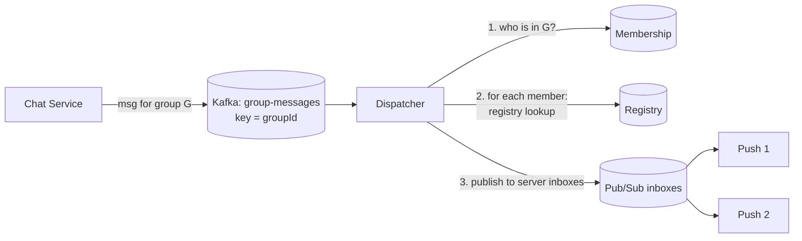
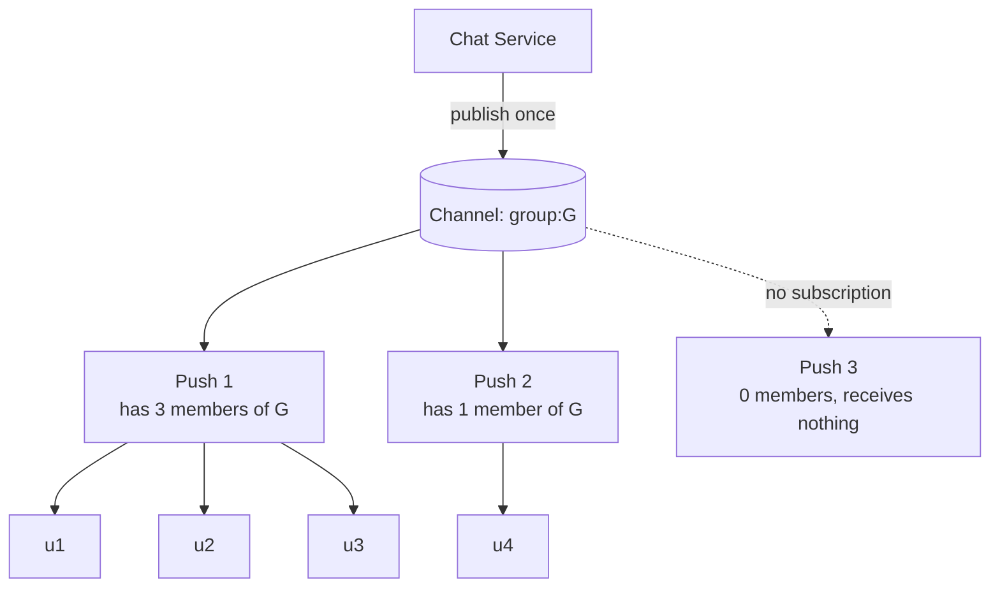

# Chapter 5: Pattern C, Groups

## 5.1 The scenario

The audience is **a set of users**, not one and not everyone:

- Group chat (10 people)
- A team channel (5,000 people)
- Collaborators on the same document or canvas (2 to 50 people)
- Viewers of one live match (500,000 people)

Pattern B (per-user) and Pattern A (global) are the two extremes. Groups sit between them, and the right design depends heavily on **how big the group is**.

## 5.2 Two separate things about a group

Mixing these up is the root of most confusion:

| Thing | Meaning | Where it lives | Durable? |
|---|---|---|---|
| **Membership** | Who belongs to the group | DB (membership service) | Yes |
| **Presence of members on servers** | Which push servers currently hold at least one connected member | Registry or pub/sub subscriptions | No, ephemeral |

A group of 5,000 members might have only 300 online, spread across 40 of your 200 push servers. The routing problem is: **reach those 40 servers, and only those**.

## 5.3 Approach 1: Fan-out at the dispatcher (small groups)

The dispatcher expands the group into members and reuses Chapter 4's per-user path.



Cost per message = **group size** (one lookup and one send per member).

- Group of 10 means 10 operations. Trivial.
- Group of 5,000 means 5,000 operations per message. A busy channel at 20 msgs/sec means 100K operations/sec for one group. This will not hold.
- **Optimization:** group members by server first. Look up all members, then send **one message per server** with a list of local recipients, not one per user.

Good for: groups up to a few hundred. Simple, reuses everything we've built.

## 5.4 Approach 2: Server-level group subscription (medium and large groups)

Flip it. The group gets a **pub/sub channel** (`group:G`). A push server subscribes to `group:G` **when its first local member of G connects**, and unsubscribes when its last one leaves.



This is the **two-level fan-out from Chapter 3**, restricted to the servers that matter. The broker copies once per *interested server*, and each server copies once per *local member*.

**The refcount trick:** a server must know when to unsubscribe, so it keeps a count per group.

```java
Map<String, Set<String>> groupLocalMembers = new ConcurrentHashMap<>();  // groupId -> connIds

void addToGroup(String groupId, String connId) {
    groupLocalMembers.compute(groupId, (g, members) -> {
        if (members == null) {
            members = ConcurrentHashMap.newKeySet();
            pubsub.subscribe("group:" + groupId, this::onGroupMessage);  // first local member
        }
        members.add(connId);
        return members;
    });
}

void removeFromGroup(String groupId, String connId) {
    groupLocalMembers.computeIfPresent(groupId, (g, members) -> {
        members.remove(connId);
        if (members.isEmpty()) {
            pubsub.unsubscribe("group:" + groupId);                      // last local member left
            return null;
        }
        return members;
    });
}

void onGroupMessage(String groupId, byte[] payload) {
    for (String connId : groupLocalMembers.getOrDefault(groupId, Set.of())) {
        connections.get(connId).send(payload);   // serialize once, write many
    }
}
```

**Topic count = number of groups that currently have at least one online member**, not the total number of groups. A million dormant groups cost nothing.

This is why **pub/sub (Redis, NATS)** fits groups and **Kafka does not**: Kafka topics are heavyweight, and creating and deleting them as users come and go is not something it is built for.

### Variant: registry-based group routing (keeps channels small)

If you want to avoid even dynamic channels, keep a registry set `group:G:servers` (which servers have members of G) maintained by the same refcount logic. The dispatcher reads that set and publishes to each `inbox:server-N` (Chapter 4's static inboxes). Channel count stays at O(servers), at the price of keeping the set accurate and one extra lookup per message.

| | Dynamic channel per active group | Registry of servers per group |
|---|---|---|
| Channels | One per active group | One per server (static) |
| Extra state | None | Set per active group |
| Message path | Producer publishes once | Dispatcher looks up, then publishes N times |
| Best for | Redis/NATS, moderate group counts | Very many active groups, or brokers where channels are costly |

## 5.5 Where Kafka and the database fit for groups

How do you avoid millions of topics? **Never put the group into the topic name.** Put it in the **key**.

| Layer | Design |
|---|---|
| Kafka | One topic `group-messages`, **key = groupId**. All messages of one group land in one partition, so **per-group ordering is preserved** |
| Durable store | A table keyed by `(groupId, seq)` |
| Live path | Pub/sub `group:G` or the registry variant |

```
messages(group_id, seq, sender_id, payload, ts)   PRIMARY KEY (group_id, seq)
```

The write-then-push rule from Chapter 4 carries over:

1. The sequencer (the chat service, or the Kafka consumer processing that group's partition) assigns the next `seq` for the group and **stores the message once**.
2. It then publishes to the live path.
3. A client that was offline, or missed something, asks: *"give me group G messages with seq > my last seq."*

### Fan-out on write vs fan-out on read

This distinction matters for groups:

| | Fan-out on **write** | Fan-out on **read** |
|---|---|---|
| Storage | One copy **per member** (inbox rows) | **One copy** per group (the log above) |
| Write cost | Group size × writes | 1 write |
| Read cost | Cheap, read your own inbox | Reader pulls from each group they belong to |
| Good for | Small groups, 1:1, notifications | Large groups |
| Breaks when | Group is huge (5,000 writes per message) | User is in thousands of groups (many reads) |

**Practical hybrid:**

- **Message content** is stored once per group (fan-out on read).
- **Per-user state** (unread count, "last seq I read" per group, mentions) is stored per user and is small.
- **Notifications for mentions** ("@riyaz") go through the Chapter 4 per-user path, because they are targeted events.

## 5.6 Collaborative documents and canvases

Many people editing the same thing. Look closely, because it splits into two very different streams.

| Stream | Example | Needs | Path |
|---|---|---|---|
| **Ephemeral** | Cursor positions, "Alice is typing", selection highlights | Speed only, loss is fine, the next one replaces it | Group pub/sub only, no storage, throttle to ~10-20/sec |
| **Authoritative** | Actual edits (insert text, move shape) | **Ordered, durable, no lost or conflicting edits** | Sequencer plus a durable op log |

For the authoritative stream, order is everything. Two people edit the same word at the same moment, and every client must converge to the same document. This is handled by **OT or CRDTs** (a topic of its own), but the infrastructure implication is simple:

> **All edits for one document must pass through one ordering point.**

Common way to get that: **route every editor of document D to the same push server** (consistent hashing on `docId` at the LB, which is Option C from Chapter 4). That server (or a room-owner process) assigns ordering, applies or validates edits, persists the op log, and broadcasts to the room. Because everyone is on one server, the fan-out is local and fast.

Trade-offs of this "room owner" model:

- Simple ordering, low latency.
- A very popular document can overload one server (but documents rarely exceed tens to hundreds of editors, so this is fine).
- If that server dies, the room must be **re-hosted** elsewhere. Clients reconnect, the new owner loads the last snapshot plus op log, and clients resend un-acked ops (Chapter 6 covers the ack and resume idea).

## 5.7 Huge groups (live match, big stream chat): 100K to millions

The model changes completely. At this size:

- You **cannot** store a copy per member, and you often don't store messages durably per user at all.
- A single group channel might carry thousands of messages per second. No human reads that, so you **sample, batch, or rate-limit**.

Techniques:

1. **Server-level subscription** (5.4) is mandatory. Never fan out at the dispatcher.
2. **Batch**: collect messages for 100 to 500 ms and send one frame containing many, which saves syscalls and bandwidth.
3. **Sample or drop** under load (e.g., show a subset of chat messages in a 1M-viewer stream).
4. **Shard a hot channel**: if one channel's throughput exceeds what a single broker node handles, split it into `group:G:0 .. group:G:k` and have publishers spread messages across them, with every interested server subscribing to all shards.
5. **Durability is optional**: live comments are usually "you had to be there". Nobody expects a replay per viewer. Keep an append-only log for moderation or replay if needed, not a per-user inbox.

This is a **Pattern A-like** design with the audience limited by interest.

## 5.8 Membership changes while connected

The group set changes under live connections:

| Event | What must happen |
|---|---|
| User **joins** group G | Membership service emits an event, and the user's push server adds the connection to G (and subscribes if needed). The user's other devices too |
| User **leaves or is removed** | The push server **immediately** stops delivery. This is a security issue, because a removed member must not keep receiving messages |
| Membership cached on the push server | Version it. Refresh on change events, and verify against the source if a cached entry is old |

How does a push server know to react? A **control message** on the per-user path ("user 42 added to group G / removed from group G"), or a membership-change event that the dispatcher forwards. Treat these as **important** events (Chapter 4), because missing a removal is a data leak.

### Avoid subscribing to everything at connect

A Slack-style user may belong to 2,000 channels. Subscribing to all of them per connection is wasteful when they're only looking at one.

**Interest-based subscription:** the client tells the server what it is currently viewing. With WebSocket this is natural:

```
client → server: {"op":"subscribe","room":"doc:991"}
client → server: {"op":"unsubscribe","room":"doc:991"}
```

For everything else (other channels), the user gets only **lightweight per-user notifications** like unread counts and mentions through the Chapter 4 path. This keeps subscriptions limited to the few rooms actually open. (SSE has no upstream channel, so the client makes a normal HTTP call to subscribe, which is another small reason WebSocket suits room-based apps.)

## 5.9 How to choose by group size

| Group size | Typical example | Live path | Durable store | Fan-out model |
|---|---|---|---|---|
| 2 to ~200 | 1:1, friends, small team | Dispatcher fan-out (Approach 1), or group subscription | Per-group log (+ per-user unread state) | Fan-out on write acceptable |
| 200 to ~50K | Team channels, communities | **Server-level group subscription** | Per-group log, fan-out on read | Group channel |
| 50K to millions | Live stream, mega broadcast | Server-level subscription, **batching, sampling, sharded channel** | Optional or log only | Broadcast-like |
| Collab doc (2 to 50) | Docs, canvas, whiteboard | **Room owner** by consistent hash on docId | Op log plus snapshots | Local fan-out on owner |

## 5.10 Chapter 5 summary

| Concept | Remember as |
|---|---|
| Two things | **Membership** (durable DB) vs which **servers hold online members** (ephemeral) |
| Small groups | Dispatcher expands members and reuses the per-user path |
| Larger groups | Push server subscribes to `group:G` on first local member and unsubscribes on last (**refcount**) |
| Topic count | **Active** groups, not total. Kafka uses one topic with **key = groupId** |
| Durable | Store each message **once per group** with a per-group `seq` |
| Collab docs | Ephemeral cursors via pub/sub. Authoritative edits via a **single ordering point** (room owner) |
| Huge groups | Server-level subscription, batch, sample, shard the channel, durability optional |
| Membership changes | Control events, and removal must be immediate |
| Many groups per user | Subscribe by **interest** (what's on screen), notify the rest via per-user path |

---

**Next: Chapter 6, Delivery guarantees.** We've said "inbox is truth, socket is a fast lane" several times. Now we build it properly: sequence numbers, acks, `Last-Event-ID` resume, replay windows, and exactly what at-most-once, at-least-once and "effectively once" mean for a push service, so you can decide when you need durability and when you don't. Say **"next"** when ready.
