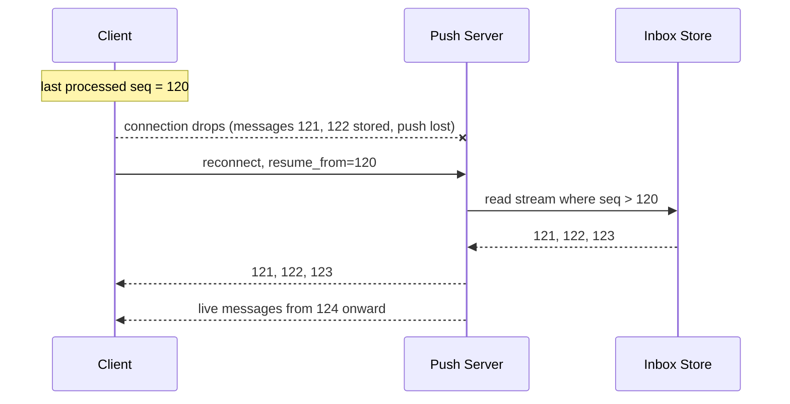
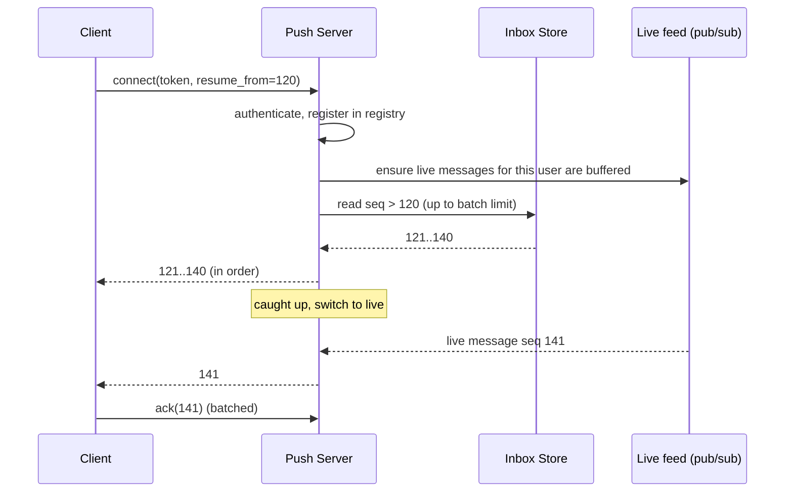
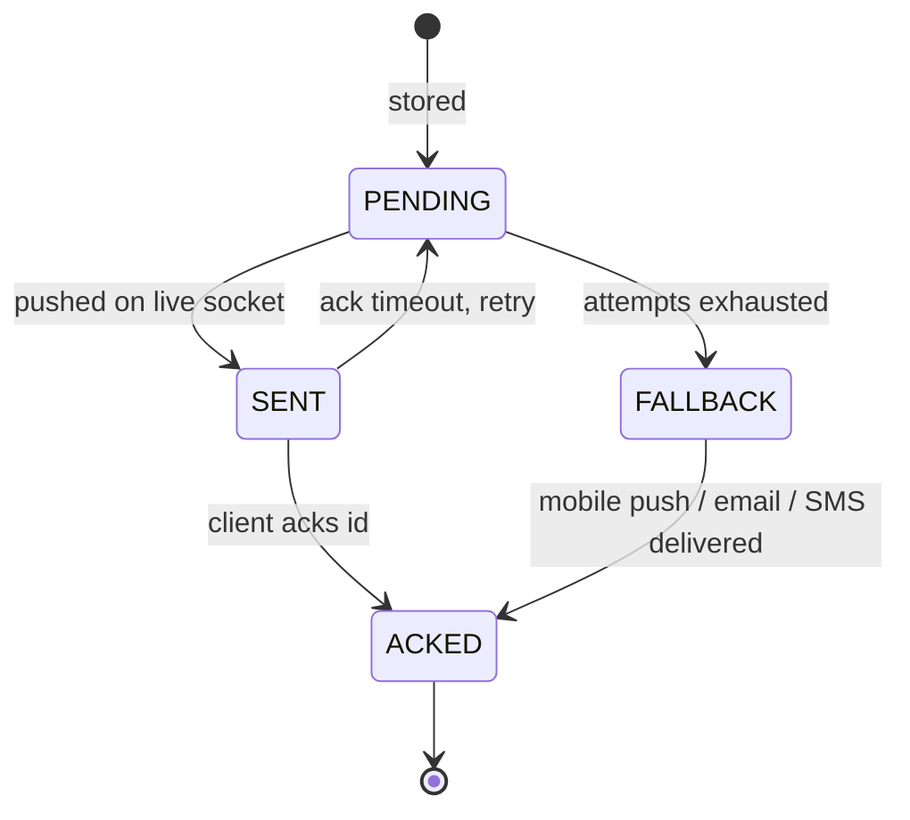
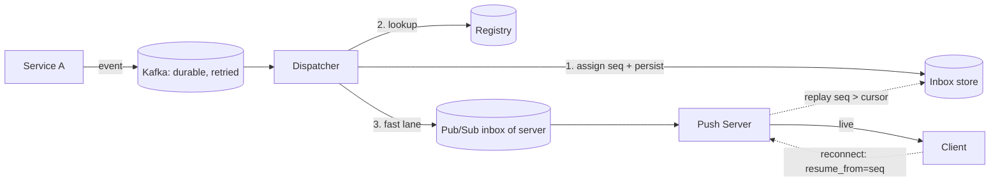

# Chapter 6: Delivery guarantees

## 6.1 The uncomfortable truth about sockets

Suppose a push server calls `socket.write(message)` and it returns successfully. Has the user received the message?

**No.** All it means is that the bytes went into the OS send buffer. From there:

- The phone may have gone into a tunnel. TCP will keep retrying for minutes before giving up.
- The connection may already be dead, but neither side knows yet (a half-open connection, Chapter 7).
- The client may receive the bytes and crash before processing them.
- The browser tab may be backgrounded and throttled.

TCP guarantees ordered, reliable bytes **while the connection lives**. It guarantees nothing across a connection that dies. The moment a connection drops, every byte in flight is in an unknown state.

> A successful `write()` is not delivery. The only proof of delivery is **the client telling you**.

So reliability can't be a property of the socket. It has to be built **on top**, at the application level. That's this chapter.

## 6.2 The three delivery semantics

| Semantics | Meaning | How it's built | Cost |
|---|---|---|---|
| **At-most-once** | Sent zero or one time. May be lost, never duplicated | Fire and forget | Cheapest |
| **At-least-once** | Delivered one or more times. Never lost, may duplicate | Store, track, retry until acked | Needs storage and acks |
| **Exactly-once** | Delivered exactly one time | Not achievable over a network in general | n/a |

What people mean by "exactly-once" in practice is **effectively-once**:

> **at-least-once delivery + idempotent processing (dedupe by id) = effectively once**

That is the formula for the whole chapter. Every durable push system is this formula in some form.

## 6.3 The decision: which tier does this message need?

Ask the "three questions" from Chapter 1 for each message type.

| Tier | Contract | Use for | Mechanism |
|---|---|---|---|
| **Tier 0: best-effort** | At-most-once. Fast path only | Typing indicators, cursor positions, live progress, "latest wins" state (Chapter 3) | Pub/sub to socket. No storage |
| **Tier 1: resumable** | At-least-once **within a retention window** | Chat messages, notifications, feeds, order updates | Store in an ordered log or inbox, client resumes from a cursor |
| **Tier 2: guaranteed + tracked** | At-least-once with **per-message ack and server retry** | Payment confirmations, 2FA codes, alerts that need proof of receipt | Tier 1 plus ack tracking, retry timers, fallback channels (mobile push, SMS) |

**Most real systems use Tier 0 and Tier 1 together. Tier 2 is rare.** Don't pay for Tier 2 unless the business truly needs "prove the user saw it".

## 6.4 The core mechanism: sequence numbers plus a client cursor

Instead of the server tracking "did message X arrive?" for every message, flip the responsibility:

1. Every message in a stream gets a **monotonically increasing sequence number** (`seq`).
2. The server **stores** messages in order, keyed by `seq`.
3. The **client remembers the highest `seq` it has processed** (its cursor).
4. On (re)connect, the client says: *"I have everything up to seq 120. Send me what's after."*



This one idea gives you:

- **No message loss**, because anything missed is simply still in the store.
- **No per-message tracking on the server**, only one cursor per client.
- **No special handling for "was the push lost, late, or sent to the wrong server?"** The client's cursor makes all of those cases self-healing.

It's also exactly what the browser's built-in SSE does: each event can carry an `id:` field, and on reconnect the browser automatically sends `Last-Event-ID: <last id>`. For WebSocket, you build the same handshake yourself.

```
SSE event on the wire:
id: 121
event: notification
data: {"title":"Order shipped"}
```

```
Reconnect request (browser does this automatically for SSE):
GET /stream
Last-Event-ID: 120
```

## 6.5 Where sequence numbers come from

A `seq` must be **monotonic within the stream it orders**. Pick the stream boundary deliberately.

| Stream boundary | Use for | Assigned by |
|---|---|---|
| **Per user** (inbox) | Notifications, 1:1 chat | Atomic counter per user (e.g., Redis `INCR inbox:seq:{userId}`, or a DB sequence/row) |
| **Per group** | Group chat, channels | Atomic counter per group, or the Kafka partition offset if keyed by groupId |
| **Per document** | Collaborative edits | The room owner (Chapter 5.6) |
| **Global** | Almost never | Too much contention. Avoid |

**Never use wall-clock timestamps alone as the cursor.** Clocks differ across machines, and two events can share a millisecond, so cursors based on time can skip or repeat events.

Alternative: use the **Kafka offset** (partition plus offset) as the ordering position when the log lives in Kafka. Fine for internal pipelines, but clients are better served by a small stable per-stream integer.

The `seq` assignment and the message write must be **atomic**, or at least produce no gaps visible to readers out of order. If two writers can interleave so that seq 7 becomes visible before seq 6, a client that reads "everything after 7" will permanently skip 6. Common fixes:

- A **single writer per stream** (the Kafka partition consumer, or the room owner).
- Or an atomic "increment-and-insert" in one DB transaction.

## 6.6 The ack: what the client confirms

Two different acks exist, and they serve different purposes. Don't merge them.

| Ack | Meaning | Used for |
|---|---|---|
| **Cursor ack** (cumulative) | "I have processed everything up to seq N" | Resume position. Cheap, can be batched ("ack every 10 messages or 1 second") |
| **Per-message ack** | "I got message id X" | Tier 2 only, where the server must know about each message |

For Tier 1, you can even skip explicit acks: the cursor is just **sent on reconnect** (`Last-Event-ID` or `resume_from`). The server doesn't need to know the cursor continuously. Explicit cursor acks are useful when you want to:

- Trim the stored data ("everything below the lowest acked cursor across devices can go").
- Show "delivered" and "read" receipts to other users.
- Detect that a connected client has fallen behind (a slow consumer, Chapter 11).

## 6.7 The resume protocol, step by step

This is the full handshake worth being able to write from memory.



The same race as Chapter 3.4 exists here: a live message can arrive while you're replaying history. The solution is the same:

1. Start **buffering** live messages for this connection.
2. Replay from the store.
3. Flush the buffer, **skipping anything with `seq <= lastSent`**.
4. Switch to direct forwarding.

And the client enforces **gap detection**:

```java
void onMessage(Msg m) {
    if (m.seq <= lastProcessed) return;                 // duplicate or replay, ignore
    if (m.seq > lastProcessed + 1) {                    // gap: something was missed
        requestResync(lastProcessed);                   // ask for seq > lastProcessed
        return;
    }
    process(m);
    lastProcessed = m.seq;
    persistCursorLocally(lastProcessed);                // survive app restart
}
```

The client's cursor is a **self-checking guarantee**: whatever went wrong upstream (lost push, wrong server, duplicate), the client notices the gap or the duplicate and repairs it.

## 6.8 Retention: how far back can you resume?

The store can't keep everything forever for every stream.

| Policy | Example |
|---|---|
| Time window | Keep 7 days of notifications |
| Count window | Keep the last 1,000 messages per stream |
| Permanent | Chat history is a product feature, kept forever and paged normally |

What if the client's cursor is **older than the retention window**? The server can't replay the gap. It must answer:

```
{"type":"RESET","reason":"cursor_too_old"}
```

and the client does a **full resync**: refetch current state through a normal HTTP API (the inbox list, the chat history page, the document snapshot), then resume live streaming from the new head.

Always design the **RESET path** up front. It is also your safety net for any bug that corrupts a cursor.

## 6.9 Tier 2: guaranteed with retries

When "the user must confirm receipt" is truly required (a payment alert, a security notice), add **server-side tracking** on top of Tier 1.

```
notification(id, user_id, payload, status, attempts, next_retry_at)
status: PENDING → SENT → ACKED
```



- A **retry worker** scans `SENT` items whose `next_retry_at` has passed and re-pushes with backoff.
- After N attempts, switch to a fallback channel (APNs/FCM, SMS, email).
- An unacked, undeliverable item ends in a **dead-letter** state for review or alerting.

This is the same claim, lease, and retry machinery you'd use for a task queue. The notification row plays the role of the task, and the ack plays the role of "task completed". The cost is real: a write per state change and a retry worker. So scope it to the few messages that need it.

## 6.10 Duplicates are the price of at-least-once

Retries, reconnects with overlapping replay, and a message published to two servers when a user has two devices will all produce duplicates. The fix is always the same:

- Every message has a **stable id** (`msgId`, or the `(stream, seq)` pair) assigned **once at creation**, never regenerated on retry.
- The client **dedupes** by `seq` (as in the code above) or by a short-lived set of recent ids.
- The UI action must be idempotent: showing "Order shipped" twice in the same notification slot, not as two notifications.

We go deeper on this and on ordering in Chapter 9.

## 6.11 SSE vs WebSocket: what you get for free

| Reliability feature | SSE | WebSocket |
|---|---|---|
| Auto-reconnect | Built in | You build (backoff plus jitter) |
| Resume cursor | **Built in** (`id` / `Last-Event-ID`) | You define `resume_from` in your protocol |
| Client acks | Separate HTTP call | Same connection |
| Message ids | `id:` field | Field in your frame format |

This is a real selection reason: for **listen-only, resumable** feeds, SSE gives you the Tier 1 handshake for almost nothing.

## 6.12 Putting it together: one reliable design



- **Kafka** keeps the event from being lost before it's processed (Chapter 4).
- The **inbox store** with `seq` is the truth.
- **Pub/sub** is the fast lane.
- The **client cursor** repairs any loss, duplicate, or reorder.

## 6.13 Chapter 6 summary

| Concept | Remember as |
|---|---|
| `write()` success | Not delivery. Only the client's word counts |
| Semantics | At-most-once, at-least-once, and **effectively-once = at-least-once + idempotence** |
| Tiers | Tier 0 best-effort, **Tier 1 resumable (most common)**, Tier 2 tracked and retried (rare) |
| Core mechanism | **Per-stream seq** plus **client cursor** plus **resume on reconnect** |
| SSE | `id` / `Last-Event-ID` gives you resume for free |
| Seq source | Atomic per-stream counter or a single writer per stream, never timestamps |
| Gap and duplicate handling | Client checks `seq` against its cursor: ignore if old, resync if gapped |
| Retention | Window-limited, so cursors older than the window get a **RESET** and a full resync |
| Tier 2 | Message state machine, retry worker with backoff, fallback channel, DLQ |
| Race on resume | Buffer live, replay history, flush buffer with `seq > lastSent`, go live |

---

**Next: Chapter 7, Heartbeats, dead connections, and presence.** How does the server learn that a connection is dead when TCP sits silent for minutes? We'll cover ping/pong vs SSE comments, timeouts and TTL tuning, what to do when the heartbeat stops, how this feeds the registry, and how to build the "online/offline" indicator without lying. Say **"next"** when ready.
