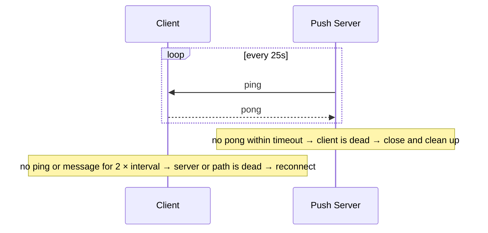
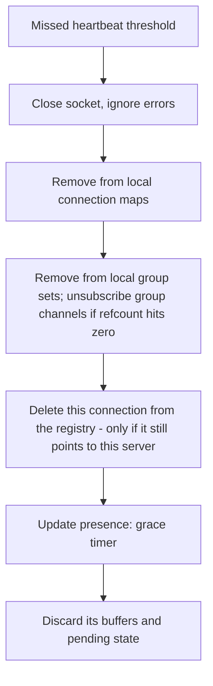
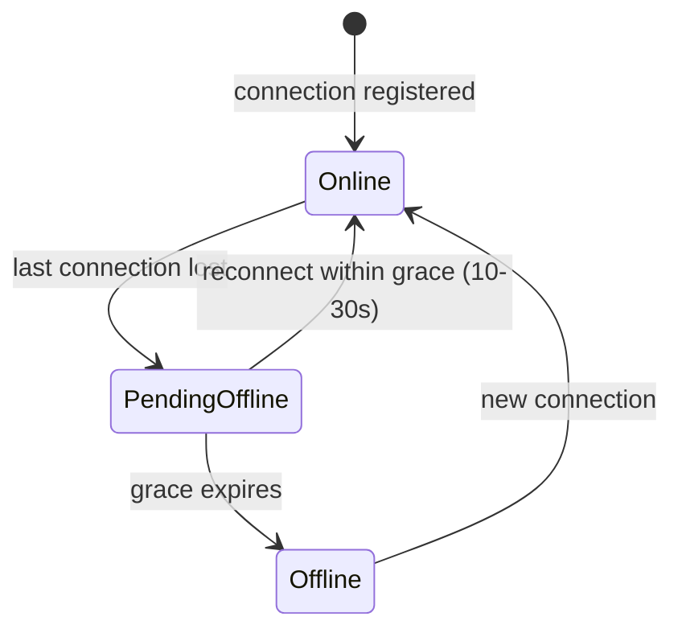

# Chapter 7: Heartbeats, dead connections, and presence

## 7.1 The problem: silence looks the same as "nothing to say"

A connection can die in two ways:

| Death type | What happens | Detection |
|---|---|---|
| **Clean close** | The client closes the tab or calls `close()`. A FIN or close frame is sent | Immediate, the server gets an event |
| **Silent death** | Phone enters a tunnel, Wi-Fi drops, laptop lid closes, NAT box forgets the mapping, the process is killed, the battery dies | **Nothing arrives at all** |

For a silent death, the server's socket still looks open. It's called a **half-open connection**. TCP will eventually notice (after retransmission timeouts, which can take many minutes), but you can't wait that long. Meanwhile:

- The server holds memory for a ghost.
- The registry still says "user 42 is on server 2".
- Messages are written into a black hole (and, as we saw in Chapter 6, a successful `write()` proves nothing).
- Presence shows the user as online while they are gone.

A push connection is often **idle on purpose**. A user may receive one message an hour. So "no traffic" can mean "healthy and quiet" or "dead", and you can't tell which without asking. That is the entire reason heartbeats exist:

> **A heartbeat turns silence into a signal.** If you expect a tick every N seconds and it doesn't come, the connection is dead.

## 7.2 A second reason: proxies kill idle connections

Between client and server sit load balancers, NAT gateways, corporate proxies, and mobile carrier boxes. Almost all of them have an **idle timeout**, and they silently drop connections that carry no bytes for a while (often 60 seconds on cloud HTTP load balancers, longer on TCP-level ones, and shorter on some mobile networks).

So even a perfectly healthy but quiet connection gets killed unless something flows regularly. The heartbeat doubles as a **keep-alive**. This is why you set the heartbeat interval **below the smallest idle timeout in the path**, which is the first thing to check when a design "mysteriously drops connections every 60 seconds".

## 7.3 What kinds of heartbeat exist

| Type | How | Who sends | Who can see it |
|---|---|---|---|
| **TCP keepalive** | OS-level probes | Kernel | OS only. Default timers are far too slow (hours), and it can't be relied on through proxies |
| **WebSocket ping/pong frames** | Protocol-level control frames | Usually the server pings, the browser auto-replies with pong | The server sees the pong. **Browser JS cannot send or observe ping frames** |
| **Application-level heartbeat** | A normal message like `{"t":"ping"}` / `{"t":"pong"}` | Either side | Both sides, and your code controls it |
| **SSE comment line** | `: keepalive\n\n` written periodically | Server | Server writes it. Client ignores it (browser doesn't fire an event) |

Two practical notes:

- A **browser client cannot detect a dead WebSocket** from protocol pings, because JS has no access to them. For client-side detection you need an **app-level** heartbeat, or a timer like "if nothing (message or heartbeat) arrived in the last 2 × interval, reconnect".
- For **SSE**, the server just writes a comment every 15 to 30 seconds. That keeps proxies happy and exercises the socket, so a dead connection soon fails with a write error. The client's job is to apply the same "silence timeout" and reconnect.

## 7.4 Who pings whom?

There are two directions, and they detect different things.



| Direction | Detects | Action on failure |
|---|---|---|
| **Server → client ping, expect pong** | Dead client, dead path (server side) | Server closes the connection and cleans up |
| **Client's silence timer** | Dead server, dead path (client side) | Client reconnects with a resume cursor |

You want **both**. The server frees resources on its side, and the client repairs its own experience. A common simplification is that the server sends a heartbeat down, and the client's silence timer plus any message it sends upstream (WebSocket) reset the server's idle timer.

## 7.5 Tuning the interval and timeout

| Setting | Typical | Reason |
|---|---|---|
| Heartbeat interval | **20 to 30 s** | Below proxy idle timeouts (often 60 s), but not so frequent that it wastes battery and bandwidth |
| Failure threshold | **2 to 3 missed beats** | One missed beat is often just jitter or a GC pause. Three is likely real |
| Detection time | About interval × threshold (e.g., ~60 to 90 s) | This is the **blind window** you accept |

The trade-off:

| Shorter interval | Longer interval |
|---|---|
| Faster detection of dead peers | Less battery, bandwidth, and CPU |
| More traffic across millions of connections | Larger blind window where messages go to ghosts |
| Phones can't sleep their radio (battery drain) | Proxies may time out an idle connection first |

Because of the **blind window**, you can never assume the registry is exact. That is the same reason Chapter 6 made the stored inbox the truth. During those ~60 seconds, a message pushed to a ghost is lost on the live path and **recovered from the inbox on reconnect**.

**Add jitter** so you don't fire a million heartbeats in lockstep. Each connection's timer is offset randomly at connect time, which spreads the load evenly.

## 7.6 What the server does when a heartbeat is missed

Treat this as a **cleanup procedure** that must be complete, because a half-done cleanup leaks memory or routes messages to nowhere.



One subtle rule in the registry step: **delete only if the entry still belongs to you.** Picture this: the client's network blips, it reconnects to Server 5, and registers there. A moment later, Server 2 finally times out the old ghost and deletes "user 42's entry", erasing the **new** valid registration. Use a compare-and-delete: remove the entry for `connId` only if its value is still `server-2`. Using unique `connId`s (a new id per connection) makes this natural, since the old ghost's id differs from the new connection's id.

```
HDEL conn:user:42 conn-a1      // keyed by connId, so it can't remove conn-a2 (the new one)
```

If the server itself is dead (it can't clean up), the **registry TTL** does it for you (Chapter 2.5), which is exactly why that TTL exists.

## 7.7 Heartbeats and the registry: don't write on every beat

Chapter 2 said "refresh the TTL on each heartbeat". At scale that needs care. With 5 million connections each beating every 30 seconds, that is roughly 170,000 registry writes per second from heartbeats alone. Don't do that.

Better:

- **Decouple the two clocks.** The heartbeat is for connection health. The registry refresh is for routing accuracy. Refresh the registry at a **lower frequency** (e.g., every 60 to 120 s per connection, with TTL about 3× that).
- **Batch**: each server runs a periodic job that pipelines TTL refreshes for all its connections in a few big Redis calls, rather than one call per beat.
- **Server-level liveness instead of per-connection:** keep one key per server (`server:2:alive`, TTL 30 s, refreshed constantly). Each connection entry just says "server-2". The dispatcher checks "is server-2 alive?" and treats entries for dead servers as stale. A server crash then invalidates **all its users at once** within seconds, without waiting for each per-user TTL.

| Approach | Writes per second | Crash detection speed |
|---|---|---|
| TTL refresh per connection per beat | Very high | One TTL period |
| Batched, lower-frequency refresh | Much lower | One (longer) TTL period |
| Server-level liveness key + per-connection entries | Low | **Fast** (server TTL) |

The third one often wins, and the fix for it is just a small extra lookup at dispatch time.

## 7.8 The client's side of a dead connection: reconnect properly

When the client decides the connection is dead, **how** it reconnects matters as much as detecting it.

```javascript
let attempt = 0;
function connect() {
  const es = new EventSource(`/stream`);          // browser sends Last-Event-ID automatically
  es.onopen = () => { attempt = 0; };
  es.onerror = () => {
    es.close();
    const base = Math.min(30000, 1000 * 2 ** attempt++);   // exponential, capped
    const delay = Math.random() * base;                    // full jitter
    setTimeout(connect, delay);
  };
}
```

- **Exponential backoff**: 1 s, 2 s, 4 s, up to a cap (~30 s). Don't hammer a struggling server.
- **Jitter**: randomize the delay. Without it, when a server dies and 100K clients lose their connections at the same moment, they all retry at the same instants (1 s, then 2 s, then 4 s) and slam the fleet in synchronized waves. This is the **thundering herd / reconnect storm**, covered in Chapter 8.
- **Resume with cursor** (Chapter 6) so reconnecting costs only the missed messages.
- **Reset the backoff after a successful, stable connection**, not immediately on open.

Also reconnect on **network-change events** (online/offline, Wi-Fi to cellular switch) and when the app returns to the foreground, because the old socket is usually dead after any of those.

## 7.9 Mobile and background reality

Mobile operating systems suspend apps in the background and kill their sockets. This changes expectations:

- A backgrounded phone **will drop the connection**. You can't keep it alive reliably.
- Don't fight it. Treat "background" as offline, and use **APNs/FCM mobile push** to wake the app for important events (Chapter 4.6), plus the inbox for catch-up on foreground.
- This is why presence on mobile is inherently approximate (next section).

## 7.10 Presence: the "online" indicator

Presence ("Alice is online") is built directly from heartbeats, and it's a classic place to over-engineer.

**Definition:** a user is online if they have **at least one live connection**. With multiple devices, one connection is enough.

**Basic implementation:**

```
SET presence:user:42 online EX 90        // refreshed by heartbeat (batched as in 7.7)
```

Online when the key exists, offline when it expires.

### The flapping problem

A phone moves between Wi-Fi and cellular and the connection drops for 3 seconds. If you broadcast "Alice went offline" then "Alice is online" a moment later, friends see a flickering dot, and you've spent a lot of fan-out for nothing.

**Add a grace period** (debounce):



Only publish "offline" **after the grace period** with no reconnect. Publish "online" immediately (it's cheap and good news).

### Who needs to know? (the fan-out trap)

If Alice has 2,000 friends and you push every presence change to all of them, that's heavy, and most of those friends aren't even looking at Alice's status right now.

| Strategy | How | Use when |
|---|---|---|
| **Pull on demand** | Client asks "who of these are online?" when rendering a list (batched query into the presence store) | Large friend lists, status is rarely critical |
| **Subscribe by interest** | Client subscribes to presence of only the people **visible on screen** (open chat, current room) | Chat apps. Mirrors Chapter 5.8 |
| **Push to all friends** | Fan-out on each change | Tiny social graphs only |
| **Per-room presence** | Presence scoped to a doc or channel: "who is in this room" | Collab tools. Use a small set with member TTLs |

For a collaborative room, store presence as a small set with per-member expiry, and broadcast join and leave events **within that room** via the group channel from Chapter 5.

### What presence is *not*

- It is **eventually consistent** and can be wrong by the TTL plus grace window. Never use it for a correctness decision ("don't send the message because they look offline").
- It is **Tier 0** (ephemeral). Loss is fine, because the next heartbeat fixes it.
- **"Last seen"** is a different feature: a timestamp written occasionally on disconnect, not a live signal. Store it in a regular DB column and update it lazily, not on every beat.

## 7.11 Other things the heartbeat channel is good for

Because you already have a periodic signal, a few jobs ride on it nearly for free:

| Use | How |
|---|---|
| **Token expiry check** | Each beat (or timer) checks whether the auth token has expired, then asks the client to refresh or closes the connection (Chapter 2.9) |
| **Slow-consumer detection** | If a client doesn't pong because its buffers are full, treat it as unhealthy (Chapter 11) |
| **Server-initiated drain** | During a deploy, the server tells clients "reconnect elsewhere" through the connection before shutting down (Chapter 8) |
| **Clock/latency estimate** | Round-trip time from ping/pong helps you see degrading connections |

## 7.12 Common mistakes

| Mistake | Consequence |
|---|---|
| Relying on TCP keepalive defaults | Ghost connections for minutes to hours |
| Heartbeat interval longer than the LB idle timeout | Healthy connections killed mid-session |
| Treating one missed beat as death | False disconnects from GC pauses and brief jitter |
| No jitter in heartbeats or reconnects | Synchronized spikes and reconnect storms |
| Deleting the registry entry unconditionally on cleanup | Erases the new valid registration after a quick reconnect |
| Per-beat Redis write for every connection | Registry becomes the bottleneck |
| Using presence for correctness | Messages skipped for users who were actually reachable |
| Flapping presence with no grace period | Flickering status and wasted fan-out |

## 7.13 Chapter 7 summary

| Concept | Remember as |
|---|---|
| Why heartbeats | Silence is ambiguous, so a heartbeat turns it into a signal. Also keeps proxies from idling out the connection |
| Types | TCP keepalive (too slow), WS ping/pong (browser JS can't see it), **app-level heartbeat**, SSE comment line |
| Direction | Server detects dead clients (missed pong). Client detects dead server (silence timer). Use both |
| Tuning | Interval ~20 to 30 s (below the LB idle timeout), fail after 2 to 3 misses, add jitter |
| Blind window | Messages sent to ghosts during detection are lost on the live path and recovered from the inbox |
| Cleanup | Close, remove from maps, adjust group refcounts, **compare-and-delete** registry entry, presence grace |
| Registry load | Decouple from heartbeats: batch and slow refresh, plus a **server-level liveness key** |
| Client reconnect | Exponential backoff with **full jitter** plus resume cursor |
| Mobile | Background means offline. Use mobile push plus the inbox |
| Presence | Any live connection means online. **Grace period** against flapping, **subscribe by interest**, never use it for correctness |

---

**Next: Chapter 8, Failures.** What happens when a push server crashes with 200K connections, when the whole fleet is redeployed, when Redis (the registry) or the broker goes down, and how to avoid the **reconnect storm** that follows. We'll cover graceful draining, connection-rate limiting, and degraded-mode behavior for each component. Say **"next"** when ready.
