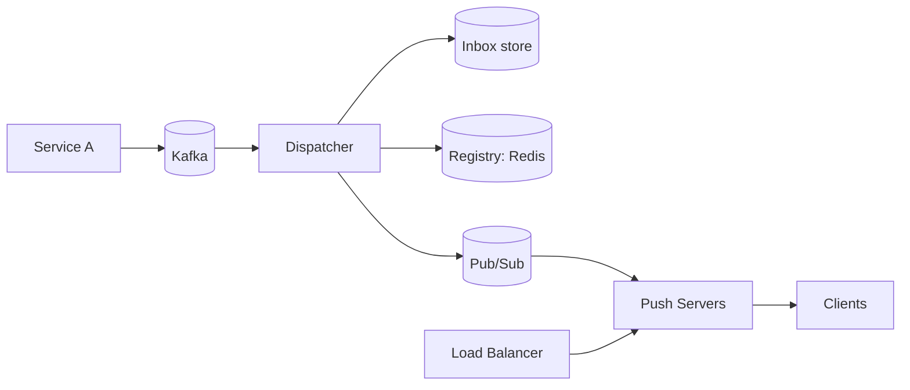
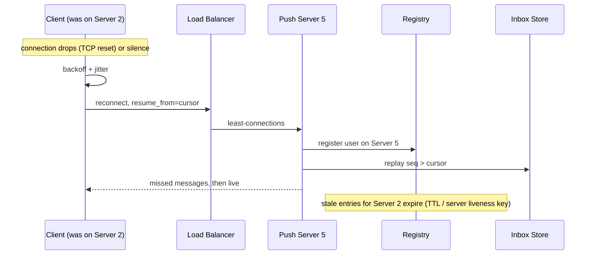
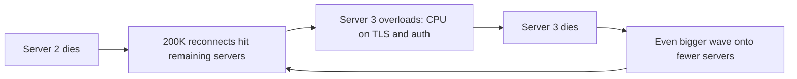
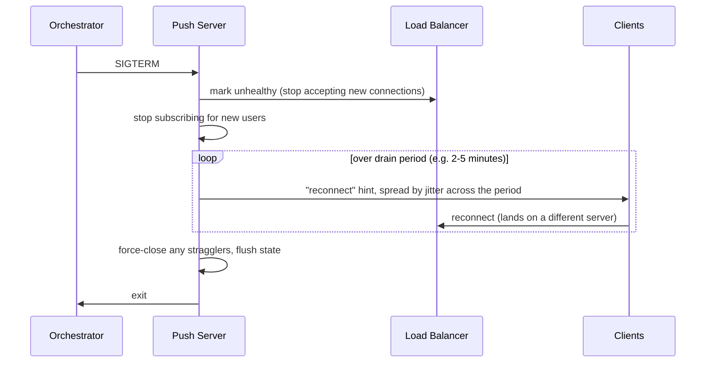
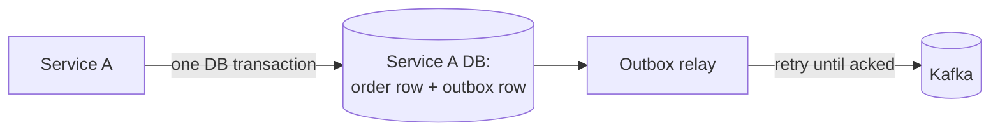

# Chapter 8: Failures

## 8.1 How to think about failure in this system

Chapters 2 to 7 built a pipeline. Now we ask the question from Chapter 1 about **every component**:

> *"If this dies, who notices, what is lost, and how does the system repair itself?"*

The pipeline again, with each box a possible failure:



The design principle that makes this survivable:

> **Durable truth lives in two places only: Kafka and the inbox store. Everything else (registry, pub/sub, push-server memory) is rebuildable cache or fast lane.**

If a component holds only rebuildable state, its failure means *degraded speed*, not *lost data*. Keep this sentence in mind throughout.

## 8.2 Failure matrix (the cheat sheet)

| Component fails | What is lost | Who detects | Recovery | Data loss? |
|---|---|---|---|---|
| **One push server** | Its connections, local maps | Clients (silence or close), registry TTL | Clients reconnect elsewhere and resume by cursor | **No** (Tier 1) |
| **Many push servers (bad deploy)** | Many connections at once | Same | Same, but risk of **reconnect storm** | No, but outage risk |
| **Registry (Redis)** | Routing hints | Dispatcher errors | Fallback routing, rebuild as clients re-register | No |
| **Pub/Sub broker** | Live fast lane | Dispatcher publish errors | Clients fall back to polling/catch-up, servers resubscribe | No for Tier 1, **yes for Tier 0** |
| **Inbox store (DB)** | Ability to persist and replay | Dispatcher write errors | Stop acking Kafka, retry, serve live only as degraded mode | No if you refuse to ack |
| **Kafka** | Ability to ingest new events | Producer errors | Producers buffer or fail, outbox pattern | Depends on producer |
| **Dispatcher** | In-flight processing | Kafka consumer group rebalance | Another instance resumes from the last committed offset | No (but **duplicates**) |
| **Load balancer** | New connections (existing ones may survive) | Health checks | LB redundancy, DNS failover | No |
| **Whole AZ/region** | Everything there | Health checks | Multi-AZ spread, multi-region (separate course) | Depends |

Now each one properly.

## 8.3 A push server crashes

The scenario: Push Server 2 holds 200K connections, and the process or machine dies.



What happens in the three layers:

| Layer | Behavior |
|---|---|
| **Clients** | See a closed socket (crash with RST) or silence (hard power loss). They reconnect with backoff, jitter and cursor |
| **Registry** | Entries for Server 2 remain until the **server liveness key** expires (seconds) or per-connection TTLs expire. Meanwhile the dispatcher might push to the dead server (lost on the live path) |
| **Messages in the blind window** | Already stored in the inbox, so replayed on reconnect. **Nothing lost** |

What is lost: only **Tier 0** messages sent in that window, which by definition we accepted. And **group subscriptions** on that server, which the clients re-establish on reconnect (Chapter 5.8).

**Key design requirement:** a push server must be **disposable**. If killing one hurts, you've put something durable in it. Test this by killing a random push server in production-like environments on a schedule.

## 8.4 The reconnect storm (thundering herd)

When 200K clients lose their connection at once, they all try to reconnect at once. Each reconnect is expensive:

- TLS handshake
- Authentication (token validation, maybe a DB or auth-service call)
- Registry write
- Inbox read for replay
- Possibly a state snapshot (Chapter 3.4)

If the survivors are already near capacity, this wave of work can take down **the next server**, which triggers another wave, and so on. This is a **cascading failure**, and it is the classic way push systems die.



### Defenses (use several together)

**1. Client side: jittered exponential backoff** (Chapter 7.8). Spreads the wave over time. This is the cheapest and most important defense.

**2. Capacity headroom (N+1 or N+2 sizing).** Run the fleet so that losing a server, or an entire AZ, still leaves enough capacity for the reconnect work. If your servers run at 90% of their connection capacity, one failure is fatal. Plan for something like 60 to 70% steady-state.

**3. Server-side admission control (rate-limit new connections).**

```java
// each push server limits how fast it accepts NEW connections
RateLimiter newConns = RateLimiter.create(2_000);    // per second, tuned by load test

Response accept(Request r) {
    if (!newConns.tryAcquire()) {
        return Response.status(503).header("Retry-After", jitterSeconds(1, 5)).build();
    }
    return handshake(r);
}
```

Excess clients get `503` plus `Retry-After` and try later, which is better than the server drowning. This is **load shedding**, and refusing early is cheaper than failing late.

**4. Make reconnect cheap.**

- **Cache auth validation** (verify a signed JWT locally, no network call).
- **Resume from cursor** sends only the gap, not full history.
- **Cap replay batch size**, then stream the remainder gradually (don't read 10,000 messages in one go for each of 200K clients).
- **Lazy snapshot**: send snapshots at a controlled rate.

**5. Don't kill a whole fleet at once.** Rolling deploys (next section) move a bounded fraction at a time.

**6. LB-level connection rate limiting and slow-start.** A new server joining the pool should ramp up its share of connections gradually. Otherwise least-connections sends *every* reconnecting client to the empty newcomer, and it collapses. Configure **slow start** on the LB.

## 8.5 Graceful shutdown and deploys

Deploys are the most common "failure" you'll ever cause yourself. Handle them deliberately so a routine release doesn't look like a crash.

**Draining protocol:**



Key points:

- **Stop accepting first, then shed connections gradually.** Don't close 200K sockets in one instant.
- **Spread the disconnects across minutes with jitter**, which is a controlled, slow reconnect wave and not a storm.
- Send an explicit **"please reconnect"** message (or SSE `retry:` hint, or a WebSocket close code like `1012 Service Restart`) so clients reconnect immediately and quietly, without alarming the user.
- Set the orchestrator's **termination grace period** long enough (Kubernetes `terminationGracePeriodSeconds`) and use a **preStop hook** to begin draining.
- Roll out **a small percentage at a time** (e.g., 5 to 10%), and wait for connection counts to rebalance before continuing.

## 8.6 The registry (Redis) goes down

What breaks: the routing hint lookup. Push servers can't register or refresh, and the dispatcher can't find where a user is.

What does **not** break: the inbox. Messages are still durably stored, and connected users with live sockets still receive messages if routing can be done another way.

**Degraded modes, in order of preference:**

| Mode | How | Trade-off |
|---|---|---|
| **Replica / cluster failover** | Redis Sentinel or Cluster promotes a replica | Seconds of outage. Replica may miss the latest writes, which is fine because the data is a hint |
| **Fallback to broadcast-and-filter** | Dispatcher publishes to a shared channel and every server filters locally (Chapter 2.4, Strategy 1) | Wasteful, but **works with no registry**. Fine for a short outage |
| **Skip the live path, rely on inbox only** | Don't push. Clients catch up by short polling or on next reconnect | Latency worsens, but nothing is lost |

**Rebuild after recovery:** if Redis comes back empty, nothing is permanent. Each push server **re-registers all its local connections** (it knows them all, because it holds the sockets). This "repopulate from the source of truth, which is the servers' own memory" is why the registry can be an in-memory store at all.

Design rule: **registry calls must have short timeouts and a circuit breaker.** A slow Redis must not make the dispatcher or the handshake hang. Fail fast into a degraded mode.

## 8.7 The pub/sub broker goes down

What breaks: the fast lane. Push servers lose their subscriptions, and live messages stop flowing.

| Event class | Impact | Repair |
|---|---|---|
| **Tier 0 (ephemeral)** | Lost for the duration | Accept. Next update supersedes |
| **Tier 1 (inbox-backed)** | Not lost, only **delayed** | On resubscribe, each server runs a **catch-up pass** for its connected users: read inbox `seq > lastSentSeq` per connection and push |
| **Broadcast state (Chapter 3)** | Stale until next update | After resubscribe, **re-send the current snapshot** to all local connections |

**Resubscribe logic must be automatic and idempotent.** Push servers detect the broken subscription, reconnect with backoff, **re-subscribe to every channel they should hold** (inbox channel plus all group channels from the refcount map), then trigger the catch-up pass. Keep the desired-subscription set in the server's memory (`groupLocalMembers` from Chapter 5) so it can rebuild exactly.

Because pub/sub is fire-and-forget, a classic subtle bug is **silent subscription loss** (the TCP connection to the broker is fine but a subscription was dropped). Mitigation: a periodic **reconciliation** job that compares the "should be subscribed" set with the actual one, and a **liveness canary** message on each channel that the server expects to see regularly.

## 8.8 The inbox store (DB) goes down

This is the most dangerous failure, because it is the source of truth for Tier 1.

**The cardinal rule: if you cannot persist, do not acknowledge upstream.**

```java
void handle(DomainEvent e) {
    try {
        inboxStore.append(userId, notification);   // durable write
    } catch (Exception ex) {
        throw ex;                                  // DO NOT commit the Kafka offset
    }
    pubsub.publish(...);                           // fast lane
    kafkaConsumer.commit(offset);                  // only after the durable write succeeded
}
```

Kafka then holds the events. When the DB recovers, the dispatcher resumes from the last committed offset and nothing is lost. **Kafka is your shock absorber for a DB outage**, which is a major reason it sits upstream of the dispatcher.

During the outage, you have a choice:

| Option | Behavior | When |
|---|---|---|
| **Stall** (default for Tier 1) | Stop processing, let lag build in Kafka | When you can't afford to deliver unrecorded messages |
| **Push live without persisting** | Deliver via pub/sub, skip the write | Only if loss on a later disconnect is acceptable. You've effectively downgraded Tier 1 to Tier 0 |

Pick the first for important events. The second silently breaks your "resume from cursor" promise: a client could be live-fed seq 141 that isn't stored, then reconnect and find a hole. If you ever do this, you have to mark those messages so replay can't skip them.

Standard DB resilience applies: replication, failover, and timeouts with retry plus backoff. The inbox table is append-heavy and partition-friendly by `userId`.

## 8.9 Kafka goes down (or the producing service can't reach it)

The failure is on the **producer** side: Service A can't publish the event.

The correct pattern is the **transactional outbox**: Service A writes the event to *its own database* in the **same transaction** as its business change, and a relay process publishes from that outbox table to Kafka (retrying until success).



Without it, you get a dual-write problem: the order is saved but the Kafka publish fails (or vice versa), and the notification is silently lost or sent for something that never committed. With it, a Kafka outage only **delays** events.

Also use `acks=all`, idempotent producers, and a replication factor of 3 for the topics that carry important events.

## 8.10 Dispatcher crashes mid-processing

The dispatcher reads an event, writes it to the inbox, publishes to pub/sub, and then dies **before committing the Kafka offset**. After the consumer-group rebalance, another instance reads the same event again.

| Crash point | Result on retry |
|---|---|
| Before inbox write | Normal processing, no harm |
| After inbox write, before offset commit | **Duplicate attempt** |
| After pub/sub publish, before offset commit | Duplicate attempt and a duplicate live push |

This is **at-least-once**, as expected. The fix is **idempotency on the write**:

```
INSERT INTO inbox(user_id, event_id, seq, payload)
VALUES (?, ?, ?, ?)
ON CONFLICT (user_id, event_id) DO NOTHING;     -- same event_id never inserted twice
```

Use a stable `event_id` carried from the source event (not generated at the dispatcher), with a unique constraint on `(user_id, event_id)`. A retry then hits the conflict, does nothing, and reuses the already-assigned `seq`. Chapter 9 covers this in depth.

## 8.11 Poison messages and dead letters

One malformed or unprocessable event (a missing user, bad payload, a bug triggered by one record) can **block a Kafka partition** if the dispatcher retries it forever, and every message behind it stalls.

Standard solution:

1. Retry a few times with backoff for transient errors.
2. If it still fails, **move it to a dead-letter topic** with the error attached, commit the offset, and continue.
3. Alert on DLQ growth. A human or a replay job reviews it later.

Distinguish **transient** errors (DB timeout, retry) from **permanent** errors (invalid payload, send to DLQ immediately).

## 8.12 Load balancer and zonal failures

| Failure | Mitigation |
|---|---|
| **LB instance** | Managed LBs are redundant by design. Otherwise use an active-passive pair or DNS with multiple IPs |
| **Health checks** | Check a lightweight `/healthz` that verifies the server can accept connections. Don't make it depend on Redis (or one Redis blip drains your whole fleet) |
| **Existing connections** | Mostly survive an LB change if the LB is TCP-transparent. Many LB failovers drop connections, so clients must reconnect anyway |
| **AZ failure** | Spread push servers across **at least 3 AZs**, sized so that losing one AZ's share is absorbed (this is the N+1 headroom from 8.4) |
| **Region failure** | Needs multi-region architecture (client reconnects to another region, state re-synced). That's the dedicated multi-region topic and beyond our scope here |

## 8.13 Design for the common property: every path ends at the cursor

Look back at what repaired each failure:

| Failure | Repaired by |
|---|---|
| Push server crash | Client reconnect and **cursor resume** |
| Pub/sub outage | Resubscribe, then **catch-up from the inbox** |
| Registry loss | Servers re-register. Meanwhile messages sit in the **inbox** |
| Dispatcher crash | Kafka redelivery plus **idempotent insert** |
| Stale route (message to the wrong or dead server) | Client **cursor and gap detection** |

Every recovery path ends in the same place: **durable store plus client cursor**. This is why the architecture is robust. You don't need perfect routing, perfect heartbeats, or a perfect broker. You need a durable record and a client that can ask for what it missed.

## 8.14 Operational must-haves

| Practice | Why |
|---|---|
| **Metrics:** connections per server, connect/disconnect rate, reconnect rate, heartbeat misses, end-to-end delivery latency (event time to socket write), dispatcher consumer lag, DLQ depth, inbox replay size | A reconnect storm or a lagging consumer shows up here first |
| **Alerting on lag**, not just errors | Quiet failures look like "everything is fine, nothing is arriving" |
| **Load test the reconnect path**, not only steady state | The cascade failure only appears under a simultaneous reconnect |
| **Chaos testing**: kill servers, kill Redis, drop the broker | Verifies that the "disposable server" claim is true |
| **Kill switches / feature flags**: pause non-critical pushes, reduce fan-out, raise `Retry-After` | Lets you shed load fast during an incident |

## 8.15 Chapter 8 summary

| Concept | Remember as |
|---|---|
| Principle | Durable truth is **only Kafka plus the inbox**. The rest is rebuildable |
| Push server crash | Disposable. Clients reconnect and resume. Messages in the blind window are replayed |
| Reconnect storm | Jittered backoff, **headroom**, **admission control (503 + Retry-After)**, cheap reconnect, LB slow-start |
| Deploys | **Drain gradually**: stop accepting, hint clients to reconnect, spread over minutes |
| Redis down | Fallback to broadcast-and-filter or inbox-only. Servers re-register to rebuild |
| Pub/Sub down | Auto-resubscribe, **catch-up from inbox**, resend snapshots. Reconcile to catch silent loss |
| DB down | **Don't ack Kafka until the durable write succeeds** |
| Kafka down | Producer side uses a **transactional outbox** |
| Dispatcher crash | At-least-once, so **idempotent insert** on `(user_id, event_id)` |
| Poison message | Retry, then **DLQ**. Never block the partition |
| Meta-pattern | Every repair ends at **durable store plus client cursor** |

---

**Next: Chapter 9, Retries, duplicates, ordering, and idempotency.** We've said "at-least-once plus idempotence" many times. Now we make it concrete: where duplicates are born at every hop, how event ids and sequence numbers flow end to end, per-user ordering guarantees (and when they break), retry policies with backoff, and how to make client-side handling truly idempotent. Say **"next"** when ready.
