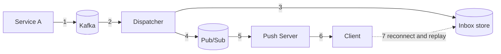
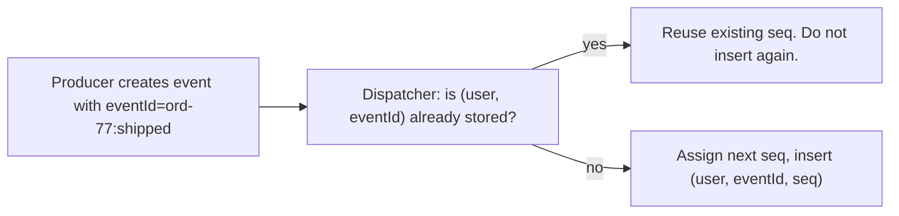
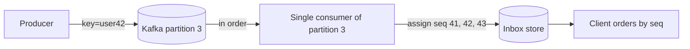
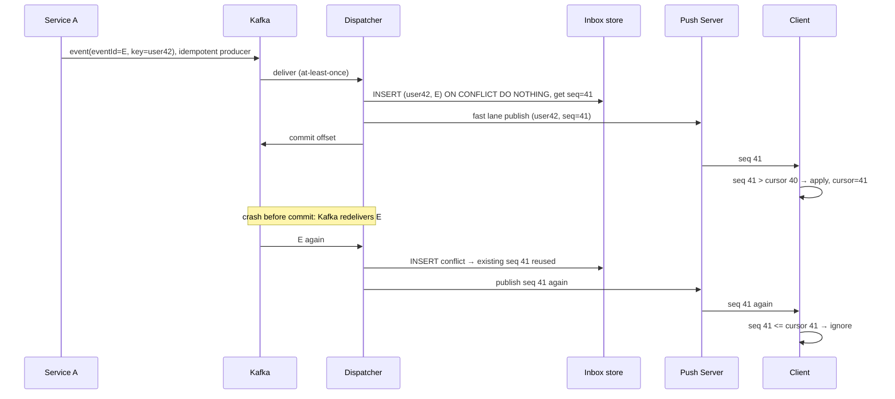

# Chapter 9: Retries, duplicates, ordering, and idempotency

## 9.1 Why this chapter exists

Chapters 6 and 8 made a promise: **at-least-once delivery plus idempotence gives effectively-once**. Now we cash it in. Every reliable system retries, and **every retry can create a duplicate or a reordering**. If you retry without thinking, you trade "lost messages" for "doubled and scrambled messages".

Three separate problems, three separate tools:

| Problem | Cause | Tool |
|---|---|---|
| **Duplicates** | Retries, redelivery, replay overlap | Stable ids and idempotent writes |
| **Reordering** | Parallelism, retries, multiple paths | Per-stream sequence numbers and a single ordering point |
| **Retry storms** | Naive retry loops | Backoff, jitter, budgets, and knowing what *not* to retry |

## 9.2 Where duplicates are born (map every hop)

Walk the pipeline once and mark where a message can appear twice.



| Hop | How a duplicate appears |
|---|---|
| **1. Producer to Kafka** | Producer sends, the broker writes it, the ack is lost, the producer retries, and the broker holds **two copies** |
| **2. Kafka to dispatcher** | Dispatcher processes, crashes before committing the offset, and another instance **re-reads** it |
| **3. Dispatcher to DB** | Retry after a timeout where the first write actually succeeded |
| **4. Dispatcher to pub/sub** | Same as 2: a re-run of the handler **republishes** |
| **5. Pub/sub to push server** | A user with two devices on two servers legitimately receives two copies. Also reconnect races, where both the replay and the live feed carry the same message |
| **6. Push server to client** | Server retries (Tier 2) after a slow ack |
| **7. Resume overlap** | Client reconnects with cursor 120, and the replay sends 121 to 140 while live also delivers 138 to 140 |

You can't eliminate these. Hops 1 to 7 are all legitimate consequences of being safe against loss. So the strategy is not "prevent duplicates", it is:

> **Make processing the same message twice harmless.**

## 9.3 The identity of a message: ids that never change

Everything depends on **stable identity**. Define two identifiers and be strict about who creates them and when.

| Id | What it is | Created by | Scope | Purpose |
|---|---|---|---|---|
| **`eventId`** | Unique id of the business event | The **producer** (Service A), at creation | Global | Dedupe at every hop. Same event always has the same id |
| **`seq`** | Position within a stream (user inbox, group, doc) | The **sequencer** (dispatcher or room owner) | Per stream | Ordering, cursors, gap detection |

**Rules that prevent subtle bugs:**

1. **Create `eventId` once, at the source, and never regenerate it.** If the dispatcher generates a fresh UUID on each attempt, the retry looks like a brand-new message and dedupe is impossible.
2. Make it **deterministic where possible**: `orderId + ":shipped"` is better than a random UUID, because even if the producer itself retries and recreates the event, the id is the same.
3. **`seq` is assigned after dedupe**, so a duplicate attempt reuses the existing seq rather than consuming a new one (a new seq for a duplicate would show the same message twice with different positions).



## 9.4 Idempotent writes: three techniques

### Technique 1: Unique constraint (the workhorse)

```sql
CREATE TABLE inbox (
    user_id    BIGINT,
    seq        BIGINT,
    event_id   TEXT,
    payload    JSONB,
    created_at TIMESTAMP,
    PRIMARY KEY (user_id, seq),
    UNIQUE (user_id, event_id)
);

INSERT INTO inbox(user_id, seq, event_id, payload)
VALUES (:u, :nextSeq, :e, :p)
ON CONFLICT (user_id, event_id) DO NOTHING;
```

The database itself enforces "this event is stored at most once per user". Retries are safe by construction. This is the single most useful technique, so prefer it whenever the store supports uniqueness.

**Subtle issue:** the example computes `:nextSeq` before the insert. If the insert is skipped as a conflict, the counter has been burned, leaving a **gap** in seq (e.g., 41, 43). Gap detection on the client (Chapter 6.7) would then ask for a resync forever. Two fixes:

- Assign seq **inside the same statement or transaction** as the insert (so a conflict rolls it back), or
- Make the client tolerate gaps it can verify are not real: the server replies "nothing exists between 41 and 43" during resync.

The cleanest version: the dedupe check and seq allocation happen in one transaction with a per-user row lock or a single writer per user (Kafka partition keyed by userId).

### Technique 2: Dedupe table or cache (when the sink has no uniqueness)

For things like pub/sub publishes or calls to another service, keep a **processed-ids** record:

```
SET dedupe:{eventId} 1 NX EX 86400      // NX = only if not exists
```

If the `SET NX` succeeds, you're the first: process it. If it fails, skip. The TTL needs to exceed the longest plausible redelivery window (Kafka retention or retry horizon), not shorter, or an old retry slips through.

Caution: "check then act" is not atomic across a crash. If you mark processed and then crash before the side effect, the message is **lost**. If you perform the effect and then crash before marking, it's **duplicated**. For pure at-least-once, do the effect first and mark second, and make the effect itself idempotent where you can.

### Technique 3: Natural idempotence ("set" instead of "add")

Design the message so applying it twice equals applying it once:

| Not idempotent | Idempotent |
|---|---|
| `unreadCount += 1` | `unreadCount = 7` (absolute value) |
| `balanceChange: +50` | `balance: 750, version: 12` |
| "Insert shape" | "Upsert shape id=abc with these properties" |
| "Increment likes" | "Set like(user, post) = true" |

When you can choose, prefer **state-carrying messages with versions** (like the leaderboard in Chapter 3). Duplicates and reorderings then collapse naturally: apply only if `incoming.version > current.version`.

## 9.5 Idempotent producer (hop 1)

Kafka can dedupe at the producer: enable `enable.idempotence=true` (with `acks=all`). The broker tracks producer id plus per-partition sequence and discards a retry of something it already wrote. That fixes the lost-ack duplicate at hop 1, at almost no cost.

Be honest about its limit: it only protects **a single producer session's retries to Kafka**. It does not protect against the producing *application* creating the same event twice after a restart (that's what the deterministic `eventId` and the outbox relay in Chapter 8.9 are for), and it does not extend past Kafka.

## 9.6 Idempotent client (hop 6 and 7)

The client is the **last line of defense**, and the cheapest place to enforce it, because it has the cursor.

```java
// per-stream state on the client
long lastProcessed;                       // cursor
Set<String> recentEventIds = new LRUSet<>(500);   // for streams without dense seq

void onMessage(Msg m) {
    if (m.seq <= lastProcessed) return;         // already processed (dup or replay overlap)
    if (m.seq > lastProcessed + 1) {            // gap
        requestResync(lastProcessed);
        return;
    }
    if (!recentEventIds.add(m.eventId)) return; // belt and braces
    apply(m);                                   // UI update
    lastProcessed = m.seq;
    persistCursor(lastProcessed);               // survive restarts
}
```

Think of this as three layers of the same defense, each cheaper and closer to the user:

| Layer | Check | Catches |
|---|---|---|
| **Store** | `UNIQUE(user, eventId)` | Dispatcher and retry duplicates |
| **Server on resume** | Replay only `seq > cursor`, skip `<= lastSent` in the buffer flush | Replay and live overlap |
| **Client** | `seq <= lastProcessed` and recent ids | Anything that slipped through |

**Side effects on the client** (play a sound, show a toast, increment a badge) must also be gated by the same check. A duplicate message that is dropped from the list but still pings the user is still a bug.

**Multi-device note:** each device has its **own cursor**. A message legitimately arrives once *per device*, so dedupe is per-connection, not per-user.

## 9.7 Ordering: what you can and cannot promise

Ordering is about **which stream** you promise order within. Promising global order across all users is both unnecessary and unaffordable, so scope it:

| Scope | Typical promise |
|---|---|
| **Per user inbox** | Notifications arrive in the order they were generated |
| **Per group / channel** | Chat messages appear in one consistent order for all members |
| **Per document** | Edits are applied in one agreed order (Chapter 5.6) |
| **Across streams** | **No promise**. "Alice's post notification before Bob's like" doesn't matter |

### How ordering is established

1. **Kafka partitioning by stream key.** Key = `userId` (or `groupId`). Kafka guarantees order *within a partition*, and the same key always maps to the same partition, so all events for one stream stay in order.
2. **A single sequencer per stream.** The consumer that owns that partition assigns `seq` in the order it reads. Because one thread handles the partition sequentially, seq order equals arrival order.
3. **The client trusts `seq`, not arrival time.** If message 8 arrives before 7, the client holds 8 briefly (or requests 7) rather than showing it out of order.



### How ordering silently breaks (the traps)

| Trap | Why it breaks order | Fix |
|---|---|---|
| **Parallel processing inside a partition** | A thread pool handles messages 1, 2, 3 concurrently, and 3 finishes first | Process a partition **sequentially**, or parallelize **across keys** (e.g., a worker per key hash), never within one key |
| **Producer retries without idempotence** | Message A fails, B is sent, A is retried and lands after B | `enable.idempotence=true`, which also preserves order for up to 5 in-flight requests |
| **Dispatcher retry of a failed event** | Event 5 fails and is retried later, but 6 already went out | Block the key on failure (retry in place), or use a retry topic **only** when order doesn't matter for that stream |
| **Partition count change** | Re-partitioning changes which partition a key maps to, and old and new events race | Plan partition counts up front, and migrate carefully when growing |
| **Consumer rebalance** | Two instances briefly think they own a partition | Idempotent writes plus a seq assignment guarded by a transaction or fencing |
| **Live path vs replay path** | Replay of 121 to 140 and live 141 interleave | Server buffers live, replays, flushes in order (Chapter 6.7) |
| **Two delivery paths to the same user** | Pub/sub and mobile push arrive in different orders | Client orders by `seq`, and non-socket paths carry the seq too |
| **Wall-clock ordering** | Clock skew between machines | Order by `seq` or Kafka offset, never by timestamps |

**The head-of-line blocking trade-off:** strict per-key ordering means one stuck message (a failing retry) blocks everything behind it **for that key**. For per-user streams this is usually tolerable (one user affected). For a poison message, use the DLQ policy from Chapter 8.11, accepting that the DLQ'd event is skipped and noting the gap deliberately.

**Do you actually need order?**

| Message type | Order needed? |
|---|---|
| Chat messages in a conversation | Yes |
| Document edit operations | Yes (strictly) |
| Notifications | Mostly no. Sorted by created time on display is enough |
| Live scores, leaderboards, presence | No. **Versioned latest-wins** handles any order |

Don't pay for ordering you don't need. Notifications can often be processed in parallel with no key ordering, and sorted for display by timestamp or seq.

## 9.8 Retries: the policy

A retry is a bet that the failure was **transient**. Make the bet carefully.

### What to retry, and what never to

| Error | Action |
|---|---|
| Timeout, connection reset, 503, throttling | **Retry** with backoff |
| 429 (rate limited) | Retry **after** the `Retry-After` interval |
| Deadlock, serialization failure | Retry immediately a few times |
| 400, validation error, missing user, malformed payload | **Do not retry**. Send to DLQ |
| 401 / 403 | Don't retry blindly. Fix credentials or drop |
| Unknown or ambiguous result after timeout | Retry **only if the operation is idempotent** (this is why 9.4 comes first) |

> **You may only safely retry an operation if it is idempotent.** The idempotence work in this chapter is the *permission slip* for retries.

### Backoff with jitter

```java
long delay = Math.min(maxDelay, baseDelay * (1L << attempt));   // exponential: 100ms, 200, 400, ...
long jittered = ThreadLocalRandom.current().nextLong(0, delay + 1);   // full jitter
sleep(jittered);
```

- **Exponential** gives a struggling dependency time to recover.
- **Jitter** prevents all failed callers from retrying in lockstep.
- **Cap** the delay and the **number of attempts**.

### Retry budgets and amplification

If each layer retries 3 times and there are 3 layers, one request becomes **27** attempts against the bottom service, precisely when it is already struggling. This is **retry amplification**, and it turns a blip into an outage.

Defenses:

- **Retry at one layer** (usually the outermost or the one with the most context), not at every layer.
- A **retry budget**: retries limited to, say, 10% of normal traffic.
- A **circuit breaker**: after N consecutive failures, stop calling for a cool-off period and fail fast.
- **Deadlines**: a request that is already too late shouldn't be retried (a "your order shipped" push from an hour ago may not be worth sending).

### Retry placement across this system

| Location | Retry mechanism | Notes |
|---|---|---|
| Producer to Kafka | Client library retries + idempotent producer | Built in |
| Dispatcher processing | Retry in place with backoff, then DLQ | Keep per-key order |
| DB write | Short bounded retry on transient errors | Idempotent insert |
| Pub/sub publish | Usually **no retry needed** for Tier 1, because the inbox covers a lost push. Don't build heavy retry for the fast lane | Tier 0 is dropped |
| Server to client (live) | **None** for Tier 1. The cursor is the retry. Tier 2 uses the ack-and-retry state machine (Chapter 6.9) | |
| Client to server (reconnect) | Backoff with jitter plus cursor | Chapter 7.8 |

Notice the pattern: **the fewer places you build retry, the simpler the system.** For Tier 1 the "retry" is simply the client's resume. For Tier 2, retry lives in exactly one component, the retry worker.

## 9.9 End-to-end exactly-once effect: the full chain

Put the pieces into one picture of how a single event stays correct through every failure.



Even with a crash and redelivery, the user sees the notification **once**. Every layer is allowed to duplicate, and some layer downstream absorbs it.

## 9.10 Retention and dedupe windows

Dedupe state isn't infinite either. Match the windows:

| Item | Keep for |
|---|---|
| Dedupe cache / processed-id TTL | **Longer than** the maximum redelivery horizon (Kafka retention or retry policy) |
| Inbox unique constraint | As long as the row exists, so effectively forever and free |
| Client recent-id set | Small LRU, because `seq` is the primary guard |
| Kafka retention | Longer than any plausible dispatcher downtime or replay need |

If a retry can arrive after the dedupe record expired, you've reopened the duplicate hole. Make that window explicit in the design.

## 9.11 Common mistakes

| Mistake | Consequence |
|---|---|
| Generating `eventId` in the dispatcher | Retries are indistinguishable from new events |
| Non-deterministic ids when the producer itself can retry | Duplicates at the source |
| Retrying non-idempotent operations | Double charges, double notifications |
| Mark-then-process in dedupe, with a crash in between | Message **lost**, which is worse than duplicated |
| Thread pool inside a partition | Silent reordering |
| Timestamps as order | Skew and ties create wrong order and skipped messages |
| Retry at every layer | Amplification, and a cascading outage |
| Retrying 4xx and poison messages | Blocked partition, wasted capacity |
| Burning seq on duplicates | Permanent "gaps" that trigger resync loops |
| Side effects not gated by the dedupe check | Duplicate sound or badge despite deduped data |
| Promising global ordering | Unaffordable, and unnecessary |

## 9.12 Chapter 9 summary

| Concept | Remember as |
|---|---|
| Duplicates | Born at **every hop**. Can't prevent them, so make them **harmless** |
| Identity | **`eventId` created once at the source, never regenerated**. `seq` assigned by the sequencer **after** dedupe |
| Idempotent writes | `UNIQUE(user_id, event_id)` with `ON CONFLICT DO NOTHING`. Or `SET NX` with TTL. Or state-carrying, versioned messages |
| Kafka producer | `enable.idempotence=true` and `acks=all`. Pair with a deterministic eventId and the outbox |
| Client | Last line of defense: `seq <= cursor` means ignore, gap means resync. Gate side effects too |
| Ordering | Scope it: **per stream**. Key by stream id, sequential per partition, `seq` assigned by one writer |
| Order breakers | Parallelism within a key, retries that reorder, rebalance, partition change, timestamps |
| Do you need order? | Chat and doc ops yes. Notifications mostly no. Latest-wins state never |
| Retries | Only on transient errors, only for idempotent operations, with **exponential backoff and jitter**, a cap, a budget, and a circuit breaker |
| Retry placement | As few places as possible. For Tier 1 the client's resume **is** the retry |
| Dedupe windows | Must outlast the redelivery horizon |

---

**Next: Chapter 10, Storage choices.** Exactly what you store and where: connection registry, inbox or message log, group membership, cursors and acks, presence, snapshots, and dedupe state. We'll compare Redis, Cassandra/DynamoDB, SQL, and Kafka as the inbox for this workload (access patterns, write volume, retention, TTL, partitioning), and settle which database suits "only this workflow". Say **"next"** when ready.
