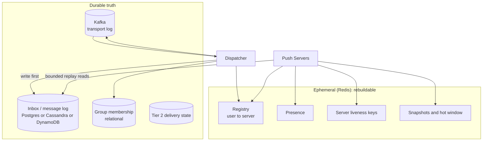

# Chapter 10: Storage choices

## 10.1 Start by listing what we actually store

Over nine chapters we have mentioned many pieces of state. Before choosing any database, put them in one table and ask, for each, **"can we lose it?"** and **"how is it accessed?"**.

| State | What it holds | Can we lose it? | Access pattern |
|---|---|---|---|
| **Local connection maps** | `connId → socket`, `userId → connIds` | Yes (clients reconnect) | In-process memory |
| **Connection registry** | `user → {connId → server}` | Yes (rebuilt by servers) | Very high read and write, point lookups, TTL |
| **Server liveness keys** | `server:N:alive` | Yes | Tiny, constant refresh |
| **Presence** | `user → online`, per-room member sets | Yes | High write, TTL, point reads |
| **Latest-state snapshots** | Leaderboard, score, "current doc state" | Rebuildable from source | Read heavy, single key |
| **Inbox / message log** | Per-user and per-group messages with `seq` | **No (this is the truth)** | Append, range read by `seq > cursor`, per stream |
| **Group membership** | Who belongs to which group | **No** | Point reads, both directions (group to users, user to groups) |
| **Seq counters** | Next `seq` per stream | Must never go backward | Atomic increment |
| **Dedupe state** | Processed `eventId`s | Windowed | Point existence check |
| **Tier 2 delivery state** | `PENDING / SENT / ACKED`, attempts, next retry | No | Update by id, scan by `next_retry_at` |
| **Cursors / receipts** | Last acked `seq` per device | Mostly the client's job | Low-frequency writes |
| **Transport log** | Kafka topics | No (within retention) | Sequential append and read |

This splits cleanly into two groups, and the split is the main design decision of this chapter:

| | **Ephemeral / rebuildable** | **Durable / truth** |
|---|---|---|
| Items | Registry, presence, liveness, snapshots cache, local maps | Inbox log, membership, Tier 2 state, Kafka |
| Priority | Speed, TTL | Correctness, durability, retention |
| Typical store | **Redis** (or in-memory) | **SQL, Cassandra/Scylla, or DynamoDB** |
| If it dies | Degraded speed, rebuilds itself | An incident |

Don't use one database for both groups. Putting heartbeat-rate writes into your durable store melts it. Putting your only copy of messages into Redis loses them.

## 10.2 The inbox: understand its access pattern first

The inbox is the heart of the durable side. Pick its store by looking at *how it is used*, not by brand.

| Property | Inbox reality |
|---|---|
| **Writes** | Append only, new messages at the head of a stream. Very high volume |
| **Reads** | "Give me stream S where `seq > cursor`, in order, up to N rows" (range scan inside one partition) |
| **Point lookups** | "Does `(user, eventId)` already exist?" (dedupe) |
| **Updates** | Rare (receipts, status for Tier 2). Messages are mostly immutable |
| **Deletes** | By **time or count retention**, never row by row on demand |
| **Joins / cross-stream queries** | **None** on the hot path |
| **Partition key** | Natural: the **stream id** (userId, groupId, docId) |
| **Consistency need** | Read-your-writes for one stream. No cross-stream transactions |

That is the textbook profile of a **partitioned, wide-row, time-ordered log**: a key-value store with a sorted range inside each partition. Relational features (joins, multi-row transactions) are not needed, and horizontal write scaling is.

## 10.3 Candidates compared

| Store | Fit for the inbox | Strengths | Weaknesses |
|---|---|---|---|
| **PostgreSQL / MySQL** | Good up to moderate scale | `UNIQUE` constraint gives free dedupe, transactions, familiar, simple ops | Write scaling needs sharding (by user hash). One huge table needs partitioning and cleanup jobs |
| **Cassandra / ScyllaDB** | **Excellent at large scale** | Built for append plus range-by-partition, linear write scaling, built-in per-row **TTL**, multi-AZ and multi-region | No joins, weak uniqueness (lightweight transactions are slow), tombstone pitfalls, careful data modeling |
| **DynamoDB** | **Excellent, fully managed** | PK = stream, SK = `seq`, native **TTL**, conditional writes for idempotency, no ops | Cost at high throughput, 400 KB item limit, hot-partition limits, vendor lock-in |
| **Redis (lists / sorted sets / Streams)** | Only as a **hot cache** of recent items | Microsecond reads, Streams support consumer cursors | Memory is expensive, durability is weaker (async persistence), not for long retention |
| **MongoDB** | Workable | Flexible docs, TTL indexes | Similar scaling story to the others, no special advantage here |
| **Kafka as the per-user inbox** | **No** | Great as transport | One topic or partition per user is the topic explosion we avoided. You can't efficiently read "user 42's messages after offset X" because many users share a partition |
| **Elasticsearch** | No for inbox | Search | Wrong shape. Add it later for message *search*, fed from the log |

Why Kafka is not the inbox deserves one more sentence, because it is the commonest wrong turn. Kafka's unit of read is a **partition**, and a partition interleaves thousands of users. To serve one user's replay you'd scan others' data. Kafka is the **pipe**, and the inbox store is the **per-stream index**.

### Recommendation by scale

| Scale | Choose |
|---|---|
| Startup to mid-size (up to hundreds of millions of messages per day, single region) | **PostgreSQL**, partitioned by time, with a unique constraint. Simplest and safest |
| Large, write-heavy, long retention, multi-region | **Cassandra/ScyllaDB or DynamoDB** |
| Latency-critical reconnect path | Any of the above **plus a Redis hot window** (last N messages per stream) |
| Mostly Tier 0 with a tiny durable slice | Redis for live and a small SQL table for the important messages |

## 10.4 Schema patterns

### Relational (Postgres)

```sql
CREATE TABLE inbox (
    user_id    BIGINT       NOT NULL,
    seq        BIGINT       NOT NULL,
    event_id   TEXT         NOT NULL,
    payload    JSONB        NOT NULL,
    created_at TIMESTAMPTZ  NOT NULL DEFAULT now(),
    PRIMARY KEY (user_id, seq),
    UNIQUE (user_id, event_id)
) PARTITION BY HASH (user_id);

-- replay on reconnect
SELECT seq, event_id, payload
FROM inbox
WHERE user_id = :u AND seq > :cursor
ORDER BY seq
LIMIT 200;
```

Retention in Postgres means dropping old **time partitions**, not running `DELETE` over millions of rows, which bloats the table. You'd typically range-partition by time and hash or shard by user across instances.

### Wide-column (Cassandra / Scylla)

```sql
CREATE TABLE inbox (
    user_id  bigint,
    seq      bigint,
    event_id text,
    payload  blob,
    PRIMARY KEY ((user_id), seq)
) WITH CLUSTERING ORDER BY (seq ASC)
  AND default_time_to_live = 604800;      -- 7 days, rows expire automatically

SELECT seq, event_id, payload FROM inbox
WHERE user_id = ? AND seq > ? LIMIT 200;  -- one partition, sequential read
```

### DynamoDB

```
Table: inbox
  Partition key: userId
  Sort key:      seq (number)
  Attribute:     expiresAt  → TTL enabled

Query: userId = :u AND seq > :cursor, Limit 200
Idempotent put: ConditionExpression attribute_not_exists(seq)
```

All three share the same shape: **partition by stream id, order by `seq` inside the partition, retention by TTL or partition drop.** Learn the shape once.

## 10.5 Dedupe and `seq` when the store has no unique constraint

Chapter 9 relied on `UNIQUE (user_id, event_id)`. Cassandra and DynamoDB don't give you that for free across a non-key column. Three workable options:

| Option | How | Notes |
|---|---|---|
| **Make the key itself deterministic** | Choose `seq` so a retry computes the **same** `(user_id, seq)` and the write becomes an idempotent upsert | See the offset trick below |
| **Separate dedupe table** | `(user_id, event_id)` as the primary key, insert with a conditional write (`IF NOT EXISTS` / `attribute_not_exists`) | Extra write per message, and LWTs in Cassandra are slow |
| **Dedupe cache** | Redis `SET NX EX` window (Chapter 9.4) | Window-bound. Acceptable when the retry horizon is short and known |

**The Kafka-offset trick.** If events are keyed by `userId`, each user's events go to one partition in order, and every event has a unique, increasing `(partition, offset)`. Use the **offset as `seq`**:

- A redelivered event has the **same offset**, so the same `(user_id, seq)` is written again, which is an idempotent overwrite. No dedupe table is needed.
- The cost: `seq` values for one user are **increasing but not consecutive** (other users' events occupy the offsets in between). So the dense-gap check from Chapter 6.7 no longer works as written.
- Fix: each stored message also carries `prevSeq` (the user's previous message). The client checks `m.prevSeq == lastProcessed` instead of `m.seq == lastProcessed + 1`. A mismatch still means a gap.

This is a good example of a general rule: pick the seq scheme and the gap-detection scheme **together**.

## 10.6 The registry and presence store

Everything here is small, hot, and disposable, so **Redis** is the standard answer.

**Sizing intuition (no math beyond order of magnitude):** a registry entry is on the order of 100 bytes. Even 10 million live connections is about a gigabyte, so the registry fits comfortably in a modest Redis Cluster. The constraint is **operations per second**, not memory.

| Data | Redis structure | Notes |
|---|---|---|
| Registry | Hash `conn:user:{id}` with `connId → serverId` | Shard by key (Redis Cluster) |
| Server liveness | String `server:N:alive` with short TTL | Chapter 7.7 |
| Presence | String with TTL, or per-room sorted set (score = last seen) | Grace period handled in app logic |
| Snapshots cache | String or hash, with `version` field | Written by the producer, read by push servers on connect |
| Dedupe window | `SET key NX EX` | Optional |

A subtle point about **TTL on a hash**: classic Redis only expires the **whole key**, not individual fields. If a user has two connections and one dies silently while the other keeps refreshing the key, the dead connection's field lives on. This is one more reason to use the **server liveness key** (Chapter 7.7): the dispatcher treats a field as valid only if its server's liveness key exists. Newer Redis versions also support per-field expiration on hashes, which you can use if your version allows it. Alternatively, use one key per connection (`conn:{connId}`) plus a per-user set, at the cost of more keys.

Persistence for this Redis can be **off or minimal**. If it restarts empty, servers re-register (Chapter 8.6). Trading durability for speed is correct here.

## 10.7 Membership and the reverse index

Group membership is **durable truth** and relational by nature.

```sql
CREATE TABLE group_members (
    group_id BIGINT,
    user_id  BIGINT,
    role     TEXT,
    joined_at TIMESTAMPTZ,
    PRIMARY KEY (group_id, user_id)
);
CREATE INDEX ON group_members (user_id, group_id);   -- "which groups is this user in?"
```

You need **both directions**:

| Query | Used for |
|---|---|
| Members of group G | Dispatcher fan-out for small groups (Chapter 5.3) |
| Groups of user U | On connect, deciding which channels to subscribe to, and permission checks |

Reads vastly outnumber writes, so **cache** the membership in Redis (or locally) with a **version** and invalidate on change events (Chapter 5.8). For very large groups, never load all members into memory on the push path. Ask "is user U in group G?" as a point query instead.

For huge scale, membership can also live in Cassandra or DynamoDB as two denormalized tables (one per direction), written together. For most systems a relational DB is enough.

## 10.8 Tier 2 delivery state

The notification state machine (Chapter 6.9) has different access patterns from the inbox: **update by id** and **scan by `next_retry_at`**.

```sql
CREATE TABLE notification_delivery (
    id            UUID PRIMARY KEY,
    user_id       BIGINT,
    status        TEXT,          -- PENDING, SENT, ACKED, FALLBACK, DEAD
    attempts      INT,
    next_retry_at TIMESTAMPTZ
);
CREATE INDEX ON notification_delivery (next_retry_at) WHERE status IN ('PENDING','SENT');
```

A relational DB suits this well (secondary index plus transactional updates). In Cassandra or DynamoDB the "scan by due time" is awkward and usually needs a time-bucketed table or a delay queue (e.g., SQS delay or a scheduler). Keep this table **small** by scoping Tier 2 to the few messages that need it.

## 10.9 Cursors and acks: what the server should (not) store

The **client** owns its cursor (Chapter 6). The server doesn't need it for correctness, because the client sends it on reconnect.

Store a server-side copy only when you need a product feature or housekeeping:

| Reason | Store |
|---|---|
| Delivery/read receipts shown to other users | `(user, group) → lastReadSeq` in the durable DB |
| Trimming the inbox below what every device has acked | `(user, device) → lastAckedSeq` |
| Unread counts for badges | Counter or derived `latestSeq - lastReadSeq` |

**Coalesce the writes.** Don't write to the DB for every ack. Acks arrive in a stream. Keep the latest value in memory or Redis and **flush periodically** (every few seconds, or on disconnect). Losing a few seconds of ack state just means a slightly longer replay later, which is harmless because replay is idempotent.

## 10.10 How the push server should touch the databases

You asked whether the push servers should connect to a DB and how to keep that correct. The answer is **very narrowly**.

| Push server does | Push server does not |
|---|---|
| **Read** a bounded replay range on connect (`seq > cursor`, `LIMIT N`) | Write inbox messages (the dispatcher does) |
| Read a **snapshot** for broadcast streams (from Redis) | Run business queries or joins |
| Read membership (from cache) | Hold a DB connection **per user socket** |
| Write registry and presence entries to **Redis** | Do synchronous DB work on the message-delivery path |
| Optionally flush batched ack cursors | |

**The scale trap:** 200K sockets do **not** mean 200K database connections. DB access goes through a **small, bounded pool**, and replay reads are throttled, because a reconnect storm (Chapter 8.4) makes many clients ask for replay at once.

```java
// bound the concurrency of replay reads so a reconnect storm can't flatten the DB
Semaphore replayPermits = new Semaphore(64);

void replay(Connection c, long cursor) {
    replayPermits.acquireUninterruptibly();
    try {
        List<Msg> page = redisHotWindow.read(c.userId, cursor, 200)     // 1. try the hot cache
                         .orElseGet(() -> store.read(c.userId, cursor, 200)); // 2. fall back to DB
        c.sendAll(page);
        if (page.size() == 200) scheduleNextPage(c);                    // keep paging, don't hold the permit
    } finally {
        replayPermits.release();
    }
}
```

Techniques that make this safe:

- **Page the replay** (fixed batch size) and release resources between pages instead of reading unbounded history.
- **Hot window cache:** keep the last N messages per stream in Redis so most reconnects (short outages) never touch the durable store.
- **Read replicas or eventually consistent reads** are acceptable for replay *if* the dispatcher's write has completed before the live push (write-first, push-second). A replica that lags can return a stale view. Either read from the primary or accept that the next reconnect or live message repairs it, and make the "lag" case safe by remembering that gap detection catches missing items.
- **Short timeouts and a circuit breaker.** If the store is slow, answer with live-only and tell the client to retry the catch-up (it holds the cursor).
- **Separate the pools:** a pool for replay reads, a different one (if any) for ack flushes, so one can't starve the other.

## 10.11 Hot partitions and huge streams

A **celebrity user**, a 1M-member group, or a live-stream chat concentrates writes on one partition key, and "partition by stream id" becomes a hotspot.

| Technique | How |
|---|---|
| **Time bucketing** | Partition key becomes `(stream_id, bucket)`, where bucket is the day or hour. Writes spread over time and a partition never grows unbounded |
| **Write sharding** | `(stream_id, shard)` where shard is a small random or hash-derived number. Reads merge the shards (cost: merge by `seq` on read) |
| **Skip durability** | For mega-streams where nobody replays history, keep only a short log, or none (Chapter 5.7) |

```sql
-- Cassandra: bucket by day so no partition grows forever
PRIMARY KEY ((group_id, day_bucket), seq)
```

Reads for "the last N messages" then touch the current bucket and, if needed, the previous one.

## 10.12 Retention and cleanup

Unbounded growth is the slow-motion failure of this system. Decide retention per data class, and let the store do the work.

| Data | Retention | Mechanism |
|---|---|---|
| Notifications inbox | 7 to 30 days | TTL (Cassandra/Dynamo) or drop time partitions (Postgres) |
| Chat history | Long or forever, product-defined | Archive cold data to cheaper storage |
| Collab op log | Until compacted into a snapshot | Periodic **snapshot plus truncate** |
| Kafka topics | Days (long enough to cover dispatcher outages and replays) | Topic retention |
| Registry, presence | Seconds to minutes | TTL |
| Tier 2 delivery rows | Days after ACKED or DEAD | TTL or cleanup job |

Remember the link back to Chapter 6.8: a cursor older than retention gets a **RESET** and a full resync, so retention and resume must be designed together.

## 10.13 The whole storage picture



## 10.14 Quick selection guide

| Requirement | Store |
|---|---|
| "Where is this user connected?" | Redis |
| "Is this user online?" | Redis with TTL |
| "Latest leaderboard / score" | Redis (cache) plus a source-of-truth DB |
| "Don't lose notifications, resume after disconnect" | **Inbox in Postgres, or Cassandra/DynamoDB at scale**, plus a Redis hot window |
| "Who is in this group?" | Relational DB, cached |
| "Retry until acked, fall back to SMS" | Relational table plus a retry worker |
| "Ordered events, replayable pipeline between services" | Kafka |
| "Search across message history" | Elasticsearch, fed asynchronously from the log |

## 10.15 Chapter 10 summary

| Concept | Remember as |
|---|---|
| Split the state | **Ephemeral and rebuildable (Redis)** vs **durable truth (log, membership, Tier 2)** |
| Inbox shape | Partition by stream id, order by `seq`, append-only, retention by TTL. A **partitioned wide-row log** |
| Store choice | Postgres up to moderate scale. **Cassandra/Scylla or DynamoDB** at large scale. Redis only as a hot cache. **Never Kafka as the per-user inbox** |
| Dedupe without unique constraint | Deterministic key (Kafka offset as `seq` plus `prevSeq` for gap detection), a conditional-write dedupe table, or a windowed cache |
| Registry | Redis, small and disposable. Pair per-field staleness with the **server liveness key** |
| Membership | Relational, both directions indexed, cached with versions |
| Acks | Client owns the cursor. Server-side copies are batched and rare |
| Push server and DB | Bounded pool, **paged and throttled replay**, Redis hot window, circuit breaker. Never a connection per socket |
| Hot partitions | **Time buckets** or write shards. Skip durability for mega-streams |
| Retention | Decide per data class, tie it to the **RESET** behavior |

---

**Next: Chapter 11, Scale.** Connection limits per machine (file descriptors, memory, kernel tuning), how many servers you actually need, sharding the fleet, backpressure and **slow consumers**, batching and compression, fan-out cost at the edges, and how the architecture grows from 10K to 10M concurrent connections. Say **"next"** when ready.
