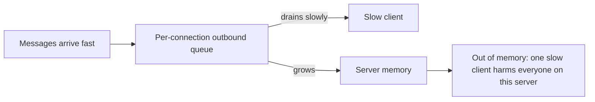
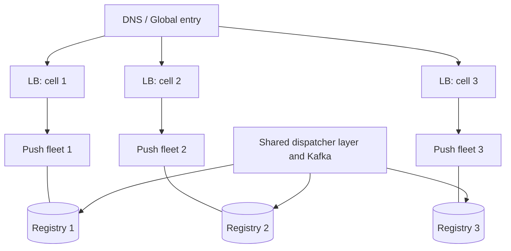
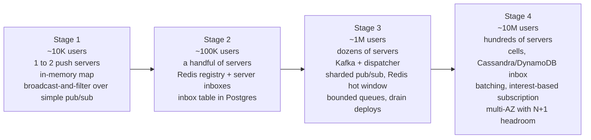

# Chapter 11: Scale

## 11.1 What "scale" means for a push service

Normal web services scale on **requests per second**. A push service scales on three different things, and each breaks a different component.

| Dimension | Meaning | What breaks first |
|---|---|---|
| **Concurrent connections** | How many sockets are open right now (millions) | Memory and file descriptors on push servers |
| **Connection churn** | Connects and disconnects per second | CPU (TLS, auth), registry writes, replay reads |
| **Message throughput** | Messages per second, and especially **fan-out** (deliveries per message) | CPU, network bandwidth, broker, slow clients |

Most connections are **idle** most of the time. That makes the connection tier cheap in CPU and expensive in memory, which is the opposite of an API tier. Keep this in mind as we go through the layers.

## 11.2 One machine: how many connections can it hold?

A connection costs the server three things.

| Resource | Cost per connection | Notes |
|---|---|---|
| **File descriptor** | 1 | OS limit, raise it far above the default |
| **Kernel socket buffers** | Several KB (send plus receive) | Tunable, and a big share of total memory |
| **Application memory** | A few KB to tens of KB | Your connection object, buffers, subscriptions, per-connection state |
| **TLS session state** | Several KB | Paid once per connection if the server terminates TLS |

Real servers hold **hundreds of thousands** of mostly idle connections each (well-tuned setups have gone to a million), but a safe planning number is much lower, since memory per connection grows once you add buffers, queues, and group state. **Load test with your real payloads and your real per-connection state** instead of trusting a rule of thumb.

### The threading model decides everything

| Model | Connections per machine | Verdict |
|---|---|---|
| **Thread per connection** | Thousands, at most | Fails. A thread stack costs far more than a socket, and context switching kills you |
| **Event loop (epoll / kqueue / io_uring)**: Netty, Node, Go netpoller, Vert.x | **Hundreds of thousands** | The standard answer. A few threads watch many sockets |
| **Virtual threads / lightweight tasks** (Java 21+, Go goroutines) | Very large | Viable. Blocking-style code with cheap threads, but verify per-connection memory |

The rule: **never block an event-loop thread.** One slow DB call inside the loop stalls every connection on that loop. Do I/O to other systems asynchronously, or hand it to a separate executor.

### Kernel and OS tuning checklist

| Setting | Why |
|---|---|
| Raise **open file limit** (`ulimit -n`, systemd `LimitNOFILE`) to well above target connections | Default is often 1024, and you'd cap out immediately |
| Raise `net.core.somaxconn` and the listen backlog | Absorb connection bursts and reconnect waves |
| Tune TCP buffer sizes down for idle connections | Memory is your bottleneck, not throughput |
| Enable `SO_REUSEPORT` and multiple acceptor loops | Spread accepts across cores |
| Check **conntrack / NAT table** limits on any middlebox | A silent connection-count ceiling |
| Use enough **ephemeral ports** on the *client side of internal hops* | Relevant for LB to backend connections, not for end users |

A frequent surprise: the **64K port limit** applies to one client IP talking to one server IP and port. End-user connections come from millions of different IPs, so a server can hold far more than 64K. The limit bites for **one proxy tier connecting to one backend**, so add more source IPs or backends there.

## 11.3 Where the CPU actually goes

With idle connections, you'd think CPU is free. It isn't, because of three costs:

| Cost | When it hurts |
|---|---|
| **TLS handshakes** | Connect storms (asymmetric crypto is the expensive part of a connection's life) |
| **Fan-out writes** | Broadcast to 100K sockets: each write is a syscall plus encryption |
| **Serialization and compression** | If done per recipient instead of once |

**Offload TLS** to the load balancer or a dedicated proxy tier when handshake load is high. The push server then sees plain TCP, which also frees memory. The trade-off is a trust boundary: traffic between the LB and the push server is unencrypted unless you add internal TLS.

Also use **TLS session resumption** so reconnecting clients skip the full handshake.

## 11.4 How many servers do you need?

Don't memorize formulas. Reason in this order:

1. **Peak concurrent connections** (not total users): the number who are online at the busiest moment.
2. **Safe connections per server**, from your own load test, with real per-connection state.
3. Divide, then add **headroom** for the failure cases in Chapter 8: losing a server, an AZ, or a rolling deploy must not push survivors over the edge. Many teams run at 50 to 60% of tested capacity.
4. Check the **second limit**: at peak message rate, can the same server also *write* the fan-out? Connection count and message throughput are separate ceilings, and you size for whichever hits first.

Example of the reasoning (illustrative, not a benchmark): 5M concurrent users and a tested limit of 100K per server gives 50 servers at 100% load, so plan on roughly 100 servers once you leave headroom and spread across three AZs. The exact numbers will differ. The *method* is what to remember.

## 11.5 The slow consumer problem

This is the most important scale-specific concept after fan-out.

A **slow consumer** is a client that can't read as fast as you write: bad network, a backgrounded phone, an overloaded browser tab. The server's writes pile up.



If you queue **unboundedly**, a few slow clients can eat all the memory, and the server dies for everyone. This is how real push systems fall over.

**Every connection must have a bounded outbound queue and a policy for when it fills.**

| Policy | Behavior | Use when |
|---|---|---|
| **Drop oldest / coalesce** | Keep only the latest state | Tier 0 and "latest wins" (scores, presence, cursors) |
| **Drop newest** | Discard incoming for this client | Rarely right |
| **Disconnect the client** | Close with a "too slow, reconnect" code | **Tier 1**. The client reconnects and **resumes from its cursor**, which is the cheap, safe fix |
| **Backpressure upstream** | Slow the producer | Rarely possible in a fan-out system |

```java
void enqueue(Connection c, byte[] frame) {
    if (c.outbound.size() >= MAX_QUEUE) {            // e.g. 1000 frames or a byte budget
        c.close(CLOSE_TOO_SLOW);                     // client reconnects and resumes from cursor
        metrics.slowConsumerDisconnects.increment();
        return;
    }
    c.outbound.add(frame);
    c.flushIfIdle();
}
```

This is where Chapter 6's design pays off: **disconnecting a slow Tier 1 client loses nothing**, because the inbox holds the truth. The cursor turns "drop the connection" from a data-loss decision into a cheap one. Use a **byte budget**, not just a message count, since message sizes vary.

Also use the transport's own signal: if the socket's writable flag says its OS buffer is full (Netty `isWritable()`), stop pushing to that connection immediately.

## 11.6 Cheaper fan-out

Fan-out is the multiplier, and several techniques cut its cost.

| Technique | What it does | Where it helps |
|---|---|---|
| **Serialize once** | Encode the payload to bytes once, then reuse the buffer for every recipient | Broadcast and groups |
| **Batching / micro-batching** | Collect messages for 50 to 500 ms and send one frame with many | High-rate streams, and mobile radios |
| **Coalescing** | Send only the latest state per key in each interval | Leaderboards, scores, cursors |
| **Compression** | Compress frames (e.g., permessage-deflate for WebSocket) | Text-heavy payloads. Costs CPU and per-connection memory, so measure first |
| **Diffs instead of full state** | Send only what changed, plus a periodic snapshot | Large state objects |
| **Interest-based subscription** | Only subscribe to what the user is viewing (Chapter 5.8) | Users in many groups |
| **Sampling / rate limiting** | Show a fraction of a firehose | Mega-streams (live chat on a huge event) |
| **Shared, pre-framed buffers** | Write the same already-framed bytes to many sockets | Large broadcasts |

**Compression caveat:** per-connection compression contexts hold memory for every socket, which can be a large share of your memory budget at 100K connections per server. Compress at the message level before fan-out where you can, and avoid per-connection deflate state unless you've measured the benefit.

## 11.7 Scaling the rest of the pipeline

The connection tier is only one layer. Each other component has its own scale story.

### Load balancer

- It only sees **connection setup** (Chapter 2.2), so it needs to handle the **connect rate**, not the message rate.
- Use **L4** for the highest connection capacity. Use L7 when you need header-based routing and auth at the edge.
- Spread across AZs, and use **slow start** for new backends (Chapter 8.4).
- Mind per-LB connection and bandwidth limits, and shard across multiple LBs or DNS names if needed.

### Dispatcher

- A normal consumer-group service. **Scale by adding instances up to the number of Kafka partitions** (partitions cap parallelism).
- Choose a partition count with growth in mind. Changing it later disturbs key-to-partition mapping and therefore ordering (Chapter 9.7).
- Keep it stateless apart from its Kafka offsets, so it scales and restarts freely.

### Pub/sub broker

This is the layer where naive designs hit a ceiling.

| Concern | Detail |
|---|---|
| **Per-message fan-out to servers** | Cost scales with the number of *subscribed servers*, which is why we use server-level subscriptions, not per-user ones |
| **Classic Redis pub/sub in a cluster** | Publishes are propagated to **all** nodes, which stops scaling. Use **sharded pub/sub** (channels hash to a slot, so only the owning shard handles them) or a broker built for this (NATS, Kafka-backed designs, managed pub/sub) |
| **Hot channel** | One huge group or topic can saturate a single shard. **Split the channel** into sub-channels (Chapter 5.7) |
| **Subscription churn** | Millions of connects trigger many subscribe and unsubscribe calls. The **refcount** design (subscribe only on the first local member) keeps this low |

### Registry (Redis)

- Memory is small. **Operations per second** is the limit. Shard by key across a cluster.
- Reduce writes: batched, lower-frequency TTL refresh plus **server liveness keys** (Chapter 7.7).
- Place the registry **close** (same region and AZ-aware) to the dispatcher and push servers, since lookups are on the hot path.

### Inbox store

- Partition by stream id and keep rows small (Chapter 10).
- Use the Redis **hot window** so most reconnects avoid it.
- Protect it from reconnect storms with bounded, paged replay (Chapter 10.10).

## 11.8 Sharding the push fleet itself

A single flat pool of push servers works to a point. Beyond it, structure the fleet.



This is the **cell-based architecture**: split users into independent cells (by user id hash or by region), each with its own LB, fleet, and registry.

| Benefit | Why |
|---|---|
| **Blast radius** | A failure or bad deploy affects one cell, not everyone |
| **Bounded component sizes** | No single Redis or LB grows unbounded |
| **Easier capacity planning** | Add a cell instead of resizing everything |
| **Deploy safely** | Roll one cell at a time |

Cost: routing now has **two levels**: which cell a user belongs to (deterministic by user id, or a small directory), then which server inside the cell. The dispatcher needs a cell lookup first. Group messages that span users across cells must publish into **each involved cell**.

**Geo-distribution:** put fleets near users to cut latency. Multi-region is its own course, and for this system the key ideas are that each region has its own connections and registry, a global event bus forwards to the right region, and the inbox needs a replication and consistency story.

## 11.9 Rate limiting and abuse protection

At scale some traffic is hostile or buggy, so protect each edge.

| Protection | Where |
|---|---|
| **Connection rate limit** (per server, per IP, per user) | Edge and push server (Chapter 8.4) |
| **Max connections per user** (e.g., 5 to 10 devices) | Registry check at connect. Evict the oldest |
| **Max subscriptions per connection** | Prevents a client subscribing to everything |
| **Max frame/message size** | Prevents memory abuse |
| **Inbound message rate limit** (WebSocket) | Per connection, with close on violation |
| **Authentication at connect, token refresh** | Chapter 2.9 |
| **Per-tenant quotas** (multi-tenant platforms) | Stops a noisy tenant exhausting the shared fleet |

## 11.10 The evolution: 10K to 10M

Here is the story of how the same design grows, adding only what each stage's problem demands.



| Stage | New problem | Added solution |
|---|---|---|
| **1** (10K) | Basic delivery | One or two push servers, in-memory connection map, simple pub/sub fan-out |
| **2** (100K) | Many servers, can't find the user | Registry plus per-server inboxes (Chapter 2, 4). Durable inbox with `seq` and cursor resume (Chapter 6) |
| **3** (1M) | Producers coupled, DB outages lose events, deploys drop everyone | Kafka plus dispatcher (Chapter 4), outbox (Chapter 8), bounded queues and drain-based deploys, sharded pub/sub, Redis hot window |
| **4** (10M) | Single Redis, LB, or DB too large. Blast radius | **Cells**, wide-column inbox store, batching and coalescing, interest-based subscriptions, strict capacity headroom, chaos testing |

**Don't build Stage 4 on day one.** Each stage's component exists to fix a problem that appears at that size. Premature cells and Cassandra for 10K users is pure cost. But *design the interfaces* (stable `eventId`, `seq`, cursor, thin push servers, "inbox is truth") so moving up a stage is an addition and not a rewrite.

## 11.11 What to measure

You can't scale what you can't see. The numbers that matter:

| Metric | Why |
|---|---|
| **Connections per server** and **per-connection memory** | Capacity and leak detection |
| **Connect and reconnect rate** | Early warning of a storm |
| **Outbound queue depth and slow-consumer disconnects** | Memory risk, and client health |
| **End-to-end latency** (event creation to socket write) | The user-visible SLO |
| **Fan-out per message** and **bytes out** | Cost and bandwidth |
| **Dispatcher consumer lag** | Pipeline health |
| **Broker publish latency and subscription counts** | Pub/sub saturation |
| **Registry ops/sec and latency** | Hot path health |
| **Replay read volume and latency** | Reconnect pressure on the store |
| **GC pauses / event-loop stall time** | Pauses cause missed heartbeats and false disconnects |

Alert on **latency and lag**, not only on errors, since a saturated pipeline often fails silently by being late.

## 11.12 Cost levers

| Lever | Trade-off |
|---|---|
| Fewer, bigger servers vs more, smaller | Bigger means fewer connections to rebalance, but larger blast radius on failure |
| Longer heartbeat interval | Less traffic and battery, but slower dead-peer detection |
| Shorter inbox retention | Cheaper storage, but more RESETs |
| Batching and coalescing | Less bandwidth and CPU, but slightly higher latency |
| Skipping durability for Tier 0 | Cheaper, but only valid where loss is acceptable |
| Interest-based subscription | Fewer deliveries, but more client protocol complexity |

## 11.13 Chapter 11 summary

| Concept | Remember as |
|---|---|
| Three dimensions | **Concurrent connections**, **churn**, **throughput and fan-out** |
| One machine | **Event loop**, not thread-per-connection. Raise FD limits. **Memory** per connection is the main limit |
| CPU surprises | TLS handshakes and fan-out writes. Offload TLS and serialize once |
| Server count | Peak concurrent ÷ tested capacity, plus failure **headroom**. Check message throughput as a second limit |
| Slow consumers | **Bounded queue per connection**. When full, **disconnect and let the cursor resume**, never grow unbounded |
| Cheaper fan-out | Serialize once, batch, coalesce, diff, interest-based subscription, sample |
| Pipeline layers | LB scales on connect rate. Dispatcher on partitions. Pub/sub needs **sharded channels**. Registry on ops/sec. Inbox on partitioning |
| Fleet structure | **Cells** for blast radius and bounded components |
| Protection | Rate limits, per-user connection caps, size limits, quotas |
| Growth path | Add each component only when its problem appears, but keep interfaces stable |
| Observability | Connections, reconnect rate, queue depth, end-to-end latency, consumer lag, GC stalls |

---

**Next: Chapter 12, the decision framework.** The final chapter pulls everything into one reusable process: the requirement questions to ask, a flowchart from requirements to architecture, SSE vs WebSocket, pub/sub vs Kafka vs inbox, durable vs best-effort, plus worked designs for chat, notifications, live scores, collaborative docs, and live-stream comments, and an interview cheat sheet. Say **"next"** when ready.
