# Direct-to-Blob File Upload: Chapter 1 of the Course

I'll go one chapter at a time, evolving the system the way it would evolve in real life. Each chapter starts with something that breaks and then fixes it. Reply **next** to move on.

**Course outline**

| # | Chapter | Question it answers |
|---|---|---|
| 1 | The naive upload and why it dies | Why presigned URLs at all? |
| 2 | Presigned URL + DB record (your flow) | What exactly happens, and what does the DB row mean? |
| 3 | Large files: multipart upload | How are chunks created, tracked and stitched? |
| 4 | Who confirms success? | Client vs S3 events vs server verification |
| 5 | Retries and resumability | Chunk-level retry, resume after a crash |
| 6 | Duplicates | Idempotency, content hash, dedup |
| 7 | Garbage: orphans and abandoned uploads | Lifecycle rules, reaper jobs |
| 8 | Security and post-processing | Virus scan, size/type validation, quarantine |
| 9 | Final architecture | Everything together, interview recall sheet |

---

## Chapter 1: The naive upload and why it dies

### Version 1: Upload through our server

The simplest design is a `POST /files` that carries the file bytes through our server.

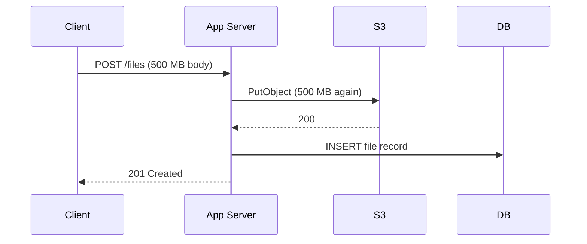

This works for a 200 KB profile photo. Then real users show up.

### What breaks

| Trigger | Why it hurts |
|---|---|
| 500 MB video upload | The server holds a connection open for minutes. Threads, memory and sockets are tied up. |
| 1,000 users upload at once | 1,000 × 500 MB flows through your servers twice (client→server, server→S3). Bandwidth and CPU become the bottleneck. |
| The user's Wi-Fi drops at 99% | The whole request fails. The user starts over from byte 0. |
| Load balancer or API gateway timeouts | Most cap request size and duration (for example 30–60 s, or a 10 MB body limit). Large uploads simply fail. |
| Scaling the app tier | You scale expensive compute only to move bytes, which is the cheapest thing S3 can do for you. |

**Core insight:** our server adds no value to the bytes. It only needs to know about the file (metadata, ownership, state). The bytes should go straight from the client to S3.

### Version 2: Separate the control plane from the data plane

This is the one idea the whole course rests on.

| Plane | Carries | Handled by |
|---|---|---|
| **Control plane** | Small JSON: "I want to upload X", "it's done", "who owns it", "what state is it in" | Our server + DB |
| **Data plane** | The actual bytes | Client ⇄ S3 directly |

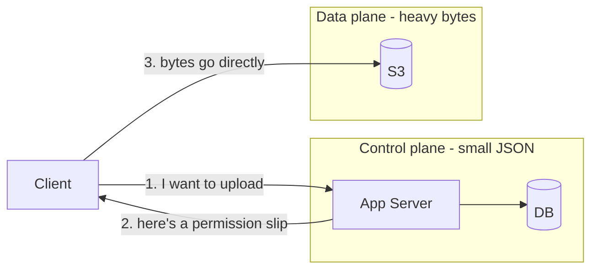

### The problem Version 2 creates

If the client talks to S3 directly, S3 needs to know the client is allowed to. We can't hand out our AWS credentials, and we don't want S3 buckets open to the world.

### Version 3: The presigned URL, the "permission slip"

A presigned URL is a normal S3 URL with a signature attached. The signature is computed by our server using its credentials. It carries:

- which bucket and key it is valid for
- which HTTP method it allows (`PUT`, or `UploadPart` for multipart)
- an expiry time (for example 15 minutes)
- optionally, constraints such as content type, content length and a checksum

The server signs it locally with its secret key, with **no network call to S3**. When the client uses it, S3 recomputes the signature, checks it matches and checks it hasn't expired. If it passes, S3 accepts the bytes as if our server had sent them.

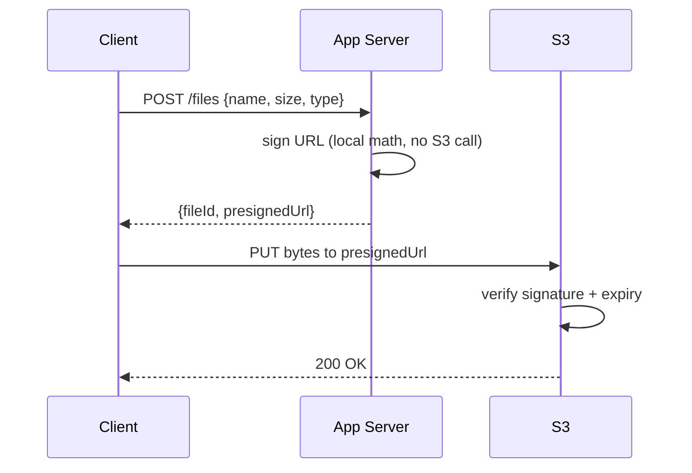

**What we gained**

- Servers never touch the bytes, so they scale independently of upload volume.
- Uploads run at S3's speed and scale.
- Security stays tight: the URL is scoped to one key, one method and a short time window.

**What we gave up (this is the next set of problems)**

| New problem | Chapter |
|---|---|
| The server no longer sees the upload happen. How does it know the upload succeeded? | 4 |
| Files too big for a single `PUT`. A single PUT caps at 5 GB, and one connection for 2 GB is fragile. | 3 |
| The client retries, double-clicks or re-uploads the same file. | 5, 6 |
| The client got a URL but never uploaded. The DB row now describes a file that doesn't exist. | 7 |
| What stops a user from uploading a 50 GB `.exe` using a URL meant for a 2 MB image? | 8 |

**Rejected alternative:** making the bucket public-write. Anyone could upload anything anywhere, with no ownership, no limits and no audit trail. It is never acceptable.

---

## Chapter 1 checkpoint

1. Server-proxied upload fails because **bytes flow through a component that adds no value**.
2. Fix: split **control plane** (our server/DB, small JSON) from **data plane** (client⇄S3, big bytes).
3. A **presigned URL** is a time-limited, scoped, locally signed permission slip. It needs no S3 call to create, and no AWS credentials are given to the client.
4. The cost: the server is now **blind** to what happens on the data plane. Chapters 3–8 are about restoring correctness without bringing the bytes back.

Next is **Chapter 2**: your exact flow (DB record first, then S3 key, then presigned URL). I'll define the file's **state machine** (`PENDING → UPLOADED → …`), explain why the DB row is created *before* the upload, and what each field means. Reply **next** to continue.


-----------------------------------------------------------------------------------------------------------------------
-----------------------------------------------------------------------------------------------------------------------
-----------------------------------------------------------------------------------------------------------------------
-----------------------------------------------------------------------------------------------------------------------


# Chapter 2: Your flow, made precise (DB record, S3 key, presigned URL)

## First, remove one hidden assumption

You said "talk to S3 and create a key for this file." In S3 **there is no "create key" API**. A key is just a string you choose, and the object only exists after bytes are uploaded. So "creating the key" really means the server **decides the key name** and records it in the DB.

That changes how we think about the DB row. It is a **claim of intent**: "we expect a file to arrive at this key." It is not proof that a file exists.

---

## Version 1: Why the DB row comes first

| Order | What happens | What breaks |
|---|---|---|
| **S3 first, DB second** | Client uploads, then tells us, then we insert | If the client never tells us, we have an **invisible object** in S3 that nobody owns, which is a cost leak and impossible to audit. |
| **DB first, S3 second** | We insert a row, then issue the URL, then the client uploads | If the client never uploads, we have a **row with no object**. This is easy to detect and clean up because the row is the source of truth. |

DB-first is better because the failure leaves an **inspectable breadcrumb**. A row stuck in `PENDING` for 24 hours is trivially findable. An orphan object in a bucket of 100M keys is not.

---

## Version 2: The file's state machine

The row must say what we *know*, and "uploaded" is not something we know at creation time. So the row carries a **state**.

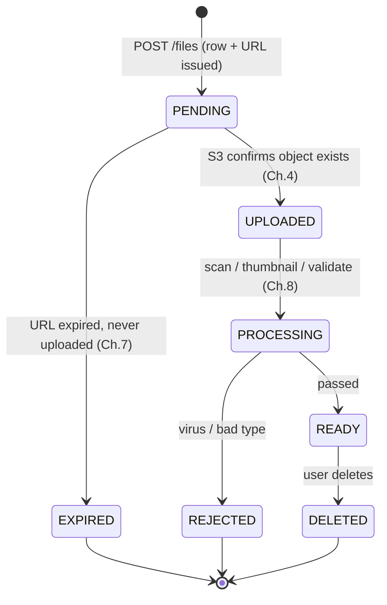

The rule that makes systems like this robust: **only the server moves state forward, and only on evidence** (never on the client's word alone).

---

## Version 3: The schema

```sql
CREATE TABLE files (
  id              UUID PRIMARY KEY,            -- generated by server
  owner_id        UUID NOT NULL,
  original_name   TEXT NOT NULL,               -- display only, never used as S3 key
  content_type    TEXT NOT NULL,               -- declared by client
  declared_size   BIGINT NOT NULL,             -- what client says it will upload
  bucket          TEXT NOT NULL,
  object_key      TEXT NOT NULL UNIQUE,        -- e.g. uploads/2026/11/<uuid>
  status          TEXT NOT NULL,               -- PENDING|UPLOADED|PROCESSING|READY|...
  actual_size     BIGINT,                      -- filled after verification (Ch.4)
  etag            TEXT,                        -- filled after verification
  checksum_sha256 TEXT,                        -- for dedup/integrity (Ch.6)
  idempotency_key TEXT,                        -- for safe retries of this API (Ch.6)
  upload_expires_at TIMESTAMPTZ NOT NULL,
  created_at      TIMESTAMPTZ NOT NULL DEFAULT now(),
  updated_at      TIMESTAMPTZ NOT NULL DEFAULT now(),
  UNIQUE (owner_id, idempotency_key)
);
CREATE INDEX ON files (status, upload_expires_at);   -- the reaper job (Ch.7)
```

Why these choices:

| Decision | Reason |
|---|---|
| `id` generated by server | Client-chosen IDs allow collisions and enumeration attacks. |
| `object_key` = UUID based, **never the filename** | Filenames collide (`resume.pdf`), contain unsafe characters, and leak info. Keep the real name in `original_name`. |
| `declared_size` **and** `actual_size` | The client's claim and the reality can differ. Trust only the one S3 reports. |
| Key prefix like `uploads/2026/11/` | Ops convenience (lifecycle rules per prefix). Not needed for S3 performance, since S3 scales by prefix automatically. |
| Index on `(status, upload_expires_at)` | The cleanup job queries exactly this. |

---

## Version 4: The create endpoint

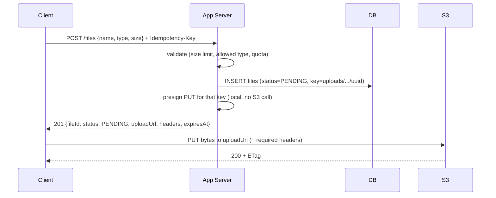

**Validation happens before we sign anything.** This is our only chance to stop abuse cheaply (size cap, MIME allow-list, per-user quota), because once the URL is issued, the client talks to S3 and we're out of the loop.

```java
// AWS SDK v2: presign a single PUT
PutObjectRequest put = PutObjectRequest.builder()
    .bucket(bucket)
    .key(objectKey)
    .contentType(contentType)        // signed: client must send the same type
    .contentLength(declaredSize)     // signed: client must send exactly this size
    .build();

PresignedPutObjectRequest presigned = presigner.presignPutObject(
    PutObjectPresignRequest.builder()
        .signatureDuration(Duration.ofMinutes(15))
        .putObjectRequest(put)
        .build());

String url = presigned.url().toString();
Map<String, List<String>> mustSendHeaders = presigned.signedHeaders();
```

Response to the client:

```json
{
  "fileId": "7c1f...",
  "status": "PENDING",
  "uploadUrl": "https://bucket.s3.amazonaws.com/uploads/2026/11/7c1f...?X-Amz-Signature=...",
  "requiredHeaders": { "Content-Type": "application/pdf", "Content-Length": "2048000" },
  "expiresAt": "2026-11-06T10:15:00Z"
}
```

---

## Version 5: What the presigned URL can and cannot enforce

This is where "assumptions" usually hide, so it needs to be spelled out.

| Concern | Can a presigned **PUT** enforce it? | Notes |
|---|---|---|
| Which key | Yes | The signature binds the key. |
| Which method | Yes | A PUT URL can't be used for GET or DELETE. |
| Expiry | Yes | Hard time limit. |
| Exact content type / length | Yes, **if you sign those headers** | A mismatch gives `403 SignatureDoesNotMatch`. |
| A **range** of sizes (e.g. 1 byte to 10 MB) | **No** | PUT signs an exact value. For ranges, use a **presigned POST** with a policy containing `content-length-range`. |
| "Only one upload per URL" | **No** | The URL can be used many times until it expires, and each PUT overwrites the object. This is why Chapter 6 exists. |
| That the bytes are really a PDF | **No** | S3 never inspects content. A `.exe` can be sent with `Content-Type: application/pdf`. This is Chapter 8. |

Two practical consequences:

1. Keep the expiry **short** (minutes), because the URL is a bearer token. Anyone who has it can use it.
2. Treat everything the client declared (type, size) as a **claim to be verified**, not a fact.

---

## Version 6: What does the DB row mean at each moment?

| Moment | Row says | Object in S3 | Truth |
|---|---|---|---|
| After `POST /files` | `PENDING` | not there | "Someone may upload here soon" |
| Client is mid-upload | `PENDING` | not there (single PUT) | S3 only shows an object once the PUT completes |
| Client finished, we don't know yet | `PENDING` | **there** | Row is **stale**, and this is the gap Chapter 4 closes |
| After verification | `UPLOADED` | there, verified | Row and reality agree |

That third row is the key to the whole design. **There is always a window where S3 is ahead of our DB.** The rest of the course is about closing that window safely.

---

## Chapter 2 checkpoint

1. S3 has no "create key." The server **chooses** the key and records it.
2. DB first, because a stale `PENDING` row is easy to find and clean up, while an unowned S3 object is not.
3. The row is a **state machine** (`PENDING → UPLOADED → PROCESSING → READY`). The server moves it forward **only on evidence**.
4. Validate and authorize **before** signing. Sign type and length into the URL where possible.
5. A presigned URL **cannot** enforce size ranges, single use or content truthfulness. Those problems are handled later.
6. Our DB can lag behind S3, and that window is the core problem going forward.

Next is **Chapter 3**: files too big for a single PUT. I'll explain S3 multipart upload step by step (initiate, per-part presigned URLs, upload parts, complete), and answer your question directly: **do we store chunk metadata, and is the final file chunks or a single stitched object?** Reply **next** to continue.


-----------------------------------------------------------------------------------------------------------------------
-----------------------------------------------------------------------------------------------------------------------
-----------------------------------------------------------------------------------------------------------------------
-----------------------------------------------------------------------------------------------------------------------


# Chapter 3: Large files and S3 multipart upload

## Version 1: Where the single PUT breaks

| Trigger | Why a single PUT hurts |
|---|---|
| A 4 GB video on a mobile connection | One long TCP connection. If it drops at 3.9 GB, you restart from 0. |
| Hard limit | A single PUT is capped at **5 GB**. Objects can be up to **5 TiB**, so large files can't use PUT at all. |
| Speed | One stream is limited by one connection's throughput. Parallel streams are faster. |
| Retry cost | Any failure costs the whole file. |

**Core insight:** if the file is cut into independent pieces, a failure costs only one piece, and pieces can upload in parallel. S3 supports this natively as **multipart upload**.

---

## Version 2: How S3 multipart upload works

There are three kinds of operations: **initiate**, **upload parts**, **complete**.

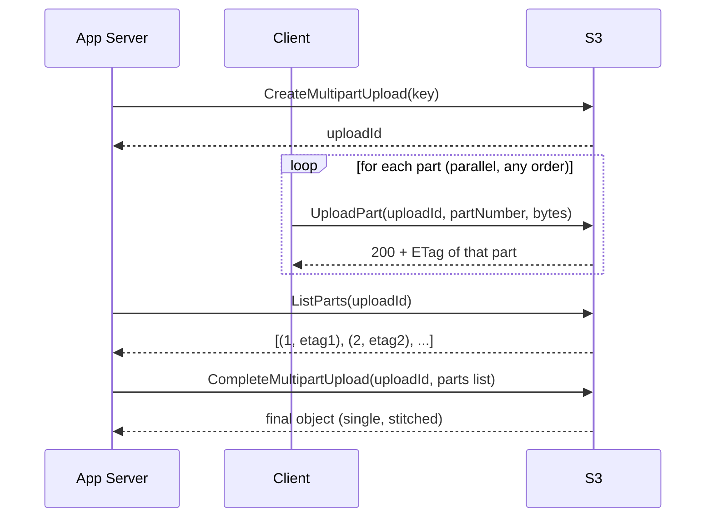

**Rules you must know (no assumptions):**

| Rule | Value |
|---|---|
| Part numbers | 1 to 10,000 |
| Part size | 5 MiB minimum (the **last** part may be smaller), 5 GiB maximum |
| Max object | 5 TiB |
| Upload order | Any order, in parallel |
| Re-uploading the same part number | Replaces the earlier copy (so retrying a part is naturally safe) |
| Visibility | Parts are **not** a visible object. The key does not exist in S3 until `Complete` succeeds. |
| Cost | Uploaded parts are **billed storage** until you complete or abort, even though you can't see them as an object |

**Choosing the part size.** Because of the 10,000-part cap:

```java
long MIN = 8L * 1024 * 1024;                      // 8 MiB is a sensible default
long partSize = Math.max(MIN, (long) Math.ceil(fileSize / 10_000.0));
int totalParts = (int) Math.ceil((double) fileSize / partSize);
```

Also set a **threshold**. Below roughly 100 MB, use a single PUT (Chapter 2). Multipart adds round trips and bookkeeping that small files don't need.

---

## Version 3: Your direct questions

### Q1: Is the final file stored as chunks or as one stitched file?

**One stitched object.** On `CompleteMultipartUpload`, S3 assembles the parts **server-side** (no bytes pass through us). From then on, the object is a normal single object, and `GetObject` returns it as one file. The parts stop existing as separate things you can list.

| Phase | What S3 holds |
|---|---|
| During upload | Hidden parts tied to `uploadId`, with no visible key |
| After `Complete` | One normal object at your key |
| After `Abort` | Nothing (parts deleted) |

Two small details:

- The final **ETag is not the MD5 of the file.** For multipart it looks like `<md5-of-part-md5s>-<partCount>`, so you cannot compare it to a plain file hash. This matters for integrity and dedup (Chapters 4 and 6).
- If you used SSE-KMS or SSE-C encryption, part ETags are not MD5s either. So never treat ETag as a content hash.

### Q2: Do we save chunk metadata in our DB?

There are two designs. The key principle: **S3 already tracks the parts, so S3 is the source of truth for which parts exist.** Our DB only needs enough to *find and control* the upload.

| | Design A: session only | Design B: session + per-part rows |
|---|---|---|
| We store | `upload_id`, `part_size`, `total_parts`, status | The above, plus a row per part (number, etag, size, checksum, status) |
| Resume / "what's done?" | Ask S3 with `ListParts` | Read our DB (still reconcile with S3) |
| Write load | Tiny | One write per part (a 5 GB file at 8 MiB is about 640 rows) |
| Risk | `ListParts` is paginated (1,000 per page) | DB and S3 can disagree and need reconciling |
| Good for | Most systems | Need per-part audit, progress shared across devices, per-part checksum policies, or a very high-value pipeline |

**Recommendation:** start with **Design A**. It has fewer moving parts and can't drift out of sync, because there is no second copy of the truth. Add part rows only when a real requirement demands them. Part rows are **temporary** in any case: once the upload completes, delete them or archive them.

What we **never** store: the chunk bytes. They go client to S3 only.

---

## Version 4: The control-plane changes

Schema additions (a separate table keeps `files` clean):

```sql
CREATE TABLE file_uploads (
  file_id      UUID PRIMARY KEY REFERENCES files(id),
  upload_id    TEXT NOT NULL,           -- S3 multipart uploadId
  part_size    BIGINT NOT NULL,
  total_parts  INT NOT NULL,
  status       TEXT NOT NULL,           -- IN_PROGRESS | COMPLETING | COMPLETED | ABORTED
  expires_at   TIMESTAMPTZ NOT NULL,
  created_at   TIMESTAMPTZ NOT NULL DEFAULT now()
);
```

API:

| Endpoint | Does |
|---|---|
| `POST /files` (size over threshold) | Insert `files` row (`PENDING`), call `CreateMultipartUpload`, insert `file_uploads`, return `{fileId, partSize, totalParts}`. **No URLs yet.** |
| `POST /files/{id}/parts/presign` `{partNumbers:[1..10]}` | Return a presigned `UploadPart` URL for each requested part |
| `GET /files/{id}/parts` | Return which parts S3 already has (from `ListParts`), used for resume |
| `POST /files/{id}/complete` | Server calls `ListParts`, builds the list, calls `Complete` |
| `POST /files/{id}/abort` | `AbortMultipartUpload`, mark `ABORTED` |

### Why URLs are issued lazily in batches

A 5 GB file has 640 parts. Issuing all URLs upfront has two problems: the response is large, and each URL **expires** (say 15 minutes), but a slow upload can take hours. Asking for URLs in small batches as the client progresses solves both. It also gives the server a natural checkpoint to refuse more URLs for an aborted or expired file.

```java
// 1. Initiate (server)
CreateMultipartUploadResponse r = s3.createMultipartUpload(b -> b
    .bucket(bucket).key(objectKey).contentType(contentType));
String uploadId = r.uploadId();

// 2. Presign one part (server) - partNumber and uploadId are inside the signature
UploadPartRequest up = UploadPartRequest.builder()
    .bucket(bucket).key(objectKey)
    .uploadId(uploadId).partNumber(n)
    .build();
String url = presigner.presignUploadPart(p -> p
    .signatureDuration(Duration.ofMinutes(15))
    .uploadPartRequest(up)).url().toString();

// 3. Complete (server) - build the list from S3, NOT from the client
List<CompletedPart> parts = listAllParts(bucket, objectKey, uploadId) // paginate!
    .stream()
    .map(p -> CompletedPart.builder().partNumber(p.partNumber()).eTag(p.eTag()).build())
    .toList();
s3.completeMultipartUpload(b -> b.bucket(bucket).key(objectKey).uploadId(uploadId)
    .multipartUpload(m -> m.parts(parts)));
```

### The client side

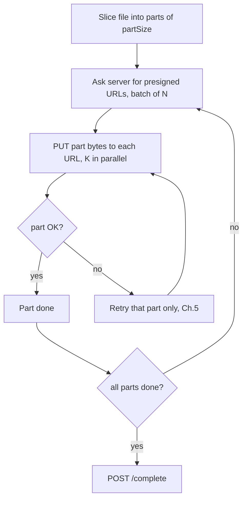

---

## Version 5: Gotchas that cause real production bugs

| Gotcha | Detail |
|---|---|
| **Browser CORS** | Browsers can't read the `ETag` response header unless the bucket CORS config includes `ExposeHeaders: ["ETag"]`. Without it, a web client can upload parts but can't see their ETags. Our design avoids depending on this because the **server uses `ListParts` at completion**. |
| **Complete can return 200 with an error** | S3 may send `200 OK` and put an error in the response body (for example, a missing part). The SDK usually surfaces it, but raw HTTP clients must inspect the body. |
| **Complete is not instant** | For large objects it can take a while. This is why we have a `COMPLETING` status: if the server crashes mid-call, the retry must be safe (Chapter 5). |
| **Presigned `Complete`** | Possible, but we deliberately have the **server** call it. The server alone decides when the upload is whole, after verifying the part list. |
| **Size and type enforcement** | Each presigned `UploadPart` can only fix that part's identity, not the total. Total size is verified after complete (Chapter 4), and tightened later (Chapter 8). |

---

## Version 6: What we gained and what's still open

**Gained**

- Resume and retry at part level
- Parallel upload for speed
- Files up to 5 TiB
- Server still never touches bytes

**Still unsolved** (the rest of the course)

| Open problem | Chapter |
|---|---|
| After `Complete`, how does our DB learn the object really exists and is the right size? | 4 |
| What if a part fails, the client crashes, or the browser tab closes and reopens? | 5 |
| What if two clients call `/complete` at once, or the user starts the same upload twice? | 6 |
| Hidden uploaded parts keep costing money forever if never completed | 7 |

---

## Chapter 3 checkpoint

1. Multipart: **initiate, upload numbered parts (parallel, any order), complete**. Part size is at least 5 MiB, at most 10,000 parts, and the last part may be small.
2. The result is **one stitched object**, assembled by S3 server-side. The parts disappear as separate entities.
3. **S3 is the source of truth for parts.** Store only the session (`upload_id`, `part_size`, `total_parts`, status). Add per-part rows only for a concrete need.
4. Presign **per-part URLs lazily in batches**, because they expire and a big file has hundreds of parts.
5. The **server calls Complete** using the part list from `ListParts`, never one supplied by the client.
6. Multipart ETag is **not** a content hash. Don't use it for dedup.

Next is **Chapter 4**: who confirms success, the client or S3? I'll compare client-reported completion, S3 event notifications (and why they can be duplicated, delayed or lost), and server-side verification with `HeadObject`. Then I'll build the confirmation flow that combines them reliably. Reply **next** to continue.


-----------------------------------------------------------------------------------------------------------------------
-----------------------------------------------------------------------------------------------------------------------
-----------------------------------------------------------------------------------------------------------------------
-----------------------------------------------------------------------------------------------------------------------


# Chapter 4: Who confirms success, client or S3?

## Version 1: The gap, restated

From Chapter 2, there is a window where S3 has the object but our DB still says `PENDING`. Something has to move the row to `UPLOADED`. There are three candidates, so let's look at each one honestly.

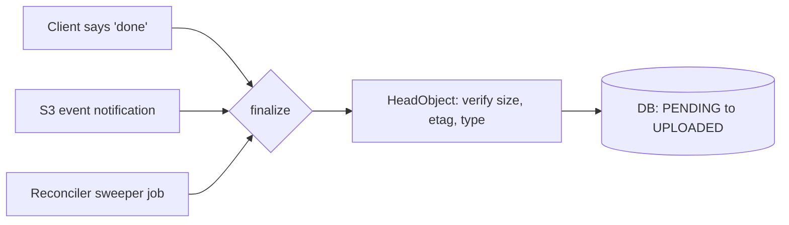

The final design uses all three signals but only one decision-maker. First, why each signal alone is not enough.

---

## Version 2: Signal A, the client reports success

The client finishes its PUT, gets a 200 from S3, then calls `POST /files/{id}/complete`.

| Good | Bad |
|---|---|
| Fastest. The UI can move on immediately. | **Can be false.** A buggy or malicious client can claim success for an upload that never happened. |
| Simple to build. | **Can be missing.** The client uploaded all bytes, then the tab closed or the network died before the callback. S3 has the file, we never hear about it. |
| | **Can be duplicated.** Retries and double clicks send it twice. |

**Verdict:** the client's message is a **hint to go check**, never proof. It is a good *trigger* and a terrible *source of truth*.

---

## Version 3: Signal B, S3 tells us (event notifications)

S3 can emit an event whenever an object is created. You configure it once on the bucket:

| Upload type | Event name |
|---|---|
| Single PUT | `s3:ObjectCreated:Put` |
| Multipart | `s3:ObjectCreated:CompleteMultipartUpload` |
| Wildcard for all of them | `s3:ObjectCreated:*` |

Destinations: **SQS**, SNS, Lambda, or EventBridge. For our case, **S3 to SQS to our worker** is the standard choice, because the queue buffers bursts and gives retries and a dead-letter queue.

What the event contains (trimmed):

```json
{
  "Records": [{
    "eventName": "ObjectCreated:CompleteMultipartUpload",
    "eventTime": "2026-11-06T10:12:03.000Z",
    "s3": {
      "bucket": { "name": "my-uploads" },
      "object": {
        "key": "uploads/2026/11/7c1f...",
        "size": 2048000,
        "eTag": "9b2c...-4",
        "versionId": "3HL4kq...",
        "sequencer": "0055AED6DCD90281E5"
      }
    }
  }]
}
```

**It is independent of the client, which is a big strength.** It fires even if the browser tab is gone. But there are guarantees you must not over-assume:

| Property | Reality | Consequence for our design |
|---|---|---|
| Delivery | **At least once.** Duplicates happen. | The handler must be idempotent. |
| Ordering | **Not guaranteed.** Events for the same key can arrive out of order. The `sequencer` field helps compare two events for the same key. | Never trust "last event wins" blindly. |
| Latency | Usually seconds, but can be delayed. | The UI can't depend on it alone for instant feedback. |
| Loss | Rare, but misconfiguration, a deleted queue or a permission change causes silent loss. | We need a safety net (Signal C). |
| Overwrite | Re-uploading to the same key fires another event. | The handler must handle "already finalized." |
| Content | Reports what S3 holds, not whether it is valid. | It is a trigger, not a content check. |
| Unknown key | An event can arrive for a key with no DB row. | Log it as an orphan and alert. Never create a row from an event. |

**Verdict:** the event is the most trustworthy **notification** because it comes from the system that actually stores the bytes. But a notification is still not a *verification*.

---

## Version 4: Signal C, the server asks S3 directly (HeadObject)

`HeadObject` returns metadata without downloading the object: size, ETag, content type, version ID, and checksum if one was supplied.

```java
HeadObjectResponse h = s3.headObject(b -> b
    .bucket(bucket).key(objectKey)
    .checksumMode(ChecksumMode.ENABLED));   // return checksum if present

long   size = h.contentLength();
String etag = h.eTag();
String type = h.contentType();
String ver  = h.versionId();
```

One fact makes this reliable: **S3 is strongly read-after-write consistent** (since December 2020). Once a PUT or `Complete` returns success, a following `HeadObject` sees it. No "eventual consistency" delay, so we don't need sleep-and-retry loops.

| Good | Bad |
|---|---|
| It is **evidence**, not a claim. | It is **pull**, so something has to decide when to call it. |
| Lets us check size and type against what we declared. | One call per file (cheap, but not zero at huge scale). |

**Verdict:** this is the only one of the three that is *verification*. It is the **authority**.

---

## Version 5: The answer to your question (which is better and more reliable?)

| | Client callback | S3 event | HeadObject (server pull) |
|---|---|---|---|
| Independent of client | No | **Yes** | **Yes** |
| Proves bytes exist | No | Yes | **Yes** |
| Proves size and type match | No | No | **Yes** |
| Latency | Fastest | Seconds | On demand |
| Can be lost | Yes | Rarely | Only if nobody calls it |
| Can be duplicated | Yes | **Yes** | Harmless |
| Can be malicious | **Yes** | No | No |

**Direct answer:** the blob store is more reliable than the client, because the client can crash, lie or disconnect, while S3 is the thing that actually holds the file. But the best design does not pick one:

> **Any signal may trigger finalization. Only the server's own `HeadObject` verification may decide it.**

- **Client callback** gives the fast path (instant UX).
- **S3 event** gives the dependable backstop (works when the client vanishes).
- **Reconciler sweeper** gives the last safety net (works when events are lost).
- **`finalize()`** is the single function all three call, and it **verifies before it trusts**.

This pattern, "many triggers, one idempotent verifier", shows up in almost every robust distributed workflow.

---

## Version 6: The finalize function

### Requirements

1. **Idempotent.** It can be called 1 or 100 times, from any of the three sources, concurrently.
2. **Verifies against S3**, never against the caller.
3. **Moves state only forward**, using a conditional update (compare-and-set).

```java
@Transactional
public void finalize(UUID fileId) {
    FileRecord f = repo.findById(fileId);

    if (f.status() != PENDING) return;          // already handled: no-op (idempotent)

    HeadObjectResponse h;
    try {
        h = s3.headObject(b -> b.bucket(f.bucket()).key(f.objectKey()));
    } catch (NoSuchKeyException e) {
        return;                                  // not there (yet): leave PENDING, caller may retry
    }

    if (h.contentLength() != f.declaredSize()
            || !f.contentType().equals(h.contentType())) {
        repo.markRejected(fileId, "SIZE_OR_TYPE_MISMATCH");
        s3.deleteObject(b -> b.bucket(f.bucket()).key(f.objectKey()));
        return;
    }

    // compare-and-set: only one concurrent caller can win
    int updated = jdbc.update("""
        UPDATE files
           SET status='UPLOADED', actual_size=?, etag=?, version_id=?, updated_at=now()
         WHERE id=? AND status='PENDING'
        """, h.contentLength(), h.eTag(), h.versionId(), fileId);

    if (updated == 1) {
        outbox.publish(new FileUploaded(fileId));   // kick off Ch.8 processing
    }
}
```

### Why the conditional `WHERE status='PENDING'` matters

If the client callback and the S3 event arrive at the same instant, both pass the early check. Only one `UPDATE` matches the `WHERE`, so only one reports `updated == 1`. That is the one that publishes the follow-up work, so processing starts **exactly once**, with no distributed lock.

### Three callers, one function

```java
// A. client callback
@PostMapping("/files/{id}/complete")
ResponseEntity<?> complete(@PathVariable UUID id) {
    finalize(id);
    return ResponseEntity.ok(repo.findById(id));   // may still say PENDING if not found yet
}

// B. S3 event consumer (SQS)
@SqsListener("upload-events")
void onEvent(S3Event e) {
    for (var rec : e.records()) {
        repo.findByObjectKey(rec.key())
            .ifPresentOrElse(f -> finalize(f.id()),
                             () -> log.warn("orphan object {}", rec.key()));
    }
}

// C. sweeper (every few minutes)
@Scheduled(fixedDelay = 300_000)
void sweep() {
    repo.findPendingOlderThan(Duration.ofMinutes(10)).forEach(f -> finalize(f.id()));
}
```

---

## Version 7: The full flow

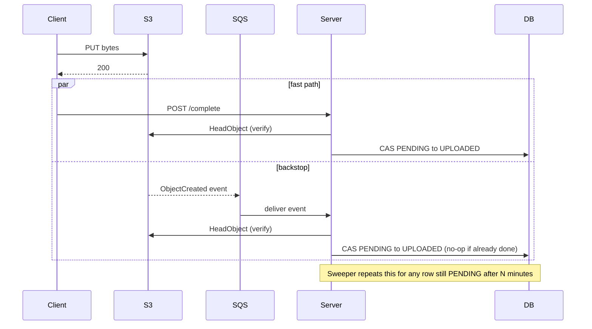

**For the UI:** after the client's `PUT` succeeds, it polls `GET /files/{id}` (or listens on a WebSocket or SSE channel) until the status is `UPLOADED` or later. With the client callback this is usually instant. If the callback was lost, the S3 event lands in seconds. If both were lost, the sweeper catches it within minutes.

---

## Version 8: Multipart is simpler on this point

For multipart, **the server itself calls `CompleteMultipartUpload`** (Chapter 3). So the server already knows, from the synchronous response, that the object was assembled. The client's "I'm done uploading parts" message *triggers* that call, but the server verifies the part list through `ListParts`, then calls `Complete`, then runs `finalize`. The S3 event still fires afterward and simply finds the row already `UPLOADED`.

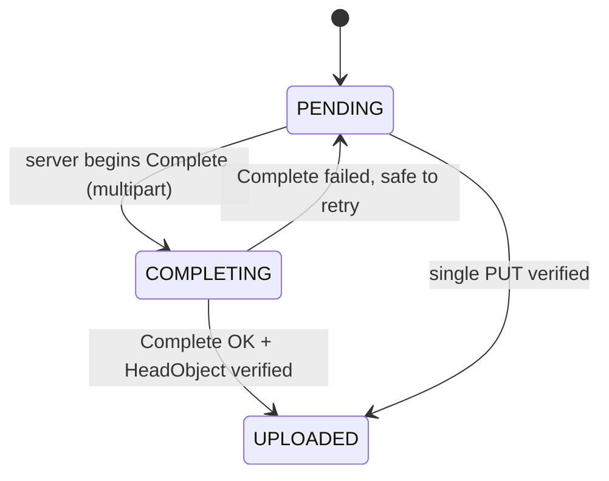

---

## Version 9: Integrity and a subtle hole

### Is the object byte-for-byte correct?

Size matching catches truncation but not corruption or a swapped file. For real integrity:

| Approach | How |
|---|---|
| **S3 additional checksums** | The client computes SHA-256 (or CRC32C etc.) and includes it as a signed header (`x-amz-checksum-sha256`). **S3 verifies the received bytes against it** and rejects a mismatch. For multipart, checksums are tracked per part and combined. |
| **Do not use ETag** | For multipart or encrypted objects, ETag is not a content hash (Chapter 3). |

### The "overwrite after verify" hole

A presigned PUT URL can be reused until it expires. So this sequence is possible:

1. File uploaded, verified, marked `UPLOADED`.
2. Someone holding the URL (the client itself, or an attacker who intercepted it) PUTs different bytes to the same key before expiry.
3. Our DB says "verified" but the object is now different.

Defenses, from strongest to weakest:

| Defense | Notes |
|---|---|
| **Record `versionId` at finalize and always read that version** | Needs bucket versioning enabled. Later overwrites create new versions that we ignore. |
| **Short expiry** | Minutes, not hours. Shrinks the window. |
| **Conditional write** | S3 supports `If-None-Match: *` (fail if the key already exists). If you sign that header into the URL, a second PUT is rejected. Check that your SDK version supports signing it. |
| **Upload to a staging prefix or bucket, then copy** | After verification, **copy** to the final location with a server-side `CopyObject`. The client's URL only ever pointed at staging, so overwrites can't touch the verified copy. This is also what Chapter 8 uses for quarantine. |

---

## Chapter 4 checkpoint

1. A client callback is a **hint**. It can be missing, duplicated or false.
2. An S3 event is the most reliable **notification** (independent of the client) but is **at-least-once, unordered and rarely lost**. It is not a verification.
3. `HeadObject` is the only **verification**. S3 is strongly consistent, so it is safe to call right after a write.
4. **Many triggers, one idempotent verifier.** Client callback, S3 event and sweeper all call `finalize()`, and only `finalize()` decides.
5. Use a **compare-and-set** (`UPDATE ... WHERE status='PENDING'`) so concurrent triggers start downstream work exactly once.
6. Verify size and type (and checksum if used). Record `versionId`. Beware the overwrite-after-verify hole, and consider staging then copy.

Next is **Chapter 5**: retries and resumability. I'll cover what happens when a single part fails, when the client crashes mid-upload, when the user closes the tab and returns the next day, and when the server crashes in the middle of `Complete`. I'll also cover how the client discovers what's already uploaded and continues from there. Reply **next** to continue.


-----------------------------------------------------------------------------------------------------------------------
-----------------------------------------------------------------------------------------------------------------------
-----------------------------------------------------------------------------------------------------------------------
-----------------------------------------------------------------------------------------------------------------------


# Chapter 5: Retries and resumability

## Version 1: What can fail, and where

Before writing any retry logic, list every place the upload can break. Each place needs a different fix.

| # | Failure | Who notices | Example |
|---|---|---|---|
| 1 | One part's HTTP request fails | Client | Wi-Fi blip, timeout, `503 SlowDown` |
| 2 | The presigned URL expired mid-upload | Client (gets `403`) | A slow 3 GB upload outlives the 15-minute URL |
| 3 | The client dies (tab closed, app killed, laptop sleeps) | Nobody, until the user returns | User closes the laptop at part 300 of 640 |
| 4 | Client returns the next day | Client | Wants to continue, not restart |
| 5 | Our API call fails (`/presign`, `/complete`) | Client | Server returned 502, client doesn't know if it was processed |
| 6 | Server crashes in the middle of `CompleteMultipartUpload` | Server, after restart | The row is stuck in `COMPLETING` |

The main idea is that **retries are only safe where the operation is idempotent**. Chapter 3 gave us a great start: uploading the same part number again simply **replaces** that part. So part retries are naturally safe.

---

## Version 2: Retrying one part (failures 1 and 2)

### Which errors are worth retrying?

| Error | Meaning | Action |
|---|---|---|
| Network error, connection reset, timeout | Transient | Retry the same URL |
| `500`, `502`, `503` (including `SlowDown`) | S3 or the path is throttled or unhealthy | Retry with backoff |
| `403` with `Request has expired` | URL timed out | **Don't retry the same URL.** Ask the server for a fresh one for this part, then retry. |
| `403 SignatureDoesNotMatch` | We signed something the client didn't send (header mismatch) | **Don't retry.** This is a bug and will fail forever. Surface it. |
| `404 NoSuchUpload` | The multipart session is gone (aborted, completed or lifecycle-expired) | **Stop.** Ask the server for the file's state. Possibly start a new upload. |
| `400` bad digest / checksum mismatch | Bytes corrupted in flight | Retry the part (this is exactly what the checksum is for) |

Blind retry of everything is a common mistake. It turns a permanent bug into an infinite loop that hammers S3.

### Backoff with jitter

If 1,000 clients all fail at the same moment (S3 hiccup) and all retry after exactly 2 seconds, they cause a **retry storm** that re-creates the overload. The fix is **exponential backoff with full jitter**.

```typescript
async function uploadPartWithRetry(part: Part, maxAttempts = 6): Promise<string> {
  let url = await getPresignedUrl(part.number);            // fetched lazily (Ch.3)

  for (let attempt = 1; ; attempt++) {
    try {
      const res = await fetch(url, { method: "PUT", body: part.blob, signal: timeoutSignal(60_000) });

      if (res.ok) return res.headers.get("ETag") ?? "";   // ETag may be hidden by CORS; server uses ListParts anyway

      if (res.status === 403 && await isExpired(res)) {
        url = await getPresignedUrl(part.number, { fresh: true });   // new URL, same part
        continue;                                                    // doesn't count as a failure
      }
      if (res.status === 404) throw new SessionGone();               // NoSuchUpload
      if (res.status >= 400 && res.status < 500 && res.status !== 408 && res.status !== 429)
        throw new Permanent(res.status);                             // our bug, don't loop

      // otherwise 5xx / 408 / 429: fall through to backoff
    } catch (e) {
      if (e instanceof Permanent || e instanceof SessionGone) throw e;
      // network error / timeout: fall through to backoff
    }

    if (attempt >= maxAttempts) throw new PartFailed(part.number);

    const cap = Math.min(30_000, 500 * 2 ** attempt);     // 1s, 2s, 4s, ... capped at 30s
    await sleep(Math.random() * cap);                      // full jitter
  }
}
```

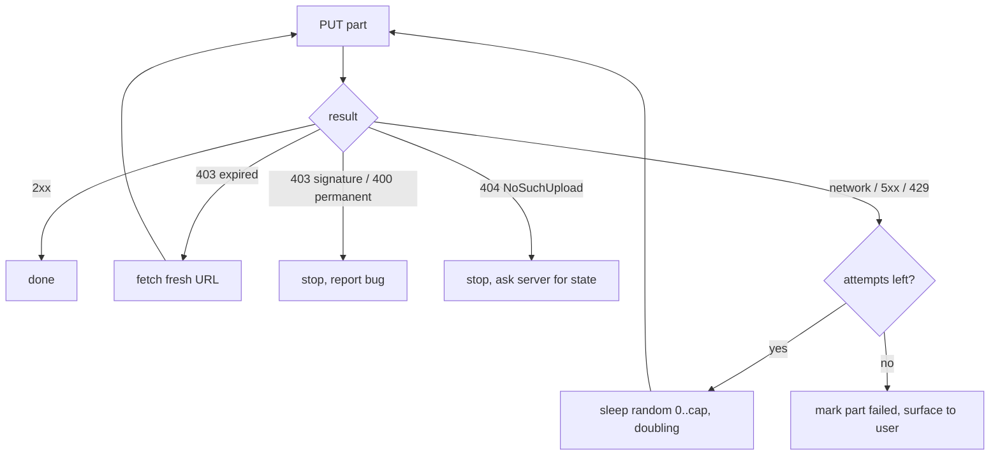

### Why part retries are cheap and safe

- You re-send **only that part** (for example 8 MiB), not the file.
- Re-sending the same part number **overwrites** the previous attempt, so there is nothing to deduplicate.
- If you add a per-part checksum (`x-amz-checksum-sha256`), S3 rejects corrupted bytes, so a "successful" part is a *correct* part.

### Concurrency and slow-downs

| Rule | Reason |
|---|---|
| Upload about 3 to 6 parts in parallel | Beyond that, one client saturates its own connection and each part gets slower and times out. |
| On repeated `429`/`503`, **reduce** concurrency | Back off globally, not only per part. |
| Per-part timeout and **stall detection** | A connection can hang forever without erroring. Treat "no progress for N seconds" as failure. |
| Choose part size sensibly for mobile | Smaller parts (5 to 8 MiB) lose less on a flaky connection. |

---

## Version 3: Resuming after a crash (failures 3 and 4)

### The question

The client died. Later it returns. How does it know **which parts are already safely in S3**?

The answer comes from Chapter 3: **S3 knows**. The client doesn't need a perfect local record, and the server doesn't need part rows. We ask S3.

### What the client must persist locally

A tiny record, in IndexedDB (web) or app storage (mobile):

```json
{
  "fileId": "7c1f...",
  "fileFingerprint": { "name": "movie.mp4", "size": 4294967296, "lastModified": 1730800000000 },
  "partSize": 8388608
}
```

The `fileId` is the **handle**. With it, everything else can be recovered from the server.

### The resume flow

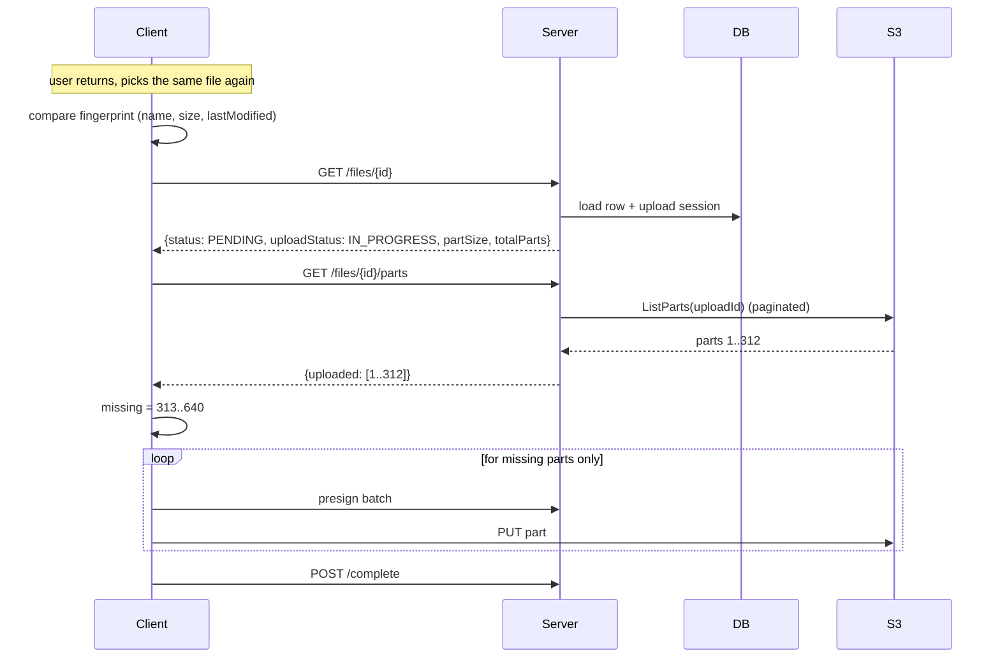

### The server side of "what's done?"

```java
public List<Integer> uploadedParts(UUID fileId) {
    FileUpload u = uploads.findByFileId(fileId);
    if (u.status() != IN_PROGRESS) throw new Conflict("not resumable: " + u.status());

    List<Integer> done = new ArrayList<>();
    Integer marker = null;
    do {                                                   // ListParts returns at most 1000 per call
        ListPartsResponse r = s3.listParts(b -> {
            b.bucket(u.bucket()).key(u.objectKey()).uploadId(u.uploadId());
            if (marker != null) b.partNumberMarker(marker);
        });
        r.parts().forEach(p -> done.add(p.partNumber()));
        marker = r.isTruncated() ? r.nextPartNumberMarker() : null;
    } while (marker != null);
    return done;
}
```

### Traps on resume (no assumptions)

| Trap | What to do |
|---|---|
| The user picked a **different file** with the same name | Compare size, `lastModified` and ideally a cheap fingerprint (hash of the first and last MB). If it doesn't match, refuse to resume and offer "start over." Mixing parts from two files creates a **corrupt but valid-looking** object, which is the worst kind of bug. |
| **Part size** differs from the session | Always use the `partSize` the **server** returns. Part boundaries must be identical to the first attempt. |
| Some listed parts are **partial or corrupted** | S3 only lists parts whose upload **completed**. A half-sent part is never listed. If you used checksums, the listed parts are verified. |
| The session was aborted or expired meanwhile | `ListParts` returns `NoSuchUpload`. The server marks the row and the client starts a **new** upload (a new `fileId`, or a new session on the same row). |
| **Different device** wants to resume | Only possible if it has the same file bytes. Usually treated as a new upload. |
| URLs from the previous session | Expired. We issue fresh ones lazily anyway. |

**How long does a resumable upload live?** Our row has `expires_at` (for example 24 to 72 hours). After that, the reaper aborts the multipart session so abandoned parts stop costing money (Chapter 7). The client should show "upload expired, please restart" rather than failing mysteriously.

---

## Version 4: Our own API calls fail (failure 5)

The nasty case is an **ambiguous** failure: the client calls `POST /files/{id}/complete`, the network drops, and the client doesn't know whether the server received it.

The fix is the same as in Chapter 4: make the server operation **idempotent**, so the client can retry blindly.

| Endpoint | Why retry is safe |
|---|---|
| `POST /files` | `Idempotency-Key` header plus `UNIQUE (owner_id, idempotency_key)` (Chapter 2 schema). A repeat returns the **same** row and fresh URLs instead of creating a second file. (Details in Chapter 6.) |
| `POST /files/{id}/parts/presign` | Pure computation, no side effects. |
| `GET /files/{id}/parts` | Read-only. |
| `POST /files/{id}/complete` | `finalize()` is a compare-and-set, so a repeat is a no-op (Chapter 4). |
| `POST /files/{id}/abort` | Abort twice is fine if the handler treats "already aborted" as success. |

Client-side: wrap these control-plane calls in the same retry helper (backoff plus jitter, limited attempts).

---

## Version 5: The server crashes mid-Complete (failure 6)

This is the subtle one. The server does three things in sequence:

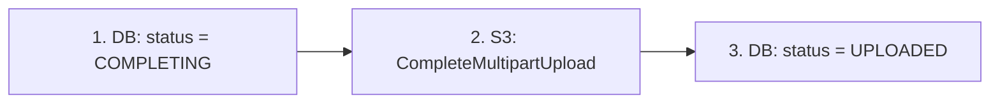

A crash can occur between any two steps.

| Crash point | State after restart | Recovery |
|---|---|---|
| Before step 1 | `IN_PROGRESS`, nothing done | Client simply retries `/complete`. |
| Between 1 and 2 | `COMPLETING`, S3 not completed | Retry step 2. |
| **During 2** (unknown outcome) | `COMPLETING`, S3 **may or may not** have completed | **Ask S3 before acting** (see below). |
| Between 2 and 3 | `COMPLETING`, S3 **is** completed | Run verification and set `UPLOADED`. The S3 event and sweeper will also do this. |

### The rule for the ambiguous case

After a completed multipart upload, the `uploadId` is no longer valid. A second `CompleteMultipartUpload` for it generally fails with `NoSuchUpload`. So a failure **does not mean** the object isn't there. The recovery logic is:

```java
void completeUpload(UUID fileId) {
    FileUpload u = uploads.lockByFileId(fileId);           // SELECT ... FOR UPDATE, or a CAS to COMPLETING

    if (u.status() == COMPLETED) return;                   // already done: idempotent no-op

    uploads.markCompleting(fileId);                        // step 1 (records intent + timestamp)

    try {
        List<CompletedPart> parts = listAllParts(u);       // truth comes from S3, not the client
        validateParts(parts, u.totalParts());              // none missing, count matches
        s3.completeMultipartUpload(b -> b.bucket(u.bucket()).key(u.objectKey())
            .uploadId(u.uploadId()).multipartUpload(m -> m.parts(parts)));   // step 2
    } catch (NoSuchUploadException e) {
        // Either someone already completed it, or the session is truly gone. Decide by looking:
        if (!objectExists(u)) { uploads.markFailed(fileId, "SESSION_GONE"); return; }
        // object exists -> an earlier attempt succeeded; fall through to finalize
    }
    finalize(fileId);                                      // Ch.4: HeadObject verify + CAS to UPLOADED
    uploads.markCompleted(fileId);                         // step 3
}
```

Notes:

- **Always verify with `HeadObject`** afterward (`finalize`). It also catches the case where a `200 OK` body actually contained an error.
- If `HeadObject` says the object exists but our declared size doesn't match, treat it as corruption or a wrong file and reject (Chapter 4).
- **Stuck `COMPLETING` rows:** the sweeper looks for `COMPLETING` older than a few minutes and re-runs `completeUpload`. Because the function is idempotent, it can run any number of times.

```sql
-- sweeper query
SELECT file_id FROM file_uploads
 WHERE status = 'COMPLETING' AND updated_at < now() - interval '5 minutes';
```

### Concurrency: two `/complete` calls at once

The `lockByFileId` (row lock or compare-and-set to `COMPLETING`) makes sure only **one** request calls S3. The second waits and then sees `COMPLETED`, or gets a quick "already in progress, poll" response.

---

## Version 6: Putting resume logic in the state machine

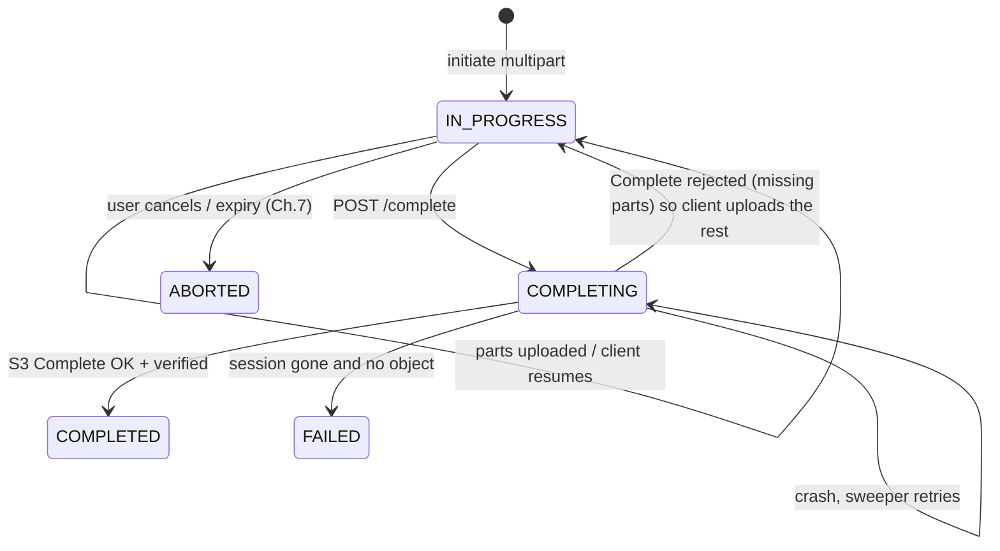

The `COMPLETING → IN_PROGRESS` edge matters: if `Complete` fails because a part is missing (for example the client lied about being done), the file is **not** dead. The client calls `GET /parts`, uploads the gap and tries again.

---

## Chapter 5 checkpoint

1. List failures by where they occur. Different failures need different fixes.
2. **Part retry is safe** because re-uploading a part number overwrites it. Retry only transient errors (network, 5xx, 429). On expired-URL `403`, **get a fresh URL**. On signature `403` or other permanent `4xx`, **stop**.
3. Use **exponential backoff with full jitter** and lower concurrency under throttling. Add per-part timeouts and stall detection.
4. **Resume = ask S3.** The client keeps only the `fileId` and file fingerprint. The server answers "what's uploaded?" with a paginated `ListParts`. Upload only the missing parts, with the **same part size**.
5. Guard against **wrong-file resume** (fingerprint check) and **expired sessions**.
6. Make every control-plane endpoint **idempotent** so ambiguous network failures can be retried blindly.
7. For a crash around `Complete`, record `COMPLETING`, treat `NoSuchUpload` as "maybe already done, go look with `HeadObject`", and let a sweeper re-run the idempotent completion for stuck rows.

Next is **Chapter 6**: duplicates. There are four different things people call "duplicate": the same API call twice, the same presigned URL used twice, the same file uploaded twice by one user or by many users, and duplicate S3 events. I'll show the right tool for each one: idempotency keys, content hashing, dedup with reference counting, and what **not** to deduplicate. Reply **next** to continue.


-----------------------------------------------------------------------------------------------------------------------
-----------------------------------------------------------------------------------------------------------------------
-----------------------------------------------------------------------------------------------------------------------
-----------------------------------------------------------------------------------------------------------------------


# Chapter 6: Duplicates

## Version 1: "Duplicate" means four different things

People say "handle duplicates" as if it were one problem. It is four, and each needs a different tool. Mixing them up is how you end up with an idempotency key trying to do content dedup, or a hash check trying to stop a double click.

| # | What is duplicated | Example | Right tool |
|---|---|---|---|
| 1 | The same **API call** | Client retries `POST /files` after a timeout | Idempotency key |
| 2 | The same **presigned URL** used more than once | Retry after success, or a leaked URL replayed | Overwrite-proofing (conditional write, versionId, staging) |
| 3 | The same **event** | S3 notification delivered twice | Idempotent consumer (the CAS from Chapter 4) |
| 4 | The same **content** uploaded more than once | Two users upload the same 2 GB installer | Content hash plus a logical/physical split |

The first three are about **correctness** (no corrupt or doubled state). The fourth is about **cost optimization**, and it is optional.

---

## Version 2: Duplicate API calls (idempotency keys)

### The trigger

The client calls `POST /files`. The server creates the row and the S3 session, but the response is lost on the network. The client can't tell whether it worked, so it retries. Without protection we now have **two rows, two S3 keys and possibly two multipart sessions**, and one of them is an orphan.

### The fix

The client generates an **idempotency key** (a UUID) when the user *starts an upload intent* and sends it as a header on every attempt of that intent. The schema from Chapter 2 already has the constraint:

```sql
UNIQUE (owner_id, idempotency_key)
```

Scoping by `owner_id` matters because two users can't collide with, or probe, each other's keys.

### Behavior table

| Situation | Server response |
|---|---|
| Key never seen | Create the row, return 201 |
| Key seen, **same request payload** | Return the **same** row (200 or 201) with **fresh presigned URLs** |
| Key seen, **different payload** (different size or name) | `422` or `409`: "key reused with different request" |
| Key seen, the first request is **still being processed** | `409` with `Retry-After`, or wait briefly and return the result |

To detect "different payload," store a hash of the normalized request body next to the key.

### Race-proof implementation

Don't do "SELECT, then INSERT if missing." Two concurrent retries both see "missing" and both insert. Let the **unique constraint be the lock**:

```java
public CreateFileResponse create(UUID ownerId, String idemKey, CreateFileRequest req) {
    String reqHash = sha256(canonicalJson(req));

    try {
        FileRecord f = repo.insertPending(ownerId, idemKey, reqHash, req);   // INSERT; may throw on UNIQUE
        initiateStorageSession(f, req);                                       // presign / CreateMultipartUpload
        return respond(f);
    } catch (DuplicateKeyException e) {
        FileRecord existing = repo.findByOwnerAndKey(ownerId, idemKey);
        if (!existing.requestHash().equals(reqHash))
            throw new UnprocessableEntity("Idempotency-Key reused with a different request");
        return respond(existing);       // same intent: hand back the same file, fresh URLs
    }
}
```

One subtlety: if the insert succeeds but the server crashes before `CreateMultipartUpload` finishes, the retry finds an existing row with no session. `respond(existing)` should **create the missing session lazily** (the "ensure" pattern) instead of assuming everything exists. Make each step "create if absent."

### Where does the client get the key?

Generate it when the user **selects the file**, persist it with the `fileId` in local storage (Chapter 5), and reuse it across retries. Never generate a new key per HTTP attempt, because that defeats the whole point.

---

## Version 3: Duplicate use of a presigned URL

From Chapter 2: a presigned PUT URL is **not single-use**. It works until it expires. Three scenarios:

| Scenario | Effect |
|---|---|
| Client retries a PUT that actually succeeded | Overwrites the object with identical bytes. Harmless. |
| Client re-uploads *different* bytes to the same URL after verification | **Silent replacement** of a verified file. This is the hole from Chapter 4. |
| URL leaked and replayed by a third party | Same as above, but malicious. |

Defenses (strongest first, summarizing Chapter 4):

1. **Staging then copy.** The client's URL points to `staging/<uuid>`. After verification, the server `CopyObject`s to `files/<uuid>`. Overwrites after that touch only staging.
2. **Version pinning.** Enable bucket versioning, record the `versionId` at finalize, and always serve that version.
3. **Conditional write.** Sign `If-None-Match: *` so a second PUT to an existing key fails. Confirm current SDK and S3 support before relying on it.
4. **Short expiry.** Reduces the exposure window.

### Multipart is naturally safer on this point

| Duplicate in multipart | Result |
|---|---|
| Same part uploaded twice | The later one replaces the earlier. Harmless. |
| `Complete` called twice | The second fails with `NoSuchUpload` (handled in Chapter 5). |
| Two sessions initiated for one file | Prevented by the idempotency key on `POST /files`. |

---

## Version 4: Duplicate events

From Chapter 4: S3 notifications are at-least-once, and SQS is also at-least-once. The same "object created" message can arrive twice, or for a key that's already finalized.

**This is already solved.** `finalize()` starts with `if (status != PENDING) return;` and then uses a compare-and-set update. Only one caller wins, and only the winner publishes the downstream event.

Two more places where duplicates can sneak in:

| Place | Fix |
|---|---|
| Downstream consumers of `FileUploaded` (thumbnailer, virus scanner) | They also receive at-least-once. Each must be idempotent, keyed on `fileId` (for example, "thumbnail exists, skip"). |
| Publishing the event after the DB update | Use a **transactional outbox** (write the event into an outbox table in the same transaction as the state change, and a relay publishes it). Otherwise a crash between "DB updated" and "event published" loses the event, which is the opposite problem of duplicates. |

The mantra: **assume every message is delivered more than once, and make handlers safe for that.**

---

## Version 5: Duplicate content (deduplication)

Everything so far prevented *accidents*. This is different: the same bytes are legitimately uploaded by one user twice, or by a thousand users. Do we store a thousand copies?

### First, a question to ask: should you dedup at all?

| Dedup helps when | Dedup is a bad idea when |
|---|---|
| Large, widely shared files (installers, course videos, email attachments forwarded to many people) | Mostly unique user content (personal photos, documents) |
| Storage cost is a major line item | Files are small and storage is cheap |
| | You have strict per-tenant isolation or per-tenant encryption keys |

Many systems wisely **don't dedup** early on. If you do, here is the clean design.

### The key design: split "file" from "blob"

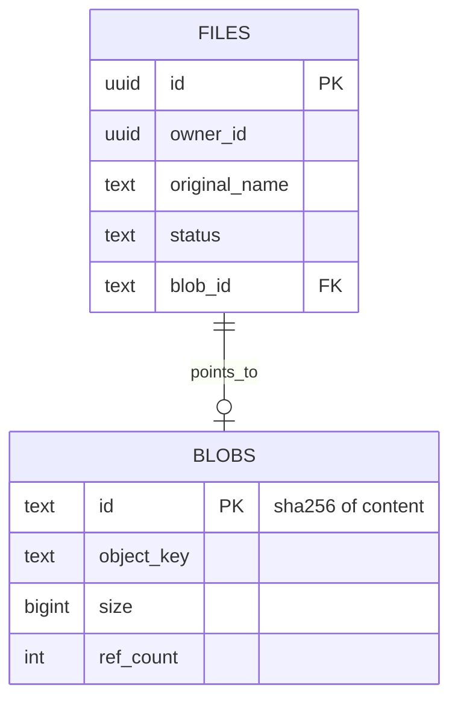

- **`files`** is the **logical** record: owner, name, permissions, status. One per user intent, and never shared.
- **`blobs`** is the **physical** content, **content-addressed** (its ID is the hash of its bytes). Many files can point to one blob.

Deleting a user's file deletes only their `files` row and decrements the blob's `ref_count`. The bytes disappear only when nobody references them.

### Where do we compute the hash? Two options

**Option 1: Post-upload dedup (safe, simple).**

```mermaid
sequenceDiagram
    participant C as Client
    participant B as S3
    participant W as Worker
    participant D as DB
    C->>B: upload (as normal, to staging)
    W->>B: stream object, compute SHA-256
    W->>D: INSERT blob(sha256) ON CONFLICT DO NOTHING
    alt blob already existed
        W->>D: files.blob_id = existing; ref_count + 1
        W->>B: delete the new duplicate object
    else new content
        W->>B: copy staging to blobs/sha256
        W->>D: files.blob_id = new; ref_count = 1
    end
```

Saves **storage** but not upload bandwidth. The server computes the hash itself, so there's nothing to trust.

**Option 2: Pre-upload dedup (the "instant upload" feature).**

The client hashes the file first and sends it. If the server already has that hash, it skips the upload entirely. Saves bandwidth, but has two serious problems:

| Problem | Detail |
|---|---|
| **The hash is a client claim.** | A malicious client can say "my file's hash is X" for a file it doesn't have. If the server just links it, the attacker gets **access to someone else's content** by knowing (or guessing) its hash. |
| **Side channel** | Even honest behavior leaks information: "instant upload" tells an attacker "someone already stored this exact file." |

Mitigations: restrict dedup to **within the same tenant or user**, and/or require **proof of possession** (the server asks for hashes of random byte ranges that only someone with the real file could produce). Many systems choose to skip cross-user pre-upload dedup precisely because of this.

### A real S3 detail you shouldn't assume away

S3's additional checksums can verify upload integrity, but for **multipart** uploads, SHA-256 and similar checksums are by default **composite** (a checksum of the part checksums), which is **not** the SHA-256 of the whole file. Full-object checksums exist only for some algorithms (the CRC family). Treat this as something to confirm in current AWS docs. In practice: compute the whole-file SHA-256 yourself in the worker (Option 1), and don't assume the S3-reported value matches it.

### Reference counting without races

```sql
-- add a reference (inside the same transaction that points file -> blob)
UPDATE blobs SET ref_count = ref_count + 1 WHERE id = :sha;

-- remove a reference
UPDATE blobs SET ref_count = ref_count - 1 WHERE id = :sha RETURNING ref_count;
```

Danger: user A deletes their last reference (count hits 0, blob is deleted) at the same moment user B's upload dedups to that blob (count about to go 0 to 1). B's file now points to a deleted object.

Fix: **never delete the bytes inline.** When `ref_count` reaches 0, set `zero_since = now()`. A garbage-collection job deletes blobs where `ref_count = 0 AND zero_since < now() - interval '24 hours'`, re-checking the count right before deleting. This grace period absorbs the race.

### What dedup does not mean

| Don't dedup | Why |
|---|---|
| The **logical** file record | Each user keeps their own name, permissions, lifecycle. |
| Across **tenants with different encryption keys** | Same plaintext gives different ciphertext, so hashes don't match. (Convergent encryption exists but weakens confidentiality, so it's a deliberate trade-off.) |
| When legal or compliance deletion must remove bytes **immediately** | Refcounting delays physical deletion, so confirm this is acceptable (for example, for GDPR erasure). |

---

## Version 6: The human duplicate (double click, same file twice)

A user selects the same file twice, or clicks "Upload" twice. Two different issues:

| Case | Handling |
|---|---|
| Same **intent** repeated by accident (double click) | The client reuses one idempotency key per intent, so the server returns the same row (Version 2). |
| User **deliberately** uploads the same file again | That's a legitimate new file. If you want a warning, compare `(owner, name, size, hash)` after finalize and show "you already have this" as **advice, not a block**. |

Don't force uniqueness on `(owner_id, original_name)`. People legitimately have many `resume.pdf` files.

---

## Version 7: One table to remember

| Duplicate type | Detect with | Prevent or absorb with |
|---|---|---|
| Repeated API call | `UNIQUE(owner_id, idempotency_key)` plus request hash | Return the existing row, fresh URLs |
| Reused presigned URL | `versionId`, `If-None-Match`, staging | Staging then copy, short expiry |
| Repeated event | `WHERE status='PENDING'` CAS | No-op when already handled |
| Repeated downstream message | Idempotent consumer keyed on `fileId` | Transactional outbox, "skip if done" |
| Same bytes, many files | SHA-256 computed **by the server** | `files`/`blobs` split plus refcount plus delayed GC |
| Double click | One idempotency key per intent | UX soft warning |

---

## Chapter 6 checkpoint

1. "Duplicate" is four problems: **repeated call, reused URL, repeated event, repeated content**. Each has its own tool.
2. **Idempotency key plus a unique constraint** makes `POST /files` safe to retry. Let the constraint arbitrate races, store a request hash, and have the "ensure" steps create anything missing.
3. A presigned URL **can be reused**, so protect verified files with staging then copy, version pinning or conditional writes.
4. **Events and messages are at-least-once everywhere.** Idempotent handlers (CAS) and a transactional outbox make that safe.
5. **Content dedup is optional.** If used, split **logical `files`** from **content-addressed `blobs`**, compute the hash **server-side**, refcount with a delayed GC, and be careful with cross-user "instant upload" (trust and side-channel problems).
6. Never assume the S3 multipart checksum equals the file's SHA-256.

Next is **Chapter 7**: garbage and abandonment. Rows stuck in `PENDING`, multipart sessions with hidden billed parts, orphan objects with no row, and expired uploads. I'll cover S3 lifecycle rules (`AbortIncompleteMultipartUpload`), the reaper job, and a reconciliation job that compares the DB against the bucket. Reply **next** to continue.


-----------------------------------------------------------------------------------------------------------------------
-----------------------------------------------------------------------------------------------------------------------
-----------------------------------------------------------------------------------------------------------------------
-----------------------------------------------------------------------------------------------------------------------


# Chapter 7: Garbage, abandonment and cleanup

## Version 1: Every design leaves trash behind

Our flow has gaps where something is created but never finished. Each gap leaves garbage, and some of it **costs money silently**.

| # | Garbage | How it's born | Cost / risk |
|---|---|---|---|
| 1 | Row stuck in `PENDING` | User got a URL and never uploaded | DB clutter, misleading counts, quota consumed |
| 2 | **Incomplete multipart session** with uploaded parts | Client died at part 300 of 640 and never returned | **Billed storage for hidden parts**, invisible in normal object listings |
| 3 | Row stuck in `COMPLETING` | Server crashed mid-complete (Chapter 5) | Stuck state, file unusable |
| 4 | Object in S3 with **no DB row** (orphan) | Bug, manual DB delete, event for an unknown key | Unowned data, cost, possible compliance issue |
| 5 | Staging objects that were never promoted | Rejected files, or crash before the copy (Chapter 4) | Cost, possibly unscanned content sitting in a bucket |
| 6 | Deleted files whose bytes still exist | Soft-delete without a follow-up, old object versions, blobs at `ref_count = 0` | Cost, and **privacy risk** (the user thinks it's gone) |

The most dangerous is **#2**, because nothing in your app shows it. Parts of an unfinished multipart upload live until you complete or abort the upload, and they are billed the whole time.

**Principle:** cleanup is a **first-class feature** of the design, not an afterthought. And because cleanup deletes data, it must be the most conservative code in the system.

---

## Version 2: Layer 1, S3 lifecycle rules (the cheap safety net)

Lifecycle rules are configured on the bucket and run inside S3, so they work even if your whole application is down. They are the **last line of defense for cost**.

```json
{
  "Rules": [
    {
      "ID": "abort-stale-multipart",
      "Status": "Enabled",
      "Filter": { "Prefix": "" },
      "AbortIncompleteMultipartUpload": { "DaysAfterInitiation": 7 }
    },
    {
      "ID": "expire-staging",
      "Status": "Enabled",
      "Filter": { "Prefix": "staging/" },
      "Expiration": { "Days": 2 }
    },
    {
      "ID": "expire-old-versions",
      "Status": "Enabled",
      "Filter": { "Prefix": "" },
      "NoncurrentVersionExpiration": { "NoncurrentDays": 30 }
    },
    {
      "ID": "remove-expired-delete-markers",
      "Status": "Enabled",
      "Filter": { "Prefix": "" },
      "Expiration": { "ExpiredObjectDeleteMarker": true }
    }
  ]
}
```

| Rule | What it protects |
|---|---|
| `AbortIncompleteMultipartUpload` | Garbage #2: hidden billed parts |
| Expire `staging/` | Garbage #5: unpromoted uploads |
| `NoncurrentVersionExpiration` | Old versions created by overwrites, if versioning is on (Chapter 4) |
| Delete-marker cleanup | Clutter left after deletes on versioned buckets |

Things to know, with no assumptions:

- **Granularity is whole days.** You can't say "abort after 6 hours." This is why lifecycle is a backstop and not the primary mechanism.
- **Execution is asynchronous.** Objects become *eligible* at the configured time, but the actual removal can lag. Don't build logic that depends on exact timing.
- **Pick the day count larger than your longest legitimate upload window.** If your resumable uploads live 72 hours, aborting at 1 day would kill valid uploads. If a lifecycle abort does kill a session, the client sees `NoSuchUpload` and handles it as in Chapter 5.
- **Test rules on a prefix first.** A lifecycle rule with a wrong filter can delete real data, and there is no undo without versioning.

---

## Version 3: Layer 2, the reaper job (state-aware cleanup)

Lifecycle rules don't know about your DB. They can't tell "abandoned" from "slow but alive." The reaper uses the row's `upload_expires_at` and `status` to clean up precisely, and sooner.

### Which rows are reaped

| Status | Condition | Action |
|---|---|---|
| `PENDING` / `IN_PROGRESS` | `upload_expires_at < now()` | **First try `finalize()`** (maybe it did finish and we never heard), then expire |
| `COMPLETING` | stuck for over 5 minutes | Re-run `completeUpload()` (Chapter 5) |
| `REJECTED` | older than N days | Delete the object and row |
| `DELETING` | any | Finish deleting (see Version 5) |

### The ordering rule that prevents a nasty bug

The reaper must **not** assume that "expired and still `PENDING`" means "nothing was uploaded." The client may have finished while the callback and event were both lost. So:

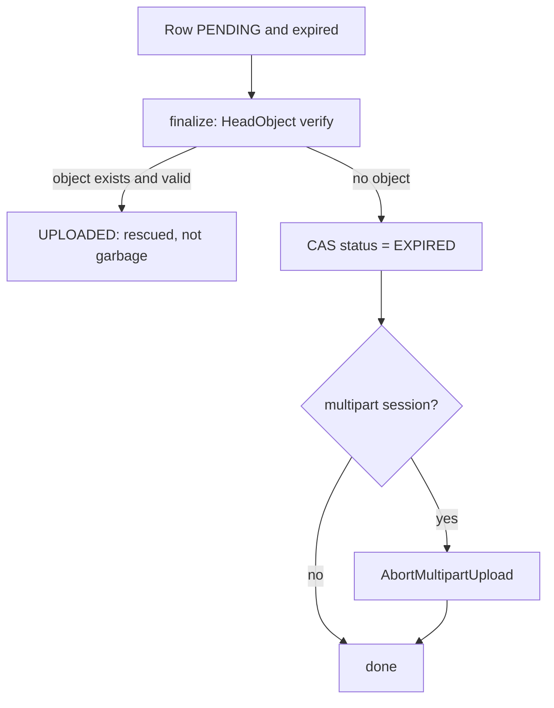

```java
@Scheduled(fixedDelay = 60_000)
void reapExpired() {
    // SKIP LOCKED lets multiple reaper instances run without fighting over rows
    List<FileRecord> batch = jdbc.query("""
        SELECT * FROM files
         WHERE status IN ('PENDING')
           AND upload_expires_at < now() - interval '10 minutes'   -- grace after expiry
         ORDER BY upload_expires_at
         LIMIT 200
         FOR UPDATE SKIP LOCKED
        """, mapper);

    for (FileRecord f : batch) {
        finalize(f.id());                                // rescue if it actually landed
        if (repo.findById(f.id()).status() != PENDING) continue;

        int n = jdbc.update("""
            UPDATE files SET status='EXPIRED', updated_at=now()
             WHERE id=? AND status='PENDING'
            """, f.id());                                // CAS: lose gracefully to a concurrent finalize
        if (n == 1) abortMultipartIfAny(f);
    }
}

void abortMultipartIfAny(FileRecord f) {
    uploads.findByFileId(f.id()).ifPresent(u -> {
        try {
            s3.abortMultipartUpload(b -> b.bucket(u.bucket()).key(u.objectKey()).uploadId(u.uploadId()));
        } catch (NoSuchUploadException ignore) { }       // already gone: success
        uploads.markAborted(f.id());
    });
}
```

Details that matter:

| Detail | Why |
|---|---|
| **DB status first, then S3 abort** | If we crash after the DB change, the next run still sees `EXPIRED` with an unaborted session and can retry. If we aborted first and crashed, a client might still believe it can upload to a dead row. |
| Treat `NoSuchUpload` on abort as **success** | Aborting must be idempotent, like everything else. |
| Grace period after expiry | Avoids racing a client that is in its final seconds. |
| `FOR UPDATE SKIP LOCKED` plus batches | Many reaper instances can run in parallel. Each takes a different slice. No distributed lock needed. |
| Abort may need **a second pass** | AWS notes that a part still being uploaded while you abort can survive. Running abort again later (or relying on the lifecycle rule) cleans up the stragglers. |

### Free the quota

If `PENDING` rows count against a user's quota, expiring them must release it. Otherwise a user who started ten abandoned uploads is blocked from uploading. Compute quota from `UPLOADED`/`READY` files plus **only unexpired** `PENDING` ones.

---

## Version 4: Layer 3, the reconciler (comparing DB and bucket)

The reaper starts from the **DB** and looks for dead rows. It cannot see **orphans** (objects with no row), because it never looks at the bucket. A reconciler checks the other direction.

### Two directions of mismatch

| Direction | Meaning | Typical cause | Action |
|---|---|---|---|
| Row says `UPLOADED`/`READY`, **object missing** | Data loss or a bad delete | Accidental deletion, wrong lifecycle rule, bug | **Alert immediately.** Never auto-fix silently. |
| Object exists, **no row** | Orphan | Hard-deleted rows, bugs, failed cleanup | Quarantine, then delete after a delay |

### Don't list the bucket with `ListObjectsV2` at scale

Listing 500 million keys by API is slow and expensive. Use **S3 Inventory**, a scheduled report (daily or weekly, CSV/Parquet/ORC) of every object with key, size, last-modified, ETag and so on. Load it into a warehouse or temporary table, and compare it against the DB.

```sql
-- objects in the inventory with no matching row (orphan candidates)
SELECT i.key, i.size, i.last_modified
  FROM s3_inventory i
  LEFT JOIN files f ON f.object_key = i.key
 WHERE f.id IS NULL
   AND i.last_modified < now() - interval '3 days';     -- grace: ignore very recent objects
```

```sql
-- rows claiming to exist whose object is missing (the scary direction)
SELECT f.id, f.object_key
  FROM files f
  LEFT JOIN s3_inventory i ON i.key = f.object_key
 WHERE f.status IN ('UPLOADED','PROCESSING','READY') AND i.key IS NULL
   AND f.updated_at < now() - interval '2 days';
```

### Why the grace periods matter

The inventory is a **snapshot** that is hours old. An object uploaded after the snapshot would look like an orphan, and a row created just now might not yet have its object. Only act on discrepancies older than the snapshot lag plus a margin.

### Orphan handling: quarantine, then delete

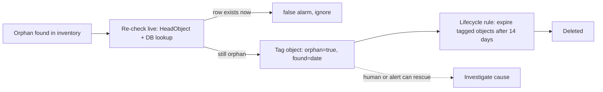

Tagging plus a lifecycle rule filtered on the tag gives a **reversible window**: anyone can remove the tag during the 14 days and save the object. Direct deletion on first detection gives none.

---

## Version 5: Deleting user files properly (garbage #6)

When a user presses Delete, the system must remove the bytes, not only the row. A crash in the middle must not leave something half-deleted.

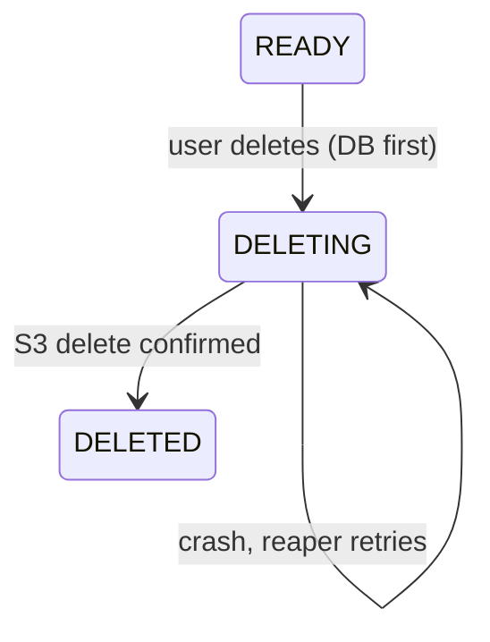

1. **DB first:** set `status = DELETING` in one transaction. The file is now invisible to the user and to APIs, instantly.
2. **Then S3:** delete the object (or release the blob reference, Chapter 6).
3. **Then finish:** mark `DELETED`, or remove the row. A **hard-delete job** can purge `DELETED` rows after a retention period.
4. **Crash-safe:** the reaper retries any `DELETING` row. `DeleteObject` on a missing key succeeds, so it is idempotent.

What deletion has to account for:

| Situation | Handling |
|---|---|
| **Versioned bucket** | A plain delete only adds a *delete marker*. The old bytes still exist. For real erasure, delete specific versions (`versionId`), or rely on `NoncurrentVersionExpiration` with a short window. |
| **Deduplicated blobs** (Chapter 6) | Decrement `ref_count`. Bytes go only when the count is 0 after the grace period. |
| **Derived data** | Thumbnails, transcodes, search index entries and CDN caches must be deleted too. The `FileDeleted` event (via the outbox) tells downstream systems. |
| **Legal erasure deadlines (for example GDPR)** | Document the maximum delay (grace periods plus lifecycle lag) and confirm it is acceptable. |
| **Backups** | Out of scope for this flow, but real erasure policies must address them. |

---

## Version 6: The safety rules for all cleanup code

Cleanup code deletes data, so it gets stricter rules than feature code.

| Rule | Reason |
|---|---|
| **Never delete on first sighting.** Mark, wait, then delete. | A bug in detection becomes a recoverable event, not data loss. |
| **Re-verify live right before deleting** (do not trust a stale report) | Inventory and queries can be hours old. |
| **Grace periods** longer than any legitimate delay in the system | Avoids races with slow-but-alive uploads. |
| **Idempotent and resumable** | Crashes mid-cleanup must be harmless. |
| **Batch limits and rate limits** | A bad query shouldn't delete a million objects in a minute. Add a **circuit breaker**: if one run wants to delete more than X% of objects, stop and page a human. |
| **Dry-run mode** | Log what *would* be deleted for a week before enabling real deletes. |
| **Metrics and alerts** | Track counts of expired, rescued, orphaned and `COMPLETING` rows. A sudden spike in orphans or in "missing objects" is an incident signal. |
| **Least privilege** | The cleanup role should delete only within the specific prefixes it owns. |

---

## Version 7: Three layers, three timescales

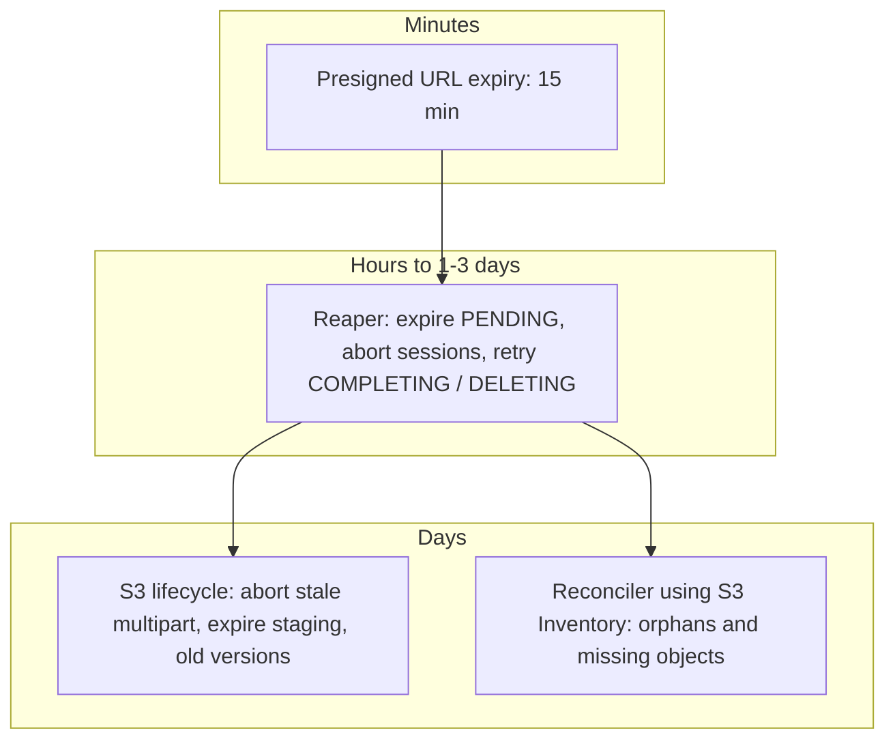

| Layer | Knows about | Runs on | Catches |
|---|---|---|---|
| URL expiry | Time only | S3 | Stale permissions |
| **Reaper** | DB state | Our service | Expired rows, stuck states, partial deletes |
| **S3 lifecycle** | Bucket only | S3 | Hidden parts, staging junk, old versions, tagged orphans, **even if our service is down** |
| **Reconciler** | DB and bucket | Batch job | Orphans and missing objects (the cases nothing else sees) |

**The timing rule:** URL expiry (minutes) is shorter than the reaper window (hours), and the reaper window is shorter than the lifecycle days. Each outer layer acts only **after** the inner one has had its chance. That ordering stops the backstop from killing something the primary mechanism would have saved.

---

## Chapter 7 checkpoint

1. Every created-but-unfinished step leaves garbage. The costliest is **hidden multipart parts**, because they are billed and invisible.
2. **Layer 1, S3 lifecycle:** `AbortIncompleteMultipartUpload`, expire `staging/`, expire old versions. It works even if your app is down, but is **day-granular and asynchronous**, so it is a backstop.
3. **Layer 2, the reaper:** `finalize()` first (rescue uploads that landed), then CAS to `EXPIRED`, then abort the session. DB first, S3 second, idempotent, with `SKIP LOCKED` batches.
4. **Layer 3, the reconciler:** use **S3 Inventory** (not full listing) to find orphans and **missing objects**. Missing objects mean alert, not auto-fix. Orphans go to **tag, wait, delete**.
5. **Deletion is a state machine** (`DELETING`, then S3, then `DELETED`) that is crash-safe. Account for versioning, dedup refcounts, derived data and legal timelines.
6. All cleanup code follows: **mark, wait, re-verify, delete**, with grace periods, circuit breakers, dry runs and alerts.

Next is **Chapter 8**: security and post-upload processing. Presigned URLs can't inspect content, so we need a quarantine flow: validating real file type (magic bytes), virus scanning, size and abuse limits, optional transformations (thumbnails, transcoding), and safely serving files back (download URLs, CDN, content-disposition). Reply **next** to continue.


-----------------------------------------------------------------------------------------------------------------------
-----------------------------------------------------------------------------------------------------------------------
-----------------------------------------------------------------------------------------------------------------------
-----------------------------------------------------------------------------------------------------------------------


# Chapter 8: Security and post-upload processing

## Version 1: What the presigned URL did not check

Chapter 2 listed what a presigned URL cannot enforce. By now our flow has verified **existence and size** (`HeadObject`), but nobody has looked at the **content**.

| Claim by the client | Verified so far? |
|---|---|
| "This is a PDF" (`Content-Type`) | No. It is only a header the client chose. |
| "This is 2 MB" | Yes (`HeadObject` size). |
| "This file is safe" | No |
| "This is an image of 4000×3000" | No |
| "My filename is `invoice.pdf`" | No (and the name is dangerous in its own right) |

The client controls every byte and every header. So the core rule of this chapter is:

> **Nothing a client sends is trusted until the server has inspected it. Nothing uninspected is ever served to anyone.**

### Threat list

| Threat | Example |
|---|---|
| **Malware** | An executable renamed `report.pdf`, or an infected Office macro file shared to other users |
| **Type spoofing** | `Content-Type: image/png` on an HTML file |
| **Stored XSS** | An uploaded `.html` or `.svg` file served from your domain runs script in your users' sessions |
| **Decompression bombs** | A 40 KB zip that expands to 40 GB. A tiny PNG that decodes to a 100,000×100,000 pixel image and exhausts the thumbnailer's memory. |
| **Resource abuse** | Millions of 5 GB uploads to run up your bill, or using your bucket as free file hosting |
| **Path and name tricks** | A filename like `../../etc/passwd`, or one with control characters or a misleading extension such as `invoice.pdf.exe` |
| **Unauthorized access** | Guessing another user's file ID, or sharing a download link that never expires |
| **Illegal or policy-violating content** | Depends on the product. May need hash matching or moderation pipelines. |

---

## Version 2: Quarantine. The file is "guilty until verified"

### The idea

Uploads land in a place where **nothing can read them** except the processing pipeline. Only after the checks pass do they move to a place where users can fetch them.

```mermaid
flowchart LR
    C[Client] -- presigned PUT --> Q[(Quarantine bucket / staging prefix)]
    Q --> P[Processing pipeline: validate, scan, transform]
    P -- pass --> L[(Clean bucket)]
    P -- fail --> R[Reject: delete + mark REJECTED]
    L --> U[Users: via signed GET or CDN]
```

| Property | Quarantine | Clean |
|---|---|---|
| Who can write | Presigned URL holders | Only the pipeline's role |
| Who can read | Only the pipeline's role | The app (to issue signed GETs) and the CDN |
| Public access | Blocked | Blocked (served through signed URLs or CDN with origin access control) |
| Lifecycle | Short expiry (Chapter 7) | Per retention policy |

A **separate bucket** is the strongest form, since the IAM policies are completely independent. A **prefix** (`staging/`) in one bucket works too, but the IAM and bucket policies must be written with care.

This also solves two earlier problems for free:

- The **overwrite-after-verify hole** (Chapters 4 and 6): after verification the pipeline **copies** the object to the clean bucket, and the client's URL only ever pointed at quarantine.
- **Unscanned content** can never reach a reader, since readers only have access to the clean side.

Copy detail: a single `CopyObject` supports objects up to 5 GB. Larger objects need a **multipart copy** (`UploadPartCopy`). The SDK's transfer manager normally handles this for you.

### State machine, completed

```mermaid
stateDiagram-v2
    [*] --> PENDING
    PENDING --> UPLOADED: finalize (Ch.4)
    UPLOADED --> PROCESSING: pipeline picks up
    PROCESSING --> READY: all checks passed, copied to clean bucket
    PROCESSING --> REJECTED: failed a check
    PROCESSING --> PROCESSING: retry (idempotent)
    PROCESSING --> FAILED: infrastructure error after N retries, alert
    READY --> DELETING
```

`REJECTED` (the content is bad) and `FAILED` (our pipeline broke) must be separate states. Rejecting a good file because the scanner was down is a different incident from rejecting malware, and the user-facing message differs too.

**Product decision:** can users see a file in `UPLOADED` or `PROCESSING`? The usual answer is "yes, the owner sees it with a 'processing' badge, but **nobody can download or share it** until `READY`."

---

## Version 3: The pipeline

Trigger: the `FileUploaded` event from the outbox (Chapter 4), delivered through a queue with retries and a dead-letter queue, like the worker pattern for any at-least-once task. Every stage must be **idempotent**, keyed on `fileId`.

```mermaid
flowchart TD
    A[FileUploaded event] --> B[Load row, CAS UPLOADED to PROCESSING]
    B --> C[Stage 1: size and metadata checks]
    C --> D[Stage 2: real type detection]
    D --> E[Stage 3: malware scan]
    E --> F[Stage 4: type-specific safety checks and transforms]
    F --> G[Copy to clean bucket]
    G --> H[CAS PROCESSING to READY + outbox FileReady]
    C -- fail --> X[REJECTED]
    D -- fail --> X
    E -- infected --> X
    F -- fail --> X
```

### Stage 1: Size and metadata

Already partly done in `finalize()`. Re-check against **policy**, not only the declared size: for example "max 100 MB for images, 5 GB for video", and per-user quota.

**Enforce limits before the bytes arrive when you can.** A presigned **PUT** signs an exact length, which is fine when the client declares the size up front. A presigned **POST** can additionally carry a policy such as `content-length-range` (min and max) and a `starts-with` condition on `Content-Type`, so S3 itself rejects oversized or wrong-typed uploads. For multipart, per-part limits apply, so total size is enforced by the server when it builds the part plan (Chapter 3) and again after `Complete`.

### Stage 2: Detect the real type (magic bytes)

Read the first few KB and identify the format from its signature, ignoring the extension and the declared `Content-Type`.

| Format | Signature (start of file) |
|---|---|
| PNG | `89 50 4E 47 0D 0A 1A 0A` |
| JPEG | `FF D8 FF` |
| PDF | `25 50 44 46` (`%PDF`) |
| ZIP (also DOCX/XLSX/APK) | `50 4B 03 04` |

```java
String detected = tika.detect(firstBytes(s3, key, 8192));       // Apache Tika, or libmagic
if (!allowedTypes.contains(detected)) reject("TYPE_NOT_ALLOWED", detected);
if (!detected.equals(declaredType)) reject("TYPE_MISMATCH", detected);   // or: trust detected, store it
```

Policy choice:

- **Allow-list**, never a block-list. Block-lists miss new types.
- On mismatch, either **reject** or **overwrite our stored type with the detected one**. Never keep the client's claim.
- A matching signature **does not prove safety**. Polyglot files can be valid as two formats at once (an image that is also a script or archive). So type detection is a **gate**, not the defense. The defense is how we serve the file (Version 5).

### Stage 3: Malware scan

| Option | Notes |
|---|---|
| **ClamAV** in a worker (self-managed) | Open source, signature-based. You manage updates and scale. Has file size limits per scan configuration. |
| **Managed service** (for example, AWS GuardDuty Malware Protection for S3, or a third-party vendor API) | Scans new objects automatically and records a result (for example as an object tag or event). Check current limits and pricing. |
| **Multiple engines** | Higher detection. Common for high-risk products. |

Design points:

- **Stream** the object into the scanner. Don't load a 5 GB file into memory.
- Scanning is slow, which is why it is **asynchronous** (a state, not a blocking API call).
- **Scanner down means retry or `FAILED`, never "assume clean."** Failing open here defeats the purpose.
- Scan time varies with file size. Set generous visibility timeouts and heartbeats on the queue (the same lease-and-heartbeat idea as long-running SQS tasks).
- Signature scanners miss novel malware. This reduces risk and does not eliminate it, which is another reason to rely on safe serving.

### Stage 4: Type-specific safety and transforms

| Type | Checks and processing |
|---|---|
| **Images** | Decode with **limits**: max width × height (**pixel count**, not just file size), to defeat decompression bombs. **Re-encode** to a clean format. This strips EXIF (GPS location, a privacy leak), any appended payloads and polyglot tricks. Generate thumbnails. Run in a sandbox with memory and CPU caps. |
| **Archives (zip)** | Cap total uncompressed size, file count, nesting depth and compression ratio. Reject entries with `../` paths (zip slip). Better: don't extract at all unless the product needs it. |
| **PDF / Office** | Scan, optionally strip active content (macros, JavaScript), optionally render a preview. |
| **Video / audio** | Transcode with a duration limit and a worker timeout. |
| **SVG, HTML** | Treat as **code**, not images. Either disallow, or sanitize with a strict allow-list sanitizer, or serve only as a download (Version 5). |
| **Text / CSV** | Mind CSV formula injection (cells starting with `=`, `+`, `-`, `@`) if these are later opened in a spreadsheet. |

**Run risky parsers in isolation.** Image and document parsers are a classic source of vulnerabilities. Use a container with no network, a read-only filesystem, tight CPU and memory limits and a timeout.

### Idempotent finish

```java
void process(UUID fileId) {
    FileRecord f = repo.findById(fileId);
    if (f.status() == READY || f.status() == REJECTED) return;           // already done
    if (!repo.casStatus(fileId, UPLOADED, PROCESSING) && f.status() != PROCESSING) return;

    Verdict v = pipeline.run(f);              // pure function of the object: safe to re-run

    switch (v.outcome()) {
        case CLEAN -> {
            copyToCleanBucket(f);             // CopyObject / multipart copy, overwrite-safe by key
            repo.casStatus(fileId, PROCESSING, READY);
            outbox.publish(new FileReady(fileId));
        }
        case INFECTED, INVALID -> {
            repo.markRejected(fileId, v.reason());        // DB first
            s3.deleteObject(quarantineBucket, f.objectKey());
            outbox.publish(new FileRejected(fileId, v.reason()));
        }
    }
}
```

Derived artifacts (thumbnails and so on) use **deterministic keys** (`derived/<fileId>/thumb_256.jpg`), so a retry overwrites instead of duplicating.

---

## Version 4: Access control and abuse limits

### Who may do what

The server is the only gatekeeper, because the bucket is private.

| Action | Check |
|---|---|
| Create upload (`POST /files`) | Authenticated, within **quota**, within **rate limit**, allowed type and size |
| Presign part or complete | The file belongs to `owner_id` (check on **every** call, not just creation) |
| Download | Owner, or someone with an explicit share grant, **and** status `READY` |

**Prevent IDOR** (insecure direct object reference). `GET /files/123` must verify that the caller may see file 123, not only that it exists. Use unguessable IDs (UUIDv4) as defense in depth, but **authorization is the real control**.

### Abuse controls

| Control | Purpose |
|---|---|
| Per-user **quota** (bytes and file count), counting unexpired `PENDING` too | Stops free file hosting |
| **Rate limits** on `POST /files` and presign endpoints | Stops URL farming and cost attacks |
| Cap on **concurrent open multipart sessions** per user | Prevents hoarding hidden billed parts |
| Max **parts and size** per file | Bounded blast radius |
| Short URL expiry, and bind to a specific key, method and headers | Limits what a leaked URL can do |
| Bucket configuration: **Block Public Access** on, TLS-only policy, default encryption (SSE-S3 or SSE-KMS) | Baseline hygiene |
| **CloudTrail / S3 access logs**, anomaly alerts (sudden spike in uploads or denies) | Detection |
| Optional: IP/geo and WAF rules on the API | Extra layer, but never the only one |

### CORS, written carefully

The bucket needs CORS for browser uploads, scoped tightly:

```json
[{
  "AllowedOrigins": ["https://app.example.com"],
  "AllowedMethods": ["PUT", "GET"],
  "AllowedHeaders": ["Content-Type", "x-amz-checksum-sha256", "x-amz-meta-*"],
  "ExposeHeaders": ["ETag"],
  "MaxAgeSeconds": 3000
}]
```

Never use `AllowedOrigins: ["*"]` together with credentials, and list the origins you actually run. (CORS only constrains browsers. It is not a security control against non-browser clients, which is why every other check still exists.)

---

## Version 5: Serving files back safely

Many real breaches come from here, not from the upload.

### Option A: Presigned GET URL

```java
GetObjectRequest get = GetObjectRequest.builder()
    .bucket(cleanBucket).key(f.cleanKey())
    .responseContentDisposition("attachment; filename=\"" + safeName(f.originalName()) + "\"")
    .responseContentType(f.verifiedContentType())
    .build();
URL url = presigner.presignGetObject(p -> p.signatureDuration(Duration.ofMinutes(5))
                                           .getObjectRequest(get)).url();
// check authorization BEFORE issuing; then 302 redirect or return the URL
```

The authorization check happens at **issue time**. The URL itself is a bearer token for its short lifetime, so keep it short (minutes).

### Option B: CDN in front (CloudFront or similar)

For high-volume downloads. Use **origin access control** so the bucket accepts requests only from the CDN. Protect private content with **signed URLs or signed cookies**, and set sensible cache headers. Caution: a **cached** private file can outlive a revoked permission, so use short TTLs, or per-user signed URLs with cache keys that don't leak across users.

### The headers that stop uploaded content from attacking users

| Header / practice | What it prevents |
|---|---|
| **`Content-Disposition: attachment`** for anything not an image or video you intend to render | Browser downloads instead of rendering, so an uploaded HTML file can't execute |
| **`X-Content-Type-Options: nosniff`** | The browser won't "guess" that a text file is HTML or script |
| **Serve from a separate domain** (for example `usercontent.example-cdn.com`, not a subdomain that shares cookies with your app) | Even if script runs, it has no access to your app's cookies or storage (same-origin policy) |
| **`Content-Security-Policy: sandbox; default-src 'none'`** on user content | Further neutralizes any rendered document |
| Serve the **stored, verified type**, never the client's | Closes the spoof hole from Stage 2 |
| **Sanitize filenames** in `Content-Disposition` | Prevents header injection and weird characters. Keep the original name only as display metadata. |
| Re-encoded images | A polyglot becomes plain pixels |

Why the separate domain is the biggest single win: stored XSS from user-uploaded files is devastating on your main origin and mostly harmless on an isolated one.

### Encryption

| Layer | Practice |
|---|---|
| In transit | HTTPS only (bucket policy denying non-TLS) |
| At rest | S3 default encryption (SSE-S3), or SSE-KMS if you need key control, audit and per-tenant keys |
| Per-tenant isolation | Separate KMS keys per tenant where contracts require it (note this prevents cross-tenant dedup, Chapter 6) |
| Client-side encryption | Only when you must keep content unreadable even to yourself. It disables server-side scanning and processing, so it is a major product trade-off. |

---

## Version 6: What the user sees, and notifying them

Processing is asynchronous, so the UI must handle it.

| Status | UI |
|---|---|
| `PENDING` | Upload progress bar |
| `UPLOADED` / `PROCESSING` | "Processing..." (owner can see, cannot download or share) |
| `READY` | Normal file |
| `REJECTED` | Clear reason when it is safe to say ("This file type isn't supported", "This file couldn't be accepted"). Don't reveal scanner details to attackers. |
| `FAILED` | "Something went wrong, try again", and an alert for us |

Update delivery: polling `GET /files/{id}`, or server-sent events and WebSockets, or push notification for long jobs (video). The `FileReady` / `FileRejected` outbox events feed these channels.

---

## Chapter 8 checkpoint

1. A presigned URL proves nothing about **content**. Treat all client claims (type, name, size) as **untrusted**.
2. **Quarantine first.** Uploads land where nobody can read them. Only a pipeline moves **verified** files to a clean location, and this also closes the overwrite-after-verify hole.
3. The pipeline is **asynchronous and idempotent**: size and policy, then **magic-byte type detection** (allow-list), then **malware scan** (fail closed), then **type-specific checks** (decompression-bomb limits, re-encoding, sandboxed parsers).
4. `REJECTED` (bad content) and `FAILED` (our infrastructure) are separate states. The scanner being down never means "assume clean."
5. Authorize every call (avoid IDOR), enforce **quotas and rate limits**, cap open multipart sessions, and lock the bucket down (Block Public Access, TLS only, encryption, tight CORS, logging).
6. **Serve defensively:** short-lived signed GETs or a CDN with signed access, `Content-Disposition: attachment`, `nosniff`, **a separate domain for user content**, and the **verified** content type.

Next is **Chapter 9**, the finale: the **complete architecture** in one picture, end-to-end sequence diagrams for small and large files, a **decision table for adapting this to different real-world systems** (profile photos vs enterprise documents vs video platforms vs mobile apps vs regulated data), a **failure-mode matrix**, and an **interview recall sheet**. Reply **next** to continue.


-----------------------------------------------------------------------------------------------------------------------
-----------------------------------------------------------------------------------------------------------------------
-----------------------------------------------------------------------------------------------------------------------
-----------------------------------------------------------------------------------------------------------------------


# Chapter 9: The complete system, end to end

This chapter assembles Chapters 1 to 8 into one design. It has the master architecture, every flow in full detail, the final contracts, a failure matrix, adaptations for different real-world systems, and a recall sheet.

---

## Part 1: Master architecture

```mermaid
flowchart TB
    subgraph Client
      UI[Web / Mobile client]
    end

    subgraph ControlPlane [Control plane: small JSON only]
      API[Upload API]
      DB[(Primary DB: files, file_uploads, blobs, outbox)]
      OB[Outbox relay]
      REAP[Reaper job]
      REC[Reconciler job]
    end

    subgraph Async [Async workers]
      FIN[Finalizer worker]
      PIPE[Processing pipeline: type check, malware scan, transforms]
      DEL[Deletion worker]
    end

    subgraph DataPlane [Data plane: heavy bytes]
      QB[(Quarantine bucket)]
      CB[(Clean bucket)]
      CDN[CDN on separate user-content domain]
    end

    Q1[[SQS: S3 events]]
    Q2[[SQS: file-uploaded]]
    Q3[[SQS: file-deleted]]

    UI -- "1. create / presign / complete / poll" --> API
    API <--> DB
    UI == "2. bytes: presigned PUT / UploadPart" ==> QB
    QB -- ObjectCreated --> Q1 --> FIN
    FIN --> DB
    DB --> OB --> Q2 --> PIPE
    PIPE -- read --> QB
    PIPE -- copy verified --> CB
    PIPE --> DB
    UI == "3. download via signed URL" ==> CDN --> CB
    API -- "authz then signed GET" --> UI
    REAP --> DB
    REAP --> QB
    REC --> DB
    REC --> QB
    DB --> OB --> Q3 --> DEL --> CB
```

| Component | Responsibility | Never does |
|---|---|---|
| **Upload API** | Authn/authz, validation, quota, idempotency, state transitions, presigning, completing multipart | Touch file bytes |
| **DB** | Source of truth for intent and state | Hold file content |
| **Quarantine bucket** | Receives raw uploads. Readable only by the pipeline. | Serve users |
| **Finalizer** | The one `finalize()` verifier (HeadObject, CAS to `UPLOADED`) | Trust a caller's claim |
| **Pipeline** | Type detection, scan, transforms, promote to clean | Fail open |
| **Clean bucket and CDN** | Serve verified files via signed access | Accept client writes |
| **Reaper** | Expire stale rows, abort sessions, retry stuck states | Delete without re-verifying |
| **Reconciler** | Compare DB and bucket via S3 Inventory | Delete on first sighting |
| **Outbox relay** | Reliably turn DB state changes into queue messages | Publish before the DB commit |

**Five invariants that hold the design together:**

1. **Control plane and data plane are separate.** Bytes never pass through our servers.
2. **S3 is the truth about bytes. The DB is the truth about intent and state.** Anything between them is reconciled, never assumed.
3. **Many triggers, one idempotent verifier.** Client callback, S3 event and sweeper all call `finalize()`.
4. **State moves forward only, by compare-and-set, only on evidence.**
5. **Nothing unverified is ever served**, and nothing is deleted without a grace period and a re-check.

---

## Part 2: Final data model

```sql
CREATE TABLE files (
  id                UUID PRIMARY KEY,
  owner_id          UUID NOT NULL,
  original_name     TEXT NOT NULL,              -- display only
  declared_type     TEXT NOT NULL,              -- client claim
  verified_type     TEXT,                       -- set by pipeline (magic bytes)
  declared_size     BIGINT NOT NULL,
  actual_size       BIGINT,
  bucket            TEXT NOT NULL,              -- quarantine bucket
  object_key        TEXT NOT NULL UNIQUE,       -- staging/<yyyy>/<mm>/<uuid>
  clean_key         TEXT,                       -- set at promotion
  version_id        TEXT,                       -- S3 version recorded at finalize
  etag              TEXT,
  checksum_sha256   TEXT,                       -- computed by server in pipeline
  blob_id           TEXT REFERENCES blobs(id),  -- only if dedup is enabled
  status            TEXT NOT NULL,              -- PENDING|UPLOADED|PROCESSING|READY|REJECTED|FAILED|EXPIRED|DELETING|DELETED
  reject_reason     TEXT,
  idempotency_key   TEXT NOT NULL,
  request_hash      TEXT NOT NULL,
  upload_expires_at TIMESTAMPTZ NOT NULL,
  created_at        TIMESTAMPTZ NOT NULL DEFAULT now(),
  updated_at        TIMESTAMPTZ NOT NULL DEFAULT now(),
  UNIQUE (owner_id, idempotency_key)
);
CREATE INDEX idx_files_reap ON files (status, upload_expires_at);

CREATE TABLE file_uploads (                     -- only for multipart
  file_id      UUID PRIMARY KEY REFERENCES files(id),
  upload_id    TEXT NOT NULL,
  part_size    BIGINT NOT NULL,
  total_parts  INT NOT NULL,
  status       TEXT NOT NULL,                   -- IN_PROGRESS|COMPLETING|COMPLETED|ABORTED|FAILED
  expires_at   TIMESTAMPTZ NOT NULL,
  updated_at   TIMESTAMPTZ NOT NULL DEFAULT now()
);

CREATE TABLE blobs (                            -- optional, only if dedup
  id          TEXT PRIMARY KEY,                 -- sha256 of content
  object_key  TEXT NOT NULL,
  size        BIGINT NOT NULL,
  ref_count   INT NOT NULL,
  zero_since  TIMESTAMPTZ
);

CREATE TABLE outbox (
  id          BIGSERIAL PRIMARY KEY,
  topic       TEXT NOT NULL,
  payload     JSONB NOT NULL,
  created_at  TIMESTAMPTZ NOT NULL DEFAULT now(),
  published_at TIMESTAMPTZ
);
```

## Part 3: Final API contract

| Endpoint | Purpose | Idempotent because |
|---|---|---|
| `POST /files` + `Idempotency-Key` | Create row. Single: return presigned PUT. Multipart: initiate and return `partSize`, `totalParts`. | Unique `(owner, key)` and an "ensure" pattern |
| `POST /files/{id}/parts/presign` `{partNumbers}` | Batch of presigned `UploadPart` URLs | Pure computation |
| `GET /files/{id}/parts` | Which parts S3 has (`ListParts`, paginated) | Read-only |
| `POST /files/{id}/complete` | Trigger `finalize()` (single) or `Complete` plus `finalize()` (multipart) | CAS and `NoSuchUpload` handling |
| `POST /files/{id}/abort` | Cancel upload | "Already aborted" is success |
| `GET /files/{id}` | Status for polling | Read-only |
| `GET /files/{id}/download` | Authz check, then 302 to short-lived signed GET | Read-only |
| `DELETE /files/{id}` | Set `DELETING`, async cleanup | State check |

Status codes worth defining: `201` created, `200` existing (same idempotent request), `409` in progress or wrong state, `422` idempotency key reused with a different body, `403` not owner, `413` too large, `429` rate or quota limit.

---

## Part 4: Flow A, small file (single PUT), full detail

Threshold: below about 100 MB.

```mermaid
sequenceDiagram
    participant C as Client
    participant A as Upload API
    participant D as DB
    participant Q as Quarantine S3
    participant E as S3 Events SQS
    participant F as Finalizer
    participant O as Outbox + Queue
    participant P as Pipeline
    participant CB as Clean S3

    C->>A: POST /files {name, type, size} + Idempotency-Key
    A->>A: authn, authz, validate type/size, quota, rate limit
    A->>D: INSERT files (PENDING, key=staging/..., expires=now+15m)
    A->>A: presign PUT (signed: key, content-type, content-length, expiry)
    A-->>C: 201 {fileId, uploadUrl, requiredHeaders, expiresAt}

    C->>Q: PUT bytes to uploadUrl
    Q-->>C: 200 OK

    par fast path
        C->>A: POST /files/{id}/complete
        A->>F: finalize(fileId)
    and backstop
        Q-->>E: ObjectCreated:Put event
        E->>F: deliver (at least once)
    end

    F->>D: load row, if status != PENDING then no-op
    F->>Q: HeadObject
    F->>F: compare size and type with declared
    F->>D: UPDATE ... SET UPLOADED WHERE status=PENDING (CAS)
    F->>D: INSERT outbox FileUploaded (same transaction)
    A-->>C: 200 {status: UPLOADED or PENDING}

    D->>O: outbox relay publishes FileUploaded
    O->>P: deliver
    P->>D: CAS UPLOADED to PROCESSING
    P->>Q: stream object
    P->>P: magic-byte type, malware scan, type checks, hash
    alt clean
        P->>CB: copy to clean bucket
        P->>D: CAS PROCESSING to READY, outbox FileReady
    else bad
        P->>D: status REJECTED + reason, outbox FileRejected
        P->>Q: delete object
    end

    loop until terminal
        C->>A: GET /files/{id}
        A-->>C: status
    end
```

**Step-by-step explanation**

| Step | What happens | Why |
|---|---|---|
| 1 | Validate before signing | After signing, we lose control of the data plane |
| 2 | Insert `PENDING` row before issuing URL | A breadcrumb exists even if the client vanishes |
| 3 | Sign key, type, length, short expiry | Narrow the permission slip |
| 4 | Client PUTs directly to S3 | Server stays out of the byte path |
| 5 | Three triggers race into `finalize()` | Any one working is enough |
| 6 | `HeadObject` then CAS | Verify first, one winner only |
| 7 | Outbox row in the **same transaction** as the state change | No lost "next step" if we crash after commit |
| 8 | Pipeline works on quarantine and promotes to clean | Unverified bytes are never readable by users |

---

## Part 5: Flow B, large file (multipart), full detail

```mermaid
sequenceDiagram
    participant C as Client
    participant A as Upload API
    participant D as DB
    participant S as S3 Quarantine

    C->>A: POST /files {size: 4 GB} + Idempotency-Key
    A->>D: INSERT files (PENDING)
    A->>S: CreateMultipartUpload(key)
    S-->>A: uploadId
    A->>D: INSERT file_uploads (IN_PROGRESS, partSize=8MiB, totalParts=512)
    A-->>C: 201 {fileId, partSize, totalParts}

    C->>C: persist {fileId, idempotencyKey, fingerprint} locally

    loop batches of parts
        C->>A: POST /parts/presign {partNumbers: next 10}
        A->>D: check status IN_PROGRESS and owner
        A-->>C: 10 presigned UploadPart URLs (15 min)
        par up to 4 parallel
            C->>S: PUT part N bytes
            S-->>C: 200 (ETag)
        end
        Note over C,S: failure: backoff+jitter retry same part, expired URL: fetch fresh one
    end

    C->>A: POST /files/{id}/complete
    A->>D: CAS file_uploads IN_PROGRESS to COMPLETING
    A->>S: ListParts (paginate)
    A->>A: validate: parts 1..N all present, no gaps
    alt parts missing
        A->>D: COMPLETING back to IN_PROGRESS
        A-->>C: 409 {missingParts: [..]}
    else all present
        A->>S: CompleteMultipartUpload(parts)
        S-->>A: final object (stitched)
        A->>S: HeadObject verify size/type
        A->>D: CAS files PENDING to UPLOADED, file_uploads COMPLETED, outbox FileUploaded
        A-->>C: 200 {status: UPLOADED}
    end
```

Then the pipeline runs exactly as in Flow A, starting from the `FileUploaded` event.

**Things specific to large files**

| Topic | Rule |
|---|---|
| Part size | `max(8 MiB, ceil(size / 10000))`. Last part may be smaller. Server decides and the client obeys. |
| URL issuance | Lazy batches, because URLs expire and sessions can last hours |
| Source of truth for parts | **S3 `ListParts`**. No per-part rows unless required. |
| Who calls Complete | **Server only**, using the S3 part list and never the client's list |
| Integrity | Per-part checksum headers signed into URLs so S3 rejects corrupted parts |
| Concurrency | 3 to 6 parallel parts, reduce on `429`/`503` |
| Final object | One stitched object. Multipart ETag is not a content hash. |

---

## Part 6: Flow C, resume after crash

```mermaid
sequenceDiagram
    participant C as Client (returns later)
    participant A as Upload API
    participant D as DB
    participant S as S3

    C->>C: load saved {fileId, fingerprint}, user re-selects file
    C->>C: fingerprint matches? name, size, lastModified (+ head/tail hash)
    alt mismatch
        C->>C: refuse to resume, offer "start over" (new idempotency key)
    else match
        C->>A: GET /files/{id}
        A->>D: load files + file_uploads
        alt status != PENDING or session not IN_PROGRESS or expired
            A-->>C: 409 {state}, client acts on it (done / restart)
        else resumable
            A-->>C: {partSize, totalParts}
            C->>A: GET /files/{id}/parts
            A->>S: ListParts (all pages)
            alt NoSuchUpload
                A->>D: mark ABORTED/EXPIRED
                A-->>C: 410 gone, start a new upload
            else
                A-->>C: {uploaded: [1..312]}
                C->>C: missing = 313..512, same partSize
                Note over C,S: continue Flow B loop with only missing parts
            end
        end
    end
```

---

## Part 7: Flow D, failure and recovery flows

### D1: Client finished but the callback was lost

```mermaid
sequenceDiagram
    participant C as Client
    participant S as S3
    participant E as S3 Events
    participant F as Finalizer
    participant D as DB
    C->>S: PUT complete (200)
    C--xF: POST /complete lost (tab closed)
    S-->>E: ObjectCreated
    E->>F: event
    F->>S: HeadObject
    F->>D: CAS PENDING to UPLOADED
    Note over D: UI polling now sees UPLOADED
```

If the event is also lost, the **reaper** reaches the row after `upload_expires_at` (plus grace), calls `finalize()` first, and rescues it.

### D2: Server crashes during multipart Complete

```mermaid
stateDiagram-v2
    [*] --> IN_PROGRESS
    IN_PROGRESS --> COMPLETING: CAS (intent recorded)
    COMPLETING --> COMPLETING: crash anywhere here
    COMPLETING --> COMPLETED: Complete OK or NoSuchUpload with object present, then finalize
    COMPLETING --> FAILED: NoSuchUpload and no object
    COMPLETING --> IN_PROGRESS: parts missing
```

Recovery: the reaper finds `COMPLETING` rows older than 5 minutes and re-runs `completeUpload()`. On `NoSuchUpload` it looks (`HeadObject`) before concluding anything.

### D3: Expired presigned URL mid-upload

Client gets `403 Request has expired`. It requests a fresh URL for **that part**, doesn't count it as a failure, and retries. If it gets `403 SignatureDoesNotMatch`, it stops, because that's a bug and not transient.

### D4: Duplicate everything

```mermaid
flowchart LR
    A[Double click POST /files] -->|same Idempotency-Key| B[Unique constraint: 2nd gets same row]
    C[Duplicate S3 event] --> D[finalize: status != PENDING so no-op]
    E[Two /complete at once] --> F[CAS: one wins, other no-op or 409]
    G[Duplicate FileUploaded message] --> H[Pipeline: CAS UPLOADED to PROCESSING, deterministic derived keys]
    I[Same part sent twice] --> J[S3 overwrites that part number]
```

### D5: Scanner outage

Pipeline retries with backoff (queue visibility timeout and heartbeat). After N attempts: `FAILED` plus alert. The file stays in quarantine and is **never** assumed clean.

### D6: Orphan found

Inventory finds an object with no row. The reconciler re-checks live, tags `orphan=true`, and lifecycle deletes it after 14 days. A human can remove the tag to rescue it.

---

## Part 8: Flow E, download

```mermaid
sequenceDiagram
    participant C as Client
    participant A as Upload API
    participant D as DB
    participant CDN as CDN (user-content domain)
    participant CB as Clean S3
    C->>A: GET /files/{id}/download
    A->>D: load row
    A->>A: owner or share grant? status == READY?
    alt not allowed or not READY
        A-->>C: 403 / 404 / 409
    else allowed
        A->>A: sign URL (5 min), attachment disposition, verified type
        A-->>C: 302 to signed URL
        C->>CDN: GET signed URL
        CDN->>CB: origin fetch (origin access control)
        CB-->>CDN: bytes
        CDN-->>C: bytes + nosniff + Content-Disposition + CSP sandbox
    end
```

## Part 9: Flow F, delete

```mermaid
sequenceDiagram
    participant C as Client
    participant A as Upload API
    participant D as DB
    participant W as Deletion worker
    participant S as S3 (clean + staging)
    C->>A: DELETE /files/{id}
    A->>D: authz, CAS READY to DELETING, outbox FileDeleted
    A-->>C: 202 (file instantly invisible)
    D->>W: FileDeleted
    W->>S: delete object (specific version if versioned) or decrement blob ref_count
    W->>W: delete derived data, invalidate CDN, search index entries
    W->>D: mark DELETED
    Note over W,D: crash: reaper retries DELETING rows (delete of missing key = success)
```

---

## Part 10: Final state machine

```mermaid
stateDiagram-v2
    [*] --> PENDING: POST /files
    PENDING --> UPLOADED: finalize verified
    PENDING --> EXPIRED: reaper, nothing arrived
    PENDING --> REJECTED: finalize size/type mismatch
    UPLOADED --> PROCESSING: pipeline starts
    PROCESSING --> READY: clean, promoted
    PROCESSING --> REJECTED: malware / invalid
    PROCESSING --> FAILED: infra error after N retries
    FAILED --> PROCESSING: manual / automatic retry
    READY --> DELETING: user delete
    UPLOADED --> DELETING
    REJECTED --> DELETING: cleanup
    DELETING --> DELETED: bytes removed
    EXPIRED --> [*]
    DELETED --> [*]
```

---

## Part 11: Failure-mode matrix

| Failure | Detected by | Recovery | Data loss risk |
|---|---|---|---|
| Client drops mid part | Client timeout | Retry that part (overwrite-safe) | None |
| URL expired | `403 expired` | Fetch fresh URL | None |
| Wrong headers signed | `403 SignatureDoesNotMatch` | Fix bug, no retry loop | None |
| Client closes tab | Reaper after expiry | Resume with `ListParts`, or abort after expiry | None until expiry, then session aborted |
| Callback lost | S3 event, then sweeper | `finalize()` | None |
| S3 event lost or dropped | Sweeper and reconciler | `finalize()` | None |
| Duplicate events | CAS | No-op | None |
| API crash after DB insert, before S3 session | Retry with idempotency key | "Ensure" creates the session | None |
| Crash during `Complete` | `COMPLETING` timeout | Idempotent `completeUpload()` | None |
| Overwrite after verify | `versionId`, staging then copy | Ignore later versions | Prevented |
| Malware uploaded | Scanner | `REJECTED`, delete | Contained in quarantine |
| Scanner down | Pipeline error | Retry, then `FAILED`, never "clean" | None |
| Abandoned multipart | Reaper plus lifecycle | Abort | Cost only |
| Orphan object | Inventory reconciler | Tag, wait, delete | None |
| Row says READY, object missing | Inventory reconciler | **Page a human** | **Real loss, so investigate** |
| Bad cleanup query | Circuit breaker | Stop run, alert | Prevented |
| Outbox publish fails | Relay retries | At-least-once delivery | None |

---

## Part 12: Adapting to real-world systems

Same skeleton, different dials.

| System | Size | Key differences |
|---|---|---|
| **Profile photos / avatars** | KB to few MB | Single PUT with presigned **POST** and `content-length-range`. Re-encode and strip EXIF. Public-ish via CDN. Skip multipart and dedup. |
| **Enterprise documents (Drive-style)** | MB to GB | Full flow. Per-tenant quotas, sharing ACLs, versioning, virus scan, audit log, retention rules. Dedup usually within tenant only. |
| **Video platform** | GB to 100s of GB | Multipart mandatory, large parts, resumable across days, **transcoding pipeline** (HLS/DASH) after `UPLOADED`, thumbnails, DRM or signed streaming URLs, long processing states, heavy CDN use. |
| **Mobile app on flaky networks** | Any | Small parts (5 to 8 MiB), aggressive resume, background upload APIs, store progress locally, handle app kill and OS limits. |
| **Chat attachments** | Small | Fast path matters. Optimistic UI, presigned PUT, scan async and block download until `READY`, short retention. |
| **Regulated data (health, finance)** | Any | Per-tenant KMS keys (no cross-tenant dedup), region-pinned buckets (data residency), immutable audit logs, strict access logging, defined erasure SLAs, possibly client-side encryption (no server scanning). |
| **Data ingestion / bulk import (CSV, logs)** | GB | Upload then **validate schema** as the pipeline stage, load via async job, row-level error reports, same idempotency rules. |
| **User-generated content at scale (public)** | Any | Add moderation (image/text classifiers, hash matching), reporting flows, stricter abuse limits, isolated domain, takedown pipeline. |
| **Multi-region** | Any | Presign against the nearest regional bucket, replicate clean bucket, keep control plane routing consistent with the multi-region design you studied separately. |

**Dials you can turn**

| Dial | Low | High |
|---|---|---|
| Part size | 5 MiB (flaky) | 64 to 128 MiB (stable, fast) |
| URL TTL | 5 min | 1 hour (never longer without reason) |
| Resumable window | 24 h | 7 days (match lifecycle abort) |
| Dedup | Off | Per-tenant or global |
| Scanning | One engine | Multiple, plus moderation |
| Part rows in DB | None (S3 as truth) | Per-part rows for audit or cross-device progress |

---

## Part 13: Interview recall sheet

### The 30-second answer

> "I separate the control plane from the data plane. The API creates a DB row in `PENDING` and returns a presigned URL (or a multipart session with per-part URLs issued lazily), and the client uploads straight to a quarantine bucket. Success is decided by the server, not the client: the client callback, an S3 event and a sweeper all call one idempotent `finalize()` that does `HeadObject` and a compare-and-set to `UPLOADED`. Then an async pipeline validates the real type, scans for malware and promotes the file to a clean bucket, and only `READY` files are served through short-lived signed URLs on a separate domain. Retries are safe because part uploads overwrite and every endpoint is idempotent, and a reaper, S3 lifecycle rules and an inventory reconciler clean up what's abandoned."

### Questions you will be asked

| Question | Short answer |
|---|---|
| Why not upload through the server? | It adds cost, latency and a bottleneck, and gains nothing. Server should handle metadata only. |
| Why create the DB row first? | A stale `PENDING` row is findable. An unowned S3 object is not. |
| Do you store chunks in the DB? | No. S3 is the source of truth for parts (`ListParts`). Store only the session. Per-part rows only for specific needs. |
| Is the final file chunks or one file? | One stitched object, assembled server-side by S3 on Complete. |
| Client or S3, who confirms success? | S3 is more reliable, but neither is verification. Both trigger `finalize()`, and `HeadObject` decides. |
| Is the S3 event guaranteed? | At-least-once, unordered, rarely lost. Needs idempotent handling and a sweeper. |
| How do you resume? | Client keeps `fileId` and fingerprint. Server returns `ListParts`. Upload only missing parts with the same part size. |
| How do you retry? | Transient errors only, exponential backoff with jitter, fresh URL on expiry, stop on signature errors. |
| How do you prevent duplicate records? | Idempotency key with `UNIQUE(owner, key)` and a request hash. |
| How do you prevent duplicate processing? | CAS on status, deterministic derived keys, idempotent consumers, outbox. |
| Dedup identical content? | Optional. Split `files` and content-addressed `blobs`, hash server-side, refcount with delayed GC. Be careful with cross-user instant upload. |
| What if the user never finishes? | Reaper expires the row and aborts the session. A lifecycle rule backs it up for hidden parts. |
| How to stop malicious files? | Quarantine, magic-byte detection, malware scan (fail closed), sandboxed parsing, re-encoding, safe serving (`attachment`, `nosniff`, separate domain). |
| Biggest hidden cost? | Incomplete multipart parts are billed and invisible. Use `AbortIncompleteMultipartUpload`. |
| What can't a presigned URL do? | Enforce size ranges (PUT), single use, or verify content. |

### Ten one-liners to memorize

1. Bytes to S3, **metadata to us**.
2. **DB first**, so failure leaves a breadcrumb.
3. A presigned URL is a **scoped, expiring bearer token**, so validate before signing.
4. Multipart = **initiate, parts (parallel, any order), complete**. Server calls Complete.
5. **S3 knows the parts.** Ask it, don't duplicate it.
6. **Many triggers, one idempotent verifier.**
7. **CAS on status**, because only one winner starts the next step.
8. **Outbox**: state change and event in one transaction.
9. **Quarantine, verify, promote.** Never serve unverified bytes.
10. **Mark, wait, re-verify, delete.**

---

## Chapter 9 checkpoint and course wrap-up

You now have the complete picture:

- **Why:** control plane versus data plane (Ch. 1).
- **State:** a DB row with a state machine, and a presigned URL that is only a permission slip (Ch. 2).
- **Scale:** multipart, with S3 as the source of truth for parts and one stitched final object (Ch. 3).
- **Truth:** S3 events, client callbacks and sweepers feed one idempotent `finalize()` (Ch. 4).
- **Resilience:** part-level retry, resume through `ListParts`, crash-safe `Complete` (Ch. 5).
- **Duplicates:** four kinds, four tools (Ch. 6).
- **Hygiene:** reaper, lifecycle and reconciler (Ch. 7).
- **Safety:** quarantine, scanning, safe serving (Ch. 8).
- **Synthesis:** all flows, failure matrix and adaptations (Ch. 9).

If you want to go deeper, the natural follow-ups are: **(a)** a mock interview round on this system with escalating "what if" questions, **(b)** a runnable reference implementation (Java Spring or Node) of `finalize()`, the reaper and the multipart endpoints, or **(c)** a focused chapter on one area such as video transcoding pipelines, resumable uploads using the tus protocol, or multi-region upload routing. Tell me which one and I'll build it.


-----------------------------------------------------------------------------------------------------------------------
-----------------------------------------------------------------------------------------------------------------------
-----------------------------------------------------------------------------------------------------------------------
-----------------------------------------------------------------------------------------------------------------------


-----------------------------------------------------------------------------------------------------------------------
-----------------------------------------------------------------------------------------------------------------------
-----------------------------------------------------------------------------------------------------------------------
-----------------------------------------------------------------------------------------------------------------------


-----------------------------------------------------------------------------------------------------------------------
-----------------------------------------------------------------------------------------------------------------------
-----------------------------------------------------------------------------------------------------------------------
-----------------------------------------------------------------------------------------------------------------------


-----------------------------------------------------------------------------------------------------------------------
-----------------------------------------------------------------------------------------------------------------------
-----------------------------------------------------------------------------------------------------------------------
-----------------------------------------------------------------------------------------------------------------------


-----------------------------------------------------------------------------------------------------------------------
-----------------------------------------------------------------------------------------------------------------------
-----------------------------------------------------------------------------------------------------------------------
-----------------------------------------------------------------------------------------------------------------------


-----------------------------------------------------------------------------------------------------------------------
-----------------------------------------------------------------------------------------------------------------------
-----------------------------------------------------------------------------------------------------------------------
-----------------------------------------------------------------------------------------------------------------------


-----------------------------------------------------------------------------------------------------------------------
-----------------------------------------------------------------------------------------------------------------------
-----------------------------------------------------------------------------------------------------------------------
-----------------------------------------------------------------------------------------------------------------------


-----------------------------------------------------------------------------------------------------------------------
-----------------------------------------------------------------------------------------------------------------------
-----------------------------------------------------------------------------------------------------------------------
-----------------------------------------------------------------------------------------------------------------------


-----------------------------------------------------------------------------------------------------------------------
-----------------------------------------------------------------------------------------------------------------------
-----------------------------------------------------------------------------------------------------------------------
-----------------------------------------------------------------------------------------------------------------------


-----------------------------------------------------------------------------------------------------------------------
-----------------------------------------------------------------------------------------------------------------------
-----------------------------------------------------------------------------------------------------------------------
-----------------------------------------------------------------------------------------------------------------------


-----------------------------------------------------------------------------------------------------------------------
-----------------------------------------------------------------------------------------------------------------------
-----------------------------------------------------------------------------------------------------------------------
-----------------------------------------------------------------------------------------------------------------------


-----------------------------------------------------------------------------------------------------------------------
-----------------------------------------------------------------------------------------------------------------------
-----------------------------------------------------------------------------------------------------------------------
-----------------------------------------------------------------------------------------------------------------------


-----------------------------------------------------------------------------------------------------------------------
-----------------------------------------------------------------------------------------------------------------------
-----------------------------------------------------------------------------------------------------------------------
-----------------------------------------------------------------------------------------------------------------------


-----------------------------------------------------------------------------------------------------------------------
-----------------------------------------------------------------------------------------------------------------------
-----------------------------------------------------------------------------------------------------------------------
-----------------------------------------------------------------------------------------------------------------------


-----------------------------------------------------------------------------------------------------------------------
-----------------------------------------------------------------------------------------------------------------------
-----------------------------------------------------------------------------------------------------------------------
-----------------------------------------------------------------------------------------------------------------------


