**Interpretation:** A BookMyShow-style platform where users browse movies and shows in a city, pick seats, pay, and receive a ticket.

## 1. Pattern and main design forks

- **Pattern:** Booking / limited-inventory reservation, with a temporary seat hold and a payment step.
- **Forks:**
  - Strict "never double-sell" (single writer per show, atomic seat state) vs. eventual consistency with oversell and compensation.
  - Hold seats with a timeout during payment vs. no hold (pay first, conflict later).
  - We own seat inventory vs. theaters' external systems own it and we integrate.
  - Normal traffic vs. flash-crowd releases (waiting room and heavy caching vs. plain autoscaling).
  - Payment is synchronous vs. async callbacks that can arrive late (reconciliation vs. simple flow).

## 2. Clarifying questions

| # | Bucket | Priority | Question, as I would say it out loud | If A, then... | If B, then... | Design decision it drives |
|---|---|---|---|---|---|---|
| 1 | S | P0 | "I'll assume we are an aggregator, but theaters upload shows and seat layouts to us, so we own the inventory. Is that right, or do theater systems stay the source of truth?" | We own inventory, so I can lock and decide seat state ourselves. | External source of truth: I need an adapter layer, sync, and a hold or confirm call to the theater. We can't guarantee the seat. | Who owns seat state |
| 2 | S | P1 | "Do users pick exact seats on a seat map, or is it general admission or auto-assigned seats?" | Seat-level state per show, a seat map API, and per-seat locking. | Just a counter per show/category. Far simpler and cheaper, with no per-seat contention. | Data granularity, locking unit |
| 3 | C | P0 | "The one thing that must never happen is the same seat sold to two people for the same show. Is that a hard rule, or is some overselling acceptable?" | Strong consistency per show: single writer or atomic conditional update on seat state. Availability can drop for that show. | Oversell allowed: optimistic path with compensation, upgrade, or refund. Higher availability. | Consistency model |
| 4 | C | P0 | "While the user pays, do we hold the seats for about 10 minutes, then release them?" | Temporary hold with a TTL, an expiry mechanism, and a pending state. | No hold: pay first, and a conflict means refund. Simpler state, worse user experience. | Hold/lock lifecycle |
| 5 | C | P0 | "Payment goes through an external gateway. If money is taken but our hold already expired, do we still give the ticket if the seat is free, or always refund?" | Re-check and confirm if free, otherwise refund. Needs reconciliation and idempotent callbacks. | Always refund: simpler, but more refunds and unhappy users. | Payment and booking state machine |
| 6 | A | P1 | "I'll assume browsing is far heavier than booking, around 100:1. Also, do some big releases open at a fixed time and cause a rush on one show?" | Hot shows: waiting room or queue, rate limit, cache the seat map, protect the hot partition. | Steady traffic: normal autoscaling, simple caching. | Hot-key and flash-crowd handling |
| 7 | L | P1 | "I'll assume 10M daily users, 1M bookings a day, and a peak of 10x to 20x average. Does that sound right? And how fresh must the seat map be: real-time, or a few seconds stale is fine?" | Real-time seat map: push or short polling backed by the source of truth. | A few seconds stale is OK: cache heavily, and the final check happens at hold time. | Cache strategy and read path cost |
| 8 | L | P1 | "For targets, I'll assume browse p99 under 300 ms with 99.9% availability, and for booking I'd choose correctness over availability. Is that okay?" | Booking fails closed during partitions or failures. | Booking must stay up always: we need to accept the oversell risk from Q3. | CAP trade-off per path |
| 9 | E | P1 | "Is this one country with many cities, or multi-country? And can payments, including card data, stay with the gateway?" | One country: regional deployment is optional, one time zone per theater, gateway handles PCI. | Multi-country: regional data placement, multi-currency, local compliance. | Region topology, compliance scope |
| 10 | D | P1 | "If the payment gateway is down, do we stop new bookings or keep holds longer? And do we support cancellation and refunds?" | Fail closed for booking. Browse stays up, and holds expire normally. | Extend holds or queue payments, which locks seats longer and needs a retry and pending flow. | Failure handling, pending states |

**Spoken block 1 (scope and correctness):** "I'll assume theaters upload their shows and we own seat inventory. Users pick exact seats on a map. The one rule I want to protect is that the same seat is never sold twice. I'd hold seats for about 10 minutes during payment. If payment lands late, I'd re-check the seat and refund if it's gone. Does that match what you want?"

**Spoken block 2 (scale and failure):** "For scale, I'll assume 10M daily users, 1M bookings a day, and a peak of 10 to 20 times average. Browsing is read-heavy, and a few seconds of stale seat map is fine. Are there fixed-time blockbuster releases? Booking should prefer correctness over availability. If the payment gateway is down, I'd stop new bookings but keep browsing alive. Is that okay?"

## 3. Assumptions to state out loud

- Login is handled, with standard auth. If wrong, we need guest checkout and abuse controls.
- Search and browse are by city, movie, and date, with basic filters. If wrong (full-text or geo search), we add a search component.
- Max 10 seats per booking. If wrong (group or bulk sales), the hold and lock logic changes.
- Fixed pricing, no dynamic pricing. If wrong, we add a pricing service and price-lock rules.
- Tickets are delivered by email, SMS, or app, sent asynchronously. If wrong (must be instant and guaranteed), we need a stricter delivery path.
- Food, offers, reviews, and recommendations are out of scope. If wrong, they become separate services.
- Data retention is a few years for bookings. If wrong, we change the archive and storage plan.
- Single currency and standard payment methods. If wrong, we add multi-currency and local payment handling.
- Show data changes (cancel or reschedule a show) are rare. If wrong, we need bulk refund and notify workflows.

## 4. Questions I deliberately did NOT ask

- **"Which database should I use?"** This is answer-seeking. The candidate decides it after the consistency answer in Q3.
- **"What payment methods do we support?"** Card, UPI, and wallets all go through the gateway, so the design is the same.
- **"Do we need email or SMS notifications?"** Both are one async notification path. The channel doesn't change the architecture.
- **"What fields does a booking or seat have?"** This is schema detail. It belongs to a later step.

## 5. Interviewer cheat sheet

| # | Good answer | Tricky answer | How the design changes |
|---|---|---|---|
| 1 | "You own inventory. Theaters upload shows." | "Half the theaters have their own systems, and they are the source of truth." | Add an integration layer. Seat state must be confirmed with the theater, so hold success isn't guaranteed. Use sync jobs, timeouts, and fallback behavior. |
| 2 | "Exact seat selection on a map." | "Both: assigned seating for some halls, general admission for others." | The model supports two inventory types per show: per-seat state and a counter. |
| 3 | "Never double-sell." | "Small oversell is fine for general admission, but never for reserved seats." | Strict locking for seat-level shows. Looser, counter-based admission for the others. |
| 4 | "Yes, hold 10 minutes." | "Hold 5 minutes, but extend while the payment page is open." | Hold becomes renewable, so I need a heartbeat and a cap on total hold time to stop seat hoarding. |
| 5 | "Refund if the seat is gone." | "Never refund automatically. Tickets must be honored." | We must guarantee the seat during payment, which means longer holds or reserving at payment start. This costs capacity. |
| 6 | "Yes, big releases open at a fixed time." | "Some shows get 100x traffic in seconds, and bots are common." | Waiting room, per-user rate limits, bot protection, and per-show queueing before the seat map is exposed. |
| 7 | "A few seconds stale is OK." | "Seat map must be live, since users get angry when a seat vanishes at pay time." | Push updates (WebSocket or SSE) from seat state changes, and less caching on hot shows. |
| 8 | "Correctness over availability for booking." | "Booking must have 99.99% availability." | Multi-AZ writers with replication per show. Accept the failover complexity, and plan for rare conflicts. |
| 9 | "One country, many cities." | "Launching in three countries soon." | Regional stacks, data residency rules, and per-region payment gateways. |
| 10 | "Stop bookings, keep browse up. Cancellation is simple." | "Bookings must continue even if the gateway fails. We have two gateways." | Add a gateway abstraction with failover and idempotency across providers. Reconciliation is harder. |

## 6. Board summary template

**FUNCTIONAL**
- Browse movies, theaters, and shows by city and date.
- View the seat map and pick exact seats.
- Hold seats for about 10 minutes, then pay.
- Receive a confirmed ticket, and cancel for a refund.
- Theater admins upload shows and seat layouts.

**NON-FUNCTIONAL**
- 10M daily users, 1M bookings a day, peak 10x to 20x average.
- Read-heavy, around 100:1.
- Browse p99 under 300 ms, with 99.9% availability.
- Booking favors correctness over availability.
- Seat map may be a few seconds stale.
- Single country, multi-city.

**INVARIANT**
- A seat for a given show is never sold to two users.
- Money taken always ends in a ticket or a refund.

**ASSUMPTIONS**
- We own seat inventory.
- Payments go through an external gateway, with callbacks that may arrive late.
- Fixed pricing, max 10 seats per booking.
- Notifications are async.
- Out of scope: food, offers, reviews, recommendations, dynamic pricing.


-----------------------------------------------------------------------------------------------------------------------
-----------------------------------------------------------------------------------------------------------------------
-----------------------------------------------------------------------------------------------------------------------
-----------------------------------------------------------------------------------------------------------------------


# 3. Scope

I'm taking "next" as a go-ahead on the defaults: reserved seating, 10-minute hold, we own inventory, aggregator, spikes in scope, payment gateway as a black box, single region.

## P0 / P1 requirements

**P0: Browse seat map for a show.**
- A user picks a show and sees which seats are free, held, or sold.
- A few seconds of staleness is acceptable here.

**P0: Hold seats, then pay, then confirm.**
- A user picks 1-6 seats and gets a 10-minute hold.
- Payment success turns the hold into a booking.
- Payment failure or timeout releases the seats.

**P0: No double booking, ever.**
- One seat for one show can belong to at most one confirmed booking.
- This holds under concurrent users, retries, and crashes.

**P1: Search and discover.**
- Find shows by city, movie, date, and theatre.
- This is a light, read-only layer. It is not where the depth is.

## Cutting (P2)

| Cut | Why |
|---|---|
| Cancellations and refunds | They add a reverse flow, but the core state machine is the same. |
| Ticket transfers | Pure product feature, no new distributed problem. |
| Building payments | We integrate a gateway. The interesting part is the boundary, not the gateway. |
| Multi-region | Write ownership per theatre is a V-late topic, and it only matters once the core is solid. |
| Recommendations, offers, loyalty | They don't change the booking architecture. |
| Food and beverage add-ons | Same reason. |

## The crux

**Holding a seat while someone pays, without ever selling it twice.**

This is where most of our time goes. It combines several hard problems:
- Many users race for the same seat.
- A hold is a lease that must expire even if a server dies.
- Payment is an external system that can succeed, fail, or go silent.
- A blockbuster concentrates 100K users on one show's few hundred seats.

I'll walk the naive attempts for this one in sequence, and the other parts get lighter treatment.

## Where the versions are headed

This is a rough path, not a commitment:
1. V0 is the simplest working booking flow.
2. Then comes the hold, which is the crux.
3. Then hold expiry and the payment boundary.
4. Then the NFR versions, each on its own: scaling, caching the seat map, sharding, and the blockbuster spike.
5. Search and replication come last.

Confirm this scope, or change anything, and I'll start **V0**.


-----------------------------------------------------------------------------------------------------------------------
-----------------------------------------------------------------------------------------------------------------------
-----------------------------------------------------------------------------------------------------------------------
-----------------------------------------------------------------------------------------------------------------------


# V0: The Dumbest Thing That Works

One Postgres database, one app server, no holds. The user picks seats, pays, and we try to claim them.

## The guarantee V0 has

V0 never double-books. One database makes every seat claim a single atomic statement, so the seat map is always exact.

Later versions will deliberately trade some of that exactness for scale. A cache will make the map slightly stale. Sharding will split the database apart.

## The idea

Think of a ticket window where the clerk takes your cash first, then walks to check the chart. If F7 was sold while you were counting bills, you get your money back and an apology.

That is V0. It is correct about seats, but it treats money carelessly.

## Data model

Postgres is the right class here. A booking claims several seats at once, and that must be all-or-nothing. We need transactions and a primary key that makes duplicates impossible.

```sql
CREATE TABLE shows (
  show_id     BIGINT PRIMARY KEY,
  movie_id    BIGINT NOT NULL,
  screen_id   BIGINT NOT NULL,
  starts_at   TIMESTAMPTZ NOT NULL,
  price_cents INT NOT NULL
);

CREATE TABLE show_seats (
  show_id     BIGINT NOT NULL,
  seat_id     TEXT   NOT NULL,          -- 'F7'
  status      TEXT   NOT NULL DEFAULT 'AVAILABLE',  -- AVAILABLE | SOLD
  booking_id  BIGINT NULL,
  PRIMARY KEY (show_id, seat_id)
);

CREATE TABLE bookings (
  booking_id  BIGINT PRIMARY KEY,
  user_id     BIGINT NOT NULL,
  show_id     BIGINT NOT NULL,
  seat_ids    TEXT[] NOT NULL,
  amount_cents INT NOT NULL,
  payment_ref TEXT NOT NULL,
  created_at  TIMESTAMPTZ NOT NULL DEFAULT now()
);
```

One design choice matters here. When a show is created, we pre-insert one `show_seats` row per seat in that screen. Roughly 200 rows per show.

We do this so "is F7 free?" is a row we can lock and update. It is not an absence we have to infer.

| Store | Who writes | When | Who reads | When |
|---|---|---|---|---|
| `show_seats` | Booking Service | At booking, flips to SOLD | Booking Service | Every seat-map request |
| `bookings` | Booking Service | In the same transaction as the flip | Booking Service | Confirmation page |
| `shows` | Admin tooling | At show creation | Booking Service | Every request |

All of it lives in one Postgres primary.

## Break it

Priya and Rahul both want F7 for the 7 PM Friday show. Both see it green.

- 19:00:00.0, Rahul taps Pay. His card is charged in 1.2 seconds.
- 19:00:00.8, Priya taps Pay. Her card is charged in 1.4 seconds.
- 19:00:01.2, Rahul's `UPDATE` runs. It succeeds. F7 is SOLD.
- 19:00:02.2, Priya's `UPDATE` runs. It touches 0 rows.

Priya's money is gone and she has no seat. We now owe her a refund and an apology.

Seat integrity held. The failure is the order of operations. We charge before we know the seat is ours.

At blockbuster scale this gets worse. With 50,000 people paying for 300 seats, about 49,700 would be charged and then refunded. That is a support disaster.

## Solve it (V0's design)

The fix for the double-booking part is one conditional statement. We claim the seat only if it is still available, and we check how many rows changed.

- ✅ **What we gained:** Correctness by construction. The database's row lock serializes two claims on the same seat, so the second sees `SOLD` and touches 0 rows. The seat map is always exact.
- ⚠️ **What we gave up:** Users can pay for seats they cannot get. There is no hold, so there is no "these are yours for 10 minutes." Everything runs through one database and one server.
- ❌ **Considered and rejected:**
  - **`SELECT` then `UPDATE`.** This is check-then-act. Two servers both read AVAILABLE, then both write. The conditional `UPDATE` does check and write in one atomic statement.
  - **An in-process lock in the app server.** It works with one server and silently breaks with two. Lock state must live in the database.
  - **A NoSQL store without multi-row transactions.** A 4-seat booking could half-succeed. We would have to build rollback ourselves.

## Implement it

**API calls:**

```
GET  /shows/9001/seats
POST /bookings
{
  "show_id": 9001,
  "seat_ids": ["F7", "F8"],
  "payment_token": "tok_abc123"
}
```

**Booking Service steps for `POST /bookings`:**

1. Validate the show exists, is in the future, and `len(seat_ids)` is between 1 and 6.
2. Compute `amount = price_cents * len(seat_ids)`.
3. Call the payment gateway to charge `payment_token`. This is the flaw we will fix.
4. On charge failure, return 402.
5. On charge success, open one Postgres transaction:

```sql
BEGIN;

UPDATE show_seats
SET status = 'SOLD', booking_id = :booking_id
WHERE show_id = 9001
  AND seat_id = ANY(ARRAY['F7','F8'])
  AND status = 'AVAILABLE';
-- app checks: rowcount == 2

INSERT INTO bookings (booking_id, user_id, show_id, seat_ids, amount_cents, payment_ref)
VALUES (:booking_id, :user_id, 9001, ARRAY['F7','F8'], :amount, :charge_id);

COMMIT;
```

6. **Branch: rowcount equals the number requested.** Commit and return 201 with the booking.
7. **Branch: rowcount is less than requested.** Roll back and call the gateway's refund API. Return 409 "seats no longer available."

The seat map is one query: `SELECT seat_id, status FROM show_seats WHERE show_id = 9001`.

```mermaid
sequenceDiagram
    participant U as User
    participant B as Booking Service
    participant G as Payment Gateway
    participant P as Postgres

    U->>B: POST /bookings (F7, F8, tok_abc123)
    B->>G: charge(amount, tok_abc123)
    G-->>B: charge_id
    B->>P: BEGIN; UPDATE show_seats ... WHERE status='AVAILABLE'
    alt rowcount == 2
        B->>P: INSERT bookings; COMMIT
        B-->>U: 201 booked
    else rowcount < 2
        B->>P: ROLLBACK
        B->>G: refund(charge_id)
        B-->>U: 409 seats taken
    end
```

## Current State (after V0)

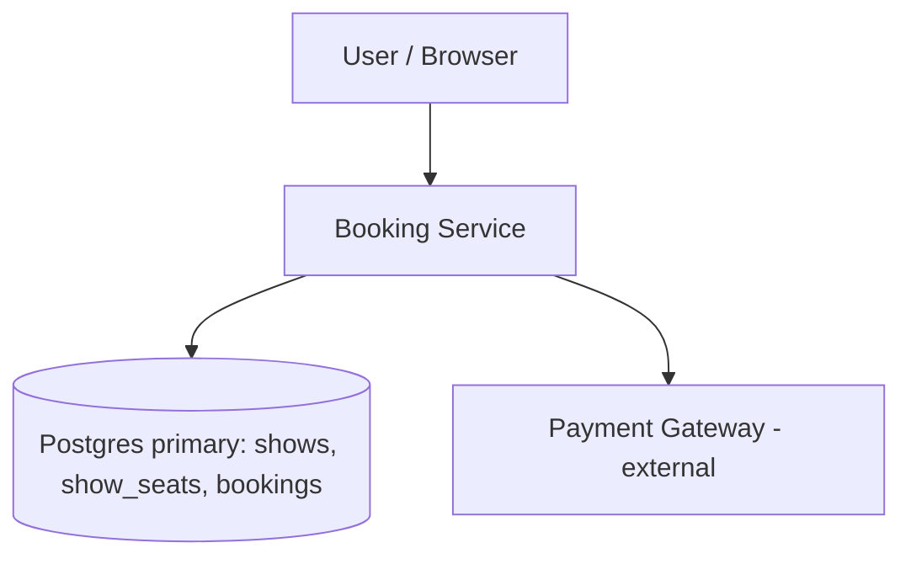

Everything is new in V0.

**Every current flow:**

*Browse path*
1. User calls `GET /shows/{id}/seats`.
2. Booking Service runs `SELECT seat_id, status FROM show_seats WHERE show_id = ?` on Postgres.
3. It returns the exact map.

*Booking path*
1. User calls `POST /bookings`.
2. Booking Service charges the Payment Gateway.
3. Booking Service runs the conditional `UPDATE` and the `INSERT` in one Postgres transaction.
4. If the claim succeeded, it returns 201. If not, it refunds and returns 409.

## Interviewer follow-ups

**"Why a conditional `UPDATE` and not `SELECT ... FOR UPDATE`?"**
Both are correct. `FOR UPDATE` takes row locks and holds them across the app's round trip, so a slow client or server stretches the lock. The conditional `UPDATE` holds its lock for microseconds. It is also one network call instead of two.

**"What if the server crashes right after the charge succeeds?"**
The money is taken and no booking exists. V0 has no answer. That is the payment-boundary problem, and it is why we will need idempotency keys and reconciliation later.

## Recap

| Concept | The Insight |
|---|---|
| Pre-materialized seat rows | Each seat is a real row, so "claim F7" becomes a lockable update. |
| Conditional `UPDATE` plus rowcount | Check and write in one statement, so there is no gap for a second user to slip into. |
| Single Postgres | One writer gives an exact seat map and trivial correctness, which we will trade away later. |
| Pay-then-claim | Safe for seats, but unsafe for users, because the loser has already paid. |

**Interview arc:** *"A naive booking flow checks the seat then writes it, which races under concurrent servers, so a conditional UPDATE with a rowcount check makes the claim atomic. But it still charges users before they own the seat, so the loser pays for nothing."*

## Next

Priya just paid for a seat she never had. What if we claim the seat first, and charge only once it is hers? That is V1, the hold.


-----------------------------------------------------------------------------------------------------------------------
-----------------------------------------------------------------------------------------------------------------------
-----------------------------------------------------------------------------------------------------------------------
-----------------------------------------------------------------------------------------------------------------------


# V1: The Hold

V0 charged users before they owned the seat. V1 flips the order: claim the seat first, then charge.

This is the crux, so we'll walk the naive attempts before landing on the fix.

## The idea

Anil opens the seat map for Friday 7 PM and taps F7 and F8. He then spends four minutes hunting for his card.

During those four minutes, F7 and F8 must be his. Nobody else can buy them. If he walks away, they must come back on their own.

That is a lease. It is the same as a hotel desk holding a room for 15 minutes. You show up and pay, or the room goes back on the shelf.

## Break it

The trigger is V0's blockbuster number. 50,000 people pay for 300 seats, and about 49,700 are charged and then refunded.

We need seats to be claimed before money moves. The claim has to be temporary, because most people who claim a seat never finish paying.

## The naive attempts

**Attempt 1: add a `HELD` status.**

It looked reasonable. Hold sets the status to `HELD`, and payment sets it to `SOLD`.

It breaks the moment someone abandons. Anil closes his laptop and F7 is `HELD` forever. If 1 in 5 users abandons, 60 of the 300 seats are dead before the movie starts.

**Attempt 2: a cron job releases expired holds.**

It looked reasonable. We store `held_until`, and a sweeper runs every minute and flips expired holds back to `AVAILABLE`.

Two engineers, Asha and Dev, argue it out:

> **Asha:** A cron every minute resets expired holds. Done.
> **Dev:** The cron selects F7 at 19:10:00.0. Priya confirms payment at 19:10:00.2. The cron's `UPDATE` lands at 19:10:00.5.
> **Asha:** And F7 goes from `SOLD` back to `AVAILABLE`. Rahul grabs it. Two tickets, one seat.

We can patch that by making the sweeper's update conditional. A second problem remains. A seat that expires at 19:10:00 is not sellable until the next sweep at 19:11:00. During a blockbuster, thousands of people are waiting for exactly those seats. We would be adding up to a minute of dead inventory.

The deeper flaw is that expiry becomes an event someone must process. If the sweeper is down, seats stay stuck.

**Attempt 3: a Redis lock with a TTL.**

It looked reasonable. `SET seat:9001:F7 user_42 NX EX 600` gives us a lock that expires by itself, even if the app server dies.

It breaks because we now have two sources of truth. Redis says who holds F7, and Postgres says whether F7 is sold. If Redis fails over with async replication, the lock is lost and two users both believe they hold F7. Postgres cannot arbitrate, because it never knew about the hold.

We would also have to keep the two stores in sync forever.

## Solve it: the lease lives in the seat row

The fix is to stop treating expiry as an event. Make it a fact that is evaluated at the moment someone tries to claim the seat.

A seat is claimable if it is `AVAILABLE`, or if it is `HELD` and its `held_until` is already in the past. The claim is one conditional `UPDATE`, as in V0.

Nobody has to release anything. An expired hold simply stops blocking the next claim.

| Option | Survives server crash | One source of truth | Expiry latency | Moving parts |
|---|---|---|---|---|
| `HELD` flag, no expiry | No | Yes | Never | None |
| Cron sweeper | If cron survives | Yes | Up to 60s | Cron job |
| Redis TTL lock | Yes | No | Instant | Redis plus Postgres |
| Lease in the row | Yes | Yes | Instant | None |

- ✅ **What we gained:** Seats are claimed before money moves, so the loser never pays. Abandoned holds free themselves with no background job. There is one store and one atomic statement, so the correctness argument from V0 still holds.
- ⚠️ **What we gave up:** Expired holds still look `HELD` in the table until someone reads or claims them. The seat map query has to translate them. The confirm step also has an unsolved gap: a slow payment near the hold's edge. V2 handles that.
- ❌ **Considered and rejected:**
  - **Redis TTL locks.** They create dual truth and lose locks on failover.
  - **Sweeper as the only release mechanism.** It leaves dead inventory and creates the SOLD-reset race.
  - **`SELECT ... FOR UPDATE` held across the payment.** That holds a database lock for minutes and exhausts connections.

## Implement it

**Schema delta.** `show_seats` gains the lease columns, and we add one new table for the hold itself.

```sql
ALTER TABLE show_seats
  ADD COLUMN hold_id    BIGINT NULL,
  ADD COLUMN held_until TIMESTAMPTZ NULL;
-- status is now: AVAILABLE | HELD | SOLD

CREATE TABLE holds (
  hold_id      BIGINT PRIMARY KEY,
  user_id      BIGINT NOT NULL,
  show_id      BIGINT NOT NULL,
  seat_ids     TEXT[] NOT NULL,
  amount_cents INT NOT NULL,
  expires_at   TIMESTAMPTZ NOT NULL,
  created_at   TIMESTAMPTZ NOT NULL DEFAULT now()
);
```

| Store | Who writes | When | Who reads | When |
|---|---|---|---|---|
| `show_seats` (lease columns) | Booking Service | On hold, on confirm | Booking Service | Seat map, hold, confirm |
| `holds` | Booking Service | On hold creation | Booking Service | On confirm |
| `bookings` | Booking Service | On confirm | Booking Service | Confirmation page |

All of it lives in the same Postgres primary.

**Step 1: create the hold.**

```
POST /shows/9001/holds
{ "seat_ids": ["F7", "F8"] }
-> 201 { "hold_id": 77, "expires_at": "2026-10-23T19:10:00Z" }
```

1. Booking Service validates the show and that there are 1-6 seats.
2. It opens a transaction and claims the seats in one statement:

```sql
BEGIN;

UPDATE show_seats
SET status = 'HELD', hold_id = :hold_id,
    held_until = now() + interval '10 minutes'
WHERE show_id = 9001
  AND seat_id = ANY(ARRAY['F7','F8'])
  AND ( status = 'AVAILABLE'
        OR (status = 'HELD' AND held_until < now()) );
-- app checks: rowcount == 2
```

3. **Branch: rowcount equals 2.** Insert the `holds` row, commit, and return 201.
4. **Branch: rowcount is less than 2.** Roll back and return 409 "seats unavailable." Nothing is partially held.

The time comes from `now()` in Postgres, not from the app server. That avoids clock skew between servers.

**Step 2: confirm and pay.**

```
POST /holds/77/confirm
{ "payment_token": "tok_abc123" }
```

1. Booking Service loads the `holds` row. It checks the caller owns it and that `expires_at` is more than 60 seconds away. If not, it returns 410 and the user must hold again.
2. It charges the Payment Gateway.
3. It opens a transaction:

```sql
BEGIN;

UPDATE show_seats
SET status = 'SOLD', booking_id = :booking_id, held_until = NULL
WHERE show_id = 9001 AND hold_id = 77 AND status = 'HELD';
-- app checks: rowcount == 2

INSERT INTO bookings (booking_id, user_id, show_id, seat_ids, amount_cents, payment_ref)
VALUES (:booking_id, :user_id, 9001, ARRAY['F7','F8'], :amount, :charge_id);

COMMIT;
```

4. **Branch: rowcount equals 2.** Return 201 with the booking.
5. **Branch: rowcount is less than 2.** Someone else claimed an expired seat during the charge. Roll back, refund, and return 409. V2 narrows this case.

The confirm predicate checks `hold_id = 77`, not the time. If the hold expired but nobody took the seat, Anil still gets it. If someone did take it, their claim overwrote `hold_id`, so our update touches 0 rows.

**The seat map now translates expired holds:**

```sql
SELECT seat_id,
       CASE WHEN status = 'HELD' AND held_until < now()
            THEN 'AVAILABLE' ELSE status END AS status
FROM show_seats
WHERE show_id = 9001;
```

```mermaid
sequenceDiagram
    participant U as User
    participant B as Booking Service
    participant P as Postgres
    participant G as Payment Gateway

    U->>B: POST /shows/9001/holds (F7, F8)
    B->>P: UPDATE show_seats SET HELD ... WHERE AVAILABLE or expired
    alt rowcount == 2
        B->>P: INSERT holds; COMMIT
        B-->>U: 201 hold_id=77, expires_at
    else rowcount < 2
        B->>P: ROLLBACK
        B-->>U: 409 seats unavailable
    end
    U->>B: POST /holds/77/confirm (tok_abc123)
    B->>G: charge(amount, tok_abc123)
    G-->>B: charge_id
    B->>P: UPDATE show_seats SET SOLD WHERE hold_id=77 AND HELD
    alt rowcount == 2
        B->>P: INSERT bookings; COMMIT
        B-->>U: 201 booked
    else rowcount < 2
        B->>G: refund(charge_id)
        B-->>U: 409
    end
```

## Current State (after V1)

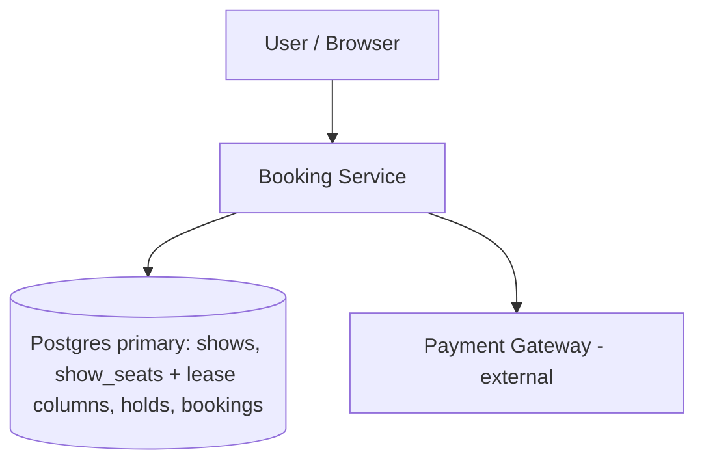

New in V1: the `holds` table, the `hold_id` and `held_until` columns on `show_seats`, and the `HELD` status. The component layout is unchanged.

**Every current flow:**

*Browse path (changed)*
1. User calls `GET /shows/{id}/seats`.
2. Booking Service runs the `SELECT` with the `CASE` that treats expired holds as `AVAILABLE`.
3. It returns the map.

*Hold path (new)*
1. User calls `POST /shows/{id}/holds`.
2. Booking Service runs the conditional `UPDATE` claiming `AVAILABLE` or expired seats.
3. If rowcount matches, it inserts the `holds` row and returns the `hold_id` and `expires_at`. Otherwise it returns 409.

*Confirm path (changed)*
1. User calls `POST /holds/{id}/confirm`.
2. Booking Service checks the hold has more than 60 seconds left, then charges the gateway.
3. It flips the seats to `SOLD` where `hold_id` matches, and inserts `bookings`.
4. If the seats were lost, it refunds and returns 409.

## Interviewer follow-ups

**"Why use the database clock for expiry?"**
App servers disagree by tens or hundreds of milliseconds. If server A thinks a hold expired and server B does not, they can both claim the seat. One clock in Postgres gives one answer to "is this expired?"

**"What stops someone from hoarding seats by holding repeatedly?"**
Cap each user at one active hold per show, checked against `holds` at creation. Add per-user rate limiting at the API edge. A bot can still hold seats for 10 minutes, so for blockbusters we later add a waiting room in front of the hold step.

## Recap

| Concept | The Insight |
|---|---|
| Hold as a lease | A hold is a time-limited claim, not a permanent status. |
| Expiry as a predicate | Expired holds are filtered at claim time, so no sweeper has to run. |
| One store | The lease lives in the seat row, so there is no dual truth to reconcile. |
| Confirm by `hold_id` | Only the holder's `hold_id` can flip the seat to `SOLD`, so a stolen seat is detectable. |

**Interview arc:** *"A permanent HELD flag leaks seats, a cron sweeper races with confirmation and leaves dead inventory, and a Redis TTL lock splits the truth across two stores, so we store the lease in the seat row and treat expiry as part of the claim predicate."*

## Next

Anil confirms at 19:09:58 and the gateway takes 6 seconds. What if the charge succeeds but the seat is gone, or the server crashes right after the charge? That is V2, the payment boundary.


-----------------------------------------------------------------------------------------------------------------------
-----------------------------------------------------------------------------------------------------------------------
-----------------------------------------------------------------------------------------------------------------------
-----------------------------------------------------------------------------------------------------------------------


# V2: The Payment Boundary

V1 claims the seat before charging. But the charge is a call to an external system, and that call can be slow, fail, or vanish.

This is the second half of the crux, so we'll walk the naive attempts again.

## The idea

Anil confirms his hold at 19:09:58. His bank wants a one-time password, so the gateway takes 6 seconds, then 90 more while he fumbles for his phone.

Think of paying at a ticket window through a slow card machine. The clerk can't hand over the ticket until the machine beeps. He also can't let the next customer take the seat while your card is still processing.

So two things must be true while the machine thinks. The seat stays yours, and a record of "payment in flight" must exist somewhere durable.

## Break it

Three failures, each with a clock.

**Failure A: the seat is lost mid-payment.**
- 19:09:58, Anil confirms. His hold expires at 19:10:00.
- 19:10:01, Rahul claims F7 on the expired hold. V1 allows this.
- 19:10:04, the gateway captures Anil's money.
- 19:10:04, Anil's `UPDATE ... WHERE hold_id = 77` touches 0 rows.

Anil is charged, has no seat, and waits for a refund.

**Failure B: a crash after the charge.**
- 19:05:10, the gateway captures the money.
- 19:05:10, the Booking Service dies before its Postgres transaction.

Money is taken and no `bookings` row exists. Nothing in our database says a payment ever happened.

**Failure C: a retry after a timeout.**
- 19:05:00, Anil taps Confirm and the app times out at 10 seconds.
- 19:05:11, it retries. The first charge had actually succeeded.

Anil is charged twice.

## The naive attempts

**Attempt 1: a bigger safety margin.**

V1 rejects confirm if less than 60 seconds remain. It looked reasonable. Raise it to 3 minutes.

It breaks because a margin is a guess. A bank OTP step can take 2 minutes. A gateway incident can take 5. Any fixed number loses to the slow tail, and a big margin makes users re-hold seats they legitimately had.

**Attempt 2: charge first, refund on loss.**

V1 does this. It looked reasonable because refunds exist.

It breaks because the refund is another network call. It can crash too. It also does nothing for Failure B, where we don't know a refund is needed. The user sees a charge and a reversal, and sometimes waits days.

**Attempt 3: retry on timeout.**

It looked reasonable. Timeouts are normal, so retry.

> **Asha:** The gateway call timed out. We retry it.
> **Dev:** What if the first call succeeded and only the response was lost?
> **Asha:** Then we charge Anil twice.
> **Dev:** So a retry is only safe if the gateway can recognize "this is the same attempt."

That recognition is an idempotency key.

## Solve it

Three changes, all about one boundary: we never call the gateway without a durable record, and we never let the seat lapse while the call is in flight.

1. **Extend the lease before charging.** Confirm first stretches `held_until` to 3 minutes. The gateway timeout is 20 seconds, so the lease outlives any call we make.
2. **Write a payment attempt row before calling the gateway.** It carries an idempotency key. A retry reuses the key, and the gateway returns the original result instead of charging again.
3. **Finalize from three triggers with one idempotent function.** The sync response, a gateway webhook, and a reconciler job all call `finalize(hold_id)`. Whichever arrives first wins, and the rest are no-ops.

| Option | Fixes lost seat | Fixes crash after charge | Fixes double charge |
|---|---|---|---|
| Bigger margin | Partly | No | No |
| Refund on loss | Slowly | No | No |
| Retry on timeout | No | No | Makes it worse |
| Extend lease + payment row + idempotent finalize | Yes | Yes | Yes |

- ✅ **What we gained:** A crash anywhere leaves a trail. An `INITIATED` payment row means "ask the gateway." Retries are safe. The seat can't be stolen during the normal payment window.
- ⚠️ **What we gave up:** A user who starts payment and abandons it blocks the seat for 3 minutes instead of expiring at the original time. We now run a reconciler and a webhook endpoint. Finalize must be carefully idempotent.
- ❌ **Considered and rejected:**
  - **A distributed transaction across Postgres and the gateway.** The gateway can't participate in two-phase commit.
  - **Holding a DB transaction open during the charge.** It ties up a connection for up to 20 seconds per user, and a blockbuster would exhaust the pool.
  - **Webhook only, with no sync path.** The user would wait for an asynchronous callback to see their ticket. We keep the sync path for speed and the webhook for safety.

## Implement it

**Schema delta.**

```sql
CREATE TABLE payments (
  payment_id      BIGINT PRIMARY KEY,
  hold_id         BIGINT NOT NULL,
  attempt         INT NOT NULL,
  idempotency_key TEXT NOT NULL UNIQUE,   -- 'hold-77-a1'
  amount_cents    INT NOT NULL,
  status          TEXT NOT NULL,          -- INITIATED | CAPTURED | FAILED | REFUND_PENDING | REFUNDED
  gateway_ref     TEXT NULL,
  created_at      TIMESTAMPTZ NOT NULL DEFAULT now(),
  updated_at      TIMESTAMPTZ NOT NULL DEFAULT now()
);
CREATE INDEX payments_stuck ON payments (status, created_at);

ALTER TABLE bookings ADD COLUMN hold_id BIGINT UNIQUE;
```

The `UNIQUE` on `bookings.hold_id` is what makes finalize idempotent. A second insert for the same hold can't create a second booking.

Who touches what, now that three components write to the same tables:

| Store | Who writes | When | Who reads | When |
|---|---|---|---|---|
| `payments` | Booking Service | INITIATED at confirm start; CAPTURED/FAILED on response | Webhook Handler, Reconciler | Look up attempt by idempotency key; find stuck rows |
| `payments` | Webhook Handler | Marks CAPTURED or FAILED on callback | Booking Service | Confirm retry check |
| `payments` | Reconciler | Resolves INITIATED older than 90s; retries REFUND_PENDING | Reconciler | Every minute |
| `show_seats` | Booking Service, Webhook Handler, Reconciler | `finalize` flips to SOLD; confirm extends the lease | Booking Service | Seat map, hold, confirm |
| `bookings` | `finalize` (called by all three) | Once per hold, guarded by `UNIQUE(hold_id)` | Booking Service | Confirmation page |

All of it lives in the same Postgres primary. The Webhook Handler is a route on the Booking Service. The Reconciler is a scheduled worker that runs every minute.

**Step 1: confirm starts.**

```
POST /holds/77/confirm
{ "payment_token": "tok_abc123" }
```

1. Booking Service loads the `holds` row and checks the caller owns it.
2. It checks for an existing booking: `SELECT booking_id FROM bookings WHERE hold_id = 77`. If found, it returns that booking. This makes a double-tap harmless.
3. It opens a short transaction, extends the lease, and records the attempt:

```sql
BEGIN;

UPDATE show_seats
SET held_until = now() + interval '3 minutes'
WHERE show_id = 9001 AND hold_id = 77 AND status = 'HELD';
-- app checks: rowcount == 2

INSERT INTO payments (payment_id, hold_id, attempt, idempotency_key, amount_cents, status)
VALUES (:pid, 77, 1, 'hold-77-a1', :amount, 'INITIATED');

COMMIT;
```

4. **Branch: rowcount is less than 2.** Someone else owns a seat, because their claim overwrote `hold_id`. Roll back and return 410. No charge happened.
5. **Branch: rowcount equals 2.** Commit and continue.

The predicate checks `hold_id`, not the clock. An expired but untouched hold is still Anil's.

**Step 2: charge, outside any transaction.**

```
POST https://gateway/charges
Idempotency-Key: hold-77-a1
{ "amount": 24000, "source": "tok_abc123", "metadata": { "hold_id": 77 } }
```

6. Timeout is 20 seconds. On a timeout, retry with the same `Idempotency-Key`. The gateway returns the original charge, never a second one.
7. **Branch: charge failed (card declined).** Set `payments.status = 'FAILED'` and return 402. The user may retry on the same hold with `attempt = 2` and key `hold-77-a2` while the lease lasts.
8. **Branch: charge succeeded.** Go to finalize.

**Step 3: `finalize(hold_id, gateway_ref)`.** All three triggers call this.

```sql
BEGIN;

-- no-op if already finalized
SELECT booking_id FROM bookings WHERE hold_id = 77;

UPDATE show_seats
SET status = 'SOLD', booking_id = :bid, held_until = NULL
WHERE show_id = 9001 AND hold_id = 77 AND status = 'HELD';
-- app checks: rowcount == 2

INSERT INTO bookings (booking_id, user_id, show_id, seat_ids, amount_cents, payment_ref, hold_id)
VALUES (:bid, :uid, 9001, ARRAY['F7','F8'], :amount, :ref, 77)
ON CONFLICT (hold_id) DO NOTHING;

UPDATE payments SET status = 'CAPTURED', gateway_ref = :ref, updated_at = now()
WHERE idempotency_key = 'hold-77-a1';

COMMIT;
```

9. **Branch: booking already exists.** Return it. This is a duplicate trigger.
10. **Branch: rowcount equals 2.** Commit, return 201.
11. **Branch: rowcount is less than 2.** The lease ran out and someone else took the seat, which is rare. Roll back, set `payments.status = 'REFUND_PENDING'`, and call `POST /refunds` with `Idempotency-Key: refund-hold-77`. On success set `REFUNDED`.

**Trigger 2: the webhook.**

```
POST /webhooks/payments
X-Signature: t=1760000000,v1=...
{ "type": "charge.succeeded", "id": "ch_9f2", "metadata": { "hold_id": 77 } }
```

12. Verify the signature first. Reject anything unsigned.
13. Call `finalize(77, "ch_9f2")`. If the sync path already finished, step 9 makes this a no-op.

**Trigger 3: the reconciler, every minute.**

```sql
SELECT payment_id, hold_id, idempotency_key
FROM payments
WHERE status = 'INITIATED' AND created_at < now() - interval '90 seconds';
```

14. For each row, ask the gateway: `GET /charges?idempotency_key=hold-77-a1`.
15. **Branch: captured.** Call `finalize`.
16. **Branch: failed or no such charge.** Mark `FAILED`. The lease expires on its own.
17. It also retries every `REFUND_PENDING` row.

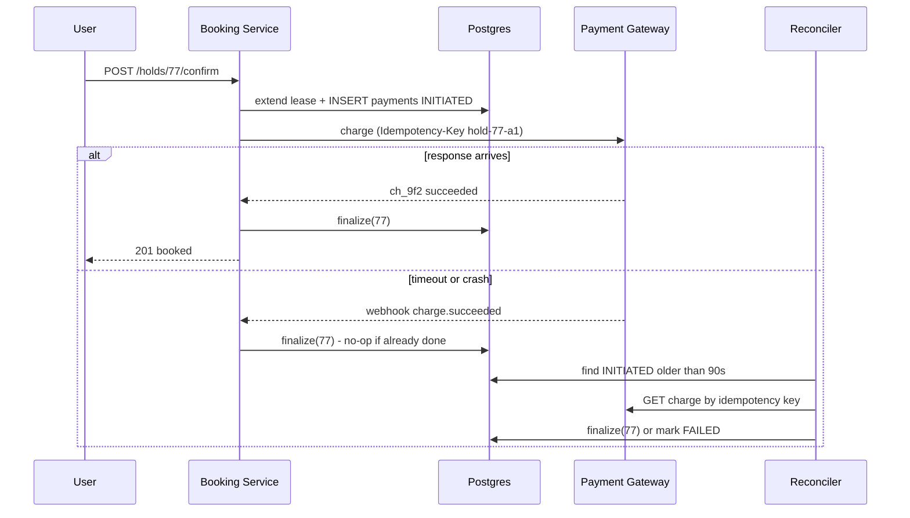

## Current State (after V2)

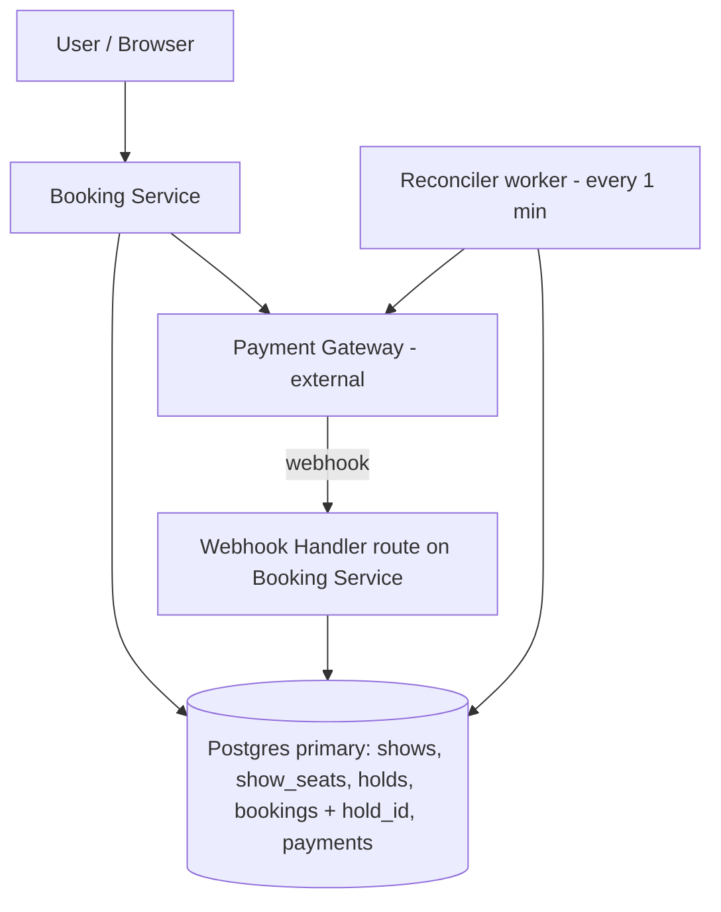

New in V2: the `payments` table, `bookings.hold_id`, the webhook route, and the Reconciler.

**Every current flow:**

*Browse path (unchanged from V1)*
1. User calls `GET /shows/{id}/seats`.
2. Booking Service runs the `SELECT` with the `CASE` for expired holds.
3. It returns the map.

*Hold path (unchanged from V1)*
1. User calls `POST /shows/{id}/holds`.
2. Booking Service runs the conditional `UPDATE` on `AVAILABLE` or expired seats.
3. It inserts the `holds` row and returns `hold_id` and `expires_at`, or 409.

*Confirm path (changed)*
1. User calls `POST /holds/{id}/confirm`.
2. Booking Service returns the existing booking if one exists.
3. It extends the lease to 3 minutes and inserts a `payments` row as INITIATED.
4. It calls the gateway with the idempotency key, outside any transaction.
5. On success it runs `finalize`. On decline it marks FAILED and returns 402.

*Webhook path (new)*
1. Gateway posts `charge.succeeded` to `/webhooks/payments`.
2. Handler verifies the signature and calls `finalize(hold_id)`, which is a no-op if already done.

*Reconcile path (new)*
1. Reconciler selects INITIATED payments older than 90 seconds.
2. It asks the gateway for the real state by idempotency key.
3. It finalizes, marks FAILED, or retries pending refunds.

## Interviewer follow-ups

**"Why not just rely on the webhook and skip the reconciler?"**
Webhooks can be delayed, dropped, or arrive out of order. The reconciler is the backstop that asks the gateway directly. The webhook gives speed, and the reconciler gives certainty.

**"What if finalize runs twice at the same moment?"**
Both try to flip the seats. The `status = 'HELD'` predicate lets only one succeed, and `UNIQUE(bookings.hold_id)` blocks a second booking. The loser sees an existing booking and returns it.

## Recap

| Concept | The Insight |
|---|---|
| Extend the lease before charging | The seat can't lapse during the one call we don't control. |
| Payment row before the gateway call | A crash always leaves a trail we can reconcile. |
| Idempotency key | A retry becomes safe because the gateway recognizes the same attempt. |
| Idempotent `finalize` from three triggers | Sync, webhook, and reconciler can race, and the outcome is still one booking. |
| `UNIQUE(bookings.hold_id)` | Duplicate bookings are structurally impossible, not just checked for. |

**Interview arc:** *"Charging after the hold fails under slow payments, crashes, and retries, so we extend the lease, record an idempotency-keyed payment attempt before calling the gateway, and let the response, the webhook, and a reconciler all call one idempotent finalize."*

## Next

The booking core is now correct. Now it meets load. A blockbuster brings 100,000 users polling the seat map every 3 seconds, about 33,000 reads per second, and one Booking Service instance handles roughly 1,500. That is V3: scaling the app tier horizontally.


-----------------------------------------------------------------------------------------------------------------------
-----------------------------------------------------------------------------------------------------------------------
-----------------------------------------------------------------------------------------------------------------------
-----------------------------------------------------------------------------------------------------------------------


# V3: Scaling the App Tier

V2 made the booking core correct. V3 makes it survive a crowd.

This is the first NFR version, so we teach the mechanism first. It gets its own break-it, trade-offs, and build. Caching and sharding come later, each in its own version.

## The idea

A theatre has one box office window, and a clerk serves one customer every 40 seconds. The queue grows and nothing breaks, but people wait.

There are two fixes. Give the clerk a faster machine, or open more windows.

The faster machine is vertical scaling. More windows is horizontal scaling.

More windows only work if any clerk can serve any customer. If Anil's paperwork lives in clerk 1's drawer, Anil must always return to window 1. That drawer is local state.

## Break it

It is 6:00 PM, and tickets for a blockbuster open at 6:00. 100,000 users have the seat map open and poll it every 3 seconds.

- Seat-map reads arrive at about 33,000 requests per second.
- One Booking Service instance handles about 1,500 requests per second.
- That is 22 times over capacity on one box.

At 6:00:05 the instance's queue is full and latency passes 10 seconds. At 6:00:30 the load balancer's health check times out, the instance is marked dead, and the site is down.

The hold and confirm calls fail in the same collapse. Those are the 300 requests that matter, drowned out by 33,000 map polls.

## Teach: vertical vs. horizontal

| | Vertical (bigger box) | Horizontal (more boxes) |
|---|---|---|
| Ceiling | Hard. The biggest machine you can rent. | None in practice. |
| Cost curve | Steep. 4x the CPU costs more than 4x the money. | Linear. |
| Failure | One box is a single point of failure. | Lose 1 of 32 and lose 3% of capacity. |
| Downtime to resize | Usually a restart. | None. Add boxes live. |
| Requirement | None. | Servers must hold no local state. |

Vertical gets us maybe 4x, which is 6,000 requests per second. We need 22x, so it fails on the ceiling alone.

Horizontal is the answer. It works only if we remove everything that makes one server special.

## Solve it

**Step 1: name the local state hiding in our servers.**

| State a server might hold | Where it must live instead |
|---|---|
| User sessions (login state) | Stateless signed token (JWT), verified on every request |
| Per-user rate-limit counters | The load balancer or API gateway, per client IP and user |
| In-flight payment progress | Already in Postgres `payments`. V2 solved this. |
| The reconciler's schedule | A separate worker deployment, not baked into every app instance |
| Seat locks and leases | Already in Postgres rows. V1 solved this. |

V1 and V2 did us a favor. The lease and the payment trail already live in the database, so no app server holds the truth about any seat. Only sessions, rate limits, and the reconciler need work.

**Step 2: choose the load-balancing algorithm.**

- **Round robin** sends request 1 to server A, request 2 to server B, and so on. It's fair by count, not by cost.
- **Least outstanding requests** sends each request to the server with the fewest requests in flight.

Our requests are wildly uneven. A seat-map read takes 5 ms. A confirm waits up to 20 seconds on the gateway. Round robin can stack five slow confirms on one server while its neighbor idles. We pick least outstanding requests.

**Step 3: the new problem, database connections.**

Each instance keeps a pool of 20 Postgres connections. With 32 instances, that is 640 connections into one primary. Postgres spends memory and context-switching on every connection, and it degrades well before 640.

So we put PgBouncer in transaction-pooling mode between the app tier and Postgres. It multiplexes 640 client connections onto about 100 real ones.

- ✅ **What we gained:** Capacity is now a dial, not a ceiling. Losing one instance costs about 3% of capacity. Deploys can roll one instance at a time with no downtime.
- ⚠️ **What we gave up:** Every request now crosses a load balancer, which adds roughly 1 ms and a new component to operate. Postgres is now the shared bottleneck. We scaled the app tier to 32 boxes, and all of them hammer one primary. PgBouncer's transaction mode also forbids session-level features like advisory locks held across calls. We don't use those.
- ❌ **Considered and rejected:**
  - **Vertical scaling only.** It tops out near 4x and leaves one box as a single point of failure.
  - **Sticky sessions.** They paper over local state instead of removing it. If the pinned server dies, the user's state dies with it.
  - **Splitting into microservices now.** Browse, hold, and confirm could scale separately. That is a real option later, but today one stateless service behind one balancer is enough.
  - **Round robin.** It ignores that a confirm costs 4,000 times more than a map read.

## Implement it

**Capacity.** We need 33,000 / 1,500 = 22 instances at full load. We target 70% utilization so a spike or a dead instance doesn't tip us over. 33,000 / (1,500 x 0.7) is about 32 instances at peak.

**Load balancer config (AWS ALB shape):**

```json
{
  "TargetGroup": {
    "Protocol": "HTTP",
    "HealthCheckPath": "/healthz",
    "HealthCheckIntervalSeconds": 5,
    "UnhealthyThresholdCount": 2,
    "Attributes": {
      "load_balancing.algorithm.type": "least_outstanding_requests",
      "deregistration_delay.timeout_seconds": "30"
    }
  },
  "IdleTimeoutSeconds": 30
}
```

- `/healthz` returns 200 only if the instance can reach PgBouncer. A box that can't reach the database leaves rotation.
- `deregistration_delay` gives in-flight confirms 30 seconds to finish before an instance is removed. This covers the 20-second gateway timeout.
- The idle timeout is 30 seconds, above the 20-second gateway call, so the balancer never cuts a confirm.

**Autoscaling:**

```json
{
  "MinCapacity": 4,
  "MaxCapacity": 40,
  "TargetTracking": {
    "Metric": "ALBRequestCountPerTarget",
    "TargetValue": 1000
  }
}
```

Autoscaling reacts in minutes, and a blockbuster spikes in seconds. So for announced on-sales we pre-scale: a scheduled action sets `MinCapacity` to 32 thirty minutes before the sale.

**Stateless auth.**

```
GET /shows/9001/seats
Authorization: Bearer eyJhbGciOi...
```

1. Any instance verifies the JWT signature against the auth service's public key, held in memory at boot.
2. It reads `user_id` from the token claims. There is no session lookup and no instance-specific data.

**Rate limiting at the edge.** The API gateway enforces 10 requests per second per client IP on `GET /seats` and 2 per second on `POST /holds`. Counters live in the gateway layer, shared across all instances. An in-process counter would give each of 32 servers its own, so the real limit would be 32 times too loose.

**The reconciler becomes its own deployment.** Two replicas, no longer running inside each app instance. Two replicas give availability without duplicate work, because of `SKIP LOCKED`:

```sql
SELECT payment_id, hold_id, idempotency_key
FROM payments
WHERE status = 'INITIATED' AND created_at < now() - interval '90 seconds'
ORDER BY created_at
LIMIT 50
FOR UPDATE SKIP LOCKED;
```

Replica A locks rows 1-50. Replica B skips those and takes 51-100. No row is reconciled twice.

**Retry rule at the balancer.** If an instance dies mid-request, the balancer retries only idempotent `GET`s on another instance. It never retries `POST /holds` or `POST /holds/{id}/confirm`. Those retries belong to the client, using the idempotency key from V2.

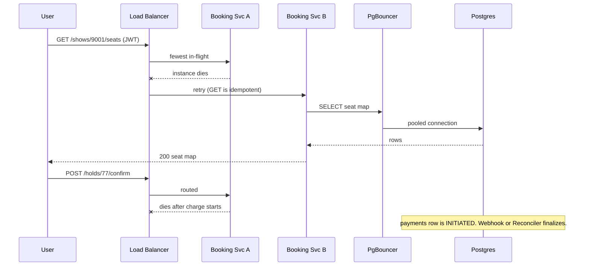

## Current State (after V3)

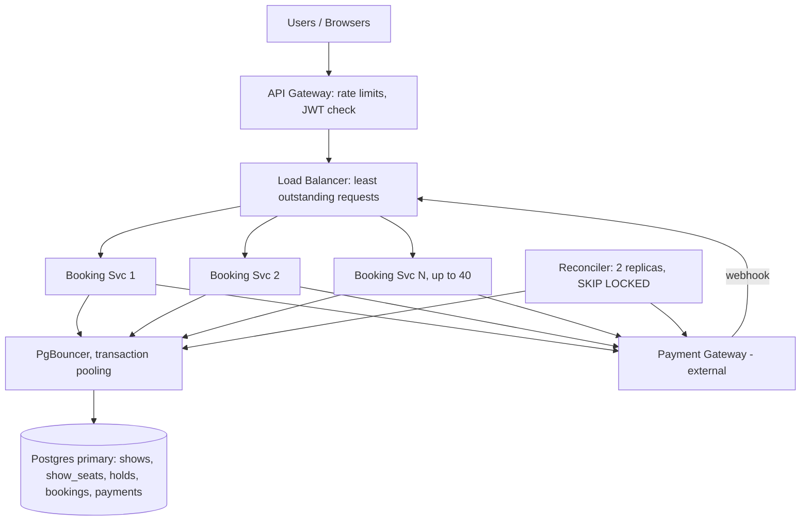

Marked new in V3: the API Gateway, the Load Balancer, the N-instance Booking Service, PgBouncer, and the Reconciler as a separate 2-replica deployment.

**Every current flow:**

*Browse path (routing changed, logic unchanged)*
1. User calls `GET /shows/{id}/seats` with a JWT.
2. The API Gateway rate-limits, and the Load Balancer picks the instance with the fewest in-flight requests.
3. The instance verifies the JWT locally and runs the `SELECT` with the expired-hold `CASE` through PgBouncer.
4. It returns the map. If the instance dies, the balancer retries on another.

*Hold path (routing changed, logic unchanged from V1)*
1. User calls `POST /shows/{id}/holds`.
2. Gateway, balancer, and any instance run the conditional `UPDATE` through PgBouncer.
3. It inserts `holds` and returns `hold_id` and `expires_at`, or 409. The balancer never retries this call.

*Confirm path (routing changed, logic unchanged from V2)*
1. User calls `POST /holds/{id}/confirm`.
2. Any instance extends the lease, inserts `payments` as INITIATED, charges the gateway, and runs `finalize`.
3. If the instance dies mid-call, the `INITIATED` row stays and the webhook or reconciler finishes the job.

*Webhook path (routing changed)*
1. Gateway posts `charge.succeeded` to the balancer.
2. Any instance verifies the signature and calls `finalize(hold_id)`, a no-op if already done.

*Reconcile path (changed)*
1. One of the 2 Reconciler replicas claims stuck `INITIATED` rows with `SKIP LOCKED`.
2. It asks the gateway for the real state, then finalizes, marks FAILED, or retries pending refunds.

## Interviewer follow-ups

**"Why not sticky sessions?"**
Stickiness pins a user to one server, so that server's death loses the user's state, and load skews toward whoever got pinned first. We removed the need for it. Auth is a stateless token and all durable state is in Postgres, so any instance can serve any request.

**"An instance dies halfway through a confirm. What happens?"**
V2 already covers it. The `payments` row exists as `INITIATED`, and the gateway call carried an idempotency key. The webhook or the reconciler calls `finalize`, so the user ends up with one booking or one refund. Scaling out adds more instances to die, but the failure path is the same.

## Recap

| Concept | The Insight |
|---|---|
| Horizontal needs statelessness | More servers only help if any server can serve any request, so first find and move local state. |
| V1 and V2 paid off | Leases and payment progress already live in Postgres, so the app tier had almost nothing to unlearn. |
| Least outstanding requests | A 5 ms read and a 20 s confirm aren't equal work, so route by load, not by turn. |
| Connection math | 32 instances x 20 connections is 640, so PgBouncer multiplexes them onto about 100 real connections. |
| Edge rate limits | In-process counters multiply the limit by the instance count. Shared counters at the gateway don't. |
| Retry only idempotent calls | The balancer retries `GET`s, and `POST`s rely on the V2 idempotency key. |

**Interview arc:** *"One instance does 1,500 requests per second against a 33,000 per second spike, and vertical scaling caps near 4x, so we make the app tier stateless, move sessions to JWTs, rate limits to the gateway, and the reconciler to its own deployment, then scale out behind a least-outstanding-requests balancer with PgBouncer protecting Postgres from the connection fan-out."*

## Next

The app tier now absorbs 33,000 requests per second and passes every one to a single Postgres primary. Each seat-map read scans about 200 rows, and 90,000 of 100,000 users are just watching. At 6:00:10 the primary's CPU hits 100%, and holds queue behind polls. That is V4: caching the seat map.


-----------------------------------------------------------------------------------------------------------------------
-----------------------------------------------------------------------------------------------------------------------
-----------------------------------------------------------------------------------------------------------------------
-----------------------------------------------------------------------------------------------------------------------


# V4: Caching the Seat Map

V3 scaled the app tier to 32 instances. All 32 now hit one Postgres primary.

This is the caching version. We teach the mechanism, show the default failing, then pick a design and build it.

## The idea

Meera runs the box office board. It's a big whiteboard showing which seats are sold.

At 6:00 PM, 100,000 people walk up and ask "is F7 still free?" every 3 seconds. Each time, a clerk walks to the vault, opens the ledger, and reads 200 lines.

The fix is obvious. Copy the board once a second and let everyone read the copy. The copy can be one second stale. When someone actually buys, the clerk still checks the real ledger.

That copy is a cache. It works here because the answer is identical for every viewer, and nobody is hurt by it being one second old.

## Break it

It's 6:00:10. Tickets for the blockbuster just opened.

- Seat-map polls arrive at about 33,000 per second.
- Each poll scans about 200 `show_seats` rows. That's 6.6 million row reads per second.
- Holds and confirms in the same window are only a few hundred per second.

That's a read-to-write ratio of roughly 100 to 1. Reads are the whole load.

At 6:00:10 the primary's CPU hits 100%. A hold's conditional `UPDATE` queues behind thousands of `SELECT`s. Hold latency goes from 5 ms to 4 seconds.

The users who matter, the ones trying to claim a seat, are slowed by the users who are only watching. The app tier is fine. The database is the problem.

## Teach: what a cache is, and how it fails by default

A cache keeps a recent answer somewhere cheaper than the source. It earns its place when the same question gets asked far more often than the answer changes.

Our seat map for show 9001 changes a few times a second. It's asked for 33,000 times a second. That's a good fit.

The naive default is "cache it with a TTL and rebuild on expiry." Here's how that fails on a blockbuster:

- 6:00:12.000, the cached map for show 9001 expires.
- 6:00:12.001 to 6:00:12.050, about 1,600 requests arrive in 50 ms. All miss.
- All 1,600 run the 200-row query against Postgres at once.

This is a **cache stampede**. The cache exists to protect the database. At the moment of expiry, it sends the entire crowd to the database at once.

## Solve it

### Decision 1: what do we cache, and at which layer?

| Layer | What it buys | What it costs here |
|---|---|---|
| Client (`Cache-Control`) | Zero server load per hit | Can't invalidate. Each user has their own copy. |
| CDN | Absorbs the crowd before it reaches us | A second staleness layer and purge complexity |
| App tier, shared Redis | One shared copy, instant control, tiny rebuild load | One more component to operate |
| DB (query cache, buffer pool) | Free | Still burns CPU per query. Postgres has no result cache. |

**Decision: a shared Redis cache between the app tier and Postgres.** 33,000 reads per second is fine for Redis, which does about 100,000 operations per second per node.

**CDN: not now.** The seat map is the same for every user, so a CDN would fit. It would mostly save app-tier cost. It would stack a second 1-2 second staleness window on top of Redis's, and we'd need a purge path. We revisit it if the app tier becomes the bill. It isn't the crisis.

**Client caching: only a 1-second `max-age`** to smooth bursts. It's harmless at that length.

### The storage class, justified

Redis is an in-memory key-value store. The access pattern is one key per show, read by key, with an expiry. There's no query, no join, and no durability need, because we can always rebuild from Postgres. That's exactly what a key-value cache does well.

### Decision 2: how do we keep it fresh?

| Option | What it optimizes | What it breaks |
|---|---|---|
| TTL only | Simplicity | Stampede at expiry |
| Delete key on every write | Freshness | On a hot show, writes arrive hundreds of times a second, so the cache is permanently cold and every read misses |
| Write-through (update cache in the write path) | Freshness | Couples every write to Redis. If Redis is down, do holds fail? |
| **TTL plus a single rebuilder** | Bounded staleness, bounded DB load | Up to about 1 second stale |

Our scope already accepted a few seconds of staleness for browsing. The strict check happens at claim time in Postgres. So a stale map can never cause a double booking. It can cause a 409 when the user taps a seat that was just taken. That's acceptable.

**Decision: TTL plus a single rebuilder.** Delete-on-write fails on exactly the shows where we need the cache most.

### Decision 3: fixing the stampede

This is a famous sub-problem with several established fixes.

**Fix A: single-flight lock.** On a miss, one request takes a lock and rebuilds. The others wait briefly or retry.

```python
if cache.get(k) is None:
    if redis.set(lock_k, 1, nx=True, ex=2):
        rebuild_and_set(k)
    else:
        sleep(0.05); retry_get(k)
```

**Fix B: stale-while-revalidate.** Keep a soft TTL and a hard TTL. After the soft TTL, serve the stale value and let exactly one request refresh it in the background. Nobody waits.

```python
v = cache.get(k)                     # hard TTL 10s
if v.age > 1.0 and redis.set(lock_k, 1, nx=True, ex=2):
    spawn(rebuild_and_set, k)        # one refresher
return v                             # everyone else gets stale-but-fast
```

**Fix C: probabilistic early refresh.** Each request refreshes early with a probability that rises as expiry nears. There's no lock, but it's harder to reason about and tune.

**Fix D: refresh-ahead worker.** A background job rebuilds known-hot shows every second. Readers never rebuild. It needs a list of hot shows.

| Fix | Readers wait? | Stampede-proof | Complexity |
|---|---|---|---|
| A single-flight | Briefly | Yes | Low |
| **B stale-while-revalidate** | **Never** | **Yes** | **Low** |
| C probabilistic | No | Mostly | Medium |
| D refresh-ahead | No | Yes | Medium, needs a hot list |

**Decision: B, stale-while-revalidate.** On a blockbuster, no user should wait for a rebuild. A cold start (nothing in cache at all) falls back to Fix A for that one first request.

- ✅ **What we gained:** Postgres seat-map load drops from 33,000 queries per second to about 1 per second per active show. Hold latency returns to normal because holds no longer queue behind polls. The hit ratio is above 99.9%.
- ⚠️ **What we gave up:** The map can be up to about 1-2 seconds stale. Users sometimes tap a seat that is gone and get a 409. Redis is a new component, and if it fails we need a fallback. A cache now holds a derived copy of truth, and we must never let it be read as truth at claim time.
- ❌ **Considered and rejected:**
  - **Delete on write.** It keeps a hot show's cache permanently cold.
  - **Write-through.** It makes Redis an availability dependency of every hold.
  - **Caching at claim time.** Claims must read Postgres. A cached "AVAILABLE" is not a lock.
  - **A reflexive CDN.** It adds a second staleness layer without a problem to solve yet.

## Implement it

**Cache key and value.**

```
key:    seatmap:9001
value:  {
  "built_at": 1760000412.350,
  "seats": {
    "F7": ["H", 1760000600],
    "F8": ["S", null],
    "F9": ["A", null]
  }
}
TTL:    10 seconds (hard)
```

- Status codes are `A` (available), `H` (held), and `S` (sold). The value is about 2 KB per show.
- We store the raw `held_until`, not a translated status.
- The reader translates an expired hold to available when it serves the map. This is the same idea as V1's `CASE`, now done in app code. Display only needs approximate time, so the app clock is fine here.

**Lock key:** `seatmap:9001:lock`, set with `NX EX 2`.

| Store | Who writes | When | Who reads | When |
|---|---|---|---|---|
| `seatmap:{show_id}` in Redis | Booking Service (the one request that wins the lock) | When the soft TTL has passed or on a cold miss | Booking Service (every instance) | Every `GET /shows/{id}/seats` |
| `seatmap:{show_id}:lock` in Redis | Booking Service | Immediately before rebuilding | Booking Service | Same moment, `NX` check |
| `show_seats` in Postgres | Unchanged from V2 | Unchanged | Booking Service rebuilder | About once a second per active show |

Redis lives as a single primary with one replica, in the same region as the app tier. Losing it loses only derived data.

**Read path: `GET /shows/9001/seats`.**

1. The Booking Service runs `GET seatmap:9001` on Redis.
2. **Branch: hit, age under 1 second.** Translate expired holds, return 200 with `Cache-Control: max-age=1`.
3. **Branch: hit, age over 1 second (soft-expired).** Run `SET seatmap:9001:lock 1 NX EX 2`.
   - If the lock is acquired, spawn one background rebuild. Return the stale value now.
   - If not, another request is already rebuilding. Return the stale value now.
4. **Branch: miss (cold start or hard-expired).** Run `SET ... NX EX 2`.
   - If the lock is acquired, rebuild synchronously and return the result.
   - If not, sleep 50 ms, then `GET` again, up to 5 tries.

**The rebuild query** runs on Postgres through PgBouncer:

```sql
SELECT seat_id, status, held_until
FROM show_seats
WHERE show_id = 9001;
```

5. The rebuilder builds the JSON, then runs `SET seatmap:9001 <json> EX 10` and `DEL seatmap:9001:lock`.

**Writes do not touch the cache.** `POST /holds` and `finalize` are unchanged from V2. After a successful hold, the response body includes the user's own seats as held. The client shows them immediately, so users always see their own writes without waiting for the next rebuild.

**Fallback if Redis is down.** A circuit breaker opens after 5 failed Redis calls in 2 seconds. Each app instance then keeps an in-process copy and rebuilds it at most once per second per show. With 32 instances, that's at most 32 queries per second per show, not 33,000. That's slower than Redis and survivable.

```mermaid
sequenceDiagram
    participant U as User
    participant B as Booking Service
    participant R as Redis
    participant PB as PgBouncer
    participant P as Postgres

    U->>B: GET /shows/9001/seats
    B->>R: GET seatmap:9001
    alt fresh hit
        R-->>B: map (age 0.4s)
        B-->>U: 200 map
    else soft-expired
        R-->>B: map (age 1.3s)
        B->>R: SET seatmap:9001:lock NX EX 2
        alt lock acquired
            B-->>U: 200 stale map
            B->>PB: SELECT seat_id, status, held_until
            PB->>P: query
            P-->>B: rows
            B->>R: SET seatmap:9001 EX 10; DEL lock
        else lock held by another
            B-->>U: 200 stale map
        end
    else cold miss
        R-->>B: nil
        B->>PB: rebuild synchronously (lock winner only)
        B->>R: SET seatmap:9001
        B-->>U: 200 map
    end
```

## Current State (after V4)

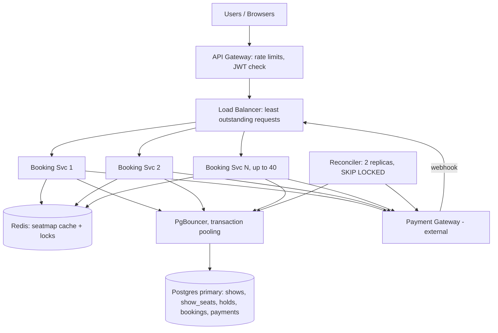

New in V4: the Redis seat-map cache and its lock keys. Everything else is as in V3.

**Every current flow:**

*Browse path (changed)*
1. User calls `GET /shows/{id}/seats` with a JWT.
2. The gateway and balancer route it to an instance.
3. The instance reads `seatmap:{show_id}` from Redis and translates expired holds.
4. If the entry is soft-expired, one request refreshes it from Postgres in the background. If it's missing, one request rebuilds it synchronously.
5. It returns the map, up to about 1-2 seconds stale.

*Hold path (unchanged from V1/V3)*
1. User calls `POST /shows/{id}/holds`.
2. The instance runs the conditional `UPDATE` on Postgres through PgBouncer, never reading the cache.
3. It inserts `holds` and returns `hold_id` and `expires_at`, or 409. The response includes the user's own seats so the client updates instantly.

*Confirm path (unchanged from V2/V3)*
1. User calls `POST /holds/{id}/confirm`.
2. The instance extends the lease, inserts `payments` as INITIATED, charges the gateway with the idempotency key, and runs `finalize`.

*Webhook path (unchanged from V3)*
1. Gateway posts `charge.succeeded` to the balancer.
2. Any instance verifies the signature and calls `finalize(hold_id)`.

*Reconcile path (unchanged from V3)*
1. A Reconciler replica claims stuck `INITIATED` rows with `SKIP LOCKED`, asks the gateway, and finalizes, fails, or retries refunds.

## Interviewer follow-ups

**"Can a stale cache cause a double booking?"**
No. The cache is only used for display. A claim is a conditional `UPDATE` in Postgres, so a stale "AVAILABLE" just produces a 409. The cost of staleness is a worse user experience, never wrong data.

**"Why not invalidate the cache whenever a seat changes?"**
On a hot show, seats change hundreds of times a second. Invalidating on every write keeps the cache permanently cold. Every read would miss and hit the database, which is the problem we're fixing. A 1-second soft TTL bounds both staleness and database load.

## Recap

| Concept | The Insight |
|---|---|
| Cache what's read 100x more than written | Seat-map reads dwarf writes, and everyone sees the same answer. |
| Display is not a claim | The cache can be stale because claims always go to Postgres. |
| Stampede is the cache's own failure | A plain TTL sends the whole crowd to the database at the moment of expiry. |
| Stale-while-revalidate | One request refreshes while everyone else gets a fast, slightly old answer. |
| No delete-on-write for hot keys | Constant writes would keep the cache permanently cold. |
| CDN is a decision, not a default | The Redis layer solved the problem, so a CDN would only add a second staleness layer. |

**Interview arc:** *"33,000 seat-map polls per second were burning the primary and queueing holds behind reads, so we cache the map in Redis with a 1-second soft TTL and stale-while-revalidate, which sends about one query per second per show to Postgres, while claims still hit the database so staleness can never double-book."*

## Next

Reads are solved, but the 300 seats that matter are not. At 6:00:00 the sale opens and 50,000 users try to hold seats on the same show in the same second. All of those writes target 300 rows, so they queue on row locks, and sharding wouldn't help because one show lives on one shard. That is V5: the blockbuster spike, with a waiting room. Sharding follows after it, once we look at the whole aggregator's write volume.


-----------------------------------------------------------------------------------------------------------------------
-----------------------------------------------------------------------------------------------------------------------
-----------------------------------------------------------------------------------------------------------------------
-----------------------------------------------------------------------------------------------------------------------


# V5: The Blockbuster Spike

V4 made reads cheap. V5 deals with the 300 writes that matter.

This is a hot-key problem: 50,000 people want the same few hundred rows at the same second. We'll teach the mechanism, list the real fixes, pick one, and build it.

## The idea

Kavya in Pune is on the sale page at 5:59:58. At 6:00:00 she taps F7, and so do 4,999 other people.

Think of a small theatre with 300 seats and one door. If 50,000 people rush the door together, nobody gets in. The doorman's fix is to let in 600 at a time and have everyone else wait outside.

That doorman is admission control. The crowd outside is a virtual waiting room.

## Break it

It's 6:00:00 and the blockbuster show opens. 50,000 users send `POST /holds` within about two seconds.

Real users don't spread out. They all want the center rows, so F7 and F8 each get roughly 5,000 attempts.

Here is what Postgres does with that:
- The first claim on F7 takes the row lock. The lock is held until its transaction commits, about 3 ms across `UPDATE`, `INSERT holds`, and `COMMIT` through PgBouncer.
- The other 4,999 wait. They wake one at a time, re-check `status = 'AVAILABLE'`, find it `HELD`, and touch 0 rows.
- That is about 300 claims per second per row. The last waiter on F7 waits roughly 15 seconds.

The damage goes beyond slow holds. PgBouncer has about 100 real connections. Within a second, all 100 are parked on row locks.

Now everything else starves:
- `finalize` for users who are paying can't get a connection.
- The Reconciler can't get one either.
- The seat-map rebuild from V4 can't get one, so the map goes stale.

About 49,700 of those requests could never have succeeded, because there are only 300 seats. We are spending the whole database to say "no" 49,700 times.

## Teach: contention is a queue you didn't choose

Row locks already form a queue. The problem is that the queue lives inside Postgres and holds scarce connections while it waits.

The fix is to move the waiting somewhere cheap. Waiting in Redis costs bytes. Waiting inside Postgres costs a connection, memory, and a lock slot.

The mechanism is to **limit how many people may attempt the scarce operation at once**, and let everyone else wait outside the database.

## Two naive attempts

**Attempt 1: rate limit at the gateway and return 429.**

It looked reasonable. V3 already rate-limits at the edge, so tighten it.

> **Asha:** Cap `POST /holds` for this show at 500 per second. Everything above gets a 429.
> **Dev:** Which 500 get through? The ones whose retry happened to land in the window.
> **Asha:** So users spam retry.
> **Dev:** And the 429s themselves become 50,000 requests per second hitting the gateway. Bots win, honest users lose.

It protects the database but is unfair and gives no feedback.

**Attempt 2: add database capacity or shard.**

It looked reasonable because more hardware usually helps.

It breaks because the contention is on 2 rows. A bigger box still serializes them, and sharding puts one show on one shard. Capacity doesn't fix a lock queue on a single row.

## Solve it: candidate fixes for a hot key

This is a known sub-problem with several established fixes.

**Fix A: shed load at the gateway.** The attempt above.

```python
if show_hold_rate(show_id) > 500: return 429
```

**Fix B: serialize holds per show through a queue.**

All hold requests for a show go to one partition and one consumer applies them in order.

```python
kafka.produce("holds", key=show_id, value=req)   # one partition per show
# single consumer: for req in partition: try_claim(req); reply_async(req.user)
```

**Fix C: virtual waiting room (admission control).** Only N users per show are admitted into the seat-selection phase. The rest wait in a queue outside the booking path.

```python
admit = min(2 * available_seats - active_admitted, 200)
batch = queue.pop_min(admit)
for u in batch: issue_token(u, show_id, ttl=600)
```

| Fix | Fair | DB load bounded | User sees progress | Moving parts |
|---|---|---|---|---|
| A: shed at gateway | No, lucky retries win | Yes | No | None |
| B: per-show queue | Yes | Yes | Only via async reply | Kafka plus a per-show consumer to fail over |
| **C: waiting room** | **Yes** | **Yes** | **Yes, a position number** | **Redis plus a small admitter** |

B has two problems. It still accepts all 50,000 requests, because the queue absorbs them. It also makes every user wait for an async result and puts a single consumer in the critical path of each show. C removes the 49,700 doomed requests before they exist.

**Decision: C.** It bounds database load by construction, is fair, and tells the user where they stand.

- ✅ **What we gained:** Postgres sees at most a few hundred hold attempts per second on a hot show, spread over 300 rows. Lock queues disappear. Confirms, finalize, and the Reconciler keep their connections. Users get a position instead of a spinner. When the show sells out, everyone is told once, and the queue stops.
- ⚠️ **What we gave up:** A new subsystem to operate, with its own Redis and its own failure modes. Some users wait minutes, which is a product decision. Fairness needs a deliberate rule, and bots will still try to cheat the queue. The admission rate is a tuning knob that can be wrong in either direction.
- ❌ **Considered and rejected:**
  - **Gateway 429s only.** It's unfair and invites retry storms.
  - **A per-show Kafka serializer.** It accepts the doomed requests and makes a single consumer a failure point per show.
  - **Sharding the seat table.** It doesn't touch the lock queue on one show's rows. It also needs its own version.
  - **Randomly delaying clients.** It spreads the spike without bounding it.

## Implement it

**Where it lives.** A new **Admission Service**, a stateless deployment behind the same load balancer on its own target group. A separate **Admission Redis**, one primary and one replica, holds its state. It is not the seat-map Redis. A queue failure must not take down the cache, and a cache failure must not lose the queue.

**Redis shapes (new):**

```
wr:9001:queue      ZSET   member = user_id,      score = arrival rank
wr:9001:admitted   ZSET   member = user_id,      score = token expiry (epoch s)
wr:9001:state      HASH   status = WAITING | OPEN | SOLD_OUT, opens_at
```

**Postgres delta** (one flag so ops can turn it on per show):

```sql
ALTER TABLE shows
  ADD COLUMN waitroom  BOOLEAN NOT NULL DEFAULT false,
  ADD COLUMN opens_at  TIMESTAMPTZ NULL;
```

| Store | Who writes | When | Who reads | When |
|---|---|---|---|---|
| `wr:{show}:queue` | Admission Service | On join | Admission Service, Admitter | Status polls, every admit tick |
| `wr:{show}:queue` | Admitter | `ZPOPMIN` when admitting | Same | Same |
| `wr:{show}:admitted` | Admitter | On admit, and to purge expired | Admission Service, Admitter | Status polls (to hand out the token), active count each tick |
| `wr:{show}:state` | Admitter | Open and sold-out transitions | Admission Service | Every status poll |
| `shows.waitroom`, `opens_at` | Admin tooling | Before a blockbuster | Booking Service | On every hold |
| Seat map `seatmap:{show}` (V4) | Unchanged | Unchanged | Admitter | To count available seats each tick |

**Step 1: join the queue.**

```
POST /waitroom/9001/join
Authorization: Bearer <JWT>
-> 200 { "position": 18342, "poll_after_ms": 8000 }
```

1. The API Gateway rate-limits joins to 1 per second per account. This slows scripts that spam joins.
2. Admission Service chooses a score:
   - If now is before `opens_at`, the score is `random()`, a value between 0 and 1.
   - If now is after `opens_at`, the score is the arrival epoch in milliseconds.
3. It runs `ZADD wr:9001:queue NX <score> user_42`. `NX` means a second join keeps the original position.
4. It returns `ZRANK wr:9001:queue user_42` as the position.

Pre-open arrivals get random scores below 1, so they sort ahead of every post-open arrival. Arriving at 5:50 or 5:59:59 is equally fair, and refreshing the page at 6:00:00 gains nothing. After the opening, it's first-come, first-served.

**Step 2: wait and poll.**

```
GET /waitroom/9001/status
-> 200 { "state": "WAITING", "position": 11200, "poll_after_ms": 8000 }
-> 200 { "state": "ADMITTED", "token": "eyJ...", "expires_in": 600 }
-> 200 { "state": "SOLD_OUT" }
```

5. Admission Service reads `wr:9001:state`. If `SOLD_OUT`, it returns that.
6. It checks `ZSCORE wr:9001:admitted user_42`. If the score is in the future, it signs and returns the token.
7. Otherwise it returns `ZRANK` on the queue.
8. `poll_after_ms` grows with position: 10 s beyond position 10,000, 5 s beyond 1,000, 2 s below that, each with jitter. 50,000 pollers at about 8 s is roughly 6,000 requests per second, all of them `O(log n)` Redis calls.

**Step 3: the Admitter** (2 replicas, one active through a `SET wr:9001:leader <id> NX EX 5` lock) ticks every second per open show:

```
now    = time()
ZREMRANGEBYSCORE wr:9001:admitted -inf now        # drop expired
active = ZCARD wr:9001:admitted
avail  = count of 'A' seats in seatmap:9001        # V4 cache, 1-2s stale is fine
target = min(2 * avail, 1000)
n      = max(0, min(target - active, 200))         # at most 200 admits per second
-- Lua, atomic: ZPOPMIN wr:9001:queue n  ->  ZADD wr:9001:admitted now+600 <user>
```

The factor of 2 exists because not every admitted user converts. 300 seats means about 600 users browsing. As seats sell, `avail` drops, admission slows, and the loop closes on its own. When the cache shows zero `A` and zero `H`, the Admitter sets `state = SOLD_OUT`.

**Step 4: the hold, now gated.**

```
POST /shows/9001/holds
X-Admission-Token: eyJ...
{ "seat_ids": ["F7","F8"] }
```

9. The Booking Service loads the show row, which it already did in V1 for validation. If `waitroom = true`, it requires the header.
10. **Branch: no token, bad signature, wrong `show` claim, or expired.** Return 403 `WAITROOM_REQUIRED`, and the client redirects to join.
11. **Branch: valid.** It verifies the signature locally, with no Redis call and the same stateless pattern as V3. Then the V1 conditional `UPDATE` runs unchanged.
12. The token is not single-use. A user who gets a 409 on F7 can try F9 before it expires.

Token claims: `{"sub": 42, "show": 9001, "scope": "select", "exp": 1760000600}`.

**Reads stay open.** The seat map is cached and cheap, so `GET /seats` is not gated. Only the write path is.

```mermaid
sequenceDiagram
    participant U as User
    participant A as Admission Service
    participant AR as Admission Redis
    participant AD as Admitter
    participant B as Booking Service
    participant P as Postgres

    U->>A: POST /waitroom/9001/join
    A->>AR: ZADD wr:9001:queue NX score user_42
    A-->>U: position 11200
    loop every 1s
        AD->>AR: ZREMRANGEBYSCORE admitted; ZCARD admitted
        AD->>AD: target = min(2 x avail, 1000)
        AD->>AR: ZPOPMIN queue n -> ZADD admitted
    end
    U->>A: GET /waitroom/9001/status
    A->>AR: ZSCORE admitted user_42
    A-->>U: ADMITTED + token
    U->>B: POST /shows/9001/holds + X-Admission-Token
    B->>B: verify JWT locally
    B->>P: conditional UPDATE (V1)
    P-->>B: rowcount
    B-->>U: 201 or 409
```

## Current State (after V5)

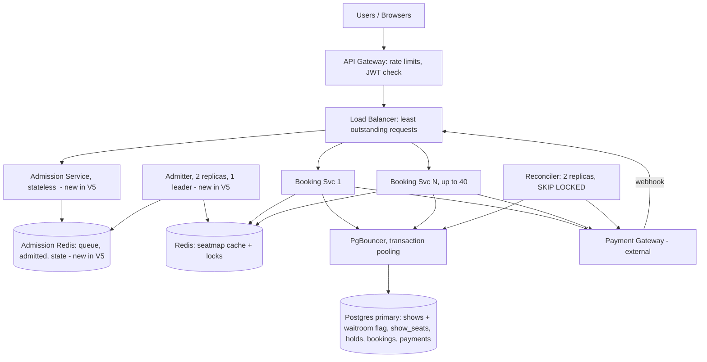

New in V5: the Admission Service, Admission Redis, the Admitter, token checks on holds, and the `waitroom` and `opens_at` columns on `shows`.

**Every current flow:**

*Waiting-room path (new)*
1. User calls `POST /waitroom/{show}/join` and lands in `wr:{show}:queue`, randomly ranked if early and first-come if late.
2. User polls `GET /waitroom/{show}/status` at an interval that grows with position.
3. The Admitter moves users from the queue to the admitted set at a rate tied to available seats.
4. The next poll returns a signed token, or `SOLD_OUT`.

*Browse path (unchanged from V4)*
1. User calls `GET /shows/{id}/seats`.
2. The instance reads `seatmap:{show_id}` from Redis, with stale-while-revalidate against Postgres.
3. It returns the map, up to 1-2 seconds stale.

*Hold path (changed)*
1. User calls `POST /shows/{id}/holds` with `X-Admission-Token`.
2. If the show has `waitroom = true`, the instance verifies the token locally, and 403s if it's missing or invalid.
3. The conditional `UPDATE` runs on Postgres, and `holds` is inserted. It returns `hold_id` and `expires_at`, or 409.

*Confirm path (unchanged from V2)*
1. User calls `POST /holds/{id}/confirm`.
2. The instance extends the lease, inserts `payments` as INITIATED, charges the gateway with the idempotency key, and runs `finalize`.

*Webhook path (unchanged from V3)*
1. Gateway posts `charge.succeeded`.
2. Any instance verifies the signature and calls `finalize(hold_id)`.

*Reconcile path (unchanged from V3)*
1. A Reconciler replica claims stuck `INITIATED` rows with `SKIP LOCKED`, asks the gateway, and finalizes, fails, or retries refunds.

## Interviewer follow-ups

**"What if the waiting room's Redis dies at 6:00:05?"**
Failing closed blocks the sale. Failing open sends the stampede back to Postgres. We take a middle path. Tokens already issued are stateless JWTs, so admitted users keep booking. New joins get a 503 with `Retry-After` while the replica is promoted. At worst we lose about a second of queue entries, and those users rejoin. It's a degraded experience but never a double booking, because Postgres still arbitrates every claim.

**"Why not just queue hold requests in Kafka, keyed by show?"**
That's Fix B. It serializes correctly, but it accepts all 50,000 requests and makes every user wait for an async reply. It also makes one consumer per show a failure point. The waiting room stops the 49,700 doomed requests at the door. It's also cheaper to run.

## Recap

| Concept | The Insight |
|---|---|
| Hot key | 5,000 attempts on one row serialize at about 300 per second, and the waiters hold scarce connections. |
| Contention is a queue | Postgres already queues the requests, but it's the most expensive place to wait. |
| Admission control | Bound how many users may attempt the scarce write at once, and queue the rest in Redis. |
| Closed-loop admission | The admit rate follows available seats, so the system self-throttles as inventory sells. |
| Fair ordering | Random scores before opening and first-come after remove the reward for refreshing. |
| Stateless tokens | The Booking Service checks a signed claim locally, with no extra dependency on the hot path. |

**Interview arc:** *"50,000 users hammering 300 seats serialized on a few row locks and drained the connection pool, so rate limits are unfair and a per-show Kafka queue still accepts the doomed requests. Instead we put a virtual waiting room in front of the hold step, which admits about twice the number of free seats through a closed-loop admitter and hands out signed tokens that the Booking Service verifies locally."*

## Next

The blockbuster is handled, but the aggregator isn't just one show. About 100,000 shows a day means roughly 20 million new `show_seats` rows daily, and Friday-evening writes from every city hit one Postgres primary. That is V6: sharding, where we pick the shard key and decide what resharding costs.


-----------------------------------------------------------------------------------------------------------------------
-----------------------------------------------------------------------------------------------------------------------
-----------------------------------------------------------------------------------------------------------------------
-----------------------------------------------------------------------------------------------------------------------


# V6: Sharding

V5 protected the hottest show. V6 handles the whole aggregator, where one Postgres primary can no longer absorb all the writes.

This is the sharding version. We teach the mechanism, compare shard keys, pick one, and build it, including what resharding costs.

## The idea

A small-town library keeps every book on one shelf, and one librarian fetches them. When the town becomes a country, one shelf can't work.

The fix is branch libraries. The rule for which branch holds which book must be simple, so any visitor can find the right one without asking around.

That rule is the shard key. The branches are shards.

## Break it

It's Friday at 6:30 PM across the country. Thousands of shows are selling at once.

- The platform lists about 100,000 shows a day, and each one pre-inserts about 200 `show_seats` rows. That's 20 million new rows a day.
- At the Friday peak we see roughly 2,500 bookings per second, nationwide.
- Each booking is about 10 write statements: the hold `UPDATE`, the `holds` insert, the lease extend, two `payments` writes, the `finalize` `UPDATE`, and the `bookings` insert. That is about 25,000 writes per second.
- One well-tuned Postgres primary, committing durably with several indexes, tops out near 10,000 writes per second.

At 6:30 the primary's WAL fsync queue backs up. Commit latency goes from 3 ms to 400 ms. Holds in Chennai slow down because of bookings in Delhi, even though they share nothing.

Size is not the trigger. 30 days of forward inventory is about 600 million rows, roughly 100 GB. That fits on one machine. **Write throughput** is what breaks, and V4 already removed the read load.

## Teach: what sharding is and how the naive version fails

Sharding splits one table across several databases, so each database takes a slice of the writes. It only works if every transaction can stay inside one slice.

The naive default is `shard = show_id % N`. Say N is 4, and we grow to 5 databases.

- `show_id 9001` lives on shard 1 today, since 9001 % 4 = 1.
- Tomorrow, 9001 % 5 = 1, so it stays. But `show_id 9002` goes from 2 to 2, and `9003` goes from 3 to 3, and `9004` goes from 0 to 4.
- Across the whole key space, about 80% of shows change shard when N goes from 4 to 5.

Moving 80% of live inventory during a ticket sale is not a plan. Modulo sharding makes every resize a full reshuffle.

## Solve it

### Decision 1: the shard key

The booking core has one hard rule. A booking claims several seats in one transaction, and that transaction must stay on one database. So all of a show's seats, holds, payments, and bookings must live together.

| Candidate key | What it optimizes | What it breaks |
|---|---|---|
| `user_id` | "My bookings" is one shard | One show's seats spread over every shard, so a seat claim becomes a distributed transaction. Fatal. |
| `city_id` | Local browse is one shard | Mumbai holds far more traffic than Indore, so shards are badly skewed. A city-wide release makes one shard the hotspot. |
| `theatre_id` | A theatre's shows stay together | Better, but a 12-screen multiplex still skews. It's coarser than we need. |
| **`show_id`** | **A show's rows stay together, and spread is even** | **Browse by city and "my bookings" cross shards** |

**Decision: `show_id`.** It is the smallest unit that must stay together, so it's the finest grain that keeps every booking on one shard.

**Does our traffic create hotspots?** Yes, on one show. A blockbuster concentrates its writes on a few hundred rows. Sharding does not fix that, and V5's waiting room already bounds it to a few hundred writes per second. What sharding adds is isolation. A hot show on shard 3 no longer slows shard 1.

### Decision 2: how shows map to databases

| Option | Resize cost | Control |
|---|---|---|
| `hash(show_id) % N` | About 80% of data moves | None |
| Consistent hash ring | About 1/N moves | Hard to move one hot show |
| **Logical buckets plus a shard map** | **Only the buckets you choose** | **Move any bucket anywhere** |

**Decision: 1,024 logical buckets, mapped to a few physical databases.** `bucket = hash(show_id) % 1024` never changes. A small table maps each bucket to a database. Growing the fleet means moving some buckets and editing the map. The key space is never re-hashed.

We start with **4 physical primaries**, 256 buckets each. 25,000 / 4 is about 6,250 writes per second each, which is 60% of one primary's ceiling.

- ✅ **What we gained:** Write capacity multiplies by the shard count. One slow shard cannot slow the others. Resizing moves a bounded number of buckets, each about 0.1% of traffic. Every booking and every claim still stays inside one database, so V1 and V2 correctness is untouched.
- ⚠️ **What we gave up:** Anything that crosses shows now crosses shards. "My bookings" must ask all 4 shards. City browse can't be a join. We carry a shard map as new routing state, and a stale copy of it can send a write to the wrong place. Operations multiply: 4 primaries, 4 PgBouncers, 4 reconciler workloads.
- ❌ **Considered and rejected:**
  - **Sharding by `user_id`.** It splits a show's seats across shards, so a claim becomes a distributed transaction.
  - **`show_id % N`.** Every resize reshuffles most of the data.
  - **Distributed SQL (Spanner-style) now.** It's a real option, but it replaces the stack we've justified step by step. At 4 shards the manual map is simpler to reason about.
  - **Cross-shard transactions.** A booking never needs one, so we should never build one.

Browse and discovery by city and movie is the P1 search layer. That comes later as its own read-optimized index, so we don't join across shards for it.

## Implement it

**Step 1: the shard-key function.** It must be stable across processes and languages, so no built-in `hash()`.

```python
import hashlib

BUCKETS = 1024

def bucket(show_id: int) -> int:
    h = hashlib.md5(str(show_id).encode()).digest()
    return int.from_bytes(h[:8], "big") % BUCKETS
```

**Step 2: the shard map**, in a tiny control Postgres, with 1,024 rows.

```sql
CREATE TABLE shard_map (
  bucket     SMALLINT PRIMARY KEY,
  db_host    TEXT NOT NULL,                 -- 'pg-shard-2'
  state      TEXT NOT NULL DEFAULT 'ACTIVE',-- ACTIVE | MOVING
  updated_at TIMESTAMPTZ NOT NULL DEFAULT now()
);
-- e.g. (bucket 17, 'pg-shard-1', ACTIVE)
```

Each Booking Service instance loads the whole table into memory at boot and refreshes it every 5 seconds.

**Step 3: carry the bucket in every row and every ID.**

```sql
-- on shows, show_seats, holds, payments, bookings:
ALTER TABLE show_seats ADD COLUMN bucket SMALLINT NOT NULL;
ALTER TABLE payments   ADD COLUMN show_id BIGINT NOT NULL;
CREATE INDEX bookings_user ON bookings (user_id, created_at DESC);
```

`hold_id`, `booking_id`, and `payment_id` become 63-bit IDs with the bucket inside:

```
| 41 bits: ms since epoch | 10 bits: bucket | 12 bits: sequence |
```

So `hold_id` alone tells us which shard to ask. The gateway metadata now carries `show_id` too: `{"hold_id": 77, "show_id": 9001}`. A webhook for hold 77 routes to the right shard with no lookup.

**Step 4: routing.**

```python
def pool_for(show_id, write):
    b = bucket(show_id)
    row = shard_map[b]                       # in-memory, 5s refresh
    if row.state == "MOVING" and write:
        raise Retry503(retry_after=2)
    return pools[row.db_host]                # PgBouncer for that shard
```

| Store | Who writes | When | Who reads | When |
|---|---|---|---|---|
| `shard_map` (control Postgres) | Resharder tool (ops) | During a bucket move | Booking Service, Webhook route, Reconciler | Boot and every 5 s |
| `show_seats`, `holds`, `payments`, `bookings`, `shows` | Booking Service, finalize, Reconciler | Same as V2, now on the shard that owns the bucket | Same | Same |
| `bucket_fence` (each shard) | Resharder tool | At cutover | Trigger on every write | Every row write |

**Request routing, hold path.**

```
POST /shows/9001/holds
```

1. The instance computes `bucket(9001)` and looks up its shard in memory, say `pg-shard-2`.
2. It runs the V1 conditional `UPDATE` and the `holds` insert through that shard's PgBouncer.
3. **Branch: shard map says MOVING.** Return 503 with `Retry-After: 2`.
4. The rest is unchanged from V1.

Confirm and `finalize` do the same. They know `show_id` from the `holds` row, so they pick the same shard.

**The Reconciler runs once per shard**, with the same `SKIP LOCKED` query from V3, against each shard's own `payments`. Two replicas per shard.

**"My bookings"** becomes a scatter-gather: the instance runs `SELECT ... FROM bookings WHERE user_id = 42 ORDER BY created_at DESC LIMIT 20` on all 4 shards in parallel, then merges. With 4 shards this is cheap. If the shard count grows, we add a global index. Not now.

**Step 5: resharding, moving one bucket.** We add `pg-shard-5` and move bucket 17 from `pg-shard-1`.

1. **Copy.** On the source, create a logical-replication publication with a row filter: `... WHERE (bucket = 17)`. The target subscribes and copies the rows, then streams changes.
2. **Wait** until replication lag is under 1 second. Users are unaffected so far.
3. **Fence.** On the source, set `bucket_fence.frozen = true` for bucket 17. A trigger rejects any write for that bucket:

```sql
CREATE TABLE bucket_fence (
  bucket SMALLINT PRIMARY KEY,
  frozen BOOLEAN NOT NULL DEFAULT false
);

CREATE FUNCTION reject_if_frozen() RETURNS trigger AS $$
BEGIN
  IF (SELECT frozen FROM bucket_fence WHERE bucket = NEW.bucket) THEN
    RAISE EXCEPTION 'BUCKET_FROZEN' USING ERRCODE = '55000';
  END IF;
  RETURN NEW;
END $$ LANGUAGE plpgsql;

CREATE TRIGGER fence_show_seats
  BEFORE INSERT OR UPDATE ON show_seats
  FOR EACH ROW EXECUTE FUNCTION reject_if_frozen();
-- same trigger on holds, payments, bookings
```

4. **Drain** the last changes, then compare row counts and a checksum per table.
5. **Flip** `shard_map` for bucket 17 to `pg-shard-5` and set `state = ACTIVE`.
6. An instance holding a stale map writes to the old shard, hits `BUCKET_FROZEN`, refreshes its map, and retries once on the new shard. It never writes a second copy.
7. **Clean up.** After a day, delete bucket 17's rows from the source and drop the fence.

The write pause for bucket 17's shows is seconds. That is about 0.1% of traffic. The fence is what makes a stale shard map safe. Without it, a lagging instance could claim F7 on the old shard after the new shard already sold it.

```mermaid
sequenceDiagram
    participant U as User
    participant B as Booking Service
    participant M as Shard Map (in memory)
    participant PB2 as PgBouncer shard 2
    participant P2 as Postgres shard 2

    U->>B: POST /shows/9001/holds (token)
    B->>B: bucket = md5(9001) % 1024 = 417
    B->>M: lookup bucket 417
    M-->>B: pg-shard-2, ACTIVE
    B->>PB2: conditional UPDATE show_seats (V1)
    PB2->>P2: pooled connection
    P2-->>B: rowcount 2
    B->>PB2: INSERT holds; COMMIT
    B-->>U: 201 hold_id (bucket 417 embedded)
```

## Current State (after V6)

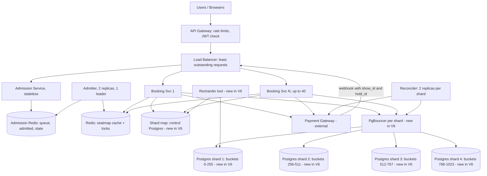

New in V6: 4 shard primaries each with its own PgBouncer, the shard map, bucket-carrying IDs, `bucket_fence` triggers, the per-shard Reconciler, and the Resharder tool. Everything above the data tier is as in V5.

**Every current flow:**

*Waiting-room path (unchanged from V5)*
1. User joins `wr:{show}:queue` and polls the status endpoint.
2. The Admitter moves users to the admitted set at a rate tied to available seats.
3. The next poll returns a signed token or `SOLD_OUT`.

*Browse path (data source changed)*
1. User calls `GET /shows/{id}/seats`.
2. The instance reads `seatmap:{show_id}` from Redis.
3. On a soft-expired or missing entry, the rebuilder routes by `bucket(show_id)` and runs the `SELECT` on that show's shard.
4. It returns the map, up to 1-2 seconds stale.

*Hold path (routing changed)*
1. User calls `POST /shows/{id}/holds` with `X-Admission-Token`.
2. The instance verifies the token, computes the bucket, and looks up the shard.
3. The conditional `UPDATE` and the `holds` insert run on that shard only. It returns `hold_id` and `expires_at`, or 409. During a bucket move it returns 503.

*Confirm path (routing changed)*
1. User calls `POST /holds/{id}/confirm`.
2. The instance routes by the hold's `show_id`, extends the lease, inserts `payments` as INITIATED, and calls the gateway with the idempotency key.
3. It runs `finalize` on the same shard.

*Webhook path (routing changed)*
1. Gateway posts `charge.succeeded` with `hold_id` and `show_id`.
2. The instance verifies the signature, routes by bucket, and calls `finalize(hold_id)` on that shard.

*Reconcile path (per shard)*
1. Each shard's Reconciler replica claims its stuck `INITIATED` rows with `SKIP LOCKED`.
2. It asks the gateway, then finalizes, fails, or retries refunds.

*My-bookings path (new)*
1. User calls `GET /me/bookings`.
2. The instance queries all 4 shards in parallel with the `bookings_user` index and merges by `created_at`.

## Interviewer follow-ups

**"Why not shard by `user_id`? It makes 'my bookings' one query."**
Because a booking claims seats, and seats belong to a show. Sharding by user would scatter one show's 200 seats across every shard. Then a hold on F7 and F8 for two different users becomes a cross-shard conflict, and we'd need a distributed transaction. The seat claim is the hot, correctness-critical path. "My bookings" is a cheap read, so it gets the scatter-gather instead.

**"How do you reshard without downtime?"**
We move one bucket at a time. The target copies it through logical replication, we freeze the bucket on the source for a few seconds, verify, and flip the map. A trigger on the source rejects writes to a frozen bucket, so a stale shard map fails loudly and retries instead of writing to the wrong place. Only that bucket's shows, about 0.1% of traffic, see a short 503.

## Recap

| Concept | The Insight |
|---|---|
| Write throughput, not size | 600M rows fit on one box. 25,000 writes per second don't. |
| Shard key follows the transaction | A booking must stay on one shard, so the key is the thing that must stay together: `show_id`. |
| Modulo sharding | `% N` moves about 80% of data on every resize. |
| Logical buckets | 1,024 fixed buckets plus a map make resizing a bounded, bucket-by-bucket move. |
| Bucket in the ID | A hold or booking ID tells you its shard with no lookup. |
| Fence before flip | A write-rejecting trigger makes a stale shard map safe during a move. |

**Interview arc:** *"One primary saturates near 10,000 writes per second against a 25,000 peak, and modulo sharding reshuffles most of the data on every resize, so we shard by `show_id` into 1,024 logical buckets mapped to 4 databases, which keeps every booking inside one shard and lets us move a bucket at a time behind a write fence."*

## Next

Each shard is now a single primary. At 6:45 PM `pg-shard-2` loses its disk, and every show on 256 buckets is down for the 20 minutes it takes to restore from backup. That is V7: replication. We'll decide whether read replicas are even justified here, since V4 already took the read load away, and how failover works without losing a confirmed booking.


-----------------------------------------------------------------------------------------------------------------------
-----------------------------------------------------------------------------------------------------------------------
-----------------------------------------------------------------------------------------------------------------------
-----------------------------------------------------------------------------------------------------------------------


# V7: Replication

V6 split the write load across four shards. Each shard is still one machine, and one machine can die.

This is the replication version. We teach the mechanism, decide whether read replicas are justified, pick a sync model, and build failover.

## The idea

Meera keeps the ledger for one branch library. She writes every loan in her book.

If the book burns, the branch loses its history. So she hires two assistants in two other buildings. After each loan, Meera phones them, and at least one must say "written down" before she tells the borrower "done."

If Meera collapses, an assistant takes over with every confirmed loan in hand. That phone call before "done" is synchronous replication. The assistant taking over is failover.

## Break it

It's 6:45 PM on Friday. `pg-shard-2` loses its disk.

V6 left each shard with a nightly base backup and WAL archived to S3 every 60 seconds. Two things go wrong at once:

- **Downtime.** Restoring a base backup and replaying WAL takes about 20 minutes. All 256 buckets on that shard can't take a hold or a confirm.
- **Lost bookings.** Each shard commits about 625 bookings per second at peak. The last 60 seconds of WAL never reached S3, so about 37,000 confirmed bookings vanish.

Those 37,000 users have a confirmation email and a captured charge. The new database has no booking for them. Their `payments` rows are gone too, so the Reconciler has nothing to reconcile.

Their seats show as free, and other users buy them. We sold the same seat twice, which V1 and V2 were built to make impossible.

Restore time hurts. The lost commits are the real failure.

## Teach: what replication is, and how the default fails

A standby is a second Postgres that receives the primary's WAL (its ordered log of every change) and replays it. If the primary dies, the standby already has the data.

The default is **asynchronous** replication. The primary commits locally, tells the user "done," and ships the WAL in the background.

Here is how it fails on one commit:

- 18:45:00.000, Priya's `finalize` commits on the primary. She gets a 201 and an email.
- 18:45:00.040, the WAL record is still in flight to the standby.
- 18:45:00.050, the primary crashes.
- 18:45:30, the standby is promoted. It never saw the commit, so F7 isn't `SOLD`.
- 18:46:00, Rahul claims F7.

At 625 commits per second, a replication lag of just 100 ms is about 60 confirmed bookings lost per failover. Async replication gives fast commits and acknowledges writes that may not survive.

## Solve it

### Decision 1: are read replicas justified?

No, not for load.

After V4, Postgres reads are cheap. Each active show triggers about one 200-row seat-map rebuild per second. That's roughly 2,500 indexed range scans per second per shard, against 6,250 writes per second. The primary handles that comfortably.

Reads that need freshness (`holds` at confirm, `bookings` after `finalize`) must hit the primary anyway. Read-your-writes stays trivial when every read goes to the primary.

We still need standbys, but for durability and failover, not for read capacity. If rebuild load grows later, those standbys could serve rebuilds with a lag cap. We don't add that routing now.

### Decision 2: sync, async, or quorum?

| Mode | Commit waits for | Loss when primary dies | A standby dies |
|---|---|---|---|
| Async | Primary only | Last ms to 100s of ms of commits | Writes unaffected |
| Sync, 1 standby | That standby | None | Writes stall |
| **Quorum, any 1 of 2** | **Fastest of 2 standbys** | **None on a single failure** | **Writes unaffected** |

**Decision: three nodes per shard, one per availability zone, with quorum sync.** Every acknowledged commit exists on the primary and at least one standby. Waiting for the faster of two standbys also trims tail latency.

The price is cross-AZ latency on every commit. Commit goes from about 3 ms to about 4.5 ms. Group commit keeps throughput intact, so 6,250 writes per second per shard is still fine.

### Decision 3: failover, a known sub-problem

When the primary dies, three questions arise. Who promotes? How do we stop the old primary from coming back and accepting writes (split-brain)? How do clients find the new primary?

**Fix A: manual runbook.** On-call runs `pg_ctl promote` and repoints traffic. It's simple, but recovery takes 10-20 minutes because a human must be paged.

**Fix B: lease-based automatic failover.** Each node runs an agent. The primary must keep renewing a leader key in a consensus store, and it demotes itself if it can't.

```python
while True:
    if etcd.refresh("/pg-shard-2/leader", me, ttl=30):
        stay_primary()
    else:
        demote_to_readonly()      # self-fencing
```

**Fix C: managed multi-AZ database.** The cloud provider does Fix B for us. It's a legitimate choice, and on RDS this is the Multi-AZ cluster option. We design the mechanism so we can explain it.

| Fix | Recovery time | Split-brain protection | Moving parts |
|---|---|---|---|
| A: manual | 10-20 min | Human discipline | None |
| **B: lease + consensus** | **About 35 s** | **Lease expiry plus quorum sync** | **Agent per node, 3-node etcd** |
| C: managed | About 60-120 s | Provider | Vendor lock-in |

**Decision: B, using Patroni with etcd.** We get automatic recovery we can reason about.

Split-brain gets two layers of protection:

1. **The lease.** The old primary demotes itself within about 20 seconds of losing the lease. The new leader can't be elected until the key expires at 30 seconds. So the old one stops first.
2. **Quorum sync.** A zombie primary that doesn't demote still can't acknowledge a write, because commits need a standby ack and the standbys now follow the new leader. The sync model is itself a fence.

- ✅ **What we gained:** No acknowledged booking is lost on a single failure. Recovery drops from 20 minutes to about 35 seconds. The V1/V2 correctness guarantees survive node death.
- ⚠️ **What we gave up:** Three nodes per shard, so 12 Postgres nodes and 3x storage. Every commit pays about 1.5 ms of cross-AZ latency. Two simultaneous failures can still lose data, and if both standbys are down, writes stop. We now operate etcd, and an etcd outage can block failover.
- ❌ **Considered and rejected:**
  - **Async replication.** It acknowledges commits that can disappear.
  - **Sync to exactly one named standby.** If that standby dies, every write on the shard stalls.
  - **Read replicas for load.** The read:write ratio doesn't justify them, and they add staleness we'd have to reason about.
  - **Cross-shard or cross-region replication for HA.** It's too far for synchronous commits at this write rate, and multi-region is a later question.

## Implement it

**Topology per shard.** The primary sits in AZ-a, standby B in AZ-b, and standby C in AZ-c. Each node runs a Patroni agent. One 3-node etcd cluster, spread across three AZs, serves all four shards.

**Postgres replication settings.** Patroni quorum mode manages the standby names; this is the setting it enforces:

```
synchronous_commit        = on
synchronous_standby_names = 'ANY 1 (pg2_b, pg2_c)'
```

**Patroni config (shard 2):**

```yaml
scope: pg-shard-2
bootstrap:
  dcs:
    ttl: 30
    loop_wait: 10
    retry_timeout: 10
    synchronous_mode: quorum
    synchronous_node_count: 1
```

The shard map from V6 doesn't change. `db_host = 'pg-shard-2'` now names a per-shard HAProxy endpoint, not a machine.

**Routing.** HAProxy checks each node with `GET :8008/primary`. Only the current leader answers 200. PgBouncer for that shard points at HAProxy, so after a failover it reconnects to the new leader.

| Store | Who writes | When | Who reads | When |
|---|---|---|---|---|
| WAL stream | Primary | Every commit, before the ack | Standbys B and C | Continuously, they replay it |
| Leader key in etcd | Patroni agent on the primary | Renewed every 10 s, TTL 30 s | Patroni agents on the standbys | Every 10 s, to detect expiry |
| S3 WAL archive and base backups | Primary (`archive_command`, 60 s timeout) | Continuously and nightly | Restore tooling | Disaster recovery only |
| Everything else (`show_seats`, `holds`, `payments`, `bookings`) | Unchanged from V6 | Unchanged | Unchanged | Always the primary |

**The commit path.** This applies to every write in V1-V6, including `finalize`:

1. The Booking Service sends `COMMIT` through PgBouncer and HAProxy to the primary.
2. The primary writes WAL locally and sends it to standbys B and C.
3. **Branch: at least one standby flushes the WAL to disk.** The primary returns "committed" and the user gets their response.
4. **Branch: no standby acks within the 3 s `statement_timeout`.** The write fails with a 503, and the alert `sync_standbys < 1` fires.

**The failover path.**

1. 18:45:00, the primary dies.
2. The standbys stop seeing the leader key refresh.
3. 18:45:30, the key's TTL expires.
4. The standby with the most WAL wins the election and calls `pg_promote()`. Quorum sync guarantees at least one standby holds every acknowledged commit.
5. HAProxy's `/primary` check flips to the new leader within about 3 seconds.
6. PgBouncer reconnects.
7. Writes resume at about 18:45:35, roughly 35 seconds after the crash.

**What clients see during those 35 seconds:**

- The Booking Service catches the connection error, returns 503 with `Retry-After: 5`, and writes nothing.
- A hold whose `COMMIT` outcome is unknown expires on its own within 10 minutes, and the user re-selects.
- A confirm already in flight is covered by V2. The `payments` row is `INITIATED`, the gateway retries the webhook, and `finalize` runs after promotion.
- The Reconciler on that shard retries on the new primary.

**When the old primary returns.** Patroni runs `pg_rewind` and rejoins it as a standby. It never rejoins as a primary.

**Observability.** We alert on:
- sync standby count below 1
- `pg_stat_replication.write_lag` above 1 s
- any leader change
- WAL archive age above 2 minutes

**Resharding.** The Resharder from V6 copies buckets into the target shard's primary. Its standbys follow physically. We pause bucket moves during a failover.

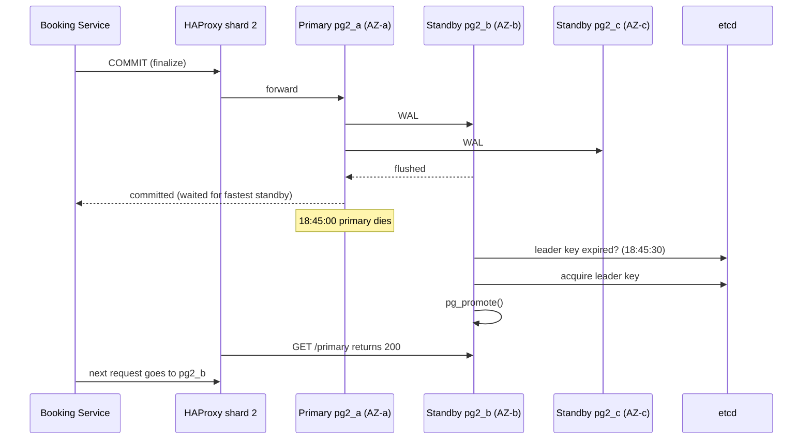

## Current State (after V7)

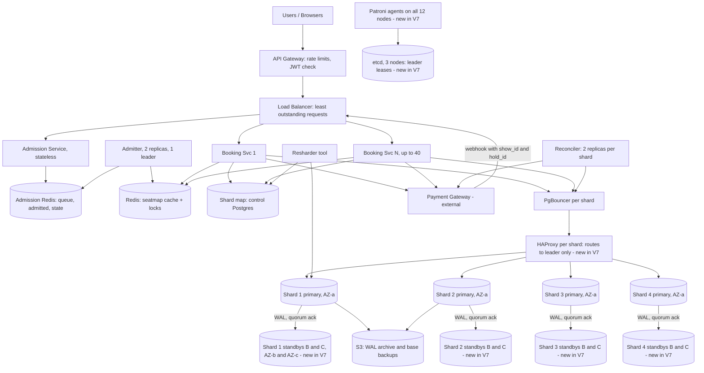

New in V7: two standbys per shard in separate AZs, quorum-synchronous replication, Patroni with etcd, HAProxy leader routing, and WAL archiving shown explicitly. Shards 3 and 4 archive to S3 the same way as 1 and 2.

**Every current flow:**

*Waiting-room path (unchanged from V5)*
1. User joins `wr:{show}:queue` and polls the status endpoint.
2. The Admitter moves users to the admitted set at a rate tied to available seats.
3. The next poll returns a signed token or `SOLD_OUT`.

*Browse path (unchanged from V6)*
1. User calls `GET /shows/{id}/seats`.
2. The instance reads `seatmap:{show_id}` from Redis, with stale-while-revalidate.
3. The rebuilder queries that show's shard primary. There are no read replicas.

*Hold path (commit semantics changed)*
1. User calls `POST /shows/{id}/holds` with `X-Admission-Token`.
2. The instance verifies the token and routes by `bucket(show_id)` to the shard's HAProxy.
3. The conditional `UPDATE` and the `holds` insert commit only after a standby flushes the WAL. It returns `hold_id` and `expires_at`, or 409. During a failover window it returns 503.

*Confirm path (commit semantics changed)*
1. User calls `POST /holds/{id}/confirm`.
2. The instance extends the lease, inserts `payments` as INITIATED, and calls the gateway with the idempotency key.
3. `finalize` commits with a standby ack. No acknowledged booking is lost on a single failure.

*Webhook path (unchanged from V6)*
1. Gateway posts `charge.succeeded` with `hold_id` and `show_id`.
2. The instance routes by bucket and calls `finalize(hold_id)` on that shard.

*Reconcile path (unchanged from V6)*
1. Each shard's Reconciler claims stuck `INITIATED` rows with `SKIP LOCKED`.
2. It asks the gateway, then finalizes, fails, or retries refunds. After a failover it simply continues on the new primary.

*My-bookings path (unchanged from V6)*
1. User calls `GET /me/bookings`.
2. The instance queries all 4 shard primaries in parallel and merges by `created_at`.

*Failover path (new)*
1. The primary stops renewing its leader key. The key expires after 30 seconds.
2. The most caught-up standby takes the key and promotes itself.
3. HAProxy flips to the new leader and PgBouncer reconnects.
4. The old primary rejoins later as a standby through `pg_rewind`.

## Interviewer follow-ups

**"Why not async replication with read replicas? It's cheaper and faster."**
Async acknowledges a commit before any other machine has it. A primary crash then loses acknowledged bookings, and those seats get resold. The reads are also already cheap, because V4 cached them. So we'd pay the durability risk and gain almost nothing. We take about 1.5 ms of commit latency to make "confirmed" mean "on two machines."

**"What if both standbys die, or the AZ with two nodes goes down?"**
The primary can't get a quorum ack, so writes fail with 503 and we alert. We choose to stop selling on that shard rather than acknowledge bookings that exist on one machine. Ops can consciously downgrade to async if the business prefers availability, but that is an explicit decision with a known loss window. The Reconciler and the gateway's records help repair afterwards, since the gateway knows what was captured.

## Recap

| Concept | The Insight |
|---|---|
| Replicas for durability, not reads | Reads were already cheap after V4, so standbys exist to protect acknowledged writes. |
| Async replication | It acknowledges commits the standby hasn't seen. 100 ms of lag is about 60 lost bookings per failover. |
| Quorum sync, any 1 of 2 | Every acked commit lives on two machines, and one slow or dead standby doesn't stall writes. |
| Lease-based failover | A primary that can't renew its lease stops itself, so recovery is automatic and about 35 seconds. |
| Split-brain, two layers | The lease demotes the old primary, and quorum sync stops a zombie from acknowledging writes. |
| Stable endpoint | The shard map points at a per-shard HAProxy, so a promotion never edits routing state. |

**Interview arc:** *"A single primary per shard meant a disk loss cost 20 minutes of downtime and up to 60 seconds of acknowledged bookings, and async replicas would still lose recent commits on failover, so each shard runs three nodes across three AZs with quorum-synchronous commits and lease-based Patroni failover, which makes every confirmed booking durable on two machines and recovers in about 35 seconds."*

## Next

The booking core is now correct, fast, sharded, and durable. The P1 search is still missing. At 7 PM Priya types "Dune, Hyderabad, tonight." The answer lives across all 4 shards, because shows are sharded by `show_id`, not by city or movie, and 100,000 shows per day must be filtered by movie, city, date, and theatre. That is V8: a read-optimized search index.


-----------------------------------------------------------------------------------------------------------------------
-----------------------------------------------------------------------------------------------------------------------
-----------------------------------------------------------------------------------------------------------------------
-----------------------------------------------------------------------------------------------------------------------


# V8: Search and Discovery

V7 made every confirmed booking durable. The P1 we deferred is still missing: finding a show.

This is a new storage class, a search index, so we justify it against the access pattern. Search is derived, read-only data, so it doesn't touch the booking core.

## The idea

Priya walks into a mall and asks the info desk, "Where is *Dune* playing tonight near me?"

The desk doesn't walk to every theatre and ask. It keeps one directory, organized by movie, area, and time. Each theatre phones in changes, and the directory is allowed to be a minute behind.

That directory is a search index. The theatres' own ledgers stay the source of truth for seats.

## Break it

It's 7:00 PM. Priya types "dun" and picks Hyderabad and tonight.

Our data is scattered:
- Movie titles and theatres live in the small control Postgres.
- `shows` rows live on 4 shards, sharded by `show_id` (V6).
- `shows` knows `movie_id` and `screen_id`. It has no city and no title.

To answer her, the app must do this:
1. Find matching `movie_id`s in the control DB.
2. Find Hyderabad `screen_id`s in the control DB.
3. Ask **all 4 shards** for tonight's shows with those IDs.
4. Merge, sort, and attach titles.

Now add traffic. About 10% of 50,000 peak users are searching, which is about 5,000 searches per second.

- Each search fans out to 4 shards. That's 20,000 extra queries per second landing on primaries that already commit 6,250 writes per second.
- Search latency is the slowest of 4 shards, so one slow shard slows everyone.
- A shard failover (35 seconds, from V7) fails **every search in every city**, because every search needs all 4 shards.

There's a quality gap too. "dun" must match *Dune*, "dune hyd" must find Hyderabad, and results need ranking. Postgres `LIKE` can't rank or tolerate typos.

Booking data is hot and exact. Search data is read-heavy, approximate, and keyed on fields the shards were never partitioned by. Mixing them couples browsing to the booking path's failures.

## Teach: what a search index is

A normal index maps a key to rows. A search index is an inverted index: it maps each term to the list of documents containing it.

- `"dune"` points to documents `[9001, 9004, 9120, ...]`.
- `"hyderabad"` points to `[9001, 9120, 9333, ...]`.

"dune AND hyderabad" is an intersection of two sorted lists. It's fast, needs no joins, and the index can also store prefixes and typo variants.

The storage class is justified by the access pattern: multi-field filters, prefix and fuzzy text matching, and ranked results. A relational store answers "give me this row". It doesn't answer "find the 20 best-matching documents across 5 fields".

The size is tiny. 30 days of forward shows is about 3 million documents at about 1 KB each, which is 3 GB. We pick the index for its query shape, not for scale.

## Solve it

### Decision: where does the search data live, and how does it stay fresh?

| Option | Fresh | Isolated from booking | Handles fuzzy and ranked | Cost |
|---|---|---|---|---|
| Scatter-gather SQL on shards | Exact | No, shares primaries and failovers | No | Extra load on write path |
| Dual-write: app writes Postgres and the index | Fast | Yes | Yes | Partial failure leaves them divergent |
| Nightly batch ETL | Hours stale | Yes | Yes | Shows created today are invisible |
| **Transactional outbox, then an indexer** | **Seconds stale** | **Yes** | **Yes** | **An outbox table plus an indexer** |

Dual-write fails the same way the payment boundary did in V2. If the app writes Postgres and then crashes before the index call, they disagree forever. The outbox puts the "tell the index" intent in the same transaction as the show change, so it can never be lost.

**Decision: transactional outbox plus a polling indexer, feeding OpenSearch.**

A show is created about once per second platform-wide (100,000 shows a day). That's tiny. So we skip Kafka. A poller reading the outbox with `SKIP LOCKED` is enough, and one fewer system is one fewer thing to fail.

**What goes in the index.** One document per show, with fields that search filters on. Live seat availability is **not** in it. It changes hundreds of times a second and is already served by the V4 cache. Search results point the user at the seat map, and they don't promise seats.

- ✅ **What we gained:** Search runs on its own cluster, so 5,000 searches per second never touch a shard primary. A shard failover no longer affects search. Fuzzy, prefix, and ranked matching work. The index is derived, so we can rebuild it any time from the sources.
- ⚠️ **What we gave up:** Search is eventually consistent, about 1-5 seconds behind. A brand new show may take seconds to appear. We now run OpenSearch and an indexer, and a stuck indexer means silent staleness. We must denormalize movie and theatre data into every document, and renaming a theatre means updating many documents.
- ❌ **Considered and rejected:**
  - **Scatter-gather on shards.** It couples search to every shard's load and failovers.
  - **Dual-write.** A crash between the two writes leaves them permanently inconsistent.
  - **Kafka between outbox and index.** At about 1 event per second it's pure overhead.
  - **Putting live seat counts in the index.** It would turn about 6,000 booking writes per second into index churn and still be stale.
  - **A second OpenSearch cluster or cache on top.** The index handles the load. Result caching can wait.

## Implement it

**Where it lives.** A new **Search Service**, a stateless deployment on its own load balancer target group. A new **OpenSearch cluster**, 3 data nodes with 1 replica of each shard, spread across 3 AZs. Index replication is built in. We don't need to engineer it, because the data is rebuildable.

**Schema delta (each shard, plus the control DB).**

```sql
CREATE TABLE search_outbox (
  outbox_id    BIGSERIAL PRIMARY KEY,
  entity       TEXT NOT NULL,         -- 'SHOW'
  entity_id    BIGINT NOT NULL,       -- show_id
  op           TEXT NOT NULL,         -- 'UPSERT' | 'DELETE'
  created_at   TIMESTAMPTZ NOT NULL DEFAULT now(),
  published_at TIMESTAMPTZ NULL
);
CREATE INDEX outbox_pending ON search_outbox (outbox_id) WHERE published_at IS NULL;
```

The control DB gets the same table for catalog changes, with entity values `'MOVIE'`, `'THEATRE'`, and `'CITY'`.

**OpenSearch document** (index `shows-live`, `_id = show_id`):

```json
{
  "show_id": 9001,
  "movie_id": 31,
  "title": "Dune: Part Three",
  "title_suggest": "Dune: Part Three",
  "language": "en",
  "format": "IMAX",
  "theatre_id": 412,
  "theatre_name": "PVR Next Galleria",
  "city": "hyderabad",
  "location": { "lat": 17.42, "lon": 78.45 },
  "starts_at": "2026-10-23T19:30:00+05:30",
  "price_cents": 24000
}
```

Mapping notes: `title` is `text` with an edge-n-gram sub-field for prefix matches. `city`, `language`, `format`, `theatre_id`, `movie_id` are `keyword`. `starts_at` is `date`.

| Store | Who writes | When | Who reads | When |
|---|---|---|---|---|
| `search_outbox` (each shard) | Admin tooling, in the same transaction as the `shows` insert | On show create, update, or cancel | Indexer | Every 1 s |
| `search_outbox` (each shard) | Indexer | Sets `published_at` after the index ack | Indexer | Same poll |
| `search_outbox` (control DB) | Catalog admin tooling | On movie, theatre, or city change | Indexer | Every 1 s |
| `shows-live` (OpenSearch) | Indexer | After building each document | Search Service | Every `GET /search/shows` |
| Movie, theatre, city tables (control DB) | Catalog admin tooling | Rare | Indexer (in-memory copy, 60 s refresh) | While building documents |

**Step 1: a show is created (write side).**

1. Admin tooling opens a transaction on the show's shard, which it finds by `bucket(show_id)` (V6).
2. It inserts the `shows` row, the 200 `show_seats` rows, and one outbox row:

```sql
BEGIN;
INSERT INTO shows (...) VALUES (...);
INSERT INTO show_seats (...) SELECT ...;   -- pre-materialized seats (V0)
INSERT INTO search_outbox (entity, entity_id, op)
VALUES ('SHOW', 9001, 'UPSERT');
COMMIT;
```

The outbox row commits atomically with the show, and it rides the V7 quorum commit. A confirmed show can't be missing from the outbox.

**Step 2: the indexer publishes.** One per shard plus one for the control DB, each with 2 replicas using `SKIP LOCKED`, the same pattern as the Reconciler in V3.

```sql
SELECT outbox_id, entity_id, op
FROM search_outbox
WHERE published_at IS NULL
ORDER BY outbox_id
LIMIT 200
FOR UPDATE SKIP LOCKED;
```

3. For each `UPSERT`, the indexer reads the `shows` row from the shard and joins in title, theatre, and city from its in-memory catalog copy.
4. It sends a bulk request to OpenSearch with external versioning, so an older event can never overwrite a newer one:

```
PUT /shows-live/_doc/9001?version=15003&version_type=external
{ ...document... }
```

`version` is the `outbox_id`. A retry of the same event is harmless.

5. **Branch: OpenSearch acks.** Set `published_at = now()`.
6. **Branch: OpenSearch errors or times out.** Leave the row unpublished. The next poll retries with exponential backoff and jitter.
7. **Branch: `DELETE`** (show cancelled or past). The indexer sends `DELETE /shows-live/_doc/9001`.

**Catalog changes.** When a theatre is renamed, the control DB outbox emits `THEATRE 412`. The indexer runs:

```
POST /shows-live/_update_by_query
{ "query": { "term": { "theatre_id": 412 } },
  "script": { "source": "ctx._source.theatre_name = params.n", "params": { "n": "PVR Galleria" } } }
```

**Step 3: Priya searches.**

```
GET /search/shows?q=dun&city=hyderabad&date=2026-10-23&lang=en
```

8. The API Gateway rate-limits (10 requests per second per client) and the load balancer routes to the Search Service.
9. The Search Service queries OpenSearch:

```json
{
  "size": 20,
  "query": { "bool": {
    "must":   [ { "match": { "title": { "query": "dun", "fuzziness": "AUTO" } } } ],
    "filter": [
      { "term":  { "city": "hyderabad" } },
      { "term":  { "language": "en" } },
      { "range": { "starts_at": { "gte": "2026-10-23T00:00:00+05:30",
                                  "lt":  "2026-10-24T00:00:00+05:30" } } }
    ]
  } },
  "sort": [ "_score", { "starts_at": "asc" } ]
}
```

10. It returns 20 hits, each with `show_id`, title, theatre, time, and price.
11. Priya taps a result, and the client calls the existing `GET /shows/9001/seats` (V4) and then the waiting room or hold flow (V5).

**Failure handling.**
- The Search Service uses a 300 ms timeout and a circuit breaker. If OpenSearch is down, it returns 503 for search only. Browsing a known show, holding, and confirming are unaffected.
- We alert on the oldest unpublished outbox row. If it's older than 60 seconds, the indexer is stuck.
- A nightly job compares counts per city between Postgres and the index. Disaster recovery is a full reindex from the sources, about 3 million documents.

```mermaid
sequenceDiagram
    participant AD as Admin tooling
    participant S as Shard primary
    participant IX as Indexer
    participant OS as OpenSearch
    participant U as User
    participant SS as Search Service

    AD->>S: BEGIN; INSERT shows, show_seats, search_outbox; COMMIT
    loop every 1s
        IX->>S: SELECT ... FROM search_outbox WHERE published_at IS NULL FOR UPDATE SKIP LOCKED
        IX->>OS: PUT /shows-live/_doc/9001 (external version)
        OS-->>IX: ack
        IX->>S: UPDATE search_outbox SET published_at = now()
    end
    U->>SS: GET /search/shows?q=dun&city=hyderabad
    SS->>OS: bool query (match + filters)
    OS-->>SS: 20 hits
    SS-->>U: results with show_id
    U->>SS: tap a result, client calls GET /shows/9001/seats (V4 path)
```

## Current State (after V8)

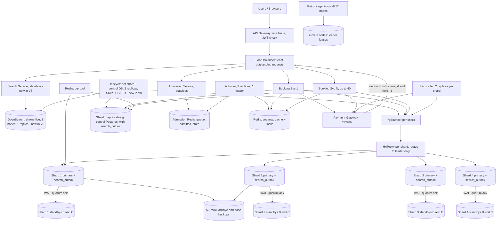

New in V8: the Search Service, the OpenSearch cluster, the Indexer, and `search_outbox` tables on every shard and on the control DB. Everything else is as in V7.

**Every current flow:**

*Search path (new)*
1. User calls `GET /search/shows?q=...&city=...&date=...`.
2. The gateway rate-limits, and the balancer routes to the Search Service.
3. The Search Service runs a bool query on `shows-live` in OpenSearch. It never touches Postgres.
4. It returns up to 20 shows. The client then opens the seat map for the chosen `show_id`.

*Indexing path (new)*
1. Admin tooling creates or changes a show. The `shows` row and a `search_outbox` row commit in one transaction on the owning shard.
2. The shard's Indexer polls unpublished outbox rows with `SKIP LOCKED`.
3. It builds the document using the in-memory catalog and writes it to OpenSearch with an external version, then marks the row published.
4. Catalog changes follow the same path through the control DB outbox and an `_update_by_query`.

*Waiting-room path (unchanged from V5)*
1. User joins `wr:{show}:queue` and polls the status endpoint.
2. The Admitter moves users to the admitted set at a rate tied to available seats.
3. The next poll returns a signed token or `SOLD_OUT`.

*Browse path (unchanged from V7)*
1. User calls `GET /shows/{id}/seats`.
2. The instance reads `seatmap:{show_id}` from Redis, with stale-while-revalidate.
3. The rebuilder queries that show's shard primary.

*Hold path (unchanged from V7)*
1. User calls `POST /shows/{id}/holds` with `X-Admission-Token`.
2. The instance verifies the token, routes by bucket, and runs the conditional `UPDATE` plus the `holds` insert on that shard.
3. It commits after a standby ack and returns `hold_id` and `expires_at`, or 409, or 503 during failover.

*Confirm path (unchanged from V7)*
1. User calls `POST /holds/{id}/confirm`.
2. The instance extends the lease, inserts `payments` as INITIATED, and calls the gateway with the idempotency key.
3. `finalize` commits with a standby ack.

*Webhook path (unchanged from V6)*
1. Gateway posts `charge.succeeded` with `hold_id` and `show_id`.
2. The instance routes by bucket and calls `finalize(hold_id)`.

*Reconcile path (unchanged from V7)*
1. Each shard's Reconciler claims stuck `INITIATED` rows with `SKIP LOCKED`.
2. It asks the gateway, then finalizes, fails, or retries refunds.

*My-bookings path (unchanged from V6)*
1. User calls `GET /me/bookings`.
2. The instance queries all 4 shard primaries in parallel and merges by `created_at`.

*Failover path (unchanged from V7)*
1. The primary's leader key expires and the most caught-up standby promotes itself.
2. HAProxy flips to the new leader and PgBouncer reconnects.
3. Search keeps working throughout, and the Indexer simply resumes on the new primary.

## Interviewer follow-ups

**"Why not Postgres full-text search or a trigram index?"**
It works on one database. Our data is split across 4 shards by `show_id`, and the filter fields (city, title) aren't the shard key. Every search would scatter to all shards and load the booking primaries. A separate index isolates search load and failures from the booking path, and it handles ranking and typos natively.

**"What if the index says a show exists but it's sold out, or the other way around?"**
The index is a directory, not a ledger. It doesn't carry seat state. The user lands on the seat map (V4 cache), and the claim itself is always checked in Postgres. A stale search result costs the user a click. It can never cause a wrong booking.

## Recap

| Concept | The Insight |
|---|---|
| Search data is shaped differently | The queries are keyed on movie, city, and time, but the shards are keyed on `show_id`. |
| Inverted index | It maps terms to documents, so multi-field filtering and fuzzy matching are list intersections. |
| Transactional outbox | The "tell the index" intent commits with the show, so a crash can't lose it. |
| Dual-write is the V2 mistake again | Two writes without a shared transaction diverge permanently on a crash. |
| Idempotent indexing | External versions make retries and out-of-order events harmless. |
| Don't index what changes constantly | Live seat state stays in the V4 cache, and search only points to it. |

**Interview arc:** *"Searching by movie and city meant fanning out to every shard and coupling browsing to booking failovers, and dual-writing an index diverges on a crash, so shows commit with an outbox row that an indexer publishes to OpenSearch with external versioning, which keeps search isolated, rebuildable, and a few seconds stale at worst."*

## Next

The design is now correct, fast, sharded, durable, and searchable, all in one region. At 8 PM a user in Singapore opens the app and every call crosses an ocean to Mumbai. That is V9: multi-region, where we decide who owns writes for each theatre and why seat claims must never be accepted in two regions. After that we do the final wrap-up. Say "next" to continue, or "wrap up" to skip to the final summary.


-----------------------------------------------------------------------------------------------------------------------
-----------------------------------------------------------------------------------------------------------------------
-----------------------------------------------------------------------------------------------------------------------
-----------------------------------------------------------------------------------------------------------------------


# V9: Multi-Region

V8 finished the single-region design. This version takes the platform to other continents.

This is the multi-region version. We teach the mechanism, show the naive default failing, compare real options, and build the one that keeps seats single-sold.

## The idea

Wei books a codeshare flight on a partner airline's website. The partner keeps no copy of the seat map. It asks the operating airline, because only one system may say "14C is yours."

Wei never notices. His request takes a short detour, and the answer is always right.

That is our design for regions. Every show has one operating region. Anyone, anywhere, can ask for a seat. Only the operating region can say yes.

## Break it

It's 8:00 PM on Friday. Singapore launched six months ago with 300 theatres and 15,000 shows a day. V6 gave us one region, so every Singapore show lives on Mumbai shards.

**Latency.** Wei opens the app in Singapore. The round trip to Mumbai is about 60 ms.
- The TCP and TLS handshake costs 2 round trips, which is 120 ms.
- Search, seat map, hold, and confirm cost 4 more, which is 240 ms.
- That is about 360 ms of pure network, against about 15 ms for a stack in Singapore.
- A Frankfurt user at 130 ms pays about 780 ms.

**Blast radius.** At 8:10 PM a bad config push breaks Mumbai's regional load balancers. V7 handled the loss of one availability zone. This is the whole region.
- For 25 minutes, no one can book anywhere on earth.
- Wei's theatre in Singapore is fine. Its data just happens to live in Mumbai.

Both symptoms have one cause. One region owns every show on the planet. That is the single concern of this version.

## Teach: what multi-region is, and how the default fails

A region is a separate set of data centers, hundreds or thousands of kilometres away from the others. Between regions, speed-of-light delay is the floor.

Mumbai to Frankfurt is about 6,500 km. Light in fibre covers that in about 32 ms each way, so the physics floor is about 65 ms round trip. Real routes run about 130 ms. No tuning removes this. Anything that waits for another region pays that wait.

The naive default is active-active. We deploy a full stack in every region, let each region accept writes for any show, and replicate asynchronously.

Here is how it fails on one seat. Wei is in Singapore and Asha is in Mumbai, and both want F7 for the same Singapore show.

- 20:00:00.000, Wei's hold commits in the Singapore stack. F7 is `HELD`, and it took 4.5 ms.
- 20:00:00.020, Asha's hold commits in the Mumbai stack. Mumbai hasn't heard about Wei yet, so F7 is still `AVAILABLE` there.
- 20:00:00.080, replication crosses in both directions. Each region now sees F7 held by someone else.
- 20:03:00, both pay. Each region's `finalize` runs `UPDATE ... WHERE hold_id = :mine AND status = 'HELD'`. Each region's own copy says that is true, so both flip F7 to `SOLD`.

Two confirmed bookings now exist for one seat. V1's conditional `UPDATE` and V2's `UNIQUE(hold_id)` guard one database. Across regions, there are two holds and two databases, and neither guard sees the other.

## The naive attempts

**Attempt 1: active-active with last-write-wins.**

It looked reasonable. Many databases offer it, and every region stays fast.

> **Asha:** Both regions accept writes. On conflict, the later timestamp wins.
> **Dev:** Wei's booking has a confirmation email and a captured charge. "Later wins" erases one of them.
> **Asha:** So we refund the loser.
> **Dev:** That is V0's flaw again. We charge people for seats they never owned.

A seat can't be merged. It has one owner or it has two, and two is a bug.

**Attempt 2: split each show's seats between regions.**

It looked reasonable. If Singapore owns rows A-F and Mumbai owns G-L, nobody collides.

It breaks on demand. A blockbuster in Mumbai sells out the Mumbai half in 90 seconds, while the Singapore half sits idle. Moving seats between regions needs coordination, and coordination is the problem we were avoiding.

**Attempt 3: one globally consistent database.**

It looked reasonable. A Spanner-style system makes every commit wait for a quorum spanning regions.

It is correct, and the cost is brutal.
- A commit goes from 4.5 ms to about 135 ms.
- A booking has about 3 sequential commits: the hold, the lease extend with the payment row, and `finalize`. That adds about 400 ms for everyone, including Mumbai users booking Mumbai shows.
- The row lock in V5 is held through the commit. That lock goes from 3 ms to 135 ms, so one seat serializes at about 7 claims per second instead of 300.

## Solve it: every show has one home region

The home region is the region of the show's theatre. Only that region ever writes the show's seats, holds, payments, and bookings. Everyone else forwards requests to it.

With one writer there are no cross-region conflicts. The argument V1 made inside a database now holds across the planet.

| Option | No double booking | Local bookings fast | Hot-seat claims/s | A region outage hits |
|---|---|---|---|---|
| Active-active, last-write-wins | No | Yes | 300 | Nothing, but data is wrong |
| Split inventory by region | Yes | Yes | 300 | Stranded seats |
| Global consensus database | Yes | No, +400 ms | About 7 | Survives if quorum lives |
| **Home region per show** | **Yes** | **Yes** | **300** | **Only that region's shows** |

We assume about 95% of bookings are local, meaning a user books a show in their own region. We'd confirm that with real data. The other 5% pay one round trip per call.

- ✅ **What we gained:** Local bookings stay at in-region latency. Seat correctness is unchanged, because each show has one writer and V1 to V7 are untouched inside a region. A region outage hits only that region's shows. Each region scales on its own, and a show's data stays in its home country.
- ⚠️ **What we gave up:** A cross-region booking pays one round trip per call, about 60 to 130 ms. A region outage stops all its shows, with no automatic failover to another region. We operate N copies of the stack. "My bookings" must fan out across regions. We also don't yet protect against losing a whole region's data. We ship WAL archives to a buddy region's S3 for restore only, and promoting there stays a deliberate human decision, because it is the one move that could reopen double selling.
- ❌ **Considered and rejected:**
  - **Active-active with conflict resolution.** A seat can't be merged.
  - **Inventory split by region.** Demand is unpredictable, and rebalancing needs the coordination we're avoiding.
  - **A global consensus database for every write.** It taxes every local booking and caps hot seats near 7 claims per second.
  - **Automatic cross-region failover for a show's writes.** A second writer is exactly what we're trying to prevent.

## Implement it

**Where it lives.** Each region is a **cell**, one full copy of the V3 to V8 stack. It has the gateway and balancer, Booking Service, Admission Service and Redis, seat-map Redis, control DB, shards, OpenSearch, Indexer, and Reconcilers. We start with regions `bom` (Mumbai), `sin` (Singapore), and `fra` (Frankfurt).

Singapore needs about 15% of Mumbai's capacity, which is about 3,750 writes per second. That is one shard of three nodes, with all 1,024 buckets on it. Growing later is a bucket move from V6. Nothing is rehashed.

**Step 1: public IDs carry the region.**

```
show:    sin-9001
hold:    bom-77
booking: bom-55102
```

Internal `BIGINT` IDs don't change. Each region's database has its own sequence, and `bucket(show_id)` is still computed from the raw number against that region's shard map. The prefix exists only at the API boundary, so it makes the public ID globally unique and routable. Legacy bare IDs mean `bom`.

**Step 2: the edge routes by prefix.** A global edge (CloudFront plus an edge function) terminates TLS at the nearest POP. It then forwards over the provider backbone on a warm HTTP/2 connection.

```python
CITY_REGION = {"hyderabad": "bom", "mumbai": "bom",
               "singapore": "sin", "berlin": "fra"}

def home_region(path, query, jwt):
    m = re.search(r"/(?:shows|holds|bookings|waitroom)/([a-z]{3})-\d+", path)
    if m:
        return m.group(1)
    if "city" in query:
        return CITY_REGION[query["city"]]
    return jwt["home_region"]               # /me/*, defaults to the user's region
```

The handshake now happens at a POP about 10 ms away. That removes 2 of the 6 round trips from Wei's old cost.

**Step 3: the region guard.** Each Booking Service refuses IDs it doesn't own.

```python
MY_REGION = os.environ["REGION"]            # 'bom'

def parse(public_id):
    region, raw = public_id.split("-")
    if region != MY_REGION:
        raise Misdirected(421, home=region)  # edge retries once at the right region
    return int(raw)
```

A bad edge rule can't write to the wrong place. It can only produce a 421.

**Step 4: what stays local and what crosses.**

| Store or flow | Who writes | When | Who reads | When |
|---|---|---|---|---|
| Seats, holds, payments, bookings, `shows` | Home region's Booking Service, `finalize`, Reconciler | As in V2, only in the show's home region | Same region | Same |
| Waiting-room queue and tokens | Home region's Admission Service and Admitter | As in V5, in the show's home region | Same | Same |
| Seat-map cache | Home region's Booking Service | As in V4 | Same region, and the edge for foreign users | Every `GET /shows/{id}/seats` |
| `theatres`, `screens` (region's control DB) | Regional catalog admin | On change | Region's Indexer, admin tooling | Doc build, show create |
| `movies`, `cities` (replicated) | Postgres logical replication from the catalog primary in `bom` | On change, lag about 1 s | Each region's Indexer, Search Service | Doc build |
| Edge route table (`CITY_REGION`) | Ops, via config deploy | Rarely | Edge function | Every request |

A trigger on the replicated `movies` table writes a local `search_outbox` row. V8's indexing path then works unchanged in every region.

**Step 5: payments stay regional.** Each region has its own gateway account and webhook URL, for example `https://sin.api.example.com/webhooks/payments`. Currency and settlement differ per country anyway. A webhook can only reach the region that created the charge, so V2's `finalize` runs where the data lives.

**Step 6: search by city.** `GET /search/shows?q=dun&city=hyderabad` routes by `CITY_REGION`. A "near me" search hits the user's local index. Each region's OpenSearch holds only its own shows. A Singapore user searching Hyderabad pays one round trip, and the client debounces typeahead at 200 ms.

**Step 7: fairness in the waiting room.** A Frankfurt user trails a Mumbai user by about 65 ms one-way after a sale opens. Before the opening, V5's random scores make arrival time irrelevant. After the opening, 65 ms is within normal network jitter, so we accept it.

**Step 8: "my bookings".** The user's local instance fans out to all regions in parallel, over the backbone. Each region runs its own shard scatter from V6. Each region gets a 400 ms timeout. If one is slow, we return partial results with `"partial": true`.

**Step 9: a cross-region booking.** Wei in Singapore holds a Mumbai show.

```
POST /shows/bom-9001/holds
X-Admission-Token: eyJ...
{ "seat_ids": ["F7","F8"] }
```

1. The Singapore POP terminates TLS, which takes about 10 ms.
2. The edge function reads prefix `bom` and forwards over the backbone to the Mumbai balancer. That takes about 60 ms.
3. The Mumbai Booking Service parses `bom-9001` as 9001, verifies the token, routes by bucket, and runs the V1 `UPDATE` with the V7 quorum commit. Only Mumbai ever writes this show.
4. It returns `{"hold_id": "bom-77"}`. Confirm (`POST /holds/bom-77/confirm`) follows the same route. The charge uses the Mumbai gateway account, and the webhook returns to Mumbai.
5. **Branch: the home region fails the edge's health check or times out at 2 s.** The edge returns 503 `REGION_UNAVAILABLE` with `Retry-After: 30`. We never try another region, because no other region may write that show.

Wei's cost for a Mumbai show is about 75 ms per call. For a Singapore show it is about 15 ms.

**Observability.** Each edge POP runs a synthetic booking probe against every region every minute. We alert per region on error rate and on probe latency.

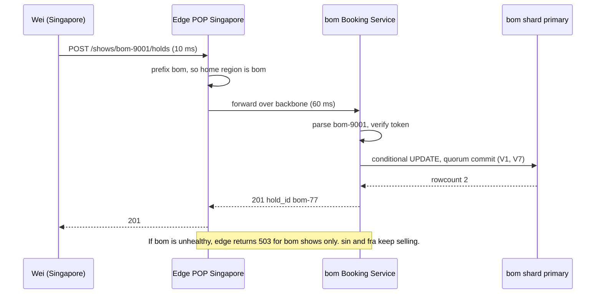

## Current State (after V9)

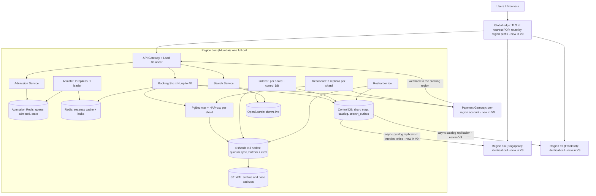

New in V9: the global edge with region-prefix routing, public region-prefixed IDs, the region guard, region cells for `sin` and `fra`, per-region gateway accounts, and catalog replication. The `sin` and `fra` cells contain exactly the same boxes as `bom`, with their own shards, Redis instances, control DBs, and OpenSearch.

**Every current flow:**

*Routing path (new)*
1. The client sends a request. The edge terminates TLS at the nearest POP.
2. The edge reads the region from the ID prefix, from the city, or from the user's home region.
3. It forwards over the backbone to that region's balancer. If the region is unhealthy, it returns 503 for that region's shows only.

*Waiting-room path (unchanged, runs in the show's home region)*
1. User joins `wr:{show}:queue` in the home region's Admission Redis and polls for status.
2. The Admitter moves users to the admitted set at a rate tied to available seats.
3. The next poll returns a signed token or `SOLD_OUT`.

*Search path (routing changed)*
1. User calls `GET /search/shows?q=...&city=...`.
2. The edge routes by `CITY_REGION`, and that region's Search Service queries its own OpenSearch.
3. It returns up to 20 shows. The client opens the seat map using the region-prefixed `show_id`.

*Indexing path (unchanged within each region)*
1. A show commits with a `search_outbox` row on its owning shard.
2. The region's Indexer publishes to its OpenSearch with external versions.
3. Catalog changes arrive through replication, and a trigger writes a local outbox row.

*Browse path (unchanged within the home region)*
1. User calls `GET /shows/{region-id}/seats`.
2. The home region reads `seatmap:{show_id}` from Redis, with stale-while-revalidate against its shard.
3. A foreign user gets the same response through the edge.

*Hold path (unchanged within the home region)*
1. User calls `POST /shows/{id}/holds` with `X-Admission-Token`.
2. The home region's Booking Service passes the region guard, verifies the token, routes by bucket, and runs the V1 conditional `UPDATE`.
3. It commits with a standby ack and returns `hold_id`, or 409, or 503 during failover.

*Confirm path (unchanged within the home region)*
1. User calls `POST /holds/{id}/confirm`.
2. The home region extends the lease, inserts `payments` as INITIATED, and charges the region's gateway account with the idempotency key.
3. `finalize` commits with a standby ack.

*Webhook path (per region)*
1. The gateway posts `charge.succeeded` to the URL of the region that created the charge.
2. That region routes by bucket and calls `finalize(hold_id)`.

*Reconcile path (unchanged within each region)*
1. Each shard's Reconciler claims stuck `INITIATED` rows with `SKIP LOCKED`.
2. It asks the gateway, then finalizes, fails, or retries refunds.

*My-bookings path (changed)*
1. User calls `GET /me/bookings` and the edge routes to the user's home region.
2. That region fans out to all regions in parallel, each with a 400 ms timeout.
3. Each region runs its own shard scatter, and the results merge by `created_at`. Slow regions are flagged as partial.

*Failover path (unchanged within each region)*
1. A shard primary's leader key expires, and the most caught-up standby promotes itself.
2. HAProxy and PgBouncer follow, as in V7.

*Region-outage path (new)*
1. The edge health check fails for one region.
2. Shows with that region's prefix, and cities mapped to it, return 503 `REGION_UNAVAILABLE`.
3. Other regions keep selling, and no other region takes writes for the failed region's shows.
4. On recovery, payments left `INITIATED` finalize through the webhook retry or the Reconciler (V2).

## Interviewer follow-ups

**"Why not CockroachDB or Spanner with geo-partitioning?"**
Geo-partitioned leaseholders are the home-region idea with more machinery. We'd pay the consensus engine's cost and complexity to get single-writer-per-show. Our shows already have a natural owner, the theatre's region, so plain Postgres plus routing gets the same guarantee. A distributed SQL system pays off when ownership isn't known up front. Here it is.

**"Wei pays for a Mumbai show, then Mumbai goes down. What happens to his money and his seat?"**
V2 covers it. His `payments` row is `INITIATED` in Mumbai, and the gateway retries the webhook. When Mumbai recovers, the webhook or the Reconciler runs `finalize`. Nobody else can buy that seat in the meantime, because only Mumbai can write it. The worst case is a delay, never a double sale or a lost payment.

## Recap

| Concept | The Insight |
|---|---|
| Physics sets the floor | Cross-region round trips cost 60 to 130 ms, and no tuning removes them. |
| Active-active can't sell seats | A seat has one owner, so two writers need conflict resolution, and a sold seat can't be merged. |
| Global consensus taxes everyone | It adds about 400 ms to each booking and drops a hot seat from 300 claims per second to about 7. |
| Home region per show | A single writer per show makes cross-region conflicts impossible, and V1 to V7 stay valid inside it. |
| Region-prefixed public IDs | The edge routes without a lookup, and a region guard turns a bad route into a harmless 421. |
| Cells limit blast radius | A region outage stops only its own shows, and the other regions keep selling. |

**Interview arc:** *"One Mumbai region owned every show on earth, so Singapore users paid 360 ms of network and one bad push stopped all booking worldwide, and active-active would sell one seat twice while a global consensus database would tax every booking and cap hot seats near 7 claims per second, so each show gets a single home region, the edge routes by a region-prefixed ID, and every cell keeps its own writes, which keeps local bookings fast and a region failure contained."*

## Next

The design is now interview-complete for the scoped requirements. Say "next" for the final wrap-up: the full architecture in one diagram, every end-to-end path, the "why not X" arsenal, the master recap table, and an offer to drill deeper or run a mock interview.


-----------------------------------------------------------------------------------------------------------------------
-----------------------------------------------------------------------------------------------------------------------
-----------------------------------------------------------------------------------------------------------------------
-----------------------------------------------------------------------------------------------------------------------


# Final Wrap-Up

The design is complete for the scoped requirements. Here it is in one place.

## 1. Full architecture

Each region is a cell with the same boxes. Mumbai is drawn in full, and `sin` and `fra` repeat it.

```mermaid
graph TD
    U["Users / Browsers"] --> EDGE["Global edge: TLS at nearest POP, route by region prefix"]
    EDGE --> SIN["Region sin: identical cell"]
    EDGE --> FRA["Region fra: identical cell"]
    EDGE --> GW

    subgraph BOM ["Region bom: one full cell"]
        GW["API Gateway: rate limits, JWT check, plus Load Balancer: least outstanding requests"]
        GW --> B["Booking Service x N, stateless, up to 40"]
        GW --> AS["Admission Service, stateless"]
        GW --> SS["Search Service, stateless"]

        AS --> AR[("Admission Redis: queue, admitted, state")]
        AD["Admitter: 2 replicas, 1 leader"] --> AR
        AD --> RC
        B --> RC[("Seat-map Redis: cache + rebuild locks")]

        B --> CTL[("Control DB: shard map, catalog, search_outbox")]
        B --> PB["PgBouncer per shard"]
        PB --> HA["HAProxy per shard: leader only"]
        HA --> SH[("4 shards x 3 nodes in 3 AZs: show_seats, holds, payments, bookings, search_outbox. Quorum sync, Patroni + etcd")]
        SH --> ARCH[("S3: WAL archive and base backups")]

        R["Reconciler: 2 replicas per shard, SKIP LOCKED"] --> PB
        RS["Resharder tool: bucket moves with write fence"] --> CTL
        RS --> SH

        IX["Indexer: per shard + control DB"] --> SH
        IX --> CTL
        IX --> OS[("OpenSearch: shows-live, 3 nodes")]
        SS --> OS
    end

    B --> G["Payment Gateway: per-region account"]
    R --> G
    G -- "webhook with show_id and hold_id, to creating region" --> GW
    CTL -- "async catalog replication: movies, cities" --> SIN
    CTL -- "async catalog replication" --> FRA
```

## 2. Every end-to-end path

### Routing (every request)

1. The client sends a request. The edge terminates TLS at the nearest POP.
2. The edge reads the region from the ID prefix (`bom-9001`), the city, or the user's home region.
3. It forwards over the backbone. If the home region is unhealthy, it returns 503 for that region's shows only.
4. The region guard in the Booking Service returns 421 for any ID the region doesn't own.

### Search

1. `GET /search/shows?q=dun&city=hyderabad` goes to the home region of that city.
2. The Search Service runs a bool query on `shows-live`. It never touches Postgres.
3. It returns 20 shows. The client then opens the seat map.

### Indexing

1. Admin tooling commits `shows`, `show_seats`, and a `search_outbox` row in one transaction on the owning shard.
2. The Indexer polls unpublished outbox rows with `SKIP LOCKED`.
3. It writes to OpenSearch with an external version, then sets `published_at`.
4. Catalog changes come through the control DB outbox and an `_update_by_query`.

### Browse

1. `GET /shows/{id}/seats` reads `seatmap:{show_id}` from seat-map Redis.
2. If it is soft-expired, one request rebuilds it from the show's shard primary. Everyone else gets the stale copy.
3. If it is missing, one request rebuilds synchronously.

### Waiting room

1. `POST /waitroom/{show}/join` adds the user to `wr:{show}:queue`. The score is random before opening and arrival time after.
2. The user polls `GET /waitroom/{show}/status` at an interval that grows with position.
3. The Admitter ticks every second and admits about 2x the available seats.
4. The poll returns a signed token, or `SOLD_OUT`.

### Hold

1. `POST /shows/{id}/holds` carries `X-Admission-Token`.
2. The Booking Service verifies the token locally and routes by `bucket(show_id)`.
3. The conditional `UPDATE` claims `AVAILABLE` or expired-`HELD` seats, and `holds` is inserted.
4. The commit waits for a standby ack. It returns `hold_id` and `expires_at`, or 409, or 503 during failover.

### Confirm, webhook, and reconcile

1. `POST /holds/{id}/confirm` returns the existing booking if there is one.
2. It extends the lease to 3 minutes and inserts `payments` as INITIATED.
3. It calls the gateway with the idempotency key, outside any transaction.
4. `finalize` runs from the sync response, the webhook, or the Reconciler. It flips seats to `SOLD`, inserts `bookings` (unique on `hold_id`), and marks the payment CAPTURED.
5. If the seat was lost, the payment goes REFUND_PENDING and the refund is retried.

```mermaid
sequenceDiagram
    participant U as User
    participant E as Edge
    participant A as Admission Service
    participant B as Booking Service
    participant P as Shard primary
    participant G as Payment Gateway
    participant R as Reconciler

    U->>A: join, then poll status
    A-->>U: admission token
    U->>E: POST /shows/bom-9001/holds + token
    E->>B: route by prefix
    B->>P: conditional UPDATE + INSERT holds, quorum commit
    B-->>U: hold_id, expires_at
    U->>B: POST /holds/bom-77/confirm
    B->>P: extend lease, INSERT payments INITIATED
    B->>G: charge with Idempotency-Key
    alt response arrives
        G-->>B: captured
        B->>P: finalize
        B-->>U: 201 booked
    else crash or timeout
        G-->>B: webhook, finalize is a no-op if done
        R->>P: INITIATED older than 90 s
        R->>G: GET charge by idempotency key
        R->>P: finalize or mark FAILED
    end
```

### My bookings

1. `GET /me/bookings` goes to the user's home region.
2. That region fans out to all regions in parallel, with a 400 ms timeout each.
3. Each region scatter-gathers its own 4 shards, and the results merge by `created_at`. Slow regions return `"partial": true`.

### Shard failover

1. The primary stops renewing its etcd leader key. It expires after 30 seconds.
2. The most caught-up standby promotes itself. Quorum sync guarantees it has every acknowledged commit.
3. HAProxy flips to it and PgBouncer reconnects. Writes resume in about 35 seconds.
4. The old primary rejoins as a standby through `pg_rewind`.

### Bucket move (resharding)

1. Logical replication copies one bucket to the target shard.
2. The Resharder fences the bucket on the source with a write-rejecting trigger.
3. It drains and verifies row counts and checksums, then flips `shard_map`.
4. A stale instance hits `BUCKET_FROZEN`, refreshes its map, and retries once.

### Region outage

1. The edge health check fails for one region.
2. That region's shows return 503. Other regions keep selling.
3. No other region writes those shows.
4. On recovery, INITIATED payments finalize through webhook retries or the Reconciler.

## 3. The "Why not X" arsenal

| Question | One-line defensible answer |
|---|---|
| Why not `SELECT ... FOR UPDATE` across the payment? | It holds a DB lock and a pooled connection for up to 20 seconds per user, so a blockbuster exhausts the pool. |
| Why not a Redis TTL lock for the hold? | It splits the truth across two stores, and an async failover loses the lock while Postgres never knew about the hold. |
| Why not a distributed transaction with the payment gateway? | The gateway can't join two-phase commit, so we use an idempotency key, a durable payment row, and an idempotent finalize. |
| Why not Kafka to serialize holds per show? | It still accepts all 50,000 requests and makes one consumer per show a failure point. A waiting room stops the doomed requests at the door. |
| Why not shard by `user_id` or `city_id`? | A booking claims seats, and seats belong to a show. `user_id` makes a seat claim a cross-shard transaction. `city_id` skews badly toward big cities. |
| Why not async replicas and read replicas? | Async acknowledges commits a standby hasn't seen, so a crash loses bookings. Reads were already cheap after V4, so standbys are for durability only. |
| Why not dual-write to the search index? | A crash between the two writes diverges them forever. The outbox commits the intent with the show. |
| Why not active-active across regions? | A seat can't be merged. Two writers sell F7 twice, and last-write-wins just means refunding someone who was charged. |

## 4. Master recap table

| Version | Concept | The Insight |
|---|---|---|
| V0 | Conditional `UPDATE` with rowcount | Check and write in one statement leaves no gap for a second user. |
| V0 | Pay-then-claim | It is safe for seats but unsafe for users, because the loser has paid. |
| V1 | Hold as a lease in the row | Expiry is a predicate evaluated at claim time, so no sweeper or second store is needed. |
| V1 | Database clock | One clock in Postgres gives one answer to "is this expired?" |
| V2 | Payment row before the gateway call | A crash always leaves a trail the Reconciler can follow. |
| V2 | Idempotency key plus idempotent `finalize` | Sync, webhook, and reconciler can race and still produce exactly one booking. |
| V2 | `UNIQUE(bookings.hold_id)` | Duplicate bookings are structurally impossible. |
| V3 | Stateless app tier | More servers help only if any server can serve any request. |
| V3 | Least outstanding requests, PgBouncer | A 5 ms read and a 20 s confirm aren't equal work, and 640 connections need multiplexing. |
| V4 | Display is not a claim | The cache can be stale because claims always hit Postgres. |
| V4 | Stale-while-revalidate | One request refreshes while everyone else gets a fast, slightly old answer. |
| V5 | Hot key as an expensive queue | Waiting inside Postgres costs connections, so wait in Redis instead. |
| V5 | Closed-loop admission with signed tokens | Admit about 2x free seats, and verify tokens locally on the hot path. |
| V6 | Shard key follows the transaction | A booking must stay on one shard, so the key is `show_id`. |
| V6 | 1,024 buckets plus shard map, fence before flip | Resizing moves bounded buckets, and a write fence makes a stale map safe. |
| V7 | Replicas for durability, not reads | Reads were cheap, so standbys protect acknowledged writes. |
| V7 | Quorum sync plus lease failover | Every acked commit lives on two machines, and recovery takes about 35 seconds. |
| V8 | Inverted index in a separate store | Search keys on movie, city, and time, which the shards weren't partitioned by. |
| V8 | Transactional outbox | The "tell the index" intent commits with the show, so a crash can't lose it. |
| V9 | Home region per show | A single writer per show makes cross-region conflicts impossible. |
| V9 | Region-prefixed IDs, regional cells | The edge routes without a lookup, and an outage stays contained. |

**Whole-design interview arc:** *"A naive booking charges before claiming and checks before writing, so we claim with a conditional UPDATE inside a lease in the seat row, make payment safe with an idempotency-keyed payment row and one idempotent finalize, then scale it by going stateless, caching display reads, admitting a hot show's crowd through a waiting room, sharding by show_id into logical buckets, replicating with quorum sync, indexing search through an outbox, and giving each show one home region so a seat only ever has one writer."*

## What next?

1. **Drill deeper** into one piece. Good candidates are the V2 payment boundary, the V6 bucket move, or the V5 admission loop.
2. **Mock interview.** I play the interviewer, give you a 45-minute prompt, and pressure-test your design with follow-ups. You answer, and I push back.

Which one do you want?


-----------------------------------------------------------------------------------------------------------------------
-----------------------------------------------------------------------------------------------------------------------
-----------------------------------------------------------------------------------------------------------------------
-----------------------------------------------------------------------------------------------------------------------


# Why V0 Uses a Conditional `UPDATE` Instead of Pessimistic Locking

## First, a precise name for what V0 does

V0 never says "optimistic locking," so let's pin it down. V0 uses a **compare-and-set (CAS)** write:

```sql
UPDATE show_seats
SET status = 'SOLD', booking_id = :booking_id
WHERE show_id = 9001 AND seat_id = ANY(...) AND status = 'AVAILABLE';
-- check rowcount
```

This is optimistic in spirit. We don't lock anything while the user thinks. We assume the seat is probably still free, try to claim it, and check whether we were right.

It is not lock-free, though. Postgres takes a row lock inside that one statement, for microseconds. The real distinction is **where the lock lives**:

| | Pessimistic | Our CAS |
|---|---|---|
| Lock held across | Multiple app round trips (read, think, write) | One statement |
| Lock duration | Milliseconds to minutes | Microseconds |
| Who detects a conflict | Nobody, the lock prevents it | The `rowcount` check, after the fact |

## The options we could have chosen

**Option 1: pessimistic, `SELECT ... FOR UPDATE`, then `UPDATE`.**

```sql
BEGIN;
SELECT status FROM show_seats WHERE show_id=9001 AND seat_id IN ('F7','F8') FOR UPDATE;
-- app checks both are AVAILABLE
UPDATE show_seats SET status='SOLD' ...;
COMMIT;
```

Correct, but it costs us:
- Two network round trips instead of one, and the lock is held across the gap between them.
- If the app server stalls or GC-pauses between the two statements, the lock stays held.
- Multi-seat deadlocks. User A locks F7 then F8, user B locks F8 then F7, and Postgres kills one of them. You must sort seat IDs in every code path to avoid this.

**Option 2: optimistic with a version column.**

```sql
UPDATE show_seats SET status='SOLD', version=version+1
WHERE show_id=9001 AND seat_id='F7' AND version=:version_i_read;
```

This is the textbook form. It needs a prior read and a version column. We don't need either, because the **status is the version**. In V0 a seat only moves `AVAILABLE` to `SOLD`, so "status is still AVAILABLE" proves nothing changed. A separate counter adds nothing.

**Option 3: `SERIALIZABLE` isolation.** Postgres detects conflicting transactions and aborts one with error 40001. It would work, but it tracks read/write dependencies across all transactions, which costs memory and CPU. It also forces retry loops everywhere. Our conflict is one predicate on one row, so we can state it directly in the `WHERE` clause.

**Option 4: insert-based claim.** A `booked_seats` table with `PRIMARY KEY (show_id, seat_id)`, where a claim is an `INSERT` that fails on duplicate. This is also correct and arguably the cleanest for a permanent sale. We rejected it because V1 needs seats to move through states (available, held, expired, available again). Updating one row through a state machine fits that better than inserting and deleting rows.

**Option 5: an application-level or Redis lock.** Rejected in V0. Lock state must live where the data lives, otherwise two stores can disagree.

## Why CAS fits this problem

**1. The loser's work is cheap, and the loser doesn't retry.**

Optimistic concurrency hurts when conflicts force expensive retries. Here, if Rahul loses F7, the right answer is "sorry, it's gone." No retry helps. His wasted work is one statement that touched 0 rows. The usual weakness of optimism simply doesn't apply.

**2. Conflicts per row are rare in V0's world.**

Across the platform there are about 20 million new seat rows a day. A given seat is contended by a handful of people, not thousands. Paying for a lock held across user think-time to prevent a rare collision is a bad trade.

**3. The lock must never span something slow.**

A pessimistic design is dangerous if the lock is taken before a slow step. A seat selected, then four minutes of card fumbling, then a lock held for four minutes, means a connection and a row lock tied up per abandoning user. With the CAS, no database resource is held during user time.

**4. It's correct under Postgres's default isolation.**

At `READ COMMITTED`, if our `UPDATE` finds the row locked by another transaction, it waits. When the other commits, Postgres **re-evaluates our `WHERE` clause against the new row version**. It sees `status = 'SOLD'`, the predicate fails, and we update 0 rows. The database does the serialization, and no special isolation level is needed.

**5. One statement means one round trip.**

At our scale that matters. Each avoided round trip is about 1 ms saved and one fewer place for a crash to land between steps.

## Where this decision gets weaker

Being honest about the limits:

- **Hot rows.** If 5,000 people hit F7 at once, optimism isn't free. All 5,000 statements still queue on one row lock, each waking to find 0 rows. That is exactly the V5 break. The cure was admission control, not switching to pessimistic locking, which would queue the same way.
- **Multi-seat deadlocks still exist in theory.** `seat_id = ANY(...)` in one statement locks rows in scan order. Two overlapping statements could lock in different orders. With a primary-key index scan the order is consistent in practice, but it isn't guaranteed. The robust version sorts `seat_ids` before the call and retries once on a deadlock error (`40P01`). V0's text glossed over this, and it's worth saying in an interview.
- **The business-level "reservation" is not CAS.** This is the subtle part.

## The deeper point: V1 adds a pessimistic lock back, at the business level

V0 only protects the instant of the claim. It doesn't protect the user's four minutes of payment, and that gap broke V0 for users.

V1's hold is a pessimistic lock in meaning: "this seat is mine for 10 minutes, nobody else may take it." But we implement it with the same optimistic CAS, and we store the lock as data, in `status`, `hold_id`, and `held_until`.

Compare the two ways to get "reserve while paying":

| | DB row lock held during payment | Lease stored in the row |
|---|---|---|
| Holds a DB connection | Yes, for minutes | No |
| Survives server crash | Lock released, no record of intent | Yes, it's data |
| Expires on its own | Only if the connection dies | Yes, `held_until` |
| Scales to 50K users | No, exhausts the pool | Yes |

So the pattern is: **use CAS for the atomic moment, and a persisted lease for the human-length wait.** Pessimistic locking at the database level is the wrong tool for anything that waits on a person.

## When pessimistic would have been right

If the problem were different, I'd choose differently:

- **High contention on the same row with expensive, non-retryable work**, such as a bank transfer that must read-modify-write a balance with business logic between read and write.
- **Work done between read and write that can't be expressed in a `WHERE` clause**, where `FOR UPDATE` is the straightforward tool.

Our decision is a single predicate, "is it still available," which fits in one statement.

## Interview-ready answer

> "I used a conditional UPDATE with a rowcount check, which is compare-and-set. The conflict condition is a single predicate on one row, so the database can check and write atomically in one statement. That holds its lock for microseconds instead of across round trips, avoids deadlocks from two-step locking, and works under the default isolation level because Postgres re-evaluates the WHERE clause after waiting. Optimism's usual downside, wasted retries, doesn't apply, because a loser just gets a 409. For the long wait while someone pays, I don't use a database lock at all. I store a lease in the row, which is a pessimistic reservation implemented with the same CAS."

Want me to drill into the deadlock case next, with the exact ordering fix and retry code, or move to the mock interview?


-----------------------------------------------------------------------------------------------------------------------
-----------------------------------------------------------------------------------------------------------------------
-----------------------------------------------------------------------------------------------------------------------
-----------------------------------------------------------------------------------------------------------------------


