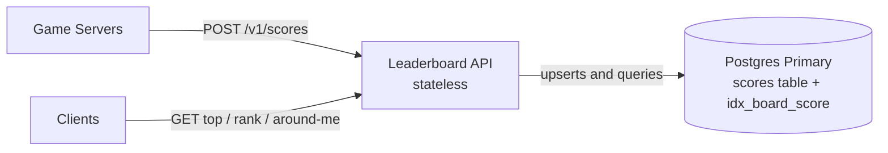
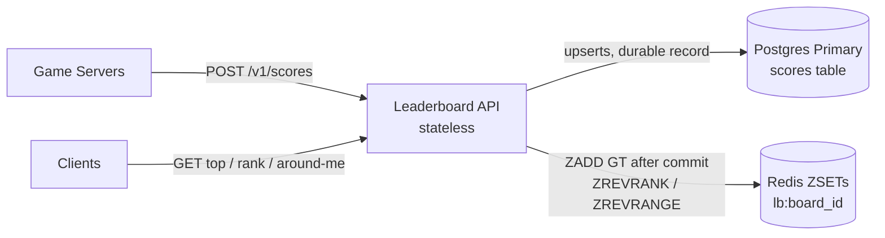
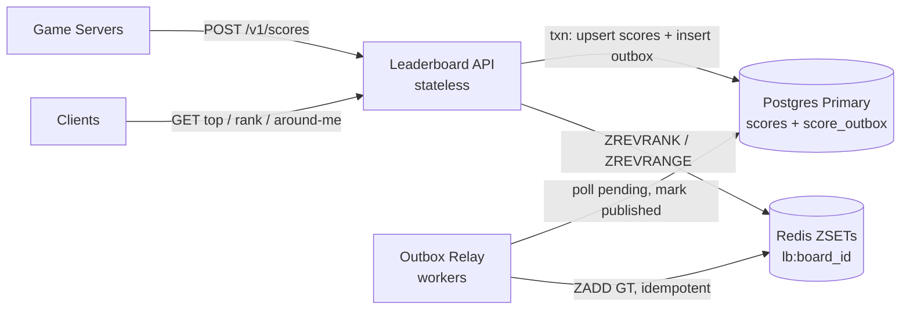

# Real-Time Leaderboard System

## 1. Opening Hook

In 1978, Space Invaders arcade cabinets started showing a high score on screen. Players fed coins in just to see their initials on top. That one number turned a game into a competition.

Today the same idea runs at a different scale. Millions of players finish matches every minute. Each one wants to know "what's my rank right now?" The hard part isn't storing scores. It's answering rank queries fast while the scores keep changing.

## 2. Clarifying Questions

Here are the questions I'd ask the interviewer. Each one changes the architecture.

| # | Question | Pushes the design toward |
|---|----------|--------------------------|
| 1 | Is it one global leaderboard, or many (per game, per region, per friend group)? | One board: a single sorted structure may fit. Many boards: partition by board ID and the problem gets easier. |
| 2 | How many players are on a single board? 10K, 1M, 100M? | Small: any sorted set works. Huge: exact rank becomes expensive and we may need approximation. |
| 3 | Do users need their **exact rank** ("you are #48,213"), or only the top N? | Top N only: a bounded heap or sorted set. Exact rank for everyone: needs order-statistics, which is much harder at scale. |
| 4 | How fresh must it be? Instant, within 1 second, or within a minute? | Instant: synchronous writes to the ranking store. Relaxed: batching and async pipelines become possible. |
| 5 | Are scores only increasing, or can they go up and down? | Monotonic: simpler updates, safe to use "max wins". Bidirectional: needs careful ordering and conflict handling. |
| 6 | Is the leaderboard time-windowed (daily, weekly, all-time) or permanent? | Windowed: we need rollover and expiry, and one score event feeds several boards. |
| 7 | What is the write rate during peak? Is it bursty (tournament end)? | Steady: simple. Bursty: needs a buffer in front of the ranking store. |
| 8 | Who reads the board, and how? Polling, or live push to every viewer? | Polling: cache-friendly. Push: needs a fan-out layer (WebSocket/SSE). |
| 9 | Do we need a "players around me" view (rank ± 5), or just the top 100? | Around-me needs rank lookup plus range reads. Top 100 can be served from one cached list. |
| 10 | Is cheating or score validation in scope? | Yes: scores must come from trusted game servers, not clients. No: we trust the input. |

## 3. Scope (assuming reasonable defaults)

I'll assume these defaults so we can keep moving. Tell me if any should change.

- **Many boards**, one per game mode and time window (daily, weekly, all-time).
- **Up to ~50M players** on the largest board.
- Scores are **mostly increasing**, with a best-score-wins rule per player.
- **Freshness of 1-2 seconds** is acceptable. Not instant.
- Scores come from **trusted game servers** only.

**P0 (drives the interesting decisions)**
1. Submit a score and see it reflected on the board in about 1-2 seconds.
2. Read the top N (say top 100) with low latency.
3. Read any player's **exact rank** and score, plus the players around them.

**P1**
4. Time-windowed boards (daily, weekly, all-time) with clean rollover.

**P2, which I'm cutting**
- Friends-only leaderboards. These are a fan-out and graph problem, a different system.
- Anti-cheat and score validation. It's a real concern, but it lives upstream of the leaderboard.
- Live push of rank changes to every viewer. We'll poll first. It can come back as a late version if you want it.
- Historical replay ("what was the board last Tuesday?").

**The crux: exact rank for any player on a 50M-player board, under constant writes.**

Top 100 is easy. Everyone can cache it. The real distributed-systems discussion is "what is my rank?" for a random player, while millions of scores are changing around them. That's where the naive attempts break, and where most of our time will go.

## Waiting on you

Two options:

1. **Confirm the defaults above** and I'll start V0.
2. **Change any of them.** The ones that move the design most are #2 (board size), #3 (exact rank vs. top N) and #4 (freshness).

Say "go" or send your changes.


-----------------------------------------------------------------------------------------------------------------------
-----------------------------------------------------------------------------------------------------------------------
-----------------------------------------------------------------------------------------------------------------------
-----------------------------------------------------------------------------------------------------------------------


# V0: The Dumbest Thing That Works

## The idea

One Postgres table holds every player's best score. Rank is computed by counting.

Think of a school notice board with one sheet of marks. Priya wants her rank. The teacher counts how many students scored higher and adds one. It's slow if the school is huge. It is never wrong.

That "never wrong" part is the guarantee V0 has. Later versions will trade it away on purpose.

- **Strong consistency.** A write is visible to the very next read.
- **Exact rank.** No approximation, no lag.
- **One place to look.** No cache or replica can disagree with it.

## Storage choice

We use a relational database, Postgres. The access pattern is "upsert by (board, player)" plus "range scan by score." A composite B-tree index handles both.

## Schema (first time, full)

```sql
CREATE TABLE scores (
  board_id   TEXT        NOT NULL,   -- e.g. 'ranked:daily:2026-10-22'
  player_id  BIGINT      NOT NULL,
  score      BIGINT      NOT NULL,
  updated_at TIMESTAMPTZ NOT NULL DEFAULT now(),
  PRIMARY KEY (board_id, player_id)
);

CREATE INDEX idx_board_score ON scores (board_id, score DESC);
```

**Time windows come free from the key.** The board ID carries the window. Daily is `ranked:daily:2026-10-22`. Weekly is `ranked:weekly:2026-W43`. All-time is `ranked:alltime`.

At midnight, new scores land under a new `board_id`. The new board starts empty, so there is no rollover job. Old boards are just old rows.

**Ties.** Players with equal scores share a rank. Rank is 1 plus the number of players with a strictly higher score. We'll revisit tie-breaking if it matters later.

## Who writes, who reads

| Structure | Who writes | Who reads | Lives where |
|---|---|---|---|
| `scores` table | Leaderboard API (write path) | Leaderboard API (top-N, rank, around-me) | Single Postgres primary |

## Implement it

### Write path: submit a score

A game server finishes a match and calls the API.

```http
POST /v1/scores
{
  "player_id": 98231,
  "match_id": "m_7f3a",
  "score": 48200,
  "boards": ["ranked:daily:2026-10-22", "ranked:weekly:2026-W43", "ranked:alltime"]
}
```

1. **Leaderboard API** authenticates the caller as a trusted game server.
2. It opens one Postgres transaction.
3. For each board in the request, it runs a best-score-wins upsert:

```sql
INSERT INTO scores (board_id, player_id, score)
VALUES ($1, $2, $3)
ON CONFLICT (board_id, player_id)
DO UPDATE SET score = EXCLUDED.score, updated_at = now()
WHERE EXCLUDED.score > scores.score;
```

4. It commits. All three boards update together or not at all.
5. It returns `204`.

The `WHERE EXCLUDED.score > scores.score` clause is what makes it "best wins." A worse score is a no-op.

### Read path 1: top N

```http
GET /v1/boards/ranked:daily:2026-10-22/top?n=100
```

```sql
SELECT player_id, score
FROM scores
WHERE board_id = $1
ORDER BY score DESC
LIMIT 100;
```

The index `(board_id, score DESC)` makes this a short index walk. It touches about 100 entries.

### Read path 2: one player's exact rank

```http
GET /v1/boards/ranked:daily:2026-10-22/players/98231
```

1. **Leaderboard API** fetches the player's score:

```sql
SELECT score FROM scores WHERE board_id = $1 AND player_id = $2;
```

2. It counts everyone strictly above that score:

```sql
SELECT COUNT(*) + 1 AS rank
FROM scores
WHERE board_id = $1 AND score > $2;
```

3. It returns `{ "player_id": 98231, "score": 48200, "rank": 48213 }`.

### Read path 3: players around me

Branch points are explicit here. We run two range reads and stitch them together.

```sql
-- the 5 just above (higher scores)
SELECT player_id, score FROM scores
WHERE board_id = $1 AND score > $2
ORDER BY score ASC LIMIT 5;

-- the 5 just below
SELECT player_id, score FROM scores
WHERE board_id = $1 AND score < $2
ORDER BY score DESC LIMIT 5;
```

Both are short index walks from the player's score outward.

### Sequence: write and rank read

```mermaid
sequenceDiagram
    participant GS as Game Server
    participant API as Leaderboard API
    participant PG as Postgres Primary
    participant C as Client

    GS->>API: POST /v1/scores
    API->>PG: BEGIN; 3x upsert (daily, weekly, alltime); COMMIT
    PG-->>API: ok
    API-->>GS: 204

    C->>API: GET /v1/boards/{id}/players/98231
    API->>PG: SELECT score WHERE player_id
    PG-->>API: 48200
    API->>PG: SELECT COUNT(*)+1 WHERE score > 48200
    PG-->>API: 48213
    API-->>C: rank 48213
```

## Solve it: gained, given up, rejected

- ✅ **Gained:** Exact rank, instant freshness, atomic multi-board writes. Almost nothing can go wrong with correctness.
- ⚠️ **Given up:** Rank cost grows with the number of players *above* you. The `COUNT` walks that whole index range. Every write also lands on one primary.
- ❌ **Rejected:** Storing a precomputed `rank` column. Every new score would shift the rank of everyone below it. One write would become millions of updates.

## Current State (V0)



Everything here is new in V0, since it's the first version.

**Every end-to-end flow right now**

1. **Write path:** Game server calls `POST /v1/scores`. The API opens a transaction and upserts one row per board (daily, weekly, all-time) in Postgres. It commits and returns 204.
2. **Top-N path:** Client calls `GET .../top?n=100`. The API runs `ORDER BY score DESC LIMIT 100` on Postgres. It returns the list.
3. **Exact-rank path:** Client calls `GET .../players/{id}`. The API reads the player's score, then runs `COUNT(*) + 1` over higher scores in Postgres. It returns score and rank.
4. **Around-me path:** Same entry as the rank path. After finding the score, the API runs two 5-row range reads (above and below) in Postgres. It merges and returns them.
5. **Window rollover:** No flow exists. A new window means a new `board_id`, so it starts empty on its own.

## Interview follow-ups

**Q: Why not just add a `rank` column and keep it updated?**
Because rank is relative. One player improving shifts everyone between their old and new position by one. That turns a single score write into a write to potentially millions of rows. Rank must be derived at read time, or kept in a structure built to answer it.

**Q: Why is this fine to start with?**
At small scale it's correct, simple and fast enough. If a board has 100K players, the count runs in milliseconds. Starting here shows you know where it breaks and why, instead of reaching for Redis by reflex.

## Recap

| Concept | The Insight |
|---|---|
| Best-score upsert | `ON CONFLICT ... WHERE EXCLUDED.score > scores.score` makes "keep the best" one atomic statement. |
| Window in the key | Putting the time window into `board_id` removes rollover jobs entirely. |
| Rank is derived | Never store rank. One score change would shift millions of others. |
| Count-based rank | `COUNT(score > mine) + 1` is always exact, but its cost grows with how many players are above you. |
| V0's guarantee | Strong consistency and exact rank. Later versions will trade some of this away. |

**Interview arc:** *"Start with one indexed table and rank by counting higher scores. It's exact and trivially correct, but the cost of a rank lookup grows with the number of players above you."*

## Next

Meet Arjun, a mid-table player on a 50M-player board. He taps "my rank" and the `COUNT` has to walk about 20M index entries, while thousands of other players do the same. That is the first naive attempt on the crux. Say **"next"** for V1.


-----------------------------------------------------------------------------------------------------------------------
-----------------------------------------------------------------------------------------------------------------------
-----------------------------------------------------------------------------------------------------------------------
-----------------------------------------------------------------------------------------------------------------------


# V1: A Rank Index That Doesn't Count

**The one concern this version fixes:** exact rank is too slow on a big board. Making the Redis update reliable is the next problem, and I'll flag it at the end.

## Break it

Arjun is a mid-table player on the 50M-player all-time board. His rank is about 20,000,000.

He taps "my rank". Postgres runs `SELECT COUNT(*) + 1 ... WHERE score > 48200`. The index lets it skip the table, but it still walks about 20M index entries. That takes roughly a second of CPU.

Now it's 8pm. A tournament just ended and about 3,000 players tap "my rank" in the same second. That's about 3,000 seconds of CPU work per wall-clock second, on one primary that is also taking every score write. It falls over.

The top-100 query is fine. Only rank is broken.

## The naive attempts

This is the crux, so we walk it properly.

### Attempt 1: Cache each player's rank with a TTL

*Why it looked reasonable:* Rank for Arjun doesn't need to be perfect. Compute it once, cache it for 30 seconds.

*How it breaks:* There are 50M players, so there are 50M possible cache keys. Most are cold at any moment, and every cold read still runs the 1-second `COUNT`. A tournament ending warms none of them in advance.

Also, rank moves constantly at the busiest moment. Arjun's cached "20,000,000" can be wrong by thousands within seconds.

The `COUNT` is still the real cost, and the cache only hides it.

### Attempt 2: Recompute all ranks on a schedule

*Why it looked reasonable:* Do the expensive work once for everyone, not once per request.

```sql
CREATE MATERIALIZED VIEW ranks AS
SELECT player_id, RANK() OVER (ORDER BY score DESC) AS rank
FROM scores WHERE board_id = 'ranked:alltime';
```

*How it breaks:* Ranking 50M rows is a full sort. It takes minutes, not seconds. Refresh every 5 minutes and the board is always at least 5 minutes stale, which already violates our 1-2 second freshness target. The refresh also loads the same primary that handles writes.

### Attempt 3: Dialogue

> **Meera:** What if the app keeps a sorted list in memory and does a binary search?
>
> **Kabir:** Binary search finds the position in O(log N). But inserting into a sorted array shifts millions of elements. And two app servers would each hold a different copy.

An in-memory sorted array gives fast rank but slow writes. The Postgres B-tree gives fast writes but slow rank. We need a structure that does both in O(log N).

### The real fix: a tree or list that stores subtree sizes

Think of a library. To find a book's position without counting every book, you read the shelf labels. "Aisle 1: 4,000 books. Aisle 2: 6,000 books." You add up whole aisles you skip, then count only inside the final shelf.

A **skip list with spans** works this way. Each forward pointer remembers how many elements it jumps over. To find Arjun, the search walks down the levels. At each step it adds the span of every pointer it follows. The sum of those spans is his rank.

The walk is O(log N). For 50M entries that's about 26 hops, not 20M.

Redis implements this as its **sorted set** (ZSET). It has two properties we need:

- `ZADD` is O(log N), so writes stay fast.
- `ZREVRANK` is O(log N), so rank is fast.

### Comparing the options

| Option | Rank cost | Write cost | Freshness | Verdict |
|---|---|---|---|---|
| Postgres `COUNT` (V0) | O(N) | Cheap | Instant | Breaks at scale |
| Per-player rank cache | O(N) on miss | Cheap | Stale | Hides the cost |
| Scheduled recompute | O(1) lookup | Minutes of rebuild | Minutes stale | Fails freshness |
| Redis ZSET (skip list + spans) | O(log N) | O(log N) | Instant | **Chosen** |

## Solve it

We add a Redis sorted set per board. Postgres stays as the durable source of truth. Redis is the **ranking index**, a structure built to answer rank queries.

**New storage class, justified:** An in-memory sorted-set store fits the access pattern "update one score, ask for rank or a range." A B-tree stores sorted data but not subtree counts, so it can't give rank without scanning. A skip list with spans stores exactly that count.

- ✅ **What we gained:** Rank, top-N and around-me all become O(log N). Rank latency drops from about 1 second to well under a millisecond of Redis time. The primary stops carrying rank reads.
- ⚠️ **What we gave up:**
  - **Two stores now.** A score must reach both Postgres and Redis. If one write succeeds and the other fails, they disagree. We'll fix that in V2.
  - **Memory cost.** About 5GB for 50M members. That fits one node, but it isn't free.
  - **Ties change.** Redis breaks equal scores by member order, so tied players now get distinct ranks. V0 gave them a shared rank. This is fine for most games. If it matters, we can encode a timestamp into the score later.
- ❌ **What we considered and rejected:**
  - **Replacing Postgres with Redis entirely.** Redis alone is memory-resident, and we want a durable record of every score.
  - **A custom order-statistic tree in the app tier.** It would reimplement Redis's skip list and leave each app server with its own copy.

## Implement it

### Redis key and shape (first time, full)

```text
Key:    lb:{board_id}                e.g.  lb:ranked:alltime
Type:   ZSET
Member: player_id (string)           e.g.  "98231"
Score:  game score (double)          e.g.  48200
Lives:  single Redis node, in memory (replication comes in a later version)
```

| Structure | Who writes | Who reads | Lives where |
|---|---|---|---|
| `scores` table | Leaderboard API (write path), unchanged | Leaderboard API (rebuilds, audits) | Postgres primary |
| `lb:{board_id}` ZSET | Leaderboard API (write path), right after the Postgres commit | Leaderboard API (top-N, rank, around-me) | Redis node |

### Write path (delta only)

The `POST /v1/scores` request is unchanged. After the Postgres transaction commits, the API updates Redis.

```python
pipe = redis.pipeline()
for board_id in req.boards:
    pipe.zadd(f"lb:{board_id}", {str(req.player_id): req.score}, gt=True)
pipe.execute()
```

`GT` means "only update if the new score is greater." It mirrors the `WHERE EXCLUDED.score > scores.score` guard in Postgres, so both stores keep best-score-wins.

The three `ZADD` commands go in one pipeline so we pay one network round trip.

### Read path 1: top N

```text
ZREVRANGE lb:ranked:alltime 0 99 WITHSCORES
```

### Read path 2: exact rank

```text
ZREVRANK lb:ranked:alltime 98231 WITHSCORES
→ [20000412, 48200]        (0-based; API returns rank = 20000413)
```

The API adds 1 because Redis ranks are 0-based. No Postgres query is involved.

### Read path 3: around me

The player's rank is `r` (0-based). One range call returns the neighbours.

```text
ZREVRANGE lb:ranked:alltime {r-5} {r+5} WITHSCORES
```

Clamp `r-5` to 0 at the top of the board. This is one `ZREVRANK` plus one `ZREVRANGE`, both O(log N + 11).

### Sequence

```mermaid
sequenceDiagram
    participant GS as Game Server
    participant API as Leaderboard API
    participant PG as Postgres Primary
    participant R as Redis (ZSETs)
    participant C as Client

    GS->>API: POST /v1/scores
    API->>PG: BEGIN; 3x upsert; COMMIT
    PG-->>API: ok
    API->>R: pipeline: 3x ZADD GT
    R-->>API: ok
    API-->>GS: 204

    C->>API: GET /v1/boards/{id}/players/98231
    API->>R: ZREVRANK lb:{id} 98231 WITHSCORES
    R-->>API: [20000412, 48200]
    API->>R: ZREVRANGE lb:{id} r-5 r+5 WITHSCORES
    R-->>API: 11 neighbours
    API-->>C: rank 20000413 + neighbours
```

## Current State (V1)



New in V1: the Redis node, and every arrow into it.

**Every end-to-end flow right now**

1. **Write path:** Game server calls `POST /v1/scores`. The API upserts one row per board in Postgres inside one transaction and commits. It then pipelines one `ZADD GT` per board into Redis. It returns 204. *(Changed in V1: the Redis step is new.)*
2. **Top-N path:** Client calls `GET .../top?n=100`. The API runs `ZREVRANGE 0 99 WITHSCORES` on Redis and returns the list. *(Changed: no longer touches Postgres.)*
3. **Exact-rank path:** Client calls `GET .../players/{id}`. The API runs `ZREVRANK ... WITHSCORES` on Redis and returns rank and score. *(Changed: O(log N) instead of `COUNT`.)*
4. **Around-me path:** Same entry as the rank path. The API follows with one `ZREVRANGE r-5 r+5` on Redis and returns the neighbours. *(Changed: one range call instead of two SQL queries.)*
5. **Window rollover:** Unchanged. A new window is a new `board_id`, so it gets a new ZSET key on first `ZADD`.

## Interview follow-ups

**Q: Why not use Postgres with a better index?**
No B-tree index stores subtree counts, so rank always needs a scan. You'd need an order-statistic structure, and Redis ZSET already is one. Postgres stays the durable record.

**Q: What happens if Redis loses its data?**
Rebuild each ZSET from the `scores` table. That's a bulk load of 50M rows, so it takes minutes. During that window the board is unavailable or wrong. Redis is a derived index, not the source of truth. Making that recovery fast is a later version.

## Recap

| Concept | The Insight |
|---|---|
| Why counting fails | Rank cost in a B-tree grows with how many players are above you. |
| Skip list with spans | Each pointer stores how many items it jumps, so rank is a sum of spans along the search path. |
| ZSET commands | `ZADD GT`, `ZREVRANK`, `ZREVRANGE` give write, rank and around-me, all in O(log N). |
| Derived index | Postgres stays the source of truth. Redis holds only what's needed to answer rank. |
| New cost | Two stores means one write can reach only one of them. |

**Interview arc:** *"Counting rank in a B-tree is O(N) and a scheduled recompute is minutes stale, so I keep a Redis sorted set, a skip list whose pointers store span counts, which makes rank, top-N and around-me all O(log N) while Postgres remains the durable record."*

## Next

Last night, Arjun posted 51,000. Postgres committed. Then Redis timed out on the `ZADD`, and the API returned an error to the game server. Postgres says 51,000. The leaderboard still says 48,200. Nobody knows. Say **"next"** for V2: making the two stores agree.


-----------------------------------------------------------------------------------------------------------------------
-----------------------------------------------------------------------------------------------------------------------
-----------------------------------------------------------------------------------------------------------------------
-----------------------------------------------------------------------------------------------------------------------


# V2: Making Postgres and Redis Agree

**The one concern this version fixes:** a score can reach Postgres but not Redis. Redis losing its data or going down is a separate problem, and I'll flag it at the end.

## Break it

Last night Arjun posted 51,000. This is what happened.

1. The API committed the Postgres transaction. `scores` now says 51,000.
2. The API sent `ZADD` to Redis. The call timed out.
3. The API returned a 500 to the game server.
4. Redis still says 48,200. Postgres says 51,000.

Nobody retries. The leaderboard stays wrong until Arjun beats 51,000 again.

How often does this happen? Say about 2,000 score writes per second on average. Even if only 0.01% of Redis calls fail, that's one divergence every 5 seconds. That's about 17,000 players per day with a wrong rank.

The root problem is that two stores can't be updated in one transaction. A crash between the two writes always leaves them different.

## The naive attempts

### Attempt 1: Retry the Redis call inline

*Why it looked reasonable:* Redis timed out, so try again. Three retries with backoff cover most blips.

*How it breaks:* The retry state lives in the API process's memory. If that process crashes or is redeployed after the commit and before the `ZADD`, nothing remembers the work is owed. Postgres has the score and no one knows Redis doesn't.

> **Meera:** Just wrap it in a retry loop.
>
> **Kabir:** And when the pod gets killed mid-loop?
>
> **Meera:** ...The commit is already done. Nothing remembers we owe Redis a write.

### Attempt 2: Write Redis first, then Postgres

*Why it looked reasonable:* If Redis is the one that fails more often, do it first. Then a Postgres failure aborts the request.

*How it breaks:* Now the failure is reversed. Redis shows 51,000, Postgres fails, and the game server gets an error and retries or gives up. Redis holds a score that is not durable. Rolling it back means a `ZADD` without `GT`, which races with other writes to the same player.

### Attempt 3: Two-phase commit across both stores

*Why it looked reasonable:* It's the textbook answer for atomic writes across two systems.

*How it breaks:* Redis is not an XA participant. Even for stores that are, 2PC blocks if the coordinator dies mid-protocol. We'd be adding a blocking protocol to the hottest path in the system.

### Options compared

| Option | Survives API crash? | Blocks the write path? | Extra infrastructure | Verdict |
|---|---|---|---|---|
| Inline retry | No | Yes (retries add latency) | None | Loses writes |
| Redis first, then Postgres | Leaves phantom scores | Yes | None | Wrong direction |
| Two-phase commit | Yes, but can block | Yes | Coordinator | Not supported by Redis |
| Outbox + relay | Yes | No | One small worker | **Chosen** |
| Kafka via CDC (Debezium) | Yes | No | Kafka, connectors | Valid, heavier than needed now |

## The real fix: the transactional outbox

Think of a restaurant's order slip. The waiter writes the order and drops the slip on the kitchen spike in one motion. If the waiter faints, the slip is still there. The kitchen works through the spike on its own schedule.

Here the Postgres transaction writes two things together:

1. The score row.
2. A **note** that says "Redis still needs this."

Both commit or neither does. A separate **relay worker** reads unsent notes and applies them to Redis. It marks a note done only after Redis confirms.

The commit is now the only point where the write becomes real. Anything after it can crash and be retried safely.

### Why a retry is safe: the update is idempotent

`ZADD GT` means "set the score only if it's higher." That is a **max** operation.

- **Idempotent:** applying the same note twice changes nothing.
- **Order-independent:** applying 51,000 then 48,200 gives the same result as the reverse, which is 51,000.

So the relay can deliver at-least-once, in any order, with duplicates, and Redis still ends up right. This is why we don't need Kafka's ordering guarantees yet.

## Solve it

- ✅ **What we gained:**
  - No lost Redis updates. The note survives any crash after the commit.
  - The write path no longer waits on Redis. A Redis outage doesn't fail score submissions.
  - Retries, backoff and monitoring all live in one worker.
- ⚠️ **What we gave up:**
  - **Redis lags Postgres slightly.** A player who posts a score and instantly reads their rank may see the old rank for about 100-200ms. This sits inside our 1-2 second freshness target.
  - **One new component** (the relay) and one new table that needs cleanup.
  - **Redis outage means the outbox backs up.** Notes pile up in Postgres until Redis returns. That is a feature, but we must monitor the backlog.
- ❌ **What we considered and rejected:** Inline retry, reverse ordering and 2PC, as in the table above. We also deferred Kafka with CDC. It adds a broker and connectors to run, and it only pays off when other consumers (analytics, notifications) need the score stream.

## Implement it

### Outbox schema (first time, full)

```sql
CREATE TABLE score_outbox (
  id           BIGSERIAL   PRIMARY KEY,
  board_id     TEXT        NOT NULL,
  player_id    BIGINT      NOT NULL,
  score        BIGINT      NOT NULL,
  created_at   TIMESTAMPTZ NOT NULL DEFAULT now(),
  published_at TIMESTAMPTZ            -- NULL = not yet applied to Redis
);

-- Small index: only unpublished rows, so the relay's poll stays cheap
CREATE INDEX idx_outbox_pending ON score_outbox (id) WHERE published_at IS NULL;
```

**Why a relational table for this:** The note must commit in the same transaction as the score. Only the same database can give us that.

| Structure | Who writes | Who reads | Lives where |
|---|---|---|---|
| `scores` table | Leaderboard API (write path) | Leaderboard API (audits), rebuilds | Postgres primary |
| `score_outbox` table | Leaderboard API (same transaction as `scores`) | Outbox Relay | Postgres primary |
| `score_outbox.published_at` | Outbox Relay | Outbox Relay, cleanup job | Postgres primary |
| `lb:{board_id}` ZSET | **Outbox Relay only** (the API no longer writes Redis) | Leaderboard API (top-N, rank, around-me) | Redis node |

### Write path: one statement per board, one transaction

`POST /v1/scores` is unchanged. Inside the transaction, for each board:

```sql
WITH improved AS (
  INSERT INTO scores (board_id, player_id, score)
  VALUES ($1, $2, $3)
  ON CONFLICT (board_id, player_id)
  DO UPDATE SET score = EXCLUDED.score, updated_at = now()
  WHERE EXCLUDED.score > scores.score
  RETURNING board_id, player_id, score
)
INSERT INTO score_outbox (board_id, player_id, score)
SELECT board_id, player_id, score FROM improved;
```

The `RETURNING` only yields a row when the score actually improved. A worse score writes no note, so the outbox carries no wasted work.

The API then commits and returns `204`. It does not touch Redis.

### Relay worker loop

```python
while True:
    with pg.transaction():
        rows = pg.fetch("""
            SELECT id, board_id, player_id, score
            FROM score_outbox
            WHERE published_at IS NULL
            ORDER BY id
            LIMIT 500
            FOR UPDATE SKIP LOCKED
        """)
        if rows:
            pipe = redis.pipeline()
            for r in rows:
                pipe.zadd(f"lb:{r.board_id}", {str(r.player_id): r.score}, gt=True)
            pipe.execute()                       # raises on timeout -> txn rolls back
            pg.execute(
                "UPDATE score_outbox SET published_at = now() WHERE id = ANY(%s)",
                [r.id for r in rows],
            )
    if not rows:
        sleep(0.1)                               # poll interval
```

Three things make this safe.

- **`FOR UPDATE SKIP LOCKED`** lets you run several relay workers. Each grabs a different batch and none block each other.
- **Crash between `execute()` and commit:** the rows stay unpublished and get re-sent. The duplicate `ZADD GT` is a no-op.
- **Redis down:** `execute()` raises, the transaction rolls back, and the rows stay pending. The worker backs off and retries.

### Retry policy

```python
delay = min(30, 0.2 * 2 ** failures) * random.uniform(0.5, 1.5)   # backoff + jitter
```

Jitter stops many relay workers from hammering a recovering Redis in lockstep.

### Cleanup and alerting

```sql
DELETE FROM score_outbox
WHERE published_at < now() - interval '1 hour';       -- run every few minutes
```

The metric to alert on is `now() - min(created_at) WHERE published_at IS NULL`. That is the **oldest unpublished note**, which tells you exactly how stale Redis is.

### Sequence

```mermaid
sequenceDiagram
    participant GS as Game Server
    participant API as Leaderboard API
    participant PG as Postgres Primary
    participant RL as Outbox Relay
    participant R as Redis (ZSETs)

    GS->>API: POST /v1/scores
    API->>PG: BEGIN; 3x (upsert scores + insert score_outbox); COMMIT
    PG-->>API: ok
    API-->>GS: 204

    loop every ~100ms
        RL->>PG: SELECT pending FOR UPDATE SKIP LOCKED
        PG-->>RL: up to 500 notes
        RL->>R: pipeline ZADD GT
        R-->>RL: ok
        RL->>PG: UPDATE published_at = now(); COMMIT
    end
```

## Current State (V2)



New in V2: the Outbox Relay, the `score_outbox` table, and the removal of the API's direct write to Redis.

**Every end-to-end flow right now**

1. **Write path:** Game server calls `POST /v1/scores`. In one Postgres transaction, the API upserts the score row and inserts an outbox row for each board that improved. It commits and returns 204. *(Changed in V2: the API no longer writes Redis.)*
2. **Outbox relay path (new):** Every ~100ms the Outbox Relay selects pending outbox rows with `SKIP LOCKED`. It pipelines `ZADD GT` into Redis. It then marks the rows published and commits. On failure it retries with backoff and jitter.
3. **Top-N path:** Unchanged. The API runs `ZREVRANGE 0 99 WITHSCORES` on Redis.
4. **Exact-rank path:** Unchanged. The API runs `ZREVRANK ... WITHSCORES` on Redis.
5. **Around-me path:** Unchanged. The API follows the rank lookup with one `ZREVRANGE r-5 r+5`.
6. **Window rollover:** Unchanged. A new `board_id` gets a new ZSET key on its first `ZADD`.
7. **Outbox cleanup (new):** A periodic job deletes outbox rows that were published more than an hour ago.

## Interview follow-ups

**Q: Why not use Kafka for this?**
Kafka with CDC is the same pattern with heavier machinery. It's the right call once other consumers need the score stream (analytics, achievements, notifications). For one consumer, an outbox table and a small relay is less to run and easier to reason about. We can swap the relay's source for CDC later without changing the write path.

**Q: Doesn't polling add latency and load?**
Latency is the poll interval, about 100ms, which fits our 1-2 second target. The partial index `WHERE published_at IS NULL` keeps each poll tiny, since only a few hundred rows are pending at any moment. If we need tighter freshness, `LISTEN/NOTIFY` can wake the relay immediately.

## Recap

| Concept | The Insight |
|---|---|
| Dual-write problem | Two stores can't commit atomically, so a crash between them always leaves a mismatch. |
| Transactional outbox | Write the "owed update" note in the same transaction as the data. The commit is the only moment the write becomes real. |
| Idempotent max | `ZADD GT` makes retries, duplicates and reordering harmless. |
| `SKIP LOCKED` | Lets many relay workers share one outbox without blocking each other. |
| New trade | Redis now lags Postgres by about 100-200ms. The oldest unpublished note measures that lag exactly. |

**Interview arc:** *"Writing to Postgres and then Redis loses updates when the process dies in between, so I commit the score and an outbox note in one transaction and let a relay apply it to Redis with an idempotent ZADD GT, which makes delivery at-least-once and the two stores eventually consistent."*

## Next

It's the final of a big tournament. The single Redis node holding the 50M-player board restarts. The ZSET is gone from memory. The relay can only replay recent notes, so rebuilding from the `scores` table means loading 50M rows, which takes minutes. For those minutes, every rank query fails. Say **"next"** for V3: keeping a second copy of the ranking index ready (replication).


-----------------------------------------------------------------------------------------------------------------------
-----------------------------------------------------------------------------------------------------------------------
-----------------------------------------------------------------------------------------------------------------------
-----------------------------------------------------------------------------------------------------------------------


-----------------------------------------------------------------------------------------------------------------------
-----------------------------------------------------------------------------------------------------------------------
-----------------------------------------------------------------------------------------------------------------------
-----------------------------------------------------------------------------------------------------------------------


-----------------------------------------------------------------------------------------------------------------------
-----------------------------------------------------------------------------------------------------------------------
-----------------------------------------------------------------------------------------------------------------------
-----------------------------------------------------------------------------------------------------------------------


-----------------------------------------------------------------------------------------------------------------------
-----------------------------------------------------------------------------------------------------------------------
-----------------------------------------------------------------------------------------------------------------------
-----------------------------------------------------------------------------------------------------------------------


-----------------------------------------------------------------------------------------------------------------------
-----------------------------------------------------------------------------------------------------------------------
-----------------------------------------------------------------------------------------------------------------------
-----------------------------------------------------------------------------------------------------------------------


-----------------------------------------------------------------------------------------------------------------------
-----------------------------------------------------------------------------------------------------------------------
-----------------------------------------------------------------------------------------------------------------------
-----------------------------------------------------------------------------------------------------------------------


-----------------------------------------------------------------------------------------------------------------------
-----------------------------------------------------------------------------------------------------------------------
-----------------------------------------------------------------------------------------------------------------------
-----------------------------------------------------------------------------------------------------------------------


-----------------------------------------------------------------------------------------------------------------------
-----------------------------------------------------------------------------------------------------------------------
-----------------------------------------------------------------------------------------------------------------------
-----------------------------------------------------------------------------------------------------------------------


-----------------------------------------------------------------------------------------------------------------------
-----------------------------------------------------------------------------------------------------------------------
-----------------------------------------------------------------------------------------------------------------------
-----------------------------------------------------------------------------------------------------------------------


-----------------------------------------------------------------------------------------------------------------------
-----------------------------------------------------------------------------------------------------------------------
-----------------------------------------------------------------------------------------------------------------------
-----------------------------------------------------------------------------------------------------------------------


-----------------------------------------------------------------------------------------------------------------------
-----------------------------------------------------------------------------------------------------------------------
-----------------------------------------------------------------------------------------------------------------------
-----------------------------------------------------------------------------------------------------------------------


-----------------------------------------------------------------------------------------------------------------------
-----------------------------------------------------------------------------------------------------------------------
-----------------------------------------------------------------------------------------------------------------------
-----------------------------------------------------------------------------------------------------------------------


-----------------------------------------------------------------------------------------------------------------------
-----------------------------------------------------------------------------------------------------------------------
-----------------------------------------------------------------------------------------------------------------------
-----------------------------------------------------------------------------------------------------------------------


