# Real-Time Leaderboard System

## 1. Opening Hook

In 1978, Space Invaders arcade cabinets started showing a high score on screen. Players fed coins in just to see their initials on top. That one number turned a game into a competition.

Today the same idea runs at a different scale. Millions of players finish matches every minute. Each one wants to know "what's my rank right now?" The hard part isn't storing scores. It's answering rank queries fast while the scores keep changing.

## 2. Clarifying Questions

Here are the questions I'd ask the interviewer. Each one changes the architecture.

| # | Question | Pushes the design toward |
|---|----------|--------------------------|
| 1 | Is it one global leaderboard, or many (per game, per region, per friend group)? | One board: a single sorted structure may fit. Many boards: partition by board ID and the problem gets easier. |
| 2 | How many players are on a single board? 10K, 1M, 100M? | Small: any sorted set works. Huge: exact rank becomes expensive and we may need approximation. |
| 3 | Do users need their **exact rank** ("you are #48,213"), or only the top N? | Top N only: a bounded heap or sorted set. Exact rank for everyone: needs order-statistics, which is much harder at scale. |
| 4 | How fresh must it be? Instant, within 1 second, or within a minute? | Instant: synchronous writes to the ranking store. Relaxed: batching and async pipelines become possible. |
| 5 | Are scores only increasing, or can they go up and down? | Monotonic: simpler updates, safe to use "max wins". Bidirectional: needs careful ordering and conflict handling. |
| 6 | Is the leaderboard time-windowed (daily, weekly, all-time) or permanent? | Windowed: we need rollover and expiry, and one score event feeds several boards. |
| 7 | What is the write rate during peak? Is it bursty (tournament end)? | Steady: simple. Bursty: needs a buffer in front of the ranking store. |
| 8 | Who reads the board, and how? Polling, or live push to every viewer? | Polling: cache-friendly. Push: needs a fan-out layer (WebSocket/SSE). |
| 9 | Do we need a "players around me" view (rank ± 5), or just the top 100? | Around-me needs rank lookup plus range reads. Top 100 can be served from one cached list. |
| 10 | Is cheating or score validation in scope? | Yes: scores must come from trusted game servers, not clients. No: we trust the input. |

## 3. Scope (assuming reasonable defaults)

I'll assume these defaults so we can keep moving. Tell me if any should change.

- **Many boards**, one per game mode and time window (daily, weekly, all-time).
- **Up to ~50M players** on the largest board.
- Scores are **mostly increasing**, with a best-score-wins rule per player.
- **Freshness of 1-2 seconds** is acceptable. Not instant.
- Scores come from **trusted game servers** only.

**P0 (drives the interesting decisions)**
1. Submit a score and see it reflected on the board in about 1-2 seconds.
2. Read the top N (say top 100) with low latency.
3. Read any player's **exact rank** and score, plus the players around them.

**P1**
4. Time-windowed boards (daily, weekly, all-time) with clean rollover.

**P2, which I'm cutting**
- Friends-only leaderboards. These are a fan-out and graph problem, a different system.
- Anti-cheat and score validation. It's a real concern, but it lives upstream of the leaderboard.
- Live push of rank changes to every viewer. We'll poll first. It can come back as a late version if you want it.
- Historical replay ("what was the board last Tuesday?").

**The crux: exact rank for any player on a 50M-player board, under constant writes.**

Top 100 is easy. Everyone can cache it. The real distributed-systems discussion is "what is my rank?" for a random player, while millions of scores are changing around them. That's where the naive attempts break, and where most of our time will go.

## Waiting on you

Two options:

1. **Confirm the defaults above** and I'll start V0.
2. **Change any of them.** The ones that move the design most are #2 (board size), #3 (exact rank vs. top N) and #4 (freshness).

Say "go" or send your changes.


-----------------------------------------------------------------------------------------------------------------------
-----------------------------------------------------------------------------------------------------------------------
-----------------------------------------------------------------------------------------------------------------------
-----------------------------------------------------------------------------------------------------------------------


# V0: The Dumbest Thing That Works

## The idea

One Postgres table holds every player's best score. Rank is computed by counting.

Think of a school notice board with one sheet of marks. Priya wants her rank. The teacher counts how many students scored higher and adds one. It's slow if the school is huge. It is never wrong.

That "never wrong" part is the guarantee V0 has. Later versions will trade it away on purpose.

- **Strong consistency.** A write is visible to the very next read.
- **Exact rank.** No approximation, no lag.
- **One place to look.** No cache or replica can disagree with it.

## Storage choice

We use a relational database, Postgres. The access pattern is "upsert by (board, player)" plus "range scan by score." A composite B-tree index handles both.

## Schema (first time, full)

```sql
CREATE TABLE scores (
  board_id   TEXT        NOT NULL,   -- e.g. 'ranked:daily:2026-10-22'
  player_id  BIGINT      NOT NULL,
  score      BIGINT      NOT NULL,
  updated_at TIMESTAMPTZ NOT NULL DEFAULT now(),
  PRIMARY KEY (board_id, player_id)
);

CREATE INDEX idx_board_score ON scores (board_id, score DESC);
```

**Time windows come free from the key.** The board ID carries the window. Daily is `ranked:daily:2026-10-22`. Weekly is `ranked:weekly:2026-W43`. All-time is `ranked:alltime`.

At midnight, new scores land under a new `board_id`. The new board starts empty, so there is no rollover job. Old boards are just old rows.

**Ties.** Players with equal scores share a rank. Rank is 1 plus the number of players with a strictly higher score. We'll revisit tie-breaking if it matters later.

## Who writes, who reads

| Structure | Who writes | Who reads | Lives where |
|---|---|---|---|
| `scores` table | Leaderboard API (write path) | Leaderboard API (top-N, rank, around-me) | Single Postgres primary |

## Implement it

### Write path: submit a score

A game server finishes a match and calls the API.

```http
POST /v1/scores
{
  "player_id": 98231,
  "match_id": "m_7f3a",
  "score": 48200,
  "boards": ["ranked:daily:2026-10-22", "ranked:weekly:2026-W43", "ranked:alltime"]
}
```

1. **Leaderboard API** authenticates the caller as a trusted game server.
2. It opens one Postgres transaction.
3. For each board in the request, it runs a best-score-wins upsert:

```sql
INSERT INTO scores (board_id, player_id, score)
VALUES ($1, $2, $3)
ON CONFLICT (board_id, player_id)
DO UPDATE SET score = EXCLUDED.score, updated_at = now()
WHERE EXCLUDED.score > scores.score;
```

4. It commits. All three boards update together or not at all.
5. It returns `204`.

The `WHERE EXCLUDED.score > scores.score` clause is what makes it "best wins." A worse score is a no-op.

### Read path 1: top N

```http
GET /v1/boards/ranked:daily:2026-10-22/top?n=100
```

```sql
SELECT player_id, score
FROM scores
WHERE board_id = $1
ORDER BY score DESC
LIMIT 100;
```

The index `(board_id, score DESC)` makes this a short index walk. It touches about 100 entries.

### Read path 2: one player's exact rank

```http
GET /v1/boards/ranked:daily:2026-10-22/players/98231
```

1. **Leaderboard API** fetches the player's score:

```sql
SELECT score FROM scores WHERE board_id = $1 AND player_id = $2;
```

2. It counts everyone strictly above that score:

```sql
SELECT COUNT(*) + 1 AS rank
FROM scores
WHERE board_id = $1 AND score > $2;
```

3. It returns `{ "player_id": 98231, "score": 48200, "rank": 48213 }`.

### Read path 3: players around me

Branch points are explicit here. We run two range reads and stitch them together.

```sql
-- the 5 just above (higher scores)
SELECT player_id, score FROM scores
WHERE board_id = $1 AND score > $2
ORDER BY score ASC LIMIT 5;

-- the 5 just below
SELECT player_id, score FROM scores
WHERE board_id = $1 AND score < $2
ORDER BY score DESC LIMIT 5;
```

Both are short index walks from the player's score outward.

### Sequence: write and rank read

```mermaid
sequenceDiagram
    participant GS as Game Server
    participant API as Leaderboard API
    participant PG as Postgres Primary
    participant C as Client

    GS->>API: POST /v1/scores
    API->>PG: BEGIN; 3x upsert (daily, weekly, alltime); COMMIT
    PG-->>API: ok
    API-->>GS: 204

    C->>API: GET /v1/boards/{id}/players/98231
    API->>PG: SELECT score WHERE player_id
    PG-->>API: 48200
    API->>PG: SELECT COUNT(*)+1 WHERE score > 48200
    PG-->>API: 48213
    API-->>C: rank 48213
```

## Solve it: gained, given up, rejected

- ✅ **Gained:** Exact rank, instant freshness, atomic multi-board writes. Almost nothing can go wrong with correctness.
- ⚠️ **Given up:** Rank cost grows with the number of players *above* you. The `COUNT` walks that whole index range. Every write also lands on one primary.
- ❌ **Rejected:** Storing a precomputed `rank` column. Every new score would shift the rank of everyone below it. One write would become millions of updates.

## Current State (V0)

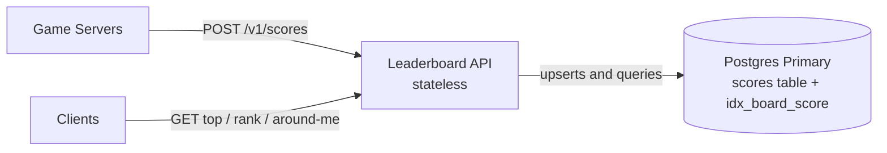

Everything here is new in V0, since it's the first version.

**Every end-to-end flow right now**

1. **Write path:** Game server calls `POST /v1/scores`. The API opens a transaction and upserts one row per board (daily, weekly, all-time) in Postgres. It commits and returns 204.
2. **Top-N path:** Client calls `GET .../top?n=100`. The API runs `ORDER BY score DESC LIMIT 100` on Postgres. It returns the list.
3. **Exact-rank path:** Client calls `GET .../players/{id}`. The API reads the player's score, then runs `COUNT(*) + 1` over higher scores in Postgres. It returns score and rank.
4. **Around-me path:** Same entry as the rank path. After finding the score, the API runs two 5-row range reads (above and below) in Postgres. It merges and returns them.
5. **Window rollover:** No flow exists. A new window means a new `board_id`, so it starts empty on its own.

## Interview follow-ups

**Q: Why not just add a `rank` column and keep it updated?**
Because rank is relative. One player improving shifts everyone between their old and new position by one. That turns a single score write into a write to potentially millions of rows. Rank must be derived at read time, or kept in a structure built to answer it.

**Q: Why is this fine to start with?**
At small scale it's correct, simple and fast enough. If a board has 100K players, the count runs in milliseconds. Starting here shows you know where it breaks and why, instead of reaching for Redis by reflex.

## Recap

| Concept | The Insight |
|---|---|
| Best-score upsert | `ON CONFLICT ... WHERE EXCLUDED.score > scores.score` makes "keep the best" one atomic statement. |
| Window in the key | Putting the time window into `board_id` removes rollover jobs entirely. |
| Rank is derived | Never store rank. One score change would shift millions of others. |
| Count-based rank | `COUNT(score > mine) + 1` is always exact, but its cost grows with how many players are above you. |
| V0's guarantee | Strong consistency and exact rank. Later versions will trade some of this away. |

**Interview arc:** *"Start with one indexed table and rank by counting higher scores. It's exact and trivially correct, but the cost of a rank lookup grows with the number of players above you."*

## Next

Meet Arjun, a mid-table player on a 50M-player board. He taps "my rank" and the `COUNT` has to walk about 20M index entries, while thousands of other players do the same. That is the first naive attempt on the crux. Say **"next"** for V1.


-----------------------------------------------------------------------------------------------------------------------
-----------------------------------------------------------------------------------------------------------------------
-----------------------------------------------------------------------------------------------------------------------
-----------------------------------------------------------------------------------------------------------------------


# V1: A Rank Index That Doesn't Count

**The one concern this version fixes:** exact rank is too slow on a big board. Making the Redis update reliable is the next problem, and I'll flag it at the end.

## Break it

Arjun is a mid-table player on the 50M-player all-time board. His rank is about 20,000,000.

He taps "my rank". Postgres runs `SELECT COUNT(*) + 1 ... WHERE score > 48200`. The index lets it skip the table, but it still walks about 20M index entries. That takes roughly a second of CPU.

Now it's 8pm. A tournament just ended and about 3,000 players tap "my rank" in the same second. That's about 3,000 seconds of CPU work per wall-clock second, on one primary that is also taking every score write. It falls over.

The top-100 query is fine. Only rank is broken.

## The naive attempts

This is the crux, so we walk it properly.

### Attempt 1: Cache each player's rank with a TTL

*Why it looked reasonable:* Rank for Arjun doesn't need to be perfect. Compute it once, cache it for 30 seconds.

*How it breaks:* There are 50M players, so there are 50M possible cache keys. Most are cold at any moment, and every cold read still runs the 1-second `COUNT`. A tournament ending warms none of them in advance.

Also, rank moves constantly at the busiest moment. Arjun's cached "20,000,000" can be wrong by thousands within seconds.

The `COUNT` is still the real cost, and the cache only hides it.

### Attempt 2: Recompute all ranks on a schedule

*Why it looked reasonable:* Do the expensive work once for everyone, not once per request.

```sql
CREATE MATERIALIZED VIEW ranks AS
SELECT player_id, RANK() OVER (ORDER BY score DESC) AS rank
FROM scores WHERE board_id = 'ranked:alltime';
```

*How it breaks:* Ranking 50M rows is a full sort. It takes minutes, not seconds. Refresh every 5 minutes and the board is always at least 5 minutes stale, which already violates our 1-2 second freshness target. The refresh also loads the same primary that handles writes.

### Attempt 3: Dialogue

> **Meera:** What if the app keeps a sorted list in memory and does a binary search?
>
> **Kabir:** Binary search finds the position in O(log N). But inserting into a sorted array shifts millions of elements. And two app servers would each hold a different copy.

An in-memory sorted array gives fast rank but slow writes. The Postgres B-tree gives fast writes but slow rank. We need a structure that does both in O(log N).

### The real fix: a tree or list that stores subtree sizes

Think of a library. To find a book's position without counting every book, you read the shelf labels. "Aisle 1: 4,000 books. Aisle 2: 6,000 books." You add up whole aisles you skip, then count only inside the final shelf.

A **skip list with spans** works this way. Each forward pointer remembers how many elements it jumps over. To find Arjun, the search walks down the levels. At each step it adds the span of every pointer it follows. The sum of those spans is his rank.

The walk is O(log N). For 50M entries that's about 26 hops, not 20M.

Redis implements this as its **sorted set** (ZSET). It has two properties we need:

- `ZADD` is O(log N), so writes stay fast.
- `ZREVRANK` is O(log N), so rank is fast.

### Comparing the options

| Option | Rank cost | Write cost | Freshness | Verdict |
|---|---|---|---|---|
| Postgres `COUNT` (V0) | O(N) | Cheap | Instant | Breaks at scale |
| Per-player rank cache | O(N) on miss | Cheap | Stale | Hides the cost |
| Scheduled recompute | O(1) lookup | Minutes of rebuild | Minutes stale | Fails freshness |
| Redis ZSET (skip list + spans) | O(log N) | O(log N) | Instant | **Chosen** |

## Solve it

We add a Redis sorted set per board. Postgres stays as the durable source of truth. Redis is the **ranking index**, a structure built to answer rank queries.

**New storage class, justified:** An in-memory sorted-set store fits the access pattern "update one score, ask for rank or a range." A B-tree stores sorted data but not subtree counts, so it can't give rank without scanning. A skip list with spans stores exactly that count.

- ✅ **What we gained:** Rank, top-N and around-me all become O(log N). Rank latency drops from about 1 second to well under a millisecond of Redis time. The primary stops carrying rank reads.
- ⚠️ **What we gave up:**
  - **Two stores now.** A score must reach both Postgres and Redis. If one write succeeds and the other fails, they disagree. We'll fix that in V2.
  - **Memory cost.** About 5GB for 50M members. That fits one node, but it isn't free.
  - **Ties change.** Redis breaks equal scores by member order, so tied players now get distinct ranks. V0 gave them a shared rank. This is fine for most games. If it matters, we can encode a timestamp into the score later.
- ❌ **What we considered and rejected:**
  - **Replacing Postgres with Redis entirely.** Redis alone is memory-resident, and we want a durable record of every score.
  - **A custom order-statistic tree in the app tier.** It would reimplement Redis's skip list and leave each app server with its own copy.

## Implement it

### Redis key and shape (first time, full)

```text
Key:    lb:{board_id}                e.g.  lb:ranked:alltime
Type:   ZSET
Member: player_id (string)           e.g.  "98231"
Score:  game score (double)          e.g.  48200
Lives:  single Redis node, in memory (replication comes in a later version)
```

| Structure | Who writes | Who reads | Lives where |
|---|---|---|---|
| `scores` table | Leaderboard API (write path), unchanged | Leaderboard API (rebuilds, audits) | Postgres primary |
| `lb:{board_id}` ZSET | Leaderboard API (write path), right after the Postgres commit | Leaderboard API (top-N, rank, around-me) | Redis node |

### Write path (delta only)

The `POST /v1/scores` request is unchanged. After the Postgres transaction commits, the API updates Redis.

```python
pipe = redis.pipeline()
for board_id in req.boards:
    pipe.zadd(f"lb:{board_id}", {str(req.player_id): req.score}, gt=True)
pipe.execute()
```

`GT` means "only update if the new score is greater." It mirrors the `WHERE EXCLUDED.score > scores.score` guard in Postgres, so both stores keep best-score-wins.

The three `ZADD` commands go in one pipeline so we pay one network round trip.

### Read path 1: top N

```text
ZREVRANGE lb:ranked:alltime 0 99 WITHSCORES
```

### Read path 2: exact rank

```text
ZREVRANK lb:ranked:alltime 98231 WITHSCORES
→ [20000412, 48200]        (0-based; API returns rank = 20000413)
```

The API adds 1 because Redis ranks are 0-based. No Postgres query is involved.

### Read path 3: around me

The player's rank is `r` (0-based). One range call returns the neighbours.

```text
ZREVRANGE lb:ranked:alltime {r-5} {r+5} WITHSCORES
```

Clamp `r-5` to 0 at the top of the board. This is one `ZREVRANK` plus one `ZREVRANGE`, both O(log N + 11).

### Sequence

```mermaid
sequenceDiagram
    participant GS as Game Server
    participant API as Leaderboard API
    participant PG as Postgres Primary
    participant R as Redis (ZSETs)
    participant C as Client

    GS->>API: POST /v1/scores
    API->>PG: BEGIN; 3x upsert; COMMIT
    PG-->>API: ok
    API->>R: pipeline: 3x ZADD GT
    R-->>API: ok
    API-->>GS: 204

    C->>API: GET /v1/boards/{id}/players/98231
    API->>R: ZREVRANK lb:{id} 98231 WITHSCORES
    R-->>API: [20000412, 48200]
    API->>R: ZREVRANGE lb:{id} r-5 r+5 WITHSCORES
    R-->>API: 11 neighbours
    API-->>C: rank 20000413 + neighbours
```

## Current State (V1)

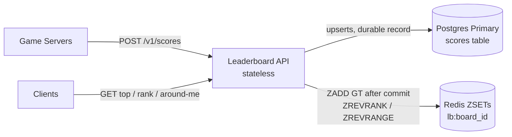

New in V1: the Redis node, and every arrow into it.

**Every end-to-end flow right now**

1. **Write path:** Game server calls `POST /v1/scores`. The API upserts one row per board in Postgres inside one transaction and commits. It then pipelines one `ZADD GT` per board into Redis. It returns 204. *(Changed in V1: the Redis step is new.)*
2. **Top-N path:** Client calls `GET .../top?n=100`. The API runs `ZREVRANGE 0 99 WITHSCORES` on Redis and returns the list. *(Changed: no longer touches Postgres.)*
3. **Exact-rank path:** Client calls `GET .../players/{id}`. The API runs `ZREVRANK ... WITHSCORES` on Redis and returns rank and score. *(Changed: O(log N) instead of `COUNT`.)*
4. **Around-me path:** Same entry as the rank path. The API follows with one `ZREVRANGE r-5 r+5` on Redis and returns the neighbours. *(Changed: one range call instead of two SQL queries.)*
5. **Window rollover:** Unchanged. A new window is a new `board_id`, so it gets a new ZSET key on first `ZADD`.

## Interview follow-ups

**Q: Why not use Postgres with a better index?**
No B-tree index stores subtree counts, so rank always needs a scan. You'd need an order-statistic structure, and Redis ZSET already is one. Postgres stays the durable record.

**Q: What happens if Redis loses its data?**
Rebuild each ZSET from the `scores` table. That's a bulk load of 50M rows, so it takes minutes. During that window the board is unavailable or wrong. Redis is a derived index, not the source of truth. Making that recovery fast is a later version.

## Recap

| Concept | The Insight |
|---|---|
| Why counting fails | Rank cost in a B-tree grows with how many players are above you. |
| Skip list with spans | Each pointer stores how many items it jumps, so rank is a sum of spans along the search path. |
| ZSET commands | `ZADD GT`, `ZREVRANK`, `ZREVRANGE` give write, rank and around-me, all in O(log N). |
| Derived index | Postgres stays the source of truth. Redis holds only what's needed to answer rank. |
| New cost | Two stores means one write can reach only one of them. |

**Interview arc:** *"Counting rank in a B-tree is O(N) and a scheduled recompute is minutes stale, so I keep a Redis sorted set, a skip list whose pointers store span counts, which makes rank, top-N and around-me all O(log N) while Postgres remains the durable record."*

## Next

Last night, Arjun posted 51,000. Postgres committed. Then Redis timed out on the `ZADD`, and the API returned an error to the game server. Postgres says 51,000. The leaderboard still says 48,200. Nobody knows. Say **"next"** for V2: making the two stores agree.


-----------------------------------------------------------------------------------------------------------------------
-----------------------------------------------------------------------------------------------------------------------
-----------------------------------------------------------------------------------------------------------------------
-----------------------------------------------------------------------------------------------------------------------


# V2: Making Postgres and Redis Agree

**The one concern this version fixes:** a score can reach Postgres but not Redis. Redis losing its data or going down is a separate problem, and I'll flag it at the end.

## Break it

Last night Arjun posted 51,000. This is what happened.

1. The API committed the Postgres transaction. `scores` now says 51,000.
2. The API sent `ZADD` to Redis. The call timed out.
3. The API returned a 500 to the game server.
4. Redis still says 48,200. Postgres says 51,000.

Nobody retries. The leaderboard stays wrong until Arjun beats 51,000 again.

How often does this happen? Say about 2,000 score writes per second on average. Even if only 0.01% of Redis calls fail, that's one divergence every 5 seconds. That's about 17,000 players per day with a wrong rank.

The root problem is that two stores can't be updated in one transaction. A crash between the two writes always leaves them different.

## The naive attempts

### Attempt 1: Retry the Redis call inline

*Why it looked reasonable:* Redis timed out, so try again. Three retries with backoff cover most blips.

*How it breaks:* The retry state lives in the API process's memory. If that process crashes or is redeployed after the commit and before the `ZADD`, nothing remembers the work is owed. Postgres has the score and no one knows Redis doesn't.

> **Meera:** Just wrap it in a retry loop.
>
> **Kabir:** And when the pod gets killed mid-loop?
>
> **Meera:** ...The commit is already done. Nothing remembers we owe Redis a write.

### Attempt 2: Write Redis first, then Postgres

*Why it looked reasonable:* If Redis is the one that fails more often, do it first. Then a Postgres failure aborts the request.

*How it breaks:* Now the failure is reversed. Redis shows 51,000, Postgres fails, and the game server gets an error and retries or gives up. Redis holds a score that is not durable. Rolling it back means a `ZADD` without `GT`, which races with other writes to the same player.

### Attempt 3: Two-phase commit across both stores

*Why it looked reasonable:* It's the textbook answer for atomic writes across two systems.

*How it breaks:* Redis is not an XA participant. Even for stores that are, 2PC blocks if the coordinator dies mid-protocol. We'd be adding a blocking protocol to the hottest path in the system.

### Options compared

| Option | Survives API crash? | Blocks the write path? | Extra infrastructure | Verdict |
|---|---|---|---|---|
| Inline retry | No | Yes (retries add latency) | None | Loses writes |
| Redis first, then Postgres | Leaves phantom scores | Yes | None | Wrong direction |
| Two-phase commit | Yes, but can block | Yes | Coordinator | Not supported by Redis |
| Outbox + relay | Yes | No | One small worker | **Chosen** |
| Kafka via CDC (Debezium) | Yes | No | Kafka, connectors | Valid, heavier than needed now |

## The real fix: the transactional outbox

Think of a restaurant's order slip. The waiter writes the order and drops the slip on the kitchen spike in one motion. If the waiter faints, the slip is still there. The kitchen works through the spike on its own schedule.

Here the Postgres transaction writes two things together:

1. The score row.
2. A **note** that says "Redis still needs this."

Both commit or neither does. A separate **relay worker** reads unsent notes and applies them to Redis. It marks a note done only after Redis confirms.

The commit is now the only point where the write becomes real. Anything after it can crash and be retried safely.

### Why a retry is safe: the update is idempotent

`ZADD GT` means "set the score only if it's higher." That is a **max** operation.

- **Idempotent:** applying the same note twice changes nothing.
- **Order-independent:** applying 51,000 then 48,200 gives the same result as the reverse, which is 51,000.

So the relay can deliver at-least-once, in any order, with duplicates, and Redis still ends up right. This is why we don't need Kafka's ordering guarantees yet.

## Solve it

- ✅ **What we gained:**
  - No lost Redis updates. The note survives any crash after the commit.
  - The write path no longer waits on Redis. A Redis outage doesn't fail score submissions.
  - Retries, backoff and monitoring all live in one worker.
- ⚠️ **What we gave up:**
  - **Redis lags Postgres slightly.** A player who posts a score and instantly reads their rank may see the old rank for about 100-200ms. This sits inside our 1-2 second freshness target.
  - **One new component** (the relay) and one new table that needs cleanup.
  - **Redis outage means the outbox backs up.** Notes pile up in Postgres until Redis returns. That is a feature, but we must monitor the backlog.
- ❌ **What we considered and rejected:** Inline retry, reverse ordering and 2PC, as in the table above. We also deferred Kafka with CDC. It adds a broker and connectors to run, and it only pays off when other consumers (analytics, notifications) need the score stream.

## Implement it

### Outbox schema (first time, full)

```sql
CREATE TABLE score_outbox (
  id           BIGSERIAL   PRIMARY KEY,
  board_id     TEXT        NOT NULL,
  player_id    BIGINT      NOT NULL,
  score        BIGINT      NOT NULL,
  created_at   TIMESTAMPTZ NOT NULL DEFAULT now(),
  published_at TIMESTAMPTZ            -- NULL = not yet applied to Redis
);

-- Small index: only unpublished rows, so the relay's poll stays cheap
CREATE INDEX idx_outbox_pending ON score_outbox (id) WHERE published_at IS NULL;
```

**Why a relational table for this:** The note must commit in the same transaction as the score. Only the same database can give us that.

| Structure | Who writes | Who reads | Lives where |
|---|---|---|---|
| `scores` table | Leaderboard API (write path) | Leaderboard API (audits), rebuilds | Postgres primary |
| `score_outbox` table | Leaderboard API (same transaction as `scores`) | Outbox Relay | Postgres primary |
| `score_outbox.published_at` | Outbox Relay | Outbox Relay, cleanup job | Postgres primary |
| `lb:{board_id}` ZSET | **Outbox Relay only** (the API no longer writes Redis) | Leaderboard API (top-N, rank, around-me) | Redis node |

### Write path: one statement per board, one transaction

`POST /v1/scores` is unchanged. Inside the transaction, for each board:

```sql
WITH improved AS (
  INSERT INTO scores (board_id, player_id, score)
  VALUES ($1, $2, $3)
  ON CONFLICT (board_id, player_id)
  DO UPDATE SET score = EXCLUDED.score, updated_at = now()
  WHERE EXCLUDED.score > scores.score
  RETURNING board_id, player_id, score
)
INSERT INTO score_outbox (board_id, player_id, score)
SELECT board_id, player_id, score FROM improved;
```

The `RETURNING` only yields a row when the score actually improved. A worse score writes no note, so the outbox carries no wasted work.

The API then commits and returns `204`. It does not touch Redis.

### Relay worker loop

```python
while True:
    with pg.transaction():
        rows = pg.fetch("""
            SELECT id, board_id, player_id, score
            FROM score_outbox
            WHERE published_at IS NULL
            ORDER BY id
            LIMIT 500
            FOR UPDATE SKIP LOCKED
        """)
        if rows:
            pipe = redis.pipeline()
            for r in rows:
                pipe.zadd(f"lb:{r.board_id}", {str(r.player_id): r.score}, gt=True)
            pipe.execute()                       # raises on timeout -> txn rolls back
            pg.execute(
                "UPDATE score_outbox SET published_at = now() WHERE id = ANY(%s)",
                [r.id for r in rows],
            )
    if not rows:
        sleep(0.1)                               # poll interval
```

Three things make this safe.

- **`FOR UPDATE SKIP LOCKED`** lets you run several relay workers. Each grabs a different batch and none block each other.
- **Crash between `execute()` and commit:** the rows stay unpublished and get re-sent. The duplicate `ZADD GT` is a no-op.
- **Redis down:** `execute()` raises, the transaction rolls back, and the rows stay pending. The worker backs off and retries.

### Retry policy

```python
delay = min(30, 0.2 * 2 ** failures) * random.uniform(0.5, 1.5)   # backoff + jitter
```

Jitter stops many relay workers from hammering a recovering Redis in lockstep.

### Cleanup and alerting

```sql
DELETE FROM score_outbox
WHERE published_at < now() - interval '1 hour';       -- run every few minutes
```

The metric to alert on is `now() - min(created_at) WHERE published_at IS NULL`. That is the **oldest unpublished note**, which tells you exactly how stale Redis is.

### Sequence

```mermaid
sequenceDiagram
    participant GS as Game Server
    participant API as Leaderboard API
    participant PG as Postgres Primary
    participant RL as Outbox Relay
    participant R as Redis (ZSETs)

    GS->>API: POST /v1/scores
    API->>PG: BEGIN; 3x (upsert scores + insert score_outbox); COMMIT
    PG-->>API: ok
    API-->>GS: 204

    loop every ~100ms
        RL->>PG: SELECT pending FOR UPDATE SKIP LOCKED
        PG-->>RL: up to 500 notes
        RL->>R: pipeline ZADD GT
        R-->>RL: ok
        RL->>PG: UPDATE published_at = now(); COMMIT
    end
```

## Current State (V2)

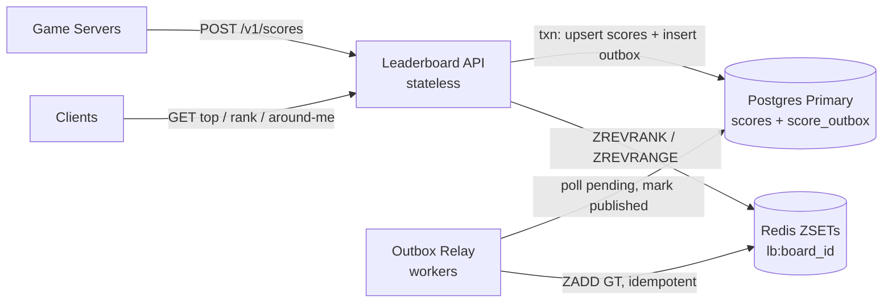

New in V2: the Outbox Relay, the `score_outbox` table, and the removal of the API's direct write to Redis.

**Every end-to-end flow right now**

1. **Write path:** Game server calls `POST /v1/scores`. In one Postgres transaction, the API upserts the score row and inserts an outbox row for each board that improved. It commits and returns 204. *(Changed in V2: the API no longer writes Redis.)*
2. **Outbox relay path (new):** Every ~100ms the Outbox Relay selects pending outbox rows with `SKIP LOCKED`. It pipelines `ZADD GT` into Redis. It then marks the rows published and commits. On failure it retries with backoff and jitter.
3. **Top-N path:** Unchanged. The API runs `ZREVRANGE 0 99 WITHSCORES` on Redis.
4. **Exact-rank path:** Unchanged. The API runs `ZREVRANK ... WITHSCORES` on Redis.
5. **Around-me path:** Unchanged. The API follows the rank lookup with one `ZREVRANGE r-5 r+5`.
6. **Window rollover:** Unchanged. A new `board_id` gets a new ZSET key on its first `ZADD`.
7. **Outbox cleanup (new):** A periodic job deletes outbox rows that were published more than an hour ago.

## Interview follow-ups

**Q: Why not use Kafka for this?**
Kafka with CDC is the same pattern with heavier machinery. It's the right call once other consumers need the score stream (analytics, achievements, notifications). For one consumer, an outbox table and a small relay is less to run and easier to reason about. We can swap the relay's source for CDC later without changing the write path.

**Q: Doesn't polling add latency and load?**
Latency is the poll interval, about 100ms, which fits our 1-2 second target. The partial index `WHERE published_at IS NULL` keeps each poll tiny, since only a few hundred rows are pending at any moment. If we need tighter freshness, `LISTEN/NOTIFY` can wake the relay immediately.

## Recap

| Concept | The Insight |
|---|---|
| Dual-write problem | Two stores can't commit atomically, so a crash between them always leaves a mismatch. |
| Transactional outbox | Write the "owed update" note in the same transaction as the data. The commit is the only moment the write becomes real. |
| Idempotent max | `ZADD GT` makes retries, duplicates and reordering harmless. |
| `SKIP LOCKED` | Lets many relay workers share one outbox without blocking each other. |
| New trade | Redis now lags Postgres by about 100-200ms. The oldest unpublished note measures that lag exactly. |

**Interview arc:** *"Writing to Postgres and then Redis loses updates when the process dies in between, so I commit the score and an outbox note in one transaction and let a relay apply it to Redis with an idempotent ZADD GT, which makes delivery at-least-once and the two stores eventually consistent."*

## Next

It's the final of a big tournament. The single Redis node holding the 50M-player board restarts. The ZSET is gone from memory. The relay can only replay recent notes, so rebuilding from the `scores` table means loading 50M rows, which takes minutes. For those minutes, every rank query fails. Say **"next"** for V3: keeping a second copy of the ranking index ready (replication).


-----------------------------------------------------------------------------------------------------------------------
-----------------------------------------------------------------------------------------------------------------------
-----------------------------------------------------------------------------------------------------------------------
-----------------------------------------------------------------------------------------------------------------------


# V3: Replication, So One Dead Node Doesn't Mean a Dead Leaderboard

**The one concern this version fixes:** the ranking index is a single point of failure. Read throughput and top-N hot spots are separate problems. I'll flag them at the end.

## Break it

It's the final of a big tournament. The single Redis node holding the board restarts. Memory is wiped, and the ZSETs are gone.

Here is what recovery looks like with V2 as built.

1. The relay can't help. Every old outbox note is marked published, so there is nothing to replay.
2. A rebuild job reads the `scores` table and re-adds every player. We have about 8GB of ZSETs across all boards, and the 50M-player board alone is about 5GB.
3. Bulk loading at roughly 200K rows per second takes **about 4 minutes** for that one board.
4. About 3,000 rank requests arrive every second during the finale. That is about **900,000 failed requests** before the board comes back.

Meanwhile the outbox keeps growing, because the relay can't write to a node that isn't there. Nothing is lost, but nothing is served.

A second failure is worse. If the machine's disk dies too, even a local snapshot is gone. Only the full rebuild remains.

## Is replication justified here?

We should say this explicitly and not default to yes.

- **Read scaling alone: no.** One Redis node does well over 100K ops/s. Our steady rank and top-N load is far below that. Replicas for throughput aren't needed yet.
- **Availability: yes.** The finale shows that 4 minutes of downtime on the busiest night is not acceptable.

So we add replicas for **failover**, not for read offload. Reads stay on the primary for now. That avoids adding a second layer of staleness on top of the outbox lag.

## The naive attempts

### Attempt 1: Turn on persistence and restart faster

*Why it looked reasonable:* Redis can write snapshots (RDB) or an append-only log (AOF) to disk. A restart then loads from disk, not from Postgres.

*How it breaks:*

- Loading an 8GB snapshot still takes tens of seconds to a couple of minutes. The board is down that whole time.
- A snapshot is only as new as its last save. Everything since is missing. Those notes are already marked published, so the relay won't resend them.
- If the disk or host is lost, the snapshot goes with it.

Persistence helps durability, but it doesn't remove downtime.

### Attempt 2: Rebuild from Postgres on demand

*Why it looked reasonable:* Postgres is the source of truth, so Redis is disposable. We already said so in V1.

*How it breaks:* "Disposable" is true for correctness, but not for latency. The rebuild is exactly the 4-minute outage from the break-it above. A rebuild is the last-resort recovery path. It can't be the first.

### Attempt 3: The relay writes to two independent Redis nodes

> **Meera:** Easy. The relay does `ZADD` to Redis A and Redis B. If A dies, we point at B.
>
> **Kabir:** And when B is down for ten minutes and comes back?
>
> **Meera:** The relay has to remember what B missed.
>
> **Kabir:** So `published_at` becomes one column per target, and every new node needs a backfill. We've rebuilt replication by hand.

*How it breaks:* The outbox tracks one "published" state. With two targets it needs per-target tracking. Any node that was down needs a catch-up job, and the two nodes can differ at any given moment. Redis already ships a tested mechanism for exactly this.

## The real fix: primary with replicas, plus automatic failover

Think of a stage manager and two understudies. The understudies watch every performance. If the lead collapses, someone calls it and the first understudy walks on. The show pauses for seconds, not for a recast.

### How Redis replication works (first time, plain language)

1. A new replica connects to the primary.
2. The primary sends a **full snapshot** of its memory.
3. From then on, the primary streams every write command to the replica as it happens.
4. If the link drops briefly, the replica reconnects and asks for just the commands it missed from the primary's **backlog**. This is a partial resync and it's cheap.

The replica is therefore a live copy that's usually a few milliseconds behind.

### Sync, async or semi-sync?

Redis replication is **asynchronous** by default. The primary acknowledges a write before the replica has it.

| Mode | Write latency | Data lost on failover | Verdict for us |
|---|---|---|---|
| Async (default) | Lowest | Last few ms of writes | **Chosen** |
| Semi-sync (`WAIT 1 0` after each batch) | One replica round trip added | Almost none | Overkill here |
| Fully sync | Slowest, blocks on any replica | None | Not offered by Redis |

**Why async is acceptable here:** Redis isn't the source of truth, and Postgres is. A few milliseconds of lost writes after a failover can be replayed from the outbox. I'll show that in the implementation.

### Who decides when to fail over?

Detecting that the primary is dead is a famous sub-problem. If two nodes both believe they are the primary, we get **split-brain**. Here are the real candidates.

| Option | Mechanism | Sketch | Fits us? |
|---|---|---|---|
| **Redis Sentinel** | 3 small watcher processes vote. A quorum agrees the primary is down, elects a replica and promotes it. | `sentinel monitor lbmaster 10.0.1.10 6379 2` | **Yes, if self-hosted** |
| **Managed multi-AZ** (e.g. ElastiCache with Multi-AZ failover) | The cloud provider runs the watcher and promotion. | `AutomaticFailoverEnabled=true`, 1 primary + 2 replicas | **Yes, if on AWS** |
| **Redis Cluster** | Failover is built in, but it also shards keys across nodes. | `redis-cli --cluster create ... --cluster-replicas 1` | Not yet. That is sharding, a later version. |

I'll implement with Sentinel because it shows the mechanics. The managed option is the same design with the operations handled for you.

## Solve it

- ✅ **What we gained:**
  - Failover in about 10-15 seconds instead of a 4-minute rebuild.
  - A live copy in a second AZ, so a lost host or AZ doesn't lose the index.
  - The rebuild from Postgres becomes a rare last resort.
- ⚠️ **What we gave up:**
  - **Async means a small loss window.** The last few milliseconds of acknowledged writes can vanish on failover. We heal this by re-publishing recent outbox rows.
  - **Consistency model:** Redis is now *eventually consistent with Postgres and with its own replicas*. The flow where staleness matters most is a player reading their own rank right after a submit. That already tolerates the outbox lag, and failover widens it only briefly.
  - **Split-brain risk** if a primary is cut off but still alive. We mitigate this below.
  - **Cost:** about 3x the memory (1 primary + 2 replicas).
- ❌ **What we considered and rejected:** Persistence-only restart, rebuild-on-demand, and a hand-rolled dual-write. Also, read replicas for throughput. The numbers don't call for them yet.

## Implement it

### Topology and where things live

| Structure | Who writes | Who reads | Lives where |
|---|---|---|---|
| `lb:{board_id}` ZSET on primary | Outbox Relay | Leaderboard API | Redis primary, AZ-a |
| `lb:{board_id}` ZSET on replicas | Redis replication stream (not our code) | Sentinel (promotion), nobody else | Redis replicas, AZ-b and AZ-c |
| Primary address | Sentinel (updates on failover) | Leaderboard API and Outbox Relay, via Sentinel lookup | 3 Sentinel processes, one per AZ |

### Replica config

```conf
# replica redis.conf
replicaof 10.0.1.10 6379
replica-read-only yes
appendonly yes              # replicas persist so a full outage restarts from disk
appendfsync everysec
```

### Primary config (the split-brain guard)

```conf
repl-backlog-size 256mb       # lets a briefly disconnected replica do a partial resync
min-replicas-to-write 1       # refuse writes if no replica is reachable
min-replicas-max-lag 10       # "reachable" means acked within the last 10s
```

If the primary is partitioned away from every replica, it stops accepting writes. A stranded old primary therefore can't keep taking writes that the new primary never sees. The cost is that the relay's writes fail during that partition, and the outbox simply backs up. That is the safe direction.

### Sentinel config (3 processes, one per AZ)

```conf
sentinel monitor lbmaster 10.0.1.10 6379 2      # quorum of 2 of 3 must agree
sentinel down-after-milliseconds lbmaster 5000  # 5s of silence = "subjectively down"
sentinel failover-timeout lbmaster 30000
sentinel parallel-syncs lbmaster 1
```

### Client discovery (API and Relay)

Neither component hardcodes an IP. Both ask Sentinel.

```python
from redis.sentinel import Sentinel

sentinel = Sentinel(
    [("s1", 26379), ("s2", 26379), ("s3", 26379)],
    socket_timeout=0.3,
)
redis_primary = sentinel.master_for("lbmaster", socket_timeout=0.3)
```

After a failover, the next call re-asks Sentinel and lands on the new primary. The API also wraps Redis calls in a **circuit breaker**. During the 10-15 second window it returns `503` with `Retry-After: 5` immediately, instead of piling up timeouts.

### Healing the loss window (outbox re-publish)

When the relay sees a failover event (a Sentinel `+switch-master` message), it re-sends recent notes.

```sql
UPDATE score_outbox
SET published_at = NULL
WHERE published_at > now() - interval '60 seconds';
```

The relay's normal loop then re-applies them. This is safe because `ZADD GT` is idempotent, as we established in V2. Cleanup keeps rows for an hour, so the 60-second window is always still there.

### Sequence: failover

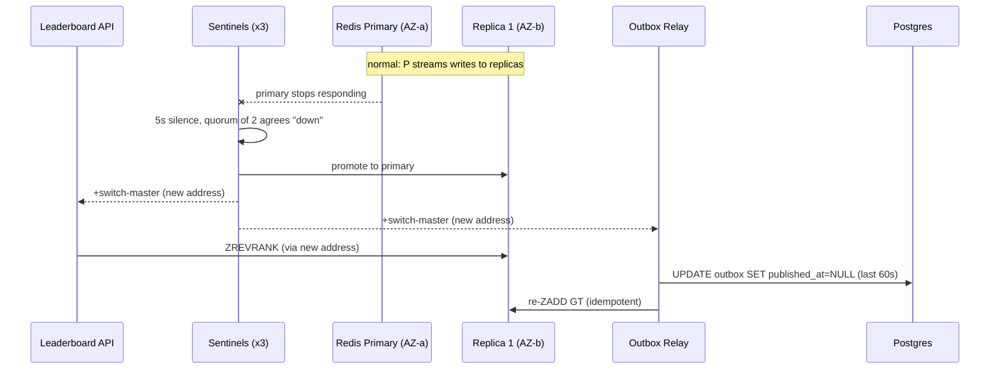

## Current State (V3)

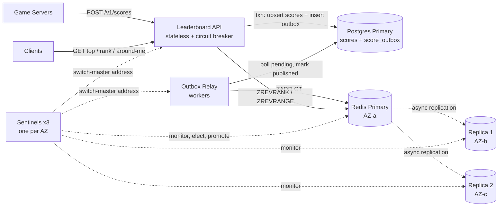

New in V3: the two replicas, the three Sentinels, the circuit breaker and the failover re-publish rule.

**Every end-to-end flow right now**

1. **Write path:** Unchanged. The game server calls `POST /v1/scores`. The API upserts `scores` and inserts `score_outbox` rows in one Postgres transaction. It returns 204.
2. **Outbox relay path:** The relay polls pending notes with `SKIP LOCKED` and pipelines `ZADD GT`. It now writes to the Redis **primary** found via Sentinel, then marks the notes published.
3. **Top-N path:** Unchanged in shape. The API runs `ZREVRANGE 0 99 WITHSCORES` on the Redis primary. If the circuit breaker is open, it returns 503 with `Retry-After`.
4. **Exact-rank path:** Unchanged in shape. `ZREVRANK ... WITHSCORES` on the primary, with the same breaker.
5. **Around-me path:** Unchanged. One `ZREVRANGE r-5 r+5` after the rank lookup.
6. **Replication path (new):** The Redis primary streams every write to both replicas asynchronously. Replicas use AOF to persist.
7. **Failover path (new):** Sentinels detect primary silence for 5s and reach quorum. They promote a replica and announce the new address. The API and relay reconnect. The relay marks the last 60s of outbox rows unpublished and re-applies them.
8. **Window rollover and outbox cleanup:** Unchanged.

## Interview follow-ups

**Q: Why not synchronous replication so nothing is ever lost?**
Redis doesn't offer true synchronous replication. `WAIT` can approximate it, but it adds a replica round trip to every write batch. Our source of truth is Postgres and the outbox can replay the last minute. Paying write latency to avoid a loss we can already heal is the wrong trade.

**Q: What stops two primaries after a network partition?**
Two things. Sentinel needs a quorum of 2 of 3, so only the side holding the majority can elect a new primary. And `min-replicas-to-write 1` makes an isolated old primary refuse writes. Between them, the minority side can't take writes that the majority never sees.

## Recap

| Concept | The Insight |
|---|---|
| Why replicate | Rebuilding from Postgres is correct but takes minutes. A live copy turns an outage into a 10-15s blip. |
| Replicas for availability | Read throughput didn't justify replicas here. Surviving a node loss did. |
| Async tradeoff | The last few ms of writes can be lost on failover. Postgres plus an idempotent re-publish heals it. |
| Split-brain guards | Sentinel quorum plus `min-replicas-to-write` stop a stranded primary from accepting orphan writes. |
| Client discovery | Clients ask Sentinel for the primary instead of hardcoding an IP, and a circuit breaker fails fast during the switch. |

**Interview arc:** *"A single Redis node turns a restart into a 4-minute rebuild from Postgres, so I run one primary and two async replicas across AZs with Sentinel quorum failover, accept losing a few milliseconds of writes, and heal that by re-publishing the last minute of idempotent outbox notes."*

## Next

It's the tournament finale and 500,000 fans are refreshing the top 100 every second. That's 500K reads per second for the same 100 rows, all hitting one Redis primary that tops out near 100K. The data hardly changes between reads, but every request asks Redis anyway. Say **"next"** for V4: caching the hot reads.


-----------------------------------------------------------------------------------------------------------------------
-----------------------------------------------------------------------------------------------------------------------
-----------------------------------------------------------------------------------------------------------------------
-----------------------------------------------------------------------------------------------------------------------


# V4: Caching the Hot Reads

**The one concern this version fixes:** the same few rows are read hundreds of thousands of times per second. The write burst at tournament end is a different problem. I'll flag it at the end.

## Break it

It's the tournament finale. 500,000 fans are refreshing the top 100 every second.

Here is what that does to V3.

1. 500K requests per second arrive for the **same 100 rows**.
2. Each one runs `ZREVRANGE lb:ranked:alltime 0 99 WITHSCORES` on the Redis primary.
3. That command returns 100 members with scores, so it costs far more than a plain `GET`. One primary handles roughly 50K of them per second.
4. We are at **10x capacity**.

The damage spreads. The relay's `ZADD` writes queue behind these reads. The outbox backs up and the whole board goes stale. Rank lookups for individual players slow down too.

Egress is a problem as well. A top-100 JSON payload is about 4KB. At 500K per second that is **2GB/s** leaving our API fleet.

The data barely changes between reads, yet we recompute it every time.

## Does caching fit this read pattern?

Check the read pattern before adding a cache. Our three read paths look very different.

| Read | Same answer for everyone? | Reads per distinct answer | Cacheable? |
|---|---|---|---|
| Top 100 | Yes | Hundreds of thousands per second | **Yes, perfect fit** |
| Exact rank of one player | No, 50M different answers | Maybe a few per minute | No |
| Around-me | No, personalized | Maybe a few per minute | No |

Top-100 is one hot key that everybody shares. Rank and around-me are a long tail of keys that each get few reads. A cache would mostly miss on them, so we leave them alone. They already cost O(log N) on Redis.

## The naive attempts

This isn't the crux, so I'll keep the walk short.

### Attempt 1: Add read replicas and spread the load

*Why it looked reasonable:* Replicas are a standard way to scale reads, and we already have two.

*How it breaks:* We'd need about 10 replicas to absorb 500K per second. Every one of them computes the same 100 rows from scratch for every request. We'd pay for 10 copies of 8GB to answer one question. In V3 we decided replicas were for availability, not throughput. The numbers still say that.

### Attempt 2: Put a plain TTL cache in front and call it done

*Why it looked reasonable:* Cache the top-100 for 1 second. One Redis read per second instead of 500K.

*How it breaks:* The cache is correct while the entry is warm. The danger is the instant it expires.

> **Meera:** The key expires at 8:00:01.000. Every request after that is a miss.
>
> **Kabir:** And all 25,000 requests that land in the next few milliseconds each go to Redis to refill it.
>
> **Meera:** So the cache saves us 999 ms of every second and then stampedes us for the last millisecond.

This is the **cache stampede**. It needs its own fix, covered below.

## The real fix: cache at two layers, and prevent the stampede

### Where to cache (different layers are different decisions)

| Layer | What it removes | Who benefits | Decision |
|---|---|---|---|
| Client (`Cache-Control: max-age`) | Repeat requests from one user | Each user | Yes, tiny TTL |
| CDN / edge | Load on our API fleet and egress | Everyone near an edge | **Yes, for top-N only** |
| In-process cache in each API pod | Load on Redis | The whole fleet | **Yes** |
| Redis itself | Already the ranking index | | Unchanged |

**Is a CDN warranted?** Yes, for this one endpoint. The response is public and identical for every viewer. Without a CDN, our API fleet must serve 500K rps and push 2GB/s of egress. With it, the edge absorbs nearly all of that.

We do **not** put rank or around-me behind the CDN cache. Those responses are per-player and go out with `private, no-store`.

### What to cache and for how long

- **What:** the top-100 response, one object per board.
- **TTL:** short, because top-N changes constantly during a finale.
- **Invalidation: TTL expiry, not event-driven.** We compare the options below.

| Invalidation strategy | How it works | Fits top-100? |
|---|---|---|
| **Short TTL** | Entry expires after 0.5-1s | **Yes.** Staleness is bounded and invalidation needs no code. |
| Invalidate on write | Each score write that could change the top 100 deletes the cache entry | No. It needs every writer to know the 100th score. During a finale the entry would be invalidated almost constantly, so the cache would barely help. |
| Versioned key | Writers bump a version, readers fetch `top:v123` | No. Same coordination problem. |

**Freshness budget.** TTLs stack. A score can be up to 0.2s behind in Redis (outbox lag), 0.5s behind in the pod cache, and 1s behind at the CDN. Worst case is about **1.7s**. That fits our 1-2 second target, but it leaves no room for a longer TTL.

### The stampede sub-problem: the real candidate fixes

| Fix | Mechanism | Sketch | Verdict |
|---|---|---|---|
| **Single-flight (request coalescing)** | On a miss, the first caller fetches. Everyone else waits on that same fetch. | `fut = INFLIGHT.setdefault(key, fetch(key)); await fut` | **Chosen** |
| **Stale-while-revalidate** | Serve the expired value immediately while one caller refreshes in the background. | `if age < STALE_OK: refresh_async(); return old` | **Chosen** |
| Probabilistic early refresh | Each request may refresh slightly before expiry, with probability rising as expiry nears. | `if age > TTL - rand() * beta: refresh()` | Skipped. More tuning than we need. |
| Background refresher | A timer refreshes hot keys regardless of traffic. | `every 500ms: cache[key] = fetch()` | Skipped. Wastes work on idle boards. |

We combine the first two. Warm entries serve instantly. Slightly expired entries serve stale while one request refreshes. Fully cold entries make everyone share one fetch.

## Solve it

- ✅ **What we gained:**
  - Redis sees about **2 top-100 reads per second per pod**, not 500K. With 20 pods that is about 40 per second per hot board, before the CDN even helps.
  - The relay's writes and rank lookups are no longer starved.
  - Egress comes off our fleet and onto the CDN.
  - With `stale-if-error`, top-100 keeps serving during a Redis failover. Users won't see the 10-15 second gap from V3.
- ⚠️ **What we gave up:**
  - **Top-100 can be up to about 1.7s stale.** A player who just took 3rd place may not see themselves for a moment. Their own rank lookup is uncached, so their personal view stays fresh.
  - **Stale-if-error shows old data during an outage.** We cap it at 30s so it can't mislead for long.
  - **Stacked TTLs.** Adding a cache layer later means re-doing this budget.
- ❌ **What we considered and rejected:** Read replicas for throughput, a plain TTL with no stampede protection, write-triggered invalidation, and caching per-player rank.

## Implement it

### Cache layers: who writes, who reads

| Structure | Who writes | Who reads | Lives where |
|---|---|---|---|
| Pod cache `top:{board_id}` (in-process dict) | Leaderboard API, on miss or background refresh | Leaderboard API, same pod | Memory of each API pod |
| CDN object `GET /v1/boards/{id}/top?n=100` | CDN, from the API's response | CDN, to clients | Edge locations |
| `lb:{board_id}` ZSET | Outbox Relay | Leaderboard API (on pod-cache miss, rank, around-me) | Redis primary, unchanged |

### Cache key hygiene

A client can ask for any `n`. That would create a different cache key per value. We fix that by only allowing `n` in `{10, 50, 100}`, and always fetching 100 into the pod cache. We then slice for smaller values.

```text
Pod cache key:  top:{board_id}            e.g.  top:ranked:alltime
CDN cache key:  path + ?n=                e.g.  /v1/boards/ranked:alltime/top?n=100
                (cookies and auth headers excluded from the key)
```

### Response headers

```http
# GET /v1/boards/{id}/top?n=100
Cache-Control: public, max-age=1, stale-while-revalidate=2, stale-if-error=30

# GET /v1/boards/{id}/players/{player_id}   (rank and around-me)
Cache-Control: private, no-store
```

The CDN must have **request collapsing** turned on. It means many simultaneous misses at one edge become one origin request. That is single-flight at the CDN layer.

### Pod cache with single-flight and stale-while-revalidate

```python
CACHE, INFLIGHT = {}, {}        # key -> (value, fetched_at) / key -> Future
TTL, STALE_OK = 0.5, 3.0        # seconds

async def get_top100(board_id):
    key = f"top:{board_id}"
    entry = CACHE.get(key)
    age = time.monotonic() - entry.at if entry else None

    if entry and age < TTL:                      # 1. fresh hit
        return entry.value
    if entry and age < STALE_OK:                 # 2. expired, serve stale, refresh once
        asyncio.ensure_future(single_flight(key, board_id))
        return entry.value
    return await single_flight(key, board_id)    # 3. cold: everyone waits on one fetch

async def single_flight(key, board_id):
    fut = INFLIGHT.get(key)
    if fut is None:                              # first caller does the real work
        fut = asyncio.ensure_future(fetch_and_store(key, board_id))
        INFLIGHT[key] = fut
        fut.add_done_callback(lambda _: INFLIGHT.pop(key, None))
    return await fut                             # everyone else shares it

async def fetch_and_store(key, board_id):
    rows = await redis_primary.zrevrange(f"lb:{board_id}", 0, 99, withscores=True)
    value = serialize(rows)
    CACHE[key] = Entry(value, time.monotonic())
    return value
```

Three branches, each its own case.

1. **Fresh hit:** return immediately. No Redis call.
2. **Stale:** return the old value now, and start one background refresh. Callers never wait.
3. **Cold:** the first caller fetches. The rest wait on the same future, so Redis sees one request.

If `fetch_and_store` raises (Redis failing over), the stale entry stays in `CACHE` and keeps serving until `STALE_OK` passes. After that the circuit breaker from V3 returns 503, and the CDN's `stale-if-error` covers it.

### Sequence: top-100 read

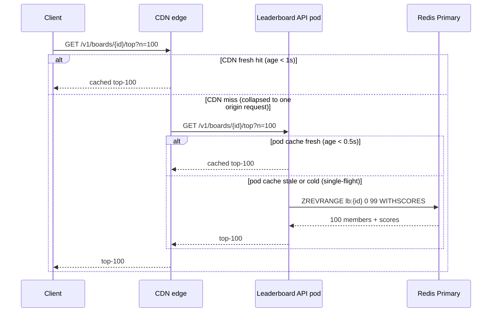

## Current State (V4)

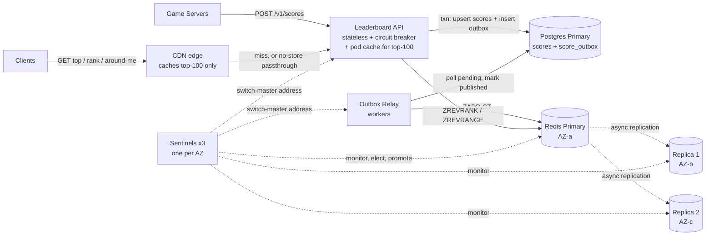

New in V4: the CDN edge, the pod cache inside the API, and the cache headers.

**Every end-to-end flow right now**

1. **Write path:** Unchanged. The game server calls `POST /v1/scores`. The API upserts `scores` and inserts `score_outbox` rows in one Postgres transaction. It returns 204. Game servers call the API directly, not through the CDN.
2. **Outbox relay path:** Unchanged. The relay applies pending notes with `ZADD GT` to the Redis primary, then marks them published.
3. **Top-N path:** Changed. The client asks the CDN. On a hit, the CDN answers. On a miss it makes one collapsed request to an API pod. The pod serves from its cache (fresh or stale), or does one single-flight `ZREVRANGE 0 99` on Redis.
4. **Exact-rank path:** Unchanged in logic. It passes through the CDN uncached (`private, no-store`). The API runs `ZREVRANK ... WITHSCORES` on the Redis primary.
5. **Around-me path:** Unchanged in logic. Same passthrough, then one `ZREVRANGE r-5 r+5`.
6. **Replication path:** Unchanged. The primary streams writes to both replicas asynchronously.
7. **Failover path:** Changed. Sentinels promote a replica as before. During the window, top-100 keeps serving from pod cache and CDN (`stale-if-error=30`). Rank and around-me return 503 until the switch completes.
8. **Window rollover and outbox cleanup:** Unchanged. A new window uses a new `board_id`, so it gets its own cache key.

## Interview follow-ups

**Q: Why not invalidate the cache when a score changes, instead of waiting for the TTL?**
Because almost every write during a finale could change the top 100. We'd invalidate constantly and the cache would hit rarely. It also requires every writer to know the current 100th score. A 0.5-1s TTL gives a hard staleness bound with no coordination.

**Q: Why not cache per-player rank too?**
50M possible keys, each read only occasionally, so the hit rate would be low. Rank also changes the moment anyone passes you. And those lookups are already O(log N) on Redis. Caching them would add staleness for almost no load saved.

## Recap

| Concept | The Insight |
|---|---|
| Cache the shared read | Top-100 is one hot key read by everyone. Per-player rank is a long tail and is not worth caching. |
| Layer choice | The CDN removes API load and egress for a public response. The pod cache removes Redis load. Each is a separate decision. |
| TTL over invalidation | Constant churn makes write-triggered invalidation useless. A short TTL bounds staleness with no coordination. |
| Stacked TTLs | Outbox lag plus pod TTL plus CDN TTL add up (about 1.7s here). Budget them together. |
| Stampede fixes | Single-flight plus stale-while-revalidate means an expiry never sends a crowd to Redis. |

**Interview arc:** *"500K reads per second for the same top-100 would crush one Redis primary, so I cache that one public response at the CDN and in each pod with a short TTL, using single-flight and stale-while-revalidate so expiry never stampedes, and I leave per-player rank uncached because it has 50M distinct keys."*

## Next

The finale ends and 50,000 players submit scores in the same second. Each submission writes three boards, which means about 150,000 upserts per second hitting one Postgres primary, and one Redis primary behind it. The outbox backlog grows into minutes. We can shard by board easily, but one 50M-player board can't be split without breaking the one thing we built this system for: exact global rank. Say **"next"** for V5: sharding.


-----------------------------------------------------------------------------------------------------------------------
-----------------------------------------------------------------------------------------------------------------------
-----------------------------------------------------------------------------------------------------------------------
-----------------------------------------------------------------------------------------------------------------------


# V5: Sharding Postgres, the Source of Truth

**The one concern this version fixes:** Postgres can't absorb the write burst. Redis is also near its write ceiling, but that is a separate problem, and I'll flag it at the end.

## Break it

It's 8:00pm and the finale ends. Arjun's match finishes along with 49,999 others. All 50,000 players submit scores in the same second, and the flood lasts about 30 seconds.

Each submit is one Postgres transaction. It does 3 upserts into `scores` and 3 inserts into `score_outbox`. That's 6 row writes per submit, so about **300K row writes per second**.

One well-tuned Postgres primary sustains roughly 5K of these transactions per second. We are asking for 50K. That's **10x over**.

Here is what happens next.

1. The connection pool fills within a few hundred milliseconds.
2. Write latency climbs from about 5ms to tens of seconds.
3. Game servers time out and retry. The `GT` upsert makes retries safe, but they still add load.
4. The outbox lives on the same drowning primary, so Redis gets nothing to apply. Rank freshness collapses too.

This is **not a size problem**. All boards together hold about 80M rows, roughly 15GB. That fits on one machine. It's a write-throughput problem, so we need more primaries accepting writes.

Redis has its own ceiling on this burst. It comes next, once Postgres is no longer the bottleneck.

## What sharding is

Sharding splits rows across several databases. Each database owns a slice and takes writes only for that slice.

Think of a supermarket with 16 checkout lanes instead of one. A fixed rule decides each shopper's lane. All of one shopper's items go through the same lane, so one receipt covers everything.

Two things matter. The rule must be deterministic, so the same shopper always lands in the same lane. And one shopper's items should never be split across lanes.

## Choosing the shard key

Our write is "one player, three boards, plus three outbox rows, in one transaction." The key must keep that transaction on one shard.

| Shard key | What it optimizes | What it breaks | Verdict |
|---|---|---|---|
| `board_id` | All rows of a board sit together | Every score hits the all-time board, so one shard takes 100% of writes. One submit touches 3 boards, so 3 shards. | Rejected |
| `hash(board_id, player_id)` | Perfectly even spread | A player's 3 rows scatter. The write becomes a cross-shard transaction, so the outbox is no longer atomic with the score. | Rejected |
| `hash(player_id)` | Even spread. A player's 3 boards and outbox rows land on one shard. | Cross-player queries in Postgres need scatter-gather. | **Chosen** |

The last cost is cheap here. Since V1, Redis answers every cross-player question: top-N, rank and around-me. Postgres only has to be good at writes, so we shard for the write path.

**Do our traffic patterns create hot shards?** No. One player submits at human pace, with minutes between matches. A bot hammering one ID would pin one shard. A per-player rate limit at the API edge prevents that.

**How many shards?** 50K transactions per second at peak, divided by about 5K per shard, is 10. We add headroom and take **16**.

## How do we route, and what does resharding cost?

### Attempt: `shard = player_id % 16`

*Why it looked reasonable:* It's one line, it's even, and it's deterministic.

*How it breaks:* One day we grow from 16 to 20 shards. Almost every row's `% N` result changes. A row stays put only when `id % 16 == id % 20`, which is true for 20% of IDs. **80% of rows, about 64M, must move**, and each move is a live migration.

### The fix: a bucket map

Hash each player into one of **1,024 fixed buckets**. A small lookup table maps each bucket to a shard. Buckets never change, and only the map does.

Adding 4 shards means handing 4/20 of the buckets to the new ones. That moves **20% of rows**, in small pieces of about 80K rows. Each bucket moves independently.

## Solve it

- ✅ **What we gained:**
  - Write capacity scales to about 80K transactions per second across 16 shards, against a 50K peak.
  - Load is even, with no hot shard.
  - **The transactional outbox from V2 survives intact.** Each shard has its own outbox in the same transaction as its own scores.
  - Growth is bounded. Adding a shard moves 20% of data, one bucket at a time.
- ⚠️ **What we gave up:**
  - 16 primaries to run, migrate and monitor, plus 16 relay pools. Each shard needs its own standby and failover, following the V3 pattern. I'm not re-deriving it.
  - A down shard stops writes for about 1/16 of players. Those get a 503 and the game server retries. Nothing is lost, because the failure happens before any commit.
  - Cross-player queries in Postgres become scatter-gather. Only audits and rebuilds use them.
  - A shard map that every API pod must agree on. A stale map writes to the wrong shard, so we add an ownership guard below.
- ❌ **What we considered and rejected:**
  - **A bigger single box.** 10x write capacity doesn't exist on one machine, and it stays a single point of failure.
  - **Batching into multi-row upserts.** That might buy about 3x, not 10x, and it still ends at one primary.
  - **A Kafka queue in front of Postgres.** It absorbs the burst but adds no drain capacity.
  - **`% N` routing.** It moves 80% of rows on every resize.
  - **A managed distributed SQL database.** It's a valid production choice, but the mechanism is the same. We build it by hand so the mechanism is visible.

## Implement it

### Schema delta (first time on each shard)

Every shard gets the same V2 schema, plus these changes.

```sql
-- on each of the 16 shards
ALTER TABLE scores ADD COLUMN bucket SMALLINT NOT NULL;
CREATE INDEX idx_scores_bucket ON scores (bucket, updated_at);

CREATE TABLE bucket_ownership (
  bucket SMALLINT PRIMARY KEY,
  owned  BOOLEAN  NOT NULL      -- true on exactly one shard per bucket
);
```

The routing table lives in a small replicated config store. It is separate from the 16 shards.

```sql
CREATE TABLE shard_map (
  bucket   SMALLINT PRIMARY KEY,   -- 0..1023
  shard_id SMALLINT NOT NULL,      -- 0..15
  version  BIGINT   NOT NULL
);
-- initial fill: shard_id = bucket % 16, so each shard owns 64 buckets
```

### Who writes, who reads

| Structure | Who writes | Who reads | Lives where |
|---|---|---|---|
| `scores` (per shard) | Leaderboard API, write path | Rebuild and audit jobs, resharding tool | The owning Postgres shard |
| `score_outbox` (per shard) | Leaderboard API, same transaction as `scores` | That shard's Relay pool | Same shard |
| `bucket_ownership` | Resharding tool | Leaderboard API (guard in every write) | Each Postgres shard |
| `shard_map` | Resharding tool only | Leaderboard API pods (in-memory copy, refreshed every ~5s) | Config store |
| `lb:{board_id}` ZSET | All 16 Relay pools | Leaderboard API read paths | Redis primary, unchanged |

### Routing function

```python
import hashlib
NUM_BUCKETS = 1024

def bucket_of(player_id: int) -> int:
    digest = hashlib.md5(str(player_id).encode()).digest()
    return int.from_bytes(digest[:4], "big") % NUM_BUCKETS

def shard_of(player_id: int) -> int:
    return SHARD_MAP[bucket_of(player_id)]     # in-memory list of 1,024 ints
```

Don't use Python's built-in `hash()`. It is randomized per process, so two API pods would route the same player to different shards.

### Write path

`POST /v1/scores` is unchanged. Routing uses only `player_id`.

1. **Leaderboard API** computes `b = bucket_of(98231)` and `k = SHARD_MAP[b]`.
2. It opens a transaction on **Postgres shard k only**.
3. First statement, the ownership guard:

```sql
SELECT 1 FROM bucket_ownership WHERE bucket = $1 AND owned FOR SHARE;
```

4. **Branch: no row returned.** The map was stale. The API rolls back, refreshes `SHARD_MAP` and retries once. If it still fails, it returns 503.
5. **Branch: row returned.** The API runs the V2 statement three times, once per board. The only change is that `bucket` is now in the insert.

```sql
WITH improved AS (
  INSERT INTO scores (board_id, player_id, bucket, score)
  VALUES ($1, $2, $3, $4)
  ON CONFLICT (board_id, player_id)
  DO UPDATE SET score = EXCLUDED.score, updated_at = now()
  WHERE EXCLUDED.score > scores.score
  RETURNING board_id, player_id, score
)
INSERT INTO score_outbox (board_id, player_id, score)
SELECT board_id, player_id, score FROM improved;
```

6. It commits and returns `204`. All six writes happened on one shard in one transaction.

### Relay path (delta)

The V2 loop is unchanged. We run **one worker pool per shard**. Each pool reads only its own shard's `score_outbox`. All pools write to the same Redis primary through Sentinel.

Two V3 rules now apply per shard. The re-publish after a Redis failover runs on all 16 shards. The outbox cleanup also runs on all 16 shards.

### Live resharding: moving bucket `b` from shard A to shard B

1. **Backfill.** Copy `WHERE bucket = b` from A to B with a max-merge upsert:

```sql
INSERT INTO scores (board_id, player_id, bucket, score, updated_at)
VALUES (...)
ON CONFLICT (board_id, player_id)
DO UPDATE SET score = EXCLUDED.score, updated_at = EXCLUDED.updated_at
WHERE EXCLUDED.score > scores.score;
```

2. **Catch up.** Re-copy `WHERE bucket = b AND updated_at >= $last_copy`. Repeat until it takes under a second.
3. **Fence on A.** `UPDATE bucket_ownership SET owned = false WHERE bucket = $b;` waits for in-flight writes holding the `FOR SHARE` lock. Then it blocks new ones. Stale writers hit the guard and retry.
4. **Final delta copy.** A handful of rows.
5. **Open on B.** `UPDATE bucket_ownership SET owned = true WHERE bucket = $b;`
6. **Flip the map.** `UPDATE shard_map SET shard_id = B, version = version + 1 WHERE bucket = b;`. API pods pick it up within about 5 seconds and retry in the meantime.
7. **Cleanup.** After a grace period, delete bucket `b`'s rows from A.

Redis is untouched throughout. The ZSET is keyed by board, not by shard. Pending outbox rows on A are still drained by A's relay. The copy is safe against concurrent writes because the max-merge is idempotent, which is the same property V2 relied on.

### Sequence: write path

```mermaid
sequenceDiagram
    participant GS as Game Server
    participant API as Leaderboard API
    participant PGk as Postgres Shard k
    participant RLk as Relay pool k
    participant R as Redis Primary

    GS->>API: POST /v1/scores (player 98231)
    API->>API: bucket = md5(98231) % 1024, k = SHARD_MAP[bucket]
    API->>PGk: BEGIN; ownership check FOR SHARE
    API->>PGk: 3x (upsert scores + insert score_outbox); COMMIT
    PGk-->>API: ok
    API-->>GS: 204

    loop every ~100ms
        RLk->>PGk: SELECT pending FOR UPDATE SKIP LOCKED
        PGk-->>RLk: up to 500 notes
        RLk->>R: pipeline ZADD GT
        R-->>RLk: ok
        RLk->>PGk: UPDATE published_at; COMMIT
    end
```

## Current State (V5)

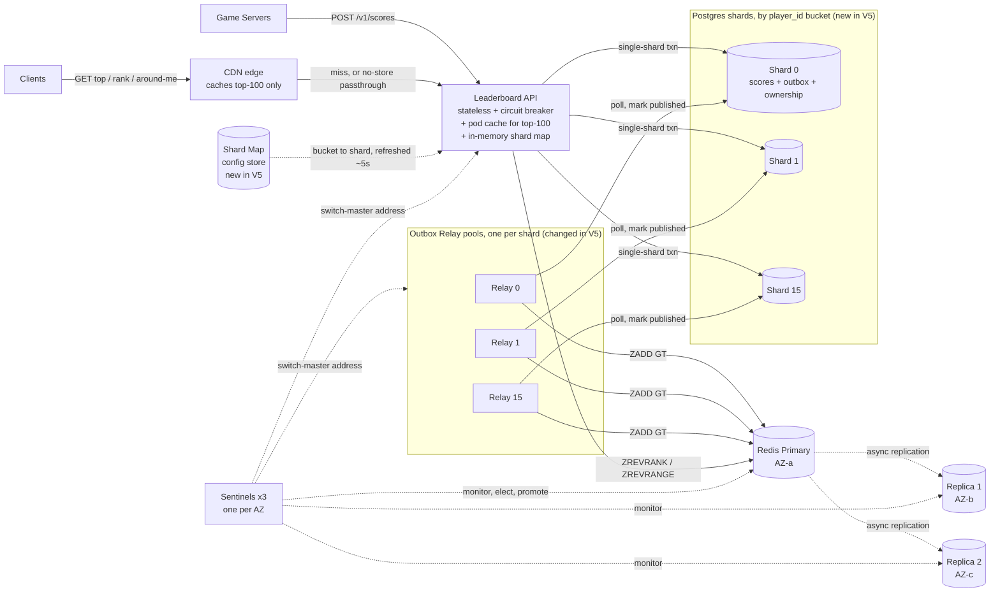

Shards 2 through 14 and relays 2 through 14 are identical and omitted for space. New in V5: the 16 Postgres shards, the shard map and the per-shard relay pools.

**Every end-to-end flow right now**

1. **Write path:** Game server calls `POST /v1/scores`. The API hashes `player_id` to a bucket, looks up the shard in its in-memory `shard_map`, and opens one transaction on that Postgres shard. It checks `bucket_ownership`, upserts `scores` and inserts `score_outbox` for each board, then commits and returns 204. *(Changed in V5.)*
2. **Outbox relay path:** Each shard's Relay pool polls its own `score_outbox` with `SKIP LOCKED`. It pipelines `ZADD GT` into the Redis primary found via Sentinel, then marks the notes published. *(Changed: 16 pools, one per shard.)*
3. **Top-N path:** Unchanged. Client to CDN, then on a miss to an API pod, then pod cache or single-flight `ZREVRANGE 0 99` on the Redis primary.
4. **Exact-rank path:** Unchanged. Through the CDN uncached, then `ZREVRANK ... WITHSCORES` on the Redis primary.
5. **Around-me path:** Unchanged. One `ZREVRANGE r-5 r+5` after the rank lookup.
6. **Replication path:** Unchanged. The Redis primary streams writes asynchronously to both Redis replicas.
7. **Failover path:** The Redis failover is unchanged, except the re-publish of the last 60 seconds of outbox rows now runs on all 16 Postgres shards.
8. **Window rollover and outbox cleanup:** Rollover is unchanged. Cleanup now runs per shard.
9. **Resharding path (new, operator-driven):** The resharding tool backfills a bucket from shard A to shard B. It then fences A through `bucket_ownership`, opens B and updates `shard_map`. Redis is not involved.

## Interview follow-ups

**Q: Why shard by `player_id` and not `board_id`? Isn't a leaderboard naturally per-board?**
Reads are served from Redis, so Postgres only needs to be good at writes. Sharding by `board_id` sends every score to the all-time board's shard, which is a hot shard. It also splits one submit across three shards. With `player_id`, a player's three boards and their outbox rows share one shard, so the write stays a local transaction.

**Q: How do you get the global top 100 when players are spread across 16 shards?**
We don't ask Postgres. The single global ZSET in Redis holds it. For an audit, take the top 100 from each shard and k-way merge 1,600 rows. That is slow, but it's off the hot path.

## Recap

| Concept | The Insight |
|---|---|
| Write throughput, not size | 80M rows fit on one box. 50K transactions per second don't, so we add primaries instead of partitioning for size. |
| Shard key follows the write path | `player_id` keeps a player's three boards and outbox rows in one single-shard transaction. |
| Bucket map | Hash to 1,024 fixed buckets, then map buckets to shards. Growing from 16 to 20 shards moves 20% of rows instead of 80%. |
| Outbox survives sharding | Each shard owns its own outbox in the same transaction, so V2's guarantee holds without 2PC. |
| Live moves | The max-merge upsert makes copy-while-writing safe. The ownership guard fences stale writers. |

**Interview arc:** *"One Postgres primary tops out near 5K of our score transactions per second against a 50K-per-second finale, so I shard by hash of player_id into 1,024 buckets mapped onto 16 primaries, which keeps a player's three boards and outbox rows in one local transaction, spreads load evenly, and lets me add shards by moving buckets instead of rehashing everything."*

## Next

Postgres now takes the burst, and 16 relay pools push 150K `ZADD` per second into the one Redis primary. That primary tops out near 100K. Over a 30-second finale the outbox backlog grows by about 1.5M notes, and Redis runs about 15 seconds behind Postgres.

We can't just split the ZSET by player. `ZREVRANK` on one shard would only give your rank among that shard's players. Say **"next"** for V6: sharding the ranking index itself, where exact global rank is the hard part.


-----------------------------------------------------------------------------------------------------------------------
-----------------------------------------------------------------------------------------------------------------------
-----------------------------------------------------------------------------------------------------------------------
-----------------------------------------------------------------------------------------------------------------------


# V6: Sharding the Ranking Index

**The one concern this version fixes:** one Redis primary can't absorb the write burst that V5 now delivers. Rank availability across shards is a related concern, which I'll cover in the trade-offs.

## Break it

It's 8:00:30pm, the end of the 30-second finale burst. V5 fixed Postgres, so 16 relay pools now drain the outbox at full speed.

Each submit produces up to 3 notes (daily, weekly and all-time), so 50K submits per second means about **150K `ZADD` per second**. All of it goes into one Redis primary. That node runs commands on a single thread, and it tops out near 100K ops per second.

The excess is 50K notes per second. Over the 30-second burst, **1.5M notes** pile up in the outboxes. Draining them takes 15 seconds.

Arjun posts 51,000 at 8:00:30. His note sits behind 1.5M others. At 8:00:40 he refreshes and still sees rank 20,000,413. He sees the new rank at about 8:00:45, which is **15 seconds** later. Our target was 1-2 seconds.

Memory is not the problem. All the ZSETs total about 8GB. This is another write-throughput problem, like V5. Replicas can't help, because they are read-only copies of the same stream.

## The crux, again: exact global rank

We covered what sharding is in V5. The new question is which shard key to use for a structure that answers a *global* question.

A ZSET answers "what's my rank among the members I hold?" Once we split the members, each shard holds only part of the picture. Your exact rank depends on players in every shard.

### Attempt 1: Shard by `hash(player_id)` and run `ZREVRANK` on the owner

*Why it looked reasonable:* It's the same routing that worked in V5. It's even, deterministic and one line of code.

*How it breaks:* Arjun's global rank is 20,000,413. With 8 shards, his shard holds about 6M players, and his shard sees only about 2.5M of them above him.

> **Meera:** Same trick as Postgres. Hash the player, ask that shard for `ZREVRANK`.
>
> **Kabir:** Arjun is 20,000,413th overall. What does his shard say?
>
> **Meera:** About 2.5 million. It only knows the players it holds.
>
> **Kabir:** So it's his rank among one-eighth of the players. Wrong by 8x.

The shard key was fine. The query was wrong.

### Attempt 2: Shard by score range

*Why it looked reasonable:* If shard 0 holds scores above 60K, shard 1 holds 50-60K, and so on, then rank is exact with one command. Rank is the sum of the sizes of all higher shards, plus `ZREVRANK` inside your own shard. Sizes can be cached.

*How it breaks:* Three ways.

1. **Players cross boundaries.** When Arjun goes from 48,200 to 51,000, he moves from one shard to another. That is a `ZREM` on one node and a `ZADD` on another. The two are not atomic, so there is a window where he's in both shards or in neither.
2. **Hot band.** The finale scores cluster. Say 80% of the 150K writes per second land between 40K and 60K. That band lives on one shard, so it takes 120K writes per second. We're back to the original ceiling.
3. **Hot reads.** Every top-100 refresh hits the top-range shard.

### Considered and rejected: shard by `board_id`

It's the same hot shard as in V5. The all-time board takes nearly all the traffic, and one board can't be split.

### The real fix: shard by `hash(player_id)`, then add the counts

Think of a school with 8 exam halls. Priya wants her rank among everyone. She asks each hall, "How many of your students scored above 48,200?" She adds the 8 answers and then adds one.

No hall needs to know about the others. Each keeps its own papers sorted with running counts, so each answers instantly.

This is exact for a simple reason. **Every player lives in exactly one shard.** The partitions don't overlap, so the counts add up without double counting.

```text
rank = 1 + Σ over shards j of  ZCOUNT(shard_j, (my_score, +inf)
```

Each `ZCOUNT` is O(log N). It uses the span counts in the skip list from V1.

**Ties:** The `(` makes the lower bound exclusive. Players with equal scores now share a rank, like V0 and unlike V1. V1's distinct tie ranks were an accident of `ZREVRANK`. The shared rank is the intended behavior.

### Top-N and around-me work the same way

- **Top-N:** Take the top 100 from each shard and merge the 8 lists. The global top 100 is always inside the union of the per-shard top 100s. Any player in the global top 100 is also in the top 100 of their own shard.
- **Around-me:** Take the 5 nearest higher and 5 nearest lower scores from each shard. Merge them and keep the nearest 5 on each side.

### Comparing the options

| Option | Exact rank? | Write spread | Rank cost | Verdict |
|---|---|---|---|---|
| One ZSET per board (V1) | Yes | None | One O(log N) command | Over its ceiling at 150K/s |
| Shard by `board_id` | Yes | None for the big board | One O(log N) command | Hot shard |
| Shard by score range | Only if boundaries hold | Hot score band, cross-shard moves | One command plus cached sizes | Rejected |
| Approximate rank (histogram) | No | n/a | O(1) | Breaks the exact-rank P0 |
| **`hash(player_id)` + scatter `ZCOUNT`** | **Yes (sum)** | **Even** | **8 parallel O(log N)** | **Chosen** |

### How many shards?

Our numbers drive this one. We have 150K writes per second against a 100K ceiling per node.

- **8 shards** gives about 19K writes per second each, around 20% of a node's ceiling. That leaves room for roughly 4x growth.
- **Don't over-shard.** Every rank read fans out to all shards, so each extra shard adds one more call to the slowest-of-N latency.
- **Hotspots:** None from the key. Writes are per player and hash evenly. The per-player rate limit stops one bot from pinning one shard.

### What resharding costs

The index is **derived** from Postgres, so we never rehash it in place. We build the new layout off to the side and flip a pointer. The blast radius is one board, and the old layout keeps serving until the flip. The cost is temporary extra memory for that board.

## Solve it

- ✅ **What we gained:**
  - Write capacity of about 8 x 100K per second against a 150K peak, with even load.
  - Exact global rank, kept exact by the "partitions don't overlap" property.
  - Each shard is only about 1GB, so failover and rebuilds get cheaper.
  - A bulkhead on the outbox. One sick index shard no longer blocks the other seven (shown below).
- ⚠️ **What we gave up:**
  - **Reads fan out.** A rank read costs 1 `ZSCORE` plus 8 parallel `ZCOUNT`, instead of one `ZREVRANK`. At about 3,000 rank reads per second that is about 27K commands per second in total, or about 3.4K per shard. Cheap, but not free.
  - **Not a global snapshot.** Each `ZCOUNT` is exact for its shard, but the 8 calls land at slightly different instants. Error is bounded by the few writes that land during the 1-2ms scatter. That's invisible next to our 1-2 second freshness budget.
  - **Rank availability depends on all 8 shards.** If shard 3 is failing over (10-15 seconds, from V3), an exact rank is impossible. Rank and around-me return 503 with `Retry-After` for that window. Top-100 keeps serving stale from the V4 caches (`stale-if-error`), because a top-100 merged from 7 shards would be wrong.
  - **24 Redis nodes** (8 primaries and 16 replicas), but small ones.
  - Neighbour ranks in around-me are assumed to be `r ± position`, which holds when scores are mostly distinct.
- ❌ **What we considered and rejected:**
  - **A faster single node.** Command execution is single-threaded, so we'd gain maybe 30%, not 4x headroom.
  - **Coalescing duplicate notes per batch.** A finale has about one note per player per board, so there is little to merge.
  - **Redis Cluster slot placement.** It would work, but it doesn't merge `ZCOUNT` across shards, so we'd still write the scatter-gather. It would also replace the Sentinel setup from V3. We stay on replica sets.
  - **Approximate rank.** We keep it as an escape hatch for boards 10x larger. It violates the exact-rank requirement today.

## Implement it

### Redis key shape (first time for a sharded index)

```text
Key:    lb:{board_id}:g{gen}:s{i}        e.g.  lb:ranked:alltime:g1:s3
Type:   ZSET   member = player_id, score = best score
Holds:  only players where index_shard(player_id) == i
Lives:  index shard i = its own Redis primary + 2 async replicas (V3 pattern, x8)
```

The `g{gen}` part is the layout generation. It's what makes resharding a pointer flip.

### Shard function

```python
def index_shard(player_id: int, shards: int) -> int:
    digest = hashlib.md5(str(player_id).encode()).digest()
    return int.from_bytes(digest[4:8], "big") % shards    # bytes 4..8, not 0..4
```

V5's `bucket_of` uses bytes 0 to 4. We use different bytes so that Postgres placement and index placement are independent. Moving a Postgres bucket never moves a player's index shard.

### Schema deltas

```sql
-- on each of the 16 Postgres shards
ALTER TABLE score_outbox ADD COLUMN index_shard SMALLINT NOT NULL DEFAULT 0;
DROP INDEX idx_outbox_pending;
CREATE INDEX idx_outbox_pending ON score_outbox (index_shard, id) WHERE published_at IS NULL;
```

```sql
-- in the config store, next to shard_map
CREATE TABLE board_index_config (
  board_id   TEXT PRIMARY KEY,
  shards     SMALLINT NOT NULL,   -- 1 for small boards, 8 for big ones
  gen        SMALLINT NOT NULL,   -- active layout generation
  next_gen   SMALLINT,            -- set only while a rebuild is running
  next_shards SMALLINT
);
-- boards with no row default to shards=1, gen=1
```

Small boards stay on one shard. Fanning a 10K-player board out to 8 shards would only add latency.

### Who writes, who reads

| Structure | Who writes | Who reads | Lives where |
|---|---|---|---|
| `score_outbox.index_shard` | Leaderboard API, in the same transaction as `scores` | Relay loops (poll filter) | Postgres shards |
| `lb:{board_id}:g{gen}:s{i}` ZSET | Relay loops. Each note goes to the one shard its player hashes to. | Leaderboard API: `ZSCORE` on the owner shard, scatter reads on all | Index shard i's primary |
| `board_index_config` | Operator or resharding tool | API pods and relay pools (in-memory, refreshed about every 5s) | Config store |

### Write path (delta only)

`POST /v1/scores` is unchanged. The outbox insert gains one column, and the value differs per board because shard counts differ per board.

```sql
INSERT INTO score_outbox (board_id, player_id, score, index_shard)
SELECT board_id, player_id, score, $5 FROM improved;
-- $5 = index_shard(player_id, shards_for_this_board)
```

### Relay path: one loop per (Postgres shard, index shard)

```python
rows = pg.fetch("""
  SELECT id, board_id, player_id, score FROM score_outbox
  WHERE published_at IS NULL AND index_shard = %s
  ORDER BY id LIMIT 500 FOR UPDATE SKIP LOCKED""", [i])

pipe = redis_primary[i].pipeline()            # Sentinel name: lbmaster{i}
for r in rows:
    pipe.zadd(f"lb:{r.board_id}:g{cfg(r.board_id).gen}:s{i}",
              {str(r.player_id): r.score}, gt=True)
pipe.execute()                                # then mark published, as in V2
```

Each loop has its own backoff with jitter from V2. If index shard 3 is down, only the loops for `index_shard = 3` back off. Its notes wait, and the other seven shards keep draining. Without the `index_shard` filter, one failed shard's notes would fill every batch and starve the healthy ones.

**Failover re-publish from V3, now scoped:**

```sql
UPDATE score_outbox SET published_at = NULL
WHERE index_shard = $X AND published_at > now() - interval '60 seconds';
```

This runs on all 16 Postgres shards, but only for the one index shard that failed over.

### Sentinel (delta)

```conf
sentinel monitor lbmaster0 10.0.1.10 6379 2
sentinel monitor lbmaster1 10.0.1.11 6379 2
# ... lbmaster2 to lbmaster7 the same shape.
# Each master gets the same down-after, failover-timeout and
# min-replicas-to-write settings as V3.
```

The same 3 Sentinels now watch 8 masters.

### Read path 1: exact rank

```http
GET /v1/boards/ranked:alltime/players/98231
```

1. **Leaderboard API** computes `owner = index_shard(98231, 8)`, say 3.
2. It runs `ZSCORE lb:ranked:alltime:g1:s3 98231` and gets `48200`. A nil result means the player has no score on this board, so it returns 404.
3. It scatters to all 8 shards in parallel:

```text
ZCOUNT lb:ranked:alltime:g1:s0 (48200 +inf     → 2500061
ZCOUNT lb:ranked:alltime:g1:s1 (48200 +inf     → 2499870
ZCOUNT lb:ranked:alltime:g1:s2 (48200 +inf     → 2500112
ZCOUNT lb:ranked:alltime:g1:s3 (48200 +inf     → 2500034
ZCOUNT lb:ranked:alltime:g1:s4 (48200 +inf     → 2499955
ZCOUNT lb:ranked:alltime:g1:s5 (48200 +inf     → 2500078
ZCOUNT lb:ranked:alltime:g1:s6 (48200 +inf     → 2499990
ZCOUNT lb:ranked:alltime:g1:s7 (48200 +inf     → 2500312
```

4. It computes `rank = 1 + sum = 1 + 20,000,412 = 20,000,413`.
5. **Branch:** if any shard doesn't answer within about 50ms, the API returns 503 with `Retry-After: 5`. It does not return a partial sum.

```python
async def rank_of(board, player_id):
    cfg = board_cfg(board)
    owner = index_shard(player_id, cfg.shards)
    score = await redis[owner].zscore(key(board, cfg, owner), str(player_id))
    if score is None:
        raise NotRanked
    counts = await asyncio.gather(*[
        redis[j].zcount(key(board, cfg, j), f"({int(score)}", "+inf")
        for j in range(cfg.shards)])
    return score, 1 + sum(counts)
```

### Read path 2: top-N (V4's `fetch_and_store` changes, the rest does not)

The pod cache, single-flight and stale-while-revalidate logic from V4 are unchanged. Only the fetch changes.

```python
async def fetch_and_store(key_, board):
    cfg = board_cfg(board)
    parts = await asyncio.gather(*[
        redis[j].zrevrange(key(board, cfg, j), 0, 99, withscores=True)
        for j in range(cfg.shards)])                     # 8 x 100 candidates
    merged = heapq.merge(*parts, key=lambda t: -t[1])    # each part is sorted by score desc
    top = list(itertools.islice(merged, 100))
    ...  # serialize and store exactly as in V4
```

Ties at the same score come out in no promised order. A refresh costs 8 commands per pod per 0.5s, which is negligible.

### Read path 3: around-me

1. Get `score` with `ZSCORE` on the owner shard, as in the rank path.
2. On each of the 8 shards, run two commands, pipelined as one round trip per shard:

```text
ZRANGEBYSCORE    lb:ranked:alltime:g1:s{j} (48200 +inf WITHSCORES LIMIT 0 5
ZREVRANGEBYSCORE lb:ranked:alltime:g1:s{j} (48200 -inf WITHSCORES LIMIT 0 5
```

3. Merge the 40 higher candidates ascending and keep the nearest 5. Merge the 40 lower candidates descending and keep the nearest 5.
4. Return the player's rank (from the rank path) with these 10 neighbours and their scores.

### Sequence: exact rank read

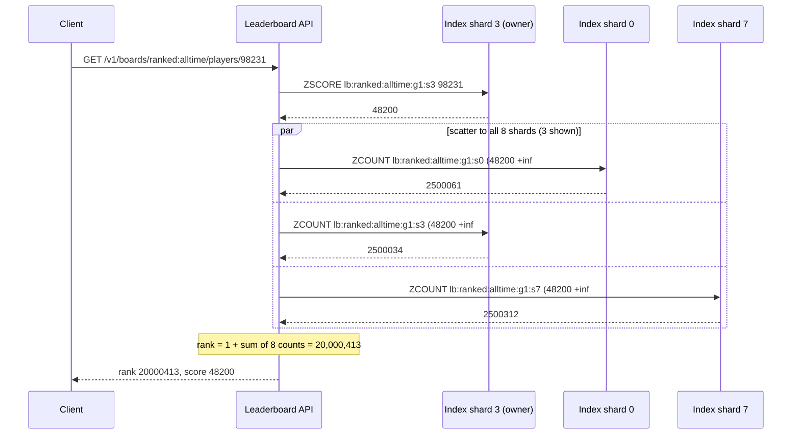

### Resharding the index: rebuild off to the side, then flip

This also moves V5's existing single-ZSET boards into the 8-shard layout.

1. Provision the new shards. Set `next_gen` and `next_shards` on the board's config row. Relay loops now dual-write every note to both layouts with `ZADD GT`.
2. A backfill job streams `SELECT player_id, score FROM scores WHERE board_id = $1` from each Postgres shard and runs `ZADD GT` into the new layout.
3. Verify that the sum of `ZCARD` across the new shards equals the sum of `COUNT(*)` across the Postgres shards, and that outbox lag is near zero.
4. Flip: `UPDATE board_index_config SET gen = 2, shards = 16, next_gen = NULL, next_shards = NULL WHERE board_id = $1`. Pods adopt it within about 5 seconds. Both layouts are complete, so either answers correctly during the switch.
5. Delete the old keys after a grace period.

This is safe to repeat because `ZADD GT` is an idempotent max, the property V2 established.

## Current State (V6)

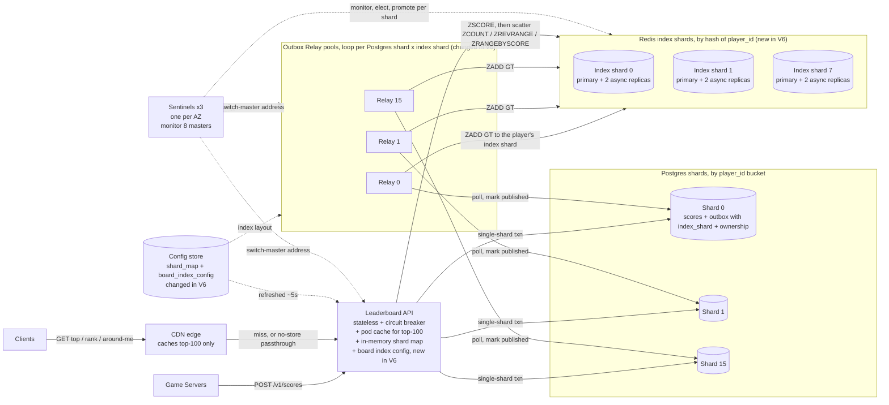

Postgres shards 2 through 14, relays 2 through 14 and index shards 2 through 6 are identical and omitted for space.

**Every end-to-end flow right now**

1. **Write path:** The game server calls `POST /v1/scores`. The API hashes `player_id` to a bucket, finds the Postgres shard and opens one transaction there. It checks `bucket_ownership`, upserts `scores`, and inserts `score_outbox` rows. Each row now carries `index_shard`. It commits and returns 204. *(Changed in V6: the outbox row has `index_shard`.)*
2. **Outbox relay path:** Each relay pool runs one loop per index shard. A loop polls pending notes for its index shard with `SKIP LOCKED` and pipelines `ZADD GT` to that shard's primary, found through Sentinel. It then marks the notes published. A down index shard only stalls its own loops. *(Changed in V6.)*
3. **Top-N path:** The client asks the CDN, which on a miss asks one API pod. The pod serves its cache if fresh or stale. If cold, it runs one single-flight scatter of 8 `ZREVRANGE 0 99`, merges and caches the result. *(Changed in V6: scatter and merge.)*
4. **Exact-rank path:** The request passes through the CDN uncached. The API runs `ZSCORE` on the owner shard, then 8 parallel `ZCOUNT`. Rank is 1 plus the sum. *(Changed in V6.)*
5. **Around-me path:** After the score lookup, the API runs 2 range queries per shard, merges 80 candidates and keeps the nearest 5 on each side. *(Changed in V6.)*
6. **Replication path:** Unchanged in mechanism. It now happens inside each of the 8 index shards.
7. **Failover path:** Each index shard fails over independently using the V3 mechanism. During one shard's 10-15 seconds, top-100 serves stale (V4), and rank and around-me return 503 with `Retry-After`. The 60-second outbox re-publish runs only for that index shard. *(Changed in V6.)*
8. **Window rollover and outbox cleanup:** Unchanged. A new window is a new `board_id`, so its ZSET keys appear on first `ZADD`.
9. **Postgres resharding path:** Unchanged. It never touches Redis.
10. **Index resharding path (new, operator-driven):** Dual-write through the relay, backfill from Postgres, verify counts, then flip `gen` in `board_index_config`.

## Interview follow-ups

**Q: Why not shard by score range, so rank is one command plus an offset?**
Because players cross shard boundaries whenever their score improves. That is a non-atomic `ZREM` plus `ZADD` across two nodes. Scores also cluster. In a finale, most writes land in one band, so one shard takes them. Every top-N refresh hits the top shard too. Hashing by player spreads the load evenly and keeps each player in one place. We pay for it with 8 parallel counts per rank read.

**Q: Doesn't scatter-gather stop scaling as you add shards?**
Yes. Rank latency is the slowest of N calls, and total read load multiplies by N. At 8 shards each call is cheap and parallel, so it's fine. At hundreds of shards I'd stop summing exactly. I'd keep the exact top K in a small ZSET and answer ranks below K from a score histogram, which is approximate. That would be a product decision, since it trades away exact rank for the tail.

## Recap

| Concept | The Insight |
|---|---|
| Why shard Redis | Command execution is single-threaded. 150K writes per second against a 100K ceiling means a 15-second lag. |
| Rank is additive | Every player lives in one shard, so global rank is `1 + Σ ZCOUNT` across shards, with no double counting. |
| Top-N merge | The global top K always sits inside the union of each shard's top K. |
| Shard key | `hash(player_id)` spreads writes evenly. Score range creates a hot band and non-atomic moves between shards. |
| Bulkhead | Tagging outbox rows with `index_shard` means one sick shard stalls only its own slice. |
| New costs | Reads fan out to all shards, and exact rank is unavailable while any one shard fails over. |

**Interview arc:** *"One Redis primary can't take 150K ZADDs per second, and splitting the ZSET by player breaks rank because each shard only sees its own slice, so I shard by hash of player_id and compute rank as one plus the sum of ZCOUNT across all eight shards, which stays exact because the partitions don't overlap, and I merge per-shard top-100s for the leaderboard."*

## Next

Arjun lives in Hyderabad. Every game server, Postgres shard and Redis node is in us-east-1. Each rank read crosses the planet, about 220ms round trip, before any work starts. If us-east-1 has a bad hour, the whole leaderboard goes with it. Say **"next"** for V7: multi-region.


-----------------------------------------------------------------------------------------------------------------------
-----------------------------------------------------------------------------------------------------------------------
-----------------------------------------------------------------------------------------------------------------------
-----------------------------------------------------------------------------------------------------------------------


# V7: Multi-Region

**The one concern this version fixes:** every read pays a trip to us-east-1, and one regional incident takes reads down worldwide. Surviving the loss of a region's *write* side is a separate problem, and I'll flag it at the end.

## Break it

Arjun lives in Hyderabad. Everything we've built runs in us-east-1.

He taps "my rank". The request path is client to CDN, then past the CDN (rank is `no-store`) to an API pod in Virginia. Round trip to Virginia is about 220ms.

- **Cold connection:** TCP, then TLS, then the request. That is 3 round trips, so about **700ms**.
- **Warm connection:** one round trip, so about **230ms**.
- **Inside Virginia** the whole `ZSCORE` plus 8 parallel `ZCOUNT` takes under 10ms. The work is cheap and the distance is the whole cost.

About 60% of players are outside the Americas, so most of the player base pays this.

The second failure is worse. Say us-east-1 has a 47-minute networking incident. Every rank and around-me read worldwide returns 503. Arjun's data is fine, but his reads depend on a region 13,000km away. Top-100 survives on `stale-if-error=30` for 30 seconds, then that goes too.

Both failures have the same root. One region holds everything.

## What multi-region is

Think of a bank with branches in three cities and one vault. Every customer, wherever they are, queues at the vault's city. A branch with its own copy of the ledger can answer "what's my balance?" down the street.

The hard part is keeping the ledgers in step when deposits happen at any branch. So the key question is who is allowed to write.

## Write ownership: the real options

Our writes are scores. They have a property that helps us a lot. A score update is "keep the maximum." Applying a max twice changes nothing, and applying maxes in any order gives the same answer. That is a max register, and it's the reason ownership can be simple here.

| Option | Who owns a player's writes | Index conflicts | Region-loss blast radius (writes) | Verdict |
|---|---|---|---|---|
| Single write region, remote Redis read replicas | us-east-1, for everyone | None | **All** writes stop | Valid and simpler. Fixes reads only. |
| **Per-player home region, full index copy in every region** | The player's home region | None by construction | Only that region's players | **Chosen** |
| Any region writes any player (active-active Postgres) | Whoever receives the request | Two rows for one player to reconcile | Small | Needs multi-master Postgres. Home region avoids that. |
| Per-board home region | One region per board | None | One board | The all-time board is hot again, like V5 and V6. |

### How conflicts are avoided, and resolved if they happen

Two layers.

1. **Postgres has one writer per row.** A player's rows live only in their home region. Two regions can't create competing versions.
2. **The index merges safely.** Every note is `ZADD GT`, a max. Duplicates, reordering, relay replays and even two writers all converge to the same value.

Layer 2 depends on a scoping answer from the start: best score wins, scores don't go down. If scores could decrease, a max would be wrong and we'd need version numbers.

### Which region is a player's home?

Chosen once at signup from the country, and encoded in the top bits of `player_id`. Routing needs no lookup. A player who moves countries keeps their home. Only their writes cross an ocean, and their reads are local anyway.

## Solve it

Three changes, all one mechanism: a full copy of the ranking index in every region, fed by the player's home region.

1. Three regions: `us-east-1` (code 0), `eu-west-1` (1), `ap-south-1` (2).
2. Each region runs the V5 Postgres shards for its own players, and the V6 index shards holding **all** players.
3. Each home region's relay delivers every note to all three regions' indexes. Reads are served from the nearest region.

- ✅ **What we gained:**
  - Arjun's rank tap drops from 230-700ms to about **20-60ms**, since both client and index are in Mumbai.
  - A region outage no longer takes down reads worldwide. DNS steers clients to the next-nearest region.
  - A dead region stops only the writes of players homed there, about 1/3 of players at worst, not everyone.
  - Each region's Postgres carries only its own players' write load.
- ⚠️ **What we gave up:**
  - **Cross-region staleness.** A note takes the outbox lag (about 0.2s) plus a WAN trip (about 0.2-0.3s). Two users in different regions can see slightly different top-100s for about a second.
  - **The V4 staleness budget gets one more term.** Worst case for a remote top-100 is about 0.2 outbox + 0.3 WAN + 0.5 pod + 0.5 CDN = **about 1.5s**. To stay inside it, the CDN `max-age` drops from 1s to 0.5s.
  - **Per-target delivery tracking.** In V3 I rejected hand-rolled dual-write because the outbox tracks one published state. With three targets that need returns, so we add a per-region delivery bitmask.
  - **3x the index memory.** About 72 small Redis nodes, 24 per region.
  - **Loops contend on the same rows.** `SKIP LOCKED` makes them take turns, costing at most one poll interval.
  - **Non-home writes cross the WAN.** A traveling player's submit takes an extra 200ms hop. The game server isn't waiting on a human, so that's fine.
  - **A home region's write side is still a single point of failure.** That is the next version.
- ❌ **What we considered and rejected:**
  - **Redis `replicaof` across regions.** A replica can only follow one primary, so remote indexes couldn't accept notes from all three home regions.
  - **Multi-master Postgres.** The max rule would make it converge, but we'd run bidirectional replication to avoid a problem that home-region ownership removes.
  - **Approximate remote ranks.** The exact-rank requirement still holds.

## Implement it

### Player ID layout and home region

```text
player_id (64-bit):  [ 8 bits region code | 56 bits sequence ]
region_of(player_id) = player_id >> 56          # 0=us-east-1, 1=eu-west-1, 2=ap-south-1
```

```python
def region_of(player_id: int) -> int:
    return player_id >> 56
```

This is a third, independent split. V5's `bucket_of` uses md5 bytes 0-4, V6's `index_shard` uses bytes 4-8, and region comes from the ID bits.

### Schema delta (every Postgres shard)

```sql
ALTER TABLE score_outbox ADD COLUMN delivered_mask SMALLINT NOT NULL DEFAULT 0;
-- bit 0 = us-east-1, bit 1 = eu-west-1, bit 2 = ap-south-1; 7 = delivered everywhere

DROP INDEX idx_outbox_pending;
CREATE INDEX idx_outbox_pending ON score_outbox (index_shard, id)
  WHERE delivered_mask <> 7;
```

`published_at` now means "delivered to all three." The V2 cleanup job is unchanged.

### Who writes, who reads

| Structure | Who writes | Who reads | Lives where |
|---|---|---|---|
| `scores`, `score_outbox` | Leaderboard API in the player's **home** region | Relay loops, rebuild jobs | Home region's Postgres shards |
| `score_outbox.delivered_mask` | Relay loops, one bit per target | Relay loops, cleanup job | Same shard |
| `lb:{board_id}:g{gen}:s{i}` ZSET, in **each** region | Relay loops from **all** home regions, via `ZADD GT` | Leaderboard API in that region only | That region's Redis index shards |
| `board_index_config` | Operator or resharding tool | API pods and relays in every region | Config store, replicated to all regions (small, changes rarely) |
| Latency-routing DNS records | Operator | Clients' resolvers | GeoDNS |

### Write path

`POST /v1/scores` keeps the same body. The API adds one decision.

1. **Leaderboard API** (in the region that received it) computes `home = region_of(player_id)`.
2. **Branch: home equals this region.** Run the V5/V6 write unchanged: ownership guard, 3 upserts, 3 outbox inserts (with `index_shard` and `delivered_mask = 0`), commit, return `204`.
3. **Branch: home differs.** Forward the request to the home region's API:

```http
POST https://api.ap-south-1.internal/v1/scores
X-Forwarded-Region: us-east-1
{ "player_id": 2305843009213693952, "match_id": "m_7f3a", "score": 48200, ... }
```

4. If the home region answers, return its status to the game server.
5. **Branch: the home region is unreachable.** Return `503`. The game server retries later. Retries are safe because the upsert only applies a higher score.

Board IDs come from the match's UTC end time in the request body, not from any server's clock. Two regions can never disagree about which daily board a match belongs to.

### Relay: one loop per (Postgres shard, index shard, target region)

```python
POLL_SQL = """
  SELECT id, board_id, player_id, score FROM score_outbox
  WHERE index_shard = %s AND (delivered_mask & %s) = 0
  ORDER BY id LIMIT 500 FOR UPDATE SKIP LOCKED"""

MARK_SQL = """
  UPDATE score_outbox
  SET delivered_mask = delivered_mask | %s,
      published_at = CASE WHEN (delivered_mask | %s) = 7 THEN now() END
  WHERE id = ANY(%s)"""

def run_loop(pg_shard, index_shard, target):          # target = 0, 1 or 2
    bit = 1 << target
    with pg[pg_shard].transaction():
        rows = pg[pg_shard].fetch(POLL_SQL, [index_shard, bit])
        if rows:
            pipe = redis_primary[target][index_shard].pipeline()   # that region's Sentinel
            for r in rows:
                pipe.zadd(f"lb:{r.board_id}:g{cfg(r.board_id).gen}:s{index_shard}",
                          {str(r.player_id): r.score}, gt=True)
            pipe.execute()                           # one WAN round trip per batch
            pg[pg_shard].execute(MARK_SQL, [bit, bit, [r.id for r in rows]])
```

Four details:

- **Discovery:** the relay asks the *target region's* Sentinels for that region's master, so a remote failover is handled the V3 way.
- **Bulkhead:** each target has its own backoff, jitter and circuit breaker. A dead region stalls only its own bit. The other two keep delivering.
- **Throughput:** a batch of 500 per WAN round trip gives about 2K notes per second per loop, and there are 128 loops per target. That clears a 150K per second peak with room to spare. Loops sleep when idle.
- **Retention:** rows stay until all three bits are set. If a region is down for hours, the outbox grows. Past a size cap, we rebuild that region's index (V6's rebuild path, using a temporary `replicaof` from a healthy peer to seed it) and clear its bit.

### Failover re-publish (V3 rule, now per target)

When region X's index shard `s` fails over, re-send only to that region and shard:

```sql
UPDATE score_outbox
SET delivered_mask = delivered_mask & ~$bit_x, published_at = NULL
WHERE index_shard = $s AND created_at > now() - interval '60 seconds';
```

### Reads: everything stays local

The API in each region reads only its own index. The V6 rank, top-N and around-me code is **unchanged**. Only the routing in front of it changes.

```text
api.leaderboard.example  latency-based records
  ap-south-1  → ALB-ap    health check: GET /healthz/ready, every 10s, fail after 3 misses
  eu-west-1   → ALB-eu    same
  us-east-1   → ALB-us    same
```

`/healthz/ready` fails when the API is down or its remote-delivery lag is over 30 seconds. Three misses (30s) are required before DNS flips, so a normal 10-15 second shard failover doesn't make traffic leave the region.

### CDN header delta

```http
Cache-Control: public, max-age=0.5, stale-while-revalidate=2, stale-if-error=30
```

### Sequence: write in the home region, fan out, read locally

```mermaid
sequenceDiagram
    participant GS as Game Server (Mumbai)
    participant API as API ap-south-1
    participant PG as Postgres shard (ap-south-1)
    participant RL as Relay loops (ap-south-1)
    participant IA as Index ap-south-1
    participant IU as Index us-east-1
    participant IE as Index eu-west-1
    participant C as Client (Hyderabad)

    GS->>API: POST /v1/scores (player homed ap-south-1)
    API->>PG: BEGIN; guard; 3x (upsert + outbox, mask=0); COMMIT
    API-->>GS: 204
    par three loops, one per target
        RL->>IA: ZADD GT (about 5 ms)
        IA-->>RL: ok
        RL->>PG: mask |= 4
    and
        RL->>IU: ZADD GT (WAN, about 220 ms)
        IU-->>RL: ok
        RL->>PG: mask |= 1
    and
        RL->>IE: ZADD GT (WAN, about 130 ms)
        IE-->>RL: ok
        RL->>PG: mask |= 2, published_at = now() when mask is 7
    end
    C->>API: GET /players/{id} (latency routing picks ap-south-1)
    API->>IA: ZSCORE, then 8x ZCOUNT in parallel
    IA-->>API: score, counts
    API-->>C: rank (about 30 ms end to end)
```

## Current State (V7)

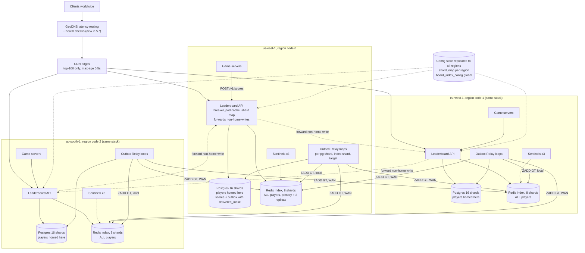

Inside each region, the 16 Postgres shards, the 8 index shards and the relay pools are exactly the V5/V6 layout. New in V7: the regions, GeoDNS, the home-region rule, WAN delivery with `delivered_mask`, and request forwarding.

**Every end-to-end flow right now**

1. **Write path, home region:** The game server calls `POST /v1/scores` on its local API. The API sees that `region_of(player_id)` matches its own region. It opens one transaction on the right Postgres shard, checks `bucket_ownership`, upserts `scores`, inserts outbox rows (`delivered_mask = 0`) and commits. It returns 204. *(Unchanged from V6 apart from the mask column.)*
2. **Write path, non-home region (new):** The local API sees that the home region differs. It forwards the request to the home region's API, which runs flow 1. If that region is unreachable it returns 503 and the game server retries.
3. **Relay delivery path (changed):** Each home region runs one loop per (Postgres shard, index shard, target region). Each loop polls rows whose bit for its target is unset, pipelines `ZADD GT` to that region's index shard primary, then sets the bit. `published_at` is set when all three bits are set.
4. **Top-N path:** Unchanged in logic. The client reaches the nearest CDN edge, which on a miss asks a pod in the nearest region. The pod serves its cache or does one single-flight 8-shard scatter on its **local** index. CDN `max-age` is now 0.5s. *(Changed.)*
5. **Exact-rank path:** Unchanged in logic. GeoDNS sends the client to the nearest healthy region. The API runs `ZSCORE` plus 8 parallel `ZCOUNT` on its local index. *(Changed: local, not Virginia.)*
6. **Around-me path:** Unchanged in logic and local, with the same merge as V6.
7. **Replication path:** Unchanged in mechanism. Each index shard replicates within its own region.
8. **Index failover path:** Unchanged in mechanism, per region. The 60-second re-publish now clears only the failed region's bit and only for that index shard.
9. **Region-unhealthy path (new):** A region that fails 3 health checks is removed from DNS. Clients are steered to the next-nearest region, which serves from its own full index copy. Writes for players homed in the dead region return 503 until it returns.
10. **Window rollover and outbox cleanup:** Unchanged. Board IDs use the match's UTC end time.
11. **Postgres resharding path:** Unchanged, within one region.
12. **Index resharding path:** Unchanged in steps. It runs in all three regions and the `gen` flip is one replicated config row.

## Interview follow-ups

**Q: Why not one write region with Redis replicas in the other two? It's much simpler.**
For a read-latency problem alone, it is, and I'd pick it. It needs no delivery tracking and no home-region logic. I chose per-player home regions for write-side reasons. A region outage stops 1/3 of players' writes instead of all of them. Each region's Postgres carries only its own load. And most submits stay local with no WAN hop in the transaction. It's safe because scores are max registers, so the index tolerates multiple writers.

**Q: What happens if two regions write the same player at the same time?**
Postgres can't see this, because only the home region writes a player's row. If a forwarded write somehow lands twice, or a relay replays, the index receives two `ZADD GT`. A max is idempotent, commutative and associative, so both orders give the same score. This relies on scores never decreasing. If they could, I'd add a version number and compare `(version, score)` instead of taking a max.

## Recap

| Concept | The Insight |
|---|---|
| Why go multi-region | Distance dominates. The rank work takes 10ms and the trip to Virginia takes 220ms. One region is also one failure domain. |
| Ownership by home region | One writer per player's Postgres rows, so there is nothing to reconcile in the source of truth. |
| Max register | `ZADD GT` is idempotent and order-independent, so every region's index converges without coordination. |
| Per-target delivery | `delivered_mask` gives each region its own progress, and a dead region stalls only its own bit. |
| Staleness budget | Outbox, WAN, pod and CDN lags add up to about 1.5s. We cut the CDN TTL to stay inside the target. |

**Interview arc:** *"Serving every rank read from one region costs 700ms for a player in Hyderabad and takes reads down worldwide when that region fails, so I give each player a home region that owns their writes and keep a full copy of the ranking index in every region fed by idempotent max-merge notes, which makes reads local and conflict-free without needing multi-master Postgres."*

## Next

The ap-south-1 region goes dark for 4 hours. Reads everywhere are fine, because the other two regions hold full indexes. But the 15M players homed in Mumbai can't submit a score, and their scores in the dead region's Postgres are unreachable. When the region returns, every game server retries at once. Say **"next"** for V8: surviving the loss of a home region's write side.


-----------------------------------------------------------------------------------------------------------------------
-----------------------------------------------------------------------------------------------------------------------
-----------------------------------------------------------------------------------------------------------------------
-----------------------------------------------------------------------------------------------------------------------


# V8: Surviving the Loss of a Home Region's Write Side

**The one concern this version fixes:** each home region's Postgres lives in one region only. That hurts both write availability and durability. Knowing the system is healthy and fresh is a separate problem, and I'll flag it at the end.

## Break it

It's 3:10pm and ap-south-1 goes dark. It stays dark for 4 hours. Reads are fine, because eu-west-1 and us-east-1 hold full index copies.

Writes are not fine. Three things break.

**1. Writes for 15M players fail.**
- Average load is about 2,000 submits per second worldwide.
- One third of players are homed in ap-south-1, so about **670 submits per second** return 503.
- Over 4 hours that is **9.6M rejected submits**.
- Nobody homed in Mumbai moves on the leaderboard all afternoon.

**2. Committed scores are stranded.**
- Arjun posted 51,000 at 3:09:59.8pm. It committed in Mumbai's Postgres.
- Delivery to the eu and us indexes takes about 0.3s, so it never arrived.
- DNS sends him to eu-west-1, whose index still says 48,200.
- His accepted score is invisible until Mumbai returns.

**3. If the region is lost for good, so is the data.**
- Mumbai's Postgres is the only copy of about **27M rows**, one third of the 80M total.
- The other regions' Redis indexes hold roughly the same scores. But they are derived, asynchronous and best-effort, and they're not a database.

Both the outage and the loss have one root. The source of truth for a home region exists in exactly one region.

## Is replication justified here?

Yes, but for durability and failover, not read scaling. Postgres reads are rare, because Redis serves every rank read. These standbys will serve no reads.

This is the same async replication idea from V3, now applied to Postgres. The primary streams its write-ahead log (WAL) to a standby, which replays it.

## The naive attempts

This isn't the crux, so I'll keep the walk short.

### Attempt 1: Game servers buffer and retry until the region returns

*Why it looked reasonable:* Nothing is lost if every submit is eventually retried.

*How it breaks:*
- Buffered submits live in game-server memory. A deploy or crash loses them.
- Buffering 4 hours is 9.6M submits, about 3GB fleet-wide.
- At recovery every server retries at once. Drained in 60 seconds, that is about **160K submits per second** into a cold region whose 16 shards sustain about 80K.
- If the disks are gone, retries accomplish nothing.

### Attempt 2: A surviving region accepts writes for the dead region's players

*Why it looked reasonable:* eu-west-1 is healthy, so let it take the writes.

*How it breaks:* eu's shards hold none of these players' history. The best-score guard compares a new score against nothing, so a worse score is accepted as an improvement. When Mumbai returns, two diverging copies exist, and nothing in eu was ever a durable copy of the old data.

### Attempt 3: Rebuild the dead region's Postgres from the surviving Redis indexes

*Why it looked reasonable:* The indexes already hold every player's best score.

*How it breaks:* The indexes are asynchronous and derived. They hold no outbox, no `updated_at` and no match history. A rebuild from them looks complete but quietly drops whatever the indexes hadn't received. This is a last-resort path, not a plan.

## The real fix: an asynchronous standby in another region, plus a controlled promotion

Think of a bank's disaster-recovery site. A second branch keeps a near-live copy of the ledger. If the main branch burns down, the manager makes one deliberate call, and the second branch starts serving. The hard part is making sure the old branch can never open again as if nothing happened.

### Sync or async?

| Mode | Commit latency | Data lost on region loss | If the standby is unreachable | Verdict |
|---|---|---|---|---|
| **Async** | +0 | Last 0.1-1s of commits | Writes continue | **Chosen** |
| Synchronous to one remote standby | +130ms per commit. At 5K tps that is about 650 commits in flight per shard instead of about 25. | None | Commits block | Rejected |
| Quorum (`ANY 1` of two remote standbys) | +130ms to the nearer one | None | Continues if one remote is up | Rejected: latency on every write |

**Why async is acceptable here:** A lost score is a max register. The game backend keeps recent match results, so lost submits can be replayed. I show that in the implementation. We accept a loss window of under a second to avoid adding 130ms to every write.

### Where do standbys live?

Each home region's standbys sit in the nearest other region.

| Home region | Standby region | Round trip |
|---|---|---|
| us-east-1 | eu-west-1 | about 75ms |
| eu-west-1 | us-east-1 | about 75ms |
| ap-south-1 | eu-west-1 | about 130ms |

### Who decides to fail over? This is a known sub-problem, so here are the real options

| Option | Mechanism | Sketch | Fits us? |
|---|---|---|---|
| **Operator-approved runbook with fencing** | A human confirms the outage. A script promotes the standbys, bumps an epoch and flips the region map. | `failover-region --home 2 --to 1` | **Chosen** |
| Patroni plus etcd across 3 regions | A cross-region quorum elects and promotes automatically. | leader key in etcd, `patronictl failover` | Valid later. Every leader renewal then depends on WAN quorum. |
| Managed global database | The provider promotes a secondary cluster. | the provider's global-cluster failover API | Valid on a managed platform. Same mechanism, hidden. |

**Why a human decides:** A false positive costs a data-loss window and a failback. A blip shorter than 15 minutes is absorbed by game-server retries. So a rare, expensive decision gets a person. The cost is about 10 extra minutes of downtime.

### Fencing: making sure the old region can't write after the flip

Two guards.

1. **A write lease.** A pod that can't refresh the region map within 30 seconds refuses writes. By the time an operator promotes, at 5+ minutes, every pod in the dead region has already stopped.
2. **An epoch in the database.** Every write transaction checks that the shard's epoch matches the one in the region map. After promotion the epoch is higher. A stale writer hitting an old primary is rejected once that primary comes back.

Even if a split brain slipped through, V7's property saves us. Scores are max registers. Two diverged copies reconcile with the same max-merge upsert used for resharding in V5.

## Solve it

- ✅ **What we gained:**
  - **Write recovery in about 10-15 minutes**, not 4 hours or forever.
  - **Durability:** a lost region loses under a second of commits, and those are replayable.
  - **No write-path latency cost.** Replication is async and off the commit path.
  - **Contained blast radius.** Only one region's players are affected, and the other two regions never notice.
- ⚠️ **What we gave up:**
  - **A loss window (RPO) of about 0.1-1s.** Acked submits in that window can vanish from Postgres. We heal them with replay.
  - **Another consistency subtlety.** The surviving indexes can be *ahead* of the promoted Postgres, because index delivery is faster than WAL shipping. So we never rebuild an index from the promoted Postgres before replay completes.
  - **About 100% more Postgres cost.** That is 48 more shard nodes across the three regions. eu-west-1 hosts standbys for both us-east-1 and ap-south-1.
  - **A slot-retention risk.** A standby that is down makes its primary keep WAL until the disk fills. We cap this, and past the cap the standby must be re-seeded.
  - **Operational weight.** Failback is a real procedure, shown below.
  - **In-region failover touches the stream.** When V5's AZ standby takes over, the cross-region stream must re-point.
- ❌ **What we considered and rejected:**
  - Synchronous or quorum replication.
  - Game-server buffering as the only defense.
  - Writing into another region's existing shards.
  - Rebuilding from Redis.
  - Multi-master Postgres, which V7 already rejected.
  - Automatic cross-region promotion, for now.

## Implement it

### Who writes, who reads

| Structure | Who writes | Who reads | Lives where |
|---|---|---|---|
| WAL stream of each home shard | Postgres primary (not our code) | Its standby shard | Primary's region, to the paired region |
| Standby shards | Postgres replication | Nobody until promotion | Paired region |
| `region_epoch` (per shard) | Promotion script | Leaderboard API (guard inside every write transaction) | Each Postgres shard, replicated to its standby |
| `region_map` and `shard_hosts` | Promotion script only | API pods and relay pools in all regions (about 5s refresh) | Config store |
| Replayed match results | Game backend | Leaderboard API, through `POST /v1/scores` | Game backend's durable match log |

### Cross-region replication config

On each ap-south-1 primary shard:

```conf
wal_level = replica
max_wal_senders = 4
synchronous_commit = on                  # local durability only
# synchronous_standby_names unset        -> remote standby is async
max_slot_wal_keep_size = 50GB            # cap on WAL held for a lagging standby
```

```sql
SELECT pg_create_physical_replication_slot('standby_eu_k');   -- k = shard number
```

On the matching standby in eu-west-1:

```conf
primary_conninfo  = 'host=pg-ap-k.internal user=replicator'
primary_slot_name = 'standby_eu_k'
hot_standby       = on
```

Replication lag is read on the standby with `SELECT now() - pg_last_xact_replay_timestamp();`. The outbox and `delivered_mask` are ordinary tables, so they replicate too.

### Schema deltas

On each Postgres shard:

```sql
CREATE TABLE region_epoch (
  home_region SMALLINT PRIMARY KEY,
  epoch       BIGINT   NOT NULL
);
```

In the config store, next to `shard_map`:

```sql
CREATE TABLE region_map (
  home_region    SMALLINT PRIMARY KEY,   -- 0, 1, 2
  serving_region SMALLINT NOT NULL,      -- who currently serves its writes
  epoch          BIGINT   NOT NULL,
  version        BIGINT   NOT NULL
);

CREATE TABLE shard_hosts (
  home_region SMALLINT NOT NULL,
  shard_id    SMALLINT NOT NULL,
  host        TEXT     NOT NULL,         -- where this shard currently runs
  epoch       BIGINT   NOT NULL,
  PRIMARY KEY (home_region, shard_id)
);
-- initially serving_region = home_region and host = the home region's own primary
```

### Write path (delta only)

`POST /v1/scores` is unchanged. Routing now asks who is *serving*, not who is home.

```python
async def submit(req):
    home = region_of(req.player_id)
    m = REGION_MAP[home]                              # refreshed every ~5s
    if m.serving_region != MY_REGION:
        return await forward(m.serving_region, req)   # V7 forwarding, to the serving region
    if time.monotonic() - m.refreshed_at > 30:        # write lease: cannot prove ownership
        return Response(503, headers={"Retry-After": "5"})
    shard = SHARD_MAP[home][bucket_of(req.player_id)]
    dsn = SHARD_HOSTS[(home, shard)]
    # run the V6 transaction on dsn, with the guard below as its first statement
```

The guard extends V5's ownership check with the epoch:

```sql
SELECT 1
FROM bucket_ownership b, region_epoch e
WHERE b.bucket = $1 AND b.owned
  AND e.home_region = $2 AND e.epoch = $3
FOR SHARE OF b, e;
```

**Branch:** no row means the API holds a stale map, or it's talking to a fenced old primary. It rolls back, refreshes the map and retries once. If that still fails, it returns 503.

### Short-outage layer: game-server retry and admission control

```python
delay = min(60, 2 ** attempt) * random.uniform(0.5, 1.5)    # backoff with jitter
# queue up to 15 min in memory, then rely on the game backend's durable match log
```

The serving region runs a token bucket for each promoted home region, at about 40K submits per second. Excess gets `429` with `Retry-After`. After a 15-minute outage the backlog is about 600K submits, which drains in about 15 seconds.

### Promotion runbook: ap-south-1 to eu-west-1

1. **Confirm.** The region has failed health checks for 5+ minutes. Check that the 30-second lease has long expired for every ap-south-1 pod.
2. **Promote each of the 16 standbys:** `SELECT pg_promote();`
3. **Bump the epoch on each promoted shard:**

```sql
UPDATE region_epoch SET epoch = epoch + 1 WHERE home_region = 2;
```

4. **Flip the map**, in one config-store transaction:

```sql
UPDATE shard_hosts SET host = 'pg-eu-ap-' || shard_id, epoch = epoch + 1 WHERE home_region = 2;
UPDATE region_map  SET serving_region = 1, epoch = epoch + 1, version = version + 1
WHERE home_region = 2;
```

5. **Within about 5 seconds** every API pod and relay pool adopts the new map. Pods in eu start accepting writes for home-2 players. Pods elsewhere forward them to eu.
6. **Start relay loops** next to the promoted shards. They deliver any outbox rows with unset bits to all three index regions. No reset is needed. A bit is set only after its `ZADD` succeeds, so bits only ever lag the truth. The loops for ap-south-1's own index stall on their bit and everything else keeps flowing, which is V7's bulkhead.
7. **Replay.** The game backend re-sends match results from `detected_at - 10 min` for affected players. Same body and same `match_id`. The max upsert makes each one a no-op unless it recovers a lost score.
8. **Only after replay finishes**, allow any index rebuild from the promoted Postgres.

### Failback

1. When ap-south-1 returns, its old primaries are **never** put back into service. They may hold a diverged tail.
2. Re-seed them as standbys of the promoted shards in eu-west-1 (`pg_rewind`, or a fresh `pg_basebackup`). The diverged tail is discarded, and replay already covered it.
3. Wait until lag is near zero.
4. During a quiet hour, do a planned switchover. Fence writes for a few seconds, promote the ap-south-1 copies, bump the epoch again and flip `region_map` back.
5. The index in ap-south-1 catches up by itself. Every outbox row with the ap-south-1 bit unset is delivered, with no operator action.

### Sequence: home-region failover

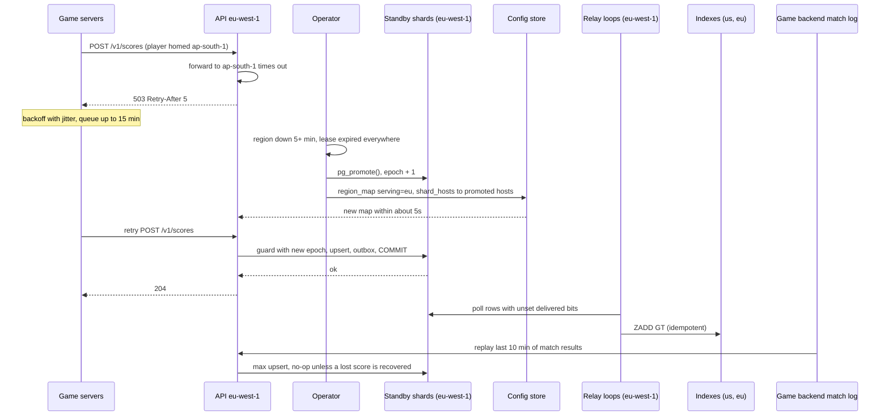

## Current State (V8)

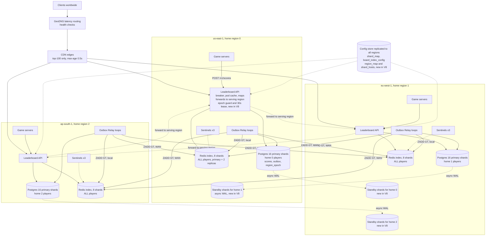

Inside each region, the 16 Postgres shards, 8 index shards, relay pools and Sentinels follow the V5-V7 layout. New in V8: the cross-region standbys, `region_map`, `shard_hosts`, `region_epoch`, the write lease and the promotion procedure.

**Every end-to-end flow right now**

1. **Write path, this region is serving:** The game server calls `POST /v1/scores`. The API looks up `REGION_MAP[home].serving_region` and sees its own region. It checks the 30s lease. It opens one transaction on the right Postgres shard, runs the combined ownership and epoch guard, upserts `scores`, inserts outbox rows (`delivered_mask = 0`), commits and returns 204. *(Changed in V8: serving region, lease, epoch guard.)*
2. **Write path, another region is serving:** The local API forwards to the serving region's API. If that region is unreachable, it returns 503 with `Retry-After`. Game servers back off with jitter. *(Changed: forwards to serving, not home.)*
3. **Relay delivery path:** Unchanged. Each loop polls rows whose bit for its target is unset, pipelines `ZADD GT` to that region's index shard, then sets the bit. `published_at` is set when all three bits are set.
4. **Top-N path:** Unchanged. CDN, then a pod in the nearest region, then pod cache or one single-flight 8-shard scatter on the local index.
5. **Exact-rank path:** Unchanged. `ZSCORE` on the owner shard, then 8 parallel `ZCOUNT` on the local index.
6. **Around-me path:** Unchanged.
7. **Redis replication path:** Unchanged, inside each index shard.
8. **Redis index failover path:** Unchanged.
9. **Region-unhealthy path:** Reads steer to the next-nearest region, as in V7. Writes for the dead region's players get 503 with backoff for up to about 15 minutes, until step 11 completes. *(Changed.)*
10. **Postgres replication path (new):** Every primary shard streams WAL asynchronously to its standby in the paired region. Outbox and mask state replicate with it.
11. **Home-region failover path (new, operator-driven):** Promote the 16 standbys, bump the epoch, flip `region_map` and `shard_hosts`, start relay loops beside the promoted shards, then replay the last 10 minutes of match results.
12. **Failback path (new):** Re-seed the old primaries as standbys. Then switch over in a quiet window.
13. **Window rollover and outbox cleanup:** Unchanged. Cleanup deletes run on the primary and replicate.
14. **Postgres and index resharding paths:** Unchanged in steps. Postgres bucket moves replicate to standbys through WAL.

## Interview follow-ups

**Q: Why not synchronous replication so you lose nothing?**
Because it puts 130ms of cross-ocean latency on every commit. At 5K transactions per second per shard, that is about 650 commits waiting at once instead of about 25. It also makes writes depend on the standby being reachable. A score is a max register, and the game backend keeps recent match results. So I take a loss window under a second and replay it, which is cheaper than slowing every write.

**Q: How do you stop the old region writing after you promote?**
Two layers. A write lease makes every pod stop writing if it can't refresh the region map within 30 seconds. We promote only after 5+ minutes, so the old pods are already silent. The epoch guard inside every transaction then rejects any stale writer that reaches a fenced primary. If both failed, max-merge reconciles the two copies, because scores only go up.

## Recap

| Concept | The Insight |
|---|---|
| Home region as a single copy | One region holding the only Postgres for its players is both an availability gap and a durability gap. |
| Async standby in another region | Costs nothing on the write path. The price is a loss window of under a second. |
| Replay is safe | Max upserts and `match_id` make re-sending the last 10 minutes harmless. |
| Fencing | A write lease plus a database epoch means the old region can't write after the flip. |
| Human in the loop | A rare, expensive decision gets a person. Retries absorb the short blips. |

**Interview arc:** *"Each home region's Postgres was the only copy of its players' scores, so a regional outage meant 4 hours of rejected writes and a regional disaster meant data loss, so I stream WAL asynchronously to a standby in another region, promote it by an operator-approved runbook that fences the old region with a write lease and an epoch, and replay the last ten minutes of match results through idempotent max upserts to heal the sub-second loss window."*

## Next

It's 9:40am the next Tuesday. Arjun's rank has been 40 seconds behind for ten minutes. A relay loop is silently stuck on one index shard. Every dashboard is green, because we alert on uptime and not on freshness. Say **"next"** for V9: observability and freshness SLOs.


-----------------------------------------------------------------------------------------------------------------------
-----------------------------------------------------------------------------------------------------------------------
-----------------------------------------------------------------------------------------------------------------------
-----------------------------------------------------------------------------------------------------------------------


# V9: Observability and Freshness SLOs

**The one concern this version fixes:** we can't tell when the leaderboard is stale. A poison note that blocks a lane is a separate problem, and I'll cover it in the follow-ups.

## Break it

It's 9:40am on a Tuesday. One relay lane has stalled. The lane is Postgres shard 7 in ap-south-1, delivering to index shard 3 in us-east-1.

The cause is a gap in V7. The relay's remote Redis clients were built with library defaults, which means no socket timeout. A packet-loss event on the Mumbai-to-Virginia link left a half-open connection. Each batch now waits about 40 seconds for the OS to give up. The loop reconnects and hits the same problem again.

Here is the damage.

- The lane covers 1/16 of Postgres shards and 1/8 of index shards. That is **1/128** of Mumbai-homed players, about **117K players**.
- That slice submits about 5 scores per second. In 10 minutes, about **3,100 submits** reach the us-east-1 index 40 seconds late.

Who notices? Meera in New York looks up her friend Arjun's rank. Arjun posted a new high score 10 minutes ago. Meera still sees the old rank. Arjun, in Hyderabad, sees the new one. The same player has two answers, depending on who is looking.

Every dashboard is green. All processes are up and API 5xx is 0.0%. Redis and Postgres are healthy. We alert on uptime, not on freshness. The first signal is a support ticket at 9:50.

There are three blind spots.

1. **Nothing alerts on staleness.** V2 named the metric "oldest unpublished note" and we never wired it to anything.
2. **The relay is the only thing that knows its own lag.** When a loop hangs, it can't report that it's hung.
3. **Nobody reads from all three regions.** A check run from Mumbai would have passed.

## What "fresh" means

Freshness is the time between the API returning `204` and the new score being visible through the public read path in region R. Every signal below is judged against that definition.

## Options for detecting staleness

| Signal | What it catches | What it misses | Verdict |
|---|---|---|---|
| Component health (up, 5xx) | A process that is down | Stalls. Every process on Tuesday was up. | Keep, but not enough |
| Outbox queue **depth** | A growing backlog | A steady trickle behind a stall. About 200 pending notes looks normal. | Dashboard only |
| Relay-exported lag | The lag the relay can see | A hung loop that stops reporting | Not on its own |
| Replication lag (Redis, WAL) | One hop of the pipeline | The lane between outbox and index | Keep for the V8 RPO |
| **Oldest pending note age, from an independent exporter** | Any stalled lane, with its location | A note marked delivered but not applied | **Chosen (white-box)** |
| **Canary players read through the real public path, from every region** | End-to-end staleness, including CDN and caches | Slices with no canary in them | **Chosen (black-box)** |
| Real-user monitoring | Slow pages | It has no ground truth for "is this rank correct?" | Rejected |

Depth counts items and age measures delay. The Tuesday stall had a normal depth and a 40-second age. So we alert on age.

## Solve it

Three layers, each answering a different question.

1. **Black-box canaries** answer "what do users feel?" They define the SLI and the SLO.
2. **White-box lane ages** answer "where is it stuck?" They catch slices too small for the SLO to notice.
3. **Self-heal and watch the watchers** answer "who monitors the monitor?" They add timeouts, a watchdog and a dead-man's switch.

### The SLOs

| SLI | Good event | SLO (30 days) |
|---|---|---|
| Rank freshness | Canary score visible through the rank API in the reader's region within **2s** of submit | 99% |
| Top-100 freshness | Canary visible in top-100 through the CDN within **3s** | 99% |
| Write availability | `POST /v1/scores` returns no 5xx and no timeout. A 429 is good, because admission control is intentional. | 99.9% |
| Rank read speed | `GET .../players/{id}` returns 200 within 100ms | 99% within 100ms |

**Why 2s:** the P0 target was 1-2 seconds. Typical remote lag is about 0.5s. A 10-15s Redis failover costs well under 1% of the budget.

**Error budget:** 1% of probes over 30 days. If more than half the budget burns in a month, we pause risky changes such as resharding.

**A trade-off to state out loud:** a stuck 1/128 slice makes about 0.8% of probes bad. That is under the 1% budget, so the SLO won't page. This is why the lane alert exists.

- ✅ **What we gained:**
  - Staleness is measured as users feel it, from every region.
  - A stalled lane is detected in about 90 seconds, not 10 minutes.
  - Loops that stop making progress restart themselves.
  - We can state an SLO with numbers in an interview.
- ⚠️ **What we gave up:**
  - **Synthetic traffic in production.** 48 canary players and one board. The load is about 720 reads per second fleet-wide, which is negligible.
  - **Clock dependence.** The canary score is a timestamp, so writer and reader clocks must agree. We alert if clock offset exceeds 100ms.
  - **Canary coverage is partial.** One canary per Postgres shard cannot cover all 128 lanes. The lane exporter covers the rest.
  - **A new storage class** and a pager integration to run and keep healthy.
  - **Alert fatigue risk.** Thresholds must be tuned so a normal Redis failover warns without paging.
- ❌ **What we considered and rejected:**
  - Alerting on depth or component health alone.
  - Relying on relay self-reporting.
  - Real-user monitoring as the freshness signal.
  - A canary on every lane, 128 per home region. It would multiply read load for little gain over the exporter.
  - Tracing every request. Cost is high and it doesn't answer "is it fresh?"

## Implement it

### New storage class: time-series

Metrics are append-only samples keyed by labels. We read them as rates and quantiles over time windows. A time-series store (Prometheus) is built for that. Postgres could hold them but would fight the query shape. It would also be the system under measurement. If Postgres or Redis is sick, the instrument must not depend on them.

| Structure | Who writes | Who reads | Lives where |
|---|---|---|---|
| Canary rows and `canary:freshness` ZSET | Canary writer, via `POST /v1/scores` | Canary readers, via the public read paths | Same stores as real data, reserved IDs |
| `lb_probe_total{kind,home,reader,outcome}` | Canary prober in each region | Prometheus, burn-rate rules | Prober memory, scraped into regional Prometheus |
| `lb_outbox_oldest_pending_seconds{home,pg_shard,index_shard,target}` | Lane-age exporter | Prometheus, lane alerts, heatmap | Exporter, scraped into regional Prometheus |
| `lb_relay_last_success_timestamp{lane}` | Relay loops | Prometheus, each loop's own watchdog | Relay memory |
| Regional Prometheus (2 nodes per region) | Scrapes | Alertmanager, global store | Each region |
| Global metrics store | Remote write from the 3 Prometheus | 30-day SLO rules, dashboards | Queryable from all regions |
| Alertmanager and pager | Prometheus and global rules | On-call engineer | External SaaS, so it survives our regions |

**Label rule:** never use `player_id` or `board_id` as labels for real traffic. Cardinality stays bounded.

### Reserved canary players

Real signups start at sequence 1000. Sequences 1 to 999 are reserved for canaries. We pick 16 per home region, one per Postgres shard.

```python
def pick_canaries(region, pg_shards=16):
    chosen = {}
    for seq in range(1, 1000):
        pid = (region << 56) | seq
        chosen.setdefault(shard_of(pid), pid)      # shard_of from V5
        if len(chosen) == pg_shards:
            break
    return list(chosen.values())
```

With 16 players over 8 index shards, each index shard is hit about twice. We verify coverage when we pick, and re-run the picker after a Postgres reshard.

The canary board uses the real scatter path.

```sql
INSERT INTO board_index_config (board_id, shards, gen) VALUES ('canary:freshness', 8, 1);
```

### Canary writer (one per home region)

The score is the tick timestamp in milliseconds. That is about 1.7e12, exact in a double and increasing, so `GT` always accepts it.

```python
while True:
    tick = (int(time.time() // 10) + 1) * 10_000          # next 10s boundary, in ms
    sleep_until(tick / 1000)
    for p in CANARIES[HOME]:                              # 16 players
        r = post("/v1/scores", {"player_id": p, "match_id": f"canary-{p}-{tick}",
                                "score": tick, "boards": ["canary:freshness"]})
        WRITE_TOTAL.labels(HOME, "ok" if r.status < 500 else "error").inc()
```

### Canary readers (one set per region)

Each region reads all 48 canaries through its own regional hostname, not through GeoDNS. They use the real rank path, polling every 200ms.

```python
def judge(st, now_ms, seen_ms):
    st.seen = max(st.seen, seen_ms or 0)
    while st.next_tick <= now_ms:
        if st.next_tick <= st.seen:                       # visible: judge by when we saw it
            lag = (now_ms - st.next_tick) / 1000          # 200ms poll, so error <= 0.2s
            emit("fresh" if lag <= 2.0 else "late")
        elif now_ms - st.next_tick > 10_000:              # still invisible past the deadline
            emit("missed")
        else:
            break                                         # too early to judge
        st.next_tick += 10_000
```

`emit` increments `lb_probe_total{kind="rank", home, reader, outcome}`. Each tick is judged exactly once. The reader needs no coordination with the writer, because the tick times are deterministic.

A second reader checks top-100. It calls `GET /v1/boards/canary:freshness/top?n=100` through the CDN. It runs the same `judge` with `seen_ms = max(score)` and a 3.0s threshold, labelled `kind="top"`.

### Lane-age exporter (independent of the relay)

It runs as its own process in each home region. It finds each shard's current host through `shard_hosts`, so it survives a V8 promotion. It queries every Postgres primary every 5 seconds.

```sql
SELECT index_shard,
       min(created_at) FILTER (WHERE (delivered_mask & 1) = 0) AS oldest_us,
       min(created_at) FILTER (WHERE (delivered_mask & 2) = 0) AS oldest_eu,
       min(created_at) FILTER (WHERE (delivered_mask & 4) = 0) AS oldest_ap,
       count(*)        FILTER (WHERE delivered_mask <> 7)      AS pending
FROM score_outbox
WHERE delivered_mask <> 7
GROUP BY index_shard;
```

The `WHERE` clause matches the partial index from V7, so it scans only pending rows. The exporter turns each `oldest_*` into `now() - oldest`, or 0 if none. It sets one gauge per (home, pg_shard, index_shard, target). That is 1,152 series.

On each standby it also exports `lb_wal_replay_lag_seconds`, from `now() - pg_last_xact_replay_timestamp()`. That backs the V8 under-a-second loss-window claim.

### Relay hardening: the actual fix for Tuesday's cause

```python
remote = Redis(host=h, socket_timeout=2.0, socket_connect_timeout=1.0,
               socket_keepalive=True, health_check_interval=15)

# inside run_loop, after each poll (a successful batch OR an empty poll)
LAST_SUCCESS.labels(lane).set_to_current_time()

# separate watchdog thread, so a hung call cannot block it
def watchdog():
    while True:
        sleep(10)
        if STATE.pending_exists and time.time() - STATE.last_success > 60:
            log.error("lane stalled, exiting", lane=lane)
            os._exit(1)                                   # supervisor restarts the loop
```

An empty poll counts as success. Idle lanes never restart. Only a lane with pending rows and no progress for 60 seconds does.

### Alert rules

```yaml
# page: one lane has not delivered for a while (catches a 1/128 slice)
- alert: LaneStalled
  expr: max by (home,pg_shard,index_shard,target) (lb_outbox_oldest_pending_seconds) > 30
  for: 1m
  labels: {severity: page}

# warn: soft threshold, so a 10-15s Redis failover warns but does not page
- alert: LaneSlow
  expr: max by (home,pg_shard,index_shard,target) (lb_outbox_oldest_pending_seconds) > 5
  for: 5m
  labels: {severity: ticket}

# SLO burn rates: bad ratio vs a 1% budget
- record: lb:bad_ratio:5m
  expr: sum(rate(lb_probe_total{outcome!="fresh"}[5m])) / sum(rate(lb_probe_total[5m]))
# (same rule for 30m, 1h and 6h)
- alert: FreshnessFastBurn            # burns 2% of the monthly budget in 1 hour
  expr: lb:bad_ratio:5m > 0.144 and lb:bad_ratio:1h > 0.144
  for: 2m
  labels: {severity: page}
- alert: FreshnessSlowBurn
  expr: lb:bad_ratio:30m > 0.06 and lb:bad_ratio:6h > 0.06
  labels: {severity: ticket}

# standby is too far behind to keep the V8 loss-window promise
- alert: StandbyLag
  expr: lb_wal_replay_lag_seconds > 5
  for: 5m
  labels: {severity: ticket}

# the probes themselves died
- alert: ProbesBlind
  expr: sum(rate(lb_probe_total[5m])) == 0
  for: 5m
  labels: {severity: page}
```

**What a burn rate means:** a burn rate of 14.4 means the bad ratio is 14.4 times the 1% budget. At that pace the monthly budget lasts about 2 days. Requiring both a short and a long window stops a brief blip from paging.

### Watching the watchers

Prometheus always fires an alert called `Watchdog`. Alertmanager forwards it to the external pager as a heartbeat. If the heartbeat stops for 5 minutes, the pager pages. A second Prometheus in another region also scrapes each region's Prometheus, so a region that goes dark is noticed by its neighbours.

### Sequence: the Tuesday stall, caught

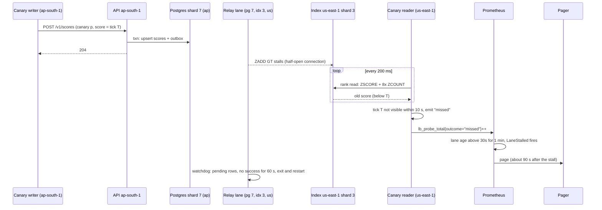

## Current State (V9)

```mermaid
graph TB
    CL[Clients worldwide] --> DNS["GeoDNS latency routing<br/>health checks"]
    DNS --> CDN["CDN edges<br/>top-100 only, max-age 0.5s"]
    CDN --> APIA
    CDN --> APIB
    CDN --> APIC
    CFG[("Config store replicated to all regions<br/>shard_map, board_index_config<br/>region_map and shard_hosts")]
    GL[("Global metrics store<br/>30-day SLO rules, dashboards<br/>new in V9")]
    AM["Alertmanager<br/>burn-rate, lane, dead-man rules<br/>new in V9"]
    PAGER["External pager and heartbeat<br/>new in V9"]

    subgraph R0["us-east-1, home region 0"]
        GSA[Game servers] -->|POST /v1/scores| APIA["Leaderboard API<br/>breaker, pod cache, maps<br/>forwards to serving region<br/>epoch guard and 30s lease"]
        APIA --> PGA[("Postgres 16 primary shards<br/>home 0 players<br/>scores, outbox, region_epoch")]
        RLA["Outbox Relay loops<br/>timeouts, heartbeat, watchdog<br/>changed in V9"] --> PGA
        APIA --> IDXA[("Redis index, 8 shards<br/>ALL players, primary + 2 replicas")]
        SNA["Sentinels x3"] -.-> IDXA
        SBU[("Standby shards for home 1<br/>async WAL")]
        CPA["Canary prober<br/>writer + readers<br/>new in V9"] -->|canary writes| APIA
        CPA -->|rank and top-100 reads| CDN
        EXA["Lane-age exporter<br/>new in V9"] -->|oldest pending per lane| PGA
        PMA[("Prometheus<br/>new in V9")] -.->|scrape| CPA
        PMA -.->|scrape| EXA
        PMA -.->|scrape| APIA
        PMA -.->|scrape| RLA
    end

    subgraph R1["eu-west-1, home region 1"]
        GSB[Game servers] --> APIB["Leaderboard API"]
        APIB --> PGB[("Postgres 16 primary shards<br/>home 1 players")]
        RLB["Outbox Relay loops<br/>timeouts, heartbeat, watchdog"] --> PGB
        APIB --> IDXB[("Redis index, 8 shards<br/>ALL players")]
        SNB["Sentinels x3"] -.-> IDXB
        SBE0[("Standby shards for home 0")]
        SBE2[("Standby shards for home 2")]
        CPB["Canary prober"] -->|canary writes| APIB
        CPB -->|rank and top-100 reads| CDN
        EXB["Lane-age exporter"] -->|oldest pending per lane| PGB
        PMB[("Prometheus")] -.->|scrape| CPB
        PMB -.->|scrape| EXB
        PMB -.->|scrape| APIB
        PMB -.->|scrape| RLB
    end

    subgraph R2["ap-south-1, home region 2"]
        GSC[Game servers] --> APIC["Leaderboard API"]
        APIC --> PGC[("Postgres 16 primary shards<br/>home 2 players")]
        RLC["Outbox Relay loops<br/>timeouts, heartbeat, watchdog"] --> PGC
        APIC --> IDXC[("Redis index, 8 shards<br/>ALL players")]
        SNC["Sentinels x3"] -.-> IDXC
        CPC["Canary prober"] -->|canary writes| APIC
        CPC -->|rank and top-100 reads| CDN
        EXC["Lane-age exporter"] -->|oldest pending per lane| PGC
        PMC[("Prometheus")] -.->|scrape| CPC
        PMC -.->|scrape| EXC
        PMC -.->|scrape| APIC
        PMC -.->|scrape| RLC
    end

    PGA -.->|async WAL| SBE0
    PGB -.->|async WAL| SBU
    PGC -.->|async WAL| SBE2

    RLA -->|ZADD GT, local| IDXA
    RLA -->|ZADD GT, WAN| IDXB
    RLA -->|ZADD GT, WAN| IDXC
    RLB -->|ZADD GT, local| IDXB
    RLB -->|ZADD GT, WAN| IDXA
    RLB -->|ZADD GT, WAN| IDXC
    RLC -->|ZADD GT, local| IDXC
    RLC -->|ZADD GT, WAN| IDXA
    RLC -->|ZADD GT, WAN| IDXB

    APIA -.->|forward to serving region| APIB
    APIB -.->|forward to serving region| APIC
    APIC -.->|forward to serving region| APIA
    CFG -.-> APIA
    CFG -.-> APIB
    CFG -.-> APIC

    PMA -.->|remote write| GL
    PMB -.->|remote write| GL
    PMC -.->|remote write| GL
    PMA -.->|lane alerts| AM
    PMB -.->|lane alerts| AM
    PMC -.->|lane alerts| AM
    GL --> AM
    AM --> PAGER
```

Inside each region, the 16 Postgres shards, 8 index shards, relay pools and Sentinels follow the V5-V8 layout. New in V9: the canary probers, lane-age exporters, regional Prometheus, the global metrics store, Alertmanager, the external pager, and the relay hardening.

**Every end-to-end flow right now**

1. **Write path, this region is serving:** Unchanged from V8. The API checks the lease, runs the epoch and ownership guard, upserts `scores`, inserts outbox rows and returns 204.
2. **Write path, another region is serving:** Unchanged. The local API forwards to the serving region, or returns 503 with `Retry-After`.
3. **Relay delivery path:** Changed. Remote clients now have socket timeouts. Each loop records `lb_relay_last_success_timestamp`. A watchdog thread restarts any loop that has pending rows and no progress for 60 seconds.
4. **Top-N path:** Unchanged. CDN, then a pod, then the pod cache or one single-flight 8-shard scatter on the local index.
5. **Exact-rank path:** Unchanged. `ZSCORE` on the owner shard, then 8 parallel `ZCOUNT` on the local index.
6. **Around-me path:** Unchanged.
7. **Redis replication path:** Unchanged, inside each index shard.
8. **Redis index failover path:** Unchanged. Lane ages rise for up to about 15 seconds. That trips `LaneSlow` at most and never `LaneStalled`.
9. **Region-unhealthy path:** Unchanged. GeoDNS steers reads away from the failed region. The probes keep measuring from the others.
10. **Postgres replication path:** Unchanged. Standby replay lag is now exported and alerted.
11. **Home-region failover and failback paths:** Unchanged. The exporter and the probers pick up the new `shard_hosts` and `region_map` within about 5 seconds.
12. **Window rollover, outbox cleanup, resharding:** Unchanged. Re-run the canary picker after a Postgres reshard.
13. **Canary freshness path (new):** Each region's writer submits 16 canary scores every 10 seconds through the real write path. Readers in all three regions poll the real rank and top-100 paths and emit `lb_probe_total` outcomes.
14. **Lane-age path (new):** Each exporter queries its Postgres primaries every 5 seconds and sets the oldest-pending-age gauge per lane.
15. **Alert path (new):** Regional Prometheus evaluates lane rules. The global store evaluates SLO burn rules. Alertmanager sends pages and tickets through the external pager.
16. **Dead-man path (new):** The always-firing `Watchdog` alert acts as a heartbeat to the external pager. If it stops for 5 minutes, the pager pages. Neighbouring regions also scrape each other's Prometheus.

## Interview follow-ups

**Q: Why not just alert when the outbox backlog gets big?**
Depth counts items and the problem is delay. A steady 5 submits per second behind a stalled lane gives about 200 pending notes, which looks normal. Age is the number that matters. It also maps directly to the user-facing promise, since oldest pending age is a lower bound on staleness.

**Q: What if a single poison note blocks a lane?**
The oldest-age alert fires for it too, so detection is already covered. The fix is a dead-letter table. After 5 failed attempts, the relay moves the note into `score_outbox_dead` in the same transaction and carries on. A count of dead notes pages a human. The rest of the lane keeps flowing, and the dead note can be fixed and replayed later because delivery is an idempotent max.

## Recap

| Concept | The Insight |
|---|---|
| Uptime is not freshness | Every process was up while 117K players had stale ranks. Define the SLI as time from 204 to visible, per region. |
| Age beats depth | A trickle behind a stall has a normal backlog and a 40-second age. Alert on the age of the oldest note. |
| Black-box plus white-box | Canaries show what users feel. The lane exporter shows where it is stuck and catches slices the SLO can't see. |
| Canary design | The score is the tick timestamp, so no coordination is needed. IDs are reserved, one per Postgres shard, and reads use the real public path. |
| Burn-rate alerts | Page on how fast the error budget is burning over two windows, not on a raw threshold. |
| Watch the watchers | Timeouts and a watchdog restart stuck loops. A dead-man's heartbeat to an external pager catches a silent monitoring system. |

**Interview arc:** *"Uptime dashboards stayed green while a stalled relay lane left 117K players with stale ranks, so I define freshness as time from the 204 to visible in each region, measure it with canary players through the real read path against a 2-second SLO with burn-rate alerts, watch every outbox lane's oldest-note age from an independent exporter, and make the relay restart itself when a lane stops making progress."*

## Next

Every failure we scoped now has a mechanism and a detector. The design is interview-complete. Say **"next"** for the final wrap-up: the full architecture, every path, the "why not X" arsenal, the master recap, and an offer to run a mock interview.


-----------------------------------------------------------------------------------------------------------------------
-----------------------------------------------------------------------------------------------------------------------
-----------------------------------------------------------------------------------------------------------------------
-----------------------------------------------------------------------------------------------------------------------


# Final Wrap-Up: Real-Time Leaderboard

## 1. The full architecture

One diagram, with the read and write paths together. Each region is shown once in detail. The other two follow the same layout.

```mermaid
graph TB
    CL[Clients worldwide] --> DNS["GeoDNS latency routing<br/>+ health checks"]
    DNS --> CDN["CDN edges<br/>top-100 only, max-age 0.5s<br/>rank and around-me: no-store"]
    CDN --> API

    GS[Game servers] -->|POST /v1/scores| API

    CFG[("Config store, replicated to all regions<br/>shard_map, board_index_config<br/>region_map, shard_hosts")] -.->|refreshed ~5s| API
    CFG -.-> RL

    subgraph REGION["Each of 3 regions: us-east-1 (0), eu-west-1 (1), ap-south-1 (2)"]
        API["Leaderboard API (stateless)<br/>circuit breaker, pod cache for top-100<br/>forwards to serving region<br/>30s lease + epoch guard"]
        PG[("Postgres, 16 primary shards<br/>players homed in this region<br/>scores + score_outbox + bucket_ownership + region_epoch")]
        RL["Outbox Relay loops<br/>per pg shard x index shard x target region<br/>timeouts + watchdog"]
        IDX[("Redis index, 8 shards<br/>ALL players, any home<br/>each shard: primary + 2 replicas")]
        SN["Sentinels x3"]
        SB[("Standby Postgres shards<br/>for a neighbour region's players<br/>async WAL")]
        CP["Canary prober<br/>writer + readers"]
        EX["Lane-age exporter"]
        PM[("Regional Prometheus")]

        API -->|"single-shard txn: guard, upsert scores, insert outbox"| PG
        RL -->|"poll pending, set delivered_mask bit"| PG
        RL -->|"ZADD GT, local target"| IDX
        API -->|"ZSCORE, scatter ZCOUNT / ZREVRANGE / ZRANGEBYSCORE"| IDX
        SN -.->|"monitor, elect, promote per shard"| IDX
        SN -.->|switch-master| API
        SN -.->|switch-master| RL
        CP -->|canary writes and reads| API
        EX -->|oldest pending per lane| PG
        PM -.->|scrape| CP
        PM -.->|scrape| EX
        PM -.->|scrape| API
        PM -.->|scrape| RL
    end

    RL -->|"ZADD GT over WAN to the 2 other regions"| IDX2[("Index in the other 2 regions")]
    API -.->|"forward write to the serving region"| API2["API in another region"]
    PG -.->|"async WAL to paired region"| SB2[("Standby in the paired region")]
    PM -.->|remote write| GL[("Global metrics store")]
    GL --> AM["Alertmanager"]
    AM --> PAGER["External pager + dead-man heartbeat"]
```

**Key placement rules**

| Concern | Rule |
|---|---|
| Source of truth | Postgres, in the player's **home region**, sharded by `hash(player_id)` into 1,024 buckets over 16 primaries. |
| Ranking index | Redis ZSETs, one full copy **per region**, split into 8 shards by a different hash of `player_id`. |
| Home region | The top 8 bits of `player_id`. It decides who writes. |
| Write rule | Best score wins. Postgres upsert and `ZADD GT` are both max registers. |

## 2. Every end-to-end path

### Path 1: Write, this region is serving

1. Game server calls `POST /v1/scores` with `player_id`, `match_id`, `score` and the three board IDs.
2. The API reads `REGION_MAP[home].serving_region` and sees its own region. It checks that its 30-second lease is fresh.
3. It hashes `player_id` to a bucket, finds the Postgres shard and opens one transaction there.
4. First statement: the ownership and epoch guard. No row back means a stale map, so it refreshes and retries once.
5. For each board, one statement upserts `scores` (only if the score is higher) and inserts a `score_outbox` row for improved scores. Each outbox row carries `index_shard` and `delivered_mask = 0`.
6. It commits and returns `204`.

### Path 2: Write, another region is serving

1. The local API sees `serving_region` is not its own.
2. It forwards the request to the serving region's API.
3. If that region answers, the answer goes back to the game server.
4. If it doesn't, the API returns `503` with `Retry-After`. The game server backs off with jitter and retries. Retries are safe because the upsert only applies a higher score.

### Path 3: Relay delivery

1. One loop runs per (Postgres shard, index shard, target region).
2. It selects up to 500 rows with its bit unset, using `FOR UPDATE SKIP LOCKED`.
3. It pipelines `ZADD GT` into the target region's index shard, found through that region's Sentinel.
4. It sets its bit in `delivered_mask`. When all three bits are set, it sets `published_at`.
5. On failure it backs off with jitter. A dead target stalls only its own bit. A watchdog restarts any loop with pending rows and no progress for 60 seconds.

```mermaid
sequenceDiagram
    participant GS as Game Server
    participant API as API (home region)
    participant PG as Postgres shard
    participant RL as Relay loops (3 targets)
    participant IL as Index (local)
    participant IR as Index (2 remote regions)

    GS->>API: POST /v1/scores
    API->>PG: BEGIN; guard; 3x (upsert + outbox); COMMIT
    API-->>GS: 204
    par per-target loops
        RL->>PG: poll rows with this bit unset (SKIP LOCKED)
        RL->>IL: ZADD GT (about 5 ms)
        RL->>PG: set bit
    and
        RL->>IR: ZADD GT over WAN (about 130-220 ms)
        RL->>PG: set bit, published_at when mask = 7
    end
```

### Path 4: Exact rank

1. Client asks for `GET /v1/boards/{id}/players/{player_id}`. GeoDNS picks the nearest healthy region. The CDN passes it through (`no-store`).
2. The API computes the owner index shard and runs `ZSCORE` there. A nil result is a 404.
3. It scatters `ZCOUNT lb:{board}:g{gen}:s{j} (score +inf` to all 8 shards in parallel.
4. Rank is `1 + sum of the 8 counts`.
5. If any shard doesn't answer within about 50ms, it returns `503` with `Retry-After`. It never returns a partial sum.

```mermaid
sequenceDiagram
    participant C as Client
    participant API as API (nearest region)
    participant S3 as Index shard (owner)
    participant SN as Index shards 0..7

    C->>API: GET /players/98231
    API->>S3: ZSCORE
    S3-->>API: 48200
    par scatter
        API->>SN: ZCOUNT (48200 +inf on every shard
        SN-->>API: 8 counts
    end
    Note over API: rank = 1 + sum
    API-->>C: rank + score
```

### Path 5: Around-me

1. Get the score with `ZSCORE`, as in path 4.
2. On each of the 8 shards, pipeline one `ZRANGEBYSCORE (score +inf LIMIT 0 5` and one `ZREVRANGEBYSCORE (score -inf LIMIT 0 5`.
3. Merge the 40 higher candidates and keep the nearest 5. Do the same for the 40 lower candidates.
4. Return the player's rank, plus 5 above and 5 below.

### Path 6: Top-N

1. Client calls `GET .../top?n=100` and reaches the nearest CDN edge.
2. On a fresh hit (under 0.5s old), the CDN answers. On a miss it makes one collapsed request to an API pod.
3. The pod serves its cache if fresh (under 0.5s). If stale (under 3s), it serves the old value and refreshes once in the background.
4. If cold, one single-flight call scatters `ZREVRANGE 0 99` to all 8 shards and merges the 8 lists. Everyone else waits on that one call.
5. During a Redis failover, `stale-if-error=30` keeps serving the cached list.

```mermaid
sequenceDiagram
    participant C as Client
    participant CDN as CDN edge
    participant API as API pod
    participant IX as Index shards 0..7

    C->>CDN: GET /top?n=100
    alt CDN fresh hit
        CDN-->>C: cached list
    else miss (collapsed to one origin call)
        CDN->>API: GET /top?n=100
        alt pod cache fresh or stale
            API-->>CDN: cached list
        else cold (single-flight)
            API->>IX: ZREVRANGE 0 99 on all 8 shards
            IX-->>API: 8 sorted lists
            Note over API: merge, keep best 100
            API-->>CDN: list
        end
        CDN-->>C: list
    end
```

### Path 7: Redis index shard failover

1. Sentinels notice the primary is silent for 5 seconds and reach a quorum of 2 of 3.
2. They promote a replica and announce the new address. The API and relay reconnect.
3. For about 10-15 seconds, rank and around-me return `503` with `Retry-After`. Top-100 serves stale from caches.
4. The relay clears that region's bit on the last 60 seconds of outbox rows for that index shard and re-applies them. Idempotent max makes this safe.

### Path 8: Region unhealthy (reads)

1. A region that fails 3 health checks (30 seconds) leaves DNS.
2. Clients go to the next-nearest region, which holds a full index.
3. Writes for the dead region's players now fail with `503` until path 9 completes.

### Path 9: Home-region failover (operator-driven)

1. Confirm the region has been down 5+ minutes. Every pod's 30-second lease has long expired.
2. Run `pg_promote()` on the 16 standbys in the paired region.
3. Bump `region_epoch` on each promoted shard.
4. Update `shard_hosts` and `region_map` in one config transaction.
5. Pods adopt the map within about 5 seconds. Writes flow again, throttled by a per-region token bucket.
6. Start relay loops beside the promoted shards. Unset bits are delivered with no reset.
7. The game backend replays the last 10 minutes of match results. Max upserts make this safe.
8. Only after replay, allow any index rebuild from the promoted Postgres.

```mermaid
sequenceDiagram
    participant GS as Game servers
    participant API as API (serving region)
    participant OP as Operator
    participant SB as Standby shards
    participant CF as Config store
    participant GB as Game backend match log

    GS->>API: POST /v1/scores
    API-->>GS: 503, Retry-After
    OP->>SB: pg_promote(), epoch + 1
    OP->>CF: region_map + shard_hosts flip
    CF-->>API: new map in about 5 s
    GS->>API: retry
    API->>SB: guard with new epoch, upsert, outbox
    API-->>GS: 204
    GB->>API: replay last 10 min (idempotent)
```

### Path 10: Failback

1. Never reuse the old primaries. They may hold a diverged tail.
2. Re-seed them as standbys of the promoted shards (`pg_rewind` or a fresh base backup).
3. Wait for lag to reach near zero.
4. In a quiet hour, fence writes briefly, promote, bump the epoch and flip `region_map` back.
5. The index in the returning region catches up on its own from unset bits.

### Path 11: Resharding

- **Postgres bucket move:** backfill with a max-merge upsert, catch up, fence the old shard through `bucket_ownership`, final delta copy, open the new shard, flip `shard_map`, clean up later.
- **Index resharding:** dual-write through the relay into a new generation, backfill from Postgres with `ZADD GT`, verify `ZCARD` against `COUNT(*)`, flip `gen` in `board_index_config`, delete the old keys later.

### Path 12: Housekeeping

1. **Window rollover:** a new window is a new `board_id`, taken from the match's UTC end time. There is no rollover job.
2. **Outbox cleanup:** delete rows with `published_at` older than an hour, every few minutes.

### Path 13: Freshness monitoring

1. Each region's canary writer submits 16 canary scores every 10 seconds through the real write path. The score is the tick timestamp.
2. Canary readers in all three regions poll the real rank and top-100 paths and emit `fresh`, `late` or `missed`.
3. The lane-age exporter reports the oldest pending note per lane.
4. Prometheus rules page on `LaneStalled` (over 30s for 1 min) and on SLO burn rates. Alertmanager sends them to an external pager.
5. An always-firing `Watchdog` heartbeat pages if it ever stops.

## 3. The "why not X" arsenal

| Interviewer asks | One-line defensible answer |
|---|---|
| Why not just `COUNT(*)` in Postgres? | Rank cost grows with the number of players above you, about 1 second for a mid-table player on 50M rows, and a finale makes that thousands of times per second. A skip list with spans gives rank in O(log N). |
| Why not write to Redis directly after the Postgres commit? | A crash between the two leaves them different and nothing remembers the debt. A transactional outbox commits the score and the owed update together, and an idempotent `ZADD GT` makes retries harmless. |
| Why shard Postgres by `player_id` and not `board_id`? | Reads come from Redis, so Postgres only needs good writes. `board_id` creates a hot shard on the all-time board and splits one submit across three shards. `player_id` keeps a player's three boards and outbox in one local transaction. |
| Why not shard the index by score range, so rank is one command? | Players cross shard boundaries as they improve, which is a non-atomic remove and add. Finale scores cluster in one band, which makes a hot shard. Hash by player and sum `ZCOUNT` instead. The partitions don't overlap, so the sum is exact. |
| Why a TTL cache and not invalidation on write? | During a finale almost every write could change the top 100, so the cache would be invalidated constantly. A 0.5s TTL bounds staleness with no coordination. Single-flight and stale-while-revalidate stop expiry from stampeding Redis. |
| Why home regions and not one write region or active-active? | A single write region is simpler and fixes read latency, but one outage stops all writes. Active-active needs multi-master Postgres. A home region gives one writer per row, and max registers make the shared index converge. |
| Why async cross-region replication and not synchronous? | Sync adds about 130ms to every commit and ties writes to the standby's reachability. A score is a max register and the game backend keeps match results, so a sub-second loss window is replayable. |
| Why alert on oldest-note age and not queue depth? | Depth counts items and the problem is delay. A stalled lane with a steady trickle still has a normal-looking backlog and a 40-second age. |

## 4. Master recap table

| Version | Concept | The Insight |
|---|---|---|
| V0 | Best-score upsert | `ON CONFLICT ... WHERE EXCLUDED.score > scores.score` makes "keep the best" one atomic statement. |
| V0 | Window in the key | Putting the time window into `board_id` removes rollover jobs entirely. |
| V0 | Rank is derived | Never store rank. One score change would shift millions of others. |
| V0 | Count-based rank | `COUNT(score > mine) + 1` is always exact, but its cost grows with how many players are above you. |
| V0 | V0's guarantee | Strong consistency and exact rank. Later versions trade some of this away. |
| V1 | Why counting fails | Rank cost in a B-tree grows with how many players are above you. |
| V1 | Skip list with spans | Each pointer stores how many items it jumps, so rank is a sum of spans along the search path. |
| V1 | ZSET commands | `ZADD GT`, `ZREVRANK`, `ZREVRANGE` give write, rank and around-me, all in O(log N). |
| V1 | Derived index | Postgres stays the source of truth. Redis holds only what's needed to answer rank. |
| V1 | New cost | Two stores means one write can reach only one of them. |
| V2 | Dual-write problem | Two stores can't commit atomically, so a crash between them always leaves a mismatch. |
| V2 | Transactional outbox | Write the "owed update" note in the same transaction as the data. The commit is the only moment the write becomes real. |
| V2 | Idempotent max | `ZADD GT` makes retries, duplicates and reordering harmless. |
| V2 | `SKIP LOCKED` | Lets many relay workers share one outbox without blocking each other. |
| V2 | New trade | Redis now lags Postgres by about 100-200ms. The oldest unpublished note measures that lag exactly. |
| V3 | Why replicate | Rebuilding from Postgres is correct but takes minutes. A live copy turns an outage into a 10-15s blip. |
| V3 | Replicas for availability | Read throughput didn't justify replicas. Surviving a node loss did. |
| V3 | Async tradeoff | The last few ms of writes can be lost on failover. Postgres plus an idempotent re-publish heals it. |
| V3 | Split-brain guards | Sentinel quorum plus `min-replicas-to-write` stop a stranded primary from accepting orphan writes. |
| V3 | Client discovery | Clients ask Sentinel for the primary instead of hardcoding an IP, and a circuit breaker fails fast during the switch. |
| V4 | Cache the shared read | Top-100 is one hot key read by everyone. Per-player rank is a long tail and not worth caching. |
| V4 | Layer choice | The CDN removes API load and egress. The pod cache removes Redis load. Each is a separate decision. |
| V4 | TTL over invalidation | Constant churn makes write-triggered invalidation useless. A short TTL bounds staleness with no coordination. |
| V4 | Stacked TTLs | Outbox lag plus pod TTL plus CDN TTL add up. Budget them together. |
| V4 | Stampede fixes | Single-flight plus stale-while-revalidate means an expiry never sends a crowd to Redis. |
| V5 | Write throughput, not size | 80M rows fit on one box. 50K transactions per second don't. |
| V5 | Shard key follows the write path | `player_id` keeps a player's three boards and outbox rows in one single-shard transaction. |
| V5 | Bucket map | Hash to 1,024 fixed buckets, then map buckets to shards. Growing from 16 to 20 shards moves 20% of rows instead of 80%. |
| V5 | Outbox survives sharding | Each shard owns its own outbox in the same transaction, so V2's guarantee holds without 2PC. |
| V5 | Live moves | The max-merge upsert makes copy-while-writing safe. The ownership guard fences stale writers. |
| V6 | Why shard Redis | Command execution is single-threaded. 150K writes per second against a 100K ceiling means a 15-second lag. |
| V6 | Rank is additive | Every player lives in one shard, so global rank is `1 + Σ ZCOUNT` across shards. |
| V6 | Top-N merge | The global top K always sits inside the union of each shard's top K. |
| V6 | Shard key | `hash(player_id)` spreads writes evenly. Score range creates a hot band and non-atomic moves. |
| V6 | Bulkhead | Tagging outbox rows with `index_shard` means one sick shard stalls only its own slice. |
| V6 | New costs | Reads fan out to all shards, and exact rank is unavailable while any one shard fails over. |
| V7 | Why go multi-region | Distance dominates. Rank work takes 10ms and the trip to Virginia takes 220ms. One region is also one failure domain. |
| V7 | Ownership by home region | One writer per player's Postgres rows, so there is nothing to reconcile in the source of truth. |
| V7 | Max register | `ZADD GT` is idempotent and order-independent, so every region's index converges without coordination. |
| V7 | Per-target delivery | `delivered_mask` gives each region its own progress. A dead region stalls only its own bit. |
| V7 | Staleness budget | Outbox, WAN, pod and CDN lags add up to about 1.5s. The CDN TTL was cut to stay inside the target. |
| V8 | Home region as a single copy | One region holding the only Postgres for its players is both an availability and a durability gap. |
| V8 | Async standby in another region | Costs nothing on the write path. The price is a loss window of under a second. |
| V8 | Replay is safe | Max upserts and `match_id` make re-sending the last 10 minutes harmless. |
| V8 | Fencing | A write lease plus a database epoch means the old region can't write after the flip. |
| V8 | Human in the loop | A rare, expensive decision gets a person. Retries absorb short blips. |
| V9 | Uptime is not freshness | Every process was up while 117K players had stale ranks. Define the SLI as time from 204 to visible, per region. |
| V9 | Age beats depth | A trickle behind a stall has a normal backlog and a 40-second age. Alert on the oldest note's age. |
| V9 | Black-box plus white-box | Canaries show what users feel. The lane exporter shows where it is stuck. |
| V9 | Canary design | The score is the tick timestamp, so no coordination is needed. Reads use the real public path. |
| V9 | Burn-rate alerts | Page on how fast the error budget is burning over two windows, not on a raw threshold. |
| V9 | Watch the watchers | Timeouts and a watchdog restart stuck loops. A dead-man's heartbeat catches a silent monitoring system. |

## 5. Where next?

Two options:

**(a) Drill deeper into one piece.** Good candidates:
- The tie-breaking rule when many players share a score, and what it does to around-me.
- The dead-letter table for poison outbox notes.
- Automatic cross-region promotion with Patroni, and what it costs.
- Approximate rank for the long tail on a 500M-player board.

**(b) Mock interview.** I play the interviewer and pressure-test the whole design. I'll ask follow-ups, change requirements mid-way and push on weak spots. You answer out loud as you would in the room.

Say **"a"** with a topic, or **"b"** to begin.


-----------------------------------------------------------------------------------------------------------------------
-----------------------------------------------------------------------------------------------------------------------
-----------------------------------------------------------------------------------------------------------------------
-----------------------------------------------------------------------------------------------------------------------


In a leaderboard system, ZRANGE fetches the actual leaderboard rows (e.g., displaying the Top 10), while ZRANK fetches a single player's position (e.g., "You are ranked #42").
Here is how they translate to SQL, followed by why Redis completely outperforms traditional databases for this specific use case.

1. Fetching the Top Leaderboard (ZRANGE)

• Redis Command: Fetches the top 3 players by score, descending, with their scores.bash
ZRANGE leaderboard 0 2 REV WITHSCORES
Use code with caution.
• Equivalent SQL Query:sql
SELECT player_id, score 
FROM leaderboard 
ORDER BY score DESC 
LIMIT 3;
Use code with caution.

2. Fetching a Single Player's Rank (ZRANK)

• Redis Command: Fetches the 0-based rank of "bob" based on the highest score.bash
ZRANK leaderboard "bob" REV WITHSCORE
Use code with caution.
• Equivalent SQL Query: To find a exact rank in SQL, you must count how many players have a higher score than the target player.sql
SELECT COUNT(*) AS rank, (SELECT score FROM leaderboard WHERE player_id = 'bob') AS score
FROM leaderboard 
WHERE score > (SELECT score FROM leaderboard WHERE player_id = 'bob');
Use code with caution.
(Note: Redis returns a 0-based index, so rank 0 is 1st place. You simply add 1 in your application logic).

Why Redis Sorted Sets Are Better Than SQL for Leaderboards

While SQL databases are great for structured relational data, they struggle heavily with high-concurrency leaderboards due to how they calculate ranks.

1. Performance and Time Complexity (Speed)

• SQL: Finding a player's rank requires scanning the table to count rows. Even with an index on the score column, updating a score forces the database to re-balance its B-Tree index. Under heavy write traffic (thousands of players updating scores per second), SQL query performance degrades rapidly, often leading to database locks.
• Redis: Sorted Sets use a hybrid data structure (a Skip List + Hash Table). Because of this, finding a rank (ZRANK) or inserting/updating a score takes \(O(\log(N))\) time. Whether you have 1,000 players or 10,000,000 players, Redis calculates the rank almost instantly (typically under a millisecond).

2. In-Memory Operation

• Redis runs entirely in-memory, making it orders of magnitude faster than traditional disk-bound relational databases. It can easily handle hundreds of thousands of read and write leaderboard operations per second on a single modest server.

3. Real-Time Efficiency

• If a player's score changes in SQL, you update the row, and the database calculates the layout later.
• In Redis, running ZADD leaderboard 1500 "bob" automatically updates Bob's score and dynamically shifts his position in the skip list instantly. The leaderboard is always strictly ordered in real-time.
Would you like to see how to handle tie-breakers (e.g., if two players have the exact same score, who gets ranked higher), or do you need the code implementation in a specific language like Python, Node.js, or Go?


Core Rule of Thumb

• Use ZRANGE when you want to retrieve actual members (a list of elements).
• Use ZRANK when you want to find the position number (index) of a specific member.

When to use ZRANGE

Use ZRANGE for any query where the goal is to fetch data out of the sorted set. It acts like a SELECT statement in SQL.
• Fetching Leaderboards: Retrieving the top 10 highest-scoring players or the bottom 5.bash
ZRANGE leaderboard 0 9 REV WITHSCORES
Use code with caution.
• Pagination: Grabbing a specific page of results (e.g., items 20 to 39).bash
ZRANGE product_views 20 39
Use code with caution.
• Filtering by Score (BYSCORE): Getting all tasks due within a specific Unix timestamp range.bash
ZRANGE tasks 1711929600 1712016000 BYSCORE
Use code with caution.
• Filtering Lexicographically (BYLEX): Fetching strings that start with specific letters when all scores are equal (e.g., autocomplete).bash
ZRANGE usernames "[a" "[b" BYLEX
Use code with caution.

When to use ZRANK

Use ZRANK when you already know the member's identity, but you need to know where they stand in the sorted set.
• User Standings: Showing a player exactly what rank they are on a global leaderboard.bash
ZRANK leaderboard "player_123" REV
Use code with caution.
• Checking Membership: Verifying if an item exists in the sorted set. If ZRANK returns nil, the member is not in the set.
• Profile Widgets: Fetching a user's rank and their current score simultaneously to display on a profile dashboard.bash
ZRANK leaderboard "player_123" REV WITHSCORE
Use code with caution.

Direct Comparison


Scenario	Use ZRANGE	Use ZRANK
"Give me the usernames of the top 3 players."	✔	
"What rank is 'player_99' right now?"		✔
"Get all items that have a score between 100 and 500."	✔	
"Does 'item_A' exist in this sorted set?"		✔

Are you currently designing a leaderboard, a task queue, or a rate limiter? Let me know, and I can give you the exact command patterns for your specific use case.


-----------------------------------------------------------------------------------------------------------------------
-----------------------------------------------------------------------------------------------------------------------
-----------------------------------------------------------------------------------------------------------------------
-----------------------------------------------------------------------------------------------------------------------


# Multi-Region Deep Dive: Keys, Persistence, Retrieval and Cross-Shard Queries

Sofia is in Frankfurt and Arjun is in Hyderabad. At 8:00:00pm Arjun posts 51,000. At 8:00:00.4 Sofia opens the app and asks "what's Arjun's rank?"

Four questions have to have crisp answers.

1. Where does Arjun's score live?
2. How does it reach Frankfurt?
3. Which copy does Sofia's read touch?
4. How does Sofia get a global rank without asking every region?

Along the way I correct four details from earlier versions. Each is marked **Correction**.

## 1. The mental model: three kinds of data

| Kind | Examples | Placement | Why |
|---|---|---|---|
| Source of truth | `scores`, `score_outbox` | One home region, plus standbys | It needs exactly one writer and must be durable. |
| Derived index | Redis ZSETs | A **full copy in every region** | Reads must be local, and rank needs every player. |
| Control data | `shard_map`, `region_map`, `shard_hosts`, `board_index_config` | Replicated everywhere, tiny | Routing needs every region to agree. |

The rule is **write where the player lives, read where the reader lives.**

Only four flows ever cross an ocean.

```mermaid
graph LR
    subgraph H["Home region of the player"]
        W["API (write)"] --> P[("Postgres shard")]
        P --> O["Outbox relay"]
        O --> IH[("Index copy")]
    end
    subgraph RA["Remote region A"]
        IA[("Index copy")]
        RD["API (read)"] --> IA
    end
    subgraph RB["Paired standby region"]
        SB[("Standby shard")]
    end
    W2["API in a non-home region"] -->|"3 forwarded write"| W
    O -->|"1 ZADD GT over WAN"| IA
    P -.->|"2 async WAL"| SB
    CFG[("Config store")] -.->|"4 config replication"| RD
    CFG -.-> W
```

1. **Relay delivery:** idempotent `ZADD GT` to the other regions' indexes.
2. **WAL shipping:** async, to the paired standby.
3. **Write forwarding:** a non-home API passes a write to the serving region.
4. **Config and metrics:** tiny and rare.

**No read ever crosses a region.** That is the point of the design.

## 2. How we create keys, and why

### 2.1 `player_id`: the region lives inside the ID

Say a game server in Frankfurt receives a submit for player X. It must know X's home region before it can do anything.

| Option | Routing cost | What breaks |
|---|---|---|
| Lookup table `player → region` | One extra read per write | The table must itself be global. If it is slow or down, writes stop. |
| Random UUID | None, but you can't route | You'd need the lookup table anyway. |
| **Region bits inside the ID** | **Zero** | The home can't change without a new ID. |

We pick the third. The ID travels with every request, so routing is a bit shift.

```text
player_id (BIGINT, signed, top bit always 0):
[ 0 | 7 bits home region | 56 bits sequence ]
```

```python
def make_player_id(home: int, seq: int) -> int:
    assert 0 <= home < 128 and 0 <= seq < (1 << 56)
    return (home << 56) | seq

def home_of(player_id: int) -> int:
    return (player_id >> 56) & 0x7F          # 0 us-east-1, 1 eu-west-1, 2 ap-south-1
```

**Correction.** V7 said 8 region bits. Postgres `BIGINT` is signed, so the top bit must stay 0 and 7 bits are usable. That gives 128 logical regions. The example ID in V7's write body (`2305843009213693952`) was also wrong. A region-2 player is `(2 << 56) + seq`, for example `144115188075857372`.

**Sequence allocation.** Each region hands out sequence numbers from its own counter, in blocks of about 1,000 per signup server. No cross-region coordination is needed. 56 bits holds about 7.2e16 players. Sequences 1 to 999 are reserved for the V9 canaries.

**What the immutable home costs, and why it is smaller than it looks.** The ID says "home region 2". The physical location is a separate mapping.

```text
player_id  --home_of()-->  logical home 2  --region_map-->  serving_region (physical)
```

- Moving a whole region (V8 failover) is one edit in `region_map`. No IDs change.
- Adding a fourth region means new signups get code 3. Existing players are untouched.
- Moving one traveling player is never needed. Their writes forward at a 200ms cost nobody feels, and their reads are already local.

### 2.2 `board_id`: the window is part of the key

```text
ranked:daily:2026-10-22      ranked:weekly:2026-W43      ranked:alltime
```

A new window is a new key, so there is no rollover job and no "reset" operation.

**The window comes from the match's UTC end time, never from the server's clock.** Consider a match that ends at 23:59:58 UTC in Mumbai. The write is forwarded and commits in Frankfurt at 00:00:03. With server-clock windows, Frankfurt files it under tomorrow's board and Mumbai would disagree. With event time, every region files it under today. The API checks the board list in the request against `ended_at` and rejects a mismatch, so a game server can't write to arbitrary boards.

### 2.3 Postgres key: `(board_id, player_id)`

It is one row per player per board. It carries no region column, because `player_id` already encodes the region.

**Correction.** V0 added `idx_board_score ON (board_id, score DESC)` for rank queries. Since V1 no read path uses it, and it taxes every one of the 300K row writes per second at peak. We drop it. Rebuilds use the primary key with keyset pagination (`WHERE (board_id, player_id) > ($1, $2) ORDER BY ... LIMIT 10000`).

### 2.4 Three decisions, three independent hashes

| Decision | Derived from | Changing it moves | Cost of change |
|---|---|---|---|
| Home region | ID bits | A player's writes and Postgres rows | `region_map` edit, or a new ID |
| Postgres shard | `md5(player_id)[0:4] % 1024`, then `shard_map` | Rows between the 16 shards in one region | One bucket at a time (V5) |
| Index shard | `md5(player_id)[4:8] % shards`, per board generation | ZSET members in all 3 regions | Build a new generation, flip `gen` (V6) |

They are independent on purpose. Suppose we reshard Postgres from 16 to 20 shards. If the index shard came from the same bucket, every ZSET member would move too. Because they use different, non-overlapping bytes of one MD5, a Postgres move never touches Redis.

### 2.5 Redis key: `lb:{board_id}:g{gen}:s{i}`

| Part | Why it exists |
|---|---|
| `lb:` | Namespace, so other systems on the same Redis can't collide. |
| `{board_id}` | One ZSET family per board, so a closed board can be dropped on its own. |
| `g{gen}` | Layout generation. Resharding builds `g2` beside `g1` and flips a pointer. |
| `s{i}` | The index shard. It is in the key so a debug `SCAN` shows which shard holds what. Routing never reads it from Redis. |

- **Member:** `player_id` as a string. **Score:** the best score as a double.
- **No hash tags, no Redis Cluster.** Each index shard is its own Sentinel-managed primary. The API does the shard math. No command ever spans keys on two shards.
- **Score precision:** doubles hold integers exactly up to 2^53, about 9.0e15. Scores far below that are safe.

### 2.6 Outbox and match IDs

- **`score_outbox.id`** is a per-shard `BIGSERIAL`. Order exists only inside one shard. That is fine, because the max operation is commutative and global order is never needed.
- **`match_id`** is not a dedupe key. Idempotence comes from the max upsert. We keep `match_id` for tracing and for the V8 replay.

### Summary of keys

| Key | Format | Decides | Why this way |
|---|---|---|---|
| `player_id` | `[0\|7b home\|56b seq]` | Which region writes | Routing with no lookup. |
| `board_id` | `{mode}:{kind}:{window}` | Which board a score counts toward | Window in the key means no rollover job. Event time keeps regions in agreement. |
| `scores` PK | `(board_id, player_id)` | Row identity | One best score per player per board. |
| Bucket | `md5[0:4] % 1024` | Postgres shard | Fixed buckets make resharding cheap. |
| Index shard | `md5[4:8] % n` | ZSET shard | Independent of the bucket. |
| ZSET key | `lb:{board}:g{gen}:s{i}` | Where a member lives in Redis | `gen` makes resharding a pointer flip. |

## 3. Data persistence in detail

### The lifecycle of one score

```mermaid
sequenceDiagram
    participant GS as Game server (Mumbai)
    participant API as API ap-south-1
    participant PG as Postgres primary (ap)
    participant AZ as AZ standby (ap, sync)
    participant WS as Cross-region standby (eu, async)
    participant RL as Relay loops (ap)
    participant IA as Index ap-south-1
    participant IE as Index eu-west-1
    participant S as Sofia (Frankfurt)

    GS->>API: POST /v1/scores (Arjun, 51000)
    API->>PG: guard, upsert scores, insert outbox
    PG->>AZ: WAL, synchronous
    AZ-->>PG: ack (about 1-2 ms)
    PG-->>API: COMMIT ok
    API-->>GS: 204 (T+0)
    PG--)WS: WAL stream, async
    RL->>PG: poll pending rows
    RL->>IA: ZADD GT (T+0.1-0.2 s)
    RL->>IE: ZADD GT over WAN (T+0.3-0.5 s)
    S->>IE: rank read, local to Frankfurt
    IE-->>S: updated rank
```

### The durability ladder

| When | What just became true | Survives | Does not survive |
|---|---|---|---|
| T+0 (the 204) | Committed on the primary, and on the in-region AZ standby | Process crash, host loss, AZ loss | Loss of the whole region |
| T+0.1 to 1s | Applied on the cross-region standby | Region loss, apart from the last sub-second tail | Nothing we care about, and that tail is replayable |
| T+0.1 to 0.2s | In the home region's index | Serves local reads | Redis loss (rebuild from Postgres) |
| T+0.3 to 0.5s | In every region's index | Any single region's index being lost | n/a |

**Correction.** In V8's config I left `synchronous_standby_names` unset. For the in-region AZ standby it should be set, for example `ANY 1 (az_b)`. That costs about 1 to 2ms and means an AZ loss loses nothing. Only the cross-region standby stays async.

**The index is derived.** Losing a Redis shard costs a rebuild from Postgres, not data. Replicas also run AOF with `appendfsync everysec`, so a full restart loads from disk first.

### Consolidated schema (home Postgres shard, for reference)

```sql
CREATE TABLE scores (
  board_id   TEXT        NOT NULL,
  player_id  BIGINT      NOT NULL,
  bucket     SMALLINT    NOT NULL,
  score      BIGINT      NOT NULL,
  updated_at TIMESTAMPTZ NOT NULL DEFAULT now(),
  PRIMARY KEY (board_id, player_id)
);
CREATE INDEX idx_scores_bucket ON scores (bucket, updated_at);   -- used by bucket moves

CREATE TABLE score_outbox (
  id             BIGSERIAL   PRIMARY KEY,
  board_id       TEXT        NOT NULL,
  player_id      BIGINT      NOT NULL,
  score          BIGINT      NOT NULL,
  index_shard    SMALLINT    NOT NULL,
  delivered_mask SMALLINT    NOT NULL DEFAULT 0,   -- one bit per target region
  created_at     TIMESTAMPTZ NOT NULL DEFAULT now(),
  published_at   TIMESTAMPTZ
);
CREATE INDEX idx_outbox_pending ON score_outbox (index_shard, id) WHERE delivered_mask <> 7;

CREATE TABLE bucket_ownership (bucket SMALLINT PRIMARY KEY, owned BOOLEAN NOT NULL);
CREATE TABLE region_epoch (home_region SMALLINT PRIMARY KEY, epoch BIGINT NOT NULL);
```

### Who writes, who reads, where it lives

| Store | Where | Who writes | Who reads |
|---|---|---|---|
| `scores`, `score_outbox` | Home region's Postgres shards | API (write path) | Relay, rebuild, replay, reconciliation |
| `delivered_mask` | Same shard | Relay loops, one bit each | Relay loops, cleanup, lane exporter |
| Standby shards | Paired region | Postgres replication | Nobody until promotion |
| Index ZSETs | All 3 regions, 8 shards each | Relay loops from all 3 homes | API in that region only |
| Config tables | Replicated to all regions | Operator, resharding and promotion tools | All API pods and relays |

**Postgres is never on a read path.** It is read only by rebuilds, replays, audits and the reconciliation job.

### What fails, and what survives

| Failure | Writes | Reads | Recovery |
|---|---|---|---|
| Response lost after commit | Game server retries | Fine | The max upsert makes the retry a no-op. |
| Relay lane stalls | Fine | One region's slice goes stale | Lane alert at 30s, watchdog restart at 60s. |
| WAN cut to region R | Fine | R's index goes stale | R's readiness check fails and DNS steers away. Outbox rows wait, and bits catch up on their own. |
| Redis shard failover | Fine | 10 to 15s of 503 on rank | Sentinel promotion, then re-publish the last 60s. |
| Whole home region lost | 503 for that region's players | Fine everywhere | V8 runbook. |

## 4. Data retrieval in detail

Every read stays in the reader's region.

| Request | Path | Reads | Worst-case staleness |
|---|---|---|---|
| Rank | GeoDNS, CDN pass-through, local API | Local index, 1 + 8 commands | About 0.5s (outbox 0.2s plus WAN 0.3s) |
| Around-me | Same | Local index, scatter | About 0.5s |
| Top-100 | CDN, then pod cache, then local API | Local index, 8 commands, cached | About 1.5s |

Rank has no CDN or pod cache in front of it, so it is the fresher read.

### Read-your-writes across regions

Arjun submits, and half a second later Sofia reads. Sofia's index may not have the score yet. For Arjun it is invisible only if he is away from his home region.

| Option | Mechanism | Verdict |
|---|---|---|
| Echo the score | The write response returns the accepted score, and the client shows it right away. | **Chosen** for the score itself. |
| Pin to home | A short cookie sends this player's reads to their home region for 5s. | Held in reserve. It costs 220ms for the rare traveler. |
| Version token | The read waits until the lane's delivered watermark passes a token. | Rejected. It needs a per-lane watermark service for a 0.5s gap. |

One related case is a brand-new player. Their first score is not in a remote index yet, so `ZSCORE` returns nil and the API returns 404. The client contract treats a 404 within a few seconds of a submit as "pending" and retries after 1s.

### A lagging region should not serve reads

`/healthz/ready` in region R also fails if the local canary reader reports repeated `missed` results. GeoDNS then removes R after 3 failed checks, which is about 30 seconds. Clients move to the next-nearest region, which is fresh.

## 5. Cross-shard queries and global requests

### The query catalogue

| Query | Shards touched | Method | Exact? |
|---|---|---|---|
| Rank | 1 owner + all 8 | `ZSCORE`, then sum of `ZCOUNT (score +inf` | Yes |
| Top-100 | 8 | `ZREVRANGE 0 99` on each, then k-way merge | Yes |
| Deep page (ranks 1,001-1,100) | 8 | Each shard must return its top 1,100, then merge | Yes, but cost grows with depth |
| Around-me | 1 + 8 | 3 range queries per shard, then merge | Yes |
| Total players, percentile | 8 | Sum of `ZCARD`, cached about 5s. Percentile is rank divided by total. | Yes |
| Friends' scores (cut in SCOPE) | At most 8 | Group friend IDs by owner shard, one `ZMSCORE` per shard, sort in the API | Yes |
| "Who is #5,000?" | 8 | Binary search on score using summed `ZCOUNT`, then fetch | Yes |
| Whole-board scan, rebuild | 48 Postgres shards (16 per home, 3 homes) | Keyset pagination on the primary key | Yes |

### Why scatter-gather is exact

1. **Partitions don't overlap.** Each player lives in exactly one shard, so summed counts never double count.
2. **Top-K is a union property.** Anyone in the global top K is also in the top K of their own shard, so merging per-shard top Ks cannot miss them.
3. **The merge must use Redis's tie order.** Equal scores sort by member string, so merge on `(score, member)` in the same direction Redis uses. Otherwise you get duplicates or skips at shard boundaries.

**Correction.** V6's around-me used exclusive bounds on both sides, so players tied with you never appeared. Add a third query per shard for equal scores.

```text
ZRANGEBYSCORE    lb:...:s{j} (score +inf   LIMIT 0 5      higher
ZREVRANGEBYSCORE lb:...:s{j} (score -inf   LIMIT 0 5      lower
ZRANGEBYSCORE    lb:...:s{j} score score   LIMIT 0 10     tied (shares your rank)
```

### Deep pages

Page 11 of the leaderboard needs the top 1,100 from each shard, so 8,800 rows merged to return 100. We cap the public API at the top 1,000. Anything deeper uses the binary-search method or around-me for a specific player.

### The scatter is not a snapshot

The 8 calls land a millisecond or two apart. At 150K writes per second fleet-wide, a few hundred writes land during one scatter. Each can move your rank by at most one. That is far below our 1-2 second freshness budget, so we accept it.

### Tail latency from fan-out

If each call is slow 1% of the time, the chance that at least one of 8 is slow is `1 - 0.99^8 = 7.7%`. That is a real number, and the options are these.

| Fix | Mechanism | Verdict |
|---|---|---|
| **Tight timeout and one retry** | `timeout=50ms`, then retry the same primary once | **Chosen** |
| Hedged read to a replica | After p95 (say 20ms) send the same `ZCOUNT` to a replica and take the first answer | Keep in reserve. Staleness of a few ms is harmless, but it adds replica load. |
| Return a partial sum | Skip the slow shard | Rejected. It breaks exact rank. |

### Global requests never leave the region

If the index were partitioned by region, rank would need `ZCOUNT` from three regions. That is three WAN trips of 130 to 220ms in the critical path. Instead we pay about 24GB total (8GB per region, three copies) and keep every read local. That is cheap next to the latency it removes.

### Reconciliation (anti-entropy)

Idempotent delivery means mistakes self-heal, but bugs and lost keys still happen. A nightly job per region checks the index against the truth.

1. For each board, compare `sum(ZCARD)` over 8 shards with `sum(COUNT(*))` over the 48 Postgres shards.
2. Sample 10K random `(board, player)` pairs per home shard. Compare Postgres `score` with `ZSCORE` in each region.
3. For mismatches, insert a repair note into `score_outbox` from `scores`. The normal relay delivers it, and the max rule makes this safe.
4. Export `lb_reconcile_mismatch_total` and alert if it is above zero for two nights running.

## 6. Other things multi-region needs

### Board lifecycle

Without this, old boards fill Redis forever and late events have no rule.

| State | When | Writes | Index |
|---|---|---|---|
| Open | Window is active | Accepted | Live ZSET |
| Grace | Window ended, up to 24h for dailies | Accepted if `ended_at` is inside the window | Live |
| Frozen | Grace over and the outbox for the board is drained | Rejected with 409 | Final top-100 snapshot stored. `EXPIRE` set on the ZSETs. |
| Archived | After a retention period | Rejected | Postgres rows moved to cold storage |

The relay checks board state before `ZADD`, so it can't recreate an expired key.

### Network partitions

| Cut | What keeps working | What degrades |
|---|---|---|
| Region A cannot reach B (WAN) | Local writes and reads in both | A's notes to B stall, so B's index goes stale for A's players. B's readiness may fail. |
| A region loses the config store | Reads. Writes continue until the 30s lease expires. | Then writes return 503. This is the fencing from V8. |
| Client cannot reach its nearest region | DNS steers it away | Higher latency |

### Data residency

The index copies in other regions hold only `player_id` and `score`. These are pseudonymous, with no names or emails. Personal data stays in the profile service and in the home region's Postgres. Display names for the top-100 come from a profile service in batch, and are cached with the list.

### Adding a fourth region

1. Assign code 3 to new signups. Existing IDs are untouched.
2. Stand up the stack and seed its index from a peer. A temporary `replicaof` then promote works, or rebuild from the 48 shards.
3. Add it as a relay target. This needs one code change. The "fully delivered" mask is hardcoded as 7 in V7. Make it a config value (`TARGET_MASK`), so four regions use 15. `SMALLINT` holds 15 bits.
4. Add its standby pairing and its canary prober.

## 7. Recap

| Concept | The Insight |
|---|---|
| Write where the player lives | The home region is encoded in `player_id`, so routing costs a bit shift and never a lookup. |
| Home is logical | `region_map` maps a logical home to a physical region, so a failover or a move never changes IDs. |
| Independent hashes | Region, Postgres bucket and index shard use different bits, so resharding one never moves the others. |
| Event-time board keys | Boards come from the match's UTC end time, so every region agrees on which window a score belongs to. |
| Durability ladder | Commit, then AZ standby, then cross-region standby, then indexes. Each rung survives a bigger failure. |
| Reads stay local | A full index copy per region costs 3x memory and removes every WAN trip from the read path. |
| Rank is additive | Non-overlapping partitions mean `1 + Σ ZCOUNT` is exact. Merge top-K lists with Redis's own tie order. |

**Interview arc:** *"A global leaderboard can't scatter ranks across oceans on every read, so I give each player a home region encoded in their ID to own their writes, replicate a full ranking index into every region through idempotent max-merge notes, and answer rank with a local sum of per-shard counts, which keeps reads local and exact while writes stay conflict-free."*

## What next?

Pick one:

**(a)** Drill into one more piece:
- The binary-search "who is #N" query.
- The reconciliation job.
- Logical homes (64 homes over 3 regions) for rebalancing load.

**(b)** Start the mock interview, where I play interviewer and pressure-test the whole design.

Say **"a"** with a topic, or **"b"** to begin.


-----------------------------------------------------------------------------------------------------------------------
-----------------------------------------------------------------------------------------------------------------------
-----------------------------------------------------------------------------------------------------------------------
-----------------------------------------------------------------------------------------------------------------------


# Three Drill-Downs: "Who is #N", Reconciliation, Logical Homes

Each one gets its own mini-version: break it, solve it, implement it. The drill-downs expose two gaps in my earlier answers, and I mark them **Correction**.

# Drill 1: "Who is #N?"

## Break it

Priya is a product manager. She wants the Gold-tier banner to say "top 1% starts at score X". On a 50M-player board, the 1% line is **position 500,000**.

Sam is a player. He taps "jump to rank 20,000,413" and expects to land on that page.

In V1 this was one command:

```text
ZREVRANGE lb:ranked:alltime 499999 499999 WITHSCORES      # O(log N), skip-list spans
```

V6 sharded the ZSET, and that command stopped working. Position 499,999 in one shard is not position 499,999 globally.

## Naive attempts

### Attempt 1: Merge top-K with K = N

*Why it looked reasonable:* It's exactly how top-100 works in V6.

*How it breaks:* The global top 500,000 sits inside the union of each shard's top 500,000. So each shard must return 500K entries.

- That is about 12MB per shard and about **100MB per query**.
- Each `ZREVRANGE 0 499999` blocks its shard's single thread for hundreds of milliseconds.
- During that time the shard serves nothing else, including the relay's `ZADD`. Outbox lag spikes for everyone.

Merging top-K is fine for K up to about 1,000. It cannot scale to deep positions.

### Attempt 2: Ask each shard for its position N/8

*Why it looked reasonable:* Players are hashed evenly, so each shard holds one-eighth of every score range.

*How it breaks:* "Even" only holds on average. Counts above a given score differ between shards by a few thousand. Position N/8 in shard 3 is near global position N, not at it. The answer is approximate, and the product needs exact.

### The insight

Rank moves in one direction as score moves. A higher score always has a lower or equal rank number. So we can **binary search on the score**, not on the position.

Each probe asks one exact question: "how many players have score at least s?" V6 already answers it with 8 parallel `ZCOUNT`.

Think of guessing a number with "higher or lower" hints. Each guess costs one exact count.

## Solve it

Define two things.

- **Position N** is the Nth player in the total order (score descending, then member string descending, which is Redis's own order).
- **Rank** is `1 + count of strictly higher scores`, so ties share a rank.

If three players tie at rank 20,000,413, they occupy positions 20,000,413, 20,000,414 and 20,000,415. Position N always exists. "Rank N" can belong to nobody. So the API is by **position**.

The algorithm has three phases.

1. **Find the score** `s*` at position N, by binary search with scatter `ZCOUNT`.
2. **Find the player** inside the tie group at `s*`.
3. **Verify** by running the normal rank path on that player.

- ✅ **What we gained:**
  - An exact answer for any N in about 25-30ms, with about 160 cheap commands and no big blocking calls.
  - Percentile cutoffs for free. Phase 1 alone returns the tier boundary score.
  - It runs on the local region's index, so there is no WAN trip.
- ⚠️ **What we gave up:**
  - **Not a snapshot.** About 20 sequential rounds run while writes keep landing. At finale load, thousands of writes arrive in that time. We return the player and their verified current rank, so the caller sees any drift.
  - **Huge tie groups can't name one player.** Past a cap we return the group's rank and size.
  - **A new endpoint to rate limit**, because each call fans out 160 commands.
- ❌ **What we considered and rejected:**
  - Top-K merge for deep N.
  - Per-shard position N/8.
  - A histogram or t-digest. It's approximate. I'd use it for percentiles on a 10x bigger board, but not for "who is exactly #N".

## Implement it

```http
GET /v1/boards/ranked:alltime/positions/20000413
→ { "position": 20000413, "player_id": 98231, "score": 48200, "rank": 20000413, "tied_with": 2 }
```

### Phase 1: find `s*`

We want the **largest integer score s such that `cnt_ge(s) >= N`**. Two facts follow.

- `cnt_ge(s*+1) < N`, so fewer than N players are strictly above `s*`.
- Someone has score exactly `s*`, because `cnt_ge(s*) > cnt_ge(s*+1)`.

```python
async def cnt_ge(board, cfg, s):                       # players with score >= s
    parts = await asyncio.gather(*[
        redis[j].zcount(key(board, cfg, j), s, "+inf") for j in range(cfg.shards)])
    return sum(parts)

async def who_is(board, N):
    cfg = board_cfg(board)
    total = await total_players(board)                 # sum of ZCARD, cached 5s
    if not (1 <= N <= total):
        raise NotFound
    if N <= 1000:
        return await top_slice(board, N)               # the V6 top-K merge is cheaper here

    lo = await min_score(board)                        # ZRANGE 0 0 on each shard, then min
    hi = await max_score(board)                        # ZREVRANGE 0 0 on each shard, then max
    while lo < hi:                                     # invariant: cnt_ge(lo) >= N
        mid = (lo + hi + 1) // 2
        if await cnt_ge(board, cfg, mid) >= N:
            lo = mid
        else:
            hi = mid - 1
    s_star = lo
```

With scores up to 212,000, that is `log2(212,000) ≈ 18` probes. A worked trace (numbers illustrative) for N = 20,000,413:

| Probe `mid` | `cnt_ge(mid)` | vs N | Next range |
|---|---|---|---|
| 106,000 | 310,000 | below | hi = 105,999 |
| 53,000 | 17.6M | below | hi = 52,999 |
| 26,500 | 31.0M | at least | lo = 26,500 |
| 39,750 | 24.9M | at least | lo = 39,750 |
| 46,375 | 21.1M | at least | lo = 46,375 |
| 49,687 | 19.4M | below | hi = 49,686 |
| ... 12 more probes | | | lands on `s*` = 48,200 |

### Phase 2: find the player in the tie group

```python
    above = await cnt_ge(board, cfg, s_star + 1)       # strictly higher
    k = N - above                                      # 1-based position inside the tie group
    group = await cnt_ge(board, cfg, s_star) - above   # size of the tie group

    if k > TIE_CAP:                                    # e.g. 5,000
        return TiedGroup(rank=above + 1, size=group)   # name no single player

    parts = await asyncio.gather(*[
        redis[j].zrevrangebyscore(key(board, cfg, j), s_star, s_star, start=0, num=k)
        for j in range(cfg.shards)])
    merged = sorted(itertools.chain(*parts), key=lambda m: m.decode(), reverse=True)
    pid = int(merged[k - 1])
```

Each shard needs to return at most `k` members. The kth member overall can't be deeper than k in any single shard. The merge sorts by the member **string**, because that is Redis's tie order. Numeric order would disagree. For example, "9" sorts after "10" as a string.

### Phase 3: verify and return

```python
    score, rank_now = await rank_of(board, pid)        # V6 path: ZSCORE + 8x ZCOUNT
    return Position(N, pid, score, rank_now, tied_with=group - 1)
```

If `rank_now` differs from `above + 1`, a write landed during the search. The caller sees the real current rank.

### Latency option: 16-way search

Each round probes 15 evenly spaced scores in one pipeline per shard.

```python
pts = [lo + (hi - lo) * i // 16 for i in range(1, 16)]
counts = await asyncio.gather(*[pipelined_zcount(j, pts) for j in shards])   # 8 pipelines x 15 commands
# narrow [lo, hi] to the largest probe with cnt >= N, up to the next probe minus 1
```

That is `ceil(log16(212,000)) = 5` rounds, about 8ms, using about 600 commands instead of 160. We use it only for latency-sensitive callers.

### Protection

- Rate limit: 2 requests per second per client.
- Cache the result for 2s by `(board, N)`. A cron job also computes tier cutoffs (1%, 5%, 20%) once a minute using phase 1 only, and the banner reads that.
- Any shard timeout returns `503` with `Retry-After`, as in V6.

### Sequence

```mermaid
sequenceDiagram
    participant C as Client
    participant API as API (local region)
    participant IX as Index shards 0..7

    C->>API: GET /positions/20000413
    API->>IX: ZCARD, min and max score (cached or 1 round)
    IX-->>API: total, lo, hi
    loop about 18 rounds
        API->>IX: ZCOUNT mid +inf on all 8 shards
        IX-->>API: 8 counts, sum them
    end
    API->>IX: ZCOUNT (s_star +inf, then ZREVRANGEBYSCORE s_star s_star LIMIT 0 k
    IX-->>API: above, tie members
    Note over API: merge ties by member string, pick the kth
    API->>IX: ZSCORE, then 8x ZCOUNT (verify rank)
    API-->>C: player, score, rank now
```

## Follow-ups

**Q: In V1 this was one command. Why did sharding make it hard?**
A skip list answers "what's at position N?" through span counts inside one structure. Once members are split, no single structure knows the global order. We rebuild it from the one thing shards can answer exactly and independently: how many members are above a score.

**Q: What about 500M players?**
Binary search still works, since it's logarithmic in the score range, not in players. Per-shard `ZCOUNT` stays O(log N). I'd cache more aggressively and add the 16-way probe.

## Recap

| Concept | The Insight |
|---|---|
| Position vs rank | Ties share a rank, so "rank N" can be empty. Position N always exists. |
| Search on score | Rank is monotone in score, so binary search on score with exact scatter counts. |
| Tie handling | Find the tie group's start from the count above, then fetch at most k per shard and merge by Redis's string order. |
| Not a snapshot | About 20 rounds run during live writes, so verify and return the current rank. |
| Why not top-K | K = N means 100MB per query and long blocking calls on single-threaded shards. |

**Interview arc:** *"Sharding broke 'what's at position N', and merging top-N costs 100MB at N = 500K, so I binary-search the score using exact scatter ZCOUNTs, then resolve the tie group by merging per-shard members in Redis's own order, which gives exact answers in about 20 cheap rounds."*

# Drill 2: The Reconciliation Job

## Break it

It's Thursday 02:10 UTC. A bad kernel patch rolls to all three AZs and takes down **all three nodes** of eu-west-1 index shard 5.

The on-call engineer wants it back fast. The V3 plan was to rebuild from Postgres, which takes minutes. Instead they restore last night's backup, which is **3 hours old**. The shard is online in 4 minutes.

V3's re-publish heals the last 60 seconds. But **18,400 score improvements** from the missing 3 hours are not in that shard. Their outbox rows were deleted by cleanup after an hour. Nothing remembers they existed.

Sofia in Frankfurt posted 52,300 at 01:00. Her index entry still says 49,000. Her rank is wrong by about 340,000 places. Nobody notices for three days.

Why every alarm stayed quiet:

- **Lane ages are 0.** The relay is healthy and has nothing pending.
- **Canaries pass.** They submit every 10 seconds, so any canary player heals itself within seconds.
- **Counts match.** Sofia still exists in shard 5, just with an old score. `ZCARD` equals `COUNT(*)`.
- **Redis is up and the API returns 200.**

This is **silent loss of old state**. Our monitoring watches the flow of new writes, and nothing watches the correctness of old ones.

## Drift classes

| Class | Index vs Postgres | Typical cause |
|---|---|---|
| Missing | Player in Postgres, absent in Redis | Restore from an old backup, lost key |
| Low | Redis score lower than Postgres | Lost update, old restore |
| High | Redis score higher than Postgres | Postgres lost an acked write (failover tail), or a buggy write |
| Extra | In Redis, no Postgres row | Bad write, test data, a deleted board |

## Naive attempts

### Attempt 1: Rebuild every index nightly

*Why it looked reasonable:* The index is derived, so recreate it.

*How it breaks:* It loads 80M rows into three regions every night and needs a new generation, a dual-write window and a flip (V6). It also hides bugs. A nightly overwrite repairs drift silently, so nobody learns it happened, and a restore bug can recur every day.

### Attempt 2: Compare counts

*How it breaks:* Sofia's case has equal counts. Counts catch missing members but not wrong scores.

### Attempt 3: Sample 10K random players

*How it breaks:* It tells you whether big drift exists. Our 18,400 players are 0.037% of the board, so a 10K sample expects about 3.7 hits. Smaller drift is invisible. It also tells you nothing about **which** players are wrong, so there's no repair list.

## Solve it

Compare **every member**. It's cheaper than it sounds.

- Redis shards are scanned on their **replicas**, so primaries stay untouched.
- Postgres rows are read from the **in-region sync standby**. In V8 those standbys serve no reads, so they're free capacity.
- A full scan is about 6M members per index shard. That is minutes of wall time per board.

**Last time I sketched sampling. A full comparison is affordable, so we do that.**

The job has four stages.

1. **Full keyed diff** per `(board, region, index shard)`. It produces candidates.
2. **Re-verify each candidate** with fresh reads, skipping players with pending outbox rows. This removes noise from writes that landed during the scan.
3. **Classify** into missing, low, high or extra.
4. **Repair** with the safe mechanism for each class.

**Correction.** My last message said repair notes work for every mismatch because "the max rule makes this safe". That is only true for **missing and low**. `ZADD GT` can never lower a score, so a **high** index value would survive. High and extra need an explicit compare-and-set.

- ✅ **What we gained:**
  - It finds the exact list of wrong players.
  - It repairs through the same delivery path, so there is no special machinery for the common case.
  - It also works as the verifier for index resharding and for home moves (Drill 3).
- ⚠️ **What we gave up:**
  - About 600MB of memory per shard job.
  - About 2GB of WAN transfer per region per night for the big board, because remote homes' rows must reach each region's reconciler.
  - A repair policy to own. "High" needs a decision (below).
- ❌ **What we considered and rejected:** Nightly rebuild, count comparison and sampling. Also slice digests (Merkle-style). At our size, live writes during a scan make nearly every slice mismatch, so they add little. At 10x scale I'd use them, with the same re-verify step behind them.

## Implement it

### Who writes, who reads

| Structure | Who writes | Who reads | Lives where |
|---|---|---|---|
| Index scan (`ZSCAN`) | Nobody (read only) | Reconciler | Index shard **replicas**, each region |
| Row scan | Nobody (read only) | Reconciler | In-region sync **standby** of each home shard |
| `reconcile_findings` | Reconciler | Dashboards, operators | Small ops Postgres, outside the 48 shards |
| Repair notes | Reconciler | Normal relay loops | `score_outbox` on the home shard |
| CAS repair | Reconciler | n/a | Index shard primary |

```sql
CREATE TABLE reconcile_findings (
  run_id BIGINT, region SMALLINT, board_id TEXT, index_shard SMALLINT, player_id BIGINT,
  kind TEXT,                 -- missing | low | high | extra
  pg_score BIGINT, idx_score BIGINT,
  state TEXT,                -- candidate | confirmed | repaired | skipped_pending | cas_failed
  found_at TIMESTAMPTZ DEFAULT now()
);
```

### Stage 1: full diff

```python
def scan_rows(shard, board, shard_j, cfg):             # from the standby, keyset pages
    last = 0
    while True:
        rows = standby[shard].fetch("""
            SELECT player_id, score, updated_at FROM scores
            WHERE board_id = %s AND player_id > %s ORDER BY player_id LIMIT 50000""",
            [board, last])
        if not rows: break
        for r in rows:
            if index_shard(r.player_id, cfg.shards) == shard_j:
                yield r
        last = rows[-1].player_id

def scan_index(replica, key):
    cursor = 0
    while True:
        cursor, batch = replica.zscan(key, cursor, count=5000)
        yield from batch
        time.sleep(0.005)                              # throttle
        if cursor == 0: break
```

```python
def diff(pg, idx):                                     # pg: {pid: row}, idx: {pid: score}
    for pid, s in idx.items():
        row = pg.get(pid)
        if row is None:    yield ("extra",   pid, None,      s)
        elif s < row.score: yield ("low",    pid, row.score, s)
        elif s > row.score: yield ("high",   pid, row.score, s)
    for pid, row in pg.items():
        if pid not in idx: yield ("missing", pid, row.score, None)
```

Scan Redis **first**, then Postgres. Then any player who improved in between shows as "low", which is the harmless direction.

### Stage 2: re-verify each candidate

Noise is small. About 2,000 submits per second for about 90 seconds at a 25% improvement rate is about 45K players, or 0.1% of the board. Re-checking that many is trivial.

```python
def reverify(c):
    pg_now  = pg_primary[c.home].fetchone(
        "SELECT score, updated_at FROM scores WHERE board_id=%s AND player_id=%s", [c.board, c.pid])
    idx_now = redis_primary[c.region][c.j].zscore(key(c.board, c.cfg, c.j), str(c.pid))
    pending = pg_primary[c.home].exists(
        "SELECT 1 FROM score_outbox WHERE board_id=%s AND player_id=%s AND delivered_mask <> 7",
        [c.board, c.pid])
    if pending or (pg_now and pg_now.updated_at > RUN_START - timedelta(seconds=60)):
        return Skip("skipped_pending")
    return classify(pg_now, idx_now)                   # same four classes, with fresh values
```

Point reads use the **primary**, because there are only thousands of them.

### Stage 3 and 4: classify and repair

| Class | Repair | Mechanism |
|---|---|---|
| Missing, low | Re-deliver the current Postgres score to **this region only** | Outbox insert with a preset mask |
| High | CAS the index down to the Postgres value | Lua script |
| Extra | CAS-remove the member | Same Lua script |

Missing or low. This sets only the broken region's bit as pending. For eu (bit 1), the mask is `7 & ~2 = 5`.

```sql
INSERT INTO score_outbox (board_id, player_id, score, index_shard, delivered_mask)
SELECT board_id, player_id, score, $3, $4          -- $4 = 7 & ~(1 << target_region)
FROM scores WHERE board_id = $1 AND player_id = $2;
```

The normal relay loop for that region delivers it with `ZADD GT`. The insert reads the **current** Postgres score, so a concurrent improvement can't be overwritten with an older value.

High or extra:

```lua
-- KEYS[1] = zset, ARGV[1] = member, ARGV[2] = bad value we observed, ARGV[3] = target score or ''
local cur = redis.call('ZSCORE', KEYS[1], ARGV[1])
if cur and tonumber(cur) == tonumber(ARGV[2]) then
  if ARGV[3] == '' then return redis.call('ZREM', KEYS[1], ARGV[1]) end
  redis.call('ZADD', KEYS[1], ARGV[3], ARGV[1])
  return 1
end
return 0                                              -- someone changed it, leave it alone
```

The script only writes if the index still holds the exact bad value we saw. If the relay moved it in the meantime, the script does nothing.

### The "high" policy

| Mode | When | Rule |
|---|---|---|
| Steady state | Normal days | **Postgres wins.** CAS the index down. Any "high" outside post-failover mode pages a human, because it usually means a bug. |
| Post-failover | After a V8 promotion and replay, set by the operator | If the high value appears in **two or more** regions' indexes, treat it as an acked write Postgres lost. **Heal Postgres upward** by posting it through the normal write path with `match_id = 'reconcile-...'`. A value present in two independent indexes was committed once. |

### Schedule, metrics and alerts

- Nightly per region for open and grace boards, staggered. Frozen boards are checked once at freeze.
- **Verifier use:** run it on the new generation before an index reshard flip (V6 step 3), and on a home's old and new copies before deleting the old one (Drill 3).
- Metrics: `lb_reconcile_confirmed_total{kind,region}`, `lb_reconcile_repaired_total`, `lb_reconcile_last_success_timestamp`.
- Alerts: page if confirmed mismatches exceed 0.01% of members, or any "high" outside post-failover mode. Ticket if the last success is over 36 hours old.

### Sequence

```mermaid
sequenceDiagram
    participant RC as Reconciler (eu-west-1)
    participant RR as Index replica (shard 5)
    participant SB as Postgres standbys (all homes)
    participant PG as Home Postgres primary
    participant RL as Relay loop (target eu)
    participant IX as Index primary (shard 5)

    par full scan
        RC->>RR: ZSCAN throttled, all members
        RR-->>RC: members and scores
    and
        RC->>SB: keyset scan of scores
        SB-->>RC: rows
    end
    Note over RC: diff gives candidates, 18,400 low plus noise
    loop each candidate
        RC->>PG: fresh score and pending outbox check
        RC->>IX: fresh ZSCORE
        alt pending or just changed
            RC->>RC: skip
        else confirmed low
            RC->>PG: INSERT outbox row, mask = 5 (eu only)
            RL->>PG: poll pending row
            RL->>IX: ZADD GT
        end
    end
```

## Follow-ups

**Q: How do you avoid false positives from in-flight writes?**
Scan the index first and Postgres second, so races only produce harmless "low" candidates. Then re-verify every candidate with fresh reads and skip anyone with a pending outbox row or a very recent update. Only players still wrong after that are repaired.

**Q: Why not just rebuild the index from Postgres?**
A rebuild fixes the symptom silently and teaches you nothing. Reconciliation produces an exact list of drifted players, repairs only those, and its mismatch rate becomes a metric. A rising rate points at a real bug.

## Recap

| Concept | The Insight |
|---|---|
| Silent drift | Old state can be lost while every flow metric looks healthy. Canaries heal themselves and lane ages show only new writes. |
| Counts miss it | Wrong scores keep the counts equal. Compare member by member. |
| Scan replicas | Reads come from index replicas and Postgres standbys, so primaries are untouched. |
| Re-verify | Fresh point reads plus the pending-outbox check turn candidates into confirmed findings. |
| GT can't lower | Missing and low repair through the relay. High and extra need a compare-and-set. |
| Two policies | Postgres wins normally. After a failover, a value present in two regions heals Postgres upward. |

**Interview arc:** *"Idempotent delivery heals in-flight failures but can't see old state that was silently lost, so a nightly job scans every index member against Postgres standbys, re-verifies each mismatch with fresh reads, and repairs missing or low scores through the normal outbox and high or extra ones through a compare-and-set script."*

# Drill 3: Logical Homes (64 Homes over 3 Regions)

## Break it

It's six weeks after a new title launches in India. ap-south-1 grows from 33% to **52%** of all players.

Its 16 Postgres primaries peak at **90% CPU** at 8pm IST. Commit p99 goes from 8ms to **180ms**, and game servers' 2-second timeouts start firing at 0.4%.

us-east-1 runs at **28%** and eu-west-1 at **35%**.

Under V7/V8, a player's home is their region, forever. The options are limited.

## Naive attempts

### Attempt 1: Add shards in ap (V5 bucket moves)

*Why it looked reasonable:* We already have the machinery.

*How it breaks:* It works, but it buys hardware only in ap. We pay for ap's 3-hour daily peak around the clock, while us-east-1 holds about 70% spare capacity that is already paid for. Every growth spurt repeats this.

### Attempt 2: Re-create Indian players as US-homed players

*How it breaks:* `player_id` is referenced everywhere, in friends lists and inventories. Changing it means migrating every system that stores an ID.

### Attempt 3: A per-player override table

*How it breaks:* 50M rows in a lookup on the write path, replicated globally. It brings back the global dependency that putting the region in the ID was designed to avoid.

### The right granularity

| Unit of placement | Count | Size of one unit | Verdict |
|---|---|---|---|
| Region | 3 | 33% | Too coarse to balance |
| **Logical home** | **64** | **1.6%** | **Chosen** |
| Bucket (V5) | 1,024 | 0.1% | 1,024 databases and about 24K relay loops. Too much to run. |
| Player | 50M | 0.000002% | Lookup table on the write path |

64 units is fine enough to balance three regions to within about 1.6%. It also fits the 7-bit ID field, with 128 codes available and 64 in use.

## Solve it

The 7-bit home field is already in `player_id`. Now it means a **logical home** (0 to 127), not a region. A small table maps each home to where it runs.

```mermaid
graph LR
    ID["player_id<br/>[0 | 7-bit logical home | 56-bit seq]"] -->|"home_of: bit shift"| H["Logical home h<br/>0..127, 64 in use"]
    H -->|"home_map lookup, refreshed about 5s"| M["serving_region, cluster_id,<br/>standby_region, epoch, state"]
    M --> C["Postgres cluster in serving region<br/>database lh_h"]
    C -.->|"async WAL"| S["Standby cluster in standby_region"]
```

**A logical home is one Postgres database** holding about 1.25M rows (about 235MB) and about 780 submits per second at peak. Several homes share a cluster. This replaces V5's bucket map. **The 64 homes are the shards.** Each home is small enough that one database handles it.

### What changes from V5-V8

| Piece | Before | With logical homes |
|---|---|---|
| Home | 3 regional codes | 64 logical homes in the same 7-bit field |
| Postgres layout | 16 shards per region, 1,024 buckets | One database per home, hosted on a cluster. No buckets. |
| Maps | `shard_map`, `region_map`, `shard_hosts` | One `home_map` |
| Write guard | `bucket_ownership` plus `region_epoch` | One `home_epoch` |
| Relay loops | per pg shard x index shard x target | per **home** x index shard x target |
| Canary | 16 per region | 1 per home, 64 total |
| Failover unit | A whole region | One cluster (2 to 4 homes), or a region's clusters spread over two regions |
| Standby pairing | One paired region | Per-cluster standby region |

**The index is untouched.** It is keyed by board and index shard, not by home. Moving a home never changes a ZSET key.

- ✅ **What we gained:**
  - **Rebalancing without changing any ID.** Move 6 of ap's 26 homes to us-east-1 in a week, one at a time.
  - **Cheap moves.** One home is about 235MB, so a move is minutes, not days.
  - **Smaller failures.** A cluster failure hits 2-4 homes (about 5% of players) instead of a region (33%).
  - **Spread failover.** Standbys sit in both other regions, so a region loss splits across two.
  - **Per-home game days.** You can test failover on 1.6% of players.
  - **Region growth by moving existing homes**, not waiting for new signups.
- ⚠️ **What we gave up:**
  - **Moved homes pay write latency.** A Mumbai game server's write for a us-homed player forwards across the ocean, about +130-220ms. Nobody waits on that.
  - **Own-region freshness gets worse for moved homes.** Delivery to the local index is now a WAN trip, so about 0.4-0.5s instead of about 0.2s. That is still inside the 1.5s budget.
  - **`home_map` is critical config.** A stale copy is stopped by the epoch guard, which costs a brief 503.
  - **64 databases to monitor**, and about 1,536 relay loops (64 homes x 8 index shards x 3 targets).
  - **Moves briefly pause writes** for the home, about 5-10s.
- ❌ **What we considered and rejected:** Per-player maps, bucket-level homes, keeping home equal to region, and consistent hashing. Consistent hashing places things automatically as nodes come and go. Here, placement is a small explicit table that an operator-approved controller changes on purpose, which gives control, fencing and an audit trail.

### Retrofitting a live system

For a greenfield design, allocate 64 homes at launch. For a system that has already shipped with 3 homes, a one-time reshard splits each legacy home into about 21 homes, by grouping its V5 buckets. I'd mention it and not build it here.

## Implement it

### Schema

```sql
-- config store, replicated to all regions (replaces region_map, shard_hosts, shard_map)
CREATE TABLE home_map (
  home           SMALLINT PRIMARY KEY,          -- 0..127
  serving_region SMALLINT NOT NULL,
  cluster_id     SMALLINT NOT NULL,
  standby_region SMALLINT NOT NULL,             -- never equal to serving_region
  epoch          BIGINT   NOT NULL,
  state          TEXT     NOT NULL,             -- active | moving | fenced
  version        BIGINT   NOT NULL
);

CREATE TABLE home_moves (
  home SMALLINT, from_region SMALLINT, to_region SMALLINT,
  state TEXT,                                   -- planned | copying | fenced | flipped | verified | cleaned
  started_at TIMESTAMPTZ, finished_at TIMESTAMPTZ
);

-- inside each home's own database lh_{home}
CREATE TABLE home_epoch (home SMALLINT PRIMARY KEY, epoch BIGINT NOT NULL, fenced BOOLEAN NOT NULL DEFAULT false);
-- scores and score_outbox as before, minus the bucket column and idx_scores_bucket
```

### Who writes, who reads

| Structure | Who writes | Who reads | Lives where |
|---|---|---|---|
| `home_map` | Rebalancer, promotion tool | API pods, relay loops, exporter, canary prober (about 5s refresh) | Config store, all regions |
| `home_moves` | Rebalancer | Operators, dashboards | Config store |
| `home_epoch` | Move and promotion tools | API (guard in every write) | Each home's database |
| `scores`, `score_outbox` | API (write path) | Relay, reconciler | Home's database on its cluster |

### Write path (delta)

```python
async def submit(req):
    home = (req.player_id >> 56) & 0x7F
    m = HOME_MAP[home]
    if m.state == "fenced" or lease_expired():
        return Response(503, headers={"Retry-After": "5"})
    if m.serving_region != MY_REGION:
        return await forward(m.serving_region, req)
    conn = CLUSTER_POOL[m.cluster_id].database(f"lh_{home}")
    # one txn: guard, then 3x (upsert scores + insert outbox), exactly as V6
```

```sql
SELECT 1 FROM home_epoch WHERE home = $1 AND epoch = $2 AND NOT fenced FOR SHARE;
```

No row means a stale map or a fenced home. The API rolls back, refreshes the map and retries once.

### New signups

A new player gets a home chosen among the homes **currently served by their nearest region**, weighted by free capacity. Their writes start local. Later moves only change where the write executes.

### Moving home 37 from ap-south-1 to us-east-1

1. **Plan.** Mark `home_moves` as `planned`. Create database `lh_37` on a destination cluster.
2. **Backfill** with the V5 max-merge upsert, keyset-paginated from A to B.

```sql
INSERT INTO scores (board_id, player_id, score, updated_at) VALUES ...
ON CONFLICT (board_id, player_id)
DO UPDATE SET score = EXCLUDED.score, updated_at = EXCLUDED.updated_at
WHERE EXCLUDED.score > scores.score;
```

3. **Catch up** by re-copying rows with `updated_at >= last_copy` until a pass takes under a second.
4. **Fence A.** This waits for in-flight writers to finish. New writers hit the guard and get 503.

```sql
UPDATE home_epoch SET fenced = true WHERE home = 37;       -- on A
```

5. **Drain.** The relay for home 37 keeps running at A until `SELECT count(*) FROM score_outbox WHERE delivered_mask <> 7` returns 0.
6. **Final delta copy.** There are no writers now, so this pass is exact.
7. **Open B.** Set `home_epoch` on B to A's epoch + 1 with `fenced = false`.
8. **Flip the map.**

```sql
UPDATE home_map SET serving_region=$us, cluster_id=$cB, standby_region=$sB,
       epoch=$e1, state='active', version=version+1 WHERE home=37;
```

9. **Switch relays.** Start the relay loops for home 37 in the new region. Stop the old ones.
10. **Verify, then clean up.** Run the Drill 2 reconciler on both copies. After 24 hours with a clean result, delete A's data.

Pods adopt the new map within about 5s. In that window, writes for these players get 503 and retry. Rollback before step 8 is "unfence A and drop B". After step 8, rollback is "move it back".

### The rebalancer

It is a controller, not a human-free autopilot. An operator approves each plan.

```python
def plan_move(metrics):
    util = {r: p95_daily_peak_cpu(r) for r in REGIONS}       # last 7 days of daily peaks
    src, dst = max(util, key=util.get), min(util, key=util.get)
    if util[src] < 0.65 or util[src] - util[dst] < 0.25:
        return None
    return Move(home=pick_home(src), to=dst)                  # one move at a time
```

Safety rails:

- Never during a tournament or finale window.
- Never with a stalled lane or an open incident.
- At most one move at a time, with the backfill throttled to about 20% of the source cluster's IOPS.
- Re-evaluate after 24 hours of fresh metrics.

### Failover with logical homes

- **Cluster loss:** promote that cluster's AZ standby. If the whole cluster's region is gone, promote its cross-region standby.
- **Region loss (V8):** same runbook, but now per cluster. Standbys are placed in **both** other regions, so ap's 26 homes split about 13 to eu and 13 to us.

| Scenario | Extra write load on surviving API fleets |
|---|---|
| V8 (ap pairs to eu) | eu takes all of ap's homes: 14K + 20K = **34K submits per second at peak**, about 2.4x |
| Logical homes, spread | us: 15.6K + 10.2K = **26K**, eu: 14K + 10.2K = **24K**, about 1.7x each |

Standby hardware cost is the same, one standby per cluster. Only its placement changes.

### Sequence: a home move

```mermaid
sequenceDiagram
    participant RB as Rebalancer
    participant A as Home DB at ap-south-1
    participant B as Home DB at us-east-1
    participant CF as Config store
    participant API as API pods (all regions)
    participant RL as Relay loops

    RB->>B: create lh_37, backfill with max-merge upsert
    RB->>A: read rows in keyset pages
    loop until delta under 1 s
        RB->>A: read rows changed since last pass
        RB->>B: max-merge upsert
    end
    RB->>A: fence home 37, waits for in-flight writers
    API-->>API: writes for home 37 return 503, retry
    RL->>A: drain pending outbox for home 37
    RB->>B: final delta copy, open with epoch + 1
    RB->>CF: flip home_map for home 37
    CF-->>API: new map in about 5 s
    API->>B: writes for home 37 now execute at us-east-1
    RL->>B: relay loops for home 37 start in us-east-1
```

## Follow-ups

**Q: Why not consistent hashing for placing homes?**
Consistent hashing helps when nodes join and leave and you want placement to adjust by itself. Here we have 64 fixed units and a handful of regions, and we want to move one specific hot home on purpose, fence it, and audit it. An explicit 64-row map does that.

**Q: Doesn't moving homes away from their players hurt them?**
Only their write path, and only by about 130-220ms on a call nobody waits on. Reads are always served from the local index copy. The cost is slightly older freshness for their own rank, about 0.4-0.5s, still inside the 2s SLO.

## Recap

| Concept | The Insight |
|---|---|
| Right granularity | Region is too coarse and bucket is too fine. 64 homes balance three regions to about 1.6% and are cheap to run. |
| Indirection, not new IDs | The 7-bit home field stays in the ID. Only the `home_map` row changes when a home moves. |
| Homes are the shards | One small database per home replaces the bucket map. A home is about 235MB, so moves take minutes. |
| Fence, drain, flip | The same max-merge copy and `FOR SHARE` fence as V5, plus draining the outbox before opening the new copy. |
| Spread failover | Per-cluster standby placement lets a region loss split across two regions instead of one. |
| Index untouched | ZSETs are keyed by board and index shard, so a home move never changes them. |

**Interview arc:** *"A region-per-home design can't rebalance, because players' IDs pin them to a region, so I put a 7-bit logical home in the ID and keep a 64-row map from home to region, cluster and standby, which lets a controller move one 235MB home at a time with a fence-drain-flip, and also spreads a region loss across two surviving regions."*

# How the Three Connect

- Drill 2's reconciler is the **safety check** for Drill 3's moves. It runs before an old copy is deleted.
- Drill 1 only reads the index, so it is unaffected by where homes live.
- Drill 3's per-home canaries and lane labels make Drill 2's findings easier to place. A drifted player maps to exactly one home and one index shard.

## What next?

Pick one:

**(a)** Another drill-down:
- Dead-letter handling for poison outbox notes.
- Automatic cross-region promotion with Patroni, and its cost.
- Retrofitting a live 3-home system to 64 homes.

**(b)** Start the mock interview. I play interviewer and pressure-test the whole design, including these three pieces.

Say **"a"** with a topic, or **"b"** to begin.


-----------------------------------------------------------------------------------------------------------------------
-----------------------------------------------------------------------------------------------------------------------
-----------------------------------------------------------------------------------------------------------------------
-----------------------------------------------------------------------------------------------------------------------


# Top-100 Caching: What Caches It, and How the Thundering Herd Is Handled

## Direct answer

**DNS does not cache the top-100.** GeoDNS only picks which region serves the client. The top-100 is cached in two places today.

1. **The CDN edge.** Cache-Control is `max-age=0.5` with stale-while-revalidate.
2. **The in-process cache inside each API pod.** This is the V4 pod cache.

**It is not cached in Redis today.** The 8 ZSET shards in each region are the ranking index. They are the source we recompute from, not a cache. I deliberately kept cache traffic off them, because V4's break-it was cache-shaped traffic starving the index.

You're right to ask about a Redis tier, because it is a real design option. I'll show where it would live and when it earns its place. First, here is every layer that already collapses duplicate calls.

## The layers, and who each one protects

| Layer | Where it lives | Collapses duplicates by | Protects | Freshness cost |
|---|---|---|---|---|
| Client | Phone | `max-age`, ETag with `304`, jittered polling | Network and CDN | up to 0.5s |
| CDN edge | Edge location | Request collapsing per URL | Origin from each edge | 0.5s |
| CDN origin shield (new) | One tier per origin region | Request collapsing across edges | API from many edges | 0s extra |
| Pod cache (V4) | Memory in each API pod | Single-flight plus stale-while-revalidate | The index, per pod | 0.5s |
| Regional cache tier (optional, new) | Small dedicated Redis in each region | A short lock, so one pod computes for all | The index, per region | 0.5s |
| Index shards | 8 Redis shards per region | Not a cache | n/a | n/a |

**Correction.** V4 described CDN request collapsing per edge. With about 200 edge locations, each one still sends its own request every 0.5s. That is about 400 requests per second to our origin for one board. An **origin shield** fixes it. All edges ask one shield node per origin region, and the shield collapses them. The origin then sees about 2 requests per second per board.

## Do we add a Redis cache tier?

Do the numbers first.

**Case 1: one very hot board, such as the finale.** The CDN and shield cut 500K per second to about 2 per second at the origin. Pod single-flight bounds scatters at pods x 2 per second. With 200 pods that is 400 scatters per second. Each scatter is 8 `ZREVRANGE 0 99`, so 3,200 commands per second, or about 400 per shard. That is **0.4% of one shard's ceiling**. A Redis tier is not needed for this case.

**Case 2: many mid-popularity boards.** Say 10,000 boards at about 1 request per second each. The requests spread across 200 pods, so each pod sees one request per board every few minutes. The pod cache never hits. The shield helps only for boards that go through the CDN. Every other request becomes a scatter. That is up to 10K scatters per second, or about 80K commands per second. Per shard that is about 10K, which is about 10% of capacity. This is acceptable but noticeable.

**Case 3: cold pods during autoscale.** Finale traffic scales pods from 20 to 200, and every new pod starts with an empty pod cache. Single-flight bounds the damage at one scatter per new pod, which is small. It still adds jitter at the worst moment.

**My recommendation:**

- **For the public top-100 endpoint:** CDN, origin shield and pod cache are enough. Skip the Redis tier.
- **Add the regional cache tier if** you have many mid-tail boards, callers that bypass the CDN (internal services, authenticated or personalized lists), or a need to survive a CDN outage.

I'll show the design so you can decide.

## The optional regional cache tier

### Where it lives

| Question | Answer |
|---|---|
| Which region? | **Every region has its own.** A read never crosses an ocean. |
| Which shard? | **None of the 8 index shards.** It's a separate small Redis (primary plus one replica in a second AZ), so cache traffic can't steal CPU from `ZCOUNT` and `ZADD`. |
| How is a board placed? | One key per board on one instance. Total size is about 10,000 boards x 4KB = 40MB, so there's nothing to shard. |
| Hot-key risk? | The key sees about 2 reads per second from the lock winners plus pod refreshes, so it's tiny. |

### Key and value

```text
Key:    cache:top100:{board_id}:g{gen}          e.g.  cache:top100:ranked:alltime:g1
Value:  {"computed_at": 1761600000123, "items": [[98231, 51000], [441, 50990], ...]}   (about 3KB)
PX:     10000          physical TTL, so we can serve stale if a recompute fails
Fresh:  500 ms         logical freshness, judged by computed_at
Lock:   lock:top100:{board_id}   SET NX PX 1500
```

`gen` is in the key so an index resharding flip can't mix layouts. The logical and physical TTLs differ on purpose. The value stays readable for 10s, but readers treat it as fresh only for 0.5s. That gives us stale-while-revalidate and a fallback during a shard failover.

### Who writes and who reads

| Structure | Who writes | Who reads | Lives where |
|---|---|---|---|
| Pod cache `top:{board}` | The pod, after a refresh | The same pod | Pod memory |
| `cache:top100:{board}:g{gen}` | The lock winner (one pod per board per region), through a Lua script | Every pod in that region, on a pod-cache miss | Regional cache Redis |
| `lock:top100:{board}` | The pod that wins `SET NX` | Pods trying to win it | Regional cache Redis |
| Origin shield object | The CDN shield | CDN edges | The CDN provider |

### Read path with all layers

```python
FRESH = lambda: 500 * random.uniform(0.8, 1.2)       # jitter, so pods don't refresh in lockstep
STALE_OK = 3000

async def get_top100(board):
    e, now = L1.get(board), ms()
    if e and now - e.at < FRESH():                    # 1. fresh in this pod
        return e.value
    if e and now - e.at < STALE_OK:                   # 2. stale: serve it, refresh once in the background
        asyncio.ensure_future(single_flight(board))
        return e.value
    return await single_flight(board)                 # 3. cold: all callers in this pod share one future

async def refresh(board):                             # runs once per pod per board at a time
    v = await l2_get(board)                           # cache Redis, 20 ms timeout, fail open
    if v and ms() - v.computed_at < FRESH():          # 4. regional cache is fresh
        return L1.put(board, v)
    won = await l2_lock(board)                        # SET lock:top100:{board} pod NX PX 1500
    if won:                                           # 5. this pod computes for the whole region
        top = await scatter_merge(board)              # 8x ZREVRANGE 0 99, then merge (V6)
        await l2_put_if_newer(board, top)             # Lua, below
        return L1.put(board, top)
    if v: return L1.put(board, v)                     # 6. someone else is computing: use the stale one
    for _ in range(3):                                # 7. nothing to serve: wait briefly, then re-read
        await asyncio.sleep(0.05 + random.random() * 0.05)
        v = await l2_get(board)
        if v: return L1.put(board, v)
    top = await scatter_merge(board)                  # 8. fail open: compute locally
    return L1.put(board, top)
```

```lua
-- put_if_newer: KEYS[1]=cache key, ARGV[1]=json, ARGV[2]=computed_at, ARGV[3]=px
local cur = redis.call('GET', KEYS[1])
if cur and cjson.decode(cur).computed_at >= tonumber(ARGV[2]) then return 0 end
redis.call('SET', KEYS[1], ARGV[1], 'PX', ARGV[3])
return 1
```

- **The lock expires by itself** after 1.5s. A winner that crashes never blocks anyone for more than 1.5s.
- **Wrong winner can't hurt.** If a slow winner finishes after its lock expired, `put_if_newer` refuses to overwrite a newer value. Cache writes are safe to repeat.
- **Everything fails open.** If the cache Redis is down, pods compute locally, bounded by single-flight.

```mermaid
sequenceDiagram
    participant C as Client
    participant CDN as CDN edge
    participant SH as Origin shield
    participant P as API pod
    participant L2 as Regional cache Redis
    participant IX as Index shards 0..7

    C->>CDN: GET /top?n=100
    alt edge fresh
        CDN-->>C: cached list
    else edge miss
        CDN->>SH: one request per URL
        alt shield fresh
            SH-->>CDN: cached list
        else shield miss
            SH->>P: one request per URL
            alt pod cache fresh
                P-->>SH: list
            else pod stale or cold (single-flight per pod)
                P->>L2: GET cache:top100 and check computed_at
                alt cache tier fresh
                    L2-->>P: list
                else stale
                    P->>L2: SET lock NX PX 1500
                    alt won
                        P->>IX: ZREVRANGE 0 99 on 8 shards
                        IX-->>P: 8 lists, merge to top 100
                        P->>L2: put_if_newer
                    else lost
                        P-->>P: serve stale or wait 50 ms and re-read
                    end
                end
                P-->>SH: list
            end
            SH-->>CDN: list
        end
        CDN-->>C: list
    end
```

## Thundering herd: every case, and what stops it

| # | Herd | What happens | What stops it |
|---|---|---|---|
| 1 | **Hot key expires** | Thousands of requests arrive in the same millisecond | Edge and shield collapse. Pod single-flight plus serving stale. The lock at the cache tier. |
| 2 | **Cold start**: new pods during autoscale or a deploy | Empty pod caches, all asking at once | The cache tier answers them. Without it, each pod does one scatter, bounded at pods x 1. |
| 3 | **Lockstep expiry** | All pods refresh on the same 0.5s boundary | Jittered `FRESH` (plus or minus 20%), so refreshes smear across the window. |
| 4 | **Midnight rollover** | The daily board's name changes and every URL is cold at once | Clients get the current board ID from the API, not from their clock. A scheduled job requests the next window's board 60s early, so the cache, config row and CDN are primed. A new board is nearly empty, so the first scatter is cheap anyway. |
| 5 | **Redis index shard failover** | Scatters fail for 10 to 15s | Stale values keep serving (physical TTL 10s, `stale-if-error=30`). The V3 circuit breaker stops retry storms. |
| 6 | **Cache tier fails over** | Every pod's L2 call fails | The 20ms timeout, then fail open to local compute, still bounded by single-flight. The pod breaker stops it hammering the dead cache. |
| 7 | **Unknown board IDs** (scanners, typos) | Millions of distinct URLs, all misses, so the cache fills with junk | Validate `board_id` against `board_index_config` before touching any cache. Cache the 404 for 5s. |
| 8 | **Client polling in lockstep** | Millions of phones refresh at second boundaries | Clients poll every 1s with a random start offset and use `If-None-Match`, so unchanged lists return `304` with no body. |

**The ETag.** The API sets `ETag: "<hash of the 100 (player, score) pairs>"`. A `304` costs no body bytes. At 500K requests per second of 4KB each, that is the difference between 2GB per second and close to nothing, for the share that revalidates.

## Numbers for the finale

| Layer | Requests per second for the hot board |
|---|---|
| Clients | 500,000 |
| Reach the origin shield (after edge collapse) | about 200 (200 edges, one per 1s refresh) |
| Reach API pods (after shield) | about 2 per origin region |
| Reach the cache tier (pod-cache misses) | at most pods x 2 per second, but mostly 2 |
| Scatters on the index (with the cache tier) | **about 2 per second per region** (16 commands per second) |
| Scatters on the index (without the cache tier) | up to pods x 2 = 400 per second per region (3,200 commands per second) |

The last two rows are the full justification for the optional tier. Without it the finale is fine. With it the index becomes nearly insensitive to the number of pods.

## Trade-offs

- ✅ **Gained with the cache tier:** pod count stops multiplying index load, cold pods start warm, mid-tail boards get a shared cache, and there's a second place to serve stale from during failover.
- ⚠️ **Given up:**
  - One more component per region to run, monitor and fail over.
  - Another term in the staleness budget. The worst case rises by about 0.1s of refresh skew.
  - Cache and lock keys that need monitoring.
- ❌ **Rejected:**
  - **Caching on the index shards.** That is V4's problem again.
  - **Invalidate on write.** Almost every write could change the top 100 during a finale, so the cache would never hit.
  - **A global cache across regions.** A read would cross an ocean and defeat the multi-region design.
  - **A per-board background refresher.** It wastes work on idle boards.

## Recap

| Concept | The Insight |
|---|---|
| DNS vs CDN | DNS only routes. The CDN and the pod cache hold the top-100. |
| The index is not a cache | The ZSET shards are the source we recompute from, and cache traffic is kept off them. |
| Origin shield | Without one, every edge sends its own origin request. With one, the origin sees a couple per second. |
| Single-flight at three levels | One call per URL at the edge and shield, one per pod, and a short lock for one per region. |
| Lock plus put-if-newer | A lock stops duplicates. Put-if-newer makes a slow or crashed winner harmless. |
| Jitter and ETag | Jitter breaks lockstep refreshes and polling. ETag makes unchanged lists nearly free. |
| Fail open | Every cache layer is optional for correctness, so an outage costs latency and never an answer. |

**Interview arc:** *"A hot top-100 would stampede the index on every expiry, so I collapse duplicates at every layer: request collapsing at the CDN edge and origin shield, single-flight and stale-while-revalidate in each pod, and an optional regional Redis tier with a short lock and put-if-newer so one pod computes for the whole region, all with jittered TTLs and ETags, and every layer failing open to the one below."*

## What next?

Say **"a"** for another drill-down (dead-letter handling, Patroni promotion, or retrofitting 64 homes), or **"b"** to start the mock interview. I can also fold this cache tier back into the master architecture diagram if you want it updated.


-----------------------------------------------------------------------------------------------------------------------
-----------------------------------------------------------------------------------------------------------------------
-----------------------------------------------------------------------------------------------------------------------
-----------------------------------------------------------------------------------------------------------------------


