## 1. Opening Hook

In the early 2010s, a typical company's data lived in a dozen places. Orders sat in MySQL, clicks in web server logs, payments in a vendor's API, and support tickets in a SaaS tool.

Every analyst who wanted a "revenue by channel" number wrote a one-off script to pull from each place. Each script broke when a schema changed, and each one produced a slightly different number.

Companies like LinkedIn (Kafka, 2010) and Netflix (Keystone) ended up building one shared pipeline with one front door. That pipeline is what we are designing.

## 2. Clarifying Questions

Each question below changes the architecture. Each has one line on what the answer pushes toward.

1. **What kinds of sources do we ingest?** (DB change streams, app events, SaaS APIs, file drops)
   - Mostly DB and events pushes toward CDC and a streaming backbone.
   - Mostly SaaS and files pushes toward scheduled pull connectors and batch.

2. **Push or pull?** Do sources send to us, or do we go and fetch?
   - Push needs a public ingestion API with auth and backpressure.
   - Pull needs a connector fleet with schedulers, cursors, and rate-limit handling.

3. **What freshness do consumers need?** Seconds, minutes, or hours?
   - Seconds pushes toward streaming end to end.
   - Hours lets us use cheap micro-batch and skip a lot of complexity.

4. **Who owns the schema, and how often does it change?**
   - Producers who change schemas freely push toward a schema registry with compatibility rules.
   - Stable schemas let us validate with simple static contracts.

5. **What happens to bad records?** Drop, quarantine, or block the pipeline?
   - Quarantine needs a dead-letter store with replay.
   - Block-on-bad means strict contracts at the front door.

6. **Do we need exactly-once results in the warehouse, or is at-least-once with dedup fine?**
   - Exactly-once pushes toward transactional sinks and idempotent writes.
   - At-least-once with dedup keys is far cheaper and usually enough.

7. **Do consumers need to replay or backfill history?** For example, "recompute 6 months with the new logic."
   - Yes pushes toward an immutable raw landing zone as the source of truth.
   - No lets us transform on the way in and keep only the result.

8. **Is there PII or regulated data?**
   - Yes adds tokenization, column-level access control, and delete-on-request (GDPR) flows.
   - No keeps the storage model simple.

9. **How many tenants or teams share the platform?**
   - Many tenants pushes toward per-tenant quotas and noisy-neighbor isolation.
   - One team can share one pipeline.

10. **Who consumes the output?** BI dashboards, ML feature pipelines, or both?
    - Both pushes toward a lake plus a warehouse layer.
    - BI only could be a warehouse alone.

## 3. Scope (proposed, assuming defaults)

I'll assume these answers unless you correct them:

- Mixed sources: app events (push), DB change streams (CDC), and a few SaaS and file sources (pull).
- Freshness target: warehouse data within about 5 minutes for events, and hours for pull sources.
- Producers change schemas without warning, so we need contracts.
- Bad records are quarantined, never dropped silently.
- At-least-once delivery with dedup, not true exactly-once.
- Replay and backfill are required.
- Some PII exists.
- Multi-tenant, with many internal teams.
- Consumers are BI and ML.

**P0 requirements**

- Ingest from push, CDC, and pull sources into one raw landing zone. Nothing is lost once we acknowledge it.
- Validate against a schema contract, and quarantine bad records with the reason attached.
- Transform and deliver to analytical storage (lake plus warehouse) with duplicates removed.

**P1 requirements**

- Replay and backfill from raw data without touching producers.
- Tenant isolation, so one team's spike cannot starve the others.

**P2, cut for now**

- Self-serve UI for building pipelines. It is product work, not distributed-systems depth.
- Full data catalog and lineage UI. We'll mention lineage metadata and nothing more.
- Fine-grained cost chargeback. It is an accounting problem.
- Reverse ETL back into operational systems. It is a separate pipeline.

**The crux: schema evolution and bad data without breaking downstream.**

Duplicates, ordering, and scale all have well-known fixes. The hard part is that producers change fields at 3 a.m. and a hundred dashboards must not break.

This is where most of our time goes. We'll walk several naive attempts there:

- Trust the producer.
- Reject on any mismatch.
- Auto-evolve the table.
- Then the real fix.

I'll weave in the secondary themes (dedup, replay, isolation) as their own versions around it.

Reply with corrections to any assumption above, or say "go" and I'll start V0.


-----------------------------------------------------------------------------------------------------------------------
-----------------------------------------------------------------------------------------------------------------------
-----------------------------------------------------------------------------------------------------------------------
-----------------------------------------------------------------------------------------------------------------------


## V0: The Dumbest Thing That Works

Priya is an analyst. She wants "revenue by channel, last 7 days" every Monday.

Today she runs three scripts. One reads the orders DB, one calls a payments API, and one parses app logs. Each script makes slightly different choices, so each gives a slightly different number.

V0 replaces her scripts with one shared path. Everything lands in a raw folder first, and one hourly job cleans it and loads the warehouse.

The analogy is a mailroom. Every package goes onto the same shelf, unopened, with a timestamp. Once an hour, a clerk opens that hour's packages, rejects the damaged ones, and sends the rest upstairs.

### The guarantees V0 has

- **Ack means durable.** We reply 200 only after the S3 write succeeds. If we said yes, the event exists.
- **Every hour is rerunnable.** The batch job overwrites one hour's output completely. Running it twice gives the same result.
- **One schema file per source.** There is one place to look when validation fails.

### What V0 deliberately gives up later

- **Freshness.** Data is up to about 70 minutes old.
- **Efficiency.** One S3 object per event.
- **Isolation.** No tenant isolation yet.
- **Correct DB capture.** Polling `updated_at` misses deletes. This is a known gap we will fix with CDC in a later version.
- **Schema handling.** The schema file is static. The crux comes later.

I'm assuming roughly 2K events/sec at peak and about 100M events/day. Those numbers don't change V0, but they will break it.

### Components

**Ingestion API**
- A FastAPI service that accepts pushed events, wraps each in an envelope, and writes it straight to S3.

**Pull cron job**
- Calls SaaS APIs on a schedule, using a saved cursor.

**DB poll job**
- Runs `SELECT ... WHERE updated_at > :cursor` against source databases.

**Batch transform job**
- Runs hourly per source. It validates, converts to Parquet, and loads the warehouse.

I'm using three storage classes. Here is why each fits its access pattern:

- **S3 (blob store).** It is cheap, durable, and append-only in spirit, and nobody needs queries on raw data. That makes it a good immutable source of truth for replay.
- **Redshift (columnar warehouse).** Analysts scan a few columns across billions of rows and aggregate them. Columnar storage fits that access pattern.
- **Postgres (small relational).** It holds only connector cursors. That is a handful of rows, with transactional updates and lookup by key.

### Implement it

#### Push write path

API call:

```http
POST /v1/events/orders
Authorization: Bearer <tenant-token>
Content-Type: application/json

{
  "event_id": "7c1e9a52-5d0f-4a66-9b0e-1f6f2f0c9a11",
  "schema_version": 1,
  "event_ts": "2026-10-28T14:03:11Z",
  "order_id": "ord_8841",
  "amount_cents": 129900,
  "currency": "INR",
  "channel": "mobile_app"
}
```

The Ingestion API (FastAPI) does four things:

1. Authenticates the token and resolves `tenant_id`.
2. Wraps the body in an envelope. The envelope is the stable shape of everything in the raw zone.
3. Writes one S3 object.
4. Returns 200 only after the PUT succeeds.

Envelope (first time, full shape):

```json
{
  "event_id": "7c1e9a52-...",
  "tenant_id": "acme",
  "source": "orders",
  "schema_version": 1,
  "received_at": "2026-10-28T14:03:12Z",
  "payload": { "order_id": "ord_8841", "amount_cents": 129900, "currency": "INR", "channel": "mobile_app", "event_ts": "2026-10-28T14:03:11Z" }
}
```

The write itself:

```python
key = (f"raw/source=orders/dt={now:%Y-%m-%d}/hr={now:%H}/"
       f"{event_id}.json")
s3.put_object(Bucket="acme-data", Key=key,
              Body=json.dumps(envelope).encode())
return {"event_id": event_id}   # 200 only after PUT succeeds
```

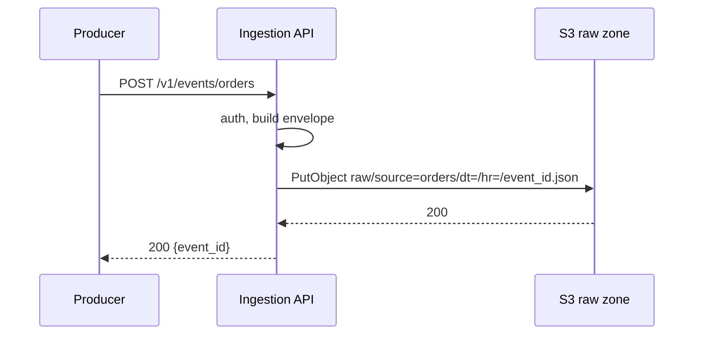

#### Pull path (SaaS and DB polling)

Cursor table, first and only appearance:

```sql
CREATE TABLE connector_state (
  connector   TEXT PRIMARY KEY,   -- 'zendesk_tickets', 'orders_db'
  cursor      TEXT NOT NULL,      -- last updated_at or page token
  updated_at  TIMESTAMPTZ NOT NULL DEFAULT now()
);
```

The cron job runs every 15 minutes, in this order:

1. `SELECT cursor FROM connector_state WHERE connector = 'orders_db'`.
2. Fetch rows with `WHERE updated_at > :cursor ORDER BY updated_at LIMIT 5000`.
3. Wrap each row in the same envelope and PUT it to the same `raw/` prefix.
4. Only after every PUT succeeds, `UPDATE connector_state SET cursor = :max_updated_at`.

The order in step 4 matters. A crash before the update re-fetches rows, which means duplicates but no loss. We fix the duplicates in the transform job.

#### Batch transform path

The scheduler (cron on a small container for V0) runs `run_hour(source, hour)` at HH:10 for the previous hour:

```python
def run_hour(source, hour):
    schema = load_schema(f"schemas/{source}.v1.json")   # from git
    validator = Draft202012Validator(schema)
    good, bad = [], []
    for key in list_keys(f"raw/source={source}/dt={hour:%Y-%m-%d}/hr={hour:%H}/"):
        env = json.loads(s3_get(key))
        errs = [e.message for e in validator.iter_errors(env["payload"])]
        (bad if errs else good).append({**env, "errors": errs} if errs else env)

    good = dedup_by(good, "event_id")                    # drop repeats in this hour
    write_parquet(good, f"curated/source={source}/dt=.../hr=.../part-0.parquet")  # overwrite
    write_jsonl(bad,    f"quarantine/source={source}/dt=.../hr=.../bad.jsonl")    # overwrite
    load_warehouse(source, hour)
```

Warehouse table (first time, full):

```sql
CREATE TABLE analytics.orders_events (
  event_id     VARCHAR(36),
  tenant_id    VARCHAR(64),
  order_id     VARCHAR(64),
  amount_cents BIGINT,
  currency     CHAR(3),
  channel      VARCHAR(32),
  event_ts     TIMESTAMP,
  received_at  TIMESTAMP,
  load_hour    TIMESTAMP
);
```

The load is an idempotent partition swap:

```sql
BEGIN;
DELETE FROM analytics.orders_events WHERE load_hour = '2026-10-28 14:00';
COPY analytics.orders_events
FROM 's3://acme-data/curated/source=orders/dt=2026-10-28/hr=14/'
IAM_ROLE 'arn:aws:iam::123:role/redshift-load' FORMAT AS PARQUET;
COMMIT;
```

Rerunning the hour deletes and reloads the same rows, so the result never changes.

#### Who writes and who reads

| Store | Who writes | When | Who reads | When |
|---|---|---|---|---|
| S3 `raw/` | Ingestion API, pull cron, DB poll job | On every event or fetch | Batch transform job | Hourly |
| S3 `curated/` | Batch transform job | Hourly | Redshift `COPY` | Right after transform |
| S3 `quarantine/` | Batch transform job | Hourly, on failures | Engineers (manual) | When triaging |
| `connector_state` | Pull cron, DB poll job | After each successful fetch | Same jobs | Start of each run |
| `analytics.orders_events` | Redshift `COPY` | Hourly | BI tools, ML pipelines | Ad hoc |
| `schemas/*.json` (git) | Engineers via PR | On change | Batch transform job | Each run |

#### Observability

V0 minimum: the transform job logs `good_count`, `bad_count`, and the hour it ran. An alarm fires if an hour has zero output or more than 5% quarantined.

### Current State After V0

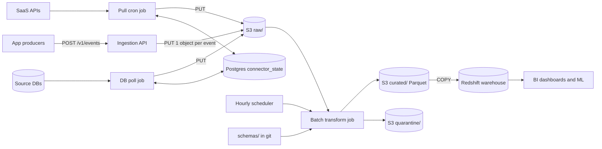

Every component above is new in V0.

**Flow 1: Push write path**
1. Producer calls `POST /v1/events/orders`.
2. Ingestion API authenticates and builds the envelope.
3. API PUTs one object under `raw/source=orders/dt=/hr=/`.
4. API returns 200 after S3 confirms.

**Flow 2: Pull path (SaaS and DB poll)**
1. Cron reads its cursor from Postgres `connector_state`.
2. It fetches changed rows or pages from the source.
3. It PUTs enveloped records to `raw/`.
4. It advances the cursor only after all PUTs succeed.

**Flow 3: Transform and load path**
1. Scheduler triggers `run_hour(source, hour)` at HH:10.
2. The job lists that hour's `raw/` objects and validates each payload against the git schema.
3. It dedups by `event_id`, writes good rows to `curated/` and bad rows to `quarantine/`.
4. It runs the Redshift delete-then-`COPY` for that hour in one transaction.

**Flow 4: Read path**
1. Analysts and ML jobs query `analytics.orders_events` in Redshift.

### Interview Follow-ups

**Q: Why land in S3 first instead of writing straight to the warehouse?**

A: The raw zone decouples ingestion from transformation. If the transform logic is wrong, we fix it and replay from raw. A direct warehouse write would also tie our ack to warehouse load and availability.

**Q: Why overwrite an hour's partition instead of just appending?**

A: Appending makes a retry produce duplicates. Delete-then-load inside one transaction makes the job idempotent, so a rerun is always safe.

### Recap

| Concept | The Insight |
|---|---|
| Raw landing zone | Store the untouched event first, so you can always replay from it. |
| Ack after durable write | Never say "received" until the bytes are safe. |
| Cursor advance order | Advance the cursor after the write. A crash then causes duplicates, never loss. |
| Idempotent partition load | Delete-then-load one hour in a transaction, so reruns are harmless. |
| Quarantine, not drop | Bad records go to a side prefix with reasons, so you can inspect and repair them. |

**Interview arc:** *"Start with the dumbest durable path: ack only after an S3 write, validate and load one hour at a time as an idempotent overwrite, so correctness is trivial and every later version is a deliberate trade away from it."*

**Next:** at 2K events/sec, V0 makes 2K S3 PUTs per second and about 170M tiny files a day, so the hourly job can't even list them. The first thing to break is the write path, and V1 puts a buffer in front of it.


-----------------------------------------------------------------------------------------------------------------------
-----------------------------------------------------------------------------------------------------------------------
-----------------------------------------------------------------------------------------------------------------------
-----------------------------------------------------------------------------------------------------------------------


## V1: Put a Log in Front of S3

It's Diwali sale morning. Neha is on call.

The marketing push lands, and traffic jumps from 2K to 6K events/sec. The Ingestion API starts returning 503s.

The cause is the write path. V0 does one S3 PUT per event, and every PUT goes into one hot hourly prefix. S3 starts answering `503 SlowDown` at around 3,500 PUTs/sec per prefix. The API holds each request open for the 60-100ms PUT, so threads pile up behind it.

Three numbers show V0 is broken, not just stressed:

- **Write throughput:** 6K/s against a ~3.5K/s prefix ceiling.
- **File count:** 100M objects a day, which costs about $500/day in PUTs alone.
- **Hourly read:** the transform job must list and GET about 7M tiny objects. That doesn't finish comfortably inside an hour.

There is one dominant problem, which is that we write one object per event. Duplicates, schema changes, and isolation are real, but they come later.

### The idea

Think of a post office sorting bay. Letters don't go one by one onto trucks. They drop into a big bin, and a clerk loads the bin onto a truck when it's full.

We need a bin in front of S3. It must be durable, because our ack promise from V0 must survive. It must also be replayable, because the raw zone is our source of truth.

That bin is a replicated, partitioned, append-only log. The name is Kafka.

### Candidates

| Option | Durable ack | Replay | Throughput headroom | Ops cost | Verdict |
|---|---|---|---|---|---|
| Kafka (MSK) | Yes, `acks=all` + ISR | Yes, by offset | High | Medium | Chosen |
| Kinesis + Firehose | Yes | 1-7 days, shard limits | Shard-bound (1 MB/s each) | Low | Fair; shard limits and weaker replay control |
| SQS | Yes | No, deleted on consume | High | Low | Rejected; no replay |
| Batch in API memory | No | No | High | Low | Rejected; crash loses acked data |

### Solve it

- ✅ **What we gained**
  - The API acks after a Kafka write (a few ms), not an S3 write.
  - A traffic spike now fills a buffer instead of failing.
  - S3 gets ~128MB files, not millions of tiny ones.
  - Kafka retains 7 days, so a sink bug can be replayed from offsets.
- ⚠️ **What we gave up**
  - A new stateful system to run and monitor.
  - Raw data in S3 now appears only when the sink flushes (up to 5 minutes later). It is still fresh enough for an hourly transform.
  - Ordering exists only within a partition. Raw doesn't need more.
- ❌ **What we considered and rejected**
  - **SQS:** deleting on consume kills replay.
  - **API-side batching:** it breaks "ack means durable", since a pod crash loses acked events.
  - **S3 append:** S3 has no append. Objects are immutable.

I'm deferring tenant isolation and consumer-side scaling to later versions.

### Implement it

#### Topic design (first time, full shape)

```bash
kafka-topics.sh --create --topic raw.orders \
  --partitions 12 --replication-factor 3 \
  --config min.insync.replicas=2 \
  --config retention.ms=604800000 \
  --config compression.type=producer
```

- **12 partitions:** ~6K/s × ~1KB = 6MB/s peak. One partition handles ~10MB/s, so 12 is for parallelism and headroom, not volume.
- **RF=3 across 3 AZs, `min.insync.replicas=2`:** an ack means at least 2 brokers hold the record.
- **Retention 7 days:** this is our replay window for sink bugs. S3 stays the permanent copy.
- **Partition key:** `event_id`, which spreads evenly. We don't need per-key ordering in raw.

Pull and DB-poll sources get their own topics (`raw.zendesk_tickets`, `raw.orders_db`), same config.

#### Push write path

The API contract doesn't change: same `POST /v1/events/orders`, same envelope. Only the write changes:

```python
producer = AIOKafkaProducer(
    bootstrap_servers=BROKERS,
    acks="all",
    enable_idempotence=True,
    linger_ms=5,
    compression_type="lz4",
)

await producer.send_and_wait(
    "raw.orders",
    key=event_id.encode(),
    value=json.dumps(envelope).encode(),
)
return {"event_id": event_id}   # 200 only after ISR ack
```

If fewer than 2 replicas are in sync, `send_and_wait` raises `NotEnoughReplicasError`. The API returns `503 Retry-After: 2`. We never ack an unreplicated write. Producers should retry with exponential backoff plus jitter.

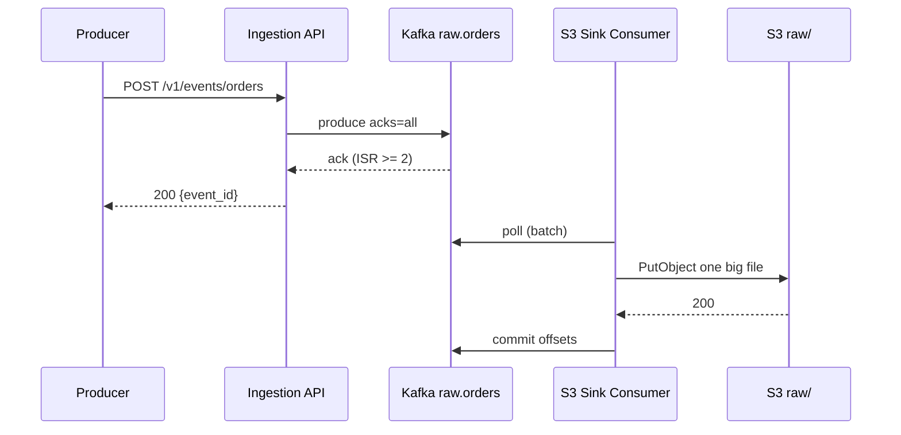

#### Pull and DB-poll paths

Same cursor logic as V0. The only change is the destination:

1. Read cursor from `connector_state`.
2. Fetch rows.
3. Produce each enveloped row to `raw.<source>`, then `await producer.flush()`.
4. Only after flush succeeds, `UPDATE connector_state SET cursor = ...`.

The crash-means-duplicates-not-loss rule is unchanged.

#### The S3 sink consumer (new component)

It is a consumer group `s3-raw-sink`, one worker per partition (12 max). It buffers records and flushes to S3 on whichever comes first: 128MB, 5 minutes, or an hour boundary by `received_at`.

The object key is deterministic, built from the offsets it covers:

```python
def flush(topic, partition, records):
    first, last = records[0].offset, records[-1].offset
    ts = records[0].received_at
    key = (f"raw/source={source_of(topic)}/dt={ts:%Y-%m-%d}/hr={ts:%H}/"
           f"p{partition:02d}-{first}-{last}.jsonl.gz")
    s3.put_object(Bucket="acme-data", Key=key, Body=gzip(jsonl(records)))
    consumer.commit({TopicPartition(topic, partition): last + 1})  # AFTER the PUT
```

Why this ordering is safe:

- **PUT before commit:** a crash between them restarts from the old offset.
- **Deterministic key:** the retry overwrites the same object, so the file isn't written twice under different names.
- **Net effect:** the sink is idempotent at the file level.

The transform job doesn't change. It now reads about 35 files an hour (~4.2GB at average load) instead of 4M+ objects. It still dedups by `event_id`.

#### Who writes and who reads (delta from V0)

| Store | Who writes | When | Who reads | When |
|---|---|---|---|---|
| Kafka `raw.*` topics (MSK, 3 AZs) | Ingestion API, pull cron, DB poll job | Per event or fetch | S3 sink consumer | Continuously |
| S3 `raw/` | S3 sink consumer (was: API and jobs) | On 128MB, 5 min, or hour roll | Batch transform job | Hourly at HH:10 |

All other rows from V0 are unchanged.

#### Observability

Two new alarms:

- **Consumer lag** on `s3-raw-sink`. If lag exceeds 5 minutes, the HH:10 transform could read an incomplete hour.
- **Under-replicated partitions.** Any non-zero value means we are one broker loss away from refusing writes.

### Current State After V1

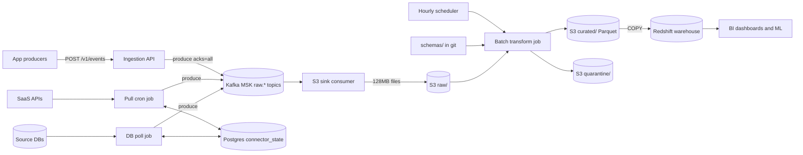

New in V1: the Kafka cluster (`raw.* topics`) and the S3 sink consumer. The producers' arrows now point at Kafka, not S3.

**Flow 1: Push write path (changed)**
1. Producer calls `POST /v1/events/orders`.
2. Ingestion API authenticates and builds the envelope.
3. API produces to Kafka `raw.orders` with `acks=all`.
4. API returns 200 after the ISR ack, or 503 if replicas are short.

**Flow 2: Pull path (changed destination)**
1. Cron reads its cursor from Postgres `connector_state`.
2. It fetches changed rows or pages from the source.
3. It produces to `raw.<source>` and flushes.
4. It advances the cursor only after the flush succeeds.

**Flow 3: Sink path (new)**
1. The sink consumer polls its Kafka partition.
2. It buffers until 128MB, 5 minutes, or an hour boundary.
3. It PUTs one deterministic-key file to S3 `raw/`.
4. It commits offsets after the PUT succeeds.

**Flow 4: Transform and load path (unchanged logic, fewer files)**
1. Scheduler triggers `run_hour(source, hour)` at HH:10.
2. Job reads the hour's `raw/` files and validates against the git schema.
3. It dedups by `event_id`, writes `curated/` and `quarantine/`.
4. It runs the Redshift delete-then-`COPY` in one transaction.

**Flow 5: Read path (unchanged)**
1. BI and ML query Redshift `analytics.orders_events`.

### Interview Follow-ups

**Q: Why Kafka and not Kinesis with Firehose? It writes to S3 for you.**

A: Firehose is a fair choice for a small team. I'd pick Kafka here because we want multiple independent consumers, long replay by offset, and partition control. Kinesis shard limits (1MB/s per shard) also make a 6x spike harder to absorb. If the team had no Kafka experience and one consumer, I'd say Firehose.

**Q: What if the sink consumer crashes mid-flush?**

A: It restarts from the last committed offset, reprocesses the same records, and writes the same deterministic key. The S3 object is overwritten, not duplicated. Offsets commit only after the PUT.

### Recap

| Concept | The Insight |
|---|---|
| Tiny-file problem | One object per event hits S3 prefix limits and makes the hourly read impossible. |
| Log as a buffer | A replicated log absorbs spikes and keeps "ack means durable". |
| `acks=all` + `min.insync.replicas=2` | An ack means at least two brokers hold the record. |
| Commit after PUT | Offsets move only after S3 confirms, so crashes cause reprocessing, never loss. |
| Deterministic object keys | Name files by partition and offset range, so retries overwrite instead of duplicating. |

**Interview arc:** *"One S3 object per event hits per-prefix throttling and a 7M-file hourly read, so we put a replicated Kafka log in front, ack on ISR write, and have a sink consumer batch into big, deterministically named files, committing offsets only after the PUT."*

**Next:** Marcus deletes an order in the source DB, and the warehouse still shows it. Our `updated_at` polling can't see deletes, and it hammers the production DB every 15 minutes. V2 replaces polling with change data capture.


-----------------------------------------------------------------------------------------------------------------------
-----------------------------------------------------------------------------------------------------------------------
-----------------------------------------------------------------------------------------------------------------------
-----------------------------------------------------------------------------------------------------------------------


## V2: Replace DB Polling with Change Data Capture

Marcus works in operations. At 14:02 he hard-deletes a duplicate order, `ord_8841`, from the production orders DB.

At 14:15 the DB poll job runs `WHERE updated_at > :cursor`. A deleted row has no `updated_at`, so the query never sees it.

The warehouse still shows `ord_8841`, and Priya's Monday revenue is overstated by ₹1,299. Nothing is quarantined and no alarm fires. The numbers are wrong and nobody knows.

Deletes are the visible symptom. Three other failures come from the same root cause, which is that polling asks the table what it looks like now:

- **Lost intermediate states.** An order goes `PLACED` → `PAID` → `SHIPPED` between two polls. We see only `SHIPPED`, so funnel analytics can't compute time-in-state.
- **Missed rows.** A bulk `UPDATE orders SET status='X' WHERE ...` run by a migration doesn't bump `updated_at`. Those rows never reach us.
- **Load on production.** On the 400M-row `orders` table, the poll query takes about 25 seconds of primary CPU every 15 minutes, forever.

The dominant problem is that we're detecting changes by querying state. Freshness and schema changes are still open, but they come later.

### The idea

Every database already keeps a diary of every change, in order, so it can recover after a crash. In Postgres that diary is the write-ahead log (WAL).

Polling is like checking a shop's shelves every hour to guess what sold. CDC is reading the till receipts. Receipts include returns, deletions, and every price change in between.

Reading the WAL and turning it into events is called change data capture, or log-based CDC.

### Candidates

| Option | Sees deletes | Sees every intermediate change | Load on source | Needs app changes | Verdict |
|---|---|---|---|---|---|
| Log-based CDC (Debezium) | Yes | Yes | Very low (reads WAL stream) | No | Chosen |
| Trigger-based audit table | Yes | Yes | High (extra write per change, in the same transaction) | No, but DB changes | Rejected |
| Better polling (soft deletes, `updated_at` triggers) | Only if app complies | No | Medium | Yes, every writer | Rejected |
| App dual-write (app writes DB and Kafka) | Yes | Yes | Low | Yes, and it can diverge | Rejected |

### Solve it

- ✅ **What we gained**
  - Every insert, update, and delete arrives, in commit order per row.
  - Source load drops from a 25-second scan to a streaming WAL read.
  - Freshness for DB data improves from 15 minutes to seconds. The warehouse is still hourly, so we don't see that yet.
  - No change to producing applications.
- ⚠️ **What we gave up**
  - A new moving part (Kafka Connect plus Debezium) to operate.
  - **Replication slot risk.** Postgres keeps WAL until we consume it. If the connector is down for hours, WAL piles up on the production disk.
  - Duplicates after connector restarts (at-least-once). Our dedup key changes.
  - The initial load requires a one-time snapshot.
- ❌ **What we considered and rejected**
  - **Triggers:** they add write latency to every production transaction.
  - **Better polling:** it still can't see hard deletes or intermediate states, and it depends on every writer behaving.
  - **Dual write:** the DB write and Kafka write aren't atomic, so they diverge.

### Implement it

#### Postgres side (first time, full)

```sql
-- postgresql.conf: wal_level = logical
--                  max_slot_wal_keep_size = 50GB   -- protects the primary

CREATE ROLE debezium REPLICATION LOGIN PASSWORD '...';
GRANT SELECT ON orders, order_items TO debezium;

CREATE PUBLICATION analytics_pub FOR TABLE orders, order_items;
```

`max_slot_wal_keep_size` is the safety valve. If the connector lags beyond 50GB of WAL, Postgres invalidates the slot instead of filling its disk. We then re-snapshot. Losing the slot is the lesser evil compared to taking down production.

#### Connector config (Kafka Connect, first time, full)

```json
{
  "name": "orders-db-cdc",
  "config": {
    "connector.class": "io.debezium.connector.postgresql.PostgresConnector",
    "plugin.name": "pgoutput",
    "slot.name": "analytics_slot",
    "publication.name": "analytics_pub",
    "database.hostname": "orders-db-primary",
    "database.dbname": "orders",
    "topic.prefix": "cdc.orders_db",
    "table.include.list": "public.orders,public.order_items",
    "snapshot.mode": "initial",
    "tombstones.on.delete": "false",
    "heartbeat.interval.ms": "10000"
  }
}
```

Two settings matter here:

- **`tombstones.on.delete=false`.** We want a real delete event and no null-value tombstone, because the delete is data for the warehouse.
- **Heartbeats.** On a quiet table, the slot's position would stall and WAL would still accumulate. Heartbeats keep it advancing.

Topics are named `cdc.orders_db.public.orders`, with 12 partitions, RF=3, `min.insync.replicas=2`, and 7-day retention. This is the same config as V1. The partition key is the **primary key** (`order_id`), not `event_id`. Debezium does this by default, and it is what keeps all changes to one order on one partition, in order.

#### The CDC event shape (first time, full)

```json
{
  "before": { "order_id": "ord_8841", "status": "PLACED", "amount_cents": 129900 },
  "after":  null,
  "op": "d",
  "ts_ms": 1793196120000,
  "source": {
    "lsn": 4821993104,
    "txId": 77213,
    "table": "orders",
    "db": "orders"
  }
}
```

The `op` field takes four values: `r` (snapshot read), `c` (create), `u` (update), and `d` (delete). For `c`, `u`, and `r`, `before` may be null and `after` holds the new row. For `d`, `after` is null.

`source.lsn` is the log sequence number. It is unique and increasing per change, so it becomes our dedup key.

#### What changes downstream

The S3 sink consumer needs no code change. Its topic list gains `cdc.orders_db.*`, and it writes the same deterministic-key files. Debezium events are not wrapped in our V0 envelope, so the sink adds the envelope fields (`tenant_id`, `source`, `received_at`) from topic metadata.

The transform job gains a second dedup rule. Push events dedup by `event_id`. CDC events dedup by `(table, lsn)`:

```python
def dedup_key(env):
    if env["source"].startswith("cdc."):
        return (env["payload"]["source"]["table"], env["payload"]["source"]["lsn"])
    return env["event_id"]
```

New warehouse tables (first time, full shape):

```sql
CREATE TABLE analytics.orders_changes (
  order_id     VARCHAR(64),
  op           CHAR(1),
  status       VARCHAR(32),
  amount_cents BIGINT,
  lsn          BIGINT,
  changed_at   TIMESTAMP,
  load_hour    TIMESTAMP
);

CREATE VIEW analytics.orders_current AS
SELECT order_id, status, amount_cents, changed_at
FROM (
  SELECT *, ROW_NUMBER() OVER (PARTITION BY order_id ORDER BY lsn DESC) AS rn
  FROM analytics.orders_changes
)
WHERE rn = 1 AND op <> 'd';
```

The design here has two layers:

- **`orders_changes`** is append-only history. It answers time-in-state questions and stays correct forever.
- **`orders_current`** is the latest row per key, with deleted rows filtered out. Dashboards read this one.

The hourly load stays delete-then-`COPY` by `load_hour`, as in V0, so reruns are idempotent. For deletes, the `d` event's `before` image fills the `order_id` and `status` columns.

#### Flow

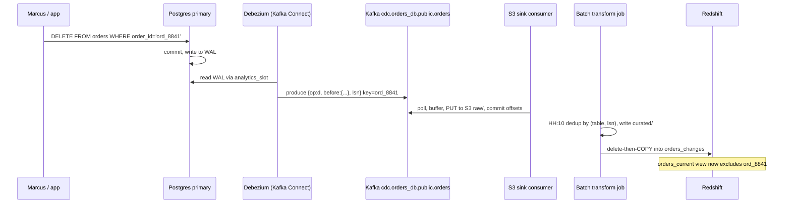

#### Failure handling and observability

Three new alarms, and one new runbook:

- **Slot lag in bytes** (`pg_replication_slots`, `pg_current_wal_lsn() - confirmed_flush_lsn`). Alert at 10GB. Page at 30GB.
- **Connector task state.** Alert if `FAILED` or paused for more than 5 minutes.
- **Source-to-Kafka lag.** The heartbeat timestamp tells us how stale the stream is.
- **Slot invalidated.** The runbook is to re-run `snapshot.mode=initial`. The `orders_changes` history for the gap is rebuilt from the snapshot as `r` rows. We lose intermediate states for that window, which is acceptable.

#### Who writes and who reads (delta from V1)

| Store | Who writes | When | Who reads | When |
|---|---|---|---|---|
| Postgres WAL and `analytics_slot` | Postgres primary | Every commit | Debezium connector | Continuously |
| Kafka `cdc.orders_db.*` topics | Debezium connector | Per change | S3 sink consumer | Continuously |
| S3 `raw/source=cdc.orders_db/` | S3 sink consumer | 128MB, 5 min, or hour roll | Batch transform job | Hourly |
| `analytics.orders_changes` | Redshift `COPY` | Hourly | `orders_current` view | On query |
| `analytics.orders_current` (view) | Not written; computed | N/A | BI, ML | Ad hoc |
| Postgres `connector_state` | Pull cron only | After fetch | Pull cron only | Start of run |

The DB poll job is gone. Other rows from V1 are unchanged.

### Current State After V2

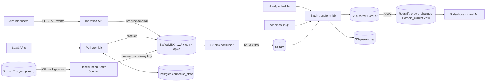

New in V2: Debezium on Kafka Connect, the logical replication slot, the `cdc.*` topics, and `orders_changes` plus the `orders_current` view. Removed: the DB poll job.

**Flow 1: Push write path (unchanged)**
1. Producer calls `POST /v1/events/orders`.
2. API authenticates, builds the envelope, and produces to `raw.orders` with `acks=all`.
3. API returns 200 after the ISR ack, or 503 if replicas are short.

**Flow 2: SaaS pull path (unchanged)**
1. Cron reads its cursor from `connector_state` and fetches from the SaaS API.
2. It produces to `raw.<source>` and flushes.
3. It advances the cursor after the flush.

**Flow 3: CDC path (new, replaces the DB poll job)**
1. The source app commits a change, and Postgres writes it to the WAL.
2. Debezium reads the WAL through `analytics_slot`.
3. It produces a change event to `cdc.orders_db.public.orders`, keyed by primary key.
4. The slot position advances after Kafka confirms.

**Flow 4: Sink path (unchanged logic, more topics)**
1. The sink polls its partitions, including `cdc.*`.
2. It PUTs deterministic-key files to S3 `raw/` and then commits offsets.

**Flow 5: Transform and load path (changed)**
1. Scheduler triggers `run_hour(source, hour)` at HH:10.
2. Job validates and dedups. Push events dedup by `event_id`, CDC events by `(table, lsn)`.
3. It writes `curated/` and `quarantine/`, then delete-then-`COPY`s into `orders_changes`.

**Flow 6: Read path (changed)**
1. BI and ML query `orders_current`, which excludes deleted orders.
2. Analysts who need history query `orders_changes`.

### Interview Follow-ups

**Q: What if the Debezium connector is down for three days?**

A: Postgres keeps WAL for the slot, and that WAL piles up on the production disk. That's why `max_slot_wal_keep_size` is set. At 50GB the slot is invalidated and production is protected. We then re-snapshot and accept lost intermediate states for the gap. We also alert on slot lag at 10GB, so a human acts long before that.

**Q: Why not just add soft deletes (`is_deleted`) and keep polling?**

A: It works only if every writer, including scripts, migrations, and ops tools, always uses soft deletes and bumps `updated_at`. One hard delete breaks it silently. It also still loses intermediate states and still queries production. CDC reads what the database committed, so it doesn't depend on writer discipline.

### Recap

| Concept | The Insight |
|---|---|
| Polling sees state | Polling can't see deletes, intermediate states, or rows with unbumped timestamps. |
| Log-based CDC | The WAL is the database's own record of every change, in commit order. |
| Key by primary key | All changes to one row land on one partition, so order is preserved per row. |
| Replication slot risk | An unconsumed slot grows WAL on production, so cap it and alarm on lag. |
| Changes table plus current view | Append history for truth, and a latest-row view for dashboards. |

**Interview arc:** *"Polling by `updated_at` can't see deletes or intermediate states and loads production, so we read the Postgres WAL with Debezium, key events by primary key into Kafka, and land an append-only change log in the warehouse with a current-state view on top, capping the replication slot so a stalled connector can't fill the primary's disk."*

**Next:** At 03:12, the orders team renames `amount_cents` to `amount` and ships it. Our static schema file rejects 100% of the events, so quarantine fills and dashboards go flat. That is the crux, and V3 starts the schema evolution problem.


-----------------------------------------------------------------------------------------------------------------------
-----------------------------------------------------------------------------------------------------------------------
-----------------------------------------------------------------------------------------------------------------------
-----------------------------------------------------------------------------------------------------------------------


## V3: Schema Contracts at the Front Door

Kavya is on the orders team. At 03:12 she deploys a cleanup: the mobile backend now sends `amount` instead of `amount_cents`.

Her unit tests pass and her deploy is green. Our V2 pipeline accepts every event into Kafka, because validation only happens at transform time.

At 04:10 the hourly job validates hour 03 against the static schema, which requires `amount_cents`. Every event fails.

The numbers from that night:

- **Volume:** about 1,500 events/sec off-peak, for 58 minutes before the job runs.
- **Quarantined:** about 5.2M events.
- **Alert:** the ">5% quarantined" alarm fires at 04:12.
- **Cost:** hour 03 is missing from the warehouse, and a human repairs it by hand around 07:40.

This is the crux. Producers change shape without warning, and the platform must not break downstream or silently corrupt it. I'm taking one concern in this version, which is how event shapes change safely. Bad values (right shape, wrong content) and CDC drift come later.

### The crux: three naive attempts

#### Attempt 1: Reject on any mismatch (what V0 to V2 do)

This looked reasonable. A strict schema keeps garbage out of the warehouse.

It broke at 03:12. The rule can't tell a harmless new optional field from a destructive rename, so it rejects both.

Feedback also arrives an hour late, in our job, not in Kavya's deploy pipeline. And every legitimate change needs an engineer to edit the schema file. That makes the platform team the bottleneck for every producer.

#### Attempt 2: Trust the producer

The opposite swing: stop rejecting. Land every payload as-is in a Redshift `SUPER` column and sort it out at query time.

This looked reasonable because nothing ever fails, and producers move fast.

It breaks quietly. After the rename, the dashboard runs `SUM(payload.amount_cents)` and gets NULL. Revenue shows ₹0 from 03:12 onward. No alarm fires, because nothing technically failed. Finance notices two days later.

A type change is worse. If `amount_cents` becomes the string `"1299.00"`, every BI cast fails at once.

#### Attempt 3: Auto-evolve the table

A middle path: the job adds a warehouse column for any new key it sees.

> **Arjun:** Let the job add columns for any new field. Zero tickets.
> **Meera:** Kavya renames `amount_cents` to `amount` tonight. What does the revenue dashboard sum tomorrow?
> **Arjun:** `amount_cents`.
> **Meera:** Which is NULL since 03:12. The job succeeded, and the number is wrong.

It breaks in other ways too:

- A typo like `ammount_cents` becomes a permanent column.
- A type change can't be `ALTER`ed on a `BIGINT` column, so the `COPY` fails and blocks the hour.
- Redshift caps a table at 1,600 columns, and producers can fill that.

A rename looks like an additive change to a machine. Only a contract can say it is not.

| Approach | Stops a breaking rename | Friction for a harmless addition | When the producer finds out | Verdict |
|---|---|---|---|---|
| Reject on mismatch (V2) | Yes, but also stops everything else | High: ticket and manual edit | About 1 hour later, at transform | Rejected |
| Trust the producer | No | None | Never; finance finds it | Rejected |
| Auto-evolve | No (a rename looks additive) | None | Never | Rejected |
| Registry with compatibility rules | Yes, precisely | Low: self-serve CI, about 2 minutes | At PR time | Chosen |

### The idea

Think of a wall socket standard. A new appliance may add features, but nobody may change the pin layout. If the layout must change, you install a second socket type beside the old one until every appliance has moved over.

That is the mechanism. Additive changes flow freely. Breaking changes get a parallel track. A machine enforces the line between them.

The machine is a schema registry. It stores every version of every schema, and it refuses a new version that breaks the compatibility rule.

A compatibility mode answers one question: who must be able to read what? Our reader is the transform job. It reads every event ever stored, old and new, using the newest schema. So the rule must be that the newest schema can read data written under every earlier version.

That rule is called `BACKWARD_TRANSITIVE`:

- **Backward** means a new reader can read old data.
- **Transitive** means this holds against all past versions, not only the previous one.

I'm using a closed content model (`additionalProperties: false`), so unknown fields are rejected too. Under these rules:

| Change | Allowed? | Why |
|---|---|---|
| Add an optional field | Yes | Old data lacks it, which is fine |
| Make a required field optional | Yes | Old data still validates |
| Add a required field | No | Old data lacks it |
| Remove a field | No | Old data still carries it |
| Change a field's type | No | Old data fails the new type |
| Rename a field | No | It is a remove plus an add |

Kavya's rename fails twice over.

### Solve it

- ✅ **What we gained**
  - Violations surface in the producer's CI in minutes, not in our transform hour.
  - Additive changes are self-serve, with no ticket.
  - Raw data from any past version stays readable by the latest schema.
  - Warehouse columns come only from registered fields, so there are no typo columns.
- ⚠️ **What we gave up**
  - Within one major version, fields live forever. Schemas only grow.
  - A breaking change needs a new major version and a side-by-side run.
  - The registry is a new dependency. If it is down, the API serves cached schemas for known versions and returns 503 for unseen ones.
  - A producer that deploys before registering gets 422s at runtime.
  - The contract covers shape only. A unit change (rupees to paise) passes silently, so semantic changes must also be a new major.
- ❌ **What we considered and rejected**
  - **Central approval board:** it is slow, and nothing enforces it at runtime.
  - **`FULL` compatibility:** it requires both directions and blocks too many safe changes.
  - **Per-event schema inference:** it moves the contract into guesswork.

### Implement it

#### A. The registry (first time, full)

It is a Confluent-compatible Schema Registry. It runs as 2 ECS tasks behind an internal ALB. It is stateless and keeps its data in a Kafka topic, `_schemas` (RF=3), so we reuse our existing cluster.

```bash
# default for every subject
curl -X PUT $SR/config \
  -H 'Content-Type: application/vnd.schemaregistry.v1+json' \
  -d '{"compatibility":"BACKWARD_TRANSITIVE"}'
```

The subject name matches the topic: `raw.orders-value`.

Only three principals hold `WRITE` ACLs on `raw.*` and `cdc.*`: the Ingestion API, the pull cron, and the Debezium connector. Nobody can bypass the validator by producing directly.

#### B. Schema v1 (first time, full)

```json
{
  "$schema": "http://json-schema.org/draft-07/schema#",
  "type": "object",
  "additionalProperties": false,
  "properties": {
    "order_id":     {"type": "string"},
    "amount_cents": {"type": "integer"},
    "currency":     {"type": "string"},
    "channel":      {"type": "string"},
    "event_ts":     {"type": "string", "format": "date-time"}
  },
  "required": ["order_id", "amount_cents", "currency", "channel", "event_ts"]
}
```

It is registered with `POST /subjects/raw.orders-value/versions` and the body `{"schemaType":"JSON","schema":"<the JSON above, as a string>"}`. The response is `{"id": 41}`.

Version 2 is a delta. It adds one property and leaves `required` untouched:

```json
"coupon_code": {"type": "string"}
```

It registers as `{"id": 57}`.

#### C. The CI gate (producer side)

This runs on every producer PR that touches `schemas/orders.json`:

```python
r = httpx.post(
    f"{SR}/compatibility/subjects/raw.orders-value/versions/latest?verbose=true",
    json={"schemaType": "JSON", "schema": open("schemas/orders.json").read()})
res = r.json()
if not res["is_compatible"]:
    print("\n".join(res.get("messages", [])))
    sys.exit(1)               # blocks the merge and the deploy
```

On merge, a second step registers the version. Kavya's rename PR would fail with output like this (illustrative):

```
FAIL: incompatible with raw.orders-value (BACKWARD_TRANSITIVE)
  - new required property 'amount' is absent from data written under version 1
  - property 'amount_cents' is no longer allowed
```

She learns this at 03:00 in her own pipeline. Nothing reaches production.

#### D. The safe path for the same rename

| Step | Schema change | Producer sends | Verdict |
|---|---|---|---|
| 1 | v2: add optional `amount` | Both `amount_cents` and `amount` | Compatible |
| 2 | v3: make `amount_cents` optional | `amount` only | Compatible |
| 3 | Platform adds a rename mapping (below) | No change | No registry change |

Removing `amount_cents` entirely is not allowed in this major version. A breaking change, such as a unit change or a real removal, means a new major: subject `raw.orders.v2-value`, topic `raw.orders.v2`, and table `orders_events_v2`. We run both side by side until v1 retires.

#### E. Runtime check in the Ingestion API

The `POST /v1/events/orders` contract is unchanged. Producers already send `schema_version`.

```python
@ttl_cache(seconds=60)
def get_schema(subject, version):
    r = httpx.get(f"{SR}/subjects/{subject}/versions/{version}").json()
    return r["id"], Draft7Validator(json.loads(r["schema"]))

sid, validator = get_schema("raw.orders-value", body["schema_version"])
payload = {k: v for k, v in body.items() if k not in ("event_id", "schema_version")}
errors = [e.message for e in validator.iter_errors(payload)]
if errors:
    raise HTTPException(422, {"error": "schema_violation",
                              "schema_version": body["schema_version"],
                              "details": errors[:5]})
envelope["schema_id"] = sid        # new envelope field; everything else as in V0
```

Validation costs about 0.1 to 0.3 ms per 1KB event. That is negligible at 6K/s.

A 422 is not retryable. Producers must park the event in their own dead-letter store. With the CI gate, this should be rare.

#### F. Transform job (reader side)

The job reads with the latest schema. Missing optional fields become NULL. Renames fold into an existing column through a git-reviewed mapping:

```python
RENAMES = {"amount": "amount_cents"}     # mappings/orders.yaml

def to_row(payload, latest):
    row = {}
    for name in latest["properties"]:
        target = RENAMES.get(name, name)
        if payload.get(name) is not None:
            row[target] = payload[name]
        else:
            row.setdefault(target, None)
    return row
```

Warehouse columns are added only for registered fields:

```python
TYPE = {"string": "VARCHAR(256)", "integer": "BIGINT",
        "number": "DOUBLE PRECISION", "boolean": "BOOLEAN"}

def sync_columns(table, latest, renames):
    have = set(redshift_columns(table))
    for name, spec in latest["properties"].items():
        target = renames.get(name, name)
        if target not in have:
            redshift.execute(f"ALTER TABLE {table} ADD COLUMN {target} {TYPE[spec['type']]}")
```

The `COPY` now lists its columns explicitly, and the job writes Parquet in the same order. Redshift maps Parquet columns by position, so the explicit list prevents a silent misalignment.

```sql
COPY analytics.orders_events (event_id, tenant_id, order_id, amount_cents, currency,
                              channel, event_ts, received_at, load_hour, coupon_code)
FROM 's3://acme-data/curated/source=orders/dt=2026-10-28/hr=14/'
IAM_ROLE '...' FORMAT AS PARQUET;
```

The job still validates each payload against its writer schema (`registry.by_id(env["schema_id"])`). Pull sources have no `schema_id`, so the job falls back to the latest schema for them.

#### G. Who writes and who reads (delta from V2)

| Store | Who writes | When | Who reads | When |
|---|---|---|---|---|
| Schema Registry (ECS, `_schemas` topic) | Producer CI pipeline | On schema PR merge | Ingestion API | Cache refresh every 60s |
| | | | Transform job | Each run |
| | | | CI compat check | Each producer PR |
| `mappings/orders.yaml` (git) | Platform engineers via PR | On a rename | Transform job | Each run |
| `analytics.orders_events` | Redshift `COPY`; `ALTER TABLE` by the transform job | Hourly | BI, ML | Ad hoc |
| `schemas/` in git (platform repo) | Retired | N/A | N/A | N/A |

The source schema file now lives in each producer's own repo. The registry is the source of truth.

#### H. The schema change flow

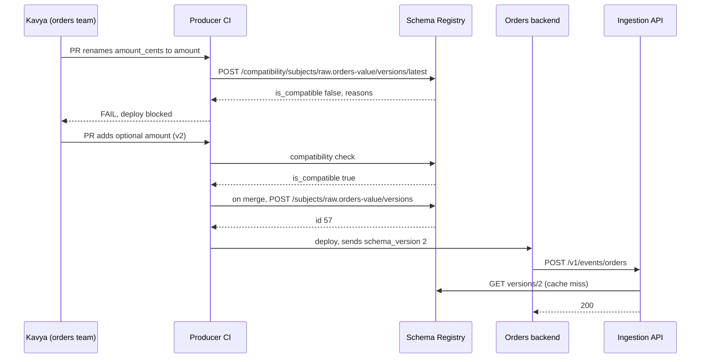

### Current State After V3

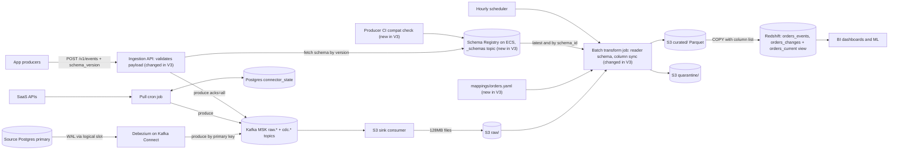

New in V3: the Schema Registry, the CI compatibility check, the API runtime validation, the rename mapping file, and the transform job's column sync. The `schemas/` git directory is retired.

**Flow 1: Push write path (changed)**
1. Producer calls `POST /v1/events/orders` with `schema_version`.
2. Ingestion API authenticates, then fetches the schema for that version from its cache or the registry.
3. It validates the payload and returns 422 on a violation.
4. It builds the envelope with `schema_id` and produces to `raw.orders` with `acks=all`.
5. It returns 200 after the ISR ack.

**Flow 2: SaaS pull path (unchanged)**
1. Cron reads its cursor, fetches from the SaaS API, produces to `raw.<source>`, and flushes.
2. It advances the cursor after the flush.

SaaS sources aren't producer-owned, so they can't be blocked at a door. The transform job validates them.

**Flow 3: CDC path (unchanged)**
1. Debezium reads the WAL and produces change events keyed by primary key.
2. CDC drift (a DB owner altering a column) is not handled yet.

**Flow 4: Sink path (unchanged)**
1. The sink consumer batches records into deterministic-key files in S3 `raw/` and commits offsets after the PUT.

**Flow 5: Transform and load path (changed)**
1. Scheduler triggers `run_hour(source, hour)` at HH:10.
2. Job loads the latest schema from the registry, and the writer schema by `schema_id` (latest for pull sources).
3. It validates, dedups, and maps each payload to a row. Failures go to `quarantine/`.
4. It runs `sync_columns` to add any new registered columns.
5. It writes `curated/` Parquet in column order, then runs delete-then-`COPY` with the explicit column list.

**Flow 6: Read path (unchanged)**
1. BI and ML query `orders_current` for latest state and `orders_changes` for history.

**Flow 7: Schema change path (new)**
1. A producer opens a PR that edits its schema file.
2. CI calls the registry's compatibility check and blocks incompatible changes.
3. On merge, CI registers the new version and the producer deploys.
4. The API picks up the new version on its next cache miss.

### Interview Follow-ups

**Q: Why `BACKWARD_TRANSITIVE` and not `FULL`, or plain `BACKWARD`?**

A: Our one reader, the transform job, replays all history with the newest schema, so new schema must read every old version. That is backward, and transitive because replay goes back past the previous version. `FULL` also requires old readers to read new data. That isn't needed when we control reader upgrades, and it blocks safe changes.

**Q: What if the schema registry is down?**

A: The API keeps serving from its schema cache for versions it already knows. An unseen version gets a retryable 503. Existing producers see no change. A new version can only deploy after CI registers it, so an outage delays rollouts, not live traffic. We run 2 tasks across AZs, and `_schemas` lives in Kafka at RF=3.

### Recap

| Concept | The Insight |
|---|---|
| Static schema file | It can't tell a harmless addition from a destructive rename, so it blocks both. |
| Trust or auto-evolve | Nothing fails, but the numbers are wrong with no alarm. |
| `BACKWARD_TRANSITIVE` | The newest schema must read all history, so you can add but never remove or rename. |
| Enforce in CI and at runtime | The producer learns at PR time, and the API stays strict as a backstop. |
| Breaking change = new major | The socket analogy: run both pin layouts side by side until everyone moves. |

**Interview arc:** *"A static schema file blocked everything at 04:10 while trusting producers or auto-evolving silently zeroed revenue, so we put a schema registry with backward-transitive compatibility at the front door, checked in the producer's CI and again at the API, which makes additive changes self-serve, makes renames impossible by construction, and turns breaking changes into a new major version run side by side."*

**Next:** the shape is now under contract, but quarantine still fills with a different kind of bad data. Those events have the right shape and wrong content: `amount_cents = -5`, currency `"INRR"`, events arriving 11 days late. Nobody owns triage, and replay is manual. V4 builds quarantine triage and replay.


-----------------------------------------------------------------------------------------------------------------------
-----------------------------------------------------------------------------------------------------------------------
-----------------------------------------------------------------------------------------------------------------------
-----------------------------------------------------------------------------------------------------------------------


## V4: Quarantine Becomes a Workflow

Priya's Monday number disagrees with Finance's ledger by ₹3.1 crore. It is Monday, October 26.

The cause started last Tuesday. Android build 4.12 shipped with a typo in a constant, so every order carried `currency: "INRR"`.

The shape was valid. V3's registry check passed, because `currency` is a string. The transform job then rejected the events and wrote them to `quarantine/`, exactly as designed.

Nobody looked there. The numbers:

- **Affected volume:** about 4,000 Android orders a day for 6 days, so 24K events.
- **Revenue missing:** 24K × ₹1,299 average ≈ ₹3.1 crore from the `mobile_app` channel.
- **Alarm:** our alarm fires at more than 5% of an hour's events quarantined. This was 0.004% of daily volume, so it never fired.
- **Owner:** none. Quarantine is a folder of `.jsonl` files with no team attached.

The cleanup made it worse. An engineer grepped the files and wrote a one-off script that patched `INRR` to `INR` and loaded the rows straight into Redshift. It stamped the wrong `load_hour`. Someone then ran it twice, so 24K rows became 48K.

The dominant problem is that bad records have no lifecycle. Nobody is told, nobody owns them, and replay is a manual, non-idempotent script. Late-data handling and tenant isolation are real, but they come later.

### The idea

Think of a returns desk in a shop. A damaged item doesn't vanish, and it doesn't sit in a back room forever.

It gets a tag with the reason. It goes to the supplier who owns that product line. The supplier decides to fix it, accept it as is, or scrap it. After a fix, it goes back on the shelf through the normal door.

For us, the tag is a reason code. The supplier is the producing team. And the "normal door" is the part to get right: a fixed record must re-enter through the same validated path as everything else.

### Solve it

Four pieces make it a workflow:

1. **Value rules.** Right-shape, wrong-content checks, owned by the producing team.
2. **Structured quarantine.** Every rejected record carries a reason code and a pointer back to its raw location.
3. **Batches with owners.** Rejections roll up into one row per source, reason, and hour, and the owning team is notified.
4. **Replay by re-running the hour.** A fix is saved as a declared resolution, and the original hour is recomputed with it applied.

### Replay candidates

Replay is a known sub-problem with a few established fixes.

**A. Re-produce fixed records to Kafka.**

```python
for rec in fixed_records:
    producer.send("raw.orders", key=rec.event_id, value=envelope(rec))
```

Rejected. The record now lands in the current hour, so `load_hour` is wrong. Kafka only retains 7 days. It also hits the same dedup path and can double-load if run twice.

**B. Re-run the original hour with the resolution applied.**

```python
run_hour("orders", hour)   # reads raw + resolutions, overwrites that hour
```

Chosen. It reads the same permanent S3 raw files. The result lands in the correct hour, and the delete-then-`COPY` makes it idempotent.

**C. Patch the warehouse directly.**

```sql
INSERT INTO analytics.orders_events SELECT ... FROM quarantine_ext.orders;
```

Rejected. It bypasses validation and the next rerun of that hour deletes the patch. Raw and warehouse silently disagree. This is also what went wrong last week.

| Option | Correct `load_hour` | Idempotent | Re-validated | Works after 7 days | Verdict |
|---|---|---|---|---|---|
| A. Re-produce to Kafka | No | No | Yes | No | Rejected |
| B. Re-run the hour | Yes | Yes | Yes | Yes | Chosen |
| C. Patch the warehouse | Manual | No | No | Yes | Rejected |

- ✅ **What we gained**
  - Every bad record has a reason code, an owner, and an SLA.
  - Replay is one idempotent mechanism, the same `run_hour` we already trust.
  - The alarm watches each reason code, so a small, concentrated failure is visible.
  - A fix is auditable: who, what, why, and when.
- ⚠️ **What we gave up**
  - A replay recomputes the whole hour (~4GB), even if only 600 records changed.
  - A resolution applies per source and hour, so it cannot target one record.
  - The `accept` action can be abused to silence alarms. We guard it below.
  - New moving parts: a small API, a batch table, and a replay runner.
- ❌ **What we considered and rejected**
  - **Value rules at the API door:** they make rule changes an API deploy, CDC and pull sources have no door anyway, and the ack path stays as cheap as possible.
  - **A Kafka dead-letter topic:** our validation runs in a batch job reading S3, and Kafka retention is 7 days. A DLQ topic makes sense later if validation moves into a stream.
  - **One Postgres row per bad record:** a 5M-event incident would flood the table. Batches bound the row count.

### Implement it

#### A. Value rules (first time)

Rules live in git, next to each source, and `CODEOWNERS` assigns them to the producing team.

```python
# rules/orders.py
ISO_4217 = {"INR", "USD", "EUR", "GBP", "AED", "SGD"}   # loaded from a file in practice

RULES = [
    ("AMOUNT_NONNEG",   lambda p, e: p["amount_cents"] >= 0),
    ("CURRENCY_ISO",    lambda p, e: p["currency"] in ISO_4217),
    ("EVENT_TS_WINDOW", lambda p, e: e.received_at - timedelta(days=7)
                                     <= parse(p["event_ts"])
                                     <= e.received_at + timedelta(minutes=5)),
]
```

The third rule is how "11 days late" gets caught. Rules run in the transform job, after schema validation, so every path (push, CDC, pull) passes through them once.

#### B. Quarantine record shape (first time, full)

It is written as Parquet to `S3 quarantine/source=orders/dt=.../hr=.../reason=CURRENCY_ISO/part-0.parquet`.

Parquet on S3 is the right class here for the same reason as `curated/`: records are numerous, written in bulk by one job, and read in bulk. Redshift Spectrum has one external table over it, `quarantine_ext.orders`, for ad hoc queries.

```json
{
  "event_id": "7c1e9a52-...",
  "source": "orders",
  "tenant_id": "acme",
  "stage": "value_rule",
  "reason_code": "CURRENCY_ISO",
  "all_reasons": ["CURRENCY_ISO"],
  "reason_detail": "currency='INRR'",
  "raw_key": "raw/source=orders/dt=2026-10-21/hr=14/p03-88120-91544.jsonl.gz",
  "raw_offset": 88377,
  "schema_id": 57,
  "received_at": "2026-10-21T14:03:12Z",
  "load_hour": "2026-10-21T14:00:00Z",
  "payload": { "order_id": "ord_9120", "amount_cents": 129900, "currency": "INRR", "...": "..." }
}
```

The `reason_code` is the first failing rule. Schema failures from V3 use `stage: "schema"` and `reason_code: "SCHEMA_VIOLATION"`, so they share this path. The job overwrites the partition each run, so reruns stay idempotent.

#### C. The batch table (first time, full)

It lives in the same small Postgres (RDS) that holds `connector_state`.

```sql
CREATE TABLE quarantine_batches (
  batch_id     UUID PRIMARY KEY DEFAULT gen_random_uuid(),
  source       TEXT        NOT NULL,
  reason_code  TEXT        NOT NULL,
  load_hour    TIMESTAMPTZ NOT NULL,
  record_count INT         NOT NULL,
  sample       JSONB       NOT NULL,          -- up to 5 payloads
  owner_team   TEXT        NOT NULL,
  status       TEXT        NOT NULL DEFAULT 'OPEN',
  resolution   JSONB,                         -- the declared fix
  resolved_by  TEXT,
  sla_due_at   TIMESTAMPTZ NOT NULL,
  created_at   TIMESTAMPTZ NOT NULL DEFAULT now(),
  updated_at   TIMESTAMPTZ NOT NULL DEFAULT now(),
  UNIQUE (source, reason_code, load_hour)
);
```

Rows are bounded by sources × reasons × hours, not by event count. The 24K-event incident is 6 days × 24 hours × 1 reason, so at most 144 rows.

The transform job upserts counts after each run:

```sql
INSERT INTO quarantine_batches (source, reason_code, load_hour, record_count, sample, owner_team, sla_due_at)
VALUES ('orders','CURRENCY_ISO','2026-10-21 14:00+00', 171, :sample, 'orders-team', now() + interval '24 hours')
ON CONFLICT (source, reason_code, load_hour)
DO UPDATE SET record_count = EXCLUDED.record_count, sample = EXCLUDED.sample, updated_at = now();
```

Ownership and SLA come from `owners.yaml` in git:

```yaml
orders:   { team: orders-team,  slack: "#orders-data", sla_hours: 24 }
payments: { team: payments-team, slack: "#pay-data",   sla_hours: 4 }
```

#### D. Lifecycle

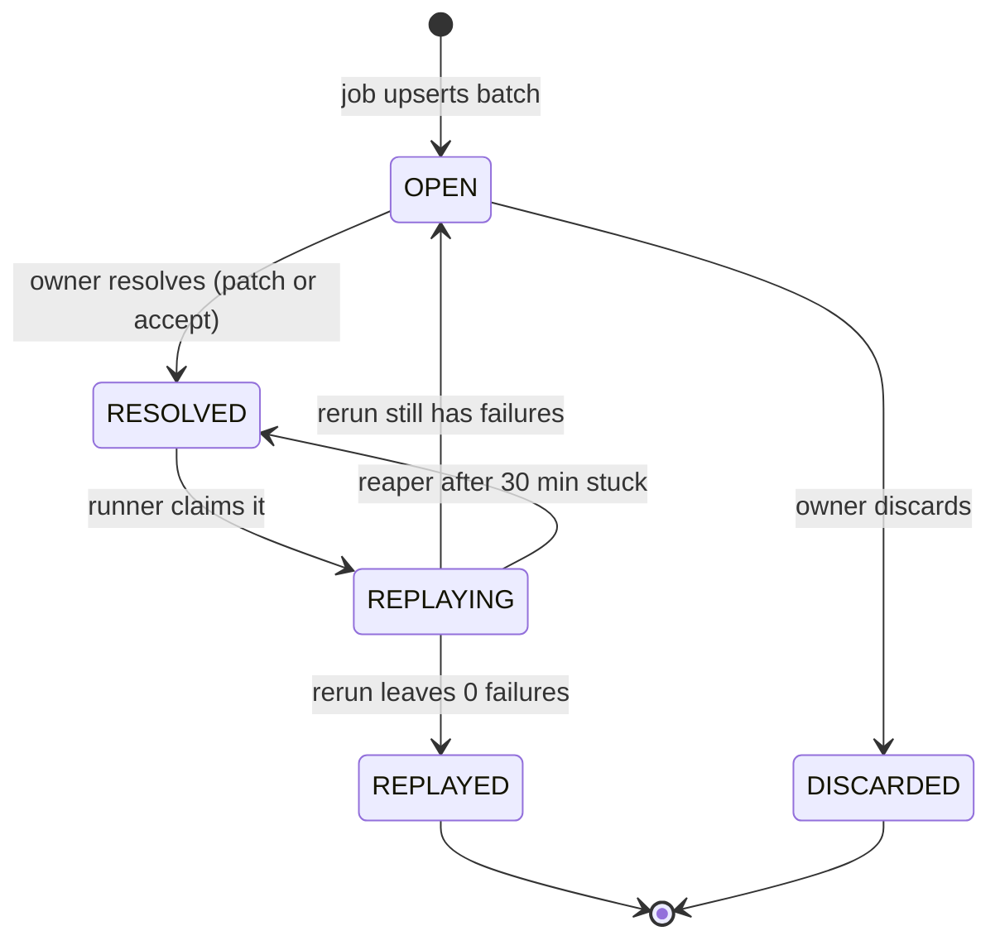

#### E. Notification and alarms

After `run_hour`, the job posts to the owner's Slack channel for each newly created batch, with counts, the first sample, and a link. It does not repost on every rerun.

Three alarms, all per `(source, reason_code)`:

- **Concentration:** more than 0.5% of a source's hourly events share one reason. Page the owner.
- **SLA breach:** a batch is still `OPEN` past `sla_due_at`.
- **Any `SCHEMA_VIOLATION` on a pull source:** the upstream API shape changed.

The old global "5%" alarm stays as a backstop.

#### F. Resolve through an API

A small FastAPI service on ECS (2 tasks) fronts the table. It authorizes by `owner_team`.

Preview first:

```http
POST /internal/quarantine/batches/6e1b.../preview
{
  "action": "patch",
  "set":   { "currency": "INR" },
  "where": { "currency": "INRR" },
  "note":  "Android 4.12 constant typo, fixed in 4.13"
}
```

The service reads that batch's Parquet partition, applies the patch in memory, and re-runs all rules. It responds `{"would_pass": 171, "still_failing": 0}`.

Then resolve with the same body:

```http
POST /internal/quarantine/batches/6e1b.../resolve
→ UPDATE quarantine_batches SET status='RESOLVED', resolution=:body, resolved_by=:user WHERE batch_id=:id AND status='OPEN'
```

Three actions are allowed:

| Action | Effect | Allowed on |
|---|---|---|
| `patch` | Apply `set` where `where` matches, then re-validate | Value rules |
| `accept` | Waive this rule for these records | Value rules only |
| `discard` | Keep out of the warehouse for good | Any reason |

Guards on `accept`: a free-text note is required, the call is audited, and it is refused for `SCHEMA_VIOLATION`, because records of the wrong shape can't load into typed columns. A monthly report lists accepted counts per team and rule.

#### G. The transform job applies resolutions

This is the only change to `run_hour`:

```python
def run_hour(source, hour):
    latest = registry.latest(f"raw.{source}-value")
    res = db.query("""SELECT reason_code, resolution FROM quarantine_batches
                      WHERE source=%s AND load_hour=%s AND status IN ('RESOLVED','REPLAYING','REPLAYED')""",
                   source, hour)
    good, bad = [], []
    for env in read_raw(source, hour):
        payload, failures = check(env, latest, RULES[source])
        if failures:
            payload, failures = apply_resolutions(payload, failures, res)
        (bad if failures else good).append(...)
    ...  # dedup, curated/, quarantine/, delete-then-COPY exactly as before
    upsert_batches(bad)
```

```python
def apply_resolutions(payload, failures, res):
    for r in res:
        spec = r["resolution"]
        if spec["action"] == "patch" and r["reason_code"] in failures and matches(payload, spec["where"]):
            payload = {**payload, **spec["set"]}
        elif spec["action"] == "accept" and r["reason_code"] in failures:
            failures = [f for f in failures if f != r["reason_code"]]
    return payload, [f for f in failures if f in recheck(payload)]
```

The job reads resolutions on every run. That means any later rerun of the same hour (say, a backfill) applies the same fixes and gives the same result.

#### H. The replay runner

It is a loop inside the existing scheduler container, every 5 minutes:

```sql
UPDATE quarantine_batches SET status='REPLAYING', updated_at=now()
WHERE batch_id IN (
  SELECT batch_id FROM quarantine_batches
  WHERE status='RESOLVED' ORDER BY load_hour
  FOR UPDATE SKIP LOCKED LIMIT 20)
RETURNING batch_id, source, load_hour;
```

```python
for (source, hour), batch_ids in group_by_source_hour(claimed):   # coalesce
    run_hour(source, hour)                                         # concurrency: 2
    for b in batch_ids:
        left = db.scalar("SELECT record_count FROM quarantine_batches WHERE batch_id=%s", b)
        db.execute("UPDATE quarantine_batches SET status=%s WHERE batch_id=%s",
                   "REPLAYED" if left == 0 else "OPEN", b)
```

Two safety details:

- **Coalescing:** several batches in one hour trigger one rerun.
- **Reaper:** a batch stuck in `REPLAYING` for 30 minutes goes back to `RESOLVED`.

The warehouse tables don't change. The corrected rows simply appear in the correct hour's partition.

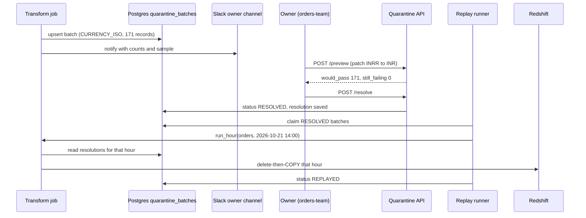

#### Who writes and who reads (delta from V3)

| Store | Who writes | When | Who reads | When |
|---|---|---|---|---|
| `rules/*.py` (git) | Producing teams via PR | On a rule change | Transform job | Each run |
| `owners.yaml` (git) | Platform engineers via PR | On a team change | Transform job, Quarantine API | Each run, each call |
| S3 `quarantine/` Parquet | Transform job | Each run (overwrite per hour) | Quarantine API (preview), engineers via Spectrum | On preview, ad hoc |
| Postgres `quarantine_batches` | Transform job (counts), Quarantine API (resolution), replay runner (status) | Each run; on resolve; on replay | Quarantine API, replay runner, transform job (resolutions), alarms | Continuously |
| Slack channel | Transform job | On a new batch | Owning team | When notified |
| `analytics.*` tables | Redshift `COPY` | Hourly and on replay | BI, ML | Ad hoc |

All V3 rows for Kafka, the registry, and the sink are unchanged.

### Current State After V4

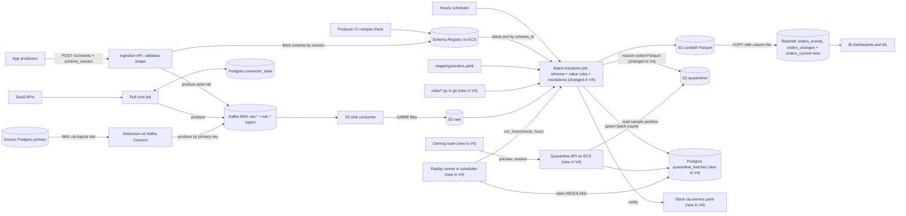

**Flow 1: Push write path (unchanged)**
1. Producer calls `POST /v1/events/orders` with `schema_version`.
2. API validates shape against the registry schema, builds the envelope with `schema_id`, and produces to `raw.orders` with `acks=all`.
3. API returns 200 after the ISR ack, or 422 or 503 on failure.

**Flow 2: SaaS pull path (unchanged)**
1. Cron reads its cursor, fetches, produces to `raw.<source>`, and flushes.
2. It advances the cursor after the flush.

**Flow 3: CDC path (unchanged)**
1. Debezium reads the WAL and produces change events keyed by primary key to `cdc.orders_db.*`.

**Flow 4: Sink path (unchanged)**
1. The sink consumer batches records into deterministic-key files in S3 `raw/` and commits offsets after the PUT.

**Flow 5: Transform and load path (changed)**
1. Scheduler triggers `run_hour(source, hour)` at HH:10.
2. Job loads the latest schema and the hour's resolutions from `quarantine_batches`.
3. For each record it checks schema, then value rules. Failures go through `apply_resolutions`.
4. It dedups, writes `curated/`, writes reason-coded Parquet to `quarantine/`, and upserts `quarantine_batches`.
5. It runs `sync_columns`, then the delete-then-`COPY`.
6. For any newly created batch, it notifies the owner's Slack channel.

**Flow 6: Triage and resolve path (new)**
1. The owning team opens the batch and calls `POST .../preview`.
2. The API applies the proposed fix to the batch's Parquet partition and reports how many would pass.
3. The owner calls `POST .../resolve`, and the batch becomes `RESOLVED`.

**Flow 7: Replay path (new)**
1. The replay runner claims `RESOLVED` batches with `SKIP LOCKED`.
2. It groups them by `(source, hour)` and calls `run_hour` for each.
3. The job applies the resolutions and overwrites that hour in Redshift.
4. The runner sets each batch to `REPLAYED`, or back to `OPEN` if failures remain.

**Flow 8: Read path (unchanged)**
1. BI and ML query `orders_current` for latest state and `orders_changes` for history.

**Flow 9: Schema change path (unchanged)**
1. A producer's PR is checked against the registry, registered on merge, and picked up by the API.

### Interview Follow-ups

**Q: Why not a Kafka dead-letter topic?**

A: Our validation runs in an hourly batch job over S3, so there is no consumer to publish a failed record from. Kafka also forgets after 7 days, and a record rejected on day 8 would be gone. S3 quarantine with a pointer back to the raw file is permanent and replayable. If validation moves into a stream processor later, a DLQ topic becomes natural, and the batch table would sit on top of it.

**Q: What stops a team from clicking `accept` on everything to quiet the alarm?**

A: Four things. `accept` needs a written note and is audited. It is refused for schema violations. The concentration alarm fires on the reason code, not on batch status. And a monthly report shows accepted counts per team and rule, so a pattern is visible to the platform team and to that team's manager.

### Recap

| Concept | The Insight |
|---|---|
| Quarantine without an owner | A folder of rejects is a silent data loss. Every reject needs an owner and an SLA. |
| Batch per source, reason, hour | Roll rejections into bounded rows, so an incident of 5M events is hundreds of rows. |
| Alarm per reason code | A global ratio hides a small, concentrated failure like 0.004% from one app build. |
| Replay by re-running the hour | Reusing the idempotent, validated path gives the correct `load_hour` and no duplicates. |
| Resolutions are data | A saved, audited fix makes every later rerun deterministic, unlike a one-off script. |

**Interview arc:** *"Rejected records sat in an unowned folder while one bad Android build quietly cost ₹3 crore, and the manual patch-and-load script double-counted, so we gave every rejection a reason code, rolled them into owner-assigned batches with per-reason alarms, and made replay a declared, audited resolution applied by re-running the original hour through the same idempotent path."*

**Next:** the warehouse is still 70 minutes behind. Our scope promised event data within about 5 minutes, and during Thursday's flash sale, ops can't see orders until the HH:10 job runs. V5 moves the hot path from the hourly batch to micro-batches, without losing the idempotency we just built.


-----------------------------------------------------------------------------------------------------------------------
-----------------------------------------------------------------------------------------------------------------------
-----------------------------------------------------------------------------------------------------------------------
-----------------------------------------------------------------------------------------------------------------------


## V5: From Hourly Batch to 5-Minute Windows

Thursday, 20:00. Ananya, the ops lead, launches the flash sale.

At 20:03 the payment gateway starts failing about 30% of checkouts. Her dashboard shows nothing unusual. Paid ads keep sending traffic into the broken checkout at roughly ₹6 lakh an hour.

At 21:15 the hourly job finishes and the 20:00 hour appears in Redshift. She sees the failure rate 72 minutes late.

The scope we agreed on promised event data in the warehouse within about 5 minutes. The numbers show how far off V4 is:

- **Average latency:** about 45 minutes, since an event waits for its hour to close and then for the job.
- **Worst case:** about 75 minutes (hour end, plus the HH:10 trigger, plus transform and load).
- **Target:** about 5 minutes typical, under 10 worst case.

That is a 9x gap on average. The dominant problem is that the unit of work is one hour. I'm deferring tenant isolation, scaling, and late data to later versions.

### The idea

Our hourly job is a bus that leaves once an hour and carries everyone who arrived. The fix is a timetable with a bus every 5 minutes.

The hard part is deciding when a bus may leave. It leaves only when every carriage confirms that nobody else is coming. Here, a carriage is a Kafka partition, and a confirmation is a seal marker saying "this partition has finished window W."

A window is a 5-minute slice, such as 20:05 to 20:10. Everything else we built stays, because the unit changes from one hour to one window, and a window is still an idempotent overwrite.

### Candidates

| Option | Typical freshness | Reuses V4's idempotent load, value rules, quarantine, replay | New operational load | Verdict |
|---|---|---|---|---|
| Micro-batch: same job on 5-minute windows | About 5 min | Yes, entirely | Low | Chosen |
| Flink streaming with transactional sink | Seconds | No, rewrite every rule and the replay path | High (state, checkpoints) | Rejected |
| Redshift streaming ingestion from Kafka | Seconds | No, bypasses validation, rules, and quarantine | Low | Rejected |
| Lambda architecture (stream for hot, batch for cold) | Seconds | Two code paths that must agree | High | Rejected |

### Solve it

- ✅ **What we gained**
  - Typical freshness drops from 45 minutes to about 5, and worst case from 75 to under 10.
  - Every V1 to V4 guarantee carries over: idempotent reload, quarantine, resolutions, and replay.
  - There is one code path, not a hot one and a cold one.
- ⚠️ **What we gave up**
  - Raw files are smaller, because they close at window boundaries (about 25 to 150MB, not a fixed 128MB).
  - Redshift runs 288 deletes and loads a day per table, so we add a nightly vacuum.
  - We need a completeness protocol (seal markers), since "the hour ended" is no longer enough.
  - Dedup now crosses window boundaries, so it needs a lookback.
  - Minute-level freshness still isn't possible. Windows can't go much below 1 to 2 minutes without a streaming design.
- ❌ **What we considered and rejected**
  - **Flink:** seconds of freshness isn't a requirement, and rebuilding quarantine and replay costs more than the freshness gains.
  - **Redshift streaming ingestion:** it skips our schema checks and value rules, so V3 and V4 would not apply to it.
  - **Lambda architecture:** two paths drift apart, and the "fast" numbers disagree with the "slow" ones by Friday.

### Implement it

#### A. Windows follow Kafka's own clock

We make the broker stamp every record, so all 12 partitions agree on time:

```bash
kafka-configs.sh --alter --entity-type topics --entity-name raw.orders \
  --add-config message.timestamp.type=LogAppendTime
# same for raw.* and cdc.* topics
```

The window for a record comes from this timestamp. It does not come from the producer's clock or the API's. It is monotonic per partition, which makes sealing safe.

```python
WINDOW_MS = 300_000
def window_of(ts_ms): return ts_ms - ts_ms % WINDOW_MS
```

The V4 rule `EVENT_TS_WINDOW` still compares `event_ts` to `received_at`. It is untouched.

#### B. The sink closes files at window boundaries and writes seal markers

The sink keeps the V1 contract: PUT first, commit offsets after, and use deterministic keys. File keys now include the window:

```
raw/source=orders/dt=2026-10-28/win=2005/p03-88120-91544.jsonl.gz
```

A seal marker is one small file per partition per window, written after that partition's data files for the window:

```
raw/source=orders/dt=2026-10-28/win=2005/_sealed/p03.json
{"partition":3,"window":"2026-10-28T20:05:00Z","first_offset":88120,"last_offset":91544,"count":3425}
```

The sink seals in two ways:

```python
def handle(p, records):                       # called per poll
    for r in records:
        w = window_of(r.timestamp)
        if buf[p].window is not None and w > buf[p].window:
            flush(p)                          # PUT file, then commit offsets
            write_marker(p, buf[p].window)    # a later record proves the window ended
        buf[p].add(w, r)

def tick(p):                                  # every 15s, also covers idle partitions
    horizon = window_of(now_ms() - GRACE_MS)  # GRACE_MS = 10_000
    if caught_up(p):                          # position == log end offset
        if buf[p].window is not None and buf[p].window < horizon:
            flush(p)
        for w in range(sealed_upto[p], horizon, WINDOW_MS):
            write_marker(p, w)                # empty windows get count=0 markers
        sealed_upto[p] = horizon
```

The idle-partition path matters. Without it, a quiet partition at 03:00 would never seal, and its window would wait forever.

The 128MB cap still applies inside a window. A big window becomes several files for one partition, and the marker records the offset range they cover.

#### C. Window state (first time, full shape)

It lives in the same small Postgres (RDS) as `connector_state` and `quarantine_batches`.

```sql
CREATE TABLE window_runs (
  source        TEXT        NOT NULL,
  window_start  TIMESTAMPTZ NOT NULL,
  status        TEXT        NOT NULL DEFAULT 'PENDING',   -- PENDING | RUNNING | DONE | FAILED
  attempts      INT         NOT NULL DEFAULT 0,
  sealed_at     TIMESTAMPTZ,
  finished_at   TIMESTAMPTZ,
  good_count    BIGINT,
  bad_count     BIGINT,
  PRIMARY KEY (source, window_start)
);
```

The `quarantine_batches.load_hour` column becomes `load_window`, so its unique key is `(source, reason_code, load_window)`. The warehouse's `load_hour` columns are renamed to `load_window`. Existing hourly values are already 5-minute aligned.

Hours written before the cutover keep the old `hr=` layout. The job reads a legacy hour as one 60-minute window.

#### D. The scheduler replaces the HH:10 cron

Every 30 seconds, per source:

```python
def tick(source):
    for w in next_windows(source):                  # in order, oldest first
        if not all_sealed(source, w):               # 12 of 12 markers present?
            break                                    # never skip a window
        db.execute("""INSERT INTO window_runs (source, window_start, sealed_at)
                      VALUES (%s,%s,now()) ON CONFLICT DO NOTHING""", source, w)
        if claim(source, w):                         # PENDING -> RUNNING, one runner
            run_window(source, w)
```

Two rules make this safe:

- **Strict order, one at a time per source.** The dedup rule below depends on earlier windows being loaded first.
- **No skipping.** If one partition never seals, the window waits. Skipping it would silently lose a slice of data. The lag alarm in section G pages us instead.

#### E. The transform job runs on one window

`run_window(source, w)` is V4's `run_hour` with the unit changed. First it checks completeness:

```python
def verify_complete(source, w):
    for p in range(PARTITIONS):
        m = read_marker(source, w, p)
        covered = sum(f.last - f.first + 1 for f in list_files(source, w, p))
        assert covered == m["count"], f"p{p}: files cover {covered}, marker says {m['count']}"
```

A missing or truncated file fails the window, and it is retried after an alarm. This check is cheap, and it means a half-written window never loads.

After that, the body is unchanged from V4: schema check, value rules, resolutions, dedup, quarantine, and `sync_columns`.

#### F. Dedup must now look back, and the load stays idempotent

A producer retry after 6 minutes, or a Debezium restart that replays events, can now land a duplicate in a different window. Per-window dedup alone would miss it.

The rule is that the earliest window wins. The load becomes a staging load with a 24-hour lookback:

```sql
CREATE TEMP TABLE stg (LIKE analytics.orders_events);

COPY stg (event_id, tenant_id, order_id, amount_cents, currency, channel,
          event_ts, received_at, load_window, coupon_code)
FROM 's3://acme-data/curated/source=orders/dt=2026-10-28/win=2005/'
IAM_ROLE '...' FORMAT AS PARQUET;

BEGIN;
DELETE FROM analytics.orders_events WHERE load_window = '2026-10-28 20:05';
INSERT INTO analytics.orders_events
SELECT s.* FROM stg s
LEFT JOIN (SELECT event_id FROM analytics.orders_events
           WHERE load_window >= '2026-10-27 20:05'
             AND load_window <  '2026-10-28 20:05') p USING (event_id)
WHERE p.event_id IS NULL;
COMMIT;
```

The lookback only looks at windows before this one. That keeps a rerun deterministic: deleting window W and reloading it always gives the same rows, even after later windows have loaded.

`orders_changes` uses the same shape, keyed on `(table, lsn)` and not `event_id`. Redshift has accumulated ghost rows from 288 deletes a day, so a nightly job runs `VACUUM DELETE ONLY analytics.orders_events;` at 03:00.

#### G. Freshness becomes a measured SLO

New metrics from `window_runs`:

- **Freshness lag:** `now() - max(window_start + 5 minutes) WHERE status = 'DONE'`. Alert above 12 minutes. Page above 20.
- **Seal lag:** time between window end and the last of the 12 markers. A rising value points to a slow sink worker.
- **Window run time:** alert if it exceeds 4 minutes, because it should stay well below the 5-minute window.

Check the budget at 3 to 4 minutes of end-to-end work after the window closes: ~30s seal, ~90s transform on ~350MB, and ~30s load. Typical freshness is the average 2.5 minutes of waiting in the window plus 2 to 3 minutes of work, so about 5 minutes. Worst case is a full window plus the work, which is about 8 minutes.

#### H. Quarantine and replay at window grain

Two small changes from V4:

- **Batches** are keyed by window, so a long incident produces more rows: 288 windows × reasons per day. The Slack notification now rolls up. The job posts once when a `(source, reason_code)` pair first appears in an hour, and the message links to every batch in range.
- **Resolve** accepts a scope. One call can resolve a range:

```http
POST /internal/quarantine/resolve
{ "source": "orders", "reason_code": "CURRENCY_ISO",
  "from": "2026-10-21T00:00Z", "to": "2026-10-27T00:00Z",
  "action": "patch", "set": {"currency": "INR"}, "where": {"currency": "INRR"} }
```

The API expands that into one `resolution` per matching batch. The replay runner then calls `run_window` for each. Its logic, `SKIP LOCKED` claim, and idempotency are unchanged.

#### I. Who writes and who reads (delta from V4)

| Store | Who writes | When | Who reads | When |
|---|---|---|---|---|
| Kafka topic config `LogAppendTime` | Platform engineers (once) | At cutover | Sink consumer | Every record |
| S3 `raw/.../win=HHMM/` files | S3 sink consumer | Window boundary or 128MB | Transform job | Per window |
| S3 `raw/.../_sealed/pNN.json` | S3 sink consumer | After a partition finishes a window | Scheduler, transform job | Every 30s; at start of each window run |
| Postgres `window_runs` | Scheduler (create), transform job (status, counts) | When sealed; during run | Scheduler, freshness alarm | Every 30s; continuously |
| `analytics.*_events` and `*_changes` | Transform job (staging load) | Per window | BI, ML | Ad hoc |
| `quarantine_batches` (keyed by window) | Transform job, Quarantine API, replay runner | As in V4 | As in V4 | As in V4 |

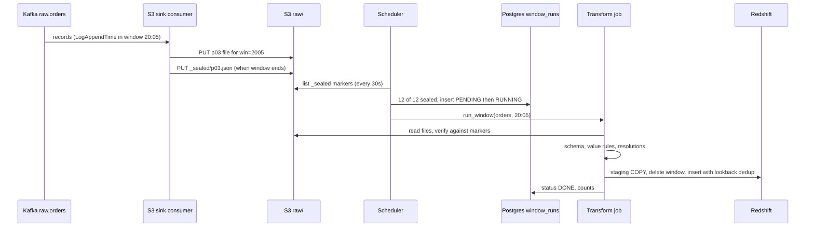

### Current State After V5

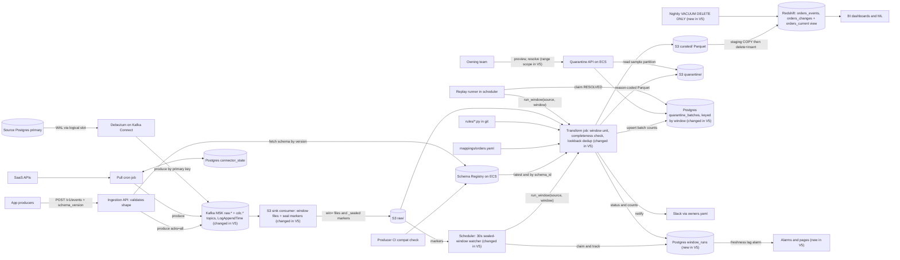

**Flow 1: Push write path (unchanged)**
1. Producer calls `POST /v1/events/orders` with `schema_version`.
2. API validates shape, builds the envelope with `schema_id`, and produces to `raw.orders` with `acks=all`.
3. API returns 200 after the ISR ack, or 422 or 503 on failure.

**Flow 2: SaaS pull path (unchanged)**
1. Cron reads its cursor, fetches, produces to `raw.<source>`, and flushes.
2. It advances the cursor after the flush.

**Flow 3: CDC path (unchanged)**
1. Debezium reads the WAL and produces change events keyed by primary key to `cdc.orders_db.*`.

**Flow 4: Sink path (changed)**
1. The sink polls its partitions and groups records by their Kafka-assigned window.
2. It flushes a file at each window boundary or at 128MB, then commits offsets.
3. After a partition finishes a window, it writes a `_sealed/pNN.json` marker. Idle partitions are sealed by a 15-second tick.

**Flow 5: Window scheduling (new, replaces the HH:10 cron)**
1. The scheduler lists markers for each source every 30 seconds.
2. When all 12 partitions have sealed the oldest unrun window, it inserts a `window_runs` row and claims it.
3. It runs windows strictly in order, and it never skips a window that is missing a seal.

**Flow 6: Transform and load path (changed)**
1. `run_window(source, window)` checks files against markers and fails the window if offsets don't line up.
2. It validates schema, applies value rules and resolutions, and dedups within the window.
3. It writes `curated/` and `quarantine/`, upserts `quarantine_batches`, and notifies owners.
4. It runs `sync_columns`, then the staging `COPY`, window delete, and lookback-deduped insert.
5. It marks `window_runs` `DONE` and records counts.

**Flow 7: Triage, resolve, and replay (unchanged logic, window grain)**
1. The owner previews and resolves a batch or a range through the Quarantine API.
2. The replay runner claims `RESOLVED` batches and calls `run_window` for each affected window.
3. The job applies resolutions and overwrites that window in Redshift.

**Flow 8: Read path (unchanged)**
1. BI and ML query `orders_current` for latest state and `orders_changes` for history.

**Flow 9: Schema change path (unchanged)**
1. A producer's PR is checked against the registry, registered on merge, and picked up by the API.

### Interview Follow-ups

**Q: Why not go straight to Flink and get seconds of latency?**

A: The requirement was about 5 minutes, and nobody here needs sub-minute. Micro-batch reuses everything V1 to V4 built: validation, value rules, quarantine, resolutions, and idempotent replay. Streaming would reimplement all of that in a stateful engine, and I'd have to solve exactly-once sinks and checkpoint recovery to get the same guarantees. If a consumer later needs seconds, I'd feed that consumer from Kafka directly and leave the warehouse path alone.

**Q: What happens if one sink worker is stuck and one partition never seals?**

A: That window waits, and so does every later window for that source. The scheduler runs strictly in order and never skips. Data is delayed, not lost, and the seal-lag and freshness alarms page within minutes. The blast radius is one source's freshness. It doesn't spread to other sources.

### Recap

| Concept | The Insight |
|---|---|
| Hourly unit | Latency is bounded by the unit of work, so shrink the unit and keep the guarantees. |
| Broker-assigned window | `LogAppendTime` gives all partitions one clock, so windows don't depend on producers. |
| Seal markers | "The window is complete" must be an explicit, checkable fact, including for idle partitions. |
| Strict order, no skipping | Skipping a stuck window loses data silently. Waiting and alarming loses only time. |
| Earliest window wins | Cross-window duplicates are removed with a lookback anti-join that keeps reruns deterministic. |

**Interview arc:** *"An hourly job meant a 45-minute average and 75-minute worst-case delay, so we shrank the unit of work to 5-minute windows stamped by the broker's clock, sealed each partition with an explicit marker, and ran the same validated, idempotent job per window in strict order, which cut typical latency to about 5 minutes without a second code path."*

**Next:** Thursday's sale also showed a different problem. A marketing campaign tenant pushed 40K events/sec for 20 minutes, and the shared Ingestion API pool starved the payments team's events. V6 adds per-tenant isolation: quotas, rate limits, and backpressure.


-----------------------------------------------------------------------------------------------------------------------
-----------------------------------------------------------------------------------------------------------------------
-----------------------------------------------------------------------------------------------------------------------
-----------------------------------------------------------------------------------------------------------------------


## V6: Per-Tenant Quotas at the Front Door

Thursday, 20:00 again. The marketing tenant, `growth`, fires a push campaign.

Their event producer was built for 2K/s on a normal day. Today it sends 40K events/sec for 20 minutes. They are a legitimate user of the platform and did nothing malicious.

The Ingestion API pool is 8 pods and handles about 12K events/sec in total. Offered load is now 41.2K/s. Payments sends 1.2K/s of that, about 3%.

The pods saturate and the load balancer queues requests, so every tenant gets the same treatment. Payments' share of served capacity falls to roughly 350 events/sec, about 29% of what it sent.

The numbers from that night:

- **API p99 latency:** 40 ms to over 9 s, with 503s and timeouts for everyone.
- **Payments producer:** about 840 events/sec went unsent. Its 100K-event SDK buffer filled in about 2 minutes, and the rest was dropped. That is roughly 0.9M payment events lost over 18 minutes.
- **Downstream:** the 20:05 window held 12M events against a normal 1.8M. The transform job needed about 10 minutes for a 5-minute window, so freshness lag for every tenant grew to about 25 minutes.

The dominant problem is that tenants share one pool with no individual limits. Elastic capacity is a separate problem and comes next. A tenant must not be able to take capacity that another tenant needs.

### The idea

A building has one main electrical supply. Each apartment has its own breaker.

If one flat runs a welding rig, its own breaker trips. The other flats keep their lights on.

We need a breaker per tenant. It must be sized so that all breakers added together fit within the building's supply. That second rule is what makes the isolation real.

### Candidates

| Option | Protects the pool | Protects other tenants | Cost and ops | Verdict |
|---|---|---|---|---|
| One global rate limit | Yes | No: `growth` still uses almost all of it, so payments is rejected too | Low | Rejected |
| Per-tenant token bucket, quotas sum below capacity | Yes | Yes: each tenant has a guaranteed slice | Low | Chosen |
| Separate API pool, topic, and sink per tenant | Yes | Yes, strongest | High: idle capacity per tenant, topic and partition explosion | Rejected (maybe later for one regulated tenant) |
| Priority-based load shedding | Partly | Only after saturation has started | Medium | Rejected as the main mechanism |

### Solve it

- ✅ **What we gained**
  - A tenant that exceeds its quota gets a 429 and nobody else notices.
  - The admitted rate has a hard ceiling, so downstream windows are bounded too. Sum of quotas is 9.5K/s, so the worst window is about 2.9M events, not 12M.
  - Rejection is cheap and early: after authentication, before JSON parsing and schema validation.
  - Each tenant can see its own throttling through per-tenant metrics.
- ⚠️ **What we gave up**
  - Isolation does not create capacity. If `growth` truly needs 40K/s, they get 429s until quota and capacity are raised.
  - Producers must now handle 429s correctly: back off with jitter, buffer locally, and not drop.
  - Quotas need an owner and a process, and someone has to decide the numbers.
  - A new dependency on the hot path (Redis), with its own failure mode.
  - Counting is slightly approximate (see the lease error bound below).
- ❌ **What we considered and rejected**
  - **Global limit:** it protects the pool and still lets the loudest tenant crowd everyone else out.
  - **Silos per tenant:** it multiplies pods, partitions, and sink workers by the tenant count, mostly sitting idle.
  - **Load shedding only:** it reacts after the pool is already saturated, so payments still sees the latency spike.

I'm deferring elastic capacity (autoscaling the API and parallelizing the transform) to V7. The CDC path has the same noisy-neighbor risk, because a bulk `UPDATE` can emit millions of change events. Debezium doesn't go through the API door, so Kafka producer quotas for connectors come in V7 with the backlog work.

### The counting sub-problem: three established fixes

A rate limit across 8 pods has to share a counter. There are three known ways to do that.

**A. Local bucket per pod, at quota / pod count.**

```python
bucket = TokenBucket(rate=q.rate // POD_COUNT, burst=q.burst // POD_COUNT)
```

No dependency, but it is inaccurate. The load balancer spreads traffic unevenly, so one pod rejects while others sit idle. Pod count also changes as we scale in V7.

**B. One central bucket in Redis, called on every request.**

```python
granted = redis.eval(LUA, key=f"rl:{tenant}", want=1)
```

It is exact. It puts a Redis round trip (about 0.7 ms) on every event, at 12K calls a second.

**C. Leased chunks from Redis.**

```python
if lease.tokens > 0: lease.tokens -= 1; admit()
else: lease = redis.eval(LUA, key=f"rl:{tenant}", want=chunk)   # chunk = rate/20
```

Each pod takes a small chunk of tokens, spends it locally, and refills when empty. That is about 20 times fewer Redis calls than B, and it stays shared across pods.

| Option | Accuracy | Redis calls at 12K/s | Survives pod count changes | Verdict |
|---|---|---|---|---|
| A. Local per pod | Poor under skew | 0 | No | Rejected |
| B. Per-request Redis | Exact | about 12,000/s | Yes | Rejected (extra latency on every ack) |
| C. Leased chunks | Within `pods × chunk` | about 600/s | Yes | Chosen |

For `growth` at 3K/s, a chunk is 150 tokens, which is 50 ms of quota. With 8 pods, the worst over-admission is 8 × 150 = 1,200 events, which is about 0.4 s of quota. That is fine.

### Implement it

#### A. Quota table (first time, full)

It lives in the same small Postgres (RDS) as `connector_state`, `quarantine_batches`, and `window_runs`.

```sql
CREATE TABLE tenant_quotas (
  tenant_id      TEXT PRIMARY KEY,
  owner_team     TEXT NOT NULL,
  rate_per_sec   INT  NOT NULL,                -- sustained events/sec
  burst          INT  NOT NULL,                -- bucket size, about 10 s of rate
  override_rate  INT,                          -- temporary raise
  override_until TIMESTAMPTZ,
  updated_by     TEXT NOT NULL,
  updated_at     TIMESTAMPTZ NOT NULL DEFAULT now(),
  CHECK (override_rate IS NULL OR override_until IS NOT NULL)
);
```

Initial rows, against a pool of about 12K/s, with 20% held back (9.6K allocatable):

| tenant_id | rate_per_sec | burst |
|---|---|---|
| payments | 2,500 | 25,000 |
| orders | 4,000 | 40,000 |
| growth | 1,500 | 15,000 |
| default (each of other teams) | 500 | 5,000 |

The numbers sum to 9,500 events/sec, which is under 9,600. Payments' observed peak is 1.2K/s, so its 2.5K quota gives about 2x headroom.

#### B. The capacity guard

Quotas change through a small admin endpoint on the existing Quarantine API service (ECS, platform-team-only auth):

```http
PUT /internal/quotas/growth
{ "override_rate": 3000, "override_until": "2026-11-14T10:00:00Z", "note": "Diwali campaign, approved by data-platform" }
```

Before saving, the service checks the pool rule:

```sql
SELECT COALESCE(SUM(CASE WHEN override_until > now() THEN override_rate ELSE rate_per_sec END), 0)
FROM tenant_quotas WHERE tenant_id <> :tenant;
-- reject if that sum + the new effective rate > POOL_ALLOCATABLE (9600)
```

This check is the heart of the design. A quota that can't be honored is not isolation, it is a promise the pool breaks under load. `growth` asking for 20K/s is refused here until capacity exists.

#### C. Redis (new storage class)

Redis (ElastiCache, 1 primary and 1 replica across 2 AZs) is a key-value store. It fits because a counter needs an atomic read-modify-write in under a millisecond. The data is tiny, one small hash per tenant, and it is disposable. If it is lost, every bucket refills to full, which is harmless.

Key shape (first time, full):

```
rl:{tenant}   HASH   t  = tokens remaining (float)
                     ts = last refill, ms
              TTL 60s
```

The Lua script does the refill and the grant atomically, using Redis's own clock so pods' clocks don't matter:

```lua
-- KEYS[1]=rl:{tenant}  ARGV[1]=rate  ARGV[2]=burst  ARGV[3]=want
local t = redis.call('TIME')
local now = t[1] * 1000 + math.floor(t[2] / 1000)
local h = redis.call('HMGET', KEYS[1], 't', 'ts')
local tokens = tonumber(h[1]) or tonumber(ARGV[2])
local ts     = tonumber(h[2]) or now
tokens = math.min(tonumber(ARGV[2]), tokens + (now - ts) / 1000 * tonumber(ARGV[1]))
local granted = math.min(tokens, tonumber(ARGV[3]))
redis.call('HSET', KEYS[1], 't', tokens - granted, 'ts', now)
redis.call('PEXPIRE', KEYS[1], 60000)
return math.floor(granted)
```

#### D. The limiter in the API pod

```python
class TenantLimiter:
    def admit(self, tenant_id, n=1):
        q = quotas.get(tenant_id)                      # Postgres cache, 30 s refresh
        s = self.state[tenant_id]
        now = monotonic_ms()
        if now < s.blocked_until:                      # recently denied: no Redis call
            return False, s.blocked_until - now
        if s.tokens >= n and now < s.lease_expires:
            s.tokens -= n
            return True, 0
        chunk = max(1, min(q.eff_rate // 20, 500))
        try:
            granted = redis_eval(LUA, f"rl:{tenant_id}", q.eff_rate, q.burst, chunk, timeout_ms=20)
        except RedisUnavailable:
            return self.fallback(tenant_id, q, n)      # section E
        if granted >= n:
            s.tokens, s.lease_expires = granted - n, now + 200   # unspent tokens expire in 200 ms
            return True, 0
        retry_ms = max(50, ceil(1000 * chunk / q.eff_rate))
        s.blocked_until = now + retry_ms
        return False, retry_ms
```

Two details matter here:

- **`blocked_until`:** once Redis says no, the pod rejects locally for at least 50 ms. Otherwise 40K rejections a second from `growth` would all become Redis calls.
- **200 ms lease expiry:** a pod can't hoard tokens it isn't using.

`eff_rate` is `override_rate` while `override_until` is in the future, and `rate_per_sec` otherwise.

The handler gains one step. The step runs before the body is parsed or validated:

```python
tenant = authenticate(request)                 # unchanged
ok, retry_ms = limiter.admit(tenant.id, 1)     # new in V6
if not ok:
    metrics.inc("rl_rejected", tenant=tenant.id)
    return JSONResponse(
        status_code=429,
        headers={"Retry-After": str(ceil(retry_ms / 1000))},
        content={"error": "rate_limited", "tenant": tenant.id, "retry_after_ms": retry_ms})
metrics.inc("rl_admitted", tenant=tenant.id)
# ... validate shape, build envelope, produce to Kafka, exactly as in V3
```

The two status codes mean different things. 503 means the platform is at fault. 429 means the tenant is over its own quota. Producers handle both the same way (retry later), but alarms and blame differ.

#### E. When Redis is down

A circuit breaker wraps the Redis call, with a 20 ms timeout. After 3 consecutive failures it opens for 5 seconds. While it is open, the pod uses a local bucket:

```python
def fallback(self, tenant_id, q, n):
    local = self.local_bucket(tenant_id, rate=q.eff_rate // desired_pod_count, burst=q.burst // desired_pod_count)
    return (True, 0) if local.take(n) else (False, 100)
```

`desired_pod_count` comes from the ECS service's desired count, refreshed every 30 seconds. This is option A, used only as a degraded mode. It is inaccurate under skew, but isolation still mostly holds.

We never fail open. An unlimited pool during a Redis outage is exactly the Thursday failure again. A Redis failover also resets buckets to full burst. The worst case is one brief over-admission of the sum of bursts, 85K events, then back to normal.

#### F. What the producer must do (the client contract)

This is the half that makes 429 safe. It goes in the producer SDK and the integration guide:

```python
def send(event):
    for attempt in range(MAX_ATTEMPTS):
        r = post(event)
        if r.status in (200,):
            return
        if r.status in (429, 503):
            wait = r.json().get("retry_after_ms", 100 * 2 ** attempt)
            sleep(random.uniform(0, wait) + wait / 2)      # honor the hint, add jitter
            continue
        raise Permanent(r)                                  # 422: do not retry
    local_spool.append(event)                               # disk spool, not memory
```

A bounded memory buffer that drops on overflow is how payments lost 0.9M events. The rule is to spool to local disk and drain when the 429s stop.

#### G. Observability

Per-tenant metrics (a tenant label is fine at tens of tenants): `rl_admitted`, `rl_rejected`, and utilization (`admitted_rate / eff_rate`).

Alarms:

- **Tenant throttled:** `rl_rejected > 0` for 5 minutes. It notifies `owner_team` through Slack, so they know before their producers fill disk.
- **Capacity planning:** a tenant above 80% of its quota for 1 hour.
- **Redis breaker open:** page the platform team.
- **Guard drift:** sum of effective quotas above 100% of `POOL_ALLOCATABLE`.

#### H. Who writes and who reads (delta from V5)

| Store | Who writes | When | Who reads | When |
|---|---|---|---|---|
| Postgres `tenant_quotas` | Platform engineers through the admin endpoint | On onboarding or an override | Ingestion API pods | Cache refresh every 30 s |
| | | | Admin endpoint (capacity guard) | On each change |
| Redis `rl:{tenant}` hash | Ingestion API pods (Lua lease) | When a pod's local tokens run out | Ingestion API pods (same script) | Same moment |
| Per-tenant metrics (CloudWatch) | Ingestion API pods | Every request | Alarms, dashboards, owner teams | Continuously |

All other stores from V5 are unchanged.

#### I. Flow

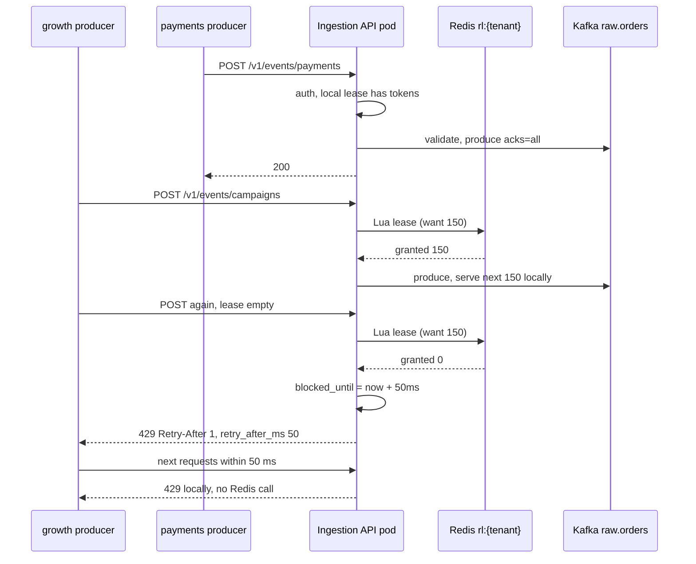

### Current State After V6

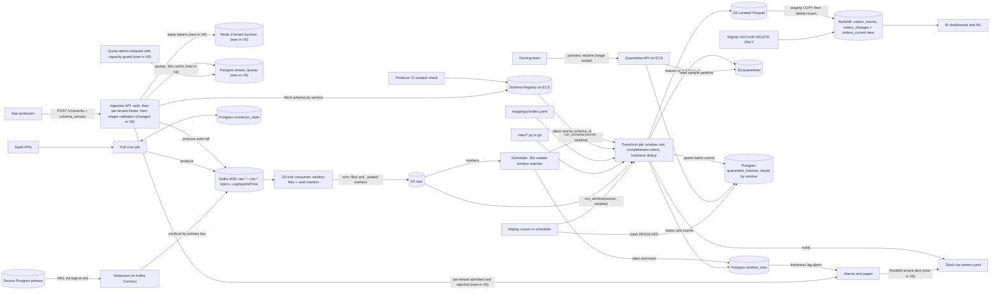

New in V6: the per-tenant limiter inside the Ingestion API, Redis, `tenant_quotas`, the quota admin endpoint with its capacity guard, and per-tenant throttle alarms. Everything else is unchanged.

**Flow 1: Push write path (changed)**
1. Producer calls `POST /v1/events/orders` with `schema_version`.
2. API authenticates the token and resolves `tenant_id`.
3. API asks its limiter for one token. The pod spends its local lease, or leases a new chunk from Redis `rl:{tenant}`.
4. If the tenant is over quota, API returns 429 with `retry_after_ms`, before any parsing.
5. Otherwise API validates shape, builds the envelope with `schema_id`, and produces to `raw.orders` with `acks=all`.
6. API returns 200 after the ISR ack, or 422 or 503 on failure.

**Flow 2: SaaS pull path (unchanged)**
1. Cron reads its cursor, fetches, produces to `raw.<source>`, and flushes.
2. It advances the cursor after the flush.

**Flow 3: CDC path (unchanged)**
1. Debezium reads the WAL and produces change events keyed by primary key to `cdc.orders_db.*`.

**Flow 4: Sink path (unchanged)**
1. The sink flushes window files and seal markers to S3 `raw/` and commits offsets after the PUT.

**Flow 5: Window scheduling (unchanged)**
1. The scheduler runs sealed windows strictly in order and tracks them in `window_runs`.

**Flow 6: Transform and load path (unchanged)**
1. `run_window` checks completeness, applies schema checks, value rules, and resolutions, then dedups.
2. It writes `curated/` and `quarantine/`, then runs the staging `COPY` with lookback-deduped insert into Redshift.

**Flow 7: Triage, resolve, and replay (unchanged)**
1. Owners resolve batches through the Quarantine API, and the replay runner re-runs the affected windows.

**Flow 8: Read path (unchanged)**
1. BI and ML query `orders_current` for latest state and `orders_changes` for history.

**Flow 9: Schema change path (unchanged)**
1. A producer's PR is checked against the registry, registered on merge, and picked up by the API.

**Flow 10: Quota change path (new)**
1. An engineer calls `PUT /internal/quotas/{tenant}` with a rate or a time-boxed override.
2. The admin endpoint sums effective quotas for all other tenants and refuses the change if the total would exceed `POOL_ALLOCATABLE`.
3. It writes `tenant_quotas`, and API pods pick up the change within 30 seconds.

### Interview Follow-ups

**Q: Why not just autoscale the API and skip quotas?**

A: Autoscaling reacts in minutes and costs money. During those minutes the noisy tenant still takes everyone's capacity, and afterward you pay to serve its spike. It also does nothing for the downstream pipeline, which would still receive 12M events in a window. Quotas protect other tenants immediately, and autoscaling then raises the ceiling for everyone on purpose. They solve different problems, and I'd want both.

**Q: What if Redis goes down?**

A: Each pod falls back to a local bucket of quota divided by the desired pod count, after a 20 ms timeout and a circuit breaker. Accuracy is worse under skew, but isolation mostly holds. We never fail open, because an unlimited pool is the Thursday outage again. When Redis returns, buckets start full, which allows one brief over-admission bounded by the sum of bursts.

### Recap

| Concept | The Insight |
|---|---|
| Shared pool, no limits | Capacity is first come, first served, so the loudest tenant starves the quietest. |
| Quotas that sum under capacity | A per-tenant limit only isolates if all the limits fit inside the pool. |
| Leased token chunks | Pods share a counter without a Redis call per event, at a bounded accuracy cost. |
| 429 vs 503 | 429 means "you are over your quota". 503 means "we are at fault". They need different blame and alarms. |
| Client contract | A rejection is only safe if the producer backs off, jitters, and spools to disk. |
| Reject early | Check the quota right after auth, before any parsing, so overload is cheap to refuse. |

**Interview arc:** *"One tenant's 40K/s campaign saturated a shared pool and cost another tenant 0.9M events, so we gave every tenant a token bucket at the API door, shared across pods through leased chunks from Redis, with an admin guard that refuses quotas whose sum exceeds capacity, so a tenant that overruns hits its own 429s and never anyone else's."*

**Next:** Black Friday is 3 weeks away. Every tenant is legitimate, and finance projects 30K events/sec in total. The 8-pod API pool tops out at 12K/s. A single transform runner would need about 7.5 minutes for each 5-minute window, so lag would grow without bound. V7 makes both ends elastic: autoscaling stateless API pods and parallelizing the transform by partition.


-----------------------------------------------------------------------------------------------------------------------
-----------------------------------------------------------------------------------------------------------------------
-----------------------------------------------------------------------------------------------------------------------
-----------------------------------------------------------------------------------------------------------------------


## V7: Scale the Front Door Horizontally

Rohan runs finance ops. He sends the Black Friday projection: peak traffic of 30K events/sec across all tenants.

The orders team asks for a quota to match. Priya on the platform team tries to grant it:

```http
PUT /internal/quotas/orders
{ "override_rate": 14000, "override_until": "2026-11-29T00:00:00Z", "note": "Black Friday" }

409 { "error": "capacity_exceeded", "allocatable": 9600,
      "others_effective": 5500, "requested": 14000, "max_for_tenant": 4100 }
```

The V6 capacity guard refuses, and it is right to. The numbers behind it:

- **Pool today:** 8 pods at about 1.5K events/sec each is 12K/s. The allocatable 80% is 9.6K/s.
- **Peak needed:** 30K/s, which is 2.5x the pool.
- **Orders alone:** asks for 14K/s, and the guard allows at most 4.1K/s.

That leaves two bad options:

- **Keep the quotas.** Legitimate producers get 429s on the busiest day. The disk spool absorbs it, but the dashboards run hours behind.
- **Lift quotas past capacity.** Then the quotas are promises the pool cannot keep, and Thursday's outage returns.

Quotas isolate tenants from each other. They don't create capacity. The dominant problem is that the front door has a fixed size.

Two other things look broken but are not yet. Kafka is fine at 30K/s, because 30MB/s over 12 partitions is about 2.5MB/s each, and I'll confirm that with the under-replicated alarm. The transform job will fall behind at 30K/s. That is V8, and the buffering in Kafka and S3 means no data is lost in the meantime.

### The idea

A supermarket with one checkout lane has a throughput ceiling. You can buy a faster cashier, which is the vertical option. Or you can open more lanes, which is the horizontal option. Lanes work only if each cashier needs nothing from the others, so any customer can join any lane.

So before adding lanes, I check what state each pod holds locally.

### What state does an API pod hold?

| Local state | Lifetime | If the pod dies or a new pod appears | Needs to move? |
|---|---|---|---|
| Kafka producer buffer (5 ms linger) | Milliseconds | We ack only after the ISR write, so nothing acked is in it. In-flight requests get reset, and producers retry. | No |
| Token lease (V6) | 200 ms | Unspent tokens expire. Redis holds the real count. | No |
| Quota cache | 30 s | A new pod loads it from Postgres. | No |
| Schema cache | 60 s | A new pod fetches from the registry. | No |
| `blocked_until` per tenant | 50 ms to 1 s | A new pod starts empty and asks Redis. | No |
| Sessions | None | Auth is a bearer token on every request. | No |

Nothing needs to move. Earlier versions already put the truth in Redis, Postgres, the registry, and Kafka. That is what makes more pods safe.

One hazard remains. A killed pod's in-flight request may have reached Kafka before the connection dropped. The producer retries the same `event_id`, so a duplicate can occur. The V5 lookback dedup handles that.

### Candidates

| Option | Reaches 30K/s | Handles an unplanned spike | Blast radius of one pod failure | Cost shape | Verdict |
|---|---|---|---|---|---|
| Vertical: bigger pod (about 3x the CPU) | Yes, for about 30K | No, needs a redeploy | 1 of 8 pods, about 12% of traffic | Pay at peak all year | Rejected |
| Horizontal, fixed 40 pods | Yes | Up to 40 pods | About 2.5% | Pay at peak all year | Rejected |
| Horizontal with autoscaling and a scheduled floor | Yes | Yes, with a 2 to 3 minute lag | About 3% | Follows load | Chosen |
| API Gateway and Lambda per request | Yes | Yes | One invocation | Several times the cost at 30K/s sustained | Rejected |

### Solve it

- ✅ **What we gained**
  - Capacity grows linearly with pods, up to 48 pods, about 72K/s at full CPU.
  - A pod failure now affects about 3% of traffic, not about 12%.
  - Quotas become honorable. The guard now reads real committed capacity.
  - Cost follows load. We pay for 32 pods only around the sale.
- ⚠️ **What we gave up**
  - **Scale-out lag.** The metric takes about 1 minute, task startup about 1 minute, and warm-up another minute. An unplanned spike meets existing capacity for about 3 minutes. The burst bucket from V6 absorbs part of it, and quotas still isolate tenants. A known event gets a scheduled floor, so it has no lag.
  - **The bottleneck moves downstream.** Admitting 30K/s means 9M events per 5-minute window. The transform job will breach the freshness SLO until V8. Kafka and S3 hold the backlog, so we lose time and not data.
  - More pods mean more connections to Redis, Postgres, the registry, and Kafka. At 48 pods, every one of those stays small.
  - Scale-in must drain carefully or it drops in-flight requests.
- ❌ **What we considered and rejected**
  - **Vertical:** one big pod is a bigger blast radius, restarts slower, and cannot scale for unplanned load.
  - **Fixed 40 pods:** it works, and wastes about 80% of its capacity outside sale days.
  - **Scaling on requests per target:** it is simpler, but one request costs the same CPU only when payload sizes match. CPU tracks the real cost.
  - **A batch endpoint (many events per POST):** it would cut request count about 10x, but it changes the producer contract, and it needs its own partial-failure semantics. It is a good later optimization and a separate decision.

### Implement it

#### A. Load balancer settings

The API sits behind an ALB. Round robin is wrong here. Request cost varies when a schema cache misses or one broker is slow, and a new pod starts cold. Least outstanding requests sends the next request to the pod with the fewest in flight, so slow pods self-limit.

```bash
aws elbv2 modify-target-group-attributes --target-group-arn $TG --attributes \
  Key=load_balancing.algorithm.type,Value=least_outstanding_requests \
  Key=slow_start.duration_seconds,Value=60 \
  Key=deregistration_delay.timeout_seconds,Value=45
```

`slow_start` ramps a new pod's share over 60 seconds, so a cold JIT and empty caches don't get a full share at once.

#### B. Autoscaling policy (first time, full)

Each pod is 2 vCPU on Fargate and handles about 1.5K events/sec at 100% CPU.

```bash
# scalable target: floor 8 (normal days), ceiling 48
aws application-autoscaling register-scalable-target \
  --service-namespace ecs --resource-id service/ingest/ingestion-api \
  --scalable-dimension ecs:service:DesiredCount \
  --min-capacity 8 --max-capacity 48

# target tracking on CPU
aws application-autoscaling put-scaling-policy \
  --policy-name api-cpu-60 --policy-type TargetTrackingScaling \
  --service-namespace ecs --resource-id service/ingest/ingestion-api \
  --scalable-dimension ecs:service:DesiredCount \
  --target-tracking-scaling-policy-configuration '{
    "TargetValue": 60.0,
    "PredefinedMetricSpecification": {"PredefinedMetricType": "ECSServiceAverageCPUUtilization"},
    "ScaleOutCooldown": 60,
    "ScaleInCooldown": 900
  }'
```

The cooldowns are asymmetric on purpose:

- **Scale out after 60 seconds.** Being late costs data freshness and 429s.
- **Scale in after 15 minutes.** Being early causes flapping, and an early shrink can hit a returning spike.

At a 60% target, each pod serves about 900 events/sec. For 30K/s that is about 34 pods.

#### C. Scheduled floor for the known event

Autoscaling reacts. Black Friday is known weeks ahead, so we pre-scale:

```bash
aws application-autoscaling put-scheduled-action \
  --service-namespace ecs --resource-id service/ingest/ingestion-api \
  --scalable-dimension ecs:service:DesiredCount \
  --scheduled-action-name black-friday-floor \
  --schedule "at(2026-11-26T12:00:00)" \
  --scalable-target-action MinCapacity=32,MaxCapacity=48

aws application-autoscaling put-scheduled-action ... \
  --scheduled-action-name black-friday-restore \
  --schedule "at(2026-11-29T12:00:00)" \
  --scalable-target-action MinCapacity=8,MaxCapacity=48
```

A floor of 32 pods covers about 38K/s at the guard's 80% allocation, with the autoscaler adding more above that.

#### D. The capacity guard reads committed capacity

In V6, `POOL_ALLOCATABLE` was a constant of 9,600. It now comes from the scalable target's floor, which is what we can count on without waiting for a scale-out:

```python
PER_POD_EPS, ALLOC_FRACTION = 1500, 0.8

def pool_allocatable():
    t = aas.describe_scalable_targets(
        ServiceNamespace="ecs", ResourceIds=["service/ingest/ingestion-api"],
        ScalableDimension="ecs:service:DesiredCount")["ScalableTargets"][0]
    return int(t["MinCapacity"] * PER_POD_EPS * ALLOC_FRACTION)
```

The guard uses `MinCapacity` and not `MaxCapacity`, on purpose. Max capacity needs a 3-minute scale-out to materialize, and a promise to a tenant must hold on minute zero.

The order of operations on Black Friday prep:

1. The floor action takes effect on Nov 26 at 12:00 UTC, and allocatable becomes 38,400.
2. Then Priya sets time-boxed overrides, which now pass the guard:

```http
PUT /internal/quotas/payments  { "override_rate": 5000,  "override_until": "2026-11-29T12:00:00Z" }
PUT /internal/quotas/orders    { "override_rate": 14000, "override_until": "2026-11-29T12:00:00Z" }
PUT /internal/quotas/growth    { "override_rate": 9000,  "override_until": "2026-11-29T12:00:00Z" }
```

The other three teams are raised to 1,000 each. The effective total is 31,000 against 38,400 allocatable. Every override expires at the same moment as the restore action, so quotas never exceed capacity after the floor drops. This is why V6 made overrides time-boxed.

#### E. Graceful scale-in

When ECS removes a task, it deregisters from the target group first. The ALB stops sending new requests, and in-flight ones have 45 seconds. Then ECS sends SIGTERM and allows 60 seconds before SIGKILL:

```python
@asynccontextmanager
async def lifespan(app):
    app.state.producer = await start_producer()   # acks=all, idempotent
    yield
    # uvicorn has stopped accepting and finished in-flight requests
    await app.state.producer.flush()
    await app.state.producer.stop()
```

```bash
uvicorn app:app --timeout-graceful-shutdown 40
# ECS task definition: "stopTimeout": 60
```

Unspent leases need no cleanup, since they expire in 200 ms.

#### F. Local fallback now tracks pod count

The V6 degraded mode divides the quota by `desired_pod_count`. That value is now dynamic, so it refreshes every 30 seconds from the ECS service's desired count. During a scale event, the fallback is a little inaccurate, and it only matters while Redis is down.

#### G. Observability

New:

- **Headroom:** `pool_allocatable() - sum(effective quotas)`. Alert below 10%.
- **At ceiling:** pods at max for 10 minutes. Page.
- **Scale lag:** time from CPU above 60% to the first new pod receiving traffic. Alert above 5 minutes.
- **ALB p99 latency per target group.** Alert above 500 ms.
- **Broker health:** the V1 under-replicated-partitions alarm. This is the check that Kafka holds at 30MB/s, which is 90MB/s across brokers at RF=3.

#### Who writes and who reads (delta from V6)

| Store | Who writes | When | Who reads | When |
|---|---|---|---|---|
| Autoscaling target (min, max) | Platform engineers (once), scheduled actions | Before Black Friday and after | Capacity guard | On each quota change |
| ECS service desired count | Application Auto Scaling | On CPU target breach or schedule | ECS scheduler, local fallback (V6) | Continuously; every 30 s |
| ALB target group | ECS (register and deregister) | On task start and stop | ALB | Every request |
| `tenant_quotas` | Admin endpoint | On override, time-boxed | Ingestion API pods | Cache refresh every 30 s |

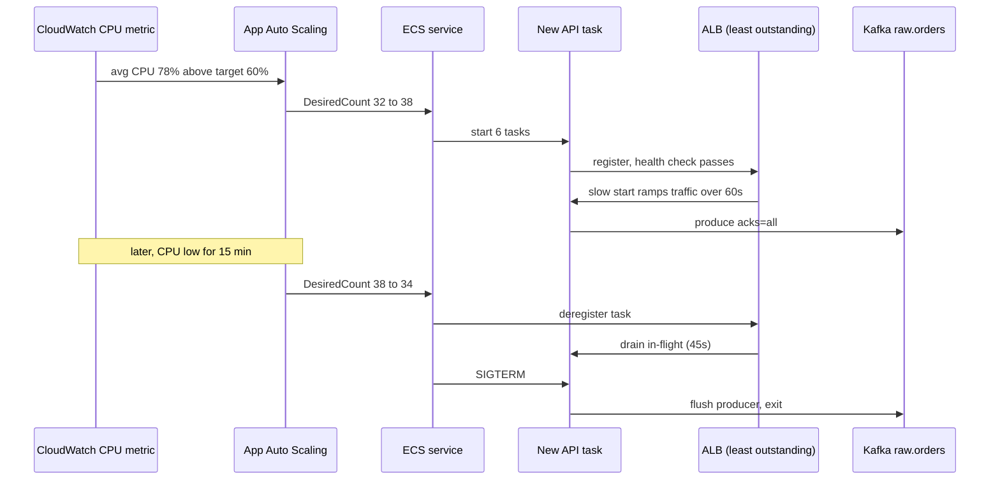

### Current State After V7

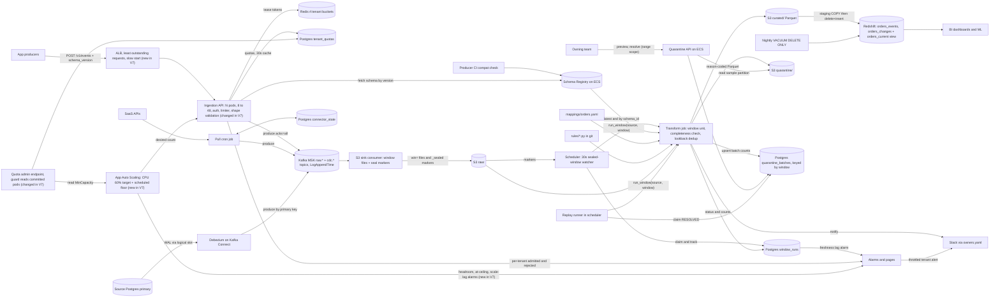

New in V7: the ALB with least-outstanding routing, autoscaling with a scheduled floor, a capacity guard that reads committed pods, graceful drain, and three capacity alarms. The API is now a pool that changes in size.

**Flow 1: Push write path (changed)**
1. Producer calls `POST /v1/events/orders` with `schema_version`.
2. The ALB routes it to the pod with the fewest in-flight requests.
3. The pod authenticates the token and resolves `tenant_id`.
4. It asks its limiter for one token, spending its local lease or leasing a chunk from Redis. It returns 429 over quota.
5. It validates shape, builds the envelope with `schema_id`, and produces to `raw.orders` with `acks=all`.
6. It returns 200 after the ISR ack, or 422 or 503 on failure.

**Flow 2: SaaS pull path (unchanged)**
1. Cron reads its cursor, fetches, produces to `raw.<source>`, and flushes.
2. It advances the cursor after the flush.

**Flow 3: CDC path (unchanged)**
1. Debezium reads the WAL and produces change events keyed by primary key to `cdc.orders_db.*`.

**Flow 4: Sink path (unchanged)**
1. The sink flushes window files and seal markers to S3 `raw/` and commits offsets after the PUT.

**Flow 5: Window scheduling (unchanged)**
1. The scheduler runs sealed windows strictly in order and tracks them in `window_runs`.

**Flow 6: Transform and load path (unchanged)**
1. `run_window` checks completeness, validates schema and value rules, applies resolutions, and dedups.
2. It writes `curated/` and `quarantine/`, then runs the staging `COPY` with lookback-deduped insert.

**Flow 7: Triage, resolve, and replay (unchanged)**
1. Owners resolve batches through the Quarantine API, and the replay runner re-runs the affected windows.

**Flow 8: Read path (unchanged)**
1. BI and ML query `orders_current` for latest state and `orders_changes` for history.

**Flow 9: Schema change path (unchanged)**
1. A producer's PR is checked against the registry, registered on merge, and picked up by the API.

**Flow 10: Quota change path (changed)**
1. An engineer calls `PUT /internal/quotas/{tenant}` with a rate or time-boxed override.
2. The guard computes allocatable capacity from the autoscaling `MinCapacity`, sums other tenants' effective quotas, and refuses if the total would exceed it.
3. It writes `tenant_quotas`, and pods pick it up within 30 seconds.

**Flow 11: Scaling path (new)**
1. CPU crosses 60%, or a scheduled action changes the floor.
2. App Auto Scaling changes the ECS desired count.
3. New tasks register with the ALB and ramp up over a 60-second slow start.
4. On scale-in, ECS deregisters a task, the ALB drains it for 45 seconds, and the task flushes its producer and exits on SIGTERM.

### Interview Follow-ups

**Q: Why scale on CPU, and not on requests per target or Kafka produce latency?**

A: CPU is the real cost driver, since the work is JSON parsing, schema validation, and compression. Requests per target assumes equal-cost requests, which stops being true when payload sizes differ. Kafka latency is a lagging symptom, and it only rises after pods are already overloaded. I'd still alert on it. I'd just not scale from it.

**Q: What if traffic doubles in 30 seconds and the autoscaler hasn't caught up?**

A: For about 3 minutes the pool serves its current capacity. Each tenant's burst bucket (about 10 seconds of its rate) absorbs the first part. Beyond that, the tenant gets 429s from its own quota, and the other tenants don't notice. Producers back off and spool to disk, so nothing is lost. For events we can predict, we avoid that gap with a scheduled floor.

### Recap

| Concept | The Insight |
|---|---|
| Quotas isolate, they don't create capacity | Once the sum of quotas hits the pool size, only more capacity helps. |
| Horizontal needs stateless pods | Check what each pod holds locally. Ours held only short-lived caches, so we could simply add pods. |
| Least outstanding requests plus slow start | Route to the least busy pod, and ramp new pods in so cold caches don't take a full share. |
| Autoscale reactively, schedule for known events | Metrics lag by minutes, so known peaks get a pre-set floor. |
| Guard on committed capacity | A quota is a promise, so it must be backed by capacity that exists at minute zero. |
| Asymmetric cooldowns | Scale out fast because lateness costs data, and scale in slowly to avoid flapping. |

**Interview arc:** *"A fixed 8-pod front door could not honor the quotas for a 30K/s Black Friday, so we confirmed the pods hold no durable state and scaled horizontally behind a least-outstanding-requests load balancer, with CPU target tracking for surprises, a scheduled floor for the known peak, and a capacity guard that only grants quotas the committed pods can serve."*

**Next:** the front door now admits 30K events/sec, which is 9M events per 5-minute window. One transform runner takes about 7.5 minutes per window, so the freshness lag grows every window and never recovers. V8 splits the transform by partition so windows run in parallel while keeping the strict ordering and idempotency we rely on.


-----------------------------------------------------------------------------------------------------------------------
-----------------------------------------------------------------------------------------------------------------------
-----------------------------------------------------------------------------------------------------------------------
-----------------------------------------------------------------------------------------------------------------------


## V8: Split Each Window Across Workers

Karan is on call for the platform team. This Saturday he runs the Black Friday game day.

He replays the projected traffic into the pipeline: 30K events/sec for three hours. The front door copes. The 32-pod floor from V7 admits every event, and Kafka stays healthy.

Then he opens the freshness dashboard.

A 5-minute window at 30K/s holds 9M events. The V5 transform job processes about 20K events/sec (1.8M events in 90 seconds). One window needs about 450 seconds of transform, plus about 60 seconds for the Redshift load.

That is 8.5 minutes of work for every 5 minutes of data. Lag grows by 3.5 minutes with every window:

- **After 1 hour:** about 50 minutes behind.
- **After 3 hours:** over 2 hours behind.
- **Target:** under 10 minutes.

Nothing fails here. Every window loads correctly, and the runner is simply slower than the arrival rate. No retry, alarm, or bigger Redshift cluster fixes that. A runner at 20K/s cannot keep up with 30K/s.

The dominant problem is transform throughput. The load step is within budget, because Redshift spreads `COPY` across its slices. Two other things are deferred:

- **Backlog and backfill:** an outage or a 6-month recompute queues many windows behind live ones. That is V9.
- **Connector quotas:** I said in V6 these would land in V7. They fit better with backlog handling, so they move to V9.

### The idea

Picture a mailroom with one clerk sorting the whole day's mail. The sack grows faster than the clerk works.

The mail already arrives in 12 labelled bins, and each bin has a count slip on it. So hire 12 clerks and give each one a bin. One supervisor signs off the day's batch only after all 12 are done, and only after yesterday's batch was signed.

The rule behind this is simple. You can split work only along a line where the pieces don't need each other. That line is called the shard key, and splitting the work this way is sharding the computation.

V5 already gave us the line. Each Kafka partition has its own files and its own seal marker with a record count.

The stable condition is that service time per window must stay below the window length. Today that is 8.5 minutes against 5, so we need a cycle under 5 minutes.

### Where to split: candidate shard keys

| Shard key | What it optimizes | What it breaks | Verdict |
|---|---|---|---|
| Kafka partition (12) | No shuffle. Each shard reads only its own files, and its marker proves completeness | Parallelism is capped at 12. Skew follows key distribution | Chosen |
| Tenant | Matches quotas and ownership | `orders` is about 45% of events, so one shard holds about 4M events and needs about 3.5 minutes | Rejected |
| Re-hash `event_id` into N buckets | Even load, and N is free to choose | Every worker must read every file, or we add a shuffle stage | Rejected |
| File or offset range inside a partition | More than 12-way parallelism | Duplicates split across units, and marker checks span units | Rejected for now |

Does our traffic create hotspots? Mostly no. Push events are keyed by `event_id`, which hashes evenly. CDC events are keyed by primary key, and a bulk `UPDATE` touches many keys, so it spreads too.

One row updated thousands of times would pile onto one partition. That is rare. I'm assuming max shard over mean shard is about 1.2, and the game day will confirm it. We alarm at 1.5.

Same `event_id` means same partition, so a shard can dedup locally. But shard-local dedup is not what makes the result correct. The exact dedup runs again in the Redshift staging step, across all shards.

That makes the shard key a performance choice, not a correctness assumption. It also bounds the cost of resharding. If we raise partitions from 12 to 24:

- **Old windows:** they are immutable files and are unaffected.
- **New records:** only they get remapped.
- **A straddling window:** it may hold one `event_id` in two shards, and the staging dedup removes it.

### Where to run a shard: candidate compute

The workload is a pulse. Twelve tasks of about 50 seconds start together every 5 minutes, then nothing.

| Option | Starts 12 in seconds | Idle cost | Extra parts | Verdict |
|---|---|---|---|---|
| Lambda per shard, invoked by the scheduler | Yes | None | One function, one concurrency cap | Chosen |
| ECS pool, fixed at 12 workers | Yes | Busy about 18% of the time, about $28/day | Pool plus a claim loop | Rejected |
| ECS pool, autoscaled on backlog | No: 1 to 2 minutes to start, for a 1-minute job | Low | A scaling policy chasing a 5-minute pulse | Rejected |
| Spark on Glue or EMR | No: minutes to start | Billing minimums | Cluster, and rules rewritten in Spark | Rejected |

At peak volume Lambda costs roughly $13/day. The shard contract below doesn't depend on the compute. If a shard ever nears 10 minutes, we move it to ECS tasks and change nothing else.

### Sub-problem: two workers run the same shard

A lease detects a dead worker. It does not detect a slow one.

Suppose Lambda invocation 1 stalls on an S3 call. Its lease expires at 90 seconds, so invocation 2 takes the shard and finishes. Then invocation 1 wakes up and finishes too. Two workers now both believe they own the shard. That is a zombie.

There are three established fixes.

**A. Deterministic overwrite (the V1 sink style).**
```python
s3.put(f"curated/.../shard=03/part-0.parquet", data)   # same key every attempt
```
This is safe only if the output is a pure function of the input. After a replay, the pinned resolutions differ. A late zombie from the old run overwrites the new file with stale data.

**B. Lock with expiry.**
```python
if redis.set(f"lock:{source}:{w}:{p}", me, nx=True, ex=90): process()
```
The lock expires while the zombie is still running. The zombie never learns it lost.

**C. Fencing token with attempt-scoped output.**
```python
token = claim()                                         # fresh uuid on every claim
write(f".../shard=03/t={token[:8]}/part-0.parquet")     # private prefix per attempt
UPDATE ... SET status='DONE' WHERE claim_token = :token AND status='RUNNING'   # 0 rows = I lost
```
A manifest names only the winner's files. A zombie's files are never referenced.

| Option | Zombie-safe | Safe across a replay | Extra infra |
|---|---|---|---|
| A. Overwrite | Only if output is pure | No | None |
| B. Lock with expiry | No | No | Redis |
| C. Fencing token | Yes | Yes | None (Postgres already exists) |

C fits. This system already keeps its state in Postgres.

### Solve it

- ✅ **What we gained**
  - Transform stage drops from 450 s to about 55 s, which is 450 s over 12 shards plus about 10 s of overhead and skew.
  - A full window cycle is about 2.5 minutes, so typical freshness is about 5 to 6 minutes at 30K/s.
  - Headroom is about 4x (roughly 120K events/s) before the 12-partition ceiling.
  - A failed shard retries one shard (about 50 s), not a whole window.
  - Nothing sits idle between windows.
- ⚠️ **What we gave up**
  - Parallelism is capped at the partition count, which is 12.
  - Parallel pieces of one logical run must see identical inputs, so schema, rules, and resolutions are now pinned per window.
  - More state: a shard table, leases, fencing tokens, and manifests.
  - Commit stays serial. The load (about 60 s at 9M events) is the next bottleneck to watch.
  - Tiny sources fan out into up to 12 near-empty tasks. That costs a few extra seconds.
  - Lambda has a 15-minute cap, and the exit path is ECS tasks.
- ❌ **What we considered and rejected**
  - **SQS plus workers:** the queue's visibility timeout is just a lease, and status and counts need Postgres anyway.
  - **Step Functions Distributed Map:** it would own retries and fan-out state. Our claim and fencing state already lives in Postgres, so that makes two sources of truth.
  - **Parallel windows without sharding:** it leaves each window's work serial, and it fights the ordered dedup from V5.

### Implement it

#### A. What a window run pins

All 12 shards of one window must read the same inputs.

| Input | Pinned in | Why |
|---|---|---|
| Reader schema | `window_runs.reader_schema_id` | Every shard emits the same columns, and `sync_columns` uses the same schema |
| Resolutions | `window_runs.resolutions` | A resolve arriving mid-run must not apply to half the window |
| Transform code (rules, mappings) | `window_runs.transform_ver` (a Lambda version) | A deploy mid-window must not mix two versions |
| Shard input | `window_shards.input_count` from the seal marker | Each shard proves its own completeness |

Delta to `window_runs` (the table from V5):

```sql
ALTER TABLE window_runs
  ADD COLUMN generation        INT NOT NULL DEFAULT 1,   -- bumped on each replay
  ADD COLUMN reader_schema_id  INT,
  ADD COLUMN resolutions       JSONB,
  ADD COLUMN transform_ver     TEXT,
  ADD COLUMN load_token        UUID,
  ADD COLUMN load_lease_until  TIMESTAMPTZ;
-- status is now: PENDING | RUNNING (shards in flight) | LOADING | DONE | FAILED
```

#### B. Shard state (first time, full)

No new storage class. It lives in the same small RDS Postgres as `window_runs`.

```sql
CREATE TABLE window_shards (
  source        TEXT        NOT NULL,
  window_start  TIMESTAMPTZ NOT NULL,
  shard         SMALLINT    NOT NULL,                 -- Kafka partition number
  generation    INT         NOT NULL,
  status        TEXT        NOT NULL DEFAULT 'PENDING', -- PENDING | RUNNING | DONE | FAILED
  claim_token   UUID,                                  -- fencing token, new on every claim
  lease_until   TIMESTAMPTZ,
  attempts      INT         NOT NULL DEFAULT 0,
  input_count   BIGINT      NOT NULL,                  -- from the seal marker
  good_count    BIGINT,
  bad_count     BIGINT,
  reason_counts JSONB,
  sample        JSONB,
  out_prefix    TEXT,                                  -- 'shard=03/t=9f3a1c2e', the winner
  updated_at    TIMESTAMPTZ NOT NULL DEFAULT now(),
  PRIMARY KEY (source, window_start, shard)
);
```

Claim, run by a shard Lambda:

```sql
UPDATE window_shards
SET status='RUNNING', claim_token=gen_random_uuid(),
    lease_until=now()+interval '90 seconds', attempts=attempts+1, updated_at=now()
WHERE source=:s AND window_start=:w AND shard=:p
  AND (status='PENDING' OR (status='RUNNING' AND lease_until < now()))
RETURNING claim_token;     -- no row: already done or held by someone else
```

Fenced completion:

```sql
UPDATE window_shards
SET status='DONE', out_prefix=:prefix, good_count=:g, bad_count=:b,
    reason_counts=:rc, sample=:smp, updated_at=now()
WHERE source=:s AND window_start=:w AND shard=:p
  AND claim_token=:token AND status='RUNNING';
-- rowcount 0 means I am a zombie: delete my own prefix and stop
```

The heartbeat runs every 20 seconds in a thread:

```sql
UPDATE window_shards SET lease_until = now() + interval '90 seconds'
WHERE source=:s AND window_start=:w AND shard=:p AND claim_token=:token;
```

Zero rows means the shard was taken. The main loop checks a flag every 10K records and aborts.

The reaper runs in the scheduler every 30 seconds:

```sql
UPDATE window_shards SET status='PENDING', updated_at=now()
WHERE status='RUNNING' AND lease_until < now() AND attempts < 4;
UPDATE window_shards SET status='FAILED'
WHERE status='RUNNING' AND lease_until < now() AND attempts >= 4;   -- poison shard: page
-- any PENDING shard with updated_at older than 20 s is invoked again (a lost invoke)
```

Re-invoking is harmless because the claim only succeeds once.

#### C. Planning a window (scheduler)

Windows are planned up to 3 ahead of the oldest uncommitted one:

```python
PARTITIONS, MAX_IN_FLIGHT = 12, 3

def tick(source):                                      # every 30 s, V5 loop
    reap_and_reinvoke(source)
    for w in next_sealed_windows(source):              # oldest first, all 12 markers present
        if in_flight(source) >= MAX_IN_FLIGHT: break
        insert_pending(source, w)
        plan_window(source, w)
    for w in running_windows(source):
        finalize(source, w)                            # section E, gated

def plan_window(source, w):
    markers = [read_marker(source, w, p) for p in range(PARTITIONS)]
    reader  = registry.latest_id(f"raw.{source}-value")                   # pin schema
    res     = db.query("""SELECT reason_code, resolution FROM quarantine_batches
                          WHERE source=%s AND load_window=%s
                            AND status IN ('RESOLVED','REPLAYING','REPLAYED')""", source, w)
    ver     = lambda_alias_version("shard-transform", "live")             # pin code
    with db.txn():
        db.execute("""UPDATE window_runs SET status='RUNNING', reader_schema_id=%s,
                      resolutions=%s, transform_ver=%s
                      WHERE source=%s AND window_start=%s AND status='PENDING'""", ...)
        for p, m in enumerate(markers):
            db.execute("""INSERT INTO window_shards (source, window_start, shard, generation,
                                                     input_count, status)
                          VALUES (%s,%s,%s,%s,%s,%s) ON CONFLICT DO NOTHING""",
                       source, w, p, gen, m["count"], "DONE" if m["count"] == 0 else "PENDING")
    for p in pending_shards(source, w):                # invoke after commit
        lam.invoke(FunctionName=f"shard-transform:{ver}", InvocationType="Event",
                   Payload=json.dumps({"source": source, "window": iso(w), "shard": p}))
```

Empty shards are marked `DONE` at plan time. Invoking by version means a deploy mid-window can't change the code of a window already planned.

Lambda configuration:

```bash
aws lambda put-function-concurrency --function-name shard-transform \
  --reserved-concurrent-executions 48            # 3 windows x 12, plus room for reruns
aws lambda put-function-event-invoke-config --function-name shard-transform \
  --maximum-retry-attempts 0 --maximum-event-age-in-seconds 60   # our reaper is the retry
# memory 4096 MB, timeout 300 s, container image with rules/ and mappings/ baked in
```

#### D. The shard Lambda

It is V5's `run_window` body, narrowed to one partition:

```python
def handler(ev, ctx):
    s, w, p = ev["source"], parse(ev["window"]), ev["shard"]
    row = db.fetchone(CLAIM_SQL, s, w, p)
    if not row: return {"skipped": True}
    tok = row.claim_token
    run = db.fetchone("SELECT reader_schema_id, resolutions FROM window_runs "
                      "WHERE source=%s AND window_start=%s", s, w)
    hb = Heartbeat(tok, every=20)                          # sets hb.lost when the fence breaks
    latest = registry.by_id(run.reader_schema_id)          # pinned, not "latest now"
    verify_complete_shard(s, w, p)                         # V5 check: files cover marker count
    sfx = f"shard={p:02d}/t={tok.hex[:8]}"
    ok  = ParquetWriter(f"curated/source={s}/dt={w:%Y-%m-%d}/win={w:%H%M}/{sfx}/part-0.parquet")
    bad = ReasonWriter(f"quarantine/source={s}/dt={w:%Y-%m-%d}/win={w:%H%M}/{sfx}/")
    seen, reasons, sample = set(), Counter(), []
    for i, env in enumerate(stream_partition_files(s, w, p)):   # streaming, never all in memory
        if i % 10_000 == 0 and hb.lost: raise Abort()
        payload, fails = check(env, latest, RULES[s])               # V3 shape + V4 value rules
        if fails: payload, fails = apply_resolutions(payload, fails, run.resolutions)
        if fails:
            bad.write(env, fails); reasons[fails[0]] += 1; keep_sample(sample, env); continue
        k = dedup_key(env)                                          # event_id, or (table, lsn)
        if k in seen: continue
        seen.add(k); ok.write(to_row(payload, latest))
    ok.close(); bad.close()
    n = db.execute(COMPLETE_SQL, ..., tok)                          # fenced
    if n == 0: delete_prefix(sfx); return {"zombie": True}          # lost the race
    return {"good": ok.count, "bad": sum(reasons.values())}
```

A shard holds about 750K events, so its dedup set is about 27 MB.

#### E. Committing a window in order

Shards finish in any order. The load commits strictly in window order. This is parallel compute with ordered commit.

The gate:

```sql
UPDATE window_runs r
SET status='LOADING', load_token=gen_random_uuid(), load_lease_until=now()+interval '5 minutes'
WHERE r.source=:s AND r.window_start=:w
  AND (r.status='RUNNING' OR (r.status='LOADING' AND r.load_lease_until < now()))
  AND NOT EXISTS (SELECT 1 FROM window_shards x                       -- all shards done
                  WHERE x.source=r.source AND x.window_start=r.window_start AND x.status<>'DONE')
  AND NOT EXISTS (SELECT 1 FROM window_runs p                         -- earlier first runs committed
                  WHERE p.source=r.source AND p.generation=1
                    AND p.window_start < r.window_start AND p.status<>'DONE')
  AND NOT EXISTS (SELECT 1 FROM window_runs l                         -- one load per source
                  WHERE l.source=r.source AND l.status='LOADING'
                    AND l.load_lease_until >= now() AND l.window_start<>r.window_start)
RETURNING load_token;
```

Replays have `generation > 1`, so they don't hold up live windows. They queue behind them.

Finalize:

```python
def finalize(source, w):
    token = db.scalar(GATE_SQL, source, w)
    if not token: return
    shards = db.query("SELECT * FROM window_shards WHERE source=%s AND window_start=%s ORDER BY shard", source, w)
    run = db.fetchone("SELECT * FROM window_runs WHERE source=%s AND window_start=%s", source, w)
    write_manifest(source, w, "curated",    [x for x in shards if x.good_count])
    write_manifest(source, w, "quarantine", [x for x in shards if x.bad_count])
    sync_columns(f"analytics.{source}_events", run.reader_schema_id)    # V3, once, serial
    redshift_load(source, w)
    merged = merge_counts(shards)                                       # sum reason_counts, first 5 samples
    upsert_batches(source, w, merged)                                   # V4, now once per window
    settle_batches(source, w, present=list(merged))                     # section F
    db.execute("""UPDATE window_runs SET status='DONE' WHERE source=%s AND window_start=%s
                  AND load_token=%s""", source, w, token)               # fenced, like shards
    delete_losing_attempts(source, w, shards)
    notify_new_batches(source, w)
```

The manifest names exactly the winning files. Redshift requires `content_length` for Parquet manifests:

```json
{ "entries": [
  { "url": "s3://acme-data/curated/source=orders/dt=2026-11-27/win=1010/shard=00/t=9f3a1c2e/part-0.parquet",
    "mandatory": true, "meta": { "content_length": 61203311 } },
  { "url": "s3://acme-data/curated/source=orders/dt=2026-11-27/win=1010/shard=01/t=4be07a15/part-0.parquet",
    "mandatory": true, "meta": { "content_length": 60987544 } }
] }
```

The load changes in two places. It reads the manifest, and it dedups inside the window as well as against earlier ones:

```sql
CREATE TEMP TABLE stg (LIKE analytics.orders_events);

COPY stg (event_id, tenant_id, order_id, amount_cents, currency, channel,
          event_ts, received_at, load_window, coupon_code)
FROM 's3://acme-data/curated/source=orders/dt=2026-11-27/win=1010/_manifest.json'
IAM_ROLE '...' FORMAT AS PARQUET MANIFEST;

BEGIN;
DELETE FROM analytics.orders_events WHERE load_window = '2026-11-27 10:10';
INSERT INTO analytics.orders_events
SELECT event_id, tenant_id, order_id, amount_cents, currency, channel,
       event_ts, received_at, load_window, coupon_code
FROM (
  SELECT s.*, ROW_NUMBER() OVER (PARTITION BY s.event_id ORDER BY s.received_at) AS rn
  FROM stg s
  LEFT JOIN (SELECT event_id FROM analytics.orders_events
             WHERE load_window >= '2026-11-26 10:10' AND load_window < '2026-11-27 10:10') p
         USING (event_id)
  WHERE p.event_id IS NULL
) WHERE rn = 1;
COMMIT;
```

The `rn = 1` filter is the exact dedup across shards. Any number of duplicate attempts converge on one table state.

#### F. Replay and quarantine deltas

- **Replay runner:** it claims only batches whose window is `DONE`. Then it requests a rerun instead of calling `run_window`:

```python
def request_rerun(source, w):
    with db.txn():
        db.execute("DELETE FROM window_shards WHERE source=%s AND window_start=%s", source, w)
        db.execute("""UPDATE window_runs SET status='PENDING', generation=generation+1,
                      load_token=NULL WHERE source=%s AND window_start=%s
                      AND status IN ('DONE','FAILED')""", source, w)
```

The scheduler plans the window again with fresh pins, including the new resolutions.

- **Settling batches:** the runner no longer blocks, so `finalize` settles status:

```sql
UPDATE quarantine_batches SET record_count = 0, updated_at = now()
WHERE source=:s AND load_window=:w AND reason_code <> ALL(:present);     -- fixed batches go to zero
UPDATE quarantine_batches SET status = CASE WHEN record_count = 0 THEN 'REPLAYED' ELSE 'OPEN' END
WHERE source=:s AND load_window=:w AND status='REPLAYING';
```

The first statement closes a gap in V4. Nothing there zeroed a fully fixed batch, so its replay check read a stale count.

- **Quarantine API preview:** it reads `quarantine/.../_manifest.json`, not a prefix listing, so it never sees a zombie's files.

#### G. Observability

- **Shard skew:** max over mean of `input_count`. Alert above 1.5.
- **Shard duration p95:** alert above 100 s.
- **Stage time:** plan to last shard DONE. Alert above 120 s.
- **Commit wait:** last shard DONE to load claim. A high value means an earlier window is blocking.
- **Zombie rejections:** a counter. A rising rate means leases are too short.
- **Shards with `attempts > 1`**, and any `FAILED` shard, which pages.
- **Freshness lag:** the V5 SLO alarm, unchanged.

#### H. Who writes and who reads (delta from V7)

| Store | Who writes | When | Who reads | When |
|---|---|---|---|---|
| Postgres `window_runs` (with pins) | Scheduler (plan, load claim, DONE), replay runner (`request_rerun`) | At plan, at load, on replay | Scheduler; shard Lambdas (pins); alarms | Each tick; at shard start |
| Postgres `window_shards` | Scheduler (create, reaper); shard Lambda (claim, heartbeat, fenced complete) | At plan; during shard | Scheduler (gate, merge counts); alarms | Every 30 s; at finalize |
| S3 `curated/.../shard=NN/t=<token>/` | Shard Lambda | During shard | Scheduler (builds manifest); Redshift `COPY` via manifest | At finalize |
| S3 `quarantine/.../shard=NN/t=<token>/` | Shard Lambda | During shard | Quarantine API via manifest; engineers via Spectrum | On preview; ad hoc |
| S3 `_manifest.json` (curated and quarantine) | Scheduler (finalize) | Before the load | Redshift `COPY`; Quarantine API | At load; on preview |
| `quarantine_batches` | Scheduler (merged counts, status), Quarantine API, replay runner | At finalize; on resolve; on claim | Same, plus alarms | Continuously |
| Redshift `analytics.*` | Scheduler (finalize load) | Per window, in order | BI, ML | Ad hoc |

Losing attempts delete their own prefix when the fence rejects them. Finalize also deletes any `t=` prefix it did not pick.

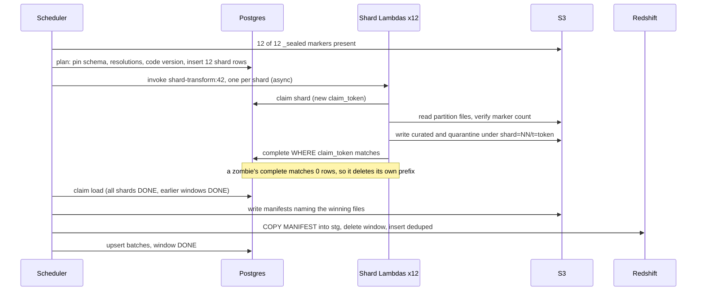

### Current State After V8

```mermaid
graph LR
    CI["Producer CI compat check"] --> REG
    P[App producers] -->|"POST /v1/events + schema_version"| ALB["ALB, least outstanding requests, slow start"]
    ALB --> API["Ingestion API: N pods, 8 to 48, auth, limiter, shape validation"]
    ASG["App Auto Scaling: CPU 60% target + scheduled floor"] -->|desired count| API
    API -->|"lease tokens"| RDS[("Redis rl:tenant buckets")]
    API -->|"quotas, 30s cache"| TQ[("Postgres tenant_quotas")]
    ADM["Quota admin endpoint, guard reads committed pods"] --> TQ
    ADM -->|"read MinCapacity"| ASG
    API -->|"fetch schema by version"| REG[("Schema Registry on ECS")]
    API -->|produce acks=all| K[("Kafka MSK raw.* + cdc.* topics, LogAppendTime")]
    SaaS[SaaS APIs] --> PC[Pull cron job]
    PC -->|produce| K
    PC <--> CS[(Postgres connector_state)]
    SRC[(Source Postgres primary)] -->|WAL via logical slot| DBZ[Debezium on Kafka Connect]
    DBZ -->|produce by primary key| K
    K --> SINK["S3 sink consumer: window files + seal markers"]
    SINK -->|"win= files and _sealed markers"| RAW[(S3 raw/)]
    SCH["Scheduler: watcher, plan_window, reaper, finalize (changed in V8)"]
    RAW -->|markers| SCH
    SCH -->|"plan: pin schema, resolutions, code version"| WR[("Postgres window_runs, with pins (changed in V8)")]
    SCH -->|"create shard rows"| WS[("Postgres window_shards (new in V8)")]
    SCH -->|"invoke by version, 12 per window"| SHARD["Shard Lambda x12: transform one partition (new in V8)"]
    SHARD <-->|"claim, heartbeat, fenced complete"| WS
    RAW -->|"one partition's files + marker"| SHARD
    REG -->|"reader schema by pinned id"| SHARD
    MAP["rules/ + mappings/ baked into the Lambda image"] --> SHARD
    SHARD -->|"attempt-scoped Parquet"| CUR[(S3 curated/ shard=NN/t=token/)]
    SHARD -->|"reason-coded Parquet"| Q[(S3 quarantine/ shard=NN/t=token/)]
    WS -->|"all shards DONE + earlier windows committed"| SCH
    SCH -->|"manifests of winning files (new in V8)"| CUR
    SCH -->|"merged counts, one upsert per window"| QB[("Postgres quarantine_batches, keyed by window")]
    SCH -->|notify| SL["Slack via owners.yaml"]
    OWN["Owning team"] -->|"preview, resolve (range scope)"| QAPI["Quarantine API on ECS"]
    QAPI --> QB
    QAPI -->|"read quarantine manifest (changed in V8)"| Q
    RR["Replay runner: claims batches whose window is DONE (changed in V8)"] -->|claim RESOLVED| QB
    RR -->|"request_rerun: bump generation"| WR
    CUR -->|"staging COPY MANIFEST, then delete + deduped insert (changed in V8)"| WH[(Redshift: orders_events, orders_changes + orders_current view)]
    VAC["Nightly VACUUM DELETE ONLY"] --> WH
    WR -->|freshness lag alarm| ALM["Alarms and pages"]
    API -->|"per-tenant admitted and rejected"| ALM
    ASG -->|"headroom, at-ceiling, scale-lag alarms"| ALM
    SCH -->|"skew, stage-time, zombie alarms (new in V8)"| ALM
    ALM -->|"throttled tenant alert"| SL
    WH --> BI[BI dashboards and ML]
```

New in V8: the shard Lambdas, the `window_shards` table, the pins on `window_runs`, the manifests, and the ordered commit gate. The scheduler's old single-runner step is now plan, shard, and finalize.

**Flow 1: Push write path (unchanged)**
1. Producer calls `POST /v1/events/orders`. The ALB routes it to the pod with the fewest in-flight requests.
2. Pod authenticates, takes a token from its Redis lease (429 over quota), validates shape, and produces to `raw.orders` with `acks=all`.
3. It returns 200 after the ISR ack, or 422 or 503 on failure.

**Flow 2: SaaS pull path (unchanged)**
1. Cron reads its cursor, fetches, produces to `raw.<source>`, and flushes.
2. It advances the cursor after the flush.

**Flow 3: CDC path (unchanged)**
1. Debezium reads the WAL and produces change events keyed by primary key to `cdc.orders_db.*`.

**Flow 4: Sink path (unchanged)**
1. The sink consumer writes window files to S3 `raw/`, commits offsets after the PUT, and writes a seal marker per partition per window.

**Flow 5: Window planning (changed)**
1. The scheduler lists markers every 30 seconds. When all 12 partitions sealed the oldest unplanned window, it inserts a `window_runs` row.
2. If fewer than 3 windows are in flight, it pins schema, resolutions, and Lambda version, and inserts 12 `window_shards` rows.
3. It invokes `shard-transform:<version>` once per non-empty shard.

**Flow 6: Shard transform (new)**
1. The Lambda claims its shard and gets a fresh `claim_token`.
2. It verifies its partition's files against the marker, then streams, validates, applies value rules and resolutions, and dedups locally.
3. It writes Parquet under `shard=NN/t=<token>/` in `curated/` and `quarantine/`.
4. It completes with `WHERE claim_token = :token`. If zero rows match, it deletes its prefix.

**Flow 7: Window commit (new)**
1. The scheduler claims the load when all shards are `DONE`, no other load runs for the source, and all earlier first-run windows are `DONE`.
2. It writes manifests naming only the winning files and runs `sync_columns` once.
3. It runs the staging `COPY MANIFEST`, then delete-then-insert with exact dedup and lookback.
4. It upserts merged batch counts, settles replay batches, marks the window `DONE`, and notifies owners.

**Flow 8: Triage, resolve, and replay (changed)**
1. The owner previews and resolves through the Quarantine API. Preview reads the quarantine manifest.
2. The replay runner claims `RESOLVED` batches whose window is `DONE` and calls `request_rerun`.
3. The scheduler plans the window again with a new generation, and Flows 6 and 7 run.

**Flow 9: Read path (unchanged)**
1. BI and ML query `orders_current` for latest state and `orders_changes` for history.

**Flow 10: Schema change path (unchanged)**
1. A producer's PR is checked against the registry, registered on merge, and picked up by the API.

**Flow 11: Quota change path (unchanged)**
1. An admin changes a quota. The guard checks the sum against committed pod capacity.

**Flow 12: API scaling path (unchanged)**
1. CPU or a schedule moves the ECS desired count, and the ALB ramps new pods in.

### Interview Follow-ups

**Q: Two workers run the same shard. How do you know the result is still correct?**

A: Correctness doesn't depend on exactly one worker running. Each attempt writes to its own prefix, and only a fenced update, matching the current `claim_token`, can mark the shard `DONE`. The manifest names the winner's files, and the load is a delete-then-insert of one window in one transaction. Duplicate attempts can waste compute, but they can't change the table.

**Q: Why Lambda and not Spark?**

A: The work is 12 independent tasks of about a minute, every 5 minutes. Spark pays minutes of cluster start-up and billing minimums for that, and we would rewrite our rules in it. Lambda starts 12 workers in seconds and costs nothing between windows. If a shard ever nears 10 minutes, I'd move the same shard contract to ECS tasks.

### Recap

| Concept | The Insight |
|---|---|
| Service time vs window length | If a window takes longer to process than to arrive, lag grows forever, however correct each window is. |
| Split along existing seams | Kafka partitions and seal markers already divide the data, so we need no shuffle. |
| Shard key is performance, not correctness | The exact dedup in Redshift staging means a bad shard key costs speed, never correctness. |
| Lease vs fencing token | A lease finds dead workers. A fencing token stops slow ones from winning. |
| Pin the inputs | Parallel pieces of one run must read the same schema, rules, and resolutions. |
| Parallel compute, ordered commit | Shards finish in any order, but windows load in order, so lookback dedup stays deterministic. |

**Interview arc:** *"One serial runner processed 20K events/s against a 30K/s arrival rate, so lag grew 3.5 minutes per window; we split each window by Kafka partition into 12 shards, ran them as fenced, attempt-scoped Lambdas pinned to one schema, rules, and resolution snapshot, and committed windows in order through a manifest-driven idempotent load, which holds freshness near 5 minutes at 30K/s with about 4x headroom."*

**Next:** the pipeline now keeps up in steady state, but it has no way to catch up. A Redshift maintenance outage at 14:00 leaves 40 windows waiting. Priya also wants 6 months recomputed with new logic, which is thousands of windows, and live windows must not queue behind them. V9 builds a priority lane for backlog and backfill, and it carries the connector quotas I deferred from V6.


-----------------------------------------------------------------------------------------------------------------------
-----------------------------------------------------------------------------------------------------------------------
-----------------------------------------------------------------------------------------------------------------------
-----------------------------------------------------------------------------------------------------------------------


-----------------------------------------------------------------------------------------------------------------------
-----------------------------------------------------------------------------------------------------------------------
-----------------------------------------------------------------------------------------------------------------------
-----------------------------------------------------------------------------------------------------------------------


-----------------------------------------------------------------------------------------------------------------------
-----------------------------------------------------------------------------------------------------------------------
-----------------------------------------------------------------------------------------------------------------------
-----------------------------------------------------------------------------------------------------------------------


-----------------------------------------------------------------------------------------------------------------------
-----------------------------------------------------------------------------------------------------------------------
-----------------------------------------------------------------------------------------------------------------------
-----------------------------------------------------------------------------------------------------------------------


-----------------------------------------------------------------------------------------------------------------------
-----------------------------------------------------------------------------------------------------------------------
-----------------------------------------------------------------------------------------------------------------------
-----------------------------------------------------------------------------------------------------------------------


-----------------------------------------------------------------------------------------------------------------------
-----------------------------------------------------------------------------------------------------------------------
-----------------------------------------------------------------------------------------------------------------------
-----------------------------------------------------------------------------------------------------------------------


