# Unified Data Ingestion Platform, Chapter 1: Where it all began

## The roadmap

Here is the path we'll take, one chapter at a time. I won't move on until you say you've understood the current one.

| # | Chapter | Core question |
|---|---|---|
| 1 | **The problem: point-to-point scripts** (we are here) | Why does a "platform" even exist? |
| 2 | Requirements and scale estimation | What exactly are we building, and how big is it? |
| 3 | Decoupling with a message log (Kafka) | How do we stop sources and consumers from knowing each other? |
| 4 | Ingestion patterns: batch, CDC, streaming, push/pull | How does data get in from different kinds of sources? |
| 5 | Validation, schema registry, and schema evolution | How do we stop garbage getting in? |
| 6 | Transformation: ETL vs ELT, stream vs batch, Lambda/Kappa | Where and when do we clean and reshape data? |
| 7 | Storage: data lake, warehouse, lakehouse, file formats | Where does the data land? |
| 8 | Partitioning and sharding | How do we spread data and load? |
| 9 | Replication and durability | What if a machine dies? |
| 10 | Delivery guarantees: idempotency, exactly-once, ordering | How do we avoid loss and duplicates? |
| 11 | Error handling: retries, DLQ, backpressure, replay | What happens when things break? |
| 12 | Scaling, caching, API layer, CDN (where they do and don't apply) | How do we grow? |
| 13 | Orchestration, metadata, lineage, data quality, monitoring | How do we run it in production? |
| 14 | Security, governance, multi-tenancy, cost | How do we keep it safe and affordable? |
| 15 | Full interview walkthrough and Q&A drill | Putting it all together in 45 minutes |

---

## Chapter 1: The story of "ShopKart"

### Year 1: Three people and one database

ShopKart is a small e-commerce startup. There is one production database (PostgreSQL) holding orders, users and payments. The CEO asks the single data analyst, Asha:

> "How many orders did we get yesterday, by city?"

Asha connects to the production database and runs a SQL query. It works. Everyone is happy.

### Year 2: The company grows, and so do the questions

The company now has:

- A mobile app and a website that produce **clickstream events** (who viewed which product).
- A **payments provider** (Razorpay or Stripe) that sends webhooks.
- A **CRM** (Salesforce) with customer support tickets.
- **Partner CSV files** from suppliers, dropped by email or SFTP every night.
- **Third-party APIs** such as Google Ads and Facebook Ads spend.
- A **MongoDB** instance for the product catalog.

The questions get harder:

> "Which ad campaign brought customers who actually *paid* and *didn't file a support ticket*?"

That answer lives across **five different systems**. Asha can't run one SQL query on all of them. So the team builds a **data warehouse** (a database optimized for analytics) and writes **scripts** to copy data into it.

### The naive approach: point-to-point scripts

Every engineer who needs data writes their own cron job:

```python
# pull_orders.py -- runs at 2 AM via cron
rows = prod_db.query("SELECT * FROM orders WHERE created_at > yesterday")
warehouse.insert("orders", rows)
```

Soon there are dozens of such scripts:

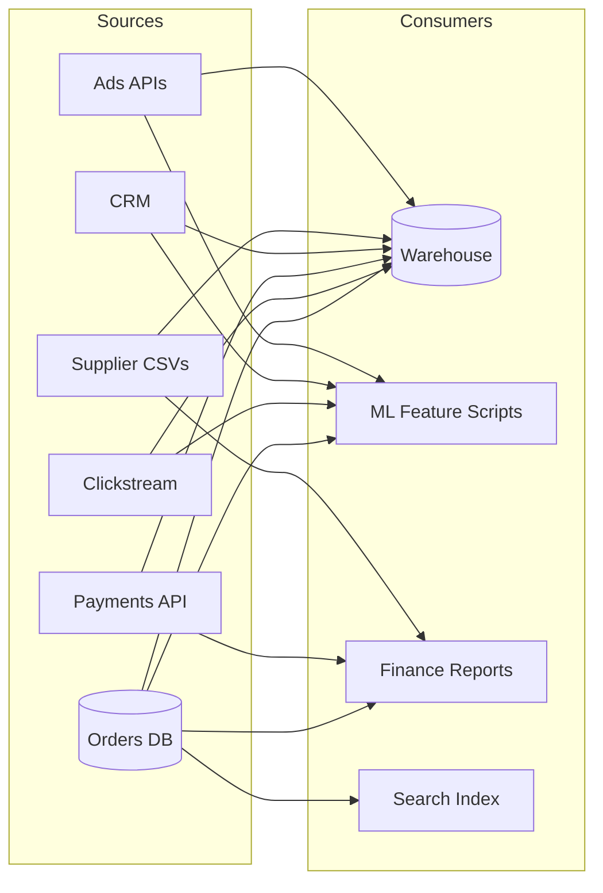

*Each arrow is a separate script, separately written, separately scheduled, and separately broken.*

This is called a **point-to-point integration**, and it works fine at first. Then the pain starts.

---

### The pains (this is the part interviewers love to hear you articulate)

#### Pain 1: The N × M explosion

With **N sources** and **M consumers**, you can end up with up to **N × M** custom integrations.

- 8 sources × 5 consumers = **40 scripts**
- Add 1 new source and you write 5 new scripts. Add 1 new consumer and you write 8.

Every integration means its own credentials, retry logic, scheduling and bugs. The cost grows multiplicatively, not additively.

#### Pain 2: You are hammering the production database

The ML team's script runs `SELECT * FROM orders` at 9 AM. The finance script does the same at 9:05, and the search-indexing script does it again at 9:10.

At 9:10 the **checkout page slows down** because the production DB is busy serving three analytics queries. A customer-facing outage is caused by an analytics job.

> **Lesson:** Analytical workloads (large scans) and transactional workloads (small, fast reads and writes) must be isolated. This is **OLTP vs OLAP**.

#### Pain 3: Schema changes silently break everything

A backend developer renames `user_city` to `city` in the orders table, which is a perfectly reasonable change for them. Meanwhile:

- Script #7 crashes at 2 AM.
- Script #12 doesn't crash but fills the `city` column with NULLs, so the **dashboard silently shows wrong numbers**.
- Nobody finds out for 3 days, until the CEO asks why "Hyderabad revenue dropped to zero".

> **Lesson:** There is no contract between the producer and the consumer. The developer didn't even know anyone was reading that column.

#### Pain 4: No reliability story

- The script fails halfway through. Are 40% of rows loaded? Do you re-run it? If you re-run it, you get **duplicates**.
- The source API was down for 6 hours. Do you ever get that data back?
- Cron has no concept of "run script B only after script A succeeds".

#### Pain 5: No replay or time travel

Three months later, the data science team finds a bug in how "session duration" was computed and wants to recompute it over all of last year's raw events. But the scripts only stored the **already-transformed** result. The raw data is gone, so it can never be recomputed.

#### Pain 6: Every script reinvents the same wheel

Each script has its own approach to retries, logging, date parsing and timezone handling. One treats `2026-10-27` as UTC, another as IST. Two reports disagree and the team spends two weeks arguing about whose number is right.

#### Pain 7: Nobody can answer "where did this number come from?"

There is no catalog, no lineage and no owner. This is the **trust problem**: when people stop trusting the data, the entire analytics investment is wasted.

---

### Summary of failures

| Problem | Root cause |
|---|---|
| N × M scripts | Tight coupling between each source and each consumer |
| Prod DB slowdown | No isolation between OLTP and OLAP |
| Silent breakage | No schema contract or validation |
| Duplicates and data loss | No delivery guarantees, no idempotency |
| Can't recompute | Raw data not retained |
| Inconsistent numbers | No shared transformation logic |
| No trust | No lineage, quality checks or ownership |

---

### The insight that creates the "platform"

The team has a whiteboard moment:

> *"Instead of every source talking to every consumer, what if everything flowed through **one common pipeline** with a standard front door and standard back door?"*

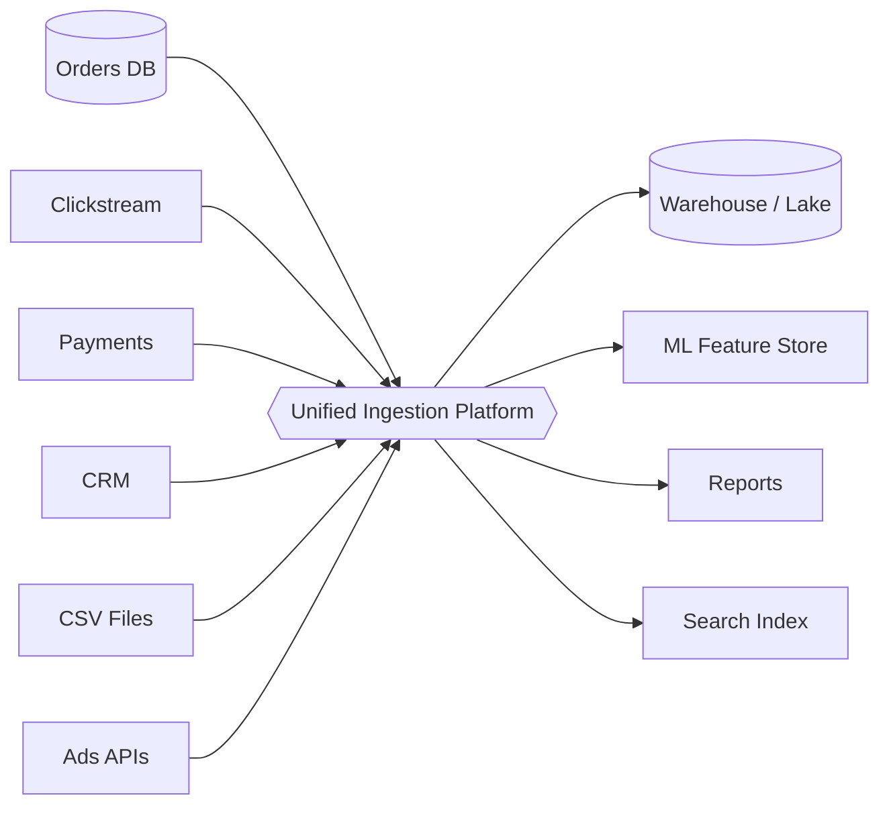

The cost now becomes **N + M** instead of **N × M**:

- A new source writes **one** connector to the platform.
- A new consumer reads from **one** place.
- Validation, retries, schemas, monitoring and security are built **once**, centrally.

This is the same idea as an airport hub. 8 cities × 5 cities of direct flights is 40 routes, whereas routing everything through one hub is 13.

That is why a **Unified Data Ingestion Platform** exists.

---

### How to say this in an interview

> *"Without a platform, every source integrates directly with every consumer, which creates N×M coupling, puts load on OLTP systems, has no schema contract, no replayability and no central quality control. A unified ingestion platform introduces a standard ingestion layer that decouples producers from consumers, turning N×M into N+M, and centralizes validation, transformation, reliability and observability."*

If you can say that confidently in the first two minutes, you've set the frame for the entire interview.

---

### Key terms from this chapter

- **Point-to-point integration:** direct custom connections between each pair of systems.
- **OLTP:** online transaction processing (the app's database, optimized for many small reads and writes).
- **OLAP:** online analytical processing (the warehouse, optimized for big scans and aggregations).
- **Data contract:** an agreement between producer and consumer on a dataset's structure and meaning.
- **Hub-and-spoke:** the pattern where everything goes through one central layer.

---

### Checkpoint

Before we move to Chapter 2, try answering these in your own words:

1. Why does point-to-point integration scale as N × M, and what does the platform change it to?
2. Why is running analytics directly on the production DB dangerous? Name the OLTP vs OLAP difference.
3. In the "city renamed" example, why was the **silent** failure worse than the crash?
4. Why does throwing away raw data after transformation hurt us later?

Tell me whether any of this is fuzzy, or just say **"Understood, next"** and we'll go to **Chapter 2: Requirements and scale estimation**, where we define what the platform must do, its functional and non-functional requirements, and the back-of-the-envelope math (events per second, storage per day, bandwidth) that drives every later design decision.


-----------------------------------------------------------------------------------------------------------------------
-----------------------------------------------------------------------------------------------------------------------
-----------------------------------------------------------------------------------------------------------------------
-----------------------------------------------------------------------------------------------------------------------


# Chapter 2: Requirements and scale estimation

## The story: the team that skipped this step

Before we define our platform, here is a cautionary tale.

A team at a company much like ShopKart got excited about the "hub" idea from Chapter 1. They spun up one big server with a REST endpoint, `POST /ingest`, and a script that wrote everything to a database. They went live on a Monday.

- **Monday 10 AM:** the marketing team turned on clickstream tracking for the whole app. The endpoint got hit by **200,000 events/second**. The server fell over in 40 seconds.
- **Tuesday:** after a restart, the analysts asked, "Where is yesterday's data?" **It was gone.** The server had no durable buffer.
- **Wednesday:** compliance asked, "Are you storing customer phone numbers in plain text?" Nobody had thought about it.
- **Thursday:** the fraud team said, "We need payment events within 30 seconds, not tomorrow morning." The design was nightly batch.

Four failures, and all of them were **requirements and estimation failures**, not coding failures. In an HLD interview this is exactly what the first 5-8 minutes are for. Interviewers want to see that you clarify before you draw.

---

## Part 1: Functional requirements (what the system does)

Asha's team interviews every stakeholder (analysts, ML engineers, finance, compliance, source-system owners) and writes this list:

| # | Requirement | Concrete example |
|---|---|---|
| F1 | **Ingest from heterogeneous sources** | Postgres/MySQL tables, MongoDB, app clickstream, Stripe webhooks, partner CSVs on SFTP, Google Ads API |
| F2 | **Support multiple ingestion modes** | Batch (nightly files), micro-batch (every 15 min), streaming (real-time events), CDC (row-level DB changes) |
| F3 | **Validate data** | Reject an order with a negative amount; flag a missing `user_id` |
| F4 | **Transform data** | Parse JSON, convert timestamps to UTC, mask PII, join with reference data, deduplicate |
| F5 | **Deliver to multiple destinations** | Data lake, data warehouse, feature store, search index |
| F6 | **Manage schemas** | Detect when `user_city` becomes `city` *before* it breaks things |
| F7 | **Replay and backfill** | "Recompute all of 2025 with the new session logic" |
| F8 | **Self-service onboarding** | A new team adds a source via config, not by writing a new pipeline from scratch |
| F9 | **Metadata, catalog and lineage** | "Which tables does this dashboard's revenue number come from?" |
| F10 | **Monitoring and alerting** | "The orders feed is 20 minutes late" |

### Out of scope

State this explicitly in the interview, because it shows maturity:

- The BI tool itself (Tableau, Looker)
- Model training pipelines
- Building the source applications

> **Interview tip:** Say, *"I'll focus on the ingestion, processing and delivery platform. BI tools and ML training consume our output but are out of scope. Let me know if you want to go deeper on either."*

---

## Part 2: Non-functional requirements (how well it does it)

These shape the architecture far more than the functional list does. Every one has to be a **testable statement** with a number attached.

| NFR | What it means here | Example target |
|---|---|---|
| **Scalability** | Handle growth in sources, volume and consumers | 7+ TB/day now, 10× in 3 years |
| **Durability** | Never lose accepted data | Zero data loss after the platform acknowledges receipt |
| **Freshness (latency)** | Time from event creation to availability | Real-time tier < 1 min, near-real-time < 15 min, batch within hours |
| **Availability** | Ingestion keeps accepting data even during partial failures | 99.9%+ on the ingestion layer |
| **Correctness** | No silent duplicates or corruption | "Effectively-once" processing |
| **Ordering** | Events for the same entity stay in order | Order #123's `created` comes before `shipped` |
| **Extensibility** | Adding a source or sink is cheap | A new source onboards in days, not weeks |
| **Security and compliance** | PII protected, access controlled, auditable | Encryption in transit and at rest, GDPR/DPDP deletion support |
| **Observability** | We find problems before users do | Lag, throughput, error rate and quality metrics on dashboards |
| **Cost efficiency** | Petabytes are expensive | Tiered storage, compression, lifecycle policies |

### The most important trade-off to state out loud

In an ingestion platform, the typical priority order is:

> **Durability (don't lose data) > Correctness > Availability > Freshness > Cost**

Why? You can fix a *late* dashboard, but you can never recover an event that was never stored. A customer's payment record that vanished is a legal problem, whereas a 5-minute delay is an annoyance.

This is the **CAP/consistency mindset** applied to data: at the **ingestion edge** we favor **availability and durability** (accept and persist, even if downstream is down), and we reconcile consistency later in processing.

### Freshness tiers (a design pattern worth remembering)

Not all data is equal. Giving everything real-time treatment would be absurdly expensive. So we **classify by SLA**:

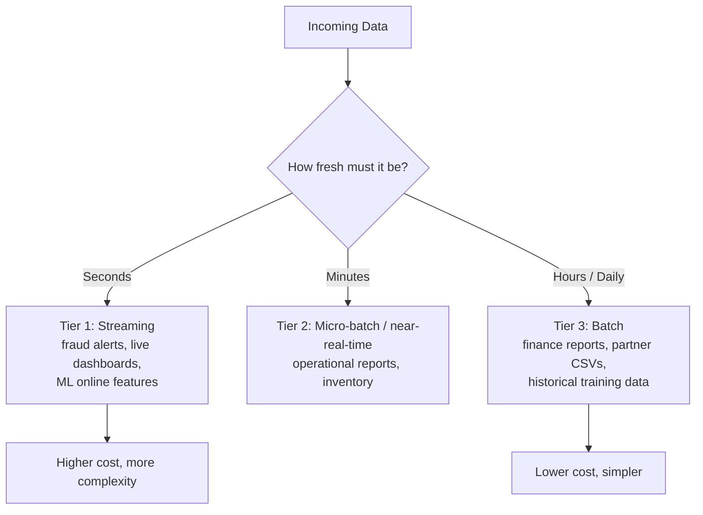

> **Example:** Payment events → Tier 1 (fraud team needs them in under 30 s). Supplier price CSVs → Tier 3 (they arrive once a night anyway).

---

## Part 3: Scale estimation (back-of-the-envelope)

Interviewers don't want exact answers. They want to see that you can **turn vague scale into numbers that drive decisions.** The standard recipe is:

1. Assume users and events
2. Compute average per second
3. Apply a peak factor
4. Multiply by event size
5. Compute daily and yearly storage
6. Account for retention, replication and compression

Let's do it for a ShopKart that has grown to a large company.

### Assumptions (say them out loud, and ask if they're reasonable)

- 100 million daily active users
- Each user generates ~50 clickstream events/day (views, clicks, searches)
- Average event size: ~1 KB (JSON with metadata)
- 200 production databases feeding CDC at an aggregate of ~20,000 row changes/sec average, ~1 KB each
- 5,000 partner/batch files per day, ~100 MB each
- Third-party API pulls: ~50 GB/day
- Peak traffic ≈ 3-4× average (sales events, evening spikes)

### Step 1: Clickstream

- Events per day: 100M × 50 = **5 billion/day**
- Average rate: 5,000,000,000 ÷ 86,400 ≈ **~58,000 events/sec**
- Peak (×3.5): ≈ **~200,000 events/sec**
- Daily volume: 5B × 1 KB = **~5 TB/day**
- Peak bandwidth: 200,000 × 1 KB ≈ **~200 MB/s**

### Step 2: CDC from databases

- Per day: 20,000 × 86,400 ≈ **1.73 billion changes/day**
- Volume: ≈ **~1.7 TB/day**
- Peak (×3): ~60,000 changes/sec ≈ **~60 MB/s**

### Step 3: Batch files and APIs

- Files: 5,000 × 100 MB = **~0.5 TB/day**
- APIs: **~0.05 TB/day** (small, but rate-limited and flaky, so they bring their own challenges)

### Step 4: Totals

| Source | Volume/day | Peak rate |
|---|---|---|
| Clickstream | ~5 TB | ~200K msgs/s |
| CDC | ~1.7 TB | ~60K msgs/s |
| Batch files | ~0.5 TB | bursty, nightly window |
| APIs | ~0.05 TB | negligible |
| **Total raw** | **≈ 7.3 TB/day** | **≈ 260K msgs/s, ~260 MB/s (~2 Gbps) in streaming peak** |

### Step 5: Storage

We'll store data in two forms, and the reasoning will become clear in Chapter 7:

- **Raw zone** (original, for replay), compressed ~3×: 7.3 ÷ 3 ≈ **2.4 TB/day → ~880 TB/year**
- **Curated zone** (clean, columnar format like Parquet, ~6× compression vs raw JSON): 7.3 ÷ 6 ≈ **1.2 TB/day → ~440 TB/year**
- **Total ≈ 1.3 PB/year** (the object store handles internal replication for us)
- Retain 5 years → **~6.5 PB**. This is why **tiered storage** (hot, warm and cold) matters for cost.

### Step 6: The message buffer (previewing Chapter 3)

Streaming data (clickstream + CDC ≈ 6.7 TB/day) gets buffered in a log for replay:

- Retention 7 days: 6.7 × 7 ≈ **47 TB**
- Replication factor 3: ≈ **~140 TB** of broker disk

### What do these numbers tell us?

This is the part that earns points in the interview. **Numbers matter only if they drive decisions.**

| Number | Design decision it forces |
|---|---|
| 260K msgs/s peak | A single server is impossible, so we need a **horizontally partitioned** log (hundreds of partitions) |
| Peak ≈ 3.5× average | Provision for peak, or autoscale, and add **buffering** to absorb bursts |
| ~7 TB/day, PBs total | Object storage plus columnar formats plus tiering, **not** a traditional RDBMS |
| ~140 TB of buffer | Brokers with large disks, replication, and partitions spread across many machines |
| Write-heavy ingestion, read-heavy analytics | **Separate** the write path (append-only) from the read path (columnar scans) |
| 4 different source types | No single ingestion method will do, so we need **multiple patterns** (Chapter 4) |

### Common estimation mistakes

1. **Designing for the average** instead of the peak. Sale days will humble you.
2. **Forgetting replication and retention** when sizing storage (a 3× multiplier on the buffer).
3. **Ignoring growth.** Always say, "I'll design for 3-5× headroom."
4. **Treating all data equally.** Different tiers have different SLAs.
5. **Not stating assumptions.** An unstated assumption looks like a guess.

---

## Part 4: Clarifying questions to ask the interviewer

This is what separates strong candidates from average ones. In the first few minutes, ask things like:

1. How many **sources**, and of what types (databases, event streams, files, APIs)?
2. What are the **data volumes and event rates**? Do you have peak numbers?
3. What **freshness** do consumers need? Is there a real-time requirement?
4. Who are the **consumers** (BI, ML, ad hoc analysts)?
5. Is data **structured, semi-structured or unstructured**?
6. How **often do schemas change**, and who owns them?
7. What are the **compliance** needs (PII, GDPR, retention, deletion)?
8. Is this **multi-tenant**, and is it single-region or multi-region?
9. What's the **tolerance for duplicates or loss**?
10. Do we need to support **replay/backfill**?

---

## Part 5: The target architecture (a first sketch)

We won't build this yet. This is the picture we'll **earn piece by piece**, with each chapter justifying a box. Think of it as a map of the destination:

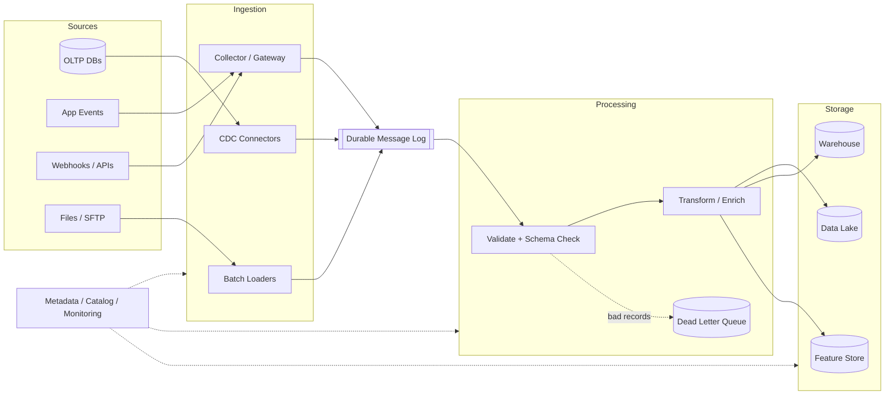

Every box is the answer to a failure we've already seen:

- **Durable message log** → fixes "server fell over and data vanished"
- **Validate + schema check** → fixes the silent `city` breakage
- **DLQ** → fixes "one bad record shouldn't block everything"
- **Raw plus curated storage** → fixes "can't recompute"
- **Metadata and monitoring** → fixes "nobody trusts the data"

---

## How to say this in an interview

> *"Before designing, let me pin down requirements. Functionally, we need to ingest from databases, event streams, files and APIs, validate and transform, and deliver to a lake, warehouse and feature store, with schema management and replay. Non-functionally, durability comes first, then correctness, availability, and tiered freshness from seconds to hours. At 100M DAU with ~50 events each, that's ~5B events/day, ~58K/s average and ~200K/s at peak, and across all sources ~7 TB/day raw, or ~1.3 PB/year after compression. That tells me I need a horizontally partitioned durable buffer, object storage with columnar formats, and multiple ingestion patterns."*

---

## Key terms from this chapter

- **Functional vs non-functional requirements:** what the system does vs how well it does it.
- **SLA / SLO:** an agreed (or target) level of freshness, availability and so on.
- **Peak factor:** the multiplier between average and worst-case load.
- **Retention:** how long data is kept in a given tier.
- **Replication factor:** the number of copies of the data (RF=3 means three copies).
- **Tiered storage:** hot, warm and cold storage, trading access speed for cost.
- **Effectively-once:** duplicates may occur internally, but results behave as if each event were processed once.

---

## Checkpoint

Try answering these before we move on:

1. Why do we rank **durability above freshness** for an ingestion platform?
2. Walk through the math: how do you get from 100M users to ~200K events/sec at peak?
3. Why do we **classify data into freshness tiers** instead of making everything real-time?
4. Name two numbers from the estimation and the design decision each one forces.
5. Name three clarifying questions you'd ask in the first five minutes.

If anything is fuzzy, tell me which part and I'll re-explain it with a different example. When you're ready, say **"Understood, next"** and we'll go to **Chapter 3: Decoupling with a durable message log (Kafka)**, where our team's first real design attempt appears: they try a direct write to the warehouse, it fails in spectacular ways, they try a simple queue, hit its limits, and discover why a *distributed log* is the answer.


-----------------------------------------------------------------------------------------------------------------------
-----------------------------------------------------------------------------------------------------------------------
-----------------------------------------------------------------------------------------------------------------------
-----------------------------------------------------------------------------------------------------------------------


# Chapter 3: Decoupling with a durable message log

## The story: three attempts to build the "front door"

In Chapter 2 we decided the platform needs a durable buffer between sources and everything downstream. The team now has to build it. They don't get it right the first time, and each failed attempt teaches something an interviewer wants you to know.

---

## Attempt 1: Write directly to the warehouse

The simplest idea is that every source writes straight into the warehouse through an ingestion API.

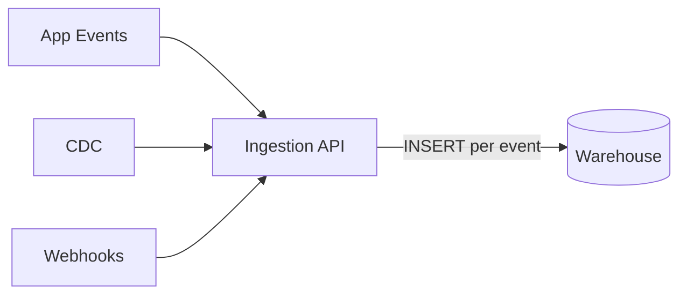

### What goes wrong

**Problem 1: Warehouses hate tiny writes.**
Analytical warehouses (Redshift, BigQuery, Snowflake) are built for **bulk loads**, not 200,000 single-row `INSERT`s per second. Each insert creates tiny files or segments, performance collapses, and the bill explodes.

**Problem 2: The warehouse goes down, so ingestion goes down.**
Say the warehouse is in maintenance for 2 hours. The API can't write, so it either rejects data (**data loss**, because the mobile app won't retry forever) or holds it in memory (**crash**). Our ingestion availability is now capped by our *least* reliable downstream system.

**Problem 3: Spikes pass straight through.**
A flash sale triples traffic and the warehouse feels it immediately. There is nothing to absorb the burst.

**Problem 4: One destination only.**
The ML team now wants the same events in a feature store. Do we write twice? What if the second write fails after the first succeeds? We're back to the N × M tangle of Chapter 1.

> **Lesson:** Producers and consumers need to be separated **in time** (they don't run at the same moment) and **in space** (they don't know about each other). We need something in the middle that **accepts data fast, stores it safely, and lets consumers take it at their own pace.**

---

## Attempt 2: A traditional message queue

The team adds a message queue (think RabbitMQ, ActiveMQ or SQS). Producers put messages in, consumers take messages out.

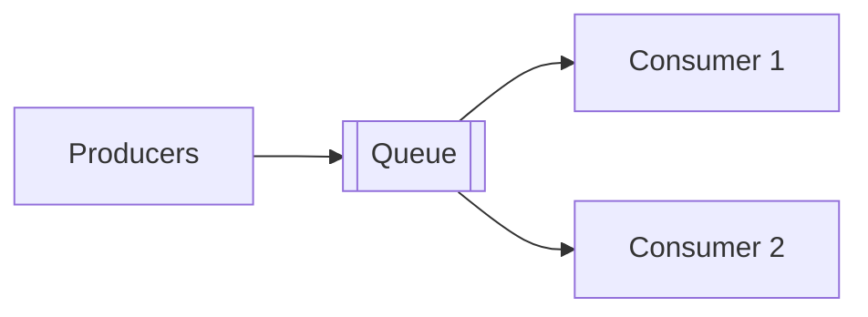

**How a classic queue works:** a message is delivered to *one* consumer, and once that consumer **acknowledges** it, the message is **deleted**.

This fixes Attempts 1's biggest problems. Producers get fast acknowledgements, spikes are absorbed, and the warehouse can be down while messages wait. Everyone celebrates for about three weeks. Then the new problems appear.

### What goes wrong

**Problem 1: Multiple consumers can't each get the data.**
The warehouse loader consumes a message and it's **deleted**. The ML feature pipeline and the fraud detector never see it. To give each consumer a copy, you create one queue per consumer and **duplicate every message into each**. Producers or brokers now have to know all the consumers, and the coupling is back.

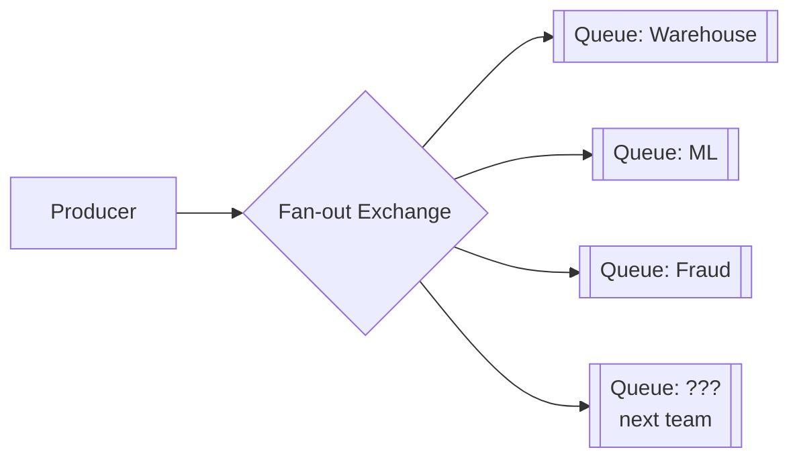

Every new consumer means a new queue, and storage is multiplied for each.

**Problem 2: No replay.**
Three months later the data science team finds a bug and needs to reprocess last year's events. The messages were deleted on acknowledgement, so they are **gone**. This is Pain 5 from Chapter 1 again.

**Problem 3: A slow consumer causes a mess.**
If a consumer falls behind, the queue grows. Classic brokers keep queue state in memory and on disk with per-message bookkeeping (who got what, who acked what). At hundreds of millions of messages, the broker itself slows down. The queue was designed to be **nearly empty**, not to hold terabytes.

**Problem 4: Throughput ceiling and no real ordering at scale.**
A single queue lives on a single node. To scale you create multiple queues, but then you lose any global ordering, and per-entity ordering (all events of order #123 in sequence) is hard to guarantee when competing consumers race each other.

**Problem 5: Per-message bookkeeping is expensive.**
Tracking the individual delivery state of 200K messages/sec is heavy work for the broker.

> **Lesson:** A queue is about **tasks to be done** (process this, then it's finished). What we need is a **record of things that happened** (events) that many independent readers can read, re-read and catch up on.

---

## Attempt 3: The distributed commit log (Kafka)

Engineers at LinkedIn faced exactly this problem around 2010. They had many data sources and many consumers and nothing that scaled. They built **Apache Kafka** on a deceptively simple idea:

> **What if we don't delete messages on consumption? What if we just append everything to a log and let each consumer remember its own position?**

### The core mental model: an append-only log

A **log** is just an ordered sequence of records, where new ones are added **only at the end**. Each record gets a sequential number called its **offset**.

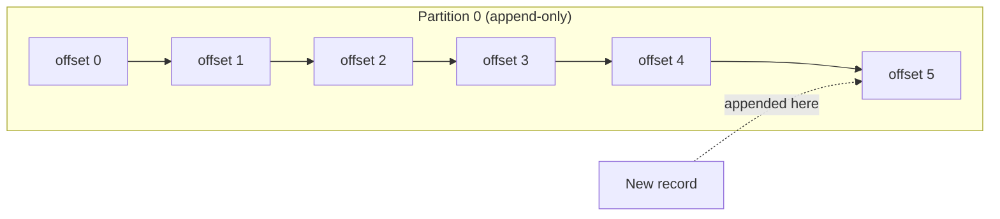

Reading doesn't remove anything. Each consumer simply keeps a **bookmark** (its offset):

- The warehouse loader is at offset 5.
- The fraud detector is at offset 3 and is a bit slow.
- The ML pipeline just started and is at offset 0.

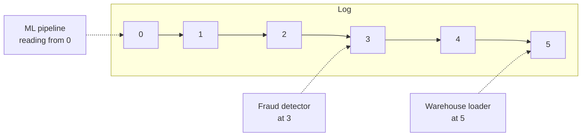

**This one change fixes almost everything from Attempt 2:**

| Problem with queue | How the log fixes it |
|---|---|
| Message deleted after one consumer | Messages stay for a **retention period** (e.g., 7 days) regardless of consumption |
| Can't add consumers cheaply | A new consumer just picks an offset and reads. **No extra copy** of the data |
| No replay | **Reset the offset** to the past and re-read |
| Broker tracks per-message state | The broker tracks **nothing per message**. Consumers store a single number (the offset) |
| Slow consumers hurt the broker | A slow consumer just has a lower offset. The broker doesn't care |

**Consumer lag** is a key metric here: `lag = latest offset − consumer's offset`. If lag keeps growing, the consumer can't keep up, and this is the number to alert on.

---

## Scaling the log: topics and partitions

One log on one machine can't handle 260K msgs/s and 140 TB (the numbers from Chapter 2). So we **split the log into pieces.**

- A **topic** is a named stream of a certain kind of data, such as `clickstream.events`, `orders.cdc`, `payments.events`.
- Each topic is divided into **partitions**. Each partition is its own independent, ordered, append-only log.
- Different partitions live on **different brokers** (servers), so the load is spread out.

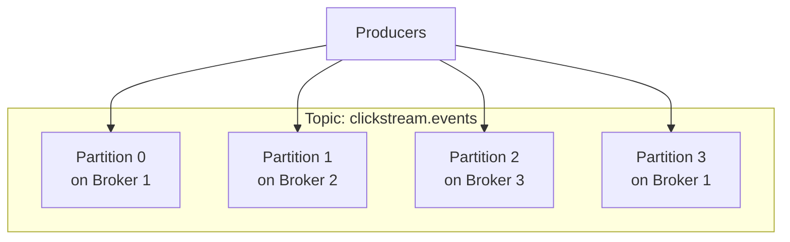

### Which partition does a record go to?

The producer picks a partition using the record's **key**:

```
partition = hash(key) % number_of_partitions
```

- **With a key** (say `user_id`), all events for the same user land in the **same partition**, so they stay in order.
- **Without a key**, records are spread round-robin (or in sticky batches) for even load, but there is no per-entity ordering.

> **Example:** For `orders.cdc`, key = `order_id`. Then `created → paid → shipped` for order #123 are guaranteed to be read in that order, because they sit in the same partition.

### The critical ordering rule (frequently asked)

> **Kafka guarantees ordering only *within a partition*, not across partitions.**

So if you need ordering for an entity, **choose the key as that entity's ID.** If you need *global* ordering across everything, you'd have to use one partition, which kills parallelism. That trade-off is the one to articulate in an interview.

### How many partitions do we need? (Using our numbers)

Rough rule: one partition comfortably handles around **10 MB/s** of writes (this varies with hardware and message size).

- Clickstream peak ≈ 200 MB/s → 200 ÷ 10 = **~20 partitions minimum**
- But partitions also set **consumer parallelism** (explained below), and we want headroom for growth and for hot keys. So we pick something like **100-200 partitions** for the clickstream topic.
- Too many partitions has costs too: more open files, slower leader elections, more memory, longer recovery. So we don't go to 10,000 "just in case."

> **Important:** You can *increase* partitions later, but doing so changes `hash(key) % N`, so the same key may map to a different partition from then on and **per-key ordering breaks across the boundary**. That's why you size generously up front.

---

## Consumers: consumer groups

Now the parallelism question. 200K msgs/sec is too much for one consumer process. We need **many instances of the same consumer working together.**

A **consumer group** is a set of consumer instances that share a job. Kafka assigns **each partition to exactly one consumer within the group**.

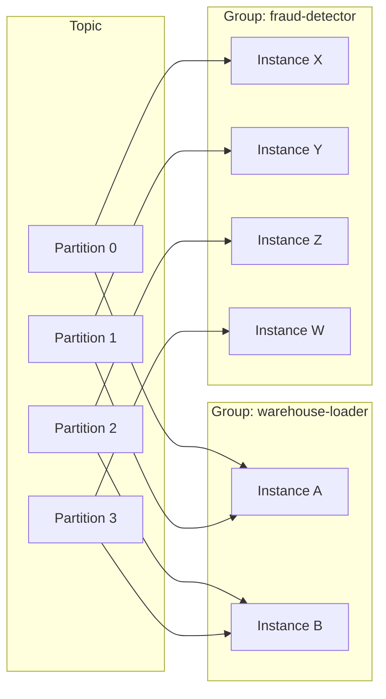

Three rules to remember:

1. **Within a group:** each partition is read by **one** instance (this gives load-sharing and preserves per-partition order).
2. **Across groups:** each group independently reads **all** the data (this gives pub/sub fan-out, and every team gets its own full copy of the stream with no extra storage).
3. **Max parallelism per group = number of partitions.** With 100 partitions, 100 instances can work in parallel, and a 101st instance would sit idle.

This is how the log gets both behaviors: **queue-like** load balancing inside a group, and **pub/sub-like** broadcasting between groups.

**Rebalancing:** if an instance dies or a new one joins, Kafka **reassigns partitions** among the group. During a rebalance, consumption can briefly pause. Modern setups use incremental/cooperative rebalancing to minimize that.

### How a consumer tracks progress: committing offsets

A consumer periodically **commits** its offset ("I've processed up to here"), stored in Kafka itself. If it crashes and restarts, it resumes from the last committed offset.

The timing of the commit decides your delivery guarantee (we cover this fully in Chapter 10, but here's the taste):

- **Commit before processing** → if it crashes mid-processing, the record is **lost** (at-most-once).
- **Commit after processing** → if it crashes after processing but before committing, the record is **processed twice** (at-least-once).

---

## Why is Kafka so fast? (A favorite follow-up question)

It seems odd that writing everything to **disk** could handle hundreds of MB/s. The reasons:

1. **Sequential I/O.** Appending to the end of a file is vastly faster than random disk access, and even spinning disks do hundreds of MB/s sequentially.
2. **OS page cache.** Recent data is served from RAM by the operating system without Kafka managing its own cache.
3. **Zero-copy.** Data goes from disk/page cache to the network socket without being copied through the application's memory (the `sendfile` system call).
4. **Batching and compression.** Producers batch many records into one request and compress the batch (e.g., LZ4, Zstd), cutting network and disk usage.
5. **Dumb broker, smart client.** The broker doesn't track per-message state. Consumers pull at their own pace and store their own offsets.

---

## Producer-side details that matter

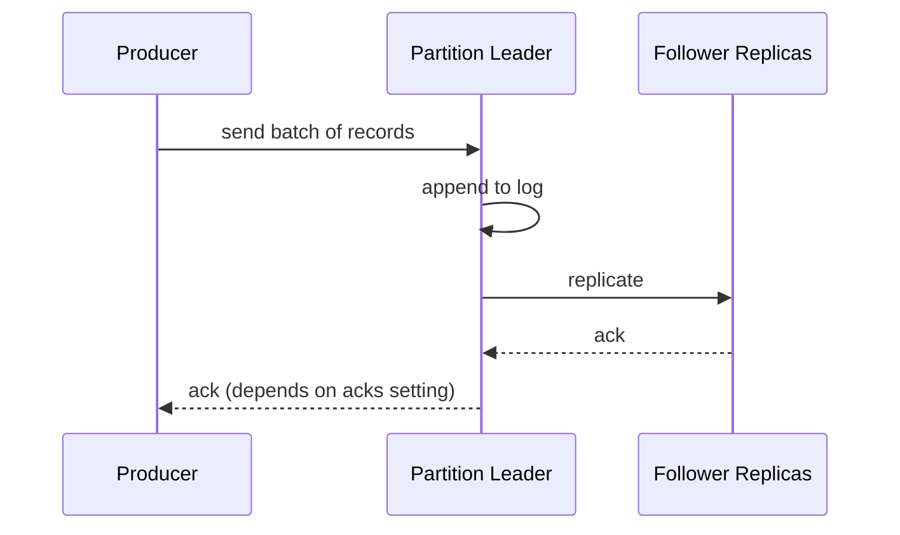

The `acks` setting is a **durability vs latency** dial. We preview it here and cover replication in depth in Chapter 9:

| `acks` | Meaning | Risk |
|---|---|---|
| `0` | Don't wait for any ack | Fastest, but data can be lost silently |
| `1` | Wait for the partition leader only | If the leader dies before replicating, data is lost |
| `all` | Wait for all in-sync replicas | Slowest, but safest. **This is what we use for payments and orders** |

Since durability is our top priority (Chapter 2), our default is `acks=all` with replication factor 3. For low-value, high-volume data such as raw UI hover events, a team might accept `acks=1` for speed. This is a good example of **tiering by data importance**.

Other producer features: **batching** (`linger.ms`, batch size) trades a few milliseconds of latency for much higher throughput, and **idempotent producers** prevent duplicates caused by producer retries (more in Chapter 10).

---

## Retention and compaction

How long does the log keep data?

- **Time-based:** keep 7 days.
- **Size-based:** keep up to X TB per partition.
- **Log compaction:** for "latest state per key" topics (like a `user_profile` changelog), keep only the **most recent record for each key** and discard older ones. This is great for rebuilding the current state of a table.

Remember that Kafka is our **buffer and replay window (days)**, *not* our permanent archive. The long-term raw copy goes into the data lake (Chapter 7), and that is how we can still backfill after the 7 days are up.

---

## Putting it together: where the log sits in our platform

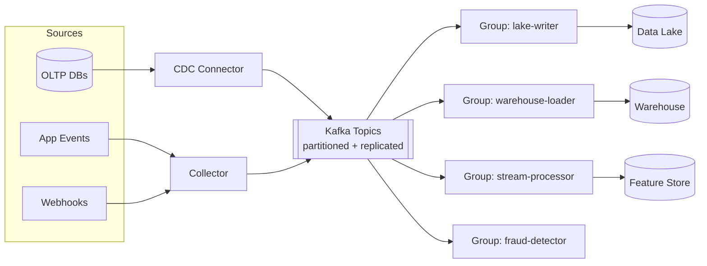

Compare this with Chapter 1's tangle:

- **N + M** instead of N × M
- A warehouse outage means consumers lag but **nothing is lost**, and they catch up later
- Adding a consumer costs **no extra storage** and no change to producers
- Replay is one offset reset away

---

## Trade-offs and "when would you NOT use it?"

Interviewers love honest trade-offs:

| Strength | Cost |
|---|---|
| High throughput, durable, replayable | Operational complexity (a cluster to run, monitor and upgrade) |
| Many independent consumers | Ordering only per partition |
| Cheap fan-out | Partition count is hard to change safely |
| Decouples teams | Not ideal for per-message routing, priorities or delayed delivery (a classic queue is better for task queues with complex routing) |

> **Alternatives to name:** Amazon Kinesis, Google Pub/Sub, Azure Event Hubs, Apache Pulsar, Redpanda. Managed services trade control for less operational burden. The concepts you've learned transfer directly.

---

## How to say this in an interview

> *"I'd put a durable, partitioned, replicated log like Kafka between producers and consumers. Writing directly to the warehouse couples availability and can't handle tiny writes, and a traditional queue deletes messages on consumption, so it can't support multiple independent consumers or replay. With a log, records are appended and retained for a window, each consumer group tracks its own offset, so we get cheap fan-out, backpressure tolerance and replay. Topics are split into partitions for throughput, keyed by entity ID so per-entity ordering holds, and consumer groups scale up to the partition count. I'd use `acks=all` with replication factor 3 for critical topics."*

---

## Key terms from this chapter

- **Topic / Partition:** a named stream / one ordered shard of it.
- **Offset:** the sequence number of a record within a partition.
- **Consumer group:** instances sharing a job, with one consumer per partition.
- **Consumer lag:** how far behind the consumer is from the log's latest offset.
- **Retention:** how long records stay in the log.
- **Log compaction:** keep only the latest record per key.
- **Rebalance:** reassigning partitions when group membership changes.
- **`acks`:** the producer's durability setting.

---

## Checkpoint

1. Why can't we write straight from sources to the warehouse? Give at least two reasons.
2. What does a log do differently from a queue that enables **replay** and **multiple consumers**?
3. If you need all events of one customer processed in order, what do you choose as the key, and why does it work?
4. Your topic has 12 partitions. How many consumer instances in one group can usefully run? What happens with 15?
5. What happens to `hash(key) % N` ordering if you later change N from 12 to 24?
6. Explain two reasons sequential disk writes make Kafka fast.

Tell me which of these feels shaky and I'll go deeper with another example. When you're ready, say **"Understood, next"** and we'll move to **Chapter 4: Ingestion patterns**, where the team discovers that *getting data into the log* is a different problem for each kind of source: why querying the database every night breaks, how CDC reads the database's own transaction log, how to handle files, webhooks and rate-limited APIs, and push vs pull.


-----------------------------------------------------------------------------------------------------------------------
-----------------------------------------------------------------------------------------------------------------------
-----------------------------------------------------------------------------------------------------------------------
-----------------------------------------------------------------------------------------------------------------------


# Chapter 4: Ingestion patterns

## The story: "The log exists. Now how do we fill it?"

In Chapter 3 the team built a durable, partitioned log. Everyone assumed the hard part was over. Then the first onboarding meeting went like this:

- **Orders team:** "Our data is in Postgres. How do you get it?"
- **Marketing:** "We get CSVs from an ad agency by SFTP, and Google Ads has an API."
- **Payments:** "Stripe sends us webhooks."
- **Mobile team:** "Our app emits events from phones that are often offline."

The team realizes that **getting data into the log is a different problem for each kind of source**. We'll walk through each source type the way the team did: the obvious approach, why it broke, and what replaced it.

---

## Part 1: Databases (the hardest and most important)

### Attempt 1: Full snapshot ("dump the whole table every night")

```sql
SELECT * FROM orders;   -- every night at 2 AM
```

Simple and correct, and it works great for a 50,000-row table. But `orders` now has **2 billion rows**.

| Problem | Why it hurts |
|---|---|
| Huge load on the production DB | A multi-hour scan fights with checkout traffic (Pain 2 from Chapter 1) |
| Wasteful | 99.9% of the rows didn't change since yesterday |
| Slow freshness | Data is at best 24 hours old |
| Takes longer as data grows | Eventually the 2 AM job doesn't finish before 9 AM |

**Where it still makes sense:** small reference tables (countries, currencies, product categories) with a few thousand rows. Don't over-engineer those.

### Attempt 2: Incremental polling with `updated_at`

"Only fetch what changed" gives the idea:

```sql
SELECT * FROM orders WHERE updated_at > :last_watermark;
```

We save the highest `updated_at` seen (the **watermark**) and use it next time. Much lighter. Then reality bites:

**Problem 1: Deletes are invisible.**
A deleted row doesn't appear in `WHERE updated_at > ...`. It's just *gone*, so the warehouse keeps showing a cancelled, deleted order forever. (Workarounds like soft-deletes need every application team to cooperate.)

**Problem 2: Not every table has a reliable `updated_at`.**
Some developers forget it, and some bulk-update scripts bypass it (`UPDATE ... ` run directly in SQL without touching the column).

**Problem 3: The in-flight transaction trap.**
Imagine:

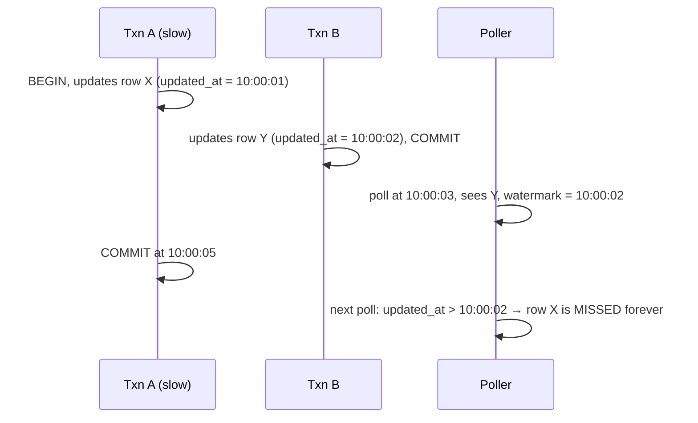

Row X's timestamp (10:00:01) is *older* than our watermark, but it only became visible *after* we moved the watermark. **We silently lose data.** (Common mitigation: re-read an overlap window, e.g., watermark minus 5 minutes, and deduplicate. It's a patch, not a cure.)

**Problem 4: Intermediate states are lost.**
If an order goes `created → paid → shipped` between two polls, we only see `shipped`. For analytics like "how long do orders sit in `paid`?", the history is **gone**.

**Problem 5: Still queries the production DB** on a schedule, and the more often you poll, the more load.

> **Lesson:** Querying a database to infer changes is fundamentally lossy. But the database *already* records every change precisely for its own purposes. Can we read that?

### Attempt 3 (the winner): Change Data Capture (CDC)

Every serious database writes every committed change to an internal, ordered log **before** applying it, so it can recover from crashes and feed its own replicas:

| Database | Its internal log |
|---|---|
| PostgreSQL | WAL (write-ahead log), read through *logical decoding* |
| MySQL | binlog |
| MongoDB | oplog / change streams |
| SQL Server / Oracle | transaction log / redo log |

**Log-based CDC** means a connector (e.g., **Debezium**) *pretends to be a replica*, reads this log, and converts every change into an event that goes into Kafka.

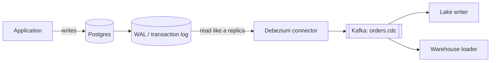

A typical CDC event looks like:

```json
{
  "op": "u",                       // c=create, u=update, d=delete, r=snapshot read
  "ts_ms": 1761554100123,
  "source": {"db":"shop","table":"orders","lsn": 88231904, "txId": 5521},
  "before": {"order_id": 123, "status": "paid",    "amount": 499},
  "after":  {"order_id": 123, "status": "shipped", "amount": 499}
}
```

Notice what CDC gives us compared with polling:

| Concern | Polling | Log-based CDC |
|---|---|---|
| Deletes | Missed | Captured (`op: "d"`) |
| Intermediate states | Lost | Every change captured |
| Load on production | Repeated queries | Light, just reads the log the DB already writes |
| Latency | Poll interval | Sub-second to seconds |
| Needs `updated_at`? | Yes | No |
| Ordering | Approximate | Exact commit order (LSN/binlog position) |
| Before and after values | No | Yes |

### CDC in practice: the details interviewers probe

**1. Initial snapshot, then streaming.**
A new connector can't just read the log, because the log only holds recent changes and the table already has 2 billion rows. So the connector does:

1. Take a **consistent snapshot** of the existing table and emit it as `op: "r"` events.
2. Record the log position at the start of the snapshot.
3. Switch to **streaming from that position**, so nothing falls in the gap.

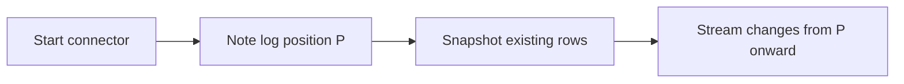

**2. Key and partitioning.**
Use the **primary key** as the Kafka message key, so all changes to one row go to one partition and stay in order (Chapter 3's rule applied).

**3. Replication slot risk (a classic production incident).**
In Postgres, the database **keeps WAL files until the CDC consumer has read them**. If the connector is down for a day, WAL piles up and can **fill the production disk and crash the database**. So you must alert on slot lag and set limits. This is a very good "war story" to mention.

**4. Schema changes.**
When someone does `ALTER TABLE orders ADD COLUMN coupon_code`, the connector must notice and publish the new schema. We'll fully solve this with a schema registry in Chapter 5.

**5. Transactions.**
One DB transaction can touch several tables. CDC events carry a transaction ID so consumers can group them if atomicity matters.

**6. Delete semantics downstream.**
A `d` event must become a **tombstone or soft-delete marker** in the lake/warehouse, otherwise deleted rows live forever.

### Variation: the Transactional Outbox pattern

Sometimes the source team owns a *service*, not just a database, and doesn't want consumers coupled to its internal table structure. (If you rename a column, every CDC consumer breaks again!)

**Outbox pattern:** the service writes its business change **and** a well-defined "event" row into an `outbox` table **in the same DB transaction**. CDC then ships *only the outbox table*.

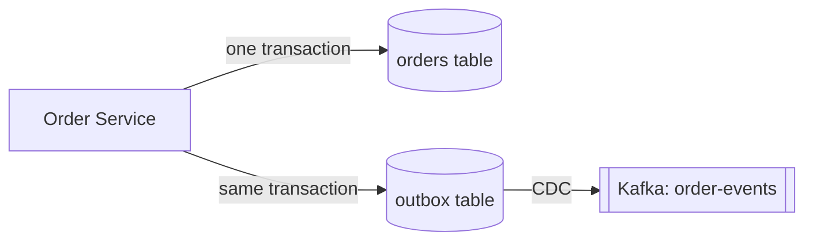

This gives atomicity (no "DB updated but event lost") and a **stable, intentional event contract** instead of leaking table internals. Mention it as the answer to "what if the source team doesn't want raw table changes exposed?"

---

## Part 2: Application events (clickstream)

These are not rows in a database. They're events produced by mobile apps and websites. At 200K events/sec peak, the app **cannot** talk directly to Kafka (millions of devices, untrusted networks, no auth control). We need a front door.

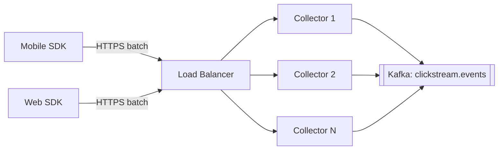

**The collector (gateway) is deliberately thin and stateless.** It does only:

- **Authenticate** (API key or token per app)
- **Light validation** (is it valid JSON? is it too large? is the required envelope present?)
- **Enrich** (server receive time, IP-derived geo, assigning an ID if missing)
- **Produce to Kafka** with `acks=all`, and only then return 200

Because it's stateless, scaling is easy: add more instances behind the load balancer. And because it writes to a durable log immediately, **the app gets a fast ack** and downstream slowness never reaches the user's phone.

**Key design points:**

1. **Client-side batching.** The SDK buffers events and sends, say, 20 at a time or every 30 seconds. This saves battery and cuts request counts by an order of magnitude.
2. **Offline mode.** A phone in a tunnel stores events locally and sends them later. So events arrive **late and out of order**. This is where **event time vs processing time** comes from. Every event must carry its own `event_time` (when it happened on the device) and the collector adds `received_time`. We deal with late data in Chapter 6.
3. **Duplicates are normal.** If the phone sends a batch and the response times out, the SDK **retries**, and the batch arrives twice. So every event carries a unique **`event_id`** (UUID) assigned **at creation**, which lets us deduplicate later (Chapter 10).
4. **Clock skew.** Phone clocks are wrong (sometimes by years). Store both timestamps, and compute a correction from the difference between the device's send time and the server's receive time.
5. **Backpressure and load shedding.** If the platform is overloaded, the collector can return `429`/`503` with a `Retry-After` header so SDKs back off with jitter. For truly low-value events, **sampling** may be acceptable (a business decision).
6. **Bot and abuse protection.** Rate limiting per API key/IP prevents a buggy client from flooding the pipeline. (This is where CDN and edge layers can help, and we'll revisit it in Chapter 12.)

---

## Part 3: Webhooks (third parties pushing to us)

Stripe, Razorpay, Shopify and others send HTTP `POST` requests to a URL we expose when something happens.

**Naive approach:** receive the webhook, parse it, write to the warehouse, then respond `200`.

**What goes wrong:** if our processing takes 20 seconds, the provider times out and **retries**, so now we process it twice. Or our DB is down and we return `500`, so the provider retries a few times and then **gives up**, and the payment event is lost.

**The robust pattern: "acknowledge fast, process later."**

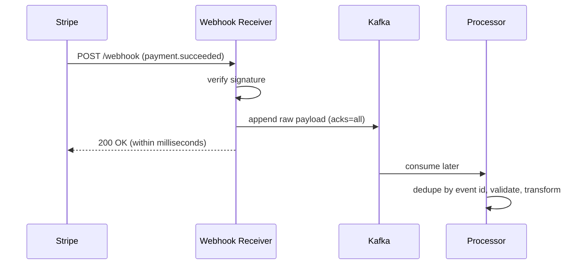

Checklist for webhook receivers:

- **Verify the signature** (HMAC with a shared secret) so attackers can't forge "payment succeeded" events.
- **Persist first, respond second.** Return `200` only once the payload is safely in the log.
- **Idempotency.** Providers retry, so dedupe on the provider's event ID.
- **Out-of-order delivery.** `refund.created` can arrive before `payment.succeeded`. Use the provider's timestamps or sequence numbers, or re-fetch the object's current state from the API.
- **Reconciliation.** Webhooks can still be missed. A periodic job that **pulls from the provider's API** and compares totals fills the gaps. (Push for speed, pull for completeness.)

---

## Part 4: Files (partner CSVs, SFTP drops, exports)

Files seem easy but are full of traps.

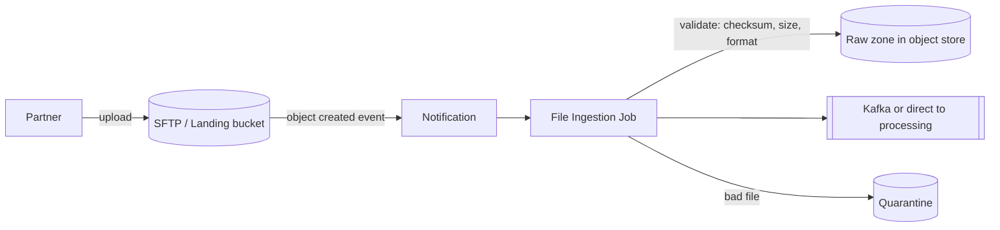

Problems and fixes:

| Problem | Example | Solution |
|---|---|---|
| **Partial files** | We read the CSV while the partner is still uploading it | Have the partner upload to `.tmp` and rename when done, or send a **manifest/`_SUCCESS` marker** or checksum last. Only process after the marker appears |
| **Duplicate delivery** | The partner re-sends yesterday's file | Track processed files (name + checksum) in a **ledger** |
| **Late or missing files** | "Where's today's file?" | Expected-arrival SLAs plus an alert if the file isn't there by 6 AM |
| **Bad formats** | Encoding is Latin-1 not UTF-8, a delimiter is inside a quoted field, dates are `27/10/26` vs `10/27/26` | Validate against an expected schema, and **quarantine** failed files for review without blocking others |
| **Huge files** | A single 50 GB file | Split into chunks and process in parallel, ideally in a splittable format |
| **Event-driven vs scheduled** | Polling the bucket every minute | Use storage **event notifications** (e.g., object-created events) to trigger processing |

The first thing we do is **save an untouched copy in the raw zone**. If our parsing logic has a bug, we can reprocess the original later.

---

## Part 5: Third-party APIs (we have to pull)

Google Ads, Facebook Ads, Salesforce and similar services don't push. We call them.

The difficulties are almost all about *someone else's limits*:

- **Rate limits and quotas.** Exceed them and we're throttled or blocked. Use a **token-bucket limiter** per API credential, and respect `Retry-After`.
- **Pagination.** Use **cursor-based** pagination where possible (offset-based can skip or repeat records when data changes mid-crawl).
- **Incremental sync.** Remember a **cursor or watermark** per source and fetch only newer data. Persist it **only after the data is durably stored**, otherwise a crash can lose a window.
- **Flaky responses.** Retries with **exponential backoff plus jitter** (we go deeper in Chapter 11).
- **Data that changes retroactively.** Ad platforms revise yesterday's spend numbers for days. So re-pull a trailing window (for example the last 7 days) and **upsert**.
- **Schema drift.** The vendor adds fields without warning.

---

## Part 6: Push vs pull, and who is responsible?

```mermaid
flowchart LR
    subgraph PUSH ["Push: source sends to us"]
        A1[App SDK] --> A2[Our Collector]
        B1[Stripe] --> B2[Our Webhook endpoint]
    end
    subgraph PULL ["Pull: we fetch from source"]
        C1[Our Connector] --> C2[(Postgres log)]
        D1[Our Scheduler] --> D2[Google Ads API]
        E1[Our Loader] --> E2[(SFTP)]
    end
```

| | Push | Pull |
|---|---|---|
| Who controls pace | The source | Us |
| Latency | Lower (event-driven) | Depends on the poll interval |
| Risk | We can be overwhelmed. We must be always-on and protect ourselves | We can overload the source. We must be gentle |
| Failure handling | The source must retry, and may give up | We retry from our saved position |
| Best for | Events, webhooks | Databases, APIs, files |

---

## Part 7: One framework, many connectors

If each of these source types is a separate custom program, we're back to Chapter 1's mess. The team's insight is to define a **standard connector framework** (e.g., **Kafka Connect**, Airbyte or Fivetran-style connectors):

```mermaid
flowchart LR
    CFG["Connector config<br/>(YAML/JSON, in Git)"] --> FW[Connector Framework / Runtime]
    FW --> SRC1[Postgres CDC connector]
    FW --> SRC2[S3/SFTP connector]
    FW --> SRC3[REST API connector]
    FW --> SINK[Kafka]
    FW --> OFF[(Offsets, status, retry state)]
```

The framework handles the shared concerns **once**: offset/position storage, retries, scaling out workers, monitoring, secrets management and schema registration. Onboarding a new source becomes writing a **config file**, which is functional requirement F8 (self-service onboarding) from Chapter 2.

---

## Part 8: Choosing the pattern, a decision table

| Source | Best pattern | Typical freshness | Biggest risk to mention |
|---|---|---|---|
| Large OLTP database | Log-based CDC (+ initial snapshot) | Seconds | Replication slot or log growth, schema changes |
| Small reference table | Periodic full snapshot | Hours/daily | None, keep it simple |
| Service with a stable event contract | Outbox + CDC | Seconds | Extra table and discipline from the team |
| Mobile/web events | SDK → collector → Kafka | Seconds | Duplicates, late data, bots |
| Third-party webhooks | Receive → persist → ack → process | Seconds | Forged requests, retries, out-of-order |
| Partner files | Landing zone + manifest + ledger | Hours | Partial or duplicate files, late arrival |
| SaaS APIs | Scheduled incremental pull with cursor | Minutes-hours | Rate limits, retroactive changes |

---

## How to say this in an interview

> *"Different sources need different ingestion patterns. For OLTP databases I'd use log-based CDC like Debezium: it reads the WAL or binlog, captures deletes and every intermediate state, adds minimal load on production, and gives commit-ordered events. It starts with a consistent snapshot, then streams, keyed by primary key. Polling on `updated_at` misses deletes and can lose in-flight transactions. For app events I'd have a stateless collector behind a load balancer that authenticates, lightly validates, and writes to Kafka before acking, with client-side batching, an `event_id` for dedup, and both event time and receive time. For webhooks, verify the signature, persist, then ack, and reconcile through the provider's API. Files go through a landing zone with manifests and a processed-file ledger, and APIs are pulled incrementally with rate limiting and a trailing re-pull window. All of it runs on a common connector framework so onboarding is configuration."*

---

## Key terms from this chapter

- **CDC (Change Data Capture):** reading the DB's transaction log to stream every change.
- **WAL / binlog / oplog:** the DB's internal ordered change log.
- **Watermark:** the saved position/timestamp marking how far we've ingested.
- **Initial snapshot:** the one-time consistent copy before streaming begins.
- **Tombstone:** a marker meaning "this key was deleted".
- **Outbox pattern:** writing business data and an event row in one transaction, then shipping the event table via CDC.
- **Event time vs processing time:** when something happened vs when we saw it.
- **Idempotency key / `event_id`:** a unique ID for safely detecting repeats.
- **Landing zone / quarantine:** where raw files arrive and where bad files wait for review.

---

## Checkpoint

1. Give three concrete reasons `updated_at` polling is unreliable, and say how CDC avoids each.
2. Explain the "in-flight transaction" trap in your own words.
3. Why does CDC need an initial snapshot, and how does it avoid a gap between the snapshot and streaming?
4. A Postgres replication slot's consumer is down for 24 hours. What can happen to the production database, and what would you do to prevent it?
5. Why must a webhook receiver persist the payload *before* returning `200`?
6. A phone sends the same batch twice because of a timeout. What two things in our design handle that?
7. When would you deliberately choose a plain full snapshot over CDC?

Take your time, and tell me what's unclear. When you're ready, say **"Understood, next"** and we'll go to **Chapter 5: Validation, schema registry and schema evolution**. That's where the team finally fixes the "city got renamed and the dashboard silently showed zeros" disaster from Chapter 1, with data contracts, Avro/Protobuf schemas, compatibility rules (backward, forward, full), and what to do with the records that fail validation.


-----------------------------------------------------------------------------------------------------------------------
-----------------------------------------------------------------------------------------------------------------------
-----------------------------------------------------------------------------------------------------------------------
-----------------------------------------------------------------------------------------------------------------------


# Chapter 5: Validation, schema registry and schema evolution

## The story: the day the dashboard showed zero

Remember the disaster from Chapter 1? A backend developer renamed `user_city` to `city`. Script #7 crashed, but script #12 silently wrote NULLs, and for three days the CEO's dashboard showed **zero revenue for Hyderabad**.

By Chapter 4 we have a log and good connectors, but the problem is still alive. Imagine the same rename today:

1. Debezium notices the column change and starts emitting events with `city` instead of `user_city`.
2. The events flow into Kafka happily. Kafka doesn't look inside messages.
3. Every consumer breaks, or worse, silently misbehaves.

**A fast, durable pipeline just delivers bad data faster.** So the team asks: *how do we guarantee that what's in the pipeline is what consumers expect, and what happens when it isn't?*

---

## Part 1: What can actually go wrong with data?

Before choosing tools, classify the failures. Interviewers love a structured answer here.

| Category | Example | Detected by |
|---|---|---|
| **Structural** | The JSON is malformed. Field `amount` is a string `"abc"` instead of a number. A required field is missing | Schema validation |
| **Field-level (semantic)** | `age = -5`, `email` has no `@`, `country = "Indai"`, timestamp in the year 2099 | Rules per field (range, regex, enum) |
| **Cross-field / business** | `shipped_at < created_at`; `discount > price`; `status = refunded` but there was never a payment | Business rules |
| **Referential** | An order references `user_id = 9999` that doesn't exist | Lookups against reference data |
| **Duplicates** | The same event delivered twice | Dedup by key (Chapter 10) |
| **Volume / freshness anomalies** | The orders feed normally delivers 2M rows/hour and today delivers 12 | Statistical monitors |
| **Schema drift** | A column renamed, a type changed, a field removed | Schema registry and compatibility checks |

Each category is caught best at a **different layer**, which is the key idea of this chapter.

---

## Part 2: The team's attempts

### Attempt 1: "Validate at the end, in the warehouse"

Load everything, then run SQL checks (`SELECT COUNT(*) WHERE amount < 0`) once the data has landed.

**Why it fails:**
- By the time we find the problem, the bad data has already been **copied to many places** (lake, features, search index) and may already have been **used in a dashboard or an ML training run**.
- It's the most **expensive** place to fix things. The later a defect is found, the more it costs to clean up.
- Nobody knows *who* introduced it or when.

### Attempt 2: "Schema-on-read, let every consumer deal with it"

Producers send flexible JSON. Each consumer parses what it needs.

```json
{"order_id": 123, "user_city": "Hyderabad", "amount": 499}
```

Flexible and quick, which is why people love it. But:

- **Every consumer writes its own defensive parsing.** Ten consumers means ten different interpretations of "what's valid".
- **Breakage is silent** (the NULL city) because JSON happily lets a field vanish.
- **JSON is verbose.** Field names repeat in every message, so at 7 TB/day we pay a lot for network, storage and CPU.
- Nobody knows what the data is *supposed* to look like. The "schema" lives in people's heads.

### Attempt 3: "Validate in every consumer"

Put validation libraries in each consumer. This is better, but you now maintain the rules in N places, they drift apart, and the bad record still sits in the log, so *every* consumer wastes time rejecting it.

> **Lesson:** Validation must be **centralized and shared**, and a **contract between producer and consumer** must exist **before** data flows. That's the idea of a **schema registry**.

---

## Part 3: Schemas and the Schema Registry

### What's a schema?

A formal description of a record's structure. Here is an example in **Avro**:

```json
{
  "type": "record",
  "name": "OrderCreated",
  "namespace": "com.shopkart.orders",
  "fields": [
    {"name": "order_id",   "type": "long"},
    {"name": "user_id",    "type": "long"},
    {"name": "city",       "type": "string"},
    {"name": "amount",     "type": "double"},
    {"name": "coupon",     "type": ["null", "string"], "default": null},
    {"name": "event_time", "type": {"type": "long", "logicalType": "timestamp-millis"}}
  ]
}
```

It tells everyone the field names, types, which are optional (`coupon` has a default) and what the timestamp means.

### Choosing a serialization format

| Format | Pros | Cons |
|---|---|---|
| **JSON** | Human-readable, universal | Big, slow, no enforced types, no built-in evolution rules |
| **Avro** | Compact binary, schema stored separately, **excellent evolution rules**, great with Kafka and Hadoop | Not human-readable, needs the schema to decode |
| **Protobuf** | Compact, fast, strong typing, great for RPC and cross-language, good evolution via field numbers | Slightly more tooling friction for data engineering |
| **JSON Schema** | Keeps JSON while adding validation | Still verbose |

For a data platform, **Avro** (or Protobuf) with a registry is the common answer. Typically it's 3-10× smaller than JSON, which matters at our scale.

### The Schema Registry

A **schema registry** is a small, central service that:

1. **Stores** every schema version, with an ID.
2. **Enforces compatibility rules** when a new version is registered.
3. Lets producers and consumers **look up** a schema by ID.

How a message looks on the wire: instead of embedding the whole schema in every message (wasteful), we put a tiny **schema ID** in front of the payload:

```
[ magic byte (1) ][ schema ID (4 bytes) ][ compact binary payload ... ]
```

```mermaid
sequenceDiagram
    participant P as Producer
    participant R as Schema Registry
    participant K as Kafka
    participant C as Consumer
    P->>R: register / fetch schema for topic "orders" (first time)
    R-->>P: schema ID = 42 (only if compatible)
    P->>K: [id=42][binary payload]
    C->>K: poll
    K-->>C: [id=42][binary payload]
    C->>R: fetch schema 42 (first time, then cached)
    R-->>C: schema
    C->>C: decode payload using schema 42
```

Important details:

- **Clients cache schemas locally**, so the registry is only hit on the first sight of a new ID. So the registry is not in the hot path per message, and a brief registry outage doesn't stop ingestion of known schemas. (Run it highly available anyway, typically 2-3 instances backed by a Kafka topic or DB.)
- **The producer can't publish data that doesn't match a registered schema.** Serialization fails *at the source*, so bad structure never enters the log. This is "**fail early, fail at the edge**".

---

## Part 4: Schema evolution (and the compatibility rules)

Schemas *must* change because the business changes. The art is changing them **without breaking anyone**. Think of it as a game of **who upgrades first**.

### The two directions

- **Backward compatible:** consumers using the **new** schema can read data written with the **old** schema. (A new reader can understand old data.)
- **Forward compatible:** consumers using the **old** schema can read data written with the **new** schema. (An old reader can tolerate new data.)
- **Full compatible:** both.

| Mode | What it guarantees | Who must upgrade first | Safe changes (Avro rules) |
|---|---|---|---|
| **BACKWARD** (the usual default) | New schema reads old data | **Consumers first**, then producers | Add field **with a default**, delete a field |
| **FORWARD** | Old schema reads new data | **Producers first**, then consumers | Add a field, delete a field **that had a default** |
| **FULL** | Both | **Any order** | Add or delete only fields **with defaults** |
| **\*_TRANSITIVE** variants | The same check against **all** previous versions, not only the latest | | Needed when you must be able to replay *old* data from the log or lake |
| **NONE** | No checks | Coordinate by hand (don't) | |

> **Why "transitive" matters for us:** we can replay 7 days of the log and read years of the lake. A new reader must understand data from *every* historic version, not just the previous one. For a long-lived platform, `FULL_TRANSITIVE` or `BACKWARD_TRANSITIVE` is common.

### Safe vs breaking changes: examples

| Change | Safe? | Why |
|---|---|---|
| Add `coupon` with default `null` | ✅ | Old data lacks it, so readers fill in the default. Old readers ignore it |
| Add a required field with no default | ❌ | Old data has no value, so the new reader has nothing to fill in |
| Remove a field that has a default | ✅ | Readers use the default |
| Remove a field that has no default | ⚠️ Breaks forward compatibility | Old readers expect it |
| Rename a field | ❌ | It looks like "delete + add", and a consumer expecting the old name sees nothing |
| Change `int` → `long` | ✅ (widening is allowed in Avro) | No precision lost |
| Change `string` → `int` | ❌ | Meaning changes |
| Change the **meaning** (amount from rupees to paise) | ❌❌ **Nothing in a schema detects it** | Needs contracts and communication |

That last row is subtle and a good one to mention. **A schema can validate structure but not semantics.** That's why data contracts exist (Part 5).

### Fixing the "city" disaster properly: the expand/contract pattern

How *should* the developer have renamed `user_city` to `city`?

```mermaid
flowchart LR
    A["Step 1 · EXPAND<br/>Add new field 'city' (default null).<br/>Keep 'user_city'. Producer writes BOTH."] --> B["Step 2 · MIGRATE<br/>Consumers switch to read 'city'."]
    B --> C["Step 3 · CONTRACT<br/>Once no one reads user_city<br/>(verified via lineage), remove it."]
```

Each step is a **compatible** change that the registry will accept, and every consumer keeps working throughout. The rename takes weeks instead of seconds, which is a good trade for not corrupting the CEO's dashboard.

And what if the developer *tried* the one-shot rename? **The registry rejects it** at registration time, and in our CI pipeline the build fails *before deploy*:

```mermaid
flowchart LR
    DEV[Developer changes schema in Git] --> CI[CI pipeline]
    CI -->|"compatibility check against registry"| R[(Schema Registry)]
    R -->|incompatible| FAIL[Build FAILS: 'removing user_city breaks consumers']
    R -->|compatible| DEPLOY[Deploy to production]
```

The problem is caught **at code review time**, not three days later by an executive.

### Schema changes in CDC

For CDC sources, the table is the schema. When a DBA runs `ALTER TABLE ... ADD COLUMN`, the connector sees the new column and registers a new schema version. If the registry rejects it as incompatible (for example a dropped column), the connector **fails loudly and pauses** instead of publishing data that would break consumers. Alerts fire, humans decide. That's the right outcome, because stopping is better than silent corruption. (Note the earlier warning: while it's paused, the replication slot retains log files. Monitor it.)

---

## Part 5: Data contracts, going beyond structure

A schema says *"amount is a double."* It does not say *"amount is in INR, tax-inclusive, never negative, and refreshed within 5 minutes."* A **data contract** is a fuller agreement between producer and consumers:

```yaml
dataset: orders.created
owner: orders-team@shopkart.com
schema: com.shopkart.orders.OrderCreated   # registry reference
semantics:
  amount: "Final payable amount in INR, tax inclusive"
  event_time: "UTC, when the user clicked Pay"
quality:
  - amount >= 0
  - city in reference.cities
  - null_rate(user_id) == 0
sla:
  freshness: "< 5 min"
  availability: "99.9%"
pii:
  user_id: pseudonymous
  email: restricted        # masked downstream
compatibility: FULL_TRANSITIVE
change_policy: "30 days notice for breaking changes"
```

Why this matters:

- **Ownership:** a named team is accountable.
- **Testable:** the quality rules are executed automatically.
- **Shifts responsibility left:** the **producer** is responsible for the quality of what it emits, instead of everyone downstream cleaning up.
- Contracts can be **verified in the producer's CI**, so a code change that violates its own contract is blocked.

---

## Part 6: The validation layers (where do we check what?)

We don't run everything in one place. The principle is: **cheap checks early, expensive checks later, and never block the hot path unnecessarily.**

```mermaid
flowchart LR
    SRC[Source] --> L1
    subgraph L1 ["Layer 1 · Edge (collector / connector)"]
        S1[Schema and serialization check<br/>auth, size limits, required envelope]
    end
    L1 --> K[["Kafka raw topic"]]
    K --> L2
    subgraph L2 ["Layer 2 · Stream processing"]
        S2[Field rules: ranges, regex, enums<br/>cross-field business rules<br/>light lookups, dedup]
    end
    L2 -->|valid| K2[["Kafka clean topic"]]
    L2 -->|invalid| DLQ[["Dead Letter Queue + error metadata"]]
    K2 --> L3
    subgraph L3 ["Layer 3 · Storage / batch"]
        S3[Referential checks, reconciliation counts,<br/>volume and distribution anomaly detection,<br/>freshness checks]
    end
    L3 --> DW[(Curated lake / warehouse)]
    L3 -.alert.-> ALERT[On-call / data owners]
```

| Layer | Checks | Why here |
|---|---|---|
| **1. Edge** | Valid schema, auth, size limits, required headers | Cheap, per-record, and stops garbage before it spreads. Keep it **thin**, because a slow collector hurts producers |
| **2. Stream** | Field and cross-field rules, light enrichment lookups, dedup | Per-record logic at stream speed |
| **3. Storage/batch** | Referential integrity over big joins, row-count reconciliation vs the source, distribution drift ("average order value jumped 40×"), freshness | These need aggregate views of the data over time, which are impossible record-by-record |

Tools you can name: Great Expectations, Deequ, Soda, dbt tests, and Monte Carlo-style data observability. Don't over-focus on tool names, but showing you know the category helps.

### Raw first, always

A key principle: **keep the unvalidated original in the raw zone/topic.** Validation produces a *new* clean stream, it does not overwrite the original. If our validation rules were wrong (they will be, at some point), we can fix them and **reprocess from the raw data**.

---

## Part 7: What do we do with bad records?

This is a classic interview question: "**What happens when a record fails validation?**" There isn't one answer, and you should present the options with their trade-offs.

| Strategy | What it does | Use when | Danger |
|---|---|---|---|
| **Fail-fast (halt)** | Stop the pipeline | Data is critical and *any* corruption is unacceptable (e.g., financial ledger) | One bad record blocks everyone: a **poison pill** |
| **Drop silently** | Discard the record | Almost never | **Silent data loss**, the exact thing we fear |
| **Dead Letter Queue (DLQ)** | Route the bad record, plus the error reason, to a separate topic or store. The pipeline continues | The default for most pipelines | The DLQ must be **monitored and replayed**, or it becomes a data graveyard |
| **Tag and pass** | Let the record through with a quality flag (`is_valid=false`, `errors=[...]`) | Analytics where partial data is better than none, and consumers can filter | Consumers might forget to filter |
| **Auto-repair** | Fix the obvious (trim whitespace, normalize case, default a missing country) | Known, deterministic, harmless fixes | Over-eager "repairs" can hide real problems. Log every repair |

```mermaid
flowchart TD
    R[Incoming record] --> V{Valid?}
    V -->|yes| OK[Clean topic]
    V -->|"no: fixable and deterministic"| FIX[Auto-repair, log the change] --> OK
    V -->|"no: not fixable"| D{Criticality?}
    D -->|"critical (payments)"| H["DLQ + page on-call<br/>+ possibly halt that stream"]
    D -->|normal| Q["DLQ + metrics + ticket"]
    D -->|"low value (hover events)"| T["Count and sample only"]
    H --> FIXR[Fix rule or data] --> REPLAY[Replay from DLQ]
    Q --> FIXR
```

What a DLQ record should contain, so people can actually diagnose it:

```json
{
  "original_payload": "...raw bytes...",
  "error_type": "RANGE_VIOLATION",
  "error_detail": "amount=-499 violates amount >= 0",
  "source_topic": "orders.created",
  "partition": 17, "offset": 8839201,
  "failed_at": "2026-10-27T09:12:44Z",
  "pipeline_version": "validator-v3.2",
  "schema_id": 42
}
```

Having the original topic, partition and offset means we can trace back to the exact source record. We'll go much deeper on DLQs, retries and replay in **Chapter 11**.

### Quality thresholds as circuit breakers

If 0.1% of records are bad, that's normal noise. If **40%** are bad, something upstream is broken, and sending 40% of the data to the DLQ isn't a solution. So we add **thresholds**: when the invalid rate exceeds X% in a window, **alert loudly and optionally pause** that dataset's propagation downstream. This is the safety net for the "silent zeros" scenario.

---

## Part 8: Trade-offs to articulate

| Decision | Strictness side | Flexibility side |
|---|---|---|
| Compatibility mode | `FULL_TRANSITIVE`: safest, but constrains producers | `BACKWARD` only: more freedom, but replaying old data may break |
| Reject vs accept bad data | Reject at the edge: clean data, but producers get errors and may lose events if they can't retry | Accept and quarantine: no loss, but the burden shifts downstream |
| Validate at the collector | Early catch, but adds latency on the hot path | Defer to the stream: the collector stays fast, but garbage enters the raw topic |
| Binary format | Compact and typed, but not human-readable | JSON is easy to debug, but big and loose |

A sensible default for our platform: the **edge enforces schema only** (cheap, structural) while **rich rules run in the stream** and invalid records go to the DLQ. The raw topic is kept for reprocessing.

---

## How to say this in an interview

> *"I'd treat schemas as contracts enforced centrally. Each topic has an Avro or Protobuf schema in a schema registry. Producers serialize with a schema ID, and the registry rejects incompatible changes, ideally in CI, so a rename like `user_city` → `city` is caught before deploy. I'd use `FULL_TRANSITIVE` compatibility so we can replay old data, and apply expand/contract for breaking changes: add the new field, migrate consumers, then remove the old. Validation is layered: structural checks at the edge, field and business rules in the stream, and referential, volume and freshness checks in batch. Invalid records go to a DLQ with error metadata rather than being dropped or blocking the pipeline, and I'd have quality thresholds that alert, or pause propagation, if the failure rate spikes. The raw data is always preserved so we can fix rules and replay."*

---

## Key terms from this chapter

- **Schema:** a formal description of record structure and types.
- **Schema registry:** a central service that stores schema versions and enforces compatibility.
- **Avro / Protobuf:** compact binary formats with strong schema and evolution support.
- **Backward / forward / full compatibility:** new readers read old data / old readers read new data / both.
- **Transitive:** compatibility checked against all earlier versions.
- **Expand/contract:** a safe multi-step approach to breaking changes.
- **Data contract:** schema plus semantics, quality rules, SLAs, ownership and a change policy.
- **DLQ (dead letter queue):** the parking place for records that failed processing.
- **Poison pill:** a bad record that repeatedly crashes or blocks a consumer.
- **Schema drift:** uncontrolled change in structure over time.

---

## Checkpoint

1. Why is validating only in the warehouse (the end of the pipeline) the most expensive option?
2. Explain what travels on the wire when a producer sends an Avro message, and why the schema isn't included in every message.
3. A producer adds a new required field with no default. Which compatibility direction breaks, and why?
4. Why does `BACKWARD` mean "consumers upgrade first", while `FORWARD` means "producers upgrade first"?
5. Walk through the expand/contract steps to rename a field safely.
6. Why can a schema never catch "amount changed from rupees to paise"? What catches it instead?
7. A record fails a business rule. List the options for handling it and when you'd choose each.
8. Why do we keep the raw, unvalidated data even after building the validator?

Tell me which part feels fuzzy. When you're ready, say **"Understood, next"** and we'll go to **Chapter 6: Transformation**. The team has clean, validated data in the log, but analysts need it joined, aggregated and reshaped. We'll follow their journey from nightly ETL scripts, to ELT in the warehouse, to stream processing, and see why late-arriving data, windowing, and the Lambda vs Kappa architecture debate came about.


-----------------------------------------------------------------------------------------------------------------------
-----------------------------------------------------------------------------------------------------------------------
-----------------------------------------------------------------------------------------------------------------------
-----------------------------------------------------------------------------------------------------------------------


# Chapter 6: Transformation

## The story: "The data is clean. Why can't anyone use it?"

After Chapter 5, the team has validated records flowing through Kafka. They hold a launch party, and on Monday morning three requests arrive:

- **Analyst Asha:** "Orders have `user_id`, but I need the user's *city* and *tier*. That's in a different system. And amounts are in 12 currencies. I need everything in INR."
- **Fraud team:** "We need *transactions per card in the last 5 minutes*, updated continuously."
- **Compliance:** "Phone numbers and emails must **not** reach the analytics tables in plain text."
- **Finance:** "Daily revenue must match the payment provider's totals to the rupee."

**Validated data is not the same as usable data.** Raw events are shaped for the *source application's* needs, not for analysis. Transformation is the bridge. In this chapter the team tries three generations of approaches, and each one fixes the last one's limits.

---

## Part 1: What does "transformation" actually include?

Interviewers like a clear taxonomy:

| Type | Example | State needed? |
|---|---|---|
| **Cleaning / standardizing** | Trim spaces, `"hyd"` → `"Hyderabad"`, timestamps → UTC, `paise` → `rupees` | No (stateless) |
| **Parsing / flattening** | Explode a nested JSON `items[]` array into one row per item | No |
| **Masking / tokenizing (PII)** | `9876543210` → `98XXXXXX10`, or `email` → hash/token | No (but needs a secret or key service) |
| **Enrichment** | Add `city` and `tier` by looking up `user_id`; convert currency using the day's exchange rate | Needs reference data (a lookup) |
| **Deduplication** | Drop the second copy of `event_id = abc` | **Yes**, must remember what it has seen |
| **Aggregation** | Orders per city per hour; transactions per card in 5 minutes | **Yes** |
| **Joins** | Join orders with payments (two streams) | **Yes**, usually both sides |
| **Sessionization** | Group a user's events into sessions (a 30-minute inactivity gap ends one) | **Yes** |
| **Derived features for ML** | "User's average order value over 30 days" | **Yes** |

The **stateless vs stateful** split is the single most important idea for scaling and failure handling later. Stateless work scales trivially, while stateful work needs a careful design.

---

## Part 2: Generation 1: classic ETL (nightly batch scripts)

**ETL = Extract → Transform → Load.** Data is pulled out, transformed on a dedicated processing server, and only then loaded into the warehouse.

```mermaid
flowchart LR
    S[(Sources)] -->|Extract| ETL["ETL Server<br/>(custom scripts / Informatica / SSIS)<br/>Transform here"]
    ETL -->|Load| W[(Warehouse<br/>only final tables)]
```

This made sense in the 1990s-2000s because warehouses were **expensive and limited in compute**, so you protected them by sending only finished, minimal data.

### Why the team outgrew it

| Problem | Explanation |
|---|---|
| **The ETL server is a bottleneck** | It must hold and crunch terabytes. Scaling means buying a bigger machine (vertical scaling) |
| **Transformations are baked in** | If Asha later needs a column the script dropped, you must change the script and re-extract from the source |
| **Raw data is thrown away** | Back to Chapter 1's Pain 5: no recompute |
| **Slow feedback** | A bug in the logic isn't found until the next morning's run, and fixing it means a long re-run |
| **Only engineers can change it** | Analysts depend on a backlog of tickets to alter logic |
| **Latency** | Strictly "tomorrow" |

---

## Part 3: Generation 2: ELT (load first, transform inside the warehouse/lake)

Then the world changed:

- **Cloud storage became cheap** (object storage costs cents per GB).
- **Cloud warehouses and lakehouses became massively parallel and elastic** (BigQuery, Snowflake, Redshift, Databricks), so transformation could happen *inside* them at great speed.

So the order flipped to **ELT = Extract → Load → Transform**:

```mermaid
flowchart LR
    S[(Sources)] -->|Extract + Load as-is| RAW[(Raw / Bronze zone)]
    RAW -->|"SQL / Spark transforms<br/>(dbt, Spark jobs)"| CLEAN[(Cleaned / Silver)]
    CLEAN -->|"SQL transforms"| MART[(Business marts / Gold)]
```

### What improved

| Benefit | Why |
|---|---|
| **Raw data is always kept** | We can re-transform any time, with new logic, over all history |
| **Compute scales elastically** | The engine is distributed, not a single server |
| **Analysts can own transformations** | SQL (with version control and tests, e.g., dbt) is accessible |
| **Faster iteration** | Change a SQL model and rebuild |
| **Separation of storage and compute** | Pay for compute only while transforming |

### The "medallion" layering (a vocabulary worth knowing)

| Layer | Contents | Who uses it |
|---|---|---|
| **Bronze / Raw** | Exact copy of what arrived, append-only, schema attached. Never modified | Engineers, replay |
| **Silver / Cleaned** | Validated, deduplicated, standardized types and timezones, PII masked, joined with reference data | Data scientists, analysts |
| **Gold / Curated** | Business-level aggregates and dimensional models (daily revenue by city, customer 360) | Dashboards, reports, executives |

```mermaid
flowchart LR
    B["Bronze<br/>raw, immutable"] --> S["Silver<br/>clean, conformed"] --> G["Gold<br/>business-ready"]
    B -.replay if logic was wrong.-> S
```

Because every layer is **derivable from the one before it**, a bug in Gold is fixed by recomputing from Silver, and a bug in Silver by recomputing from Bronze.

### Why ELT still wasn't enough

The fraud team's request ("transactions per card in the last 5 minutes") can't be met by a job that runs hourly or nightly. Batch ELT has an inherent **latency floor** of minutes to hours, and for use cases like fraud detection, live inventory, personalization and alerting, that is too slow. Which brings us to...

---

## Part 4: Generation 3: stream processing

Instead of waiting for a big pile of data and then processing it, **process each event (or tiny batch) as it arrives**, continuously.

```mermaid
flowchart LR
    K[["Kafka: orders.clean"]] --> SP["Stream Processor<br/>(Flink / Spark Structured Streaming / Kafka Streams)"]
    REF[(Reference data:<br/>users, FX rates)] --> SP
    SP --> K2[["Kafka: orders.enriched"]]
    SP --> FS[(Feature Store / Redis)]
    SP --> L[(Lake / Warehouse)]
```

### Batch vs streaming: the mental shift

| | Batch | Streaming |
|---|---|---|
| Data | Bounded (a finite file or table) | **Unbounded** (never ends) |
| Run | Starts, finishes | Runs forever |
| Latency | Minutes-hours | Milliseconds-seconds |
| Failure recovery | Re-run the job | Resume from a **checkpoint** |
| Complexity | Lower | Higher (state, time, ordering, late data) |
| Cost | Pay only while running | Always-on cluster |

**Micro-batch vs true streaming:**
- **Micro-batch** (Spark Structured Streaming): chop the stream into tiny batches (e.g., every 1-5 seconds) and process each as a mini batch job. It's simpler, has high throughput, and latency is in seconds.
- **True record-at-a-time** (Flink, Kafka Streams): lower latency (milliseconds) and richer time semantics, but it takes more care to operate.

---

## Part 5: The hard part of streaming: **time**

This is where interviewers separate those who've memorized tools from those who understand streaming.

### Event time vs processing time

Recall from Chapter 4: a phone in a tunnel sends events late.

- **Event time:** when the thing *actually happened* (the device's clock, a field in the record).
- **Processing time:** when our system *happened to see it*.

Imagine counting "orders per minute":

```mermaid
sequenceDiagram
    participant U as User phone
    participant P as Our processor
    U->>U: 10:00:30 order placed (offline)
    Note over U: enters tunnel, 7 minutes pass
    U->>P: 10:07:40 arrives
    Note over P: processing time = 10:07<br/>event time = 10:00
    P->>P: Which minute does this belong to?
```

If we use **processing time**, this order is counted in the 10:07 minute, so the 10:00 count is **wrong forever**. For correct business analytics, we almost always want **event time**.

### Windows: slicing an endless stream

To aggregate over an infinite stream we need **windows**:

```mermaid
flowchart TB
    subgraph TUMBLING ["Tumbling: fixed, non-overlapping (e.g. every 5 min)"]
        T1["00-05"] --- T2["05-10"] --- T3["10-15"]
    end
    subgraph SLIDING ["Sliding: fixed size, overlapping (5 min window, moves every 1 min)"]
        S1["00-05"] --- S2["01-06"] --- S3["02-07"]
    end
    subgraph SESSION ["Session: gap-based, variable length (close after 30 min of inactivity)"]
        SS1["user A: events ... gap ... closes"]
    end
```

| Window | Use |
|---|---|
| **Tumbling** | "Revenue per 5 minutes", the simplest |
| **Sliding / hopping** | "Transactions per card in the *last* 5 minutes, updated every second" (the fraud use case) |
| **Session** | "A user's browsing session", ending after 30 minutes of silence |

### Watermarks: "how long do we wait for stragglers?"

When can we say the 10:00-10:05 window is **complete** and emit its result? We can never be sure a late event isn't still on its way. A **watermark** is the system's moving estimate: *"I believe I've now seen all events with event time ≤ T."*

```
watermark = (max event time seen so far) − (allowed lateness / out-of-orderness bound)
```

Example with a 2-minute tolerance:

1. The newest event seen has event time 10:07.
2. Watermark = 10:05.
3. The window 10:00-10:05 is now considered **closed**, and the result is emitted.
4. An event with event time 10:03 that arrives *after* this is **late data**.

### What do we do with late data?

| Option | Behavior | Trade-off |
|---|---|---|
| **Drop** | Ignore it | Simple, but the counts are slightly wrong |
| **Allowed lateness** | Keep the window's state a while longer and **update (re-emit) the result** when stragglers arrive | More accurate, but downstream must handle updates (upserts) |
| **Side output** | Send late events to a separate stream or table for later correction | Nothing lost, but needs a correction job |
| **Wait longer** (bigger watermark delay) | Fewer late events | Higher latency for *every* result |

**The core trade-off: latency vs completeness.** Waiting longer means more accurate results but a slower answer. There's no free lunch, and you should state it explicitly.

> **A pragmatic pattern:** emit a fast, *approximate* result at the watermark (good for dashboards), then let a **batch job recompute the exact numbers** from the raw data later (good for finance). This leads to Lambda architecture below.

---

## Part 6: Stateful processing: how streams "remember"

Dedup, aggregations, joins and sessions all need to **remember** things. Where does that memory live?

- Each processor instance keeps **state** locally (in memory, spilling to an embedded store like RocksDB), partitioned by **key**. Remember Chapter 3: records with the same key go to the same partition and thus to the same processor instance. That's what makes local state possible without a network call per record.

```mermaid
flowchart LR
    K[["Kafka partitions<br/>(keyed by card_id)"]] --> W1["Worker 1<br/>state: cards A, D, G"]
    K --> W2["Worker 2<br/>state: cards B, E, H"]
    K --> W3["Worker 3<br/>state: cards C, F, I"]
    W1 --> CP[("Checkpoint store<br/>S3 / HDFS")]
    W2 --> CP
    W3 --> CP
```

### What if a worker crashes?

The state in its memory is gone. The solution is **checkpointing**:

1. Periodically (e.g., every 30 s) the framework takes a **consistent snapshot** of all state **plus the Kafka offsets** at that moment, and saves it to durable storage.
2. On failure, restart workers, **restore state from the last checkpoint**, and **rewind Kafka offsets to the matching positions**.
3. Reprocess the few seconds since the checkpoint.

The state and the offset are saved *together*, so they are consistent with each other. This is the foundation of "exactly-once" state semantics, covered in Chapter 10.

### State growth is a real danger

"Remember every `event_id` we've ever seen for dedup" grows forever and will eventually exhaust memory or disk. Solutions:

- **TTL on state** (dedup only within a 24-hour window, which is usually enough since duplicates come from retries soon after)
- **Bloom filters** (compact, probabilistic "probably seen", at the cost of rare false positives)
- Spilling state to **RocksDB on local SSD**
- Tuning **window/lateness** so old window state can be discarded

### Hot keys and skew

If one key is overwhelmingly popular (say a mega-merchant `merchant_id = 1` accounts for 40% of events), one worker is overloaded while others idle. Fixes: **salting** (split the key into `key#0..key#9`, aggregate partially, then combine), **pre-aggregation (combiners)** before the shuffle, or isolating hot keys. We'll return to this in Chapter 8.

---

## Part 7: Joins and enrichment

### Stream enrichment with reference data (the most common)

*Orders stream + users table → orders with city/tier.* Options:

| Approach | How | Pros | Cons |
|---|---|---|---|
| **Remote lookup per event** | Call a user service or DB for each event | Always fresh | Slow, and 100K events/s will crush the service. Needs caching |
| **Cached lookup** | Local cache with TTL in front of the lookup | Fast, protects the source | Stale up to the TTL |
| **Stream-table join (changelog)** | Ingest the users table via CDC (Chapter 4) into a compacted topic and hold it as **local state** in the processor, partitioned by `user_id`. Co-partition both streams by the same key | Fast (local), consistent, no extra load on the source | Needs state, and requires the same key and partition count |
| **Broadcast join** | Small table (like currency rates) copied to every worker | Very fast | Only for small tables |

This is a natural place for **caching** to come up in the interview. Cache reference data in the processor, with TTLs, invalidated through CDC updates.

### Stream-stream joins

*Join orders with payments*, where both arrive as streams and may come minutes apart. You must buffer one side in state **for a bounded time interval** ("match a payment within 30 minutes of the order"), otherwise state grows without limit. An unmatched order after 30 minutes is emitted as "unpaid" or sent for investigation.

---

## Part 8: Lambda vs Kappa architecture

The team now has a dilemma. **Streaming gives speed, but its results can be approximate** (late data, bugs, restarts). **Batch gives accuracy, but slowly.** What do we do?

### Lambda architecture (2011-ish, Nathan Marz)

Run **two parallel paths** and merge:

```mermaid
flowchart LR
    SRC[Raw events] --> BATCH["Batch layer<br/>recomputes everything from full history<br/>accurate, slow"]
    SRC --> SPEED["Speed layer<br/>stream processing on recent data<br/>fast, approximate"]
    BATCH --> SERVE["Serving layer<br/>merge batch view + real-time view"]
    SPEED --> SERVE
    SERVE --> Q[Queries / dashboards]
```

- The batch layer periodically produces the "truth".
- The speed layer fills the gap for the most recent minutes.
- Queries combine the two.

**Pain points teams reported:**

1. **Two codebases** that must produce the same results: a batch job in Spark SQL and a streaming job in Flink. They *will* drift apart.
2. Double the operational and debugging burden.
3. A subtle logic difference means "the dashboard number and the report number disagree".

### Kappa architecture (Jay Kreps, 2014)

> *"If the log keeps all the data and can be replayed, we don't need a separate batch layer. Use **one streaming codebase**. To reprocess, just replay the log with the new logic."*

```mermaid
flowchart LR
    LOG[["Durable log<br/>(Kafka, long retention or tiered storage)"]] --> V1["Stream job v1 (running)"]
    LOG --> V2["Stream job v2 (new logic, replays from start)"]
    V1 --> T1[(Output table v1)]
    V2 --> T2[(Output table v2)]
    T2 -.cut over when caught up.-> APP[Consumers]
```

- One codebase and one mental model.
- To fix a bug or change logic, start the new version, replay from the beginning, and **swap over** when it catches up.

**Limits of pure Kappa:** keeping years of data in Kafka is expensive (though **tiered storage** makes it more viable), and replaying huge history through a streaming engine can be slower and costlier than a batch engine doing the same scan.

### Where modern platforms land (a pragmatic hybrid)

Most real platforms today use a **unified engine** (e.g., Spark or Flink that handles both batch and streaming with the same API/SQL) plus the **lake as the long-term replay source**:

```mermaid
flowchart LR
    K[["Kafka (days of retention)"]] --> STR["Streaming job<br/>low-latency outputs (fraud, features, live dashboards)"]
    K --> LAKE[("Lake: Bronze<br/>full history")]
    LAKE --> BATCHJ["Batch job (same logic/SQL)<br/>backfills, corrections, heavy history"]
    STR --> SERVE[(Serving stores)]
    BATCHJ --> WH[(Warehouse / Gold)]
```

This gets the benefits of both while keeping a **single logic definition**. In an interview, say clearly: *"I'd avoid maintaining two divergent codebases. I'd use one engine with unified batch and streaming APIs, with the lake as the replay source for backfills."*

---

## Part 9: Putting transformation into our platform

```mermaid
flowchart LR
    RAWT[["Kafka: raw topics<br/>(schema-valid)"]] --> BRZ["Lake writer<br/>→ Bronze (raw, immutable)"]
    RAWT --> VAL["Stream job 1<br/>validate · dedupe · standardize · mask PII"]
    VAL -->|bad| DLQ[["DLQ"]]
    VAL --> CLEANT[["Kafka: clean topics"]]
    CLEANT --> ENR["Stream job 2<br/>enrich (stream-table joins) · derive"]
    ENR --> ENRT[["Kafka: enriched topics"]]
    ENRT --> RT["Real-time aggregations<br/>→ Feature store / Redis / OLAP store"]
    ENRT --> SLV["Silver tables (lake / warehouse)"]
    SLV --> GLD["Batch/ELT jobs (dbt / Spark SQL)<br/>→ Gold marts"]
    BRZ -.backfill / reprocess.-> SLV
```

Notice:
- **Bronze is written from the raw topic**, *independently* of the validator. If our validator breaks, we still keep everything.
- **PII masking happens before the data reaches broad-access zones.** Raw/Bronze is restricted to a small set of people, and Silver/Gold contain only masked or tokenized values.
- Jobs communicate through **Kafka topics**, so each stage can be scaled, deployed and replayed independently.

### Idempotent and deterministic transformations

Two properties make recompute and replay safe, and you should say them out loud:

- **Deterministic:** the same input always gives the same output. Avoid `now()`, random values and external lookups that change over time *inside* the transformation, or capture them as part of the input (for example, "exchange rate **as of** the event's date").
- **Idempotent writes:** re-running a job doesn't create duplicates. Use **upserts/MERGE by key**, or **overwrite a partition atomically**, instead of blind appends. (More in Chapter 10.)

### PII handling in transformation

| Technique | What it does | When |
|---|---|---|
| **Masking** | `98XXXXXX10` | Display and analytics where the pattern doesn't matter |
| **Hashing (with salt/pepper)** | Irreversible, but equal inputs → equal outputs, so joins still work | Joining on email without exposing it |
| **Tokenization** | Replace with a random token, mapping held in a secured vault | Reversible by authorized services only |
| **Encryption (field-level)** | Reversible with keys | Needed to restore the original later |
| **Dropping the field** | Gone | When it isn't needed at all (the best option: data minimization) |

For GDPR/DPDP "right to be forgotten", **tokenization is very helpful**: delete the token mapping and all downstream copies become meaningless. (More in Chapter 14.)

---

## Part 10: Choosing the tools and trade-offs

| Need | Typical choice | Why |
|---|---|---|
| Heavy batch / large history | **Spark** (batch) | Mature, scalable, SQL + code |
| SQL-based warehouse transforms | **dbt** on a warehouse/lakehouse | Version control, tests, lineage for analysts |
| Low-latency stateful streaming | **Flink** | Event-time semantics, strong state and checkpointing |
| Simple stream processing inside the app/Kafka ecosystem | **Kafka Streams / ksqlDB** | No separate cluster to operate |
| Seconds-level latency with team familiarity with Spark | **Spark Structured Streaming** | One API for batch and streaming |

| Decision | Choose the left when... | Choose the right when... |
|---|---|---|
| Streaming vs batch | Latency of seconds really matters (fraud, personalization) | Hours is fine (finance reports). It's much cheaper and simpler |
| ETL vs ELT | You must **not** land sensitive raw data (strict compliance) | You want flexibility and replay (default today, with PII protections) |
| Wait longer for late data vs emit early | Accuracy matters (billing) | Freshness matters (live dashboards) |

---

## How to say this in an interview

> *"I'd store raw data immutably in a Bronze layer, then transform in layers. A streaming job validates, deduplicates, standardizes and masks PII, and a second stage enriches using stream-table joins with reference data held as local state or cached, then writes Silver, with dbt/Spark producing Gold marts. For latency-sensitive use cases like fraud I'd use stateful stream processing with event-time windows and watermarks to handle late and out-of-order data, trading off latency against completeness, with late events either updating results or going to a side output. State is partitioned by key and checkpointed together with Kafka offsets for recovery. To avoid Lambda's two-codebase problem, I'd use a unified engine and use the lake as the replay source for backfills, so a logic fix is a recompute from Bronze. Transformations are deterministic and writes are idempotent, so reruns are safe."*

---

## Key terms from this chapter

- **ETL vs ELT:** transform before loading vs load raw and transform inside the warehouse/lake.
- **Medallion (Bronze/Silver/Gold):** raw → cleaned → business-ready layers.
- **Stateless vs stateful:** whether processing needs memory of past records.
- **Event time / processing time:** when it happened vs when we saw it.
- **Window (tumbling, sliding, session):** a slice of an unbounded stream.
- **Watermark:** the estimate of how complete event time is.
- **Late data / allowed lateness / side output:** events that arrive after the watermark and the options for handling them.
- **Checkpoint:** a snapshot of state plus offsets for recovery.
- **Hot key / skew:** a key with disproportionate traffic.
- **Lambda / Kappa:** batch+speed layers vs a single replayable stream.
- **Idempotent / deterministic:** safe to repeat / same input gives the same output.
- **Tokenization:** replacing sensitive values with tokens held in a vault.

---

## Checkpoint

1. Why did classic ETL become a bottleneck, and what two changes made ELT possible?
2. What does each of Bronze, Silver and Gold contain, and why does this layering make bug fixes easier?
3. A phone sends an order that arrives 7 minutes late. Explain event time vs processing time using this, and why counting by processing time is wrong.
4. Explain a watermark with an example. What happens to an event that arrives behind it, and what are your options?
5. Which window would you use for: (a) revenue per 5 minutes, (b) transactions per card in the last 5 minutes, (c) user browsing sessions?
6. A stream worker crashes. How is its state recovered, and why are offsets saved together with state?
7. Your dedup state keeps growing without bound. Give two ways to control it.
8. Compare Lambda and Kappa. What's the main pain of Lambda, and what limits pure Kappa?
9. How would you enrich 100K orders/sec with user data without crushing the user service?

Tell me which parts are shaky and I'll take another angle with new examples. When you're ready, say **"Understood, next"** and we'll go to **Chapter 7: Storage**. The team has to decide *where all this data lands*: why a warehouse alone wasn't enough, how data lakes turned into "data swamps", what lakehouse table formats (Iceberg, Delta, Hudi) fixed, why Parquet beats CSV by 10×, the small-files problem, partitioning layouts, compaction, and tiering for cost.


-----------------------------------------------------------------------------------------------------------------------
-----------------------------------------------------------------------------------------------------------------------
-----------------------------------------------------------------------------------------------------------------------
-----------------------------------------------------------------------------------------------------------------------


# Chapter 7: Storage

## The story: "The pipeline works. But where does the data live?"

By now the team has clean, enriched data flowing out of the stream processors. Then three people walk in with three different storage demands:

- **Finance:** "I need fast, correct SQL on 5 years of orders. Joins, aggregations, no surprises."
- **Data science:** "I need to read *all* the raw clickstream, 300 TB of it, with Spark and Python. And images and logs too."
- **Compliance:** "A customer asked us to delete their data. Prove it's gone from *everywhere*."

No single storage system seems to satisfy all three. The team goes through three generations of storage, and each one is a reaction to the previous generation's failures.

---

## Part 1: Generation 1, the data warehouse

A **data warehouse** is a database built for analytics (OLAP): columnar storage, massively parallel queries, strong SQL, ACID transactions. Examples include Teradata, Redshift, Snowflake and BigQuery.

```mermaid
flowchart LR
    ETL[Transformed data] --> W[("Warehouse<br/>structured tables")]
    W --> BI[BI / SQL users]
```

It was wonderful for finance, who finally had fast, reliable SQL. But as the company grew:

| Problem | Why it hurt |
|---|---|
| **Expensive** | Early warehouses coupled storage and compute on the same expensive hardware. Storing 1 PB of raw clickstream there was unthinkable |
| **Schema-on-write** | You must define the table *before* loading. Dumping raw JSON, logs or images isn't natural |
| **Structured data only** | Text, images, audio and semi-structured blobs didn't fit |
| **ML access was awkward** | Data scientists wanted to read files with Spark or Python at scale, not pull rows through a SQL connection |
| **Vendor lock-in** | Data in a proprietary format, reachable only through the vendor's engine |
| **Raw data discarded** | Too costly to keep, so the Chapter 1 "can't recompute" problem returned |

> **Lesson:** We need a place to store *everything, cheaply, in its original form*, and decide how to use it later.

---

## Part 2: Generation 2, the data lake

The idea: dump all data, raw and processed, as **files in cheap, scalable storage**, and let different engines read them.

- First this was **HDFS** (Hadoop). Now it's mostly **object storage**: Amazon S3, Google Cloud Storage, Azure Blob/ADLS.

### Why object storage?

| Property | Detail |
|---|---|
| **Extremely cheap** | Roughly cents per GB-month, far cheaper than warehouse storage |
| **Practically infinite** | No capacity planning |
| **Highly durable** | Designed for around 11 nines (99.999999999%) durability, with data replicated across multiple facilities automatically (this is the replication we deferred in Chapter 2's estimate) |
| **Separates storage from compute** | Spin compute clusters up and down independently, even many engines on the same data |
| **Open** | Any engine (Spark, Presto/Trino, Flink, Python) can read the same files |

**Schema-on-read:** store first, interpret when reading. Everyone was excited.

```mermaid
flowchart LR
    SRC[Pipelines] --> LAKE[("Data Lake on object storage<br/>files: JSON, CSV, Parquet...")]
    LAKE --> SPARK[Spark / ML]
    LAKE --> TRINO[Trino / Presto SQL]
    LAKE --> PY[Python notebooks]
```

### The data swamp: why lakes went bad

A year later the lake was a mess, and people started calling it a **data swamp**. The problems were precise, and interviewers like candidates who can list them:

| Problem | Concrete example |
|---|---|
| **No ACID transactions** | A job writing 1,000 files fails after writing 600. Readers now see **half-written data**. There is no atomic "commit" |
| **No schema enforcement** | One job writes `amount` as a string and another as a number. The table is unreadable |
| **No updates or deletes** | Files are immutable. To change one row you must rewrite the whole file. A GDPR deletion means scanning and rewriting petabytes by hand |
| **Concurrent writers corrupt each other** | Two jobs overwrite the same folder and one wipes out the other's output |
| **Slow metadata** | Finding which files make up a table means **listing** millions of objects in a bucket, which is slow and, historically, eventually consistent |
| **The small files problem** | Streaming ingestion writes millions of tiny files, so queries crawl (details below) |
| **No history** | You can't ask "what did this table look like yesterday?" |
| **Poor performance** | CSV/JSON scans read *everything* |

Fixing these happens in two stages: first the **file format** (performance), then the **table format** (reliability).

---

## Part 3: File formats, why Parquet beats CSV by 10×

### Row-oriented vs column-oriented storage

Take an `orders` table with 100 columns. An analyst asks:

```sql
SELECT SUM(amount) FROM orders WHERE city = 'Hyderabad';
```

This touches **2 columns out of 100**.

```mermaid
flowchart TB
    subgraph ROW ["Row-oriented (CSV, JSON, Avro): each record stored together"]
        direction LR
        R1["[id1, user1, Hyd, 499, ...100 cols]"] --- R2["[id2, user2, Del, 250, ...100 cols]"] --- R3["[id3, user3, Hyd, 799, ...100 cols]"]
    end
    subgraph COL ["Column-oriented (Parquet, ORC): each column stored together"]
        direction LR
        C1["city: Hyd, Del, Hyd, ..."] --- C2["amount: 499, 250, 799, ..."] --- C3["other 98 columns... (never read)"]
    end
```

- **Row format:** to read 2 columns you must read all 100 columns of every row. You read **50× more data than needed**.
- **Columnar format:** read *only* the `city` and `amount` column chunks. **Column pruning** skips 98% of the file.

### Why columnar also compresses better

Values in the same column are similar (`Hyderabad, Hyderabad, Delhi, Hyderabad...`), which allows powerful encodings:

- **Dictionary encoding:** store `{0: Hyderabad, 1: Delhi}` once, then the column becomes `0,0,1,0...`
- **Run-length encoding (RLE):** `Hyderabad ×1000` instead of repeating it
- **Delta encoding:** store timestamps as small differences
- Then a general compressor (Snappy, Zstd) on top

This is how we got the ~6× compression assumed in Chapter 2.

### Predicate pushdown and row-group statistics

A Parquet file is divided into **row groups** (say ~128 MB each), each containing column chunks. Each chunk stores **min/max statistics**.

```mermaid
flowchart TB
    F["Parquet file"] --> RG1["Row group 1<br/>amount: min=10, max=300"]
    F --> RG2["Row group 2<br/>amount: min=450, max=9000"]
    F --> RG3["Row group 3<br/>amount: min=20, max=290"]
    Q["Query: WHERE amount > 1000"] -.skips.-> RG1
    Q -.reads.-> RG2
    Q -.skips.-> RG3
```

For `WHERE amount > 1000`, the engine reads the footer, sees that row groups 1 and 3 have `max < 1000`, and **skips them without reading the data**. That is **predicate pushdown** (data skipping).

### Choosing a format

| Format | Layout | Best for | Notes |
|---|---|---|---|
| **CSV / JSON** | Row, text | Interchange, debugging | Large, slow, no types, no schema |
| **Avro** | Row, binary | **Streaming and Kafka**, write-heavy, full-record reads | Great schema evolution (Chapter 5) |
| **Parquet** | Columnar | **Analytics** (the lake standard) | Pruning + pushdown + compression |
| **ORC** | Columnar | Similar to Parquet, common in Hive ecosystems | |

**The rule of thumb:** *Row formats for moving data (Kafka, Avro), columnar formats for storing and querying data (Parquet).* The pipeline typically converts Avro → Parquet when writing to the lake.

---

## Part 4: Layout, partitioning, small files and compaction

### Partitioning the lake

Even with Parquet, scanning 5 years of orders for *yesterday's* revenue is wasteful. We organize files into **directories by a partition column**:

```
s3://shopkart-lake/silver/orders/
    event_date=2026-10-25/part-0001.parquet
    event_date=2026-10-26/part-0001.parquet
    event_date=2026-10-27/part-0001.parquet
```

A query with `WHERE event_date = '2026-10-26'` reads only that folder. This is **partition pruning**.

**Choosing the partition key:**

| Guideline | Reason |
|---|---|
| Choose a column that is **commonly filtered**, usually a date | The benefit of pruning |
| **Low-to-moderate cardinality** | Too many distinct values means too many tiny partitions |
| Prefer **event date** over ingestion date for analytics, but keep ingestion time as a column | Analysts ask about *when things happened*. But late events then land in old partitions |

**Over-partitioning trap:** partitioning by `user_id` (100 million values) creates 100 million tiny folders, and the metadata alone cripples the system. Partitioning by `date` then `hour` for a low-volume table does the same. Aim for partitions holding at least hundreds of MB each.

### The small files problem

Streaming ingestion naturally produces many small files. If a stream job writes a file every minute for each of 100 partitions:

- 100 files/min × 60 × 24 = **144,000 files/day** for one table, each perhaps 2 MB.

Why is this terrible?

1. **Every file open has overhead** (an object-store API call, a file footer read). Reading 144,000 files of 2 MB is far slower than reading 300 files of 1 GB.
2. **Metadata explosion** in listings and query planning.
3. **Poor compression and statistics** because each tiny file has few rows.
4. **API cost** (object-store requests are billed).

**The fix is compaction:** a background job merges many small files into fewer large ones (target around **128 MB-1 GB** per file).

```mermaid
flowchart LR
    S["1000 files × 2 MB<br/>(from streaming writes)"] -->|"compaction job"| B["4 files × 500 MB"]
```

There is a tension to name: **freshness vs file size.** Writing more often means fresher data but smaller files. The usual answer is to write small files frequently (to a "hot" area, or committed at each checkpoint) and compact in the background, so readers see both fresh and efficient data.

### Clustering / sorting within files

Beyond partitions, sort or cluster data by a commonly-filtered column (e.g., `city`) so that each row group's min/max range is narrow, making pushdown skip far more. **Z-ordering / multi-dimensional clustering** extends this to several columns at once.

---

## Part 5: Generation 3, the table format and the lakehouse

Parquet fixed performance, but the swamp's reliability problems (no ACID, no updates, no history) remained. They are fixed by adding a **metadata layer on top of the files**, called an **open table format**: **Apache Iceberg**, **Delta Lake** and **Apache Hudi**.

> **The key idea:** a "table" is no longer *"whatever files are in this folder."* A table is **a list of files tracked in a transaction log or metadata tree.** Readers consult the metadata, not the folder listing.

### How it works (Iceberg-style)

```mermaid
flowchart TB
    CAT["Catalog<br/>pointer to current metadata file"] --> M["Table metadata file<br/>schema, partition spec, snapshots list"]
    M --> S1["Snapshot N-1"]
    M --> S2["Snapshot N (current)"]
    S2 --> ML["Manifest list"]
    ML --> MF1["Manifest A<br/>list of data files + stats"]
    ML --> MF2["Manifest B"]
    MF1 --> D1[("data-001.parquet")]
    MF1 --> D2[("data-002.parquet")]
    MF2 --> D3[("data-003.parquet")]
```

(Delta Lake uses a simpler ordered JSON transaction log plus checkpoint files in `_delta_log/`, but the principle is the same.)

### How a write becomes atomic (ACID on object storage)

1. The writer **writes the new Parquet data files** (invisible to readers, since no metadata points to them yet).
2. It then writes new manifest and metadata files describing the new snapshot.
3. Finally it does a single **atomic swap** of the catalog's "current metadata" pointer (compare-and-swap).

If the job crashes at step 1 or 2, the pointer is untouched, so **readers never see partial data** (just orphaned files to clean up later). The commit is the pointer swap, which is all-or-nothing.

### Concurrent writers: optimistic concurrency

Two writers both read snapshot N and prepare changes. The first to swap the pointer wins. The second finds the pointer moved to N+1, so it **checks for conflicts** (did we touch the same files?). If none, it **rebases** and retries. If conflicting, it fails and retries. No locks, and readers are never blocked.

### What this unlocks

| Capability | How |
|---|---|
| **ACID transactions** | The atomic pointer commit |
| **Schema enforcement and evolution** | The schema is stored in metadata, and writes that don't match are rejected. Columns tracked by ID so renames are safe |
| **Time travel** | Old snapshots stay until expired. `SELECT * FROM orders VERSION AS OF ...` or `TIMESTAMP AS OF '2026-10-20'`. Also easy rollback after a bad job |
| **Row-level UPDATE / DELETE / MERGE** | Without rewriting the whole table (see below) |
| **Efficient planning** | The manifests hold file lists and min/max stats, so no object-store listing. Data skipping happens from metadata alone |
| **Partition evolution / hidden partitioning** (Iceberg) | Change from daily to hourly partitioning without rewriting old data, and queries needn't mention the partition column |
| **Incremental reads** | "Give me only files added since snapshot X" supports downstream incremental pipelines |

### Updates and deletes: copy-on-write vs merge-on-read

Parquet files are immutable, so how do we change one row?

| Strategy | How | Write cost | Read cost | Best for |
|---|---|---|---|---|
| **Copy-on-write (CoW)** | Rewrite the **entire affected file(s)** with the change applied | High (write amplification) | Low (clean files) | Read-heavy tables, infrequent updates |
| **Merge-on-read (MoR)** | Write a small **delta/delete file** noting the change. Readers merge it at query time. Compaction folds deltas in later | Low | Higher (merge at read) | Frequent updates, CDC upserts |

For our **CDC pipeline** (Chapter 4), which emits constant updates and deletes, **MoR** is usually the right pick, with periodic compaction. GDPR deletion becomes: issue a `DELETE WHERE user_id = X`, then let compaction plus snapshot expiry physically remove the bytes.

### Applying CDC to a table: the MERGE pattern

```sql
MERGE INTO silver.orders t
USING staged_changes s
  ON t.order_id = s.order_id
WHEN MATCHED AND s.op = 'd' THEN DELETE
WHEN MATCHED THEN UPDATE SET *
WHEN NOT MATCHED THEN INSERT *
```

Because `MERGE` is **keyed**, re-running the same batch produces the same result. That's **idempotency** (Chapter 6's requirement, which we complete in Chapter 10). Remember to **deduplicate within the batch** first, keeping only the latest change per key by LSN/sequence.

### Housekeeping that is part of operating the lake

| Task | Why |
|---|---|
| **Compaction** | Fix small files |
| **Snapshot expiration** | Old snapshots pin old files forever. Expire by policy (e.g., keep 7-30 days) |
| **Orphan file cleanup** | Remove files left by failed writes |
| **Re-clustering / Z-order** | Maintain data-skipping effectiveness |

### The lakehouse

Put an open table format on top of object storage, add a SQL engine, and you get **warehouse-like reliability and performance on lake-like cost and openness**. That's the **lakehouse**.

```mermaid
flowchart LR
    subgraph ENG ["Multiple engines (compute, scale independently)"]
        SPK[Spark] 
        TRN[Trino]
        FLK[Flink]
        WHE[Warehouse engine]
    end
    ENG --> TF["Open table format<br/>Iceberg / Delta / Hudi<br/>(ACID, schema, time travel)"]
    TF --> PQ[("Parquet files on object storage")]
```

---

## Part 6: One platform, several kinds of storage

No single store is best for everything. A mature platform uses **polyglot storage**, each matched to its access pattern. Name the pattern and be able to justify each box:

| Store | Role | Latency | Typical technology | Fed from |
|---|---|---|---|---|
| **Raw/Bronze** | Immutable archive, replay source | n/a (batch) | Object storage + Parquet/Avro (with a table format) | Kafka |
| **Silver/Gold lakehouse tables** | Analytics, ML training, ad hoc SQL | Seconds-minutes | Iceberg/Delta on object storage | Stream and batch jobs |
| **Warehouse** (optional) | Highest-concurrency BI, governed marts | Sub-second to seconds | Snowflake / BigQuery / Redshift | Gold layer |
| **Real-time OLAP store** | Live dashboards, sub-second aggregations on fresh data (e.g., "orders per minute by city") | Milliseconds | Druid / Pinot / ClickHouse | Kafka directly |
| **Online feature store / KV** | ML serving: "user's last-5-minute order count" | Single-digit ms | Redis / DynamoDB / Cassandra | Stream job |
| **Offline feature store** | Training sets with point-in-time correctness | Batch | Lakehouse tables | Same pipeline |
| **Search index** | Free-text and filter queries | ms | Elasticsearch/OpenSearch | Kafka |

```mermaid
flowchart LR
    K[["Enriched Kafka topics"]] --> LW["Lake writer<br/>(commit per checkpoint)"] --> LH[("Lakehouse<br/>Bronze/Silver/Gold")]
    K --> RT[("Real-time OLAP<br/>Pinot/Druid")]
    K --> FS[("Online store<br/>Redis/DynamoDB")]
    K --> ES[("Search index")]
    LH --> WH[("Warehouse marts")]
    LH --> ML["ML training<br/>(offline features)"]
    LH --> BI["BI / SQL"]
    WH --> BI
```

A point that interviewers love: the **same stream feeds the online and offline feature stores through one pipeline**, which avoids **training/serving skew** (a model trained on features computed one way but served features computed another).

---

## Part 7: Writing from the stream into the lake correctly

This is where Chapters 3, 6 and 7 meet.

1. A **sink** (Flink/Spark job or Kafka Connect) reads from Kafka and writes Parquet files.
2. File commits are tied to **checkpoints**: on each checkpoint (say every 1-5 minutes), the sink **closes its files and commits them to the table in one atomic snapshot**, together with the Kafka offsets it covers.
3. If the job crashes between checkpoints, **uncommitted files are never referenced** and are discarded. The job resumes from the last committed offsets, so **no duplicates and no loss**, which gives exactly-once into the lake (we derive this fully in Chapter 10).

```mermaid
sequenceDiagram
    participant K as Kafka
    participant S as Sink job
    participant O as Object store
    participant T as Table metadata
    loop between checkpoints
        K->>S: records
        S->>O: write in-progress Parquet files
    end
    Note over S: checkpoint barrier
    S->>O: finalize files
    S->>T: atomic commit (files + offsets)
    Note over S,T: crash before commit → files orphaned, replay from last offsets
```

**Late data and partitions:** an event for `event_date = 2026-10-20` arriving today must be written into the **old** partition. This produces small files in old partitions, which compaction handles later. With a table format, appending files to an old partition is just another atomic commit.

---

## Part 8: Data modeling for analytics (brief but interview-relevant)

Gold tables are not just copies of operational tables. A common design is the **star schema**:

```mermaid
flowchart TB
    F["FACT: orders<br/>order_id, user_key, product_key, date_key, amount, qty"]
    D1["DIM: users<br/>city, tier, signup_date"]
    D2["DIM: products<br/>category, brand"]
    D3["DIM: date<br/>day, week, month, is_holiday"]
    F --> D1
    F --> D2
    F --> D3
```

- **Fact tables:** events or measurements, large and append-heavy (orders, clicks).
- **Dimension tables:** descriptive context, smaller (users, products).

**Slowly Changing Dimensions (SCD Type 2)** handles history. When a user moves from Delhi to Hyderabad, don't overwrite. Add a new row:

| user_id | city | valid_from | valid_to | is_current |
|---|---|---|---|---|
| 7 | Delhi | 2024-01-01 | 2026-08-14 | false |
| 7 | Hyderabad | 2026-08-14 | 9999-12-31 | true |

So "revenue by the city the user lived in **at the time of the order**" is answerable. CDC (with its before/after values and timestamps) is the ideal source for building SCD2.

Some teams denormalize into wide, flat tables for simple fast scans (storage is cheap), while others keep star schemas for governance and reuse. State your reasoning rather than treating either as universally correct.

---

## Part 9: Cost and tiering

Remember our estimate: **~1.3 PB/year**, ~6.5 PB over 5 years. Storing all of it hot is wasteful, because most data is rarely queried after a few weeks.

```mermaid
flowchart LR
    H["HOT: 0-30 days<br/>Standard storage<br/>queried constantly"] -->|lifecycle rule| W["WARM: 30-180 days<br/>Infrequent-access class<br/>cheaper, retrieval fee"]
    W -->|lifecycle rule| C["COLD: 180 days - 5 years<br/>Archive class<br/>very cheap, slow/expensive retrieval"]
    C -->|retention policy| X["Delete / legal hold"]
```

Cost levers to mention:

1. **Columnar format + good compression** (Zstd), the biggest single lever.
2. **Lifecycle policies** moving objects between storage classes automatically.
3. **Retention policies** (raw clickstream kept 13 months, financial data 7 years for audit).
4. **Compaction** reduces both metadata overhead and request costs.
5. **Snapshot expiry and orphan cleanup** so deleted data doesn't linger.
6. **Aggregate and downsample old data** (keep hourly aggregates once the raw events are 2 years old).
7. **Avoid over-retaining the Kafka buffer.** Days, not months, since the lake is the long-term store.

Also remember the **trade-off** with tiering: archive tiers have retrieval delays and fees, so a "backfill from 2 years ago" becomes slower and costs real money. That's acceptable if you've planned for it.

---

## Part 10: Trade-offs summary

| Decision | Option A | Option B |
|---|---|---|
| Warehouse vs lakehouse | Warehouse: best BI concurrency and simplicity, higher cost, less open | Lakehouse: cheap, open, handles ML and unstructured data, more operational work |
| CoW vs MoR | CoW: fast reads, slow writes | MoR: fast writes, slower reads until compaction |
| Partition granularity | Fine (hourly): precise pruning, risk of small files | Coarse (daily): fewer files, less pruning |
| Commit frequency | Frequent: fresher, more small files | Infrequent: fewer files, staler |
| Snapshot retention | Long: more time travel, more storage | Short: cheaper, less recovery ability |
| Table format | Iceberg: engine-neutral, strong partition evolution | Delta: tight Spark/Databricks integration. Hudi: strong in upsert-heavy, incremental workloads |

---

## How to say this in an interview

> *"For storage I'd go with a lakehouse: object storage as the durable, cheap, replicated base, Parquet as the columnar format, and an open table format like Iceberg or Delta for ACID commits, schema enforcement, time travel and row-level updates. Raw data lands immutably in Bronze, with Silver and Gold layers above it. Tables are partitioned by event date, with compaction to avoid small files and clustering to improve data skipping. The stream sink commits files atomically on each checkpoint together with the Kafka offsets, so we get exactly-once into the lake. CDC data is applied with keyed MERGE statements, and I'd use merge-on-read for update-heavy tables. Different access patterns get specialized stores: a real-time OLAP store for sub-second dashboards, a KV store for online features, and a search index. Cost is controlled through compression, lifecycle tiering from hot to archive, and retention policies."*

---

## Key terms from this chapter

- **Data warehouse / data lake / lakehouse:** structured analytics DB / raw files on cheap storage / lake plus warehouse-like reliability.
- **Data swamp:** an ungoverned lake that has become unusable.
- **Object storage:** S3/GCS/Blob, cheap, durable, immutable objects.
- **Columnar format (Parquet/ORC):** values stored by column, enabling pruning and compression.
- **Predicate pushdown / data skipping:** skipping row groups or files using min/max stats.
- **Partition pruning:** reading only the relevant partition folders.
- **Small files problem / compaction:** too many tiny files / merging them into larger ones.
- **Open table format (Iceberg/Delta/Hudi):** a metadata layer providing ACID, schema, time travel and updates.
- **Snapshot / time travel:** a consistent table version / querying a past version.
- **Optimistic concurrency:** writers proceed without locks and retry on conflict.
- **Copy-on-write / merge-on-read:** rewrite files on update / record deltas and merge when reading.
- **Star schema / SCD Type 2:** facts and dimensions / history-preserving dimension rows.
- **Tiering / lifecycle policy:** automatically moving data to cheaper storage classes.

---

## Checkpoint

1. Why couldn't the warehouse alone serve the team, and what specifically went wrong with the first data lakes?
2. Explain column pruning and predicate pushdown using `SELECT SUM(amount) WHERE city='Hyderabad'`.
3. Why do we use Avro in Kafka but Parquet in the lake?
4. What is the small files problem, why does streaming cause it, and what's the fix? What's the tension between freshness and file size?
5. Describe how an Iceberg/Delta commit is atomic even though object storage has no transactions. What do readers see if the writer crashes midway?
6. Compare copy-on-write and merge-on-read, and say which you'd use for CDC-heavy tables.
7. A user requests GDPR deletion. How is it executed in a lakehouse, and why might the bytes still exist for a while?
8. Why would you add a real-time OLAP store and an online feature store when you already have a lakehouse?
9. Your table is partitioned by `user_id` and queries are painfully slow. What went wrong, and what would you change?
10. How would you cut storage costs on 6.5 PB without losing the ability to replay recent data?

Tell me which parts need another pass and I'll explain them differently. When you're ready, say **"Understood, next"** and we'll move to **Chapter 8: Partitioning and sharding**. Until now we've said "spread the data across machines" in several places (Kafka partitions, state partitioning, lake partitions). In Chapter 8 we'll treat it as a first-class topic, covering range vs hash vs consistent hashing, hot keys and skew, resharding without downtime, and how those choices show up in Kafka, the stream processors, the storage layer and the metadata services.


-----------------------------------------------------------------------------------------------------------------------
-----------------------------------------------------------------------------------------------------------------------
-----------------------------------------------------------------------------------------------------------------------
-----------------------------------------------------------------------------------------------------------------------


# Chapter 8: Partitioning and sharding

## The story: "We keep saying 'spread it across machines.' How, exactly?"

The team is reviewing the architecture on a whiteboard and Asha, the analyst, makes an observation:

> "You've said 'split it up' about five times now. Kafka partitions, stream state by key, lake partitions by date, the key-value store for features... Is that all the same thing? Because last week our stream job fell over and the Kafka topic was fine. What's going on?"

Two things were going on at once, and both are classic partitioning problems:

1. One merchant (`merchant_id = 1`, a giant retailer) was producing 40% of all events. **One partition and one worker were drowning while the other 99 sat idle.**
2. An engineer "fixed" a slow topic by bumping its partition count from 100 to 150. The next day, order #123's `shipped` event was processed *before* its `created` event.

Both are the result of not understanding partitioning properly. This chapter makes it a first-class topic.

---

## Part 1: Why split data at all?

A single machine has hard limits:

| Limit | Example from our numbers |
|---|---|
| **Storage** | ~7 TB/day of raw data, with a 140 TB Kafka buffer, doesn't fit on one disk |
| **Write throughput** | 200 MB/s of peak ingest exceeds what one server's network and disk can sustain with replication |
| **Compute** | Processing 260K events/sec with joins and state needs many CPU cores |
| **Memory** | Dedup and window state for billions of keys |
| **Fault isolation** | One machine = one blast radius |

**Vertical scaling** (a bigger machine) runs out of road: it gets super-linearly expensive, has a ceiling, and remains a single point of failure. So we use **horizontal scaling**: split the data into pieces and spread them over many machines.

### Terminology (the same idea with different names)

| System | Their word |
|---|---|
| Kafka, DynamoDB, Flink | **Partition** |
| MongoDB, Elasticsearch, relational "sharding" | **Shard** |
| HBase | **Region** |
| Cassandra | **Token range / vnode** |
| Spanner, Bigtable | **Split / tablet** |
| Redis Cluster | **Hash slot** |

In an interview, "partitioning" and "sharding" are used interchangeably. If asked, you can say that "sharding" usually means partitioning *across machines*, while "partitioning" can also mean splitting within a single system (like Hive-style date folders).

### Partitioning vs replication (don't mix them up)

- **Partitioning:** *different* data on *different* nodes (splits the dataset for scale).
- **Replication:** the *same* data on *multiple* nodes (copies for durability and availability). That's Chapter 9.

They combine: each partition is itself replicated.

```mermaid
flowchart TB
    subgraph Topic
        P0["Partition 0"]
        P1["Partition 1"]
        P2["Partition 2"]
    end
    P0 --> B1["Broker 1: leader"]
    P0 -.replica.-> B2["Broker 2: follower"]
    P1 --> B2b["Broker 2: leader"]
    P1 -.replica.-> B3["Broker 3: follower"]
    P2 --> B3b["Broker 3: leader"]
    P2 -.replica.-> B1b["Broker 1: follower"]
```

---

## Part 2: Attempt 1, range partitioning

**Idea:** divide the key space into contiguous ranges.

```mermaid
flowchart LR
    subgraph RANGE ["Partition by order_id range"]
        R1["Node 1<br/>order_id 1 - 1B"]
        R2["Node 2<br/>1B - 2B"]
        R3["Node 3<br/>2B - 3B (newest)"]
    end
    W[New orders] --> R3
```

The same idea applies to dates (Jan, Feb, Mar), or alphabetical ranges (A-F, G-M, ...).

### The good

- **Range queries are efficient.** "All orders from Jan 1 to Jan 7" touches one or a few partitions. Data is also sorted within a partition, so scans are fast.
- Easy to reason about and to locate data.

### The bad: hotspots

Our order IDs and timestamps are **monotonically increasing**. All *new* writes go to the **last** range, so Node 3 absorbs 100% of write traffic while Nodes 1 and 2 sit idle holding cold history.

The same happens with time-ordered keys everywhere: partition by `event_time` and today's partition is always the hot one. On sale day, the problem is 10× worse.

**Mitigation:** prefix the key with a hash bucket, e.g. `(hash(order_id) % 16, timestamp)`. Writes spread across 16 ranges, but a time-range query now has to query all 16 buckets and merge (scatter-gather). You've traded range-scan efficiency for write distribution, which is a recurring theme.

> **Where range partitioning is the right call:** the **lake** (partitioning folders by date), where we *want* time-range pruning and writes are spread across many writers and files anyway. And systems like HBase, Bigtable and Spanner, which pair ranges with **automatic splitting** of hot ranges.

---

## Part 3: Attempt 2, hash partitioning with modulo

**Idea:** destroy the ordering on purpose so that data spreads evenly.

```
partition = hash(key) % N
```

With a good hash function, keys scatter uniformly, so no hotspot from monotonic IDs. Kafka's default partitioner works this way (a murmur2 hash of the key, modulo the partition count).

| Property | Result |
|---|---|
| Even distribution | ✅ |
| Point lookups by key | ✅ (compute the partition directly, no lookup table) |
| Range queries | ❌ Neighbouring keys are scattered, so you must ask every partition |
| Ordering across keys | ❌ (we never wanted it) |

### The resharding disaster

The team has 3 nodes and adds a 4th, so the formula changes from `% 3` to `% 4`. Look at 12 keys (using their hash values 0-11 for simplicity):

| key hash | `% 3` | `% 4` | Moves? |
|---|---|---|---|
| 0, 1, 2 | 0, 1, 2 | 0, 1, 2 | stays |
| 3 | 0 | 3 | **moves** |
| 4 | 1 | 0 | **moves** |
| 5 | 2 | 1 | **moves** |
| 6 | 0 | 2 | **moves** |
| 7 | 1 | 3 | **moves** |
| 8 | 2 | 0 | **moves** |
| 9 | 0 | 1 | **moves** |
| 10 | 1 | 2 | **moves** |
| 11 | 2 | 3 | **moves** |

**9 of 12 keys (75%) change location.** In general, going from N to N+1 nodes relocates about **N/(N+1)** of all data. For a cache this means a flood of misses, and for a database it means shuffling terabytes across the network while serving traffic. That's exactly what happened when the engineer bumped Kafka partitions from 100 to 150: `hash(key) % 150` is a different mapping than `% 100`, so a key's new records went to a *different* partition than its old ones, and ordering for that key broke at the seam.

> **Lesson:** `hash % N` is fine as long as N never changes. We need a scheme where adding capacity moves only the *minimum* data.

---

## Part 4: Attempt 3, consistent hashing

**Idea (Karger et al., 1997):** instead of dividing by N, place both **nodes and keys on the same circular hash space** (a "ring"). Each key belongs to the **first node clockwise** from its position.

```mermaid
flowchart LR
    NA(("Node A")) --> K1["key1"] --> NB(("Node B")) --> K2["key2"] --> K3["key3"] --> NC(("Node C")) --> K4["key4"] --> NA
```

*Read clockwise around the ring: key1 belongs to Node B, key2 and key3 belong to Node C, key4 belongs to Node A. Each key goes to the next node clockwise.*

### Adding a node

Insert Node D between B and C (right after key2's position):

```mermaid
flowchart LR
    NA(("Node A")) --> K1["key1"] --> NB(("Node B")) --> K2["key2"] --> ND(("NEW Node D")) --> K3["key3"] --> NC(("Node C")) --> K4["key4"] --> NA
```

Only the keys in the slice between B and D (here key2) move, from C to D. **All other keys stay put.** On average only about **1/N** of the keys move, instead of N/(N+1). That's the whole point.

Removing (or losing) a node works symmetrically: its keys fall to the next node clockwise, and nothing else moves.

### Problem: uneven slices

With only 3 nodes at random ring positions, one node might own 60% of the ring. When a node dies, **all its load goes to a single neighbour**, which may then collapse too, in a **cascading failure**. Heterogeneous machines (some bigger) are also hard to represent.

### Virtual nodes (vnodes)

Each physical node claims **many** points on the ring (e.g., 128-256 "tokens"):

```mermaid
flowchart LR
    A1(("A-1")) --> B1(("B-1")) --> C1(("C-1")) --> A2(("A-2")) --> C2(("C-2")) --> B2(("B-2")) --> A3(("A-3")) --> B3(("B-3")) --> C3(("C-3")) --> A1
```

| Benefit | Why |
|---|---|
| **Even load** | Many small slices average out |
| **Failure spreads widely** | When A dies, its many small slices go to many different nodes, so no single neighbour is crushed |
| **Heterogeneous hardware** | A node with twice the capacity takes twice the vnodes |
| **Smoother joins** | A new node picks up a little from everyone |

Used by Cassandra, DynamoDB (Dynamo paper), Riak, and many caches and load balancers.

---

## Part 5: The practical winner, fixed logical partitions

Consistent hashing is elegant, but most data-platform systems use a simpler variant that's easier to operate:

> **Decide on a fixed, large number of logical partitions up front, much greater than the number of nodes. Hash keys to a partition. Then assign *whole partitions* to nodes. To rebalance, move whole partitions between nodes.**

```mermaid
flowchart TB
    K["key"] -->|"hash(key) % 240"| LP["Logical partition (0..239)"]
    LP --> MAP[("Assignment table: partition → node<br/>(metadata)")]
    MAP --> N1["Node 1: partitions 0-79"]
    MAP --> N2["Node 2: partitions 80-159"]
    MAP --> N3["Node 3: partitions 160-239"]
```

**Adding Node 4:** steal some partitions from each existing node (say 20 from each) and update the assignment table. The **key → partition mapping never changes**, so no key gets re-hashed, and only the moved partitions' data travels.

| System | How it does this |
|---|---|
| **Kafka** | A topic has a fixed partition count, and partitions are assigned to brokers |
| **Redis Cluster** | 16,384 hash slots (CRC16 of the key mod 16384), with slots assigned to nodes |
| **Elasticsearch** | Fixed number of primary shards per index, allocated across nodes |
| **Flink** | Keys hash into a fixed number of **key groups** (set by max parallelism), and key groups are assigned to workers |
| **DynamoDB** | Keys hash to partitions that the service splits and moves transparently |

### The catch

The partition count is a **long-term commitment**. Too few means you can't scale out further (a partition is the unit of parallelism and of movement). Too many means overhead (metadata, open files, replication traffic, slow recovery). This is why Part 8 spends time on sizing it.

### Alternative: dynamic splitting

HBase, Bigtable and Spanner start with few ranges and **automatically split** a range when it grows too big or too hot, then move the halves. This adapts without a pre-chosen count, and it works for range partitioning. The risk: splitting under heavy load adds work at the worst time, and a single very hot key can't be split (a range containing one key is indivisible).

### Manual vs automatic rebalancing

Fully automatic rebalancing sounds nice, but it can be dangerous. A node that's briefly slow may be wrongly deemed "dead", triggering a rebalance that moves lots of data, adding load to the network and other nodes, which makes *them* slow, and so on: a **rebalance storm**. Many production teams prefer **automated recommendations with a human approving**, or throttled automation (like Kafka's Cruise Control with bandwidth limits).

---

## Part 6: Hot keys and skew

Even a perfect hash can't fix this: **the hash spreads *keys* evenly, not *traffic*.** If one key is 40% of traffic, whichever partition owns it is crushed.

### Real examples in our platform

| Hot key | Why |
|---|---|
| `merchant_id = 1` | A giant retailer is 40% of the events |
| `sku_id` for a flash-sale item | Everyone is buying it at once |
| `user_id = null` / anonymous | Every anonymous event hashes to the **same** partition (a **null-key hotspot**, a very common bug) |
| `country = "IN"` | A low-cardinality key, so most data lands in a few partitions |
| Timestamp as key | Today's key is always hot (the range-partitioning problem, again) |
| A bot or a buggy client | One device ID flooding 50K events/sec |

### Numbers

100 partitions, and one key has 40% of traffic: that partition gets **40%** versus the **1%** expected, so it's **40× overloaded**. Adding more partitions doesn't help, since the hot key still maps to exactly one partition.

### Fixes (know several, and know their trade-offs)

```mermaid
flowchart TD
    H[Hot key detected] --> Q{Do we need per-key ordering for it?}
    Q -->|No| S["Salting: key = merchant_id#rand(0..9)<br/>spreads over 10 partitions"]
    Q -->|Yes| O["Order on a finer key (e.g. order_id)<br/>or dedicated partition(s) with extra capacity"]
    S --> AGG["Two-stage aggregation:<br/>1) partial agg per salted key<br/>2) combine per merchant_id"]
    H --> P2["Pre-aggregate before the shuffle<br/>(combiners / local aggregation)"]
    H --> I["Isolate: route known hot keys to a separate topic or job"]
    H --> N2["Null keys: use fallback key (device_id)<br/>or round-robin"]
```

1. **Salting.** Append a random suffix (0-9) to the key, which spreads one hot key over 10 partitions. Cost: downstream aggregation becomes **two-stage** (partial results per salt, then a combine step), and **per-key ordering is lost** across the salts.
2. **Choose a finer-grained key.** Instead of `merchant_id`, key by `order_id`. This gives you ordering where it matters (within an order) and spreads merchant 1's load across millions of order IDs.
3. **Pre-aggregation (local combine).** Before data is shuffled across the network, aggregate within each worker, so merchant 1's 40% collapses into a handful of partial sums.
4. **Dedicated capacity.** Give a known mega-key its own topic, job or partition set, scaled separately.
5. **Fix null and default keys.** A fallback such as `device_id`/`anonymous_id`, or leave the key null so the producer spreads data across partitions (and accept no ordering for those records).
6. **Detect early.** Monitor **per-partition** throughput and consumer lag, not just topic totals. One lagging partition hides inside a healthy average.

> **Interview insight:** "How do you handle a hot partition?" is almost guaranteed. The ideal answer: **identify** (per-partition metrics), **decide whether ordering is required**, then **salt, refine the key, or isolate**, and mention the cost of two-stage aggregation.

---

## Part 7: Choosing the partition key

The key decision is the most consequential partitioning choice. Run every candidate through this checklist:

| Criterion | Question | Bad example |
|---|---|---|
| **High cardinality** | Are there many more distinct values than partitions? | `country` (about 200 values), `status` (5 values) |
| **Even distribution** | Is traffic spread across values? | `merchant_id` with one giant merchant |
| **Matches access pattern** | Does the key co-locate what is read or processed together? | Partitioning by `order_id` when the main query is "all orders for a user" |
| **Required ordering** | Do events that must stay in order share this key? | `random` key when per-order order matters |
| **Stable/immutable** | Does the key never change for a record? | `email` (users change it) |
| **Known at write time** | Is it always present? | `user_id` for anonymous traffic |

### Worked example: keys for each ShopKart stream

| Topic | Candidate key | Chosen key and reasoning |
|---|---|---|
| `orders.cdc` | `order_id` / `user_id` | **`order_id`** (the primary key). All changes to one order stay ordered, and distribution is excellent |
| `payments.events` | `payment_id` / `order_id` | **`order_id`**. This **co-partitions** with orders so the order-payment join is local (Part 9) |
| `clickstream.events` | `user_id` / `session_id` / `device_id` | **`user_id`**, with a fallback to `device_id` for anonymous traffic. It keeps a user's events together for sessionization and per-user features, and the fallback avoids the null-key hotspot. Bots are throttled at the collector |
| `inventory.events` | `sku_id` | **`sku_id`**: ordering of stock changes per SKU matters. Flash-sale SKUs are hot, so monitor, and consider a finer key if ordering allows |
| `ads.spend` (API pull) | `campaign_id` | `campaign_id`, which is low volume and not sensitive to skew |

Notice the pattern: **the partition key is chosen to match the *downstream processing*, not just the source.** Choosing it well here saves you from expensive repartitioning ("shuffles") later.

---

## Part 8: How many partitions? (sizing)

We use the numbers from Chapter 2: clickstream peak ≈ **200 MB/s**.

**Constraint 1: broker throughput.**
A partition comfortably handles around 10 MB/s (a rule of thumb that depends on hardware and message size):
200 ÷ 10 = **20** partitions minimum.

**Constraint 2: consumer parallelism (usually the binding one).**
A partition is read by at most one consumer instance in a group. If one instance of our heavy enrichment job processes ~2 MB/s:
200 ÷ 2 = **100** instances needed, so at least **100** partitions.

**Constraint 3: headroom.**
We designed for 3-5× growth, and we want room to scale consumers during backlog catch-up (after an outage, a consumer must process faster than real time). Multiply: 100 × 2-3 ≈ **200-300**.

**Constraint 4: cost of too many.**
Each partition has files, memory, replication traffic and leader-election overhead. With RF=3, 240 partitions means 720 replicas. Across, say, 20 brokers, that's 36 per broker, which is comfortable. (Brokers handle thousands each, but metadata overhead and recovery time grow with count. Don't go to 100,000 "just in case.")

**Decision:** about **240** partitions for the clickstream topic. A number with many divisors (240 divides by 2, 3, 4, 5, 6, 8, 10, 12, 15, 20, 24, 30, 40, 48, 60, 80, 120) means consumer counts can scale evenly, with each instance getting the same number of partitions.

```mermaid
flowchart LR
    A["Throughput need<br/>200 MB/s ÷ 10 = 20"] --> M{"max of constraints"}
    B["Consumer parallelism<br/>200 ÷ 2 = 100"] --> M
    C["Growth + catch-up headroom<br/>× 2-3"] --> M
    M --> R["≈ 240 partitions"]
    D["Overhead limit<br/>(don't over-provision)"] -.upper bound.-> R
```

---

## Part 9: Cross-partition problems

Partitioning isn't free. Anything that needs data from **more than one partition** gets harder.

### 1. Joins and co-partitioning

To join orders and payments, matching keys must meet on the same worker. If both topics are keyed by `order_id`, use the **same partitioner** and the **same partition count**, then partition *k* of orders and partition *k* of payments contain the same `order_id`s, so a worker joins locally with **no network shuffle**. This is **co-partitioning**.

```mermaid
flowchart LR
    subgraph O ["orders (key = order_id, 240 partitions)"]
        O7["partition 7"]
    end
    subgraph P ["payments (key = order_id, 240 partitions)"]
        P7["partition 7"]
    end
    O7 --> W7["Worker 7: local join<br/>(no shuffle)"]
    P7 --> W7
```

If the partition counts differ (say 240 and 150), co-partitioning breaks and you need a **repartition (shuffle)**, which is expensive. That's an argument for standardizing partition counts across related topics.

### 2. Ordering

Order is guaranteed only within a partition (Chapter 3). Anything needing a global order must either use a single partition (kills scale) or impose order later using **sequence numbers/timestamps** in a sorting step.

### 3. Secondary indexes

Our online feature store is sharded by `user_id`. How do we look up by `email`? Options:

| Approach | How | Trade-off |
|---|---|---|
| **Local (document-partitioned) index** | Each shard indexes its own data, so a query by email goes to **every** shard (scatter-gather) | Writes are simple and fast, reads are slow and have tail latency |
| **Global (term-partitioned) index** | A separate index sharded by `email` | Reads hit one shard, but writes touch multiple shards and the index is often updated asynchronously, so it can be briefly stale |

### 4. Cross-partition transactions

Atomically updating data on two partitions needs distributed transactions (two-phase commit), which are slow and fragile. Our platform mostly **avoids them** by design: events are immutable appends, and per-key operations stay inside one partition. (The lake's atomic commits, Chapter 7, work through a single pointer swap, not 2PC.)

### 5. Scatter-gather queries

A query without the partition key has to ask every partition and merge. It's fine for batch analytics, and painful for latency-sensitive serving. That's another reason to choose the key to match the dominant access pattern.

---

## Part 10: Resharding in practice

Back to the incident: "someone bumped partitions from 100 to 150 and ordering broke." What *should* the team have done?

### Kafka: why in-place partition increase is dangerous

Kafka lets you add partitions, but:

1. `hash(key) % 150` differs from `% 100`, so **future records for a key go to a different partition than its past records**. A consumer reading the new partition may see `shipped` before the older `created` has been processed from the old partition.
2. For **compacted topics**, the same key can now exist in two partitions, which breaks "latest value per key".
3. Stateful consumers hold state for the key in the *old* partition's worker, while new data goes to another worker.

### The safe procedure: a new topic and a migration

```mermaid
sequenceDiagram
    participant PR as Producers
    participant V1 as Topic v1 (100 partitions)
    participant MIG as Repartitioning job
    participant V2 as Topic v2 (240 partitions)
    participant C as Consumers
    Note over PR,C: Phase 1: copy
    V1->>MIG: read from earliest
    MIG->>V2: write with the new partitioner
    Note over PR,C: Phase 2: switch writers
    PR->>V2: producers cut over to v2 (at a known point)
    Note over PR,C: Phase 3: drain and switch readers
    C->>V1: consumers finish v1 completely (per key ordering preserved)
    C->>V2: then continue on v2
    Note over V1: retire v1 after retention
```

The crucial rule for ordering: **a consumer must fully drain v1 for a key before consuming that key's v2 records.** Many teams do this with a brief, planned cutover window, or an offset boundary recorded at the switch.

### Rebalancing brokers (not changing partition count)

Adding brokers to a Kafka cluster does **not** automatically move existing partitions onto them. You need to **reassign partitions** (with a throttle, so replication traffic doesn't starve production traffic), commonly using tools like Cruise Control. This is the "move whole partitions between nodes" rebalancing from Part 5.

### Stateful stream jobs: rescaling

For a Flink job with key groups, you take a **savepoint** (a consistent snapshot of state and offsets), then restart with a **different parallelism** (up to the max parallelism). State is redistributed by key group. The job's *max parallelism* is the fixed logical-partition count, so choose it generously up front, as it's hard to change later.

### Generic online resharding recipe (for stores like a feature store)

1. **Create the new layout** alongside the old.
2. **Dual-write** new updates to both.
3. **Backfill** history into the new layout.
4. **Verify** (compare counts, checksums, sampled reads).
5. **Cut reads over** (gradually, canary first).
6. **Stop dual-write and decommission** the old layout.

It's slower than flipping a switch, but safe and reversible until the final step, which is the standard way to resize any production data system.

---

## Part 11: Partitioning across the whole platform

Every layer partitions, with a different scheme and key, matched to its purpose:

```mermaid
flowchart LR
    LB["Collectors<br/>stateless<br/>(load balancer, no partitioning)"] --> K
    K[["Kafka<br/>hash(key) % 240<br/>fixed partitions, assigned to brokers"]] --> SP
    SP["Stream jobs<br/>keyBy → key groups<br/>state partitioned by key"] --> LK
    SP --> KV
    LK[("Lakehouse<br/>range: event_date folders<br/>+ clustering/Z-order within files")]
    KV[("Online store / OLAP<br/>hash slots / hash partitions<br/>by entity key")]
```

| Layer | Scheme | Key | Why |
|---|---|---|---|
| Collectors | None (stateless, load balanced) | n/a | Any instance can handle any request |
| Kafka topics | Hash into a fixed number of partitions | Entity ID (`order_id`, `user_id`) | Per-entity ordering and parallelism |
| Stream state | Hash into key groups | Same key as the topic (so no reshuffle) | Local state with no network call |
| Lakehouse tables | Range by date, plus clustering/bucketing | `event_date`, then a frequently filtered column | Partition pruning and data skipping |
| Online KV / feature store | Hash slots / consistent hashing | `user_id` | Single-key lookups in milliseconds |
| Real-time OLAP (Pinot/Druid) | Time segments plus hash partitioning | time + a dimension | Fast time-sliced aggregation |
| Metadata services (registry, catalog) | Usually **not partitioned**: small, replicated | n/a | Not worth the complexity at this size |

The last row is also a good interview point: **don't shard what doesn't need sharding.** Partitioning adds complexity, so apply it only where volume demands.

---

## Trade-offs summary

| Decision | Option A | Option B |
|---|---|---|
| Range vs hash | Range: efficient range scans, risk of hotspots | Hash: even spread, point lookups, no range scans |
| `hash % N` vs fixed logical partitions | `% N`: simplest, but resharding moves ~everything | Fixed logical partitions: cheap rebalancing, but the count is a long-term commitment |
| Many vs few partitions | Many: more parallelism and headroom, more overhead and slower recovery | Few: simple, but limits scale-out |
| Salting a hot key | Spreads load, but loses ordering and needs two-stage aggregation | Finer natural key or dedicated capacity: keeps ordering but needs a suitable key |
| Auto vs manual rebalancing | Auto: fast reaction, but risk of rebalance storms | Manual or throttled: safer, slower |
| Global vs local secondary index | Global: fast reads, complex writes, stale | Local: simple writes, scatter-gather reads |

---

## How to say this in an interview

> *"I'd partition at every layer, matched to its purpose. Kafka topics use hash partitioning on an entity key, such as `order_id` for orders and CDC, and `user_id` with a `device_id` fallback for clickstream, so per-entity ordering holds and consumers scale in parallel. I'd use a fixed, generously sized logical partition count (around 240 for clickstream, derived from peak throughput, consumer parallelism and growth headroom), because changing it later breaks `hash % N` and key ordering. Related topics like orders and payments share a key and partition count so joins are co-partitioned and avoid shuffles. Stream state is partitioned by the same key, and Flink's key groups make rescaling possible. The lakehouse is range-partitioned by event date with clustering for data skipping. For hot keys like a giant merchant or a flash-sale SKU, I'd monitor per-partition lag, and then either refine the key, salt with two-stage aggregation if ordering isn't needed, or isolate the key. Resharding is done by migrating to a new topic and draining the old one to preserve ordering, never by bumping the partition count in place."*

---

## Key terms from this chapter

- **Partition / shard:** a slice of the dataset placed on one node.
- **Horizontal vs vertical scaling:** more machines vs a bigger machine.
- **Range partitioning:** contiguous key ranges per partition.
- **Hash partitioning:** `hash(key) % N`.
- **Consistent hashing / vnodes:** a ring where adding nodes moves only about 1/N of keys / many ring points per physical node for balance.
- **Fixed logical partitions:** a large, fixed partition count, with whole partitions assigned to nodes.
- **Hot key / skew / hotspot:** traffic concentrated on one key or partition.
- **Salting:** adding a random suffix to spread a hot key.
- **Co-partitioning:** related datasets sharing a key, partitioner and partition count for local joins.
- **Scatter-gather:** querying all partitions and merging.
- **Key group / max parallelism (Flink):** the fixed logical partitioning of stream state.
- **Rebalance storm:** cascading data movement caused by overly eager rebalancing.

---

## Checkpoint

1. Why does `hash(key) % N` fail when N changes? Use the 3-node to 4-node example to explain why about 75% of keys move.
2. How does consistent hashing reduce the data moved, and what problem do virtual nodes solve?
3. Why do many systems (Kafka, Redis Cluster, Flink) use a fixed number of logical partitions instead of consistent hashing?
4. Merchant #1 produces 40% of events and one worker is overloaded. Would adding more partitions help? Why or why not? List two fixes and their costs.
5. What is the "null key hotspot", and how do you avoid it for anonymous clickstream events?
6. How did we arrive at about 240 partitions for clickstream? Walk through the constraints.
7. Why is bumping a Kafka topic from 100 to 150 partitions risky for ordered, keyed data, and what's the safe alternative?
8. What is co-partitioning, and what must be true of two topics for a local join to work?
9. Your feature store is sharded by `user_id` but a new feature needs lookups by `email`. What are your options and trade-offs?
10. When would you choose range partitioning over hash partitioning?

Tell me which parts need another pass, and I'll explain them with fresh examples. When you're ready, say **"Understood, next"** and we'll go to **Chapter 9: Replication and durability**. We've been saying "RF=3" and "`acks=all`" since Chapter 3, and now we'll finally earn those words: leader-follower replication, in-sync replicas, what really happens when a broker dies mid-write, the split-brain problem, quorums, `min.insync.replicas`, unclean leader election, multi-AZ and multi-region designs, and the CAP/PACELC trade-offs underneath it all.


-----------------------------------------------------------------------------------------------------------------------
-----------------------------------------------------------------------------------------------------------------------
-----------------------------------------------------------------------------------------------------------------------
-----------------------------------------------------------------------------------------------------------------------


# Chapter 9: Replication and durability

## The story: the 3 AM disk failure

Since Chapter 3 we've been casually writing "RF=3" and "`acks=all`". Now we earn those words, starting with the night they were missing.

In the platform's early days, the team ran its Kafka topics with **replication factor 1** (one copy of each partition) to save money. At 3 AM, a disk on Broker 7 died.

- Partitions 14, 15 and 16 of `payments.events` lived only on that disk. They were **gone**: 11 hours of payment events, never to be seen again.
- Every producer writing to those partitions started failing, because there was no one to accept the writes. **Availability** was gone too.
- Finance spent two weeks reconciling payments by hand against the payment provider's statements.

Nobody did anything unusual. **Disks, servers, racks and whole data centers fail as a matter of routine.** At scale, failure isn't an exception to plan for, it's a daily event:

| Failure type | Rough frequency (illustrative) |
|---|---|
| A single disk dies | ~1-3% per disk per year, so in a 100-broker cluster with 10 disks each, you'll lose several disks a year |
| A server crashes or reboots | Several times a year across a fleet |
| A network partition between racks | Occasional |
| A whole availability zone (AZ) degrades | Rare, but it happens, and it's why cloud providers publish AZ outage post-mortems |
| A human runs the wrong command | Eventually, always |

> **The goal of this chapter:** *accepted data must survive these failures (durability), and the system should keep working through them (availability).* The tool is **replication**: keep copies on independent machines.

(From Chapter 8: partitioning splits *different* data across nodes for scale, while replication keeps *the same* data on several nodes for safety. We apply replication to each partition.)

---

## Part 1: The team's attempts

### Attempt 1: Back up periodically

*"Snapshot the data every night to another place."*

Problem: the **RPO (Recovery Point Objective)**, meaning how much data you can afford to lose, equals the backup interval. A nightly backup means up to **24 hours of data lost**. For a payments stream, that's unacceptable. Restoring is also slow (**RTO**, the Recovery Time Objective, is hours), and during the restore the data is unavailable.

Backups are still needed (Part 9 explains why), but they don't give continuous durability or availability.

### Attempt 2: Two copies, asynchronous replication

*"Keep a second copy on another broker. The leader writes locally, acks the producer immediately, and the copy catches up in the background."*

```mermaid
sequenceDiagram
    participant P as Producer
    participant L as Leader (Broker 1)
    participant F as Follower (Broker 2)
    P->>L: write record 500
    L->>L: append to local log
    L-->>P: ACK (success!)
    Note over L: Broker 1 crashes here ⚡
    L--xF: replication of record 500 never happens
    Note over F: Follower becomes the new leader.<br/>Record 500 does not exist on it.
```

The producer was told "success", but the record is **lost**. This is exactly the `acks=1` risk from Chapter 3, and the danger is that the loss is *silent*: nobody gets an error.

(Typical other issues: the follower may lag by seconds under load, so the window of vulnerability is not tiny.)

### Attempt 3: Fully synchronous replication to every copy

*"Don't ack until every replica has the data."*

This is **safe**, but it creates a new problem: **availability collapses to that of the *slowest or dead* replica.**

- A follower has a 2-second garbage-collection pause, so *every write* stalls for 2 seconds.
- A follower's server dies, so *every write* blocks forever (or fails), even though two healthy copies exist.

With N replicas you've now made the system *N times more likely to be impaired*, not less. We want to survive failures, not amplify them.

### Attempt 4 (the winner): replicate to the in-sync set (ISR)

**Idea:** the leader waits only for the replicas that are *keeping up* (the **in-sync replicas**), and kicks out replicas that fall behind or die. A slow or dead follower is *removed from the set*, so it can no longer block writes. When it recovers and catches up, it rejoins.

That's Kafka's design, and it hits a sweet spot between attempts 2 and 3. Let's see precisely how it works.

---

## Part 2: Kafka replication in depth

### The setup

Each partition has **RF replicas** (we use 3):

- One **leader**: handles all reads and writes for that partition.
- RF−1 **followers**: continuously **pull** new records from the leader (the same fetch protocol consumers use) and append them to their own copy of the log.

(Leaders for different partitions are spread over different brokers, so load balances. A broker is leader for some partitions and follower for others.)

### ISR, the in-sync replica set

The **ISR** is the set of replicas (including the leader) that are fully caught up, meaning they've fetched from the leader recently (within `replica.lag.time.max.ms`, default around 30 s). A follower that stops fetching or falls too far behind is **dropped from the ISR**, and it is added back after it catches up.

### The high watermark (HW)

The **high watermark** is the offset up to which **all ISR members have the record**. Consumers can only read up to the HW.

```mermaid
flowchart LR
    subgraph Leader
        L["offsets 0..9<br/>(log end offset = 10)"]
    end
    subgraph Follower1
        F1["0..9"]
    end
    subgraph Follower2
        F2["0..7 (catching up)"]
    end
    HW["High watermark = 8<br/>(min over ISR of replicated offsets)<br/>consumers can read 0..7 only"]
    L --- HW
```

Why hold back? If the leader exposed offset 9 to consumers and then crashed before replicating it, a consumer would have seen a record that **"never existed"** after failover. The high watermark guarantees that **anything a consumer has read is already safely replicated**.

### The write path with `acks=all`

```mermaid
sequenceDiagram
    participant P as Producer
    participant L as Leader
    participant F1 as Follower 1 (ISR)
    participant F2 as Follower 2 (ISR)
    P->>L: produce batch
    L->>L: append to log
    F1->>L: fetch
    L-->>F1: new records
    F1->>F1: append
    F2->>L: fetch
    L-->>F2: new records
    F2->>F2: append
    Note over L: all ISR members have it → advance high watermark
    L-->>P: ACK
```

### The three dials that define durability

| Setting | Meaning |
|---|---|
| `replication.factor` (RF) | Total copies of each partition |
| `acks` | How many replicas must have the record before the producer gets an ack (`0`, `1`, `all`) |
| `min.insync.replicas` (minISR) | With `acks=all`, the **minimum ISR size required** for a write to be accepted at all |

The best-practice combo for critical data: **RF=3, `acks=all`, `min.insync.replicas=2`**.

Why `min.insync.replicas` matters: with `acks=all` alone, if two followers die and the ISR shrinks to just the leader, "all ISR members" means *just the leader*, and you've silently degraded to `acks=1`. Setting minISR=2 says "**refuse writes unless at least 2 copies will exist**."

### Failure scenarios with RF=3, minISR=2, `acks=all`

```mermaid
flowchart TD
    S["Partition with 3 replicas: L, F1, F2"] --> A{What fails?}
    A -->|"One follower dies"| R1["ISR = L + F1 (size 2 ≥ minISR)<br/>Writes continue. No data loss."]
    A -->|"Leader dies"| R2["Controller elects a new leader from ISR (F1 or F2)<br/>Brief unavailability (seconds). No acked data lost."]
    A -->|"Two replicas die"| R3["ISR = 1 < minISR<br/>Writes REJECTED (NotEnoughReplicas)<br/>Reads of committed data continue.<br/>We chose consistency over availability."]
    A -->|"All three die"| R4["Partition offline until a replica returns.<br/>Data lost only if all disks are lost."]
```

The key insight is that in the third case the system **deliberately stops accepting writes** rather than accepting data it can't protect. The producer gets an error and *knows*, so it can buffer and retry. That's the right trade for a durability-first platform (Chapter 2's priority list), and a clear case of **choosing consistency/durability over availability**.

**Tolerance math:**
- With RF=3 and minISR=2, you can lose **1 broker with zero impact on availability** and zero data loss.
- You tolerate **2 losses without data loss** (the data is still on one machine), but writes pause until the ISR recovers.
- A common general formula: RF = 2f+1 tolerates f failures with a majority, and `acks=all` with minISR = f+1 keeps data safe through f failures.

### Leader election and what can go wrong

When the leader dies, the **cluster controller** picks a new leader **from the ISR**. Because every ISR member has all committed records (up to the HW), **no acknowledged data is lost.**

**Unclean leader election**: what if *no* ISR member is alive (all in-sync replicas died, but an out-of-date follower is still up)? Two choices:

| Choice | Result |
|---|---|
| **Wait** for an ISR member to come back (`unclean.leader.election.enable=false`) | Partition is **unavailable**, but **no data loss** |
| **Promote the stale follower** (`=true`) | Partition is **available**, but records the stale replica missed are **lost**, and consumers may see offsets go "backwards" or diverge |

This is a **textbook availability vs durability choice**. For payments and orders: `false`. For low-value telemetry where staying up matters more: maybe `true`. A good interview answer names both and ties the choice to the data's importance.

### Divergence and leader epochs

Suppose the old leader had records the new leader never received (they weren't acknowledged, because they hadn't been fully replicated). When the old leader comes back as a follower, its log has *extra* records that conflict with the new leader's history. Kafka tracks a **leader epoch** (a monotonically increasing number per leadership term), and the returning replica **truncates its log** to the point where its history diverged from the new leader's epoch, then re-fetches. This prevents two different histories from existing.

### Split brain and fencing

**Split brain** means two nodes both believe they are the leader and accept conflicting writes. It can happen when a leader is cut off by a network partition: the cluster elects a new leader, but the old one is still alive and unaware.

Defenses:

1. **Epochs / generation numbers**: every leadership term has an increasing number. Followers and brokers **reject requests from a lower epoch**. The stale old leader's writes are ignored (this is called **fencing**).
2. **Quorum-based metadata**: leader election decisions are made by a **consensus protocol** among a small group of controllers (ZooKeeper's ZAB in the older design, Raft in Kafka's KRaft mode). A majority must agree, so two groups can't both elect leaders (the minority side can't reach a quorum).
3. `min.insync.replicas`: an isolated old leader can't get enough ISR acks, so it can't commit writes anyway.

```mermaid
flowchart LR
    subgraph MAJ ["Majority side (2 of 3 controllers)"]
        C1[Controller 1]
        C2[Controller 2]
    end
    subgraph MIN ["Isolated side"]
        C3[Controller 3]
        OL["Old leader<br/>(epoch 5)"]
    end
    MAJ -->|"elects new leader, epoch 6"| NL["New leader (epoch 6)"]
    OL -.writes rejected: stale epoch.-> NL
```

> **Remember:** "How do you prevent split brain?" → **odd-sized quorum for metadata decisions + fencing via epochs/generation tokens**.

---

## Part 3: Replication models (the general landscape)

Kafka uses one of three standard models. Interviewers expect you to compare them.

### 1. Single-leader (primary/replica)

One node accepts writes and replicates them to followers. Used by **Kafka partitions, PostgreSQL/MySQL, MongoDB replica sets, Redis**, etc.

- ✅ Simple, a clear ordering of writes, easy to reason about consistency.
- ❌ The leader is a bottleneck for writes (per partition), and failover needs care (Part 2).

### 2. Multi-leader

Several nodes accept writes (e.g., one leader per region) and replicate to each other.

- ✅ Low-latency local writes in each region, tolerates a region being offline.
- ❌ **Write conflicts**: two regions update the same record at the same time. You need conflict resolution (last-write-wins, which can lose data; CRDTs; or application-level merging). Complexity is high.

### 3. Leaderless (quorum), Dynamo-style

Any node accepts reads and writes. Data is written to **N** replicas, a write succeeds when **W** acknowledge, and a read queries **R** replicas. Used by **Cassandra, DynamoDB (internally), Riak**.

**The quorum rule:** if **R + W > N**, every read overlaps with at least one replica that has the latest write.

Example, N=3:

| W | R | R+W | Behavior |
|---|---|---|---|
| 2 | 2 | 4 > 3 | **Strongly consistent** reads (overlap guaranteed), tolerates 1 failure |
| 1 | 1 | 2 ≤ 3 | Fast, highly available, but **eventually consistent** (stale reads possible) |
| 3 | 1 | 4 > 3 | Reads are fast and consistent, writes are slow and fragile |

Leaderless systems repair divergence with **read repair** (fix stale replicas when a read notices differences), **anti-entropy** (background comparison using Merkle trees), and **hinted handoff** (a neighbour holds writes for a temporarily down replica).

| | Single-leader | Multi-leader | Leaderless |
|---|---|---|---|
| Write conflicts | None | Yes, must resolve | Possible, resolved by version vectors or timestamps |
| Consistency | Easy to get strong | Eventual | Tunable (R, W, N) |
| Write availability under partition | Lower (needs the leader) | High | High |
| Best for in our platform | **Kafka, metadata DBs, lake catalog** | Cross-region active-active serving data (rare) | **Online feature store** (Cassandra/DynamoDB) |

---

## Part 4: Failure domains and where replicas live

Three replicas on **three servers in the same rack** doesn't help when the rack's switch or power fails. Replicas must live in **independent failure domains**.

```mermaid
flowchart TB
    subgraph REGION ["Region (e.g. ap-south-1)"]
        subgraph AZ1 ["AZ-a"]
            B1["Broker 1<br/>P0 leader"]
            B4["Broker 4<br/>P1 follower"]
        end
        subgraph AZ2 ["AZ-b"]
            B2["Broker 2<br/>P0 follower"]
            B5["Broker 5<br/>P1 leader"]
        end
        subgraph AZ3 ["AZ-c"]
            B3["Broker 3<br/>P0 follower"]
            B6["Broker 6<br/>P1 follower"]
        end
    end
```

- **Rack awareness** (`broker.rack`): Kafka places each partition's replicas on **different racks/AZs**.
- **Multi-AZ with RF=3** across 3 AZs: you survive the loss of an entire AZ with no data loss and, with minISR=2, **without losing write availability** (the other two AZs form the ISR). This is the standard production design.

### The cost: cross-AZ traffic

Cloud providers charge for inter-AZ data transfer. Let's use our numbers: the clickstream peak is ~200 MB/s of produced data. With RF=3, each record must reach two followers, typically in two *other* AZs, so replication adds roughly **400 MB/s of cross-AZ traffic at peak**, plus producers/consumers in other AZs. At roughly 0.01-0.02 USD per GB each way, across days this becomes a significant line item. Mitigations:

- **Compression** (producers compress batches, so replication carries compressed bytes too).
- **Follower fetching** (consumers read from a replica in their *own* AZ rather than the leader across AZs).
- Place producers/consumers thoughtfully, and don't over-replicate low-value topics (RF=2 may be acceptable for debug telemetry).

> This is a nice "senior" observation: **durability has a cost, and you should tier replication by the value of the data**, in line with Chapter 2's tiers.

### Cross-region replication (disaster recovery)

An AZ failure is survivable inside one region, but what about a regional outage (rare but real) or a regulatory need to keep a copy elsewhere? Options:

```mermaid
flowchart LR
    subgraph R1 ["Region A (primary)"]
        KA[["Kafka cluster A"]]
    end
    subgraph R2 ["Region B (DR)"]
        KB[["Kafka cluster B"]]
    end
    KA -->|"MirrorMaker 2 / Cluster Linking<br/>asynchronous replication"| KB
```

| Approach | How | Trade-off |
|---|---|---|
| **Stretch cluster** (one cluster across regions) | Synchronous replication across regions | RPO = 0, but every write pays cross-region latency (tens to hundreds of ms), and a partition between regions can stall writes. Rarely worth it |
| **Active-passive, async mirroring** | The DR cluster is a lagging copy | RPO = replication lag (seconds), cheap, simple. On failover, you may lose the last few seconds, and consumer offsets must be translated (offsets differ between clusters) |
| **Active-active** | Both regions serve producers, and mirror to each other | Lowest user latency and no idle capacity, but needs conflict handling, loop prevention (don't mirror a mirrored record forever), and care about ordering |

**RPO and RTO** are the vocabulary for DR targets:

| Tier | Example data | RPO | RTO | Likely design |
|---|---|---|---|---|
| Critical | Payments, orders | ≈ seconds | Minutes | Multi-AZ RF=3, plus async cross-region mirror, practiced failover |
| Important | Clickstream, features | Minutes | Hour | Multi-AZ, plus the lake as the replayable copy |
| Best-effort | Debug logs | Hours-day | Day | Single region, rebuilt from sources if possible |

A **cheaper DR trick for ingestion platforms:** since the **lake in Bronze** is a durable replayable copy (object storage replicated across AZs, optionally cross-region), a regional loss of Kafka can be recovered by *re-ingesting from Bronze*, so you need not mirror every Kafka topic across regions. Keep real-time mirroring for the topics whose *freshness* during a regional failure matters.

---

## Part 5: Replication in every other layer

Let's tour the platform and see how each component protects its data.

```mermaid
flowchart LR
    C["Collectors"] -->|"stateless; multiple instances across AZs"| K[["Kafka<br/>RF=3, multi-AZ"]]
    K --> SP["Stream jobs<br/>state in RocksDB<br/>checkpointed to object store"]
    SP --> LK[("Lakehouse on object storage<br/>replicated across AZs by the provider")]
    SP --> KV[("Online store<br/>replicated shards")]
    META[("Metadata: schema registry, catalog, orchestrator DB<br/>small, consensus/sync-replicated")]
```

| Component | Durability mechanism | Notes |
|---|---|---|
| **Collectors** | Stateless, many instances across AZs behind a load balancer | If one dies, others carry on. The danger isn't loss of the collector but **loss of events in flight**: clients must retry until acked, and the collector must ack only after the Kafka `acks=all` write succeeds (Chapter 4) |
| **Kafka** | RF=3, `acks=all`, minISR=2, multi-AZ | Part 2 above |
| **Stream-processor state** | Local RocksDB, plus **periodic checkpoints** to object storage (Chapter 6) | The checkpoint, not the local disk, is the durable copy. A dead worker restores from the checkpoint |
| **Object storage (lake)** | The provider stores data redundantly across multiple devices and AZs (often via **erasure coding**), advertised around 11 nines of durability | You normally don't manage this. Add **cross-region replication** for DR or compliance, and **versioning** to guard against accidental overwrites |
| **Table metadata / catalog** | The tiny but critical pointer to the current snapshot (Chapter 7) lives in a replicated DB or service | Losing the catalog pointer is worse than losing a data file, so protect it: sync replication plus backups |
| **Online feature store** | Cassandra/DynamoDB-style leaderless replication (N=3, quorum reads/writes), or Redis with replicas | Redis replication is **asynchronous by default**, so a failover can lose recent writes. That's acceptable for features that are recomputable from the stream, but not for a system of record |
| **Warehouse** | Managed service handles replication and recovery | Verify the provider's SLA and time-travel/backup window |
| **Orchestrator and registry DBs** | Small relational DB with a synchronous standby, or a consensus-based store | Small data, high importance, so spend replication budget here |

A principle that ties it together: **the stream processors and online stores can often be "cheap and rebuildable" because the durable sources of truth (Kafka for days, the lake forever) can replay.** Spend your strongest durability engineering on the *sources of truth* and metadata, and accept looser guarantees for derived, rebuildable stores. This is a powerful design heuristic.

### Replication ≠ backup

Replication copies *everything, including mistakes*. If a developer runs `DELETE FROM orders` or a buggy job overwrites a table, all replicas faithfully replicate the destruction within milliseconds. So durable platforms also need **protection against logical errors**:

| Mechanism | Protects against |
|---|---|
| **Table-format time travel / snapshots** (Chapter 7) | Bad writes, wrong deletes (roll back to a snapshot) |
| **Object versioning and soft delete** | Accidental or malicious object deletion |
| **Immutable / write-once (object lock) backups** | Ransomware, insider threat |
| **Raw Bronze retention** | Anything downstream. Reprocess from the original |
| **Cross-account backups** | A compromised account that can delete everything |
| **Restore drills** | A backup you've never restored is a hope, not a backup |

---

## Part 6: Reads from replicas and replication lag

Replicas can also *serve reads*, which helps scale read traffic. But async replicas lag, which causes anomalies. These are the standard names:

| Anomaly | Example | Fix |
|---|---|---|
| **Stale read** | A dashboard reads a replica that is a few seconds behind | Accept it (analytics), or read from the leader for critical reads |
| **Read-your-writes violation** | A user updates a profile, refreshes, and sees the old value | Route that user's reads to the leader for a short while, or use session tokens |
| **Monotonic reads violation** | You see a newer value, refresh, then see an older one (two different replicas) | Pin a user or session to one replica |

For our **analytics platform**, most consumers tolerate staleness of seconds to minutes, which is exactly why replicas and lakehouse snapshots work well. For the few places that need **fresh, consistent** reads (such as the fraud check reading a card's recent history), design for it explicitly: read from the leader/primary, or use quorum reads.

Kafka note: consumers normally read from the **leader** (only committed data, up to the HW). Newer versions allow **follower fetching** to cut cross-AZ cost, accepting a slightly higher latency because followers learn the HW a beat later.

---

## Part 7: CAP and PACELC, in plain language

You've now seen the trade-off several times. Name it.

**CAP theorem:** when a **network Partition** occurs, a distributed system must choose between **Consistency** (every read sees the latest write, or an error) and **Availability** (every request gets a non-error response, possibly stale). Partitions are unavoidable in real networks, so the real choice is **C vs A during a partition**.

**PACELC** extends it: *if Partition, choose A or C; **Else** (normal operation), choose between **L**atency and **C**onsistency.* It reminds us that even with no failure, **stronger consistency costs latency** (waiting for replicas), which is exactly the `acks` dial.

Where our components sit:

| Component | Under partition | In normal operation | Mapping |
|---|---|---|---|
| Kafka with minISR=2, `acks=all`, no unclean election | **Chooses C** (rejects writes without enough replicas) | Pays latency for replica acks | PC/EC |
| Kafka with `acks=1`, unclean election on | Chooses A (keeps accepting) | Low latency | PA/EL (risk of loss) |
| Cassandra with R=W=1 | A | Low latency | PA/EL |
| Cassandra with QUORUM | Leans C | More latency | closer to PC/EC |
| Lakehouse commit via an atomic pointer swap | C (a commit succeeds or fails) | | C-leaning |
| Object storage (modern S3-like) | Strong read-after-write consistency | | C |

**The ingestion-specific nuance (good to articulate):** the data platform's *edge* wants high availability (don't drop events while a downstream is unhealthy), but also *never lose acknowledged data*. We reconcile them by **buffering**: if Kafka rejects writes (minISR not met), the collector returns a retryable error (`503`), the SDK **retries with backoff** and holds events on-device, and optionally the collector **spools to local disk** briefly. So the system favors *durability at the acknowledgement boundary* and **pushes the availability gap to the clients' retry buffers**, which are designed for it. We cover backpressure and retries fully in Chapter 11.

---

## Part 8: Durability pitfalls to be able to name

| Pitfall | What happens | Fix |
|---|---|---|
| `acks=1` on critical data | Silent loss on leader crash | `acks=all` + minISR=2 |
| `min.insync.replicas=1` with `acks=all` | Degrades to leader-only durability when followers drop | minISR=2 |
| RF=3 but all replicas in one rack/AZ | One failure domain event kills all copies | Rack/AZ awareness |
| Unclean leader election enabled on critical topics | Data loss and divergence on failover | Keep it disabled |
| Producer ignores errors or has retries disabled | A "failed" send is dropped by the app | Retries, idempotence, check callbacks |
| Relying on page cache and no `fsync` | A *simultaneous* power loss of all replicas can lose recent data. Kafka accepts this because replicas are on independent hardware | Replication across failure domains is the protection |
| Auto-rebalancing during an incident | Extra replication traffic makes things worse | Throttle reassignments |
| Under-replicated partitions ignored | You're running with fewer copies than you think | **Alert on URP (under-replicated partitions)**, ISR shrink rate, and offline partitions |
| Never testing failover | The first real test is at 3 AM | Game days and chaos testing |

The **monitoring metrics** for replication health (a favorite follow-up): *under-replicated partitions*, *ISR shrink/expand rate*, *offline partitions*, *leader election rate*, *replica lag*, and *request latency (produce, fetch)*.

---

## Part 9: Capacity impact of replication (tying to Chapter 2)

From Chapter 2: streaming data is about 6.7 TB/day, retained 7 days: **≈ 47 TB logical**.

- With RF=3: **≈ 140 TB physical** disk across brokers.
- Add ~30% headroom (rebalancing, spikes, filesystem overhead): **≈ 180 TB**.
- If each broker holds ~12 TB usable: about **15 brokers** minimum, and we'd run more for throughput and failure tolerance (losing a broker's partitions shouldn't overload the survivors). A fleet in the **20-30 broker** range is reasonable.
- **Network:** produce 260 MB/s × 2 follower copies ≈ **520 MB/s replication traffic** in addition to consumer reads. NICs and cross-AZ links must be sized for that.

Replication multiplies **storage, network and cost by RF**, and this is what you must trade against durability needs.

---

## Trade-offs summary

| Decision | More durable/consistent | More available/cheaper |
|---|---|---|
| `acks` | `all` | `1` or `0` |
| minISR | 2 (reject writes when the ISR shrinks) | 1 (always accept, risk of loss) |
| Unclean election | Disabled (wait for the ISR) | Enabled (come back up faster, may lose data) |
| RF | 3 (survive 2 failures) | 2 or 1 (cheaper, fragile) |
| Cross-region | Synchronous stretch (RPO 0, high latency) | Async mirror (RPO > 0, cheap) |
| Quorum (leaderless) | R+W>N | R=W=1 |
| Spend durability budget | On sources of truth (Kafka, lake, metadata) | Derived stores that can be rebuilt |

---

## How to say this in an interview

> *"For durability I'd replicate every Kafka partition three times across three availability zones, using rack awareness, with `acks=all` and `min.insync.replicas=2`, and unclean leader election disabled for critical topics. The leader waits only for in-sync replicas, so a slow follower is dropped from the ISR rather than stalling writes, and consumers only read up to the high watermark, so they never see data that could vanish on failover. That tolerates a full AZ loss without data loss: if the ISR drops below two, we deliberately reject writes and rely on client-side retries, because I'm prioritizing durability over availability at the acknowledgement boundary. Split brain is prevented with quorum-based controllers and leader epochs that fence stale leaders. For DR I'd async-mirror critical topics to a second region, with RPO in seconds, and treat the replicated Bronze layer on object storage as the replayable source of truth, since derived stores like the feature store can be rebuilt. And since replication faithfully copies mistakes, I'd add table time travel, object versioning and immutable backups, and practice restores."*

---

## Key terms from this chapter

- **Replication factor (RF):** the number of copies of each partition.
- **Leader / follower:** the replica that serves writes and reads / replicas that copy from it.
- **ISR (in-sync replicas):** replicas that are caught up with the leader.
- **High watermark:** the highest offset replicated to all ISR members, and the limit of what consumers can read.
- **`min.insync.replicas`:** the minimum ISR size needed for a write to be accepted.
- **Unclean leader election:** promoting an out-of-sync replica, trading data loss for availability.
- **Leader epoch / fencing:** a term number that lets the system reject stale leaders.
- **Split brain:** two nodes both acting as leader.
- **Quorum (R + W > N):** overlapping read and write sets guarantee fresh reads.
- **Failure domain:** a set of things that fail together (a rack, an AZ, a region).
- **RPO / RTO:** how much data we can lose / how fast we must recover.
- **Stretch cluster vs async mirroring:** synchronous multi-region vs lagging copy.
- **CAP / PACELC:** consistency vs availability under a partition, and latency vs consistency otherwise.
- **Under-replicated partition (URP):** a partition with fewer in-sync replicas than its RF.

---

## Checkpoint

1. Why is asynchronous replication with `acks=1` dangerous, and why is the loss *silent*?
2. Why doesn't Kafka wait for *all replicas*, and what does the ISR do instead?
3. What is the high watermark, and what problem would exist if consumers could read beyond it?
4. With RF=3, minISR=2, `acks=all`: what happens when (a) one broker dies, (b) two brokers die? What does the producer see in each case?
5. What is unclean leader election, and when might you enable it for a topic?
6. How do leader epochs and a quorum of controllers prevent split brain?
7. Explain R + W > N with N=3. What do R=1, W=1 give you?
8. Why must replicas be spread across AZs, and what extra cost does that create? Give a rough number for the cross-AZ traffic at our peak load.
9. Why isn't replication a substitute for backup? Name three protections against logical errors.
10. Which parts of the platform deserve the strongest durability engineering, and which can be rebuilt from other layers?

Tell me which parts need another pass. When you're ready, say **"Understood, next"** and we'll go to **Chapter 10: Delivery guarantees, idempotency and ordering**. We've waved at "at-least-once," "effectively-once" and "exactly-once" for several chapters, and now we'll dissect them precisely: where duplicates and losses can sneak in at every hop (producer, broker, processor, sink), idempotent producers, transactions, two-phase commits into sinks, idempotent upserts, deduplication strategies, and why "exactly-once" is really a carefully engineered illusion.


-----------------------------------------------------------------------------------------------------------------------
-----------------------------------------------------------------------------------------------------------------------
-----------------------------------------------------------------------------------------------------------------------
-----------------------------------------------------------------------------------------------------------------------


# Chapter 10: Delivery guarantees, idempotency and ordering

## The story: two bad days, opposite problems

**Day 1: the double-counted revenue.** A stream worker crashed mid-batch and restarted. The Finance dashboard showed that day's revenue as **₹4.2 crore**. The real number was ₹3.1 crore. The restarted worker had reprocessed a chunk of orders it had already counted. Finance caught it only because the payment provider's statement disagreed.

**Day 2: the missing orders.** The team "fixed" Day 1 by committing Kafka offsets *before* processing, so nothing could be reprocessed. Then a worker crashed after committing but before writing to the lake. **1,800 orders vanished** from analytics, and nothing raised an error.

Same pipeline, two opposite failures. Every distributed pipeline faces this tension, and the aim of this chapter is to understand it precisely. When a component crashes, **you can't know whether the last operation completed**, so you must either redo it (risking duplicates) or skip it (risking loss).

---

## Part 1: The three delivery semantics

| Semantics | Promise | How it happens | Failure mode |
|---|---|---|---|
| **At-most-once** | Never duplicated, but may be lost | Don't retry, or commit the offset before processing | **Loss** (Day 2) |
| **At-least-once** | Never lost, but may be duplicated | Retry until acknowledged, commit the offset after processing | **Duplicates** (Day 1) |
| **Exactly-once** | Each event affects the result exactly once | Engineered from at-least-once plus other mechanisms (below) | Complex and costly |

### Why can't we just have "exactly once" for free? The Two Generals problem

```mermaid
sequenceDiagram
    participant A as Sender
    participant B as Receiver
    A->>B: Send record 500
    B->>B: Process / store it
    B--xA: ACK lost in the network
    Note over A: Did B get it?<br/>A cannot tell: crash, slow, or lost ACK?
    A->>B: Retry? → possible duplicate<br/>Give up? → possible loss
```

Over an unreliable network, the sender **cannot distinguish** "the message never arrived" from "it arrived but the ack was lost". So true exactly-once *delivery* is impossible in general.

> **The key insight to state in an interview:** *"Exactly-once delivery" doesn't exist, but **exactly-once processing effects** do. They are built from **at-least-once delivery** (never lose) plus **idempotence or transactions** (duplicates have no extra effect).*

```
at-least-once delivery  +  idempotent processing  =  effectively-once (exactly-once effect)
```

---

## Part 2: Find where duplicates and losses can sneak in

Follow one event on its whole journey. Every hop can fail between "did the work" and "recorded that it did the work".

```mermaid
flowchart LR
    S["① Source<br/>(phone / DB)"] -->|"hop 1"| C["② Collector"]
    C -->|"hop 2"| K[["③ Kafka"]]
    K -->|"hop 3"| SP["④ Stream processor"]
    SP -->|"hop 4"| K2[["⑤ Kafka (output)"]]
    SP -->|"hop 5"| SK[("⑥ Sink: lake / DB")]
```

| Hop | How a **duplicate** arises | How a **loss** arises |
|---|---|---|
| **1. Source → collector** | The phone retries after a timeout (the ACK was lost) | The app is killed before sending, or the SDK drops its buffer |
| **2. Collector → Kafka** | The producer retries after a network blip, but the first attempt *did* succeed | `acks=0/1`, or the collector acks the client before the Kafka write completes |
| **3. Kafka → processor** | Offset committed *after* processing, then crash → re-read | Offset committed *before* processing, then crash |
| **4. Processor state** | State restored from an older checkpoint, so some events are re-applied | State lost with no checkpoint |
| **5. Processor → output** | Output written, then crash before committing the offset → rewritten | Offset committed, but output not yet written |
| **6. Sink write** | A retried or replayed write appends again | A partial write that was never completed |

We need a defense at each hop. Let's build them one by one.

---

## Part 3: Producer side, idempotent producers

**Problem (hop 2):** the producer sends a batch, the broker writes it, but the ack is lost. The producer retries, and now the batch is in the log **twice**.

```mermaid
sequenceDiagram
    participant P as Producer
    participant B as Broker
    P->>B: batch (seq 7)
    B->>B: append ✔
    B--xP: ack lost
    P->>B: retry batch (seq 7)
    Note over B: Without idempotence: appended again → DUPLICATE<br/>With idempotence: broker sees seq 7 already stored, discards, acks
```

**Idempotent producer** (`enable.idempotence=true`, default in modern Kafka clients):

- The broker assigns each producer a **producer ID (PID)**.
- The producer numbers every batch **per partition** with an incrementing **sequence number**.
- The broker remembers the last sequence per (PID, partition). A repeated or out-of-order sequence is **rejected or deduplicated**.

This also fixes a subtle **ordering** bug. Without idempotence and with several requests in flight, if batch 1 fails and batch 2 succeeds, retrying batch 1 puts it *after* batch 2, so the order flips. With idempotence, sequence numbers let the broker keep order even with up to 5 in-flight requests.

**Limits you must state:** this dedupes retries **within a producer session** and one partition. It doesn't protect against the *application* sending the same logical event twice (a restart that re-reads its input and produces again), which is why **application-level `event_id`s** still matter.

---

## Part 4: End-to-end idempotency from the source

A stable ID created **at the source**, before any retry can happen, is the strongest tool we have.

```json
{
  "event_id": "7b0e2c1a-5c1f-4d57-9d0d-7c0b1a9f2e44",   // generated ONCE when the event is created
  "event_time": "2026-10-28T05:40:12.345Z",
  "user_id": 4412,
  "type": "order_created"
}
```

- If the phone retries, the retry carries the **same** `event_id`.
- Downstream, `event_id` (or a business key like `order_id`) lets any stage detect "I've already handled this".

Two ID flavors:

| ID type | Example | Use |
|---|---|---|
| **Random unique ID** (UUID) | Clickstream `event_id` | Dedupe repeated deliveries |
| **Natural/business key + version** | `order_id` + `updated_at`/LSN | Upsert semantics, "latest wins" |

---

## Part 5: Consumer side, the offset-commit dilemma

Back to Day 1 and Day 2. A consumer does three things: **read → process → commit offset**. Crashes can strike between any two.

```mermaid
flowchart TD
    A["Read record at offset 41"] --> B["Process / write result"]
    B --> C["Commit offset 42"]
    A -.crash here.-> X1["Restart from last committed offset → re-read: safe"]
    B -.crash here (after write, before commit).-> X2["Restart → re-read → process again → DUPLICATE (at-least-once)"]
    C -.never reached.-> X2
```

| Order | Crash between | Outcome |
|---|---|---|
| **Commit then process** | commit and process | The record is skipped forever, **loss** (at-most-once) |
| **Process then commit** | process and commit | The record is processed again, **duplicate** (at-least-once) |

Because **loss is usually worse**, we choose **process-then-commit (at-least-once)**, and then make the processing **idempotent** so repeats don't hurt. That's the foundation of most real systems.

### Making processing idempotent: the toolbox

| Technique | How | Good for | Caveat |
|---|---|---|---|
| **Keyed upsert / MERGE** | `INSERT ... ON CONFLICT (order_id) DO UPDATE`, or `MERGE INTO` | Table writes: reapplying the same row gives the same result | Needs a stable key |
| **Deterministic overwrite of a partition** | Re-running the job for `event_date=2026-10-27` atomically replaces that whole partition | Batch jobs and backfills | Needs atomic swap (table format commits) |
| **Dedup by ID with state** | Keep a set of seen `event_id`s (TTL 24h) and drop repeats | Streams of events with no natural key | State grows, and duplicates older than the TTL slip through (a bloom filter trades memory for rare false positives) |
| **Versioned writes** | Store `(key, version)`, and apply only if `incoming.version > stored.version` | Out-of-order and duplicate updates (CDC) | Needs a monotonic version (LSN, sequence) |
| **Idempotency keys for side effects** | Send `Idempotency-Key: <event_id>` to external APIs (payments, email) | Anything that leaves our system | The external system must support it |
| **Natural idempotence** | `SET status='shipped'` is idempotent. `counter = counter + 1` is **not** | Design operations so repeats are harmless | Aggregations need care (below) |

### Idempotent vs non-idempotent operations

| Idempotent (safe to repeat) | Not idempotent (dangerous to repeat) |
|---|---|
| `SET balance = 500` | `balance = balance + 100` |
| `UPSERT order 123 status=paid` | `INSERT` a new row blindly |
| Write file to a deterministic path | Append to a log file |
| `PUT /orders/123` | `POST /orders` (creates a new one each time) |

**Aggregation trap (Day 1's bug):** `revenue += amount` on replay double counts. Fixes: (a) **dedupe before aggregating**, (b) make the aggregation **a pure function of the input window** and write its result by key (`(date, city) → revenue`, an upsert that *overwrites*), or (c) **store state and offsets atomically** so a replay restarts from a consistent point (Part 6).

---

## Part 6: Exactly-once inside the stream processor

When both input and output live in Kafka and state lives in the processor, we can do better than "dedupe by hand". The problem to solve is the **atomicity gap**: "write the output" and "commit the input offset" are two separate actions, and a crash between them breaks us.

### Kafka transactions: make those two actions one

A **consume-transform-produce** loop wraps in a transaction:

```mermaid
sequenceDiagram
    participant IN as Input topic
    participant APP as Stream app (transactional.id = job-7)
    participant TC as Transaction Coordinator
    participant OUT as Output topic
    APP->>IN: poll records (offsets 100..199)
    APP->>TC: beginTransaction
    APP->>OUT: produce results
    APP->>TC: sendOffsetsToTransaction(input offsets → 200)
    APP->>TC: commitTransaction
    TC->>OUT: write commit markers
    Note over OUT,IN: Output records and the offset advance become visible ATOMICALLY.<br/>Crash before commit → both are discarded → reprocess cleanly
```

Pieces to know:

- **`transactional.id`** identifies a logical producer across restarts. The coordinator tracks it.
- **Atomic multi-partition writes**: all output records and the input-offset commit succeed or fail together.
- **Consumers use `isolation.level=read_committed`**, so they ignore records from aborted or in-flight transactions.
- **Zombie fencing:** if a worker is declared dead but is merely paused (a long GC), and a replacement starts with the same `transactional.id`, the coordinator bumps an **epoch**, and the old zombie's writes are **rejected**. (Same fencing idea as leader epochs in Chapter 9.)

**What Kafka transactions do *not* cover:** side effects **outside** Kafka (a database write, an HTTP call, an email). Those aren't part of the transaction, which brings us to sinks.

### Flink-style exactly-once: checkpoints as the transaction boundary

Flink (Chapter 6) takes consistent **checkpoints** of operator state plus source offsets. On failure it restores both and replays from the checkpointed offsets. For *state*, that already gives exactly-once: the state after recovery reflects each event exactly once. For *output*, it needs **sinks that cooperate**.

---

## Part 7: Sinks, the last mile

The sink is where "effects leave the system", so it's where exactly-once is most often broken.

### Option A: Idempotent sink (usually the simplest and most robust)

Write with a **deterministic key**. Replays overwrite instead of duplicating.

```sql
MERGE INTO silver.orders t USING batch s ON t.order_id = s.order_id
WHEN MATCHED AND s.lsn > t.lsn THEN UPDATE SET *       -- apply only if newer (handles out-of-order + duplicates)
WHEN NOT MATCHED THEN INSERT *;
```

Also **deduplicate within the batch first** (keep the highest LSN per key), or MERGE may see the same key twice. This is "at-least-once delivery + idempotent write = effectively-once".

### Option B: Transactional sink via two-phase commit (2PC)

When the sink supports atomic commit (a lakehouse table, or a database), tie its commit to the checkpoint:

```mermaid
sequenceDiagram
    participant J as Job (coordinator)
    participant S as Sink operator
    participant T as Table (Iceberg/Delta)
    Note over S,T: Phase 0: between checkpoints
    S->>T: write data files (invisible to readers)
    J->>S: checkpoint N barrier arrives
    Note over S: Phase 1 (pre-commit): finalize files,<br/>record "files for checkpoint N" in checkpoint state
    J-->>S: checkpoint N complete, durable everywhere
    Note over S,T: Phase 2 (commit)
    S->>T: atomic commit snapshot (files + offsets/checkpoint ID)
    Note over S,T: Crash after pre-commit, before commit → on recovery the commit is RETRIED (idempotent via checkpoint ID).<br/>Crash before the checkpoint completes → files are orphaned, never referenced.
```

The commit carries the **checkpoint ID (or Kafka offsets)** in the table metadata. On recovery, the job checks "was checkpoint N already committed?" and skips if so. The effect: **each event lands in the table exactly once**, without relying on the data having unique keys. This is the pattern behind the lakehouse sinks from Chapter 7.

### Option C: Kafka → lake via a connector

Connectors commit files and offsets together by tying **file names to offset ranges** (for example `topic-partition-0-offsets-100-199.parquet`). Re-running the same offset range produces the *same file name* and overwrites it, which is a deterministic, idempotent output.

### Option D: External side effects (the unavoidable at-least-once)

For "send an email" or "call the payments API", there's no transaction. Options:

1. **Idempotency keys** supported by the target.
2. **Outbox + dedupe table:** record "event X already acted on" in a store in the same step as the action, if both are in the same database.
3. Accept occasional duplicates if harmless (a duplicate analytics ping), but never for money.

| Sink type | Best approach |
|---|---|
| Lakehouse table | 2PC commit tied to checkpoints, or idempotent MERGE |
| Relational DB | Upsert by key (`ON CONFLICT`), or write results and offsets in one DB transaction |
| Key-value / feature store | Idempotent `SET` by key (last writer wins with version) |
| Search index | Index by document `_id` = business key (re-index overwrites) |
| External API | Idempotency keys |
| Kafka output | Kafka transactions |

---

## Part 8: Exactly-once, honestly

Be able to explain what exactly-once does and doesn't mean:

```mermaid
flowchart LR
    ALO["At-least-once delivery<br/>(never lose: retry, commit after)"] --> PLUS(("+"))
    IDEM["Idempotent or transactional processing<br/>(repeats don't change the outcome)"] --> PLUS
    PLUS --> EO["Effectively-once results<br/>(an 'illusion' that holds within a defined boundary)"]
```

- It holds **within a boundary** (Kafka-to-Kafka, or checkpointed job to a transactional sink). **At each boundary where the system touches the outside world, you must re-establish it** (idempotency keys, transactional sinks).
- Messages are *physically* delivered or processed more than once during recovery, but their **observable effect** happens once.
- It has costs: transactions add latency (commit interval 100 ms-seconds), reduce throughput slightly, and require careful configuration. Many analytics use cases are better served by **at-least-once + idempotent upsert**, which is simpler and often cheaper.

**Where is exactly-once worth it?** Money, inventory counts, billing aggregations. **Where is at-least-once with tolerance fine?** Pageview counts where ±0.1% is irrelevant, as long as it's not wildly wrong.

### Choosing per data tier (ties to Chapter 2)

| Data | Guarantee | Mechanism |
|---|---|---|
| Payments and orders | Effectively-once, with reconciliation | Idempotent producers, keyed upserts or 2PC sinks, daily reconciliation against the provider |
| Clickstream analytics | At-least-once + dedup by `event_id` (TTL) | Cheap, tolerates tiny error |
| Debug telemetry | At-most-once acceptable | `acks=1`, sampling OK |

---

## Part 9: Ordering

Duplicates and loss are one axis, and **order** is the other. Walk through the ways it breaks and how to defend.

### 1. Per-partition ordering is all Kafka gives (Chapter 3)

Events for the same key stay ordered only if they share a partition. Choose keys accordingly (Chapter 8).

### 2. Retries can reorder (producer)

Without idempotence and with `max.in.flight.requests > 1`, a retried batch lands after a later one. Fix: **idempotent producer** (preserves order up to 5 in-flight), or `max.in.flight=1` (slow).

### 3. Parallelism *inside* a partition breaks order (consumer)

A common mistake: a consumer reads partition 7 and hands records to a thread pool "for speed". Records for the same key are now processed concurrently, and `shipped` may be written before `created`. Fix: parallelize **across partitions** (more partitions and instances), or **hash by key onto single-threaded workers** within the consumer.

### 4. Out-of-order arrival across sources

`payment.succeeded` arrives before `order.created` because they come through different pipelines. No partitioning fixes this. Options:

| Approach | How |
|---|---|
| **Buffer and wait** (stream-stream join with a time bound) | Hold the early event until its counterpart arrives, or until a timeout (Chapter 6) |
| **Versioned, commutative updates** | Each update carries a version, and a store applies only newer versions. Late old versions are ignored |
| **State machine tolerance** | Define allowed transitions, accept `paid` first and mark the order "pending details" |
| **Re-fetch current state** | On a surprising event, query the source API for the truth (used for webhooks) |
| **Reconciliation jobs** | A periodic batch compares totals and repairs gaps |

### 5. The "last writer wins" trap

If updates for key K arrive as v5, v4 (reordered), a naive overwrite leaves **v4**, the *older* value. So always compare **versions** (LSN, sequence number, or `updated_at` as a tie-breaker), not arrival order.

```mermaid
flowchart LR
    A["Update v5 arrives"] --> S[("Store: K = v5")]
    B["Update v4 arrives later"] --> CHK{"v4 > stored v5?"}
    CHK -->|no| DROP["Ignore (stale)"]
    CHK -->|yes| W["Overwrite"]
```

### 6. Global ordering is rarely needed, and expensive

Requiring a single total order across all events forces one partition, killing scale. Almost every real requirement is **per-entity ordering** (per order, per user, per SKU). Ask the interviewer: "do we need global order or per-entity order?" It shows judgment.

### 7. Ordering vs retries and the DLQ

If one record fails and goes to a DLQ while later records for the same key continue, you've **reordered by omission** (`updated` processed, the earlier `created` sitting in the DLQ). For ordering-sensitive keys, either **block that key** until resolved, or make downstream logic tolerant (versions, state machines). We'll treat retry topologies in Chapter 11.

---

## Part 10: Reconciliation, the safety net for everything

Even with all of this, bugs and exotic failures happen. Mature platforms add **independent verification**:

| Check | Example |
|---|---|
| **Count reconciliation** | Rows in the source table (as of a snapshot time) vs the rows in the lake |
| **Sum/checksum reconciliation** | Total order value per day vs the payment provider's statement |
| **Hash-based comparison** | A per-partition hash of keys between source and target to find missing or extra rows |
| **Offset gap checks** | Every Kafka offset range accounted for (no holes) |
| **Duplicate scans** | `SELECT event_id, COUNT(*) ... HAVING COUNT(*) > 1` as a scheduled quality test |

When a check fails: alert, then repair by **replay or targeted backfill** (Chapter 11), made safe by idempotent writes.

Day 1's bug (the ₹4.2 crore dashboard) would have been caught within hours by a daily sum reconciliation against the provider's totals, instead of by an angry Finance team.

---

## Part 11: End-to-end design for our platform

```mermaid
flowchart LR
    SDK["Source / SDK<br/>event_id created once<br/>retries reuse it"] -->|"retry with backoff"| COL["Collector<br/>ack only after Kafka acks=all"]
    COL -->|"idempotent producer<br/>acks=all, minISR=2"| K[["Kafka raw"]]
    K -->|"read_committed<br/>offsets committed with output (transaction)"| SP["Stream job<br/>dedup by event_id (TTL state)<br/>checkpointed state"]
    SP -->|"transactional produce"| K2[["Kafka clean"]]
    K2 --> SINK["Lake sink<br/>2PC commit per checkpoint<br/>offsets in table metadata"]
    SINK --> LH[("Lakehouse")]
    LH -->|"MERGE with version check"| SLV[("Silver tables")]
    SLV --> REC["Daily reconciliation<br/>vs source & provider totals"]
```

Every hop now has its answer:

| Hop | Duplicate defense | Loss defense |
|---|---|---|
| Source → collector | `event_id`, dedup downstream | Client buffer and retry until acked |
| Collector → Kafka | Idempotent producer | `acks=all`, ack to client only after the write |
| Kafka → processor | Dedup state, transactions | Commit offsets only after processing/transaction |
| Processor state | Checkpoint plus offsets together | Durable checkpoints (Chapter 9) |
| Processor → sink | 2PC or idempotent MERGE | Atomic commit, replay from offsets |
| Whole pipeline | Daily reconciliation | Daily reconciliation, replay from Bronze |

---

## Trade-offs summary

| Decision | Stronger guarantee | Cheaper / faster |
|---|---|---|
| Semantics | Exactly-once with transactions (latency, complexity) | At-least-once + idempotent writes (simple, robust) |
| Dedup window | Long TTL (more state, catches late duplicates) | Short TTL (less memory, misses old duplicates) |
| Transaction commit interval | Short (fresher output, more overhead) | Long (higher throughput, more latency and bigger replay on failure) |
| Ordering | Single partition or key-blocking (strict order, low throughput) | Per-key ordering plus versioned writes (scalable) |
| Reconciliation frequency | Hourly (finds issues early, costly) | Daily (cheap, slower detection) |

---

## How to say this in an interview

> *"True exactly-once delivery is impossible, because a sender can't distinguish a lost message from a lost ack, so I'd build effectively-once as at-least-once delivery plus idempotent or transactional processing. Sources assign a stable `event_id` at creation, collectors ack only after a Kafka write with `acks=all`, and producers are idempotent, so retries don't duplicate. Consumers commit offsets after processing, never before, since loss is worse than duplicates, and the stream job dedups by `event_id` with a TTL state and checkpoints state with offsets. Within Kafka I'd use transactions with `read_committed` consumers and epoch fencing for zombies, and for the lake I'd use a two-phase commit sink tied to checkpoints, or keyed MERGE with version checks, so replays overwrite rather than append. Ordering is guaranteed per partition by keying on the entity ID, I'd avoid in-partition parallelism, handle cross-source reordering with versions and bounded waits, and avoid global ordering. Finally, a daily reconciliation against source and provider totals catches anything the mechanisms miss."*

---

## Key terms from this chapter

- **At-most-once / at-least-once / exactly-once:** may lose / may duplicate / effects occur once.
- **Two Generals problem:** why a sender can't know whether a message or its ack was lost.
- **Idempotent operation:** repeating it yields the same result.
- **Idempotent producer (PID + sequence):** broker-side dedup of producer retries.
- **`event_id` / idempotency key:** a stable identifier for detecting repeats.
- **Offset commit ordering:** commit-after-process (at-least-once) vs commit-before (at-most-once).
- **Kafka transactions / `read_committed`:** atomic output-plus-offset commit and readers that ignore uncommitted data.
- **Zombie fencing:** rejecting writes from a stale instance via an epoch.
- **Two-phase commit sink:** pre-commit at the checkpoint, commit after the checkpoint completes.
- **Upsert / MERGE:** key-based insert-or-update.
- **Versioned write / last-writer-wins by version:** apply only if newer.
- **Reconciliation:** independent comparison of counts and sums between systems.

---

## Checkpoint

1. Why is exactly-once *delivery* impossible, and what do we build instead?
2. Day 1 double-counted revenue and Day 2 lost orders. Explain each with the offset-commit order that caused it.
3. How does an idempotent producer deduplicate retries, and what does it *not* protect against?
4. `revenue += amount` is replayed after a crash. Give two ways to make it safe.
5. What problem do Kafka transactions solve in a consume-transform-produce loop, and what is a zombie producer?
6. Describe how a two-phase commit sink writes to a lakehouse without duplicates, including what happens if the job crashes after pre-commit.
7. Why must a keyed MERGE compare versions (like LSN) instead of just overwriting?
8. A teammate adds a thread pool inside a partition consumer. What breaks, and what do you suggest?
9. `payment.succeeded` arrives before `order.created`. Give three ways to handle it.
10. Which data in our platform deserves effectively-once, and which can live with at-least-once or even at-most-once?

Tell me which parts need another pass. When you're ready, say **"Understood, next"** and we'll go to **Chapter 11: Error handling, retries, DLQ, backpressure and replay**. That's where the team learns that failures come in kinds (transient, permanent, poison pills, slow dependencies), and designs the machinery: retry topologies with exponential backoff and jitter, retry topics and DLQs without breaking ordering, circuit breakers, backpressure and load shedding, rate limiting, safe replay and backfill, and how to run incident playbooks.


-----------------------------------------------------------------------------------------------------------------------
-----------------------------------------------------------------------------------------------------------------------
-----------------------------------------------------------------------------------------------------------------------
-----------------------------------------------------------------------------------------------------------------------


# Chapter 11: Error handling, retries, DLQ, backpressure and replay

## The story: the Black Friday cascade

It's Black Friday, and ShopKart's traffic is 4× normal. At 10:02 AM the following happens, one step at a time:

1. The **enrichment job** calls the user-profile service for each order. The service slows down under load (response time goes from 20 ms to 3 s).
2. The enrichment job's workers sit blocked waiting, so they process fewer records per second and **consumer lag starts growing**.
3. Some calls time out. The code **retries immediately, 5 times**. The user-profile service now receives **6× the traffic** it was already failing to handle, so it slows further and finally **falls over**.
4. The job crashes on an unhandled exception, restarts, re-reads from the last committed offset, hits the same failing calls, and **crash-loops**.
5. Meanwhile, one malformed record (a **poison pill**: an order with a 2 MB `notes` field) crashes the parser **every time it's read**. The job can never get past offset 8,839,201 on partition 17.
6. Lag grows to 90 minutes. Kafka's 7-day retention is fine, but the fraud team gets payment events 90 minutes late, and **fraudsters take advantage of the gap**.
7. An engineer panics and **restarts all jobs at once**. 240 workers hammer the half-recovered profile service simultaneously (a **thundering herd**), and it goes down again.

Every step was a plausible local decision (retry, crash, restart), yet together they produced a **cascading failure**. The aim of this chapter is a deliberate error-handling strategy, because "just retry" and "just crash" are both wrong most of the time.

---

## Part 1: Not all failures are alike

The first step is classifying, because each class needs a different response.

| Class | Examples | Right response |
|---|---|---|
| **Transient** | Network blip, a timeout, a brief 503, a leader election in Kafka, a throttle | **Retry** with backoff |
| **Persistent but recoverable** | A downstream service down for 20 minutes, the warehouse in maintenance, an expired credential | **Stop sending, buffer, wait**, then resume. Alert if it takes long |
| **Permanent per record** ("poison pill") | Malformed JSON, schema violation, a business rule failure, an oversized record | **Never retry in place.** Park it in a DLQ and move on |
| **Bug in our code** | A null pointer on a valid record, a wrong transformation | Halt or quarantine, fix the code, **replay** |
| **Overload** | Traffic spike, a slow dependency, a hot partition | **Backpressure, shed load, scale out** |
| **Data corruption / logic error discovered later** | Wrong currency conversion for 3 hours | **Backfill/replay** from raw data (Part 9) |
| **Infrastructure loss** | A broker dies, an AZ is lost | Replication and failover (Chapter 9) |

```mermaid
flowchart TD
    E[Error occurs] --> Q1{Is it about this ONE record?}
    Q1 -->|Yes: bad data| P[Permanent: DLQ + continue]
    Q1 -->|No| Q2{Will waiting help?}
    Q2 -->|"Yes: brief"| T[Transient: retry with backoff + jitter]
    Q2 -->|"Yes: long outage"| R[Recoverable: circuit break, buffer, wait, alert]
    Q2 -->|"No: our code is wrong"| B[Bug: halt/quarantine, fix, replay]
    Q2 -->|"Because of load"| O[Overload: backpressure, shed, scale]
```

The trap in the story was treating everything as one category ("exception → retry → crash").

---

## Part 2: Retries done right

### Attempt 1: retry immediately, N times

Fine for a single flaky call. During a real outage it's **gasoline on a fire**: 240 workers × 6 attempts each = 1,440 requests where the service needed relief.

### Attempt 2: exponential backoff

Wait longer after each failure: 100 ms, 200 ms, 400 ms, 800 ms... capped at a maximum (e.g., 30 s). This gives the dependency room to recover.

### But: synchronized retries (thundering herd)

If 240 workers all failed at the same moment, they all wait exactly 400 ms, and all retry **at the same instant**, forming synchronized waves.

### Attempt 3: exponential backoff **with jitter**

Add randomness so retries spread out:

```
delay = random(0, min(cap, base * 2^attempt))      # "full jitter"
```

```mermaid
flowchart LR
    subgraph NOJ ["No jitter: synchronized spikes"]
        A1["t=0: 240 calls"] --> A2["t=400ms: 240 calls"] --> A3["t=800ms: 240 calls"]
    end
    subgraph JIT ["Jitter: spread out"]
        B1["calls smear evenly across each interval"]
    end
```

Full jitter is a standard answer to "how do you retry?". Say it, since interviewers listen for it.

### Retry budgets and caps

- **Max attempts or max elapsed time** (e.g., give up after 5 attempts or 2 minutes).
- **Retry budget:** retries may be at most ~10% of normal traffic. When the budget is exhausted, fail fast. This prevents a retry storm from multiplying load.
- **Respect server hints**: honor `Retry-After` headers and `429` responses.
- **Retry only retryable errors**: `503`, timeouts, and connection resets *yes*. `400`/`422` (bad request) *never*, because the same input will fail again.
- **Retry only idempotent operations**, or use idempotency keys (Chapter 10), because a retry after a timeout may duplicate an effect that actually succeeded.

### Where retries live (avoid retry amplification)

If the client retries 3×, the collector retries 3×, and the producer retries 3×, one failure becomes 27 attempts. **Retry at one layer** (usually the closest to the failure, or the outermost, and be consistent), and pass the others a "don't retry" signal.

---

## Part 3: Timeouts, circuit breakers and bulkheads

### Timeouts

An unbounded wait is a hidden failure. A call to the profile service with **no timeout** ties up a worker thread forever. Every remote call needs a **timeout**, short enough to fail fast but longer than the normal p99 latency. (Example: p99 = 80 ms means a timeout of ~300-500 ms.)

### Circuit breaker

When a dependency is clearly failing, **stop calling it** for a while instead of piling on.

```mermaid
stateDiagram-v2
    [*] --> Closed
    Closed --> Open: failure rate over threshold (e.g. 50% in 30s)
    Open --> HalfOpen: after cool-down (e.g. 30s)
    HalfOpen --> Closed: trial calls succeed
    HalfOpen --> Open: trial calls fail
    note right of Open: Calls fail immediately.<br/>The dependency gets breathing room.
```

- **Closed:** normal operation, count the failures.
- **Open:** short-circuit calls (fail fast, or use a fallback).
- **Half-open:** after a cool-down, let a few trial requests through to test recovery.

### Fallbacks and graceful degradation

When the circuit is open, what does enrichment do?

| Strategy | Behavior |
|---|---|
| **Use a stale cache** | Serve the last-known `city`/`tier` (slightly outdated but usable) |
| **Emit with null + flag** | Pass the record on with `enriched=false`. A later batch job **backfills** missing fields |
| **Pause the stream** | Stop consuming (lag grows, but nothing is lost). Appropriate if enrichment is mandatory |
| **Route to a retry topic** | Park the records for later reprocessing (Part 4) |

> This is a business decision: *Is a late, complete record better than a timely, partial one?* For fraud scoring, a partial record in 2 s may beat a complete one in 2 hours. For finance reporting, the reverse holds. Name that trade-off in the interview.

### Bulkheads

Isolate resources so one failing dependency can't drain everything. Examples: separate thread pools or connection pools per dependency, **separate consumer groups and jobs per topic**, so a poison pill in `ads.spend` can't stall `payments.events`, and **reserve capacity for critical topics**.

---

## Part 4: Poison pills, retry topics and the DLQ

### The poison pill problem

One record that can *never* be processed stops a partition. Consumers read in order, and if the job fails on offset N and retries forever, **offsets N+1, N+2, ... are blocked behind it**. This is **head-of-line blocking**.

### Attempt 1: skip and log

Catch the exception, log it, continue. Simple, but the record is **silently lost**, and "log it" often means nobody ever looks. (Chapter 5's "drop silently" anti-pattern.)

### Attempt 2: crash and let the supervisor restart

The job restarts and re-reads the same bad record: a **crash loop**. Worse than skipping.

### Attempt 3: Dead Letter Queue (DLQ)

After classifying the record as permanently bad (or after bounded retries), **publish it to a separate DLQ topic along with diagnostic metadata**, then commit the offset and continue.

```mermaid
flowchart LR
    IN[["orders.clean"]] --> PROC{"Process"}
    PROC -->|success| OUT[["orders.enriched"]]
    PROC -->|"permanent failure"| DLQ[["orders.dlq"]]
    PROC -->|"transient failure"| RT["Retry path (below)"]
```

A good DLQ message (extending Chapter 5):

```json
{
  "original_payload": "<raw bytes>",
  "source": {"topic": "orders.clean", "partition": 17, "offset": 8839201, "key": "order-123"},
  "error": {"type": "ParseError", "message": "field 'notes' exceeds 1MB", "stack_hash": "9af3..."},
  "attempts": 1,
  "first_failed_at": "2026-11-27T04:32:10Z",
  "pipeline": {"job": "enricher", "version": "v3.4.1", "schema_id": 42}
}
```

### Retry topics for transient failures (non-blocking retries)

Retrying *in place* with sleeps blocks the partition. Instead, use **tiered retry topics with delays**:

```mermaid
flowchart LR
    MAIN[["orders.clean"]] --> P1["Processor"]
    P1 -->|ok| OUT[["orders.enriched"]]
    P1 -->|"transient fail"| R1[["orders.retry.1m<br/>(consumed after ≥ 1 min delay)"]]
    R1 --> P2["Retry consumer"]
    P2 -->|ok| OUT
    P2 -->|"fail again"| R2[["orders.retry.10m"]]
    R2 --> P3["Retry consumer"]
    P3 -->|ok| OUT
    P3 -->|"exhausted"| DLQ[["orders.dlq"]]
```

- Main-topic consumers **never block**: a failing record is moved aside quickly.
- Each retry tier delays by consuming only records older than the tier's delay (pausing the partition until the head record is "due").
- After the last tier, the record goes to the **DLQ** for human or automated triage.

### The ordering cost (a trade-off interviewers love)

When record A (`created`) goes to the retry topic while record B (`shipped`, same key) continues in the main flow, **B is processed before A**. Chapter 10's reordering by omission. Options:

| Approach | How | Cost |
|---|---|---|
| **Accept reordering and use versions** | Downstream upserts compare versions, state machines tolerate it | Needs well-designed idempotent consumers (preferred) |
| **Key-level blocking** | While a key has a pending retry, route *all* its newer events to the retry path too | More state and complexity, preserves order |
| **Block the partition** (retry in place, bounded) | Pause and retry briefly | Throughput stalls, only for rare, strictly-ordered, critical data |

### Don't let the DLQ become a graveyard

A DLQ that nobody watches is silent data loss with extra steps. Operate it:

| Practice | Why |
|---|---|
| **Alert on DLQ rate and age** (not just count) | "Oldest message is 3 days old" matters |
| **Dashboards by error type** | One bug usually causes thousands of identical failures |
| **Ownership and runbook** | Who triages, within what time |
| **Triage workflow** | Fix the code or rule → **replay** the DLQ → verify. Or discard with a recorded reason |
| **Retention longer than the main topic** | Don't lose evidence before someone looks |
| **Circuit-breaker threshold** | If 30% of records are failing, the problem is systemic. Pause and page rather than filling the DLQ (Chapter 5) |

---

## Part 5: Backpressure, what happens when producers outrun consumers

### The fundamental situation

If data arrives faster than the system can process it, something has to give. The only options are:

1. **Buffer it** (until the buffer fills)
2. **Slow the sender down** (backpressure)
3. **Drop data** (load shedding)
4. **Add capacity** (scale out)

Pretending the problem doesn't exist leads to an out-of-memory crash, which is the worst version of options 1 and 3 combined.

### How each part of our platform handles it

```mermaid
flowchart LR
    SDK["Clients / SDKs"] -->|"HTTP 429/503 + Retry-After<br/>(explicit backpressure)"| COL["Collectors<br/>(bounded in-flight, rate limits)"]
    COL -->|"producer blocks / buffer limit<br/>(buffer.memory, max.block.ms)"| K[["Kafka<br/>(disk buffer, days)"]]
    K -->|"pull model: consumers fetch<br/>at their own speed"| SP["Stream jobs"]
    SP -->|"credit-based flow control inside the job"| SNK["Sinks"]
```

| Layer | Mechanism |
|---|---|
| **Kafka consumers** | **Pull-based.** A consumer asks for data only when it's ready, so a slow consumer simply falls behind in the log without hurting anyone. Backpressure is *built in*, and the log is the shock absorber |
| **Kafka as a buffer** | Disk-backed and large (Chapter 3). It absorbs bursts of hours, as long as retention isn't exceeded |
| **Stream processors (Flink)** | Credit-based flow control: a slow operator stops granting credits, so upstream operators slow down and ultimately stop reading from Kafka. The slowdown propagates *backward* to the source |
| **Collectors (HTTP edge)** | A push-based edge, so it needs *explicit* protection (below) |
| **Sinks** | Batch and throttle writes. If the warehouse is slow, lag grows, and nothing is lost |

### Protecting the push-based edge

The collector receives pushed traffic that it can't slow by itself, so it uses:

1. **Bounded queues and in-flight limits.** Never an unbounded in-memory queue, which converts overload into OOM crashes.
2. **Rate limiting** per client, API key and IP. The classic algorithm is the **token bucket**: a bucket holds up to B tokens and refills at R tokens per second. Each request consumes one, and if there's none the request is rejected (`429`). It allows short bursts (up to B) while enforcing an average rate (R).

```mermaid
flowchart LR
    R["Refill: R tokens/sec"] --> BKT(("Bucket<br/>capacity B"))
    REQ[Incoming request] --> CHK{"Token available?"}
    BKT --> CHK
    CHK -->|yes| OK["Accept (take 1 token)"]
    CHK -->|no| REJ["429 + Retry-After"]
```

3. **Explicit signals to clients**: `429 Too Many Requests` or `503` with `Retry-After`, and SDKs implement backoff with jitter plus an on-device buffer (Chapter 4).
4. **Prioritization.** Under stress, *protect critical traffic*: payments and orders get reserved capacity and separate collector pools or topics, while low-value events (hover events) are shed first.
5. **Load shedding.** When truly overloaded, deliberately drop **the least valuable** data (sampling debug events, dropping non-essential fields), with **metrics** so the loss is counted and visible. Choosing what to drop on purpose beats random failure.
6. **Autoscaling.** Scale collector instances on CPU, request rate or latency, and keep headroom since scale-up takes minutes.

### Consumer lag: the key health signal

`lag = latest offset − committed offset`, per partition (Chapter 3). How to read it:

| Pattern | Likely cause |
|---|---|
| Lag grows on **all** partitions | Under-provisioned consumers, or a slow shared dependency |
| Lag grows on **one** partition | A hot key or skew (Chapter 8), or a poison pill |
| Lag **sawtooth** (grows, drops) | Batchy processing: usually fine |
| Lag **flat at a high value** and not moving | Consumers are stuck or crash-looping |
| Lag **rising while consumers are idle** | Rebalance storm, or the group is paused |

**Lag measured in time** (`now − timestamp of the oldest unconsumed record`) is usually more meaningful than raw offsets: "we're 90 minutes behind" is what the fraud team cares about. **Alert on time lag against the SLA of each dataset** (Chapter 2's freshness tiers).

### Recovering from a backlog (catch-up)

Lag of 90 minutes means the job must process faster than real time to catch up:

- Required speed-up = (backlog + ongoing arrival) / ongoing arrival. If processing capacity is 2× arrival rate, a 90-minute backlog takes **90 minutes** to burn off (the backlog shrinks at the surplus rate). With 4× capacity it takes **30 minutes**.
- That's why we provisioned **headroom** and **over-partitioned** in Chapter 8: partitions cap how many consumers can help.
- **Scale out** consumers (up to the partition count), temporarily scale the dependency, and **don't restart everything at once**, since that creates the thundering herd. **Ramp up gradually.**
- Consider **prioritized catch-up**: process the freshest data of critical topics first, then drain the backlog.

---

## Part 6: Making the story's failure chain impossible

Replaying Black Friday with the new design:

```mermaid
flowchart TD
    A["10:02 Profile service slows (3s)"] --> B["Timeout 500ms: calls fail fast; workers are not blocked"]
    B --> C["Retries: exponential backoff + full jitter + retry budget (≤10%)"]
    C --> D["Circuit breaker opens after 50% failures"]
    D --> E["Fallback: stale cache for city/tier;<br/>unknown users flagged enriched=false"]
    E --> F["Poison pill → DLQ with metadata (partition 17 keeps moving)"]
    F --> G["Alerts: time lag, DLQ rate, breaker open, on-call paged"]
    G --> H["Profile service recovers → breaker half-open → closes"]
    H --> I["Gradual ramp-up of workers; backfill job fixes enriched=false rows"]
```

Each of the seven steps in the story now has a defense:

| Story step | Defense |
|---|---|
| Slow dependency blocks workers | Timeouts, bulkheads |
| Immediate 5× retries kill the service | Backoff, jitter, retry budget, circuit breaker |
| Crash on an unhandled exception | Error classification, never crash on a single record |
| Poison pill blocks a partition | DLQ |
| 90-minute lag unnoticed | Time-lag alerting per SLA |
| Fraud gap | Priority handling and fallback paths for critical topics |
| Everyone restarts at once | Gradual ramp-up, runbooks |

---

## Part 7: Failure handling per component (a tour)

| Component | Typical failure | Handling |
|---|---|---|
| **Collector** | Kafka unavailable or minISR not met | Return `503` + `Retry-After`. Optionally spool briefly to local disk. Clients buffer and retry |
| **CDC connector** | Source DB down, schema change rejected, connector crash | Auto-restart from stored offsets. On an incompatible schema, **pause loudly**. Monitor the replication slot's WAL growth (Chapter 4) |
| **Batch/file loader** | Partial or corrupt file, late file | Quarantine the file, alert on missed arrival SLA, track processed files in a ledger (idempotent) |
| **API puller** | Rate limited, vendor outage | Backoff, respect quotas, resume from the saved cursor, re-pull a trailing window |
| **Stream job** | Crash, OOM, slow checkpoint | Restart from the last checkpoint (state + offsets). Tune memory and checkpoint intervals. Alert on checkpoint failures or duration growth |
| **Sink** | Warehouse or lake write failures | Retry with backoff, **commit only after durable write**, lag grows meanwhile (acceptable) |
| **Orchestrator job (batch)** | A task fails mid-DAG | **Retry the task** (idempotent), alert after N failures, downstream tasks wait. SLA-miss alerts |
| **Schema registry** | Unavailable | Clients use cached schemas. Only brand-new schemas are blocked |

### Failures in the orchestrator / batch world

Batch has its own idioms:

- **Idempotent, re-runnable tasks** (overwrite a partition, MERGE), so *retrying a failed task is always safe*.
- **Atomic outputs** (write to a staging location, then commit via the table format), so a failed run never leaves partial output visible.
- **Task retries with backoff**, **timeouts**, and **SLA alerts** ("daily orders table not ready by 6 AM").
- **Dependency gates:** downstream tasks start only after upstream data-quality checks pass (the "write-audit-publish" pattern: write to a staging branch, audit, and *then* publish).

```mermaid
flowchart LR
    W["Write to staging<br/>(branch/snapshot)"] --> A{"Audit<br/>quality checks"}
    A -->|pass| P["Publish<br/>(atomic swap)"]
    A -->|fail| Q["Block, alert,<br/>consumers keep seeing the last good version"]
```

This pattern means **consumers never see bad data**: they continue with yesterday's good snapshot until the fix lands, which keeps the "silent zeros on the dashboard" disaster from Chapter 1 from recurring.

---

## Part 8: Replay and backfill

Replay is the superpower we built in Chapter 3 (the log) and Chapter 7 (the immutable Bronze layer). Time to understand how to use it safely.

### Reasons to replay

| Reason | Example |
|---|---|
| **A bug fix** | The currency conversion was wrong for 3 hours |
| **DLQ recovery** | We fixed the parser, so reprocess 40,000 parked records |
| **A new consumer or feature** | A new team needs 6 months of history |
| **Logic change** | "Session" is now redefined as a 20-minute gap |
| **Outage recovery** | The warehouse was down, so catch up |
| **Disaster recovery** | Rebuild a region's derived stores |

### Two replay sources

| Source | Range | Speed | Use |
|---|---|---|---|
| **Kafka (reset offsets)** | Days (retention window) | Fast, near-streaming | Recent fixes. `kafka-consumer-groups --reset-offsets --to-datetime ...` |
| **Bronze lake data** | Years | Batch speed, massively parallel | Long-range backfills. Run a batch job over the raw files |

### Rules for safe replay

```mermaid
flowchart TD
    S1["1. Fix the root cause first<br/>(or you'll replay into the same bug)"] --> S2["2. Replay into a SEPARATE target<br/>(new table / staging / shadow topic)"]
    S2 --> S3["3. Throttle it: don't starve live traffic<br/>(separate cluster/quotas/off-peak)"]
    S3 --> S4["4. Verify: row counts, sums, sample diffs vs expected"]
    S4 --> S5["5. Swap atomically<br/>(table snapshot swap / alias flip / partition overwrite)"]
    S5 --> S6["6. Keep the old version for rollback, then clean up"]
```

| Rule | Reason |
|---|---|
| **Writes must be idempotent** (Chapter 10) | Replayed data overlaps with already-processed data |
| **Don't mix replay and live in the same consumer group blindly** | Resetting offsets on the production group re-emits old results to live downstream systems (alerts, emails, fraud actions). Use a **separate consumer group** and sink for replays |
| **Beware side effects** | Replaying orders must not re-send confirmation emails or re-trigger payments. Gate external actions by `is_replay` flags or write replays to analytic sinks only |
| **Time-dependent logic** | Use **event time**, not the wall clock, so replays reproduce the same results (deterministic, Chapter 6). Use "FX rate as of event date" |
| **Resource isolation** | A big backfill can starve live consumers of broker I/O or the warehouse. Use quotas, a separate cluster or compute pool, and off-peak windows |
| **Schema compatibility** | Old data has old schemas. Transitive compatibility (Chapter 5) makes replay possible |
| **Partition-level backfill** | Reprocess only the affected date partitions (`event_date` between X and Y), and overwrite them atomically |

### The "backfill with a trailing window" pattern

For sources with late-arriving or retroactively revised data (ads spend, late mobile events), schedule a job that **re-computes the last N days every night** (N = how long data can change). It heals late arrivals automatically, with no special replay process.

---

## Part 9: Observability for failures

You can't handle failures you can't see. The core signals for an ingestion platform, grouped by what they tell you:

| Signal | Metrics | Alert example |
|---|---|---|
| **Freshness** | Time lag per dataset and per pipeline stage, and "time since the last successful write" | Orders freshness > 10 min for 5 min |
| **Throughput** | Records/sec in and out per stage, and bytes/sec | Drop of 50% vs the same hour last week |
| **Errors** | Error rate by type, DLQ inflow and age, and retry counts | DLQ rate > 0.5% of input |
| **Latency** | End-to-end (event time → queryable), plus per-stage p50/p95/p99 | p99 end-to-end > SLA |
| **Saturation** | Broker disk and network, CPU, consumer lag per partition, and checkpoint duration | Disk > 75%, checkpoint time rising |
| **Quality** | Null rates, distribution drift, volume anomalies, and reconciliation diffs (Chapters 5, 10) | Sum mismatch vs the provider > 0.1% |
| **Replication health** | Under-replicated partitions, ISR shrink rate (Chapter 9) | URP > 0 for 5 min |
| **Dependencies** | Circuit-breaker state, dependency latency and error rate | Breaker open > 10 min |

Practices:

- **Alert on symptoms tied to SLAs** (freshness, completeness) more than on every internal cause, to avoid alert fatigue. Page for "payments data is 20 min late", and send a ticket for "a retry topic has a few messages".
- **Distributed tracing / lineage IDs:** carry `event_id` and a `trace_id` end to end so one record can be followed through every hop.
- **Structured logs** with partition/offset, so a DLQ entry leads directly to a log line.
- **Dashboards per pipeline** showing the whole chain left to right.
- **SLOs and error budgets:** "99.5% of orders are queryable within 5 minutes" turns vague health into an actionable target.

---

## Part 10: Incident playbook (how to talk about operating this)

Interviewers value operational maturity. A concise runbook for the most common alerts:

| Alert | First checks | Typical actions |
|---|---|---|
| **Consumer lag growing** | All partitions or one? Consumers alive? Downstream dependency slow? Recent deploy? | One partition: look for a hot key or poison pill. All: scale out, check the dependency, check rebalances |
| **DLQ spike** | Which error type? Since when? What changed (schema, deploy, source)? | Roll back the deploy or fix the rule, then replay. If it's an upstream change, contact the owner |
| **Freshness SLA miss (batch)** | Which task failed? Upstream late? | Re-run the idempotent task, notify consumers, and consider serving the last good snapshot |
| **Under-replicated partitions** | Which broker? Disk, network, GC? | Replace or restart the broker, throttle reassignment (Chapter 9) |
| **Schema compatibility failure** | Which producer change? | Block the deploy, apply expand/contract (Chapter 5) |
| **Reconciliation mismatch** | Missing or duplicated? Which window? | Identify via offset/ID comparison, targeted backfill |
| **Replication slot lag (CDC)** | Is the connector running? WAL size growing? | Restart the connector. If critical, drop the slot to save the primary DB, then re-snapshot |

General principles:

1. **Stop the bleeding** (pause a stage, open a breaker, shed load) before investigating.
2. **Don't make it worse:** no mass restarts, throttle replays, change one thing at a time.
3. **Preserve evidence:** keep DLQ/raw data, record offsets.
4. **Blameless post-mortem:** the story's 90-minute lag becomes a list of structural fixes, not "the engineer should have been careful".
5. **Game days / chaos testing:** inject a failing dependency or kill brokers on purpose and confirm the runbook works.

---

## Trade-offs summary

| Decision | Option A | Option B |
|---|---|---|
| Retry aggressively vs fail fast | More attempts: fewer transient losses, more load on a struggling dependency | Fewer attempts and a breaker: protects dependencies, relies on DLQ and replay |
| In-place retry vs retry topics | In-place: preserves order, blocks the partition | Retry topics: non-blocking, may reorder |
| Drop / shed vs buffer | Shed: bounded latency, loses low-value data | Buffer: lossless, but latency grows and capacity is finite |
| Strict ordering vs throughput on failures | Block the key or partition | Version-tolerant consumers and a DLQ |
| Auto-heal vs human review for DLQ | Auto-replay after a fix: fast, risk of loops | Manual triage: safe, slow |
| Alert sensitivity | Aggressive: early warning, noise | Conservative: quiet, slower detection |
| Backfill speed vs live impact | Fast backfill: shorter repair, risk to live traffic | Throttled: gentle, slower |

---

## How to say this in an interview

> *"I'd classify failures first: transient errors get retried with exponential backoff and full jitter under a retry budget, permanent per-record errors go to a DLQ with the source topic, partition, offset, error type and pipeline version, and systemic problems trip circuit breakers and alerts instead of filling the DLQ. Every remote call has a timeout, dependencies are isolated with bulkheads, and enrichment has a fallback, such as stale cache or `enriched=false` plus a later backfill, depending on whether timeliness or completeness matters more. Non-blocking retries use tiered retry topics, with the ordering cost handled by versioned idempotent consumers. Backpressure is largely built in, since Kafka is a pull-based durable buffer and Flink propagates credit-based flow control upstream, while the push-based edge uses bounded queues, token-bucket rate limiting, `429/503` with `Retry-After`, priority for critical topics, and deliberate load shedding of low-value data. I'd alert on time-based consumer lag against each dataset's SLA, per partition. Because everything is idempotent and Bronze is immutable, fixing a bug means replaying into a separate target with a separate consumer group, throttled, verified, and then swapped in atomically. Batch tasks use write-audit-publish so consumers keep seeing the last good snapshot if quality checks fail."*

---

## Key terms from this chapter

- **Transient vs permanent failure:** retrying may help vs it never will.
- **Exponential backoff + jitter:** growing, randomized waits between retries.
- **Retry budget / retry storm / thundering herd:** a cap on retry load / retries multiplying load / simultaneous retries or restarts.
- **Timeout, circuit breaker, bulkhead:** bounded waits, stop calling a failing dependency, isolated resource pools.
- **Graceful degradation / fallback:** serving partial or stale results instead of failing.
- **Poison pill / head-of-line blocking:** a record that can't be processed and blocks those behind it.
- **DLQ / retry topic:** parking place for failed records / delayed reprocessing path.
- **Backpressure / load shedding:** slowing producers / deliberately dropping low-value work.
- **Token bucket:** a rate limiter allowing bursts at a fixed average rate.
- **Consumer lag (offset and time):** how far behind consumers are.
- **Replay / backfill:** reprocessing historical data after a fix or for new needs.
- **Write-audit-publish:** write to staging, validate, then atomically publish.
- **SLO / error budget:** the target reliability and the allowed shortfall.

---

## Checkpoint

1. Name the failure classes and the right response for each. Why is "retry everything, crash on error" wrong?
2. Explain exponential backoff with full jitter. What problem does jitter solve?
3. Why is retrying at several layers dangerous? Give the arithmetic.
4. Describe the three states of a circuit breaker, and what enrichment should do when it's open.
5. What is head-of-line blocking from a poison pill, and how does a DLQ resolve it? What belongs in a DLQ message?
6. Why do retry topics reorder events, and what are your options to deal with it?
7. How does backpressure work in Kafka consumers versus at the HTTP collector? Explain how a token bucket works.
8. Consumer lag is high on only one partition. What are the likely causes, and how would you investigate?
9. A 90-minute backlog exists and consumers can process at 3× the arrival rate. How long does catch-up take, and why shouldn't you restart everything at once?
10. List the rules for a safe replay. Why use a separate consumer group and sink?
11. What is write-audit-publish, and which Chapter 1 failure does it prevent?

Tell me which parts need another pass. When you're ready, say **"Understood, next"** and we'll go to **Chapter 12: Scaling, caching, the API layer and CDN**. We've been scaling the data plane since Chapter 3, and now we'll look at the whole platform end to end: autoscaling each tier, where caching genuinely helps (reference data, metadata, query results, the serving layer) and where it doesn't, what the CDN is actually good for in an ingestion platform (SDK delivery and edge collection), the control-plane APIs for onboarding sources, multi-tenancy and quotas, and the question every interviewer eventually asks: "what breaks first at 10× scale?"


-----------------------------------------------------------------------------------------------------------------------
-----------------------------------------------------------------------------------------------------------------------
-----------------------------------------------------------------------------------------------------------------------
-----------------------------------------------------------------------------------------------------------------------


# Chapter 12: Scaling, caching, the API layer and CDN

## The story: the launch that grew traffic 10×

ShopKart launches in three new countries and signs a celebrity ad campaign. In six weeks, every number from Chapter 2 grows by **10×**:

- Peak events: ~260K/sec becomes **~2.6M/sec**
- Daily volume: ~7 TB becomes **~70 TB**
- Sources: from dozens to **hundreds** (every new country brings new payment providers, partners and CSV feeds)
- Teams onboarding: from 5 to **40**

Nothing is "down", but a series of small things stop working, one after another:

| Week | What breaks |
|---|---|
| 1 | Collectors hit CPU limits at peak, and the autoscaler reacts **4 minutes too late**, so clients get a burst of `503`s |
| 2 | Kafka brokers hit **network saturation** during an evening peak, and consumer lag climbs |
| 3 | Consumer group **rebalances take minutes** because there are now 1,000 instances. Every deploy causes lag |
| 4 | The reference-data lookup service is **hammered by enrichment jobs**, which is the Chapter 11 outage again, but from steady load rather than a failure |
| 5 | Queries on the lake slow down. **Catalog metadata** (manifests) has grown so large that query planning alone takes 40 seconds |
| 6 | A new team's accidental backfill **starves everyone else** (a noisy neighbor), and onboarding takes 6 weeks per source because every change goes through the platform team |

The architecture was correct, so what changed is that **each component has its own scaling limit**, and 10× finds them one by one. This chapter is about scaling the platform on purpose: knowing each tier's limit, adding caching where it genuinely helps, using the edge (CDN) correctly, and building a control plane so that growth in *teams* doesn't create a human bottleneck.

---

## Part 1: Scaling fundamentals

### Vertical vs horizontal (a quick recap from Chapter 8)

| | Vertical (scale up) | Horizontal (scale out) |
|---|---|---|
| How | A bigger machine | More machines |
| Limit | Hardware ceiling, and cost grows super-linearly | Needs the workload to be **partitionable** |
| Failure impact | A bigger blast radius | Smaller blast radius, and redundancy comes free |
| Complexity | Low | Higher: coordination, partitioning, rebalancing |

Vertical scaling is still the right first move for small, stateful, hard-to-shard components (a metadata database), but the **data plane scales horizontally**.

### The key distinction: stateless vs stateful

| Stateless (collectors, API servers, transform workers without state) | Stateful (Kafka brokers, stream state, databases, caches) |
|---|---|
| Any instance can handle any request | Each instance owns specific data |
| Scale by **adding instances behind a load balancer** | Scale by **repartitioning and moving data** |
| Instant-ish, and instances are disposable | Slow, careful, and rebalancing consumes resources |
| Failure = lose nothing | Failure = need replicas or checkpoints |

**Design principle:** *keep as much as possible stateless, and push state into a few well-understood stateful systems* (Kafka, object storage, a metadata DB). This is why collectors are thin (Chapter 4).

### Autoscaling: what to scale on, and why it's harder than it sounds

```mermaid
flowchart LR
    M["Metric<br/>(CPU, requests/sec, queue depth, consumer lag)"] --> A["Autoscaler"]
    A -->|"decide: +N instances"| P["Provision<br/>(VM boot / container start / warm-up)"]
    P --> R["Ready & receiving traffic"]
    R -.->|"lag between signal and capacity<br/>= 1 to 5 minutes"| M
```

Three practical lessons:

1. **Scale-up has a delay** (boot, image pull, JVM warm-up, cache warm-up, joining a consumer group). A spike that arrives in 30 seconds beats an autoscaler that needs 4 minutes. So we keep **headroom** (run at ~50-60% of capacity at peak) and use **scheduled scaling** for predictable peaks (evenings, sale events).
2. **Pick the right signal per tier:**

| Tier | Good scaling signal | Poor signal |
|---|---|---|
| Collectors | Requests/sec per instance, p99 latency, CPU | Memory alone |
| Stream consumers | **Consumer lag (time-based)**, records/sec per worker | CPU alone, since a blocked worker has low CPU but is far behind |
| Batch jobs | Data volume to process, queue of pending tasks | n/a (size the job per run) |
| Query engines | Concurrent queries, queue wait time | CPU |

3. **Scale down slowly, scale up quickly** (asymmetric policies), and avoid **flapping** (scale up/down/up) with cooldown periods. For stateful consumers, scaling down triggers rebalances, which is costly.

### The hard ceiling: scale is bounded by partitions

Chapter 3 and 8: a consumer group can use at most **one instance per partition**. If a topic has 240 partitions, the 241st instance is idle. So **partition count is a scaling ceiling you set in advance** and the reason we sized generously.

### Always ask: "What is the bottleneck?"

A quick mental model for any pipeline stage:

```mermaid
flowchart LR
    A["CPU?<br/>(parsing, compression, serialization)"] --- B["Memory?<br/>(state, buffers)"] --- C["Disk I/O?<br/>(brokers, state stores)"] --- D["Network?<br/>(replication, shuffles)"] --- E["Downstream dependency?<br/>(DB, API, warehouse)"] --- F["Coordination?<br/>(rebalances, metadata, locks)"]
```

Interviewers love when you name *which* resource limits each tier. Next up is each tier in turn.

---

## Part 2: Scaling each tier

### Collectors (the stateless edge)

```mermaid
flowchart LR
    C["Clients"] --> DNS["DNS / Anycast<br/>(nearest region)"]
    DNS --> LB["Load balancer (L7)<br/>TLS termination, health checks"]
    LB --> A1["Collector"]
    LB --> A2["Collector"]
    LB --> AN["Collector ×N (autoscaled)"]
    A1 --> K[["Kafka"]]
    A2 --> K
    AN --> K
```

- **Horizontal scaling** behind a load balancer is trivial because they're stateless.
- **Connection handling:** many mobile clients means many connections. Use keep-alive, HTTP/2, and efficient async I/O servers.
- **Graceful shutdown and connection draining:** when scaling down or deploying, stop sending new requests, let in-flight ones finish, and **flush producer buffers to Kafka before exiting**. Otherwise you lose acked-but-unflushed events (a durability bug, Chapter 10).
- **Load shedding and rate limits** act as the last line of defense (Chapter 11).
- **Per-instance efficiency matters at 2.6M msgs/s:** batching and compression on the producer, reusing serializers, and avoiding per-event JSON parsing (do the minimum at the edge).

**Rough sizing:** if one collector instance handles ~15K events/sec comfortably, 2.6M/s peak needs ~175 instances, so ~260 with headroom (about 50% utilization at peak). Autoscale between a floor (night traffic) and a ceiling (cost guard).

### Kafka (stateful, the hardest to scale)

| Dimension | How to scale | Watch out for |
|---|---|---|
| **Throughput** | More partitions **and** more brokers, with partitions spread evenly (leaders balanced) | Hot brokers (a skewed leader distribution), the network limits per broker |
| **Storage** | More brokers or **tiered storage** (older segments offloaded to object storage, keeping only recent data on local disks) | Reassignment traffic when adding brokers |
| **Consumer fan-out** | Each consumer group reads independently. 10 groups mean ~10× read traffic | Egress and cross-AZ cost. Use **follower fetching** (Chapter 9) |
| **Metadata/controller** | Modern KRaft controllers handle many partitions, but total partition count still has a ceiling per cluster | Clusters with hundreds of thousands of partitions are slow to recover |
| **Multi-tenant isolation** | **Quotas** per client/user (bytes/sec, request rate) | One runaway producer can saturate a broker |

**Tiered storage** deserves special mention. At 10× our buffer need (from Chapter 9: 140 TB physical at 1×) is **~1.4 PB** on local disks, which means around **120+ brokers** purely for storage. With tiered storage, we keep, say, **~1 day** on local SSD/disk and push the rest of the 7-day retention to cheap object storage, cutting broker count by several times. The trade-off is that reads of older data (replays) are slower.

**Re-estimating partitions at 10×:** clickstream peak ≈ 2 GB/s. At ~10 MB/s per partition: 200 minimum for throughput. By consumer parallelism (2 MB/s per instance): ~1,000. With 2× headroom: **~2,000-2,400** partitions. That's a significant jump from 240, and it brings the Week 3 problem:

### Consumer group rebalancing at scale

With 1,000+ instances in one group, a membership change (a deploy, a crash, a scale event) triggers a **rebalance**: reassigning partitions across instances, and in the classic "stop-the-world" protocol, **every consumer pauses** until it finishes. Minutes of paused consumption means lag spikes on every deploy.

Mitigations:

- **Cooperative (incremental) rebalancing**: only the partitions that need to move are revoked, and the others keep running.
- **Static group membership** (`group.instance.id`): a restarting instance reclaims its previous partitions within a session timeout, **without triggering a rebalance** (great for rolling deploys).
- **Tune session and heartbeat timeouts** so a brief GC pause doesn't evict a healthy consumer.
- **Split a giant group** into several groups or topics by domain, or by key range, so a rebalance affects a smaller scope.
- **Rolling deploys in small batches**, not all at once.

### Stream processors

| Limit | Approach |
|---|---|
| **Parallelism ≤ partitions** (and ≤ key groups, Chapter 8) | Plan the max parallelism up front |
| **State size** (GBs to TBs per job) | RocksDB on local SSD, incremental checkpoints, state TTLs, and keeping state keys few |
| **Checkpoint duration** (grows with state) | Incremental checkpoints, tuning intervals, and unaligned checkpoints under backpressure |
| **Rescaling** | Savepoint, then restart at higher parallelism. Plan this as a normal operation, with state redistributed by key group |
| **Skew** | Salting and two-stage aggregation (Chapter 8) |
| **Dependency load** | Caching (Part 3) and local state joins instead of per-record remote calls |

### Storage layer (lake, catalog)

**Object storage itself scales essentially without limit**, but things *around* it have ceilings:

| Limit | Symptom | Fix |
|---|---|---|
| **Request rate per prefix** | Throttling when millions of tiny files share a path prefix | Spread across prefixes (hash-prefix directories), and fewer larger files |
| **Small files** | Slow planning and slow scans (Chapter 7) | Continuous **compaction** |
| **Metadata growth** (Week 5) | The table's manifest list grows to millions of entries, and planning takes 40 s | **Manifest compaction/rewrite**, snapshot expiration, partitioning at the right granularity, and caching table metadata in the query engine |
| **Catalog throughput** | The atomic commit pointer is hot with thousands of writers | Reduce commit frequency (batch more per commit), shard tables by domain, and use a scalable catalog service |
| **Write contention** | Concurrent MERGEs on the same table conflict and retry | Partition-aligned writes, fewer writers per table |

### Serving and query layer

- **Separation of storage and compute** lets us scale query clusters independently: spin up a **dedicated compute pool per team or workload** (BI, ML, ad hoc), so a heavy backfill doesn't starve dashboards.
- **Materialized views / pre-aggregated Gold tables** reduce the work per query (a form of caching).
- **Concurrency scaling** in warehouses (extra clusters for bursts), and **result caching** (Part 3).
- Real-time OLAP stores (Pinot/Druid/ClickHouse) scale by adding nodes and segments, and use replication for query throughput.

---

## Part 3: Caching, where it helps and where it doesn't

Remember this key point from the start: **an ingestion platform is mostly an append-only write path, and caching helps *reads*.** So caching is not a universal tool here. It belongs in a handful of specific places.

### Where caching does NOT belong

| Place | Why not |
|---|---|
| The raw event write path | Each event is unique and written once. Nothing to reuse |
| Kafka itself | It already is a log. The OS page cache serves recent data (Chapter 3) |
| Final analytical correctness paths | A stale cache can break reconciliation (Chapter 10) |

### Where it does

```mermaid
flowchart LR
    subgraph Ingest ["Ingestion / processing"]
        E["Enrichment job"] --> C1["① Local/near cache<br/>(user profile, FX rates, product catalog)"]
        C1 -.miss.-> R["Reference service / DB"]
        V["Validators"] --> C2["② Schema cache<br/>(by schema ID)"]
        C2 -.miss.-> SR["Schema registry"]
    end
    subgraph Serve ["Serving / analytics"]
        BI["Dashboards"] --> C3["③ Query result cache"]
        C3 -.miss.-> Q["Query engine"]
        ML["Online model"] --> C4["④ Online feature store<br/>(Redis / KV: precomputed features)"]
        Q --> C5["⑤ Metadata / manifest cache"]
    end
```

| # | What is cached | Why it pays off | Invalidation |
|---|---|---|---|
| ① | **Reference data** during enrichment (user tier, merchant info, FX rates) | The same key is looked up millions of times and changes rarely | TTL, plus **CDC-driven updates** from the source (Chapter 6's stream-table join is essentially a cache kept fresh by a changelog) |
| ② | **Schemas by ID** | A schema ID is immutable (ID → schema never changes), so cache **forever** | None needed |
| ③ | **Query results** for popular dashboards | The same query runs hundreds of times and the data changes only when a pipeline lands new data | Invalidate on new snapshot/partition commit, or short TTL |
| ④ | **Precomputed features** in a KV store | Online inference needs single-digit ms lookups | Written by the stream pipeline (this is more a "materialized view" than a cache) |
| ⑤ | **Table metadata** (manifests, partition stats) in the query planner | Planning would otherwise re-read metadata from object storage every time | Keyed by the snapshot ID, which is immutable, so safe |

> **A powerful principle:** caching **immutable things** (schema by ID, a snapshot's manifest, a Parquet file's footer) is *trivially safe*. Caching **mutable things** (a user's tier) requires an invalidation strategy. Always ask "is this keyed by something immutable?"

### Cache patterns

| Pattern | How it works | Good for | Risk |
|---|---|---|---|
| **Cache-aside (lazy loading)** | The app checks the cache. On a miss it loads from the source and fills the cache | Default for reference-data lookups | The first request is slow, and stale data until the TTL expires |
| **Read-through** | The cache itself loads from the source on a miss | Simplifies app code | Cache library or service coupling |
| **Write-through** | Writes go to the cache and the store together | Keeps the cache fresh | Extra write latency |
| **Write-behind (write-back)** | Write to the cache, flush to the store asynchronously | High write throughput | **Data loss risk** if the cache dies before flushing, so avoid for important data |
| **Refresh-ahead** | Proactively refresh popular entries before they expire | Hot keys, predictable latency | Wasted refreshes on keys no longer needed |

### The classic cache failure modes (all very interviewable)

**1. Cache stampede (thundering herd on a miss).** A hot entry expires, and 5,000 workers simultaneously miss and hit the database to reload it.

- **Single-flight / request coalescing:** only one request loads the value while others wait for it.
- **Jittered TTLs:** don't expire everything at the same instant (`TTL = 300s ± random 10%`).
- **Refresh-ahead, or serve stale while revalidating.**

**2. Cache penetration.** Requests for keys that **don't exist** (e.g., unknown or bot user IDs) always miss and always hit the database. Fix: **negative caching** (cache "not found" for a short TTL) and a Bloom filter in front.

**3. Cold start.** After a deploy or restart, the cache is empty and the database gets slammed. Fix: **pre-warm** from a snapshot or the CDC changelog, and ramp up gradually.

**4. Stale data and consistency.** Caches are almost always **eventually consistent** with the source. State the tolerance explicitly: "user tier can be up to 5 minutes stale for enrichment, but fraud decisions read the primary."

**5. Hot keys in the cache.** One key (the mega-merchant) overloads a single cache shard. Fix: replicate hot keys across shards, add a small **local in-process cache** (L1) in front of the shared cache (L2).

```mermaid
flowchart LR
    W["Worker"] --> L1["L1: in-process cache<br/>(microseconds, per instance, small TTL)"]
    L1 -.miss.-> L2["L2: shared cache (Redis)<br/>(sub-ms to ms)"]
    L2 -.miss.-> DB[("Source of truth<br/>(reference DB / service)")]
```

**Eviction policy:** LRU (least recently used) is the usual default. LFU (least frequently used) suits stable hot sets. Size the cache for the **working set**, not the full dataset, and monitor the **hit ratio** (a ratio under about 90% for reference lookups is a smell).

### Fixing Week 4 with caching

Enrichment was calling the profile service per record. Options, in order of preference:

1. **Stream-table join:** ingest the user table via CDC into a compacted topic, and hold it as local state, co-partitioned by `user_id` (Chapters 6 and 8). **Zero remote calls**, and updates flow in continuously.
2. **Local cache with TTL and single-flight** for medium-sized, slowly changing reference data.
3. **Broadcast** small tables (currency rates) to every worker.

The remote call becomes a rare fallback, rather than a per-record dependency.

---

## Part 4: The CDN, what it actually does for a data platform

A common interview trap: candidates say "put a CDN in front" without being able to say what is being cached. For an ingestion platform, **the data itself is not cacheable** (event `POST`s are unique writes), but a CDN and edge network still help in four concrete ways.

```mermaid
flowchart LR
    U["User device<br/>(anywhere)"] --> EDGE["CDN / Edge PoP<br/>(near the user)"]
    EDGE -->|"① static SDK + remote config: cached at the edge"| U
    EDGE -->|"② event POSTs: TLS terminated at the edge,<br/>forwarded over a warm, optimized backbone"| REG["Regional collector fleet"]
    EDGE -->|"③ WAF, bot filtering, DDoS absorption"| BLOCK["Blocked traffic"]
    REG --> K[["Kafka"]]
    EXP["Consumers' report/export downloads"] -->|"④ signed URLs via CDN"| EDGE
```

| # | Use | Detail |
|---|---|---|
| ① | **SDK and config delivery** | The JavaScript tracking SDK, and **remote config** (sampling rates, feature flags, which events to send, kill switches) are static, highly cacheable files served from the edge with long TTLs and versioned URLs. The remote config is especially valuable: it's your **load-shedding lever for clients**. If the platform is overloaded, change the sampling rate in config, and millions of clients obey within minutes without a deploy |
| ② | **Edge ingestion (accelerated uploads)** | The client opens a TLS connection to a **nearby edge** (a short round trip), and the edge forwards the request over a persistent, optimized connection to the nearest regional collectors. A phone in Jakarta handshaking with a server in Mumbai pays a lot of latency in connection setup, and the edge cuts that. It's not caching: it's **connection termination and routing** |
| ③ | **Protection** | A **WAF**, rate limiting, bot detection and **DDoS absorption** at the edge protect the collectors (and your bill) from abuse, before the traffic reaches your infrastructure (extending Chapter 11's rate limiting) |
| ④ | **Delivering outputs** | Large report exports, extracts and public datasets served via **pre-signed URLs** through a CDN, so heavy downloads don't hit the platform's APIs |

**Geo-routing:** use **latency-based DNS or anycast** to direct each client to the nearest healthy region, with automatic **failover** if a region's collectors are unhealthy. This is also how multi-region ingestion works (Part 7).

> **What a CDN does *not* do here:** it doesn't cache event data, it doesn't buffer events durably (that's Kafka's job), and it doesn't replace the need for retry/dedup logic. Say that explicitly to demonstrate understanding.

---

## Part 5: The API layer, control plane vs data plane

Week 6's problem was *human* scaling: every new source required the platform team. The fix is to separate two planes:

| | **Data plane** | **Control plane** |
|---|---|---|
| What it does | Moves the data: collectors, Kafka, stream jobs, sinks | Manages the configuration of the platform: which sources exist, schemas, contracts, connectors, quotas, access |
| Volume | Millions of events/sec | Tens of requests/sec |
| Latency/availability needs | Extremely high | Moderate, and **must not take down ingestion if it fails** |
| Consistency | Eventual in places | **Strong** (config is critical) |
| Storage | Kafka, object store | A small, strongly consistent, replicated relational DB or Git |

```mermaid
flowchart TB
    subgraph CP ["Control plane (self-service)"]
        UI["Portal / CLI / Terraform"] --> API["Platform API<br/>authN/Z, validation, idempotent create"]
        API --> DB[("Metadata DB<br/>sources, contracts, quotas, owners")]
        API --> GIT[("Git: configs as code<br/>review + audit trail")]
        DB --> RECON["Reconciler / operators<br/>desired state → actual state"]
    end
    subgraph DP ["Data plane"]
        CONN["Connectors"] --> K[["Kafka topics"]]
        K --> JOBS["Stream jobs"] --> LAKE[("Lakehouse")]
    end
    RECON -->|"creates topics, connectors, ACLs, schemas, jobs"| DP
```

### Self-service onboarding flow

A team onboards a new source by submitting a declarative spec (or an API call):

```yaml
source: payments-india-razorpay
type: webhook
owner: payments-team@shopkart.com
schema: com.shopkart.payments.PaymentEvent:v1   # registered, compatibility-checked
topic: payments.events         # partitions / retention chosen from a tier template
tier: critical                 # → RF=3, acks=all, minISR=2, DLQ, 5-min freshness SLO
pii_fields: [card_last4, email]
quota: { events_per_sec: 5000, burst: 15000 }
destinations: [lakehouse.silver.payments, feature_store.payment_features]
```

The control plane then **creates the topic, ACLs, schema registration, connectors, DLQ, dashboards, alerts and the lake table**, all from templates. Onboarding goes from **six weeks to a day**, because the platform team has encoded the "paved road" once.

### API design points interviewers like

| Concern | Approach |
|---|---|
| **Declarative, idempotent** | `PUT /sources/{id}` with the desired state. Retried calls are safe. A reconciler drives actual to desired (the Kubernetes pattern) |
| **Config as code (GitOps)** | Changes via PR, with review, validation and an audit trail. Rollback is a revert |
| **AuthN/Z** | Per-team identities, **RBAC/ABAC** (a team may only manage its own sources), mTLS or short-lived tokens. Producers authenticate with API keys or OAuth client credentials |
| **Validation at submit time** | Schema compatibility, naming rules, quota limits, PII tagging required. Fail early with clear messages |
| **Pagination and filtering** | Cursor-based for listing sources, runs and DLQ entries |
| **Rate limits and versioning** | `/v1/` paths, deprecation policy |
| **Status and observability API** | Per-source health, lag, error rate, freshness, and last schema change |
| **Resilience** | Data plane keeps running even if the control plane is down. Collectors cache their authorization and config locally. A control plane outage only blocks *changes* |

---

## Part 6: Multi-tenancy, quotas and noisy neighbors

Week 6's runaway backfill is a **noisy neighbor** problem. With 40 teams sharing the platform, one team's behavior can degrade others.

### Isolation spectrum

```mermaid
flowchart LR
    A["Shared everything<br/>(cheapest, weakest isolation)"] --> B["Shared clusters,<br/>logical isolation<br/>(quotas, ACLs, per-tenant topics)"] --> C["Dedicated resource pools<br/>(separate compute pools, priority queues)"] --> D["Dedicated clusters<br/>(strongest isolation, highest cost)"]
```

| Level | Use when |
|---|---|
| **Shared + quotas** | Most teams and non-critical workloads |
| **Dedicated pools/queues** | Critical or bursty workloads (payments, fraud) |
| **Dedicated cluster** | Regulatory isolation, extreme volume, or a tenant with a very different SLA |

### Tools

| Resource | Quota / isolation mechanism |
|---|---|
| **Kafka produce/consume** | Per-client **byte-rate and request-rate quotas**, and per-team topics with ACLs |
| **Collector API** | Token-bucket rate limits per API key (Chapter 11) |
| **Compute (Spark/Flink/query)** | Separate **queues or pools** with guaranteed minimums and burst caps, and priorities (live pipelines outrank ad hoc backfills) |
| **Storage** | Per-tenant namespaces, **storage and retention quotas** |
| **Metadata/catalog** | Limits on tables, partitions and commit rates per tenant |
| **Cost** | **Tag everything per team** for chargeback or showback, and budget alerts |

**Fair scheduling:** guarantee each tenant a **floor** (so no one starves) and let them **burst** into unused capacity, reclaiming it when others need it. Backfills run in a **low-priority, preemptible** class, so they use idle capacity and never harm live traffic. That's the direct fix for Week 6.

---

## Part 7: Multi-region at scale

As the business expands to new countries, regions come into play for **latency**, **resilience** (Chapter 9), and **data residency** (some countries require data to stay within their borders).

```mermaid
flowchart TB
    subgraph IN ["Region: India"]
        EI["Edge + collectors"] --> KI[["Kafka (India)"]] --> LI[("Lake (India)")]
    end
    subgraph EU ["Region: EU"]
        EE["Edge + collectors"] --> KE[["Kafka (EU)"]] --> LE[("Lake (EU)")]
    end
    subgraph US ["Region: US"]
        EU2["Edge + collectors"] --> KU[["Kafka (US)"]] --> LU[("Lake (US)")]
    end
    LI -->|"aggregated / anonymized only"| GLOBAL[("Global analytics lake")]
    LE -->|"aggregated / anonymized only"| GLOBAL
    LU --> GLOBAL
```

| Pattern | Description |
|---|---|
| **Regional ingestion, regional storage** | Each region ingests and stores locally. Raw PII stays in-region |
| **Global rollups** | Only aggregated or anonymized data is replicated to a global lake for cross-region reporting |
| **Latency-based routing** | Clients go to the nearest region |
| **Regional failover** | Async mirroring of critical topics to a paired region (Chapter 9) |
| **Control plane** | Global (a single pane of glass), but with **regional data planes** that continue to run independently |

---

## Part 8: "What breaks first at 10×?", a capacity walk-through

This is a favorite closing question. Answer systematically, by tier, with numbers and fixes.

**Baseline → 10× (peak):**

| Metric | Today (1×) | 10× |
|---|---|---|
| Peak events | ~260K/s | **~2.6M/s** |
| Peak ingest bandwidth | ~260 MB/s | **~2.6 GB/s** |
| Daily raw volume | ~7.3 TB | **~73 TB** |
| Lake growth (compressed) | ~1.3 PB/yr | **~13 PB/yr** |

| Tier | What breaks first | Mitigation |
|---|---|---|
| **Edge/collectors** | Autoscaler lag, connection counts | More instances (~2,600 at 1K/s... see sizing: ~260 at 15K/s each), scheduled scaling, CDN/edge termination, remote-config sampling as a pressure valve |
| **Kafka network** | A broker's NIC at ~2.6 GB/s ingest × RF replication ≈ **~7.8 GB/s of write-side traffic cluster-wide**, plus consumers | More brokers, faster NICs, balanced leaders, follower fetching, compression (Zstd/LZ4), **tiered storage** |
| **Kafka disk** | ~1.4 PB at 7 days × RF3 | Tiered storage (hours local, days remote), shorter local retention, per-topic retention tiers |
| **Partition count** | 240 → ~2,400 for the clickstream topic | Plan it. Watch controller/metadata limits, and consider **multiple clusters** (by domain or region) rather than one giant cluster |
| **Consumer rebalances** | 1,000+ instance groups | Cooperative rebalancing, static membership, split groups |
| **Stream state** | State and checkpoint sizes grow 10× | Incremental checkpoints, TTLs, RocksDB tuning, scale the parallelism |
| **Reference lookups** | Dependencies get 10× load | Local state via CDC joins and caching |
| **Lake files/metadata** | Small files and manifest explosion | Compaction, manifest rewrite, snapshot expiry, bigger commit intervals, partition design |
| **Query/warehouse** | Concurrency, noisy neighbors | Compute pools per team, materialized views, result caching |
| **Cost** | Linear growth in storage, network and compute | Tiering, compression, lifecycle, spot capacity for batch, per-team cost attribution, deleting unused data |
| **People/process** | Onboarding and on-call load | Self-service control plane, paved-road templates, runbooks, SLO-based alerting |
| **Cross-AZ transfer** | Replication and consumer traffic costs | Follower fetching, AZ-local consumers, compression |

### A rule of thumb for headroom planning

```
capacity needed  =  peak load × growth factor (6-12 months) × safety margin (1.3–1.5)
```

And re-validate it with **load tests** (replay a day of traffic at 2×, 5× and 10× in staging) instead of trusting the math. Load testing reveals the actual bottleneck: usually something unexpected, like a single metadata service or a connection limit.

### Cost levers that scale with traffic

| Lever | Saving |
|---|---|
| **Spot/preemptible instances** for batch and backfills (idempotent, restartable, Chapters 10-11) | 50-80% on compute |
| **Reserved/committed capacity** for the steady baseline | 30-60% |
| **Autoscaling and scale-to-zero** for infrequent jobs | Pay only while running |
| **Compression and columnar formats** | Large storage and network savings |
| **Tiered and lifecycle storage** | Large savings on cold data |
| **Data minimization** (drop fields nobody uses, sample debug events) | Reduces everything downstream |

---

## Trade-offs summary

| Decision | Option A | Option B |
|---|---|---|
| Autoscale vs over-provision | Autoscale: cheaper, but lag risk | Headroom: costlier, safer for spikes |
| Single giant Kafka cluster vs several | One: simpler, shared capacity, but metadata/blast-radius limits | Several (by domain/region): isolation, harder cross-cluster flows |
| Cache TTL | Long: fewer lookups, staler | Short: fresher, more load |
| Local vs shared cache | Local: fastest, duplicated and inconsistent | Shared: consistent, a network hop and a shared failure point |
| Shared vs dedicated tenancy | Shared: efficient | Dedicated: isolated, costly |
| Edge termination | Better latency and protection, but another layer to operate | Direct to regional collectors: simpler, higher latency for distant users |
| Centralized vs regional data | Central: simple analytics | Regional: residency compliance, complex global views |

---

## How to say this in an interview

> *"I'd scale each tier on its own limit. Collectors are stateless behind a load balancer and autoscale on request rate and latency, with scheduled scaling and headroom because autoscalers lag; Kafka scales through more partitions and brokers, tiered storage and quotas, and I'd size partitions from throughput and consumer parallelism, around 2,000+ at 10×. At that group size I'd use cooperative rebalancing and static membership so deploys don't stall consumers. Caching only goes where it helps: enrichment uses CDC-fed local state or TTL caches with single-flight and jittered TTLs to prevent stampedes, schemas and snapshot metadata are cached forever because they're immutable, and dashboards use result caches. The CDN doesn't cache events. It delivers the SDK and remote config, terminates TLS near users, absorbs bots and DDoS, and the remote config doubles as a client-side load-shedding lever. I'd separate a self-service control plane (declarative, idempotent APIs, GitOps, templates per data tier) from the data plane so teams onboard in a day and a control-plane outage never stops ingestion. Multi-tenancy uses quotas, compute pools, and low-priority preemptible backfills to stop noisy neighbors. At 10× the first things to break are collector autoscaling, broker network and disk, rebalances, reference-service load, lake metadata and the human onboarding process, and I'd validate each with load tests."*

---

## Key terms from this chapter

- **Vertical / horizontal scaling:** bigger machine / more machines.
- **Stateless vs stateful:** whether an instance holds data that others can't serve.
- **Headroom:** spare capacity kept for spikes and scale-up delay.
- **Tiered storage:** recent data on local disks, older data offloaded to object storage.
- **Cooperative rebalancing / static membership:** rebalances that move only what's needed / instances reclaiming their partitions on restart.
- **Cache-aside / read-through / write-through / write-behind:** cache population patterns.
- **Cache stampede / penetration / cold start:** herd on a miss / lookups for nonexistent keys / empty cache after restart.
- **Single-flight / negative caching / jittered TTL:** defenses against those.
- **CDN / edge PoP / anycast / WAF:** edge delivery network, its local node, nearest-node routing, web application firewall.
- **Remote config:** server-controlled client settings, including sampling.
- **Control plane vs data plane:** managing configuration vs moving data.
- **GitOps / reconciler / declarative API:** config as code, a loop driving actual to desired state, specifying the end state.
- **Multi-tenancy / noisy neighbor / quota:** shared platform, one tenant harming others, a per-tenant resource cap.
- **Data residency:** a legal requirement to keep data within a geography.

---

## Checkpoint

1. Why do stateless components scale easily while stateful ones don't? Give examples from our platform of each.
2. Why does autoscaling alone often fail to protect against spikes, and what do you add?
3. What's the scaling ceiling for a consumer group, and how did we pick the partition counts at 1× and 10×?
4. What causes long rebalances with 1,000+ consumers, and what are two mitigations?
5. Where in an ingestion platform does caching *not* help, and why? Name three places where it does.
6. Explain cache stampede and three defenses. Why is caching a schema by ID always safe?
7. What does a CDN actually do for an event-ingestion platform, given that event POSTs can't be cached? How can remote config help during overload?
8. Contrast the control plane and the data plane. Why must a control plane outage not stop ingestion?
9. How do you stop one team's backfill from starving everyone else?
10. Walk through what breaks first at 10×, in order, with a mitigation for each.

Tell me which parts need another pass. When you're ready, say **"Understood, next"** and we'll go to **Chapter 13: Orchestration, metadata, lineage, data quality and monitoring**. That's the "running it in production" chapter: how scheduled and event-driven workflows are orchestrated (DAGs, dependencies, SLAs, backfills), what a data catalog and lineage actually record and why "where did this number come from?" finally becomes answerable, how data quality is monitored continuously (freshness, volume, distribution), and how it all ties together into an operable platform with SLOs.


-----------------------------------------------------------------------------------------------------------------------
-----------------------------------------------------------------------------------------------------------------------
-----------------------------------------------------------------------------------------------------------------------
-----------------------------------------------------------------------------------------------------------------------


# Chapter 13: Orchestration, metadata, lineage, data quality and monitoring

## First, a correction to Chapter 12

I made an arithmetic slip in the collector sizing. At ~15K events/sec per instance:

- **1× peak (260K/s):** ~17 instances, so about **35 with 50% headroom**.
- **10× peak (2.6M/s):** ~175 instances, so about **350 with headroom**.

I had written 175 and 260 for the 1× case, which was wrong, and the 10× row of the table was garbled. The reasoning (headroom, scheduled scaling) is unchanged, but use these numbers if you quote them.

---

## The story: the Monday morning nobody could explain

It's Monday, 9:00 AM. The CEO opens the revenue dashboard and sees **₹0.9 crore for Sunday**, against a typical ₹3 crore. Panic follows, and the investigation goes like this:

1. **Asha (analyst):** "The dashboard reads `gold.daily_revenue`. Is that table wrong?" It is.
2. **Which job builds it?** Nobody is sure. Someone finds a cron entry on a server: `0 6 * * * build_gold_revenue.sh`.
3. **Did it run?** Yes, at 6:00 AM. **But the upstream Silver orders job normally finishes around 6:20 AM**, because Sunday volume is high. The Gold job ran on *yesterday's partial Silver data* and published a wrong number. Cron had no idea the two jobs depended on each other.
4. **Where does Silver get its data?** From `orders.enriched`, which comes from... a team that left the company. Nobody knows who owns it.
5. **Who else used this wrong table?** Finance's weekly report, an ML feature job, and a partner export. Nobody knows. Some of them have already consumed the bad data.
6. **Fix:** someone re-runs the Gold job by hand. The dashboard recovers at 11:30 AM, **2.5 hours late**, and the partner export already went out wrong.

The data platform of Chapters 3-12 worked as designed: events arrived, were validated, stored durably, and processed idempotently. **The failure was operational.** Nothing coordinated the jobs, nothing recorded what depended on what, nothing noticed the number was off, and nobody owned anything.

This chapter covers the layer that makes a platform *operable*: **orchestration** (who runs what, when, in what order), **metadata and catalog** (what exists, who owns it), **lineage** (what depends on what), **data quality monitoring** (is it right?), and **observability with SLOs** (is it healthy against its promises?).

---

## Part 1: Orchestration

### Attempt 1: cron on a server

```
0 5 * * *  extract_orders.sh
0 6 * * *  build_silver.sh
0 7 * * *  build_gold.sh
```

Times are guesses. If the 5 AM job takes 90 minutes one day, the 6 AM job starts on partial data (the Monday disaster). If a job fails, nothing downstream knows. There are no retries, no history, no alerting, no backfills, and the cron server is a single point of failure.

### Attempt 2: "chain them in one script"

`extract && silver && gold`. This enforces order, but it's one giant job. A failure in step 3 means re-running everything. There's no parallelism, no visibility into which step is slow, and no reuse.

### Attempt 3: a workflow orchestrator

Model the work as a **DAG (directed acyclic graph)** of tasks with explicit dependencies, and let a dedicated system schedule, run, retry, monitor and record it. Common tools: **Apache Airflow, Dagster, Prefect, Argo Workflows**.

```mermaid
flowchart LR
    E1["extract_orders"] --> V["validate_orders"]
    E2["extract_payments"] --> V2["validate_payments"]
    V --> S["build_silver_orders"]
    V2 --> S2["build_silver_payments"]
    S --> J["join_orders_payments"]
    S2 --> J
    J --> DQ{"quality checks"}
    DQ -->|pass| G["build_gold_daily_revenue"]
    DQ -->|fail| A["alert + hold<br/>(keep last good Gold)"]
    G --> X1["refresh_dashboard_cache"]
    G --> X2["export_to_partner"]
    G --> X3["update_ml_features"]
```

### What the orchestrator provides

| Capability | Why it matters |
|---|---|
| **Explicit dependencies** | Gold runs only after the Silver tasks and quality checks succeed. No more guessed clock times |
| **Retries with backoff** per task | Transient failures heal themselves (Chapter 11's rules) |
| **State history** | Every run and task attempt is recorded, so you can see what ran, how long it took and why it failed |
| **Alerting and SLAs** | "Gold revenue not ready by 7:30" pages someone |
| **Parallelism and concurrency limits** | Independent branches run together, and pools cap load on shared resources (e.g., max 5 concurrent warehouse jobs) |
| **Backfills** | Re-run a range of past dates safely |
| **Parameterization** | The same DAG runs for any date |
| **Visibility** | A UI showing the whole pipeline's status |

### Critical concept 1: logical dates (data intervals), not `now()`

A run is *for a time window of data*, not "whatever time it is now."

```python
# BAD: breaks on retries and backfills
rows = query("SELECT * FROM orders WHERE order_date = CURRENT_DATE - 1")

# GOOD: parameterized by the run's logical date
rows = query("SELECT * FROM orders WHERE order_date = '{{ ds }}'")   # ds = the run's data date
```

If you re-run the job for `2026-10-25` three weeks later, it must process **October 25's data**, giving the same result. This ties to Chapter 6's *deterministic* requirement and Chapter 10's *idempotent* requirement. Using `now()` inside a task silently makes every re-run and backfill wrong.

### Critical concept 2: idempotent, atomic tasks

Every task must be **safe to re-run** (overwrite the partition or MERGE by key, never blind append) and **atomic** (a failure never leaves partial output visible, using the write-audit-publish pattern from Chapter 11). Then "retry the task" is always the right first response.

### Critical concept 3: time-driven vs data-driven scheduling

| Style | Trigger | Problem or strength |
|---|---|---|
| **Time-driven** ("run at 6 AM") | Clock | Simple, but encodes a guess about when upstream finishes. The Monday bug |
| **Data-driven / event-driven** ("run when `silver.orders` for 2026-10-25 is published") | Upstream dataset update | Runs as soon as inputs are truly ready, and no idle waiting |
| **Sensors** (poll for a file or partition) | Condition check | Works with external systems, but occupy slots while waiting, and are best done in "deferrable" or async mode |

The modern approach is **dataset (asset) aware scheduling**: a task declares which datasets it *produces* and *consumes*, so the orchestrator triggers downstream work from upstream completion. It also yields a **lineage graph for free** (Part 3).

### What does the orchestrator *not* do?

- **It orchestrates, it doesn't process.** The orchestrator should *trigger* Spark/Flink/dbt/warehouse jobs and watch them, not crunch data on its own workers. Heavy work inside orchestrator workers makes the orchestrator the bottleneck. Pass small metadata (paths, row counts) between tasks, never datasets.
- **It doesn't run the streaming jobs.** Streaming pipelines (Chapter 6) run continuously and are managed by their own platform (Flink on Kubernetes, with restarts from checkpoints). The orchestrator may **deploy, monitor and run periodic maintenance** around them (compaction, snapshot expiry, reconciliation, backfills), but it doesn't "schedule" them.

### Operating the orchestrator itself (it's a critical system)

| Concern | Approach |
|---|---|
| **High availability** | Multiple schedulers and workers, a replicated metadata database (Chapter 9), no single point of failure |
| **Scale** | Thousands of DAGs and tens of thousands of task runs/day. Keep DAG parsing light, use pools, scale workers horizontally (containers/Kubernetes), and keep task logs in object storage |
| **Failure of the orchestrator** | Running jobs on external engines continue. On recovery it reconciles state. Tasks are idempotent, so a duplicate launch is harmless |
| **DAG definitions as code** | In Git, code-reviewed, tested, deployed via CI (Part 6) |
| **Multi-tenancy** | Per-team folders/namespaces, RBAC, resource pools, and priorities (Chapter 12's noisy-neighbor rules apply) |
| **Backfill control** | Limit concurrent backfill runs, run them in low-priority pools, and cap the date range per trigger |

### SLAs and the "freshness contract" at the orchestration level

Each critical DAG declares **when its output must be ready** (e.g., `gold.daily_revenue` by 7:00 AM IST). The orchestrator tracks **SLA misses** and alerts *before* the deadline when the pipeline is running late ("predicted to miss"), not after the CEO finds out.

---

## Part 2: Metadata and the data catalog

### What is metadata?

Data about data. There are four useful kinds:

| Type | Examples | Source |
|---|---|---|
| **Technical** | Schema, column types, partitioning, file formats, sizes, row counts | Table format, registry, crawlers |
| **Operational** | Last updated time, job run history, duration, rows written, freshness | Orchestrator, pipeline logs |
| **Business** | Descriptions, glossary terms ("revenue = tax-inclusive INR"), owners, domain | People, contracts |
| **Governance** | PII tags, classification (public/internal/restricted), retention, access policies | Classification tools, policy engines |

(Lineage, the next part, is a fifth: relationships between datasets.)

### Two things both called "catalog"

| | **Table/technical catalog** | **Data catalog (discovery & governance)** |
|---|---|---|
| Purpose | Engines find tables and their current metadata pointer | Humans (and policy engines) discover, understand and govern data |
| Examples | Hive Metastore, Iceberg catalogs, Glue, Unity Catalog's table layer | DataHub, Amundsen, OpenMetadata, Collibra, Alation |
| Used by | Spark, Trino, Flink on every query (**hot path**, must be highly available) | Analysts, stewards, compliance (**not** on the query path) |

Keep this distinction clear in an interview. The Chapter 7 "atomic pointer swap" lives in the **technical catalog**, and its outage breaks queries, so it needs strong replication. The **discovery catalog** can be briefly down without stopping any pipeline.

### What a good catalog entry answers

```
Dataset: silver.orders
  Owner:           orders-data-team  (on-call: #orders-oncall)
  Description:     One row per order, deduplicated, PII-masked. Amount in INR, tax-inclusive.
  Freshness SLO:   < 15 min       Current: 4 min ✅
  Quality:         12 checks, 12 passing
  Schema:          order_id (PK), user_id, city, amount, status, event_time ...
  Tags:            contains-pii: false (masked)   domain: commerce   tier: critical
  Upstream:        orders.cdc → silver.orders
  Downstream:      gold.daily_revenue, ml.fraud_features, partner_export_v2
  Usage:           312 queries/week, top users: finance, growth
```

That single page would have turned the Monday investigation from hours into minutes: *who owns it, how fresh it is, who depends on it.*

### How metadata gets in

```mermaid
flowchart LR
    A["Table format / registry<br/>(schemas, partitions)"] --> C
    B["Orchestrator<br/>(runs, durations, freshness)"] --> C
    D["Query engine logs<br/>(usage, lineage)"] --> C
    E["Quality tools<br/>(test results)"] --> C
    F["Humans<br/>(descriptions, owners, glossary)"] --> C
    G["Classifiers<br/>(PII detection)"] --> C
    C[("Metadata platform<br/>graph + search index")] --> H["Search & discovery UI"]
    C --> I["Policy engine<br/>(access, masking)"]
    C --> J["Alerts & dashboards"]
```

Two ingestion styles:

| Style | How | Trade-off |
|---|---|---|
| **Pull (crawl)** | Periodically scan systems | Simple, but lags and misses transient things |
| **Push (event-driven)** | Pipelines and engines emit metadata events as they run | Fresh and accurate, but needs instrumentation |

The best systems combine both, and **make metadata production part of the paved road**: every pipeline created through the control plane (Chapter 12) automatically registers owner, schema, tier and SLO. If documentation is optional, it rots.

### Why catalogs fail (and how to avoid it)

| Failure | Fix |
|---|---|
| **Stale descriptions nobody maintains** | Make owners accountable, auto-generate what's possible, surface "undocumented, high-usage" tables |
| **Ownerless datasets** | Require an owner at creation. Alert on orphaned datasets and auto-flag them for deprecation |
| **Too many near-duplicate tables** | Certified/"gold" badges, usage-based ranking, and deprecation workflows |
| **Catalog nobody uses** | Integrate where people work (SQL editor, BI tool), not as a separate website |

---

## Part 3: Lineage

### The question lineage answers

> **"Where did this number come from, and what breaks if I change it?"**

Lineage is a **graph** where nodes are datasets, columns, jobs and dashboards, and edges say "B is derived from A".

```mermaid
flowchart LR
    SRC["Postgres.orders<br/>(user_city)"] -->|CDC| K["Kafka: orders.cdc"]
    K --> BRZ["bronze.orders_raw"]
    BRZ -->|"validate/dedupe job"| SLV["silver.orders<br/>(city)"]
    SLV -->|dbt model| GLD["gold.daily_revenue<br/>(city, revenue)"]
    GLD --> DASH["CEO Revenue Dashboard"]
    GLD --> FIN["Finance weekly report"]
    SLV --> FEAT["ml.fraud_features"]
    GLD --> PART["Partner export"]
```

### Table-level vs column-level lineage

| Level | Answers | Cost |
|---|---|---|
| **Table/dataset-level** | "Which tables feed `gold.daily_revenue`?" | Cheap, and covers most needs |
| **Column-level** | "Which source column becomes `revenue`? Does `email` flow into any exported table?" | Harder (needs SQL parsing and expression analysis), but essential for **impact analysis on renames** and **PII tracing** |

### How lineage is captured

| Method | How | Notes |
|---|---|---|
| **From the orchestrator/jobs** | Tasks declare inputs and outputs (asset-aware scheduling) | Easy, but only as accurate as declarations |
| **Emitting lineage events** | Jobs publish "run X read A and wrote B" using an open standard (**OpenLineage**) | Accurate, language-agnostic, near-real-time |
| **Parsing SQL / query logs** | Analyze `INSERT ... SELECT` and dbt models to derive column mappings | Gives column-level lineage. Struggles with dynamic SQL |
| **Streaming topology** | Read Flink/Kafka Streams job graphs and consumer-group-to-topic mappings | Covers the real-time edges |
| **Manual** | Humans declare | Doesn't scale, so use only for gaps (external systems) |

### What lineage is used for (give examples)

| Use | Example |
|---|---|
| **Impact analysis (before a change)** | "I'm renaming `user_city`." Lineage lists every downstream table, dashboard and export that uses it. This is the structural fix for Chapter 1's silent-zeros disaster, and a natural complement to the schema-registry checks of Chapter 5 and the *contract phase* of expand/contract (remove the old field only once lineage shows no readers) |
| **Root cause analysis** | The revenue dashboard is wrong, so walk **upstream** and find the first bad node (Silver's freshness check failed at 6:05) |
| **Blast radius during incidents** | "Silver orders was bad from 02:00 to 06:00. Which downstream tables, reports and exports consumed it?" Notify those owners and re-run exactly those (the Monday problem) |
| **Compliance (GDPR/DPDP)** | "Which tables hold data derived from `email`?" is needed to honor deletion requests (Chapter 14) |
| **Deprecation and cost** | "Nobody has queried this table or its descendants in 6 months." Safe to delete |
| **Trust** | Showing a certified lineage path to a dashboard builds confidence |

---

## Part 4: Data quality monitoring

Chapter 5 covered **validation at ingestion** (record-level checks, schema enforcement, DLQs). Here we cover **dataset-level quality over time**, the checks you can only make once you have aggregates and history.

### The dimensions of quality

| Dimension | Question | Example check |
|---|---|---|
| **Freshness** | Is it up to date? | `max(event_time)` within 15 min of now |
| **Volume** | Did the expected amount arrive? | Rows today within ±30% of the same weekday's average |
| **Completeness** | Are required values present? | `null_rate(user_id) < 0.1%` |
| **Validity** | Do values obey rules? | `amount >= 0`, `status in (...)` |
| **Uniqueness** | Are there duplicates? | `COUNT(*) = COUNT(DISTINCT order_id)` |
| **Consistency** | Do related datasets agree? | Orders count = payments count (±tolerance), source count = lake count |
| **Distribution / drift** | Did the shape of the data change? | Mean order value or the share of `city='Delhi'` suddenly shifts |
| **Accuracy** | Does it match reality? | Daily revenue matches the payment provider's statement (reconciliation, Chapter 10) |

### Two kinds of checks

| | **Rule-based tests** (known expectations) | **Anomaly detection** (unknown unknowns) |
|---|---|---|
| Example | `order_id` unique, `amount >= 0` | "Row count is 4σ below what we'd expect for a Sunday at 06:00" |
| Strength | Precise, explainable | Catches problems nobody thought to write a test for |
| Weakness | Only covers what you anticipated | False positives, needs seasonality-aware baselines |

Anomaly detection must account for **seasonality**: Sunday volume differs from Wednesday, and 2 AM differs from 8 PM. A naive "average of the last 7 days" threshold will cry wolf every weekend. Compare against the **same hour, same weekday** in previous weeks, and use a robust measure (median and MAD, or percentile bands).

Back in the Monday incident, a freshness check on `silver.orders` ("latest partition complete and `max(event_time)` ≥ 23:55 of the previous day") would have **blocked the Gold job** and alerted the owner at 6:05 AM, and the volume check ("Sunday rows at 40% of expected") would have flagged it independently.

### Where checks run: layered (extending Chapter 5)

```mermaid
flowchart LR
    I["Ingestion<br/>record validation, schema<br/>(Chapter 5)"] --> B["Bronze→Silver<br/>row-level + dedupe tests<br/>(block bad batches)"] --> G["Silver→Gold<br/>aggregate/consistency/<br/>reconciliation tests<br/>(write-audit-publish gate)"] --> C["Continuous monitors<br/>freshness, volume, drift<br/>(anomaly detection)"] --> P["Published datasets<br/>+ quality status in catalog"]
```

### Blocking vs non-blocking checks

Not every failed check should stop the pipeline.

| Severity | Action | Example |
|---|---|---|
| **Critical (blocking)** | Fail the task, **don't publish**, consumers keep the last good version, page the owner | Primary key duplicates in Gold revenue, sum mismatch > 1% against the provider |
| **Warning (non-blocking)** | Publish, but alert and annotate the dataset with a "degraded" badge | `null_rate(coupon)` slightly higher than usual |
| **Informational** | Record a metric, no alert | Row-count trend |

Make this classification explicit, **per dataset and per tier** (Chapter 2): payment tables get strict blocking checks, debug telemetry gets informational ones.

### Making quality visible and owned

| Practice | Why |
|---|---|
| **Quality status in the catalog** ("12/12 checks passing", "last failed 3 days ago") | Consumers can judge trust before they use a table |
| **Alert the *owner*, not a shared inbox** | Ownership from the catalog (Part 2) routes the alert |
| **Data incidents with severity and post-mortems** | Treat bad data like an outage |
| **Data contracts** (Chapter 5) with quality clauses | Producers are accountable for the quality of what they emit |
| **Avoid alert fatigue** | Tune thresholds, group related alerts using lineage ("1 root cause, 14 downstream alerts"), and page only on SLO-impacting problems |
| **Quarantine rather than delete** | Keep failed batches for investigation |

Tooling you can name: **Great Expectations, Soda, dbt tests, Deequ**, and data-observability platforms (Monte Carlo and similar). The concepts matter more than the product names.

---

## Part 5: Observability and SLOs for the platform

### Observability = metrics, logs and traces

| Pillar | For pipelines |
|---|---|
| **Metrics** | Throughput, lag (time), error and DLQ rates, latency, resource saturation, freshness (Chapter 11's table) |
| **Logs** | Structured, with `job`, `partition`, `offset`, `event_id`, `run_id` so any DLQ record or failed task leads straight to the right line |
| **Traces / correlation IDs** | A `trace_id` or `event_id` carried through hops lets you follow one record end to end (collector → Kafka → job → sink) |

The **fourth signal specific to data**: *data* observability, meaning freshness, volume, schema and distribution (Part 4).

### SLIs, SLOs and error budgets for datasets

| Term | Meaning | Example |
|---|---|---|
| **SLI (indicator)** | A measured quantity | "Minutes between an order's creation and its appearance in `silver.orders`" |
| **SLO (objective)** | The target for the SLI | "99% of orders are available within 5 minutes, measured over 30 days" |
| **SLA (agreement)** | A contractual commitment, often with consequences | "Finance gets the daily revenue table by 07:00 IST, 99.5% of days" |
| **Error budget** | The allowed shortfall (1 − SLO) | 1% of orders may be late, i.e., ~7 hours per month |

Example SLO set for the critical tier:

| Dataset | SLI | SLO |
|---|---|---|
| `payments.events` ingestion | Durable ack rate (Chapter 9) | 99.99% of accepted events never lost (reconciled daily) |
| `silver.orders` | Freshness | p99 < 5 min |
| `gold.daily_revenue` | Ready-by time | By 07:00 IST on 99.5% of days |
| `silver.*` (all) | Quality checks passing | ≥ 99% of runs |
| Replication health | Under-replicated partitions | 0 for > 5 min |

**Error budgets drive decisions:** if the budget is nearly spent, freeze risky changes and prioritize reliability work. If there's plenty left, ship faster. This turns "the platform is flaky" into a measurable conversation.

**Alerting philosophy (from Chapter 11):** page on *SLO burn* ("freshness budget burning at 10× the sustainable rate"), not on every internal blip.

### Cost observability

At petabyte scale cost is a reliability concern too. Track **cost per team, per dataset and per pipeline** (storage, compute, egress), detect anomalies (a backfill doubling the bill), and surface "most expensive and least used" datasets for cleanup (using lineage and usage metadata from Parts 2-3).

---

## Part 6: Shipping changes safely (CI/CD for data pipelines)

The platform will change constantly, and each change is a chance to repeat the Monday incident. Treat **pipelines as software**:

```mermaid
flowchart LR
    PR["Pull request<br/>(pipeline code, SQL, DAGs, schemas, configs)"] --> CI["CI checks"]
    CI --> T1["Unit tests<br/>(transform logic on small fixtures)"]
    CI --> T2["Schema compatibility check<br/>(registry, Chapter 5)"]
    CI --> T3["Lint & contract checks"]
    CI --> T4["Lineage impact report:<br/>'this change affects 7 downstream assets'"]
    T1 & T2 & T3 & T4 --> STG["Deploy to staging<br/>run on sampled/prod-like data"]
    STG --> DIFF["Data diff vs production output<br/>(row counts, sums, key overlap)"]
    DIFF --> CAN["Canary / shadow run in prod<br/>(write to a separate target)"]
    CAN --> PROMO["Promote: atomic swap<br/>(Chapter 7 snapshots, Chapter 11 replay rules)"]
    PROMO --> RB["Rollback = repoint to the previous snapshot or revert the commit"]
```

| Practice | Why |
|---|---|
| **Pipeline definitions in Git** with reviews | Auditability, rollback |
| **Environments** (dev, staging, prod) with isolated data and credentials | Experiments can't break production |
| **Data diffing** (compare old and new logic outputs) | Catches subtle logic changes before they ship |
| **Shadow runs** | New logic runs alongside the old one, with outputs compared, before cutover |
| **Feature flags / gradual rollout** | Limit blast radius |
| **Rollback via table-format time travel** | Undoing a bad deploy is cheap (Chapter 7) |
| **Deprecation process** | Announce, mark in the catalog, watch usage drop (lineage and query logs), then remove |

---

## Part 7: Replaying the Monday incident

```mermaid
flowchart TD
    A["06:00 Gold DAG triggers only when<br/>silver.orders partition is PUBLISHED (data-driven)"] --> B["Silver is late → Gold waits<br/>(no wrong number published)"]
    B --> C["Freshness SLO tracker: 'gold.daily_revenue predicted to miss 07:00'<br/>→ alerts the OWNER found in the catalog"]
    C --> D["Silver finishes at 06:25 → quality gate runs:<br/>volume, uniqueness, reconciliation vs provider"]
    D -->|pass| E["Gold builds → published atomically (write-audit-publish)"]
    D -->|fail| F["Gold held; dashboard keeps last good data and shows<br/>'data delayed' banner"]
    E --> G["Downstream tasks (dashboard cache, partner export, ML features)<br/>triggered by Gold's publish"]
    F --> H["Lineage gives blast radius;<br/>owners notified; fix → replay → verify"]
```

| Monday failure | Fix introduced |
|---|---|
| Cron ran Gold on a guess | Dependency-aware, data-driven orchestration |
| Wrong number published | Quality gates and write-audit-publish |
| Late discovery by the CEO | SLO and freshness monitoring, predictive SLA alerts |
| Nobody knew the owner | Catalog ownership, on-call mapping |
| Unknown downstream impact | Lineage-based blast radius |
| Manual re-run | Idempotent, parameterized DAG, one-click backfill |
| Partner export already sent wrong data | Exports gated on Gold's published, quality-passed status |

---

## Part 8: How it all connects, the platform's operating model

```mermaid
flowchart TB
    subgraph DP ["Data plane (Chapters 3-11)"]
        ING["Ingestion"] --> LOG[["Kafka"]] --> PROC["Processing"] --> STO[("Lakehouse")]
    end
    subgraph OP ["Operational layer (this chapter)"]
        ORCH["Orchestrator<br/>(DAGs, SLAs, backfills)"]
        META[("Metadata & catalog<br/>owners, schemas, tags")]
        LIN["Lineage graph"]
        DQ["Data quality & observability<br/>(tests, monitors, SLOs)"]
    end
    subgraph CP ["Control plane (Chapter 12)"]
        API["Self-service API / GitOps"]
    end
    API -->|"provisions + registers"| DP
    API --> META
    ORCH -->|"runs batch tasks, maintenance"| DP
    DP -->|"emits metrics, lineage events, run metadata"| META
    DP --> LIN
    DP --> DQ
    DQ -->|"results, status"| META
    META -->|"routes alerts to owners"| ONC["On-call / owners"]
    LIN -->|"impact analysis"| API
    ORCH -->|"run history"| META
```

The **metadata layer is the platform's nervous system.** The data plane moves bytes, but metadata is what lets humans and automation answer *who owns this, what depends on it, is it healthy and who should be told*. Interviewers who ask "how do you operate this at scale?" want to hear that you've designed this layer deliberately rather than leaving it as an afterthought.

---

## Trade-offs summary

| Decision | Option A | Option B |
|---|---|---|
| Time-driven vs data-driven scheduling | Time: simple, predictable | Data-driven: correct dependencies, needs dataset tracking |
| Blocking vs non-blocking quality checks | Block: no bad data published, risk of delays | Warn: always fresh, risk of consumers using bad data |
| Anomaly detection sensitivity | High: catches subtle issues, alert fatigue | Low: quiet, misses problems |
| Pull vs push metadata | Pull: easy to start | Push: fresh, requires instrumentation |
| Column-level vs table-level lineage | Column: precise impact analysis, costly | Table: cheap, coarser |
| Central platform team vs federated ownership | Central: consistency, a bottleneck | Federated (domain-owned) on a shared paved road: scalable, needs standards |
| One orchestrator vs several | One: unified visibility | Several: team autonomy, fragmented view |

---

## How to say this in an interview

> *"Running the platform reliably needs an operational layer. I'd use a DAG orchestrator like Airflow or Dagster with dataset-aware, data-driven scheduling so Gold tables run when their Silver inputs are actually published, not at a guessed clock time. Tasks are parameterized by logical date, idempotent and atomic, so retries and backfills are always safe. The orchestrator triggers external engines rather than processing data itself, and it declares SLAs with predictive alerts. Streaming jobs run continuously and are supervised separately. A metadata platform records schemas, owners, tiers, PII tags, freshness and quality status, fed by push events from pipelines, and a technical catalog serves the query engines on the hot path. Lineage, captured through OpenLineage events and SQL parsing, gives table and column-level dependency graphs, so I can do impact analysis before a rename, find root causes upstream, compute blast radius during incidents, and trace PII for deletion requests. For quality I'd layer record-level validation at ingestion, blocking tests and write-audit-publish gates before publishing Gold, and continuous seasonality-aware anomaly monitors on freshness, volume and distribution, with reconciliation against source and provider totals. I'd define SLIs and SLOs per dataset tier, alert on SLO burn instead of every blip, and use error budgets to balance feature work against reliability. Pipeline changes go through CI with schema checks, data diffs and shadow runs, and rollback is a snapshot revert."*

---

## Key terms from this chapter

- **DAG:** a directed acyclic graph of tasks with dependencies.
- **Logical date / data interval:** the window of data a run represents, as opposed to the wall-clock time it runs.
- **Backfill:** re-running pipeline runs for past data intervals.
- **Sensor:** a task waiting on an external condition.
- **Dataset/asset-aware scheduling:** triggering work from upstream dataset updates.
- **Technical catalog vs data catalog:** engine-facing table metadata vs discovery and governance for humans.
- **Lineage (table/column-level) / OpenLineage:** dependency graphs between data assets / an open standard for emitting them.
- **Impact analysis / blast radius:** finding what a change or incident affects.
- **Data quality dimensions:** freshness, volume, completeness, validity, uniqueness, consistency, distribution, accuracy.
- **Anomaly detection (seasonality-aware):** statistical monitors comparing to like-for-like history.
- **Write-audit-publish:** write to staging, check quality, then atomically publish.
- **SLI / SLO / SLA / error budget:** the measurement / the target / the commitment / the allowed shortfall.
- **Data observability:** monitoring the health of the data itself.
- **Data diff / shadow run:** comparing outputs of old and new logic before cutover.

---

## Checkpoint

1. Why did cron cause the Monday disaster, and what does a DAG orchestrator provide instead?
2. What is a logical date, and why does using `now()` inside a task break backfills?
3. What's the difference between time-driven and data-driven scheduling? When would you still use a sensor?
4. Why should the orchestrator not process data itself, and how are streaming jobs handled differently?
5. Distinguish the technical catalog from the discovery catalog, and say which one is on the query hot path.
6. Name four things lineage lets you do, and explain how it complements the schema registry when renaming a column.
7. Why does anomaly detection need seasonality-aware baselines? Give an example.
8. When should a failed quality check block publishing, and when should it only warn?
9. Define SLI, SLO, SLA and error budget with one concrete dataset example. How does an error budget influence decisions?
10. Describe the CI/CD path a change to a Silver transformation takes before reaching production, and how you'd roll it back.

Tell me which parts need another pass. When you're ready, say **"Understood, next"** and we'll go to **Chapter 14: Security, governance, privacy, multi-tenancy and cost**. We'll cover encryption in transit and at rest, authentication and authorization at every hop (producers, Kafka ACLs, lake access, column- and row-level security), PII classification, tokenization and masking in practice, GDPR/DPDP "right to be forgotten" in an immutable lake and replayable log, audit logging, secrets management, data residency, and the cost model and FinOps levers that keep a petabyte platform affordable.


-----------------------------------------------------------------------------------------------------------------------
-----------------------------------------------------------------------------------------------------------------------
-----------------------------------------------------------------------------------------------------------------------
-----------------------------------------------------------------------------------------------------------------------


# Chapter 14: Security, governance, privacy, multi-tenancy and cost

## The story: the audit that found everything

Eighteen months in, ShopKart's platform handles ~7 TB/day and every team depends on it. Then three things happen in the same fortnight.

**1. The security review.** An external auditor spends a week and finds that:
- Any employee with a laptop on the VPN can read **any Kafka topic**, because the brokers have no authentication. That includes `payments.events`.
- The Bronze bucket, which holds raw events with **emails and phone numbers in plain text**, is readable by 200 engineers, because one broad IAM role was created "temporarily" two years ago.
- A connector's database password sits **in a Git repository**, committed 14 months ago.
- The DLQ topic contains **full raw payloads**, PII included, with no access restrictions of its own.

**2. The deletion request.** A customer in Germany emails: *"Delete all my personal data."* The legal team gives engineering **30 days**. Engineers start listing where that user's email might live:

```
Kafka (7 days) · Bronze (years, immutable) · Silver · Gold · feature store · 
search index · DLQ · retry topics · application logs · caches · warehouse · 
nightly backups · the analyst's exported CSV on a shared drive...
```

Nobody can say the list is complete, nobody can prove the deletion afterwards, and Bronze was designed to be **immutable**.

**3. The cloud bill.** Finance reports that the platform cost is up **2.3×** in six months, and nobody can say which team or dataset is responsible.

Each of these is a design failure rather than a bug. Security, privacy and cost are **cross-cutting properties**: they can't be bolted on at the end, they have to be designed into every layer we've already built. (A note on scope: the privacy and compliance parts below are engineering guidance, not legal advice. In a real company, counsel decides what the law requires, and engineering builds the mechanisms to meet it.)

---

## Part 1: Threat model and defense in depth

Before choosing controls, ask what we're protecting and from whom.

| Asset | Why it matters |
|---|---|
| **PII** (emails, phones, addresses, device IDs) | Legal liability, user trust |
| **Financial data** (payments, orders) | Fraud, regulation, audit |
| **Business-sensitive aggregates** (revenue, margins) | Competitive and insider-trading concerns |
| **Platform integrity** (can anyone inject or alter data?) | Wrong decisions, poisoned ML models |
| **Credentials and keys** | The keys to everything else |

| Threat | Example in our platform |
|---|---|
| **External attacker** | Forged events, DDoS on collectors, a stolen API key |
| **Malicious or careless insider** | An employee exporting customer emails, or an over-broad role |
| **Compromised workload** | A hijacked connector pod using its credentials to read everything |
| **Accidental exposure** | PII in logs or the DLQ, a public bucket, a shared CSV |
| **Supply chain** | A malicious connector plugin or dependency |
| **Data poisoning** | Fake events deliberately skewing analytics or ML features |

The guiding principle is **defense in depth**: no single control is trusted. Assume any one layer will eventually fail, so the next must still protect the data. Alongside it go **least privilege** (every identity gets only what it needs) and **zero trust** (being inside the network proves nothing, so every request is authenticated and authorized).

```mermaid
flowchart LR
    subgraph L1 ["1 · Edge"]
        E["WAF, rate limits,<br/>TLS, bot filtering"]
    end
    subgraph L2 ["2 · Identity"]
        I["Workload identities,<br/>SSO + MFA for humans"]
    end
    subgraph L3 ["3 · Network"]
        N["Private subnets,<br/>no public brokers,<br/>egress allowlists"]
    end
    subgraph L4 ["4 · Authorization"]
        A["ACLs, RBAC/ABAC,<br/>column + row security"]
    end
    subgraph L5 ["5 · Data protection"]
        D["Encryption, tokenization,<br/>masking, minimization"]
    end
    subgraph L6 ["6 · Detection"]
        T["Audit logs,<br/>anomaly alerts"]
    end
    L1 --> L2 --> L3 --> L4 --> L5 --> L6
```

---

## Part 2: Authentication, who is calling?

Every hop in the pipeline has a caller and a callee, and each needs verified identity.

| Hop | Who authenticates, and how |
|---|---|
| **Mobile/web SDK → collector** | An API key or app token. Critical point: **an SDK key embedded in an app is not a secret**, because anyone can extract it. Treat it as an *identifier* for rate limiting and attribution, never as proof of trust, and never trust identity claims in the payload (e.g., a `user_id` field) without server-side verification of a user token |
| **Server-to-server producers** | OAuth2 client credentials with short-lived tokens, or **mTLS** (both sides present certificates) |
| **Third-party webhooks** | **HMAC signature verification** with a shared secret, plus a **timestamp window and event-ID check** to prevent replay of captured requests (Chapter 4) |
| **Collectors, connectors, jobs → Kafka** | **TLS** plus **SASL** (SCRAM, OAuth bearer tokens) or mTLS client certificates, with a unique principal per application |
| **Jobs → object storage / warehouse** | **Workload identity**: the job's pod or role assumes a cloud identity with short-lived credentials. No static keys |
| **Humans → platform UIs and query engines** | **SSO with MFA**, mapped to groups. No shared accounts |
| **Services → control-plane API** | Per-team service identities (Chapter 12) |

Two principles:

1. **Prefer short-lived, automatically rotated credentials** over long-lived secrets. A leaked token that expires in an hour is a small incident.
2. **One identity per workload.** If every job shares one superuser identity, an audit log can't tell you who did what, and a compromise of one job exposes everything.

### Secrets management

Back to the password found in Git:

| Anti-pattern | Right pattern |
|---|---|
| Credentials in code, config files, container images, or CI logs | A **secrets manager / vault**: secrets are injected at runtime, never stored in the repo |
| Long-lived static passwords | **Dynamic secrets** (the vault issues a short-lived DB credential per job) or workload identity |
| Manual rotation (never happens) | **Automated rotation**, tested |
| Everyone can read all secrets | Secrets scoped per application, with access audited |
| A leaked secret discovered later | **Pre-commit and CI secret scanning**, and a rotate-immediately runbook |

For connectors specifically (Chapter 4's framework), the connector config references a secret by name (`${vault:db/orders/password}`), and the runtime resolves it, so the config file in Git contains no secrets.

---

## Part 3: Authorization, who may do what?

### Kafka authorization

Kafka ACLs control access per **principal × resource × operation**:

| Resource | Examples |
|---|---|
| **Topic** | The collector principal may `WRITE` to `clickstream.events` only. The fraud job may `READ` `payments.events` |
| **Consumer group** | A team may use only its own group IDs, so it can't commit offsets for another team's group |
| **Transactional ID** | A job may use only its own `transactional.id` (Chapter 10's fencing depends on this) |
| **Cluster / admin** | Only the platform team and automation |

Default-deny, with grants created automatically by the **control plane** (Chapter 12) when a source or consumer is onboarded, so ACLs are never hand-edited. Pair ACLs with **quotas** (Chapter 12) to protect availability as well as confidentiality.

### Layered data-zone access (the medallion model as a security model)

The Bronze, Silver and Gold layers (Chapter 6) are natural **trust zones**:

| Zone | Contains | Who can access |
|---|---|---|
| **Raw / Bronze** | Original records, most sensitive | A **very small set** of platform engineers. Break-glass only for others |
| **Silver** | Cleaned, **PII masked or tokenized** | Data engineers, data scientists (approved), analysts for specific domains |
| **Gold** | Aggregates and marts | Broad business access |
| **Restricted domains** (payments, health, HR) | Separate buckets or accounts, separate keys | Named groups only |

The key design rule: **PII is removed or protected as early as possible**, ideally at the edge or the first processing stage, so the widely accessed zones never contain it (Part 5).

### Fine-grained access: column-level, row-level, masking

Table-level grants aren't enough (an analyst needs `orders` but not `email`):

| Control | Meaning | Example |
|---|---|---|
| **Column-level security** | Hide columns from roles | Analysts can't `SELECT email` |
| **Dynamic data masking** | The column is visible but masked according to role | Support sees `98XXXXXX10`, the fraud team sees the full number |
| **Row-level security** | A policy filters rows per user | The Germany analyst sees only rows where `country = 'DE'`. A partner sees only their own `tenant_id` |
| **Views / secure views** | Expose a curated, safe projection | `orders_public` excludes sensitive columns |

### Tag-based (attribute-based) access control, how it scales

Writing grants table by table for 10,000 tables is unmanageable. Instead:

1. Tag columns by **classification** in the catalog (Chapter 13) and the schema registry (`pii:email`, `confidential:financial`).
2. Write policies against **tags and attributes**, not tables: *"Only members of `pii_readers` see unmasked `pii:*` columns; everyone else sees masked values."*
3. A new table or column with a tag **automatically inherits the policy**.

```mermaid
flowchart LR
    SCH["Schema registry / contract<br/>field tagged pii:email"] --> CAT[("Catalog tags")]
    CLS["Auto-classifier<br/>(finds unlabeled PII)"] --> CAT
    CAT --> POL["Policy engine<br/>(tag + user attributes → decision)"]
    USR["User identity<br/>(groups, region, purpose)"] --> POL
    POL --> ENG["Query engine / Kafka / API<br/>enforces: allow / mask / deny / filter rows"]
    ENG --> AUD[("Audit log")]
```

This is why Chapter 13's catalog is also a *security* system, and why Chapter 5's data contract included `pii:` tags: classification flows from the producer, through the pipeline, to enforcement.

### Break-glass and just-in-time access

Sometimes an engineer legitimately needs raw data to debug. The answer isn't permanent access:

- **Time-boxed, approved, logged** elevation (access expires after hours).
- A stated **reason** (ticket ID) recorded in the audit log.
- Alerts when break-glass is used.

### Regular access reviews

Quarterly, owners confirm who has access to their datasets. Combine with usage data: *"this person has had access for 18 months and never queried it"* is a removal candidate. This directly fixes the "temporary" role that 200 engineers still had.

---

## Part 4: Encryption and key management

### Encryption in transit

- **TLS everywhere**: client → edge, edge → collectors, collectors → Kafka, broker ↔ broker (replication), jobs → storage, and queries → engines.
- **mTLS** between internal services where mutual identity matters.
- Include **internal** traffic. "It's inside the VPC" is not a reason to skip it under zero trust.

### Encryption at rest

| Layer | Mechanism |
|---|---|
| **Object storage (lake)** | Server-side encryption with managed keys. Enable by default on all buckets |
| **Kafka broker disks** | Volume (disk) encryption |
| **Databases, warehouses, caches** | Native at-rest encryption |
| **Backups and snapshots** | Encrypted, with separate keys and access |

Disk and bucket-level encryption protects against **stolen media or a misconfigured storage layer**, but not against an **authorized reader abusing access**: the service decrypts transparently for anyone with permission. For that we need access control (Part 3) and **field-level encryption** (Part 5).

### Envelope encryption and the key hierarchy

Encrypting petabytes directly with a master key is impractical. The standard design is **envelope encryption**:

```mermaid
flowchart TB
    ROOT["Root key<br/>(in KMS / HSM, never leaves)"] --> KEK["Key-encryption keys (KEKs)<br/>per domain or tenant"]
    KEK --> DEK["Data-encryption keys (DEKs)<br/>per bucket / topic / table / user"]
    DEK --> DATA["Encrypted data"]
    KEK -. "wraps (encrypts)" .-> DEK
```

- Data is encrypted with a **DEK** (fast, local).
- The DEK is stored **wrapped** (encrypted) by a KEK held in a **KMS/HSM**.
- Revoking or rotating a KEK controls access to everything beneath it.

Operational points:

| Topic | Practice |
|---|---|
| **Rotation** | Rotate KEKs regularly (re-wrap DEKs, no need to re-encrypt the data). Rotate DEKs for new data |
| **Separation** | **Different keys per domain or tenant**, so a key compromise or revocation has limited scope |
| **Key access ≠ data access** | The people who administer keys shouldn't be able to read data, and vice versa |
| **KMS availability** | KMS is on the critical path for decryption. Cache DEKs in memory with a TTL, and design for KMS outages. A KMS outage becomes a data outage otherwise |
| **Audit** | Every key use is logged |
| **Regional keys** | Keys for EU data live in the EU (residency, Chapter 12) |

---

## Part 5: PII handling, classification and minimization

### Step 1: know where PII is (classification)

| Method | How |
|---|---|
| **Declared** | Producers tag fields in the schema or data contract (Chapter 5). The most reliable |
| **Automated scanning** | Classifiers sample data and detect emails, phone numbers, card-like numbers and national IDs by pattern and dictionary, flagging *untagged* PII (free-text fields like `notes` are the classic leak) |
| **Lineage propagation** | A column derived from a PII column inherits the tag unless transformed (Chapter 13's column-level lineage) |

### Step 2: minimize, then protect (a priority order)

| Priority | Technique | What it does | Trade-off |
|---|---|---|---|
| **1. Don't collect it** | Drop the field | The best protection is not holding the data | Lost analytic value, so decide with the business |
| **2. Tokenize** | Replace the value with a random token. The mapping lives in a **secured vault** | Reversible only by authorized services, **a single deletion point** (below) | Needs a vault service, and lookups are on the path |
| **3. Pseudonymize with a keyed hash** | `HMAC(secret_key, value)` | The same input gives the same output, so **joins still work** without exposing the value | Re-identification is possible for whoever holds the key. Still personal data legally |
| **4. Mask / generalize** | `98XXXXXX10`, age → age band, location → city | Safe display and analytics | Lossy |
| **5. Field-level encryption** | Encrypt the field with a key (per user, tenant or domain) | Reversible with the key | Can't query or join on it without decrypting |
| **6. Aggregate / anonymize** | Counts, k-anonymity, differential privacy | Truly anonymous data can fall outside privacy law | Hard to do correctly, and utility drops |

**Common mistake to name:** hashing a phone number with plain SHA-256 is **not** safe. There are only about 10 billion possible phone numbers, so an attacker can hash them all and reverse the data in hours. Use a **keyed hash (HMAC with a secret)** or tokenization. Similarly, **pseudonymized data is still personal data** under most privacy laws, whereas truly **anonymized** data is not. The distinction has legal weight, so confirm with counsel.

### Where in the pipeline? Push protection as early as possible

```mermaid
flowchart LR
    SRC["Source<br/>(raw PII)"] --> EDGE["Collector / connector:<br/>tokenize or encrypt<br/>high-risk fields<br/>(email, phone, card)"]
    EDGE --> K[["Kafka<br/>(tokens, not raw PII)"]]
    EDGE -.->|"token ↔ value mapping"| VAULT[("Token vault<br/>(restricted, audited,<br/>per-region)")]
    K --> BRZ[("Bronze")]
    K --> SLV[("Silver:<br/>masked / pseudonymous")]
    SLV --> GLD[("Gold:<br/>aggregates")]
    VAULT -.->|"authorized detokenization<br/>(support, fraud, billing)"| SVC["Approved services only"]
```

If the platform only ever sees **tokens**, then Kafka, Bronze, the DLQ, logs and backups contain no raw PII. That drastically shrinks the exposure surface, and as Part 7 shows, it also makes deletion tractable.

**Don't forget the "side channels":**

| Leak path | Control |
|---|---|
| **DLQ and retry topics** hold the original payload (Chapter 11) | Same classification and ACLs as the source topic, with a shorter retention |
| **Application and job logs** | Never log raw payloads. Log IDs (`event_id`, partition, offset) and redact |
| **Error messages and stack traces** | Scrub values |
| **Free-text fields** (`notes`, support tickets) | Scan and redact, or drop |
| **Exports, CSVs, notebooks, screenshots** | Governed export paths, watermarking, DLP (data loss prevention) tools, and a ban on local copies of restricted data |
| **Dev and test environments** | Use synthetic or masked data. Never copy production PII to staging |
| **ML features and models** | Training data may memorize PII, so apply minimization before training |

---

## Part 6: Network security and platform hardening

| Control | Detail |
|---|---|
| **Private by default** | Kafka brokers, databases and processing clusters live in private subnets with **no public IPs**. Only the edge and collectors face the internet |
| **Private connectivity** | Private endpoints (VPC endpoints / PrivateLink) so lake and warehouse traffic never traverses the public internet |
| **Segmentation** | Separate accounts or projects (and VPCs) per environment and per sensitivity domain. A compromise in dev can't reach production, and the payments domain is isolated |
| **Egress control** | Allowlist outbound destinations from processing workloads, to block **data exfiltration** and command-and-control callbacks |
| **Security groups / network policies** | Least-privilege, port-level rules between tiers |
| **Image and dependency hygiene** | Scan container images, **pin and verify connector/plugin versions**, and allow only approved plugins in the connector framework (supply-chain defense) |
| **Patching** | Regular patch and upgrade cadence for brokers, runtimes and libraries |
| **Immutable infrastructure and IaC** | Infrastructure as code with review, so drift and one-off manual changes are detectable |

---

## Part 7: Ingestion-specific attacks

Beyond generic security, an ingestion platform has its own threats. Interviewers appreciate candidates who think about *adversarial data*.

| Attack | Description | Defense |
|---|---|---|
| **Event spoofing / forgery** | An attacker sends fake `payment.succeeded` events | Authenticate sources, verify webhook signatures, accept only from known identities, and **reconcile** against the provider's API (Chapter 4) |
| **Replay attack** | A valid captured request is resent | Timestamp window, nonce or `event_id` dedup (Chapter 10) |
| **Volumetric abuse / DDoS** | Floods collectors and inflates your bill | Edge WAF, rate limits, quotas (Chapters 11-12) |
| **Data poisoning** | Fake traffic (bots) skews dashboards or poisons ML features | Bot filtering, anomaly detection (Chapter 13), per-source trust scoring, **quarantine suspicious sources**, and keep training data lineage so a poisoned window can be excluded and models retrained |
| **Injection via data values** | `'; DROP TABLE...` in a string field, or **CSV/formula injection** (`=HYPERLINK(...)` in a field exported to Excel) | Parameterized queries only (never string-concatenate values into SQL), sanitize on export |
| **Oversized or malformed payloads (resource exhaustion)** | A 2 MB `notes` field, deeply nested JSON | Size and depth limits at the edge (the poison pill from Chapter 11) |
| **Schema abuse** | A producer registers a wide-open or malicious schema | RBAC on the schema registry, review, and compatibility rules |
| **Compromised connector or plugin** | A third-party connector exfiltrates data | Vetted plugins, network egress limits, least-privilege credentials |

---

## Part 8: Privacy and the right to be forgotten

Back to the German customer's 30-day deletion request. The tension is stark. **Chapters 3, 6, 7 and 11 deliberately built an immutable, replayable system** (append-only logs, immutable Bronze, time travel, backups), and now the law says certain data must be erasable.

### What privacy regulations typically require (engineering-relevant summary)

| Principle | Engineering meaning |
|---|---|
| **Lawful basis and consent** | Process data only for consented or permitted purposes. Consent changes must propagate through the pipeline |
| **Purpose limitation** | Data collected for one purpose isn't freely reused for another, so tag datasets with permitted purposes |
| **Data minimization** | Collect and keep only what's needed |
| **Storage limitation (retention)** | Delete when no longer needed. Enforce retention schedules |
| **Right of access / portability** | Produce all data about a person (the reverse of deletion: find everything) |
| **Right to erasure** | Delete a person's data on request, within a deadline (GDPR gives about one month, India's DPDP Act and California's CCPA/CPRA have their own provisions) |
| **Breach notification** | Detect and report breaches within defined windows, so logging and detection matter |

There are also **legitimate conflicts**: financial and tax records often must be *retained* for years even when a user asks for deletion. So the deletion system needs **rules** (what is exempt, what is anonymized instead of deleted), decided with legal, not hard-coded by engineers.

### Attempt 1: hunt and delete manually

An engineer greps every system. It fails because the list is never provably complete, it's error-prone, it doesn't scale to hundreds of requests per month, and there's no audit trail.

### Attempt 2: a deletion pipeline (the standard approach)

Treat a deletion request as an **event** that drives an automated, auditable workflow, using the lineage and catalog (Chapter 13) to know where a person's data lives.

```mermaid
flowchart TB
    REQ["Deletion request<br/>(verified identity)"] --> LEDGER[("Deletion ledger<br/>user_id, requested_at, status")]
    LEDGER --> ORCH["Deletion orchestrator"]
    CAT[("Catalog + lineage:<br/>which datasets hold this user's PII")] --> ORCH
    ORCH --> VAULT["Delete token-vault mapping /<br/>destroy user's encryption key"]
    ORCH --> LAKE["Lakehouse: batched DELETE / MERGE<br/>→ compaction + snapshot expiry"]
    ORCH --> FS["Feature stores, caches,<br/>search index, warehouse"]
    ORCH --> KAF["Kafka: tombstones for compacted topics;<br/>others age out by retention"]
    ORCH --> BAK["Backups: expire by retention,<br/>or apply deletion on restore"]
    VAULT --> VER["Verification:<br/>scan for the user's identifiers"]
    LAKE --> VER
    FS --> VER
    VER --> AUD[("Audit record: proof of completion")]
```

### System by system

| System | How deletion works | Subtlety |
|---|---|---|
| **Token vault** | Delete the mapping | If everything downstream holds only tokens, **this alone makes the data irreversibly meaningless** |
| **Kafka** | Records can't be individually deleted. Options: **compacted topics**: publish a **tombstone** (null value) for the key and compaction removes older values (eventually). **Retention-based topics**: data **ages out** (e.g., 7 days) | Document that Kafka's retention fits within the legal deadline, and keep PII out of Kafka by tokenizing at the edge. A tombstone for key X removes only records keyed by X, so check the key matches |
| **Lakehouse (Iceberg/Delta)** | `DELETE ... WHERE user_id = X` writes a **new snapshot** without the rows. But **older snapshots (time travel) still reference the old files**, so physical removal needs **snapshot expiration, compaction/rewrite and orphan-file cleanup**. With merge-on-read, delete files merely mask rows until compaction (Chapter 7) | Snapshot retention (e.g., 7-30 days) must fit inside the legal deadline. Know the *physical* deletion timeline, not just the logical one |
| **Warehouse** | `DELETE`, plus the provider's time-travel and fail-safe retention windows | Same issue: some warehouses retain deleted data for a period |
| **Feature stores / caches / search indexes** | Delete by key (and invalidate) | Easy to forget. They must be in the catalog's dependency list |
| **Backups** | Rewriting backups is impractical. Standard approaches: let them **expire on a defined retention** (documented), and **re-apply the deletion ledger after any restore** | Legal acceptance of "deleted on expiry" varies, so confirm with counsel |
| **Logs, DLQ, exports** | Prevent PII from entering them (Part 5), otherwise delete by search | Free-text logs are the hardest, which is why we don't log raw payloads |

### Batch the deletions (a performance insight)

A single-user `DELETE` on a big Parquet table rewrites the files that contain that user's rows, and with 100M users a copy-on-write delete may touch **many files for one person**. Processing each request individually causes severe **write amplification**. So we **batch**: accumulate the day's deletion requests into a list and run **one `MERGE`/`DELETE` that joins against the list** nightly. This stays well inside a 30-day deadline and is far cheaper.

### The resurrection problem (a subtle, important point)

We have **replay** (Chapter 11), **backfills** and **backup restores**. All of them read old data that *still contains the deleted user*. If we don't guard against this, a later backfill **silently resurrects the deleted person**, which is a compliance violation.

**Fix:** keep a durable **deletion ledger** (just IDs and timestamps, with no PII beyond the key you need) and make every replay, backfill and restore **filter against it** before writing. This is a must-mention detail that shows depth.

### Attempt 3: crypto-shredding, delete by destroying the key

Rather than finding and deleting every copy, make every copy **unreadable** by destroying its key.

```mermaid
flowchart LR
    PII["Raw PII value"] --> ENC["Encrypt with user's data key (DEK)"]
    DEKSTORE[("Key store:<br/>user_id → wrapped DEK")] --> ENC
    ENC --> COPIES["Ciphertext copies everywhere:<br/>Kafka · Bronze · Silver · DLQ · backups · logs"]
    DEL["Deletion request"] --> KILL["Delete user's DEK"]
    KILL --> DEKSTORE
    KILL -.-> DEAD["All copies become<br/>permanently unreadable"]
```

| Pros | Cons |
|---|---|
| **One action** makes every copy unreadable, **including backups and immutable Bronze and Kafka** | Needs a **key per user**: 100M+ keys, so a scalable key store (not raw KMS calls per record), with caching |
| Instant and provable (the key is gone) | Encrypted fields can't be used in analytics without decrypting. Keep analytics on a pseudonymous ID |
| Fits the immutable, replayable design | Any **plaintext copy that escapes** (a log, an export) isn't covered |
| | Key-store availability becomes critical, and its backups need the same deletion discipline |
| | Legal acceptance of crypto-shredding as "erasure" should be confirmed |

**Tokenization** (Part 5) achieves a similar single-point deletion with a different mechanism (a lookup table instead of per-user keys). In practice, mature platforms combine them: **tokenize or encrypt PII at the edge, keep Silver and Gold pseudonymous, run a deletion pipeline for the residual copies, and use retention to bound everything else.**

### Retention enforcement

Deletion on request is only half of storage limitation. The rest is **automatic expiry**:

| Dataset | Retention (illustrative) | Mechanism |
|---|---|---|
| Kafka raw topics | 7 days | Topic retention |
| Raw clickstream (Bronze) | 13 months | Lifecycle policy / partition drop |
| Financial records | 7 years | Retained for audit, with restricted access, then purged |
| Debug telemetry | 30 days | Lifecycle |
| DLQ | 30 days | Topic retention |

Retention rules are **attached to dataset tags** and enforced by automation, not by people remembering. A **legal hold** (litigation) can override deletion for specific data, and must be implementable per dataset.

---

## Part 9: Audit, detection and compliance

### What to log

| Source | Events |
|---|---|
| Kafka | Authorization decisions (denies in particular), ACL and topic changes |
| Object storage | Object-level access logs (who read what, when) |
| Query engines / warehouse | Every query, with user, tables and columns touched, rows returned |
| Catalog and policy engine | Grants, policy changes, break-glass use |
| Key management | Every key use and administrative action |
| Control plane | Every config change (also in Git) |
| Deletion pipeline | Request, per-system completion, verification (**the proof**) |

### Protecting and using the logs

- **Immutable, separate-account storage**, so a compromised admin can't erase evidence (the same principle as immutable backups in Chapter 9).
- **Retention** long enough for investigations (commonly a year or more).
- **Detection rules / UEBA:** alert on anomalies such as *"this user read 50× their normal volume from a PII table"*, *"access from a new location"*, *"bulk export at 3 AM"*, *"break-glass use"*, *"a new principal reading the payments topic"*.
- **Breach readiness:** to report a breach, you must know *what was accessed and whose data it was*. Lineage and access logs are what make that answerable in hours rather than weeks.

### Compliance frameworks (vocabulary)

| Framework | Relevance |
|---|---|
| **GDPR (EU), India's DPDP Act, CCPA/CPRA (California)** | Privacy: consent, minimization, erasure, breach notification |
| **PCI-DSS** | Card data. Best practice: **never store raw card numbers**. Let the payment provider tokenize, keep the platform **out of PCI scope** |
| **SOC 2 / ISO 27001** | Security controls and audits for customers and partners |
| **HIPAA** | Health data (if applicable) |
| **Data residency / sovereignty laws** | Keep certain data within a country or region (Chapter 12's regional design) |

Engineers rarely need the legal details, but should speak of **controls as code**: policies in Git, enforced automatically, with continuous evidence collection for auditors.

---

## Part 10: Multi-tenancy, the security side

Chapter 12 covered noisy neighbors (performance isolation). The **security** side asks whether tenant A can ever see tenant B's data.

| Layer | Isolation mechanism |
|---|---|
| **Kafka** | Per-tenant topics or prefixes plus ACLs |
| **Lake / warehouse** | Separate namespaces or schemas, **row-level policies** on a `tenant_id` column for shared tables, or separate buckets and accounts for sensitive tenants |
| **Compute** | Separate pools, or containers with strong isolation |
| **Keys** | **Per-tenant KEKs**, so a tenant can be cryptographically separated, and offboarding (or "bring your own key") is possible |
| **Metadata / catalog** | Tenants only see their own assets |
| **Testing** | Automated **cross-tenant access tests** in CI (a negative test: "tenant A's credentials must fail on tenant B's table") |

The spectrum from Chapter 12 applies: **shared with logical isolation** (cheapest, the largest blast radius if a policy bug occurs), **dedicated resources**, and **dedicated clusters or accounts** for the most sensitive or regulated tenants.

---

## Part 11: Cost and FinOps

The third surprise: the bill grew 2.3× and nobody knew why. At petabyte scale, **cost is an architectural dimension** that belongs alongside durability and latency.

### The cost model, where the money goes

| Category | Drivers | Chapter |
|---|---|---|
| **Storage** | Volume × retention × storage class × replication | 7, 9 |
| **Compute: streaming** | Always-on clusters (Flink/Spark streaming), brokers | 3, 6 |
| **Compute: batch / query** | Job runs, warehouse credits, query scans | 6, 7 |
| **Network** | **Cross-AZ replication and consumer traffic**, cross-region mirroring, internet egress | 9, 12 |
| **Managed service fees** | Managed Kafka, catalog, vault, observability (including per-GB log ingestion) | |
| **Operations / people** | On-call, platform team | |

### A worked storage example (illustrative; check current provider pricing)

From Chapter 2, about **1.3 PB/year** accumulates, so about **6.5 PB at year 5** with a 5-year retention. Assume roughly: hot (standard) ≈ \$23/TB-month, warm (infrequent access) ≈ \$12.5/TB-month, cold (archive) ≈ \$4/TB-month.

**Everything hot:** 6,500 TB × \$23 ≈ **\$150K/month**.

**Tiered** (hot 0-30 days, warm 30-180 days, cold beyond):

| Tier | Data | Cost |
|---|---|---|
| Hot (~30 days of data) | ~110 TB × \$23 | ~\$2.5K |
| Warm (~150 days) | ~530 TB × \$12.5 | ~\$6.6K |
| Cold (the rest) | ~5,860 TB × \$4 | ~\$23.4K |
| **Total** | | **≈ \$33K/month** |

That's roughly **4-5× cheaper** with the same data retained, and the trade-off is slower or costlier retrieval for old data (a backfill from year 3 now pays retrieval fees and delay). Colder archive classes cut it further, if the access pattern allows.

**Cross-AZ replication (Chapter 9) as a second example:** clickstream averages ~58 MB/s produced, and RF=3 across AZs means roughly 2 copies cross AZ boundaries, so ~116 MB/s ≈ **~10 TB/day** before compression. At around \$0.02/GB for inter-AZ transfer, that's about \$200/day, or **~\$6K/month**, for clickstream alone. Compression (often 3×+) and follower fetching (Chapter 12) cut it substantially.

### The cost levers (grouped)

| Lever | Typical effect |
|---|---|
| **Columnar format + strong compression (Zstd)** | The largest single storage and I/O saving (Chapter 7) |
| **Lifecycle tiering and retention policies** | As computed above, plus deleting what's no longer needed |
| **Compaction and fewer small files** | Lower request costs and faster queries (Chapter 7) |
| **Data minimization** | Drop unused fields and sample debug events. Reduces *every* downstream cost, and privacy risk |
| **Right-size and autoscale compute** | Don't pay for idle clusters. Scale streaming on lag (Chapter 12) |
| **Spot/preemptible capacity for batch and backfills** | 50-80% cheaper, safe because tasks are idempotent and restartable (Chapters 10-11) |
| **Committed-use / reserved capacity for the steady baseline** | Discounts for predictable load |
| **Cut cross-AZ and egress traffic** | Follower fetching, AZ-aware consumers, compression, regional processing |
| **Reduce query scan costs** | Partition pruning, clustering, materialized views, result caching, and **query guardrails** (scan-size limits, require partition filters) |
| **Tiered replication by data value** | RF=3 for payments, RF=2 or short retention for debug telemetry (Chapter 9) |
| **Delete unused data and pipelines** | Use lineage and usage metadata (Chapter 13): "no reads in 6 months" is a deprecation candidate |
| **Reduce observability cost** | Sample logs, aggregate metrics, shorter log retention for noisy sources |

### FinOps practices (answering "who spent the money?")

```mermaid
flowchart LR
    TAG["Tag everything<br/>(team, dataset, environment, cost center)"] --> ALLOC["Cost allocation<br/>per team / pipeline / dataset"]
    ALLOC --> SHOW["Showback / chargeback<br/>dashboards"]
    ALLOC --> UNIT["Unit economics:<br/>$ per TB ingested, $ per million events, $ per query"]
    SHOW --> BUD["Budgets + anomaly alerts<br/>(a backfill doubling the bill pages someone)"]
    UNIT --> OPT["Optimization backlog<br/>(top spenders, low-value data)"]
    BUD --> OPT
```

| Practice | Why |
|---|---|
| **Mandatory tagging** (enforced by the control plane at provisioning) | Without it, the bill can't be attributed. The "2.3× and nobody knows why" problem |
| **Showback or chargeback** | Teams that see their cost make better decisions, and a "free" resource gets over-used |
| **Unit economics** | Track **cost per TB ingested** and **cost per million events**. Total cost rising with traffic is fine, but cost per unit rising is a problem |
| **Budgets and anomaly alerts** | A runaway job or a forgotten cluster is caught in hours |
| **Quotas as cost guards** | Chapter 12's quotas protect the budget too |
| **Cost-aware design reviews** | New pipelines state their expected cost, and tiers justify their SLAs (real-time costs more than batch) |

### The triangle to articulate

```mermaid
flowchart TB
    R["Reliability / durability"] --- F["Freshness / latency"]
    F --- C["Cost"]
    C --- R
    X(("Every design choice<br/>trades among these"))
```

Examples: RF=3 and `acks=all` buy durability and cost more. Real-time streaming buys freshness and costs more than hourly batch. Long retention buys replay and costs storage. A strong answer says **which corner you're prioritizing for each data tier**, and ties it to the Chapter 2 tiers. Critical data gets durability and freshness. Best-effort telemetry gets cheap.

---

## Part 12: Replaying the audit

| Audit finding | Fix |
|---|---|
| Unauthenticated Kafka | TLS + SASL/mTLS, per-principal ACLs generated by the control plane, default-deny |
| 200 engineers can read Bronze | Zoned access, tag-based policies, break-glass with approval, quarterly access reviews |
| Password in Git | Secrets manager, dynamic credentials, secret scanning, rotation |
| DLQ full of raw PII | PII tokenized at the edge, DLQ has the source topic's classification and ACLs, short retention |
| Raw PII in Bronze | Tokenize or field-encrypt at ingestion, so Bronze holds tokens |
| 30-day deletion request unmanageable | Automated deletion pipeline plus ledger, batched deletes, snapshot expiry and compaction, crypto-shredding or tokenization for the immutable parts, replay guards, proof logged |
| No idea who spent the money | Mandatory tags, showback, unit economics, budget alerts |
| Cost growth | Tiering, compression, spot for batch, cross-AZ reduction, deprecating unused datasets |

---

## Trade-offs summary

| Decision | Option A | Option B |
|---|---|---|
| Tokenize at the edge vs inside the pipeline | Edge: raw PII never enters the platform, but the edge has vault dependencies and latency | Inside: simpler ingestion, but raw PII exists in Kafka and Bronze |
| Crypto-shredding vs deletion pipeline | Crypto-shred: one action, covers backups, but heavy key management and no plaintext analytics | Pipeline: flexible, but slow, must find every copy |
| Per-tenant keys vs shared keys | Per-tenant: strong isolation and offboarding, more key overhead | Shared: simple, a larger blast radius |
| Strict vs flexible access | Strict: safer, slower access and more tickets | Flexible: productive, higher exposure |
| Dynamic masking vs pre-masked copies | Dynamic: one copy, runtime cost | Pre-masked: fast, duplicated storage and pipelines |
| Storage tiering depth | Deep archive: cheapest, slow and costly to retrieve | Warm tiers: dearer, flexible for backfills |
| Encrypt everything vs only PII fields | Everything: simplest policy, overhead | PII only: efficient, depends on correct classification |
| Short vs long snapshot/backup retention | Short: faster physical deletion, less recovery ability | Long: better recovery, slower erasure |

---

## How to say this in an interview

> *"I'd treat security as defense in depth with least privilege. Every workload gets its own short-lived identity: TLS plus SASL or mTLS for Kafka with per-topic, per-group and per-transactional-ID ACLs generated by the control plane, workload identities for storage, SSO and MFA for humans, and secrets in a vault, never in Git. Authorization is zoned: Bronze is restricted, Silver is masked or pseudonymous, Gold is broad, and fine-grained column, row and masking policies are driven by classification tags that originate in the data contract and flow through the catalog. The key privacy move is protecting PII as early as possible: tokenize or field-encrypt at the collector so Kafka, Bronze, the DLQ and logs hold tokens rather than raw values, and use keyed hashes, not plain SHA, for joinable pseudonyms. Encryption in transit and at rest uses envelope encryption with per-domain keys in KMS, rotation, and cached DEKs. For the right to be forgotten in an immutable, replayable system, I'd run an automated deletion pipeline driven by lineage with batched lakehouse deletes followed by snapshot expiry and compaction, and prefer crypto-shredding or token-vault deletion for the immutable layers, plus a deletion ledger that every replay, backfill and restore filters against so deleted users aren't resurrected. Everything is audited to immutable logs with anomaly detection. Finally, I'd treat cost as a design dimension: columnar compression, lifecycle tiering, which cuts a 6.5 PB estate from roughly \$150K to \$33K a month, spot capacity for idempotent batch, cutting cross-AZ traffic, mandatory tagging with showback, and unit-cost tracking per TB and per million events."*

---

## Key terms from this chapter

- **Defense in depth / least privilege / zero trust:** layered controls / minimal permissions / never trust the network position.
- **Workload identity / mTLS / SASL:** a cloud identity for jobs / mutual certificates / Kafka auth mechanisms.
- **Secrets manager / dynamic secrets:** central secret storage / short-lived generated credentials.
- **ACL / RBAC / ABAC:** access lists / role-based / attribute-based access control.
- **Column-level, row-level security, dynamic masking:** per-column hiding, per-row filtering, role-based masking.
- **Tag-based access control:** policies written against classification tags rather than tables.
- **Break-glass:** temporary, audited emergency access.
- **Envelope encryption / KEK / DEK / KMS / HSM:** the key hierarchy and the services that guard roots.
- **Tokenization / pseudonymization / anonymization:** replace with a vault token / reversible-by-key identifier / irreversible de-identification.
- **HMAC:** keyed hash, safer than plain hashing for low-entropy values.
- **DLP:** data loss prevention tooling.
- **Right to erasure / retention / legal hold:** delete on request / time-based expiry / suspend deletion for legal reasons.
- **Deletion ledger / crypto-shredding:** record of erasures to guard replays / destroying keys to make data unreadable.
- **Data residency:** a requirement to keep data in a geography.
- **FinOps / showback / chargeback / unit economics:** cloud financial management, cost visibility vs billing back teams, cost per unit of work.

---

## Checkpoint

1. Why is an SDK API key not a secret, and what should the collector trust instead?
2. Describe a tag-based access policy end to end, from where the tag originates to where it's enforced. Why does it scale better than table-level grants?
3. Explain envelope encryption. Why not encrypt petabytes directly with the master key, and what must you design for KMS availability?
4. Why is SHA-256 of a phone number not safe pseudonymization? What would you use?
5. Name five places PII leaks besides the main tables.
6. List the systems a deletion request must reach, and explain why deleting from the lakehouse doesn't physically remove data immediately.
7. What is the resurrection problem, and what prevents it?
8. Explain crypto-shredding, including its biggest advantage and two costs.
9. A new engineer asks why we batch deletion requests instead of running them as they arrive. What do you say?
10. Walk through the tiered-storage cost calculation for 6.5 PB, and name three other levers that reduce the bill.
11. What tags and metrics would you require so that "the bill grew 2.3× and nobody knows why" can't happen again?

Tell me which parts need another pass. When you're ready, say **"Understood, next"** and we'll go to **Chapter 15, the finale: the full interview walkthrough and Q&A drill**. We'll assemble everything into a 45-minute interview structure (what to say in the first 5 minutes, how to sequence the design, which diagrams to draw and when), practice the toughest follow-up questions ("what if Kafka goes down?", "how do you guarantee no data loss?", "how would you handle a 100× spike?", "why not just use X?"), review the common mistakes that sink candidates, and finish with a one-page cheat sheet of the whole platform.


-----------------------------------------------------------------------------------------------------------------------
-----------------------------------------------------------------------------------------------------------------------
-----------------------------------------------------------------------------------------------------------------------
-----------------------------------------------------------------------------------------------------------------------


# Chapter 15: The full interview walkthrough and Q&A drill

## The story: same knowledge, two outcomes

Two candidates get this exact question: *"Design a Unified Data Ingestion Platform for Analytics."* Both know Kafka, Parquet, CDC and schema registries.

**Candidate A** opens with "I'd use Kafka and Spark," draws six boxes in two minutes, then spends 30 minutes on Kafka internals. When asked "what if a source schema changes?" they pause. When asked "how do you handle a 10× spike?" they say "add more servers." They never mention requirements, numbers, failure modes or cost.

**Candidate B** spends the first five minutes on requirements and estimation, then builds the design in layers, justifying each box by the problem it solves. At each step they name a trade-off. When the interviewer probes, they say "that's the failure I mentioned earlier, here's how the design handles it."

Candidate B isn't smarter. They have a **structure**, and every chapter of this course was a building block for it. This chapter assembles those blocks into a repeatable 45-minute performance.

---

## Part 1: The 45-minute plan

| Time | Phase | Goal | Chapters |
|---|---|---|---|
| **0-5 min** | Clarify and scope | Show you ask before you draw | 1, 2 |
| **5-10 min** | Requirements and estimation | Numbers that drive decisions | 2 |
| **10-15 min** | High-level architecture | The whole picture, one diagram | 1, 3 |
| **15-35 min** | Layered deep dives | Ingestion, buffer, validation, processing, storage, delivery guarantees | 3-10 |
| **35-42 min** | Failure modes, scaling, operations, security | Show production maturity | 9, 11-14 |
| **42-45 min** | Trade-offs recap and questions | End with judgment | All |

**Do not run the clock evenly.** Interviewers decide the level of your answer from the first 15 minutes, and they steer the deep-dive portion toward where you seem strongest or weakest. Leave 10 minutes of slack for their curveballs.

### A rule that applies to the entire interview

For every component you add, answer three questions out loud:

1. **What problem does it solve?** (the failure it prevents)
2. **What does it cost?** (complexity, latency, money)
3. **What would you use instead if the constraint changed?**

That's the story-style learning you've done, converted into interview behavior.

---

## Part 2: The first five minutes (script)

### Restate and scope

> *"So we're building a platform that ingests data from many heterogeneous sources, validates and transforms it, and delivers it to analytical storage for reporting and ML. I'll focus on the ingestion, processing and delivery platform. BI tools and model training are consumers and out of scope. Does that match your intent?"*

### Ask the clarifying questions (pick 5-6, not all 10)

1. What kinds of sources: databases, event streams, files, third-party APIs?
2. Rough volume: events per second, TB per day? Is there a peak?
3. What freshness do consumers need: seconds, minutes, hours?
4. Who are the consumers: BI, ML, ad hoc analysts?
5. How often do schemas change, and who owns them?
6. Any compliance constraints: PII, GDPR/DPDP, residency?
7. Tolerance for loss or duplicates?
8. Do we need replay and backfill?

If the interviewer says "assume whatever is reasonable," say your assumptions aloud: **that is the answer they want.**

### State requirements (30 seconds each)

- **Functional:** multi-source ingestion (batch, CDC, streaming, webhooks, files, APIs), validation, transformation, delivery to multiple sinks, schema management, replay and backfill, self-service onboarding, metadata and lineage.
- **Non-functional, in priority order:** **durability** first (never lose accepted data), then correctness, availability, freshness tiers (seconds, minutes, hours), scalability, security and compliance, cost.

### Estimation (2 minutes, from Chapter 2)

> *"Assume 100M daily users at ~50 events each, which is 5B events/day, about 58K/s average and ~200K/s at peak. Add CDC and files and we're at roughly 7 TB/day raw, about 1.3 PB/year compressed. That tells me: a partitioned, replicated log, object storage with columnar formats, multiple ingestion patterns, and tiered storage for cost."*

Notice the last sentence. **Never present numbers without the decisions they drive.**

---

## Part 3: Building the architecture in layers

Draw the final diagram *incrementally*, not all at once. Add a layer, explain it, then move on. Here's the complete picture you're working toward.

```mermaid
flowchart LR
    subgraph SRC ["Sources"]
        S1[(OLTP DBs)]
        S2["App/Web SDKs"]
        S3["Webhooks / SaaS APIs"]
        S4["Files / SFTP"]
    end
    subgraph ING ["Ingestion layer"]
        I1["CDC connectors<br/>(snapshot + log)"]
        I2["Edge + stateless collectors<br/>(auth, light validation, event_id)"]
        I3["Pull connectors<br/>(cursor, rate limit)"]
        I4["File loaders<br/>(manifest, ledger, quarantine)"]
    end
    K[["Durable log: Kafka<br/>partitioned by entity key, RF=3, acks=all, multi-AZ<br/>+ Schema Registry"]]
    subgraph PROC ["Processing"]
        P1["Validate + dedupe + mask PII"]
        P2["Enrich + transform<br/>(stateful, event-time, checkpointed)"]
        DLQ[["DLQ / retry topics"]]
    end
    subgraph STO ["Storage and serving"]
        B[("Bronze: raw, immutable")]
        SL[("Silver: clean")]
        G[("Gold: marts")]
        OLAP[("Real-time OLAP")]
        FS[("Feature store / KV")]
        WH[("Warehouse")]
    end
    subgraph OPS ["Operational layer"]
        CP["Control plane: self-service API / GitOps"]
        OR["Orchestrator (batch DAGs, SLAs)"]
        MD[("Catalog + lineage + quality + SLOs")]
        SEC["Security: IAM, keys, audit"]
    end
    S1 --> I1 --> K
    S2 --> I2 --> K
    S3 --> I2
    S3 --> I3 --> K
    S4 --> I4 --> K
    K --> B
    K --> P1 --> P2
    P1 -.-> DLQ
    P2 --> SL --> G --> WH
    P2 --> OLAP
    P2 --> FS
    B -.replay / backfill.-> SL
    CP -.provisions.-> ING
    CP -.provisions.-> K
    OR --> SL
    OR --> G
    MD -.-> PROC
    MD -.-> STO
    SEC -.-> ING
    SEC -.-> STO
```

### The narration for each layer (what to say, and the story behind it)

| Step | What you say | The "why" (from the story) |
|---|---|---|
| **1. Why a platform** | "Point-to-point scripts give N×M integrations, hammer production DBs, break silently on schema changes and can't replay. A hub gives N+M." | Chapter 1 |
| **2. The buffer** | "A durable, partitioned, replicated log decouples producers and consumers in time and space. A queue deletes messages, and direct warehouse writes couple availability and can't absorb spikes." | Chapter 3 |
| **3. Ingestion per source** | "CDC for databases (captures deletes, intermediate states and low load, but needs a snapshot and care with replication slots). Thin stateless collectors for events. Persist-then-ack for webhooks. Manifests and ledgers for files. Cursors and rate limits for APIs. One connector framework, so onboarding is config." | Chapter 4 |
| **4. Contracts** | "Schemas in a registry with compatibility checks in CI, expand/contract for breaking changes, data contracts for semantics and quality." | Chapter 5 |
| **5. Validation** | "Layered: structure at the edge, field and business rules in the stream, referential and volume checks in batch. Bad records go to a DLQ with metadata. Raw data is always kept." | Chapters 5, 11 |
| **6. Processing** | "Stateless cleaning, PII masking, stateful dedupe, enrichment through CDC-fed local state, event-time windows with watermarks, checkpointed state. One engine for batch and streaming, with the lake as replay source." | Chapter 6 |
| **7. Storage** | "Lakehouse: object storage, Parquet, Iceberg/Delta for ACID and time travel, medallion layers, compaction, plus specialized stores (real-time OLAP, KV feature store) for different access patterns." | Chapter 7 |
| **8. Partitioning** | "Entity-key hashing into a generously sized, fixed partition count, co-partitioned related topics, hot-key mitigations, never resize in place." | Chapter 8 |
| **9. Durability** | "RF=3 across AZs, `acks=all`, `min.insync.replicas=2`, no unclean election, epoch fencing, async cross-region mirror, Bronze as the replayable source of truth." | Chapter 9 |
| **10. Correctness** | "At-least-once plus idempotence: stable `event_id`, idempotent producers, commit after process, transactions or 2PC sinks, versioned MERGE, reconciliation." | Chapter 10 |
| **11. Failure handling** | "Classify errors, backoff with jitter, circuit breakers, retry topics, DLQ with ownership, backpressure, load shedding, safe replay." | Chapter 11 |
| **12. Scale** | "Stateless tiers autoscale with headroom, Kafka scales by partitions and brokers plus tiered storage, caching only where it helps, CDN for SDK/config/edge, control plane vs data plane, quotas." | Chapter 12 |
| **13. Operations** | "Orchestrated DAGs with data-driven scheduling, catalog, lineage, quality gates, SLOs, CI/CD for pipelines." | Chapter 13 |
| **14. Security and cost** | "Identity everywhere, zoned access, tokenize PII early, envelope encryption, deletion pipeline and crypto-shredding, tagging and tiering for cost." | Chapter 14 |

You will **not** have time to say all of this in 45 minutes, and that's fine. **Cover steps 1-8 at depth, steps 9-14 at headline level, and let the interviewer pull you deeper where they want.** The skill is knowing the whole map so you can navigate anywhere.

### Which diagrams to draw on the whiteboard (minimum set)

1. **The hub picture** (sources → platform → consumers), to show N×M becoming N+M.
2. **The layered pipeline** (the diagram above, built incrementally).
3. **A partition/consumer-group sketch**, when discussing ordering and scale.
4. **A failure-path sketch**: validator to DLQ, retry topics, and replay from Bronze.
5. **One sequence diagram** of your choice: the 2PC lake commit, or the CDC snapshot-then-stream, depending on what the interviewer probes.

---

## Part 4: The Q&A drill, the hardest follow-ups with model answers

For each question, there's a **concise model answer** (what to actually say in 60-90 seconds) and the **concept it tests**. Practice saying these aloud.

### Q1. "What happens if Kafka goes down?"

First ask: *"Total cluster loss, a broker, or an AZ?"* Then:

> *"A single broker or AZ: RF=3 across AZs with min ISR 2 means leaders fail over in seconds with no acknowledged data lost and no write outage. If the ISR for a partition drops below two, we deliberately reject writes. Collectors return 503 with Retry-After, SDKs buffer and retry with jittered backoff, and the collector can spool briefly to local disk. Consumers just see lag and catch up afterward. For a full regional loss: critical topics are mirrored asynchronously to a second region, giving an RPO of seconds. Everything else can be rebuilt by re-ingesting from the Bronze layer in object storage, which is replicated across AZs. I prioritize durability over availability at the ack boundary and push the availability gap to client-side buffers."*

Tests: replication, ISR, backpressure, DR (Chapters 9, 11).

### Q2. "How do you guarantee no data loss?"

> *"End to end, hop by hop. Clients keep events until acked and retry with the same event_id. Collectors ack only after a Kafka write with acks=all and min.insync.replicas=2. Kafka replicates across three AZs with unclean election disabled. Consumers commit offsets only after processing. The lake sink commits files atomically with offsets through two-phase commit, so a crash replays instead of losing. Bronze keeps the raw data immutably. And an independent daily reconciliation against source counts and provider totals catches anything the mechanisms miss. I'd also say honestly that 'zero loss' means loss of acknowledged data. Before the ack boundary, the client's buffer is the safety net."*

Tests: end-to-end thinking, the ack boundary (Chapters 3, 9, 10).

### Q3. "How do you avoid duplicates? Do you support exactly-once?"

> *"Exactly-once delivery is impossible over an unreliable network because a sender can't distinguish a lost message from a lost ack. I build effectively-once: at-least-once delivery plus idempotence. Events carry a stable event_id assigned at the source. Kafka producers are idempotent, so retries don't duplicate. Within Kafka I use transactions with read_committed consumers and epoch fencing for zombies. For the lake, a two-phase commit sink ties file commits to checkpoints and offsets, or I use a keyed MERGE with version checks so replays overwrite. For external side effects I use idempotency keys. Where I need certainty, like payments, I add reconciliation."*

Tests: delivery semantics (Chapter 10).

### Q4. "A producer renames a column. What happens?"

> *"With the contract in place: the schema change is registered in CI, and the registry's compatibility check (FULL_TRANSITIVE) rejects the rename because it looks like delete plus add, so the deploy fails before reaching production. The producer instead uses expand/contract: add the new field with a default while still writing the old one, migrate consumers, then remove the old field once lineage shows no readers. For CDC sources, an incompatible DDL makes the connector pause loudly rather than emit data that would break consumers, and I watch replication slot lag meanwhile. Semantic changes, like rupees to paise, can't be caught by schemas, so the data contract's semantics section, quality tests and change-notice policy cover those."*

Tests: schema evolution, contracts (Chapter 5).

### Q5. "How would you handle a 10× or 100× spike?"

First ask: *"Sustained growth or a short burst?"*

> *"A burst: Kafka is the shock absorber. It's disk-backed and consumers pull, so lag grows but nothing is lost. At the edge, collectors autoscale, but since autoscalers lag by minutes I keep headroom and use scheduled scaling for known peaks. Rate limiting and 429/503 with Retry-After protect the collectors, critical topics have reserved capacity, and remote config lets me reduce client sampling for low-value events, which is deliberate load shedding. Sustained 10×: partitions rise to around 2,000+ based on throughput and consumer parallelism, so I plan the migration to a new topic rather than resizing in place. I add brokers and tiered storage, use cooperative rebalancing and static membership so big consumer groups don't stall on deploys, replace per-record lookups with CDC-fed local state, compact lake metadata, and validate each assumption with load tests. At 100× I'd also consider splitting into multiple clusters by domain or region."*

Tests: scaling, backpressure, capacity (Chapters 11, 12).

### Q6. "One partition is lagging badly. Why, and what do you do?"

> *"One partition is a hot key, a poison pill, or a stuck consumer. Check which: if the lag is flat and consumers are crash-looping on the same offset, it's a poison pill. Route to a DLQ and move on. If the partition's throughput is far above the others, it's a hot key like a mega-merchant or a null-key hotspot. Options: refine the key (e.g., order_id instead of merchant_id) if I need per-order ordering only, salt the key with two-stage aggregation if ordering isn't needed, pre-aggregate before the shuffle, or isolate the key. Adding partitions doesn't help, since the hot key still maps to one partition. I'd monitor per-partition lag, not just the topic total."*

Tests: skew, observability (Chapters 8, 11).

### Q7. "Why Kafka? Why not just a queue like RabbitMQ or SQS?"

> *"Classic queues delete a message once it's acknowledged, so multiple independent consumers need duplicated queues, there's no replay, and the broker tracks per-message state, which doesn't scale to terabytes of backlog. A log keeps data for a retention window, each consumer group tracks its own offset, fan-out is free, replay is an offset reset, and partitioning gives horizontal scale with per-key ordering. Queues remain better for task distribution with complex routing, priorities or delayed delivery. For managed alternatives I'd consider Kinesis, Pub/Sub or Event Hubs, trading operational control for less burden."*

Tests: justification of core design (Chapter 3).

### Q8. "Why CDC instead of just querying the database?"

> *"Polling on updated_at misses deletes, loses intermediate states, can skip rows committed out of order (the in-flight transaction trap), depends on every table having a reliable timestamp, and keeps loading production. Log-based CDC reads the WAL or binlog like a replica, so it captures every change in commit order with before and after values at low load. It needs an initial consistent snapshot, then streams from the recorded log position. The operational risks are replication slot growth filling the primary's disk, which I monitor, and schema changes, which the registry handles. For small reference tables I'd still use a plain snapshot, since simplicity wins there."*

Tests: ingestion patterns (Chapter 4).

### Q9. "Data lake or data warehouse?"

> *"Both roles matter, and a lakehouse covers most of them. Warehouses give great SQL and BI concurrency but cost more, are less open and handle unstructured data and ML poorly. Plain lakes are cheap and open but became swamps with no ACID, no updates and slow metadata. A lakehouse puts an open table format like Iceberg or Delta over Parquet on object storage, giving ACID commits, schema enforcement, time travel and row-level deletes, with storage and compute separated. I'd add a warehouse for high-concurrency governed marts if BI needs it, a real-time OLAP store for sub-second dashboards, and a KV store for online features, since each store matches a different access pattern."*

Tests: storage trade-offs (Chapter 7).

### Q10. "How do you handle GDPR deletion in an immutable system?"

> *"By designing for it up front. PII is tokenized or encrypted at the edge so Kafka, Bronze and the DLQ hold tokens, and deleting the token mapping or the user's key makes every copy unreadable, which also covers backups. For residual copies, an automated deletion pipeline driven by lineage runs batched deletes against the lakehouse, followed by snapshot expiry and compaction, since time travel and merge-on-read delete files keep bytes until then. Kafka data ages out by retention or is tombstoned if compacted. A deletion ledger is checked by every replay, backfill and restore, so deleted users aren't resurrected. Legal holds and retention exemptions, like financial records, are rules set with counsel. Everything is logged as proof."*

Tests: privacy engineering (Chapter 14).

### Q11. "Streaming or batch?"

> *"It depends on the freshness SLA, so I tier by data. Fraud and live inventory need seconds, so streaming. Operational dashboards need minutes, so micro-batch. Finance reports and partner files are fine with hours, so batch, which is much cheaper and simpler. I avoid Lambda's two divergent codebases by using a unified engine for both, with the lake as the replay source, so a logic fix is a recompute from Bronze. A good hybrid is a fast, approximate streaming result at the watermark with a batch reconciliation for exactness."*

Tests: processing architecture (Chapter 6).

### Q12. "How do you handle late and out-of-order events?"

> *"Every event carries an event_time, and I aggregate by event time, not processing time. Watermarks estimate completeness, with an allowed out-of-orderness bound. Events behind the watermark can update results if I keep window state longer with allowed lateness, go to a side output for a correction job, or be dropped, depending on the accuracy-versus-latency trade-off. For updates to the same entity I use versioned writes (LSN or sequence), so an older update never overwrites a newer one. For ordering within an entity I key by the entity ID so it stays in one partition."*

Tests: time semantics, ordering (Chapters 6, 10).

### Q13. "How do you make sure the data is correct, not just delivered?"

> *"Layered quality. Schema and contract enforcement at the edge, record-level rules in the stream with a DLQ, write-audit-publish before a Gold table is published so consumers keep the last good snapshot if checks fail, continuous freshness, volume and distribution monitors with seasonality-aware baselines, and reconciliation against source counts and external totals like the payment provider's statement. Lineage lets me trace a wrong number upstream and compute downstream blast radius, and SLOs with error budgets make correctness measurable."*

Tests: data quality and trust (Chapters 5, 10, 13).

### Q14. "How would you reduce the cost?"

> *"Biggest levers first: columnar format with Zstd, lifecycle tiering from hot to archive, which in my estimate cuts a 6.5 PB estate from about \$150K to \$33K a month, retention policies, and minimizing what we collect. Then compute: autoscale, scale-to-zero for infrequent jobs, spot instances for idempotent batch and backfills, committed capacity for the baseline. Then network: compression, follower fetching and AZ-aware consumers to cut cross-AZ traffic. I'd also tier replication by data value, deprecate unused datasets using lineage and usage, enforce mandatory tags for showback, and track unit costs like dollars per TB ingested."*

Tests: cost awareness (Chapter 14).

### Q15. "What if a downstream dependency (warehouse, enrichment service) is down?"

> *"Kafka buffers, so consumers lag but nothing is lost. With retries I use exponential backoff with full jitter and a retry budget, and a circuit breaker stops hammering the dependency. Enrichment has a fallback: stale cache, or emit with a flag and backfill later, chosen by whether timeliness or completeness matters more. Sinks commit only after durable writes. When it recovers, I ramp consumers up gradually to avoid a thundering herd, and alert on time-based lag against the dataset's SLO."*

Tests: resilience (Chapter 11).

### Q16. "How do you onboard a new source quickly without a bottleneck on your team?"

> *"A self-service control plane. Teams submit a declarative spec: source type, owner, schema, tier, PII fields, quota, destinations. The control plane validates it, registers the schema with a compatibility check, and a reconciler provisions the topic, ACLs, connector, DLQ, lake table, dashboards and alerts from tier templates, all via GitOps. Ingestion keeps running if the control plane is down, since only changes are blocked. Onboarding drops from weeks to about a day."*

Tests: platform thinking (Chapter 12).

### Q17. "Why not just put all data in one big Kafka cluster / one big topic?"

> *"A single topic limits parallelism (partitions and ordering are per topic), blends different SLAs and retention needs, lets one noisy producer hurt everyone, and complicates ACLs and schemas. I'd use one topic per logical stream, with tier-based configs. At very large scale, multiple clusters by domain or region limit blast radius and metadata overhead, at the cost of harder cross-cluster flows."*

Tests: isolation, topic design (Chapters 8, 12).

### Q18. "What would you do differently for a small startup?"

This one tests **judgment**:

> *"Much less. A managed ingestion tool, a managed warehouse, and dbt for ELT: possibly no Kafka at all. The complexity I've described is justified by scale, multiple freshness tiers and many teams. I'd start with batch ELT into a cloud warehouse, add CDC through a managed connector if freshness demands, and introduce a log and stream processing only when real-time use cases and volume justify the operational cost. Each component I added answers a specific pain, so I'd add them in the order the pains appear."*

Tests: maturity. Strong candidates avoid over-engineering.

---

## Part 5: Common mistakes that sink candidates

| Mistake | What it looks like | Fix |
|---|---|---|
| **Jumping to technologies** | "Kafka, Spark, S3" in the first minute | Requirements and numbers first |
| **No numbers** | "It'll scale horizontally" | Estimate, then derive partitions, storage, brokers |
| **Designing for averages** | Ignoring peaks, growth, replication multipliers | State the peak factor and growth headroom |
| **Buzzword stacking** | Listing ten tools with no reasoning | Each component justified by a problem and a trade-off |
| **Ignoring failure** | Everything works in the happy path | Walk through failure modes by hop (Chapters 9-11) |
| **Claiming exactly-once for free** | "Kafka gives exactly-once" | Explain the idempotence-plus-at-least-once reality and its boundary |
| **Treating partitions as an afterthought** | "Just add partitions later" | Explain key choice, ordering and why resizing breaks things |
| **Forgetting schema evolution** | No answer to "a source changes" | Registry, compatibility modes, expand/contract |
| **Forgetting the operational layer** | No monitoring, lineage, owners, SLOs | Chapter 13 in the last third |
| **Ignoring security and privacy** | No PII story | Tokenize early, zoned access, deletion plan |
| **Over-engineering** | Lambda, multi-region active-active for 10 GB/day | Match complexity to requirements, and say so |
| **One-way answers** | No alternatives or trade-offs | "I chose X over Y because... If the constraint changed, I'd choose Y" |
| **Not listening** | Reciting a memorized design when the interviewer redirects | Follow their probes, and return to your structure afterwards |
| **Silence while thinking** | Long quiet pauses | Think aloud: "I'm weighing two options..." |

---

## Part 6: What differs by level

| Level | What they look for |
|---|---|
| **Mid-level** | A working end-to-end design with correct core components (log, stream processing, lake), basic partitioning and replication, awareness of failures |
| **Senior** | Everything above plus quantified estimation, clear trade-offs, delivery semantics, schema evolution, hot keys, backpressure, replay, and monitoring |
| **Staff+** | The above plus platform and organizational thinking: control plane and self-service, multi-tenancy, data contracts and ownership, cost as a design dimension, security and privacy architecture, migration and evolution strategy, and, importantly, **saying what you would not build** |

Aim for the level above the role when you can, but never at the expense of clarity.

---

## Part 7: The one-page cheat sheet

### The story in seven sentences

1. Point-to-point scripts create N×M coupling, load production, break silently and can't replay, so we build a **hub**.
2. A **durable partitioned log** decouples producers and consumers, absorbs spikes and enables replay.
3. **Source-specific ingestion** (CDC, collectors, webhooks, files, API pulls) feeds the log through a connector framework.
4. **Schema registry and contracts** stop silent breakage, with **layered validation** and a **DLQ**.
5. **Stateful stream and batch processing** (event time, watermarks, checkpoints) feed a **lakehouse** (Bronze, Silver, Gold) plus specialized stores.
6. **Replication, idempotence, retries, backpressure and replay** make it reliable.
7. **Orchestration, catalog, lineage, quality, SLOs, security and cost controls** make it operable.

### The numbers to remember (illustrative, from our worked example)

| Quantity | Value |
|---|---|
| Events/day | 100M users × 50 = **5B** |
| Avg / peak events per sec | **~58K / ~200K** (clickstream), **~260K** total peak |
| Raw volume | **~7.3 TB/day** |
| Lake growth (compressed) | **~1.3 PB/year**, ~6.5 PB over 5 years |
| Kafka buffer | 7 days ≈ 47 TB logical, **~140 TB** with RF=3 |
| Partitions (clickstream) | **~240** (derived from throughput, consumer parallelism, headroom) |
| At 10× | ~2.6M/s peak, ~73 TB/day, ~2,400 partitions, ~350 collectors |
| Tiered storage saving (6.5 PB) | **~\$150K → ~\$33K / month** |

### The settings to remember

| Setting | Value for critical data |
|---|---|
| Replication factor | **3**, across 3 AZs |
| Producer | `acks=all`, idempotence on |
| `min.insync.replicas` | **2** |
| Unclean leader election | **off** |
| Offset commit | **after** processing |
| Consumer isolation | `read_committed` when using transactions |
| Compatibility mode | `FULL_TRANSITIVE` (or backward-transitive) |
| Retention | Kafka days, Bronze years, with tiering |

### The decision table

| Decision | Default choice | Switch when... |
|---|---|---|
| Buffer | Kafka-style log | Task queue semantics, tiny scale → managed queue |
| DB ingestion | Log-based CDC | Small reference table → snapshot |
| Format in Kafka / in lake | Avro or Protobuf / Parquet | n/a |
| Storage | Lakehouse (Iceberg/Delta) | BI concurrency → add warehouse |
| Processing | Unified engine, ELT for batch | Sub-second needs → Flink-style streaming |
| Delivery guarantee | At-least-once + idempotent writes | Money → transactions + reconciliation |
| Partition key | Entity ID | Hot key → refine or salt |
| Update strategy | Merge-on-read for CDC-heavy tables | Read-heavy → copy-on-write |
| Bad records | DLQ with metadata | Critical, strict ordering → block with an alert |
| PII | Tokenize at the edge | Analytics on aggregates only → anonymize |

### Ten phrases that signal depth

- "Exactly-once is at-least-once plus idempotence within a boundary."
- "Durability over availability at the acknowledgement boundary."
- "Ordering is per partition, so the key defines the ordering domain."
- "Fixed logical partitions, never resize in place."
- "Event time with watermarks, trading latency against completeness."
- "Raw is immutable, everything else is derivable, so a bug is a replay."
- "Write-audit-publish, so consumers keep the last good snapshot."
- "Protect PII early, so downstream systems hold tokens."
- "Control plane separate from data plane."
- "Every added component answers a specific failure, and I can say which."

---

## Part 8: Practice plan

1. **Day 1: say it aloud.** Time yourself delivering the first 15 minutes (clarify, requirements, estimates, high-level diagram) in under 15 minutes. Record it.
2. **Day 2: deep dives.** Pick three chapters at random and explain each in 5 minutes, including at least one failure scenario and one trade-off.
3. **Day 3: the Q&A drill.** Answer Q1-Q18 without notes in 60-90 seconds each.
4. **Day 4: mock interview.** Full 45 minutes with a friend, or with me.
5. **Day 5: gaps.** Revisit the chapters where your answers wobbled.

---

## Final checkpoint (a self-test)

Without notes, can you:

1. Draw the architecture in under three minutes and say why each box exists?
2. Derive ~200K events/sec peak and ~7 TB/day from the assumptions, and say which three design decisions they force?
3. Explain how a record survives a crash at each hop without loss or duplication?
4. Explain why a rename of `user_city` can no longer produce silent zeros?
5. Describe what happens to a poison pill, a slow dependency and a 10× spike?
6. Explain how you delete one user's data from an immutable lake?
7. Name what you'd leave out for a small company?

If you can do all seven fluently, you can handle almost any variation of this question.

---

## Where to go next

You've completed the course. From here, I can:

- **Run a mock interview**: I play the interviewer, ask the opening question, probe your answers with follow-ups in real time, and give you structured feedback afterwards.
- **Do a rapid-fire drill**: I fire short questions from any chapter and you answer, with grading and gaps.
- **Revisit any chapter** with new examples, or in a different style, like a pure diagram walkthrough.
- **Move to another HLD problem** using the same story-based approach, such as a real-time analytics system, a notification platform, a search system or a feature store.

Which would you like?


-----------------------------------------------------------------------------------------------------------------------
-----------------------------------------------------------------------------------------------------------------------
-----------------------------------------------------------------------------------------------------------------------
-----------------------------------------------------------------------------------------------------------------------


-----------------------------------------------------------------------------------------------------------------------
-----------------------------------------------------------------------------------------------------------------------
-----------------------------------------------------------------------------------------------------------------------
-----------------------------------------------------------------------------------------------------------------------


-----------------------------------------------------------------------------------------------------------------------
-----------------------------------------------------------------------------------------------------------------------
-----------------------------------------------------------------------------------------------------------------------
-----------------------------------------------------------------------------------------------------------------------


-----------------------------------------------------------------------------------------------------------------------
-----------------------------------------------------------------------------------------------------------------------
-----------------------------------------------------------------------------------------------------------------------
-----------------------------------------------------------------------------------------------------------------------


-----------------------------------------------------------------------------------------------------------------------
-----------------------------------------------------------------------------------------------------------------------
-----------------------------------------------------------------------------------------------------------------------
-----------------------------------------------------------------------------------------------------------------------


-----------------------------------------------------------------------------------------------------------------------
-----------------------------------------------------------------------------------------------------------------------
-----------------------------------------------------------------------------------------------------------------------
-----------------------------------------------------------------------------------------------------------------------


-----------------------------------------------------------------------------------------------------------------------
-----------------------------------------------------------------------------------------------------------------------
-----------------------------------------------------------------------------------------------------------------------
-----------------------------------------------------------------------------------------------------------------------


-----------------------------------------------------------------------------------------------------------------------
-----------------------------------------------------------------------------------------------------------------------
-----------------------------------------------------------------------------------------------------------------------
-----------------------------------------------------------------------------------------------------------------------


-----------------------------------------------------------------------------------------------------------------------
-----------------------------------------------------------------------------------------------------------------------
-----------------------------------------------------------------------------------------------------------------------
-----------------------------------------------------------------------------------------------------------------------


