# Unified Data Ingestion Platform, Chapter 1: Where it all began

## The roadmap

Here is the path we'll take, one chapter at a time. I won't move on until you say you've understood the current one.

| # | Chapter | Core question |
|---|---|---|
| 1 | **The problem: point-to-point scripts** (we are here) | Why does a "platform" even exist? |
| 2 | Requirements and scale estimation | What exactly are we building, and how big is it? |
| 3 | Decoupling with a message log (Kafka) | How do we stop sources and consumers from knowing each other? |
| 4 | Ingestion patterns: batch, CDC, streaming, push/pull | How does data get in from different kinds of sources? |
| 5 | Validation, schema registry, and schema evolution | How do we stop garbage getting in? |
| 6 | Transformation: ETL vs ELT, stream vs batch, Lambda/Kappa | Where and when do we clean and reshape data? |
| 7 | Storage: data lake, warehouse, lakehouse, file formats | Where does the data land? |
| 8 | Partitioning and sharding | How do we spread data and load? |
| 9 | Replication and durability | What if a machine dies? |
| 10 | Delivery guarantees: idempotency, exactly-once, ordering | How do we avoid loss and duplicates? |
| 11 | Error handling: retries, DLQ, backpressure, replay | What happens when things break? |
| 12 | Scaling, caching, API layer, CDN (where they do and don't apply) | How do we grow? |
| 13 | Orchestration, metadata, lineage, data quality, monitoring | How do we run it in production? |
| 14 | Security, governance, multi-tenancy, cost | How do we keep it safe and affordable? |
| 15 | Full interview walkthrough and Q&A drill | Putting it all together in 45 minutes |

---

## Chapter 1: The story of "ShopKart"

### Year 1: Three people and one database

ShopKart is a small e-commerce startup. There is one production database (PostgreSQL) holding orders, users and payments. The CEO asks the single data analyst, Asha:

> "How many orders did we get yesterday, by city?"

Asha connects to the production database and runs a SQL query. It works. Everyone is happy.

### Year 2: The company grows, and so do the questions

The company now has:

- A mobile app and a website that produce **clickstream events** (who viewed which product).
- A **payments provider** (Razorpay or Stripe) that sends webhooks.
- A **CRM** (Salesforce) with customer support tickets.
- **Partner CSV files** from suppliers, dropped by email or SFTP every night.
- **Third-party APIs** such as Google Ads and Facebook Ads spend.
- A **MongoDB** instance for the product catalog.

The questions get harder:

> "Which ad campaign brought customers who actually *paid* and *didn't file a support ticket*?"

That answer lives across **five different systems**. Asha can't run one SQL query on all of them. So the team builds a **data warehouse** (a database optimized for analytics) and writes **scripts** to copy data into it.

### The naive approach: point-to-point scripts

Every engineer who needs data writes their own cron job:

```python
# pull_orders.py -- runs at 2 AM via cron
rows = prod_db.query("SELECT * FROM orders WHERE created_at > yesterday")
warehouse.insert("orders", rows)
```

Soon there are dozens of such scripts:

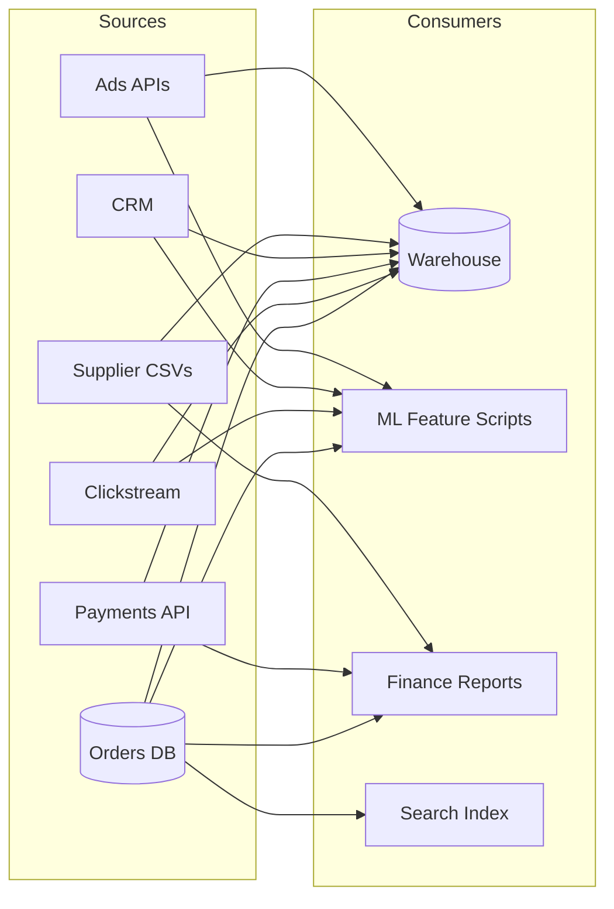

*Each arrow is a separate script, separately written, separately scheduled, and separately broken.*

This is called a **point-to-point integration**, and it works fine at first. Then the pain starts.

---

### The pains (this is the part interviewers love to hear you articulate)

#### Pain 1: The N × M explosion

With **N sources** and **M consumers**, you can end up with up to **N × M** custom integrations.

- 8 sources × 5 consumers = **40 scripts**
- Add 1 new source and you write 5 new scripts. Add 1 new consumer and you write 8.

Every integration means its own credentials, retry logic, scheduling and bugs. The cost grows multiplicatively, not additively.

#### Pain 2: You are hammering the production database

The ML team's script runs `SELECT * FROM orders` at 9 AM. The finance script does the same at 9:05, and the search-indexing script does it again at 9:10.

At 9:10 the **checkout page slows down** because the production DB is busy serving three analytics queries. A customer-facing outage is caused by an analytics job.

> **Lesson:** Analytical workloads (large scans) and transactional workloads (small, fast reads and writes) must be isolated. This is **OLTP vs OLAP**.

#### Pain 3: Schema changes silently break everything

A backend developer renames `user_city` to `city` in the orders table, which is a perfectly reasonable change for them. Meanwhile:

- Script #7 crashes at 2 AM.
- Script #12 doesn't crash but fills the `city` column with NULLs, so the **dashboard silently shows wrong numbers**.
- Nobody finds out for 3 days, until the CEO asks why "Hyderabad revenue dropped to zero".

> **Lesson:** There is no contract between the producer and the consumer. The developer didn't even know anyone was reading that column.

#### Pain 4: No reliability story

- The script fails halfway through. Are 40% of rows loaded? Do you re-run it? If you re-run it, you get **duplicates**.
- The source API was down for 6 hours. Do you ever get that data back?
- Cron has no concept of "run script B only after script A succeeds".

#### Pain 5: No replay or time travel

Three months later, the data science team finds a bug in how "session duration" was computed and wants to recompute it over all of last year's raw events. But the scripts only stored the **already-transformed** result. The raw data is gone, so it can never be recomputed.

#### Pain 6: Every script reinvents the same wheel

Each script has its own approach to retries, logging, date parsing and timezone handling. One treats `2026-10-27` as UTC, another as IST. Two reports disagree and the team spends two weeks arguing about whose number is right.

#### Pain 7: Nobody can answer "where did this number come from?"

There is no catalog, no lineage and no owner. This is the **trust problem**: when people stop trusting the data, the entire analytics investment is wasted.

---

### Summary of failures

| Problem | Root cause |
|---|---|
| N × M scripts | Tight coupling between each source and each consumer |
| Prod DB slowdown | No isolation between OLTP and OLAP |
| Silent breakage | No schema contract or validation |
| Duplicates and data loss | No delivery guarantees, no idempotency |
| Can't recompute | Raw data not retained |
| Inconsistent numbers | No shared transformation logic |
| No trust | No lineage, quality checks or ownership |

---

### The insight that creates the "platform"

The team has a whiteboard moment:

> *"Instead of every source talking to every consumer, what if everything flowed through **one common pipeline** with a standard front door and standard back door?"*

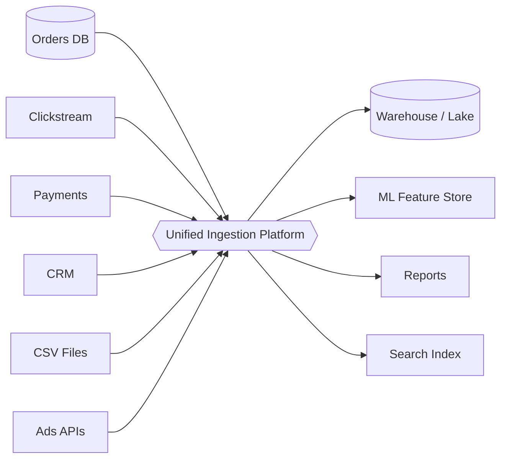

The cost now becomes **N + M** instead of **N × M**:

- A new source writes **one** connector to the platform.
- A new consumer reads from **one** place.
- Validation, retries, schemas, monitoring and security are built **once**, centrally.

This is the same idea as an airport hub. 8 cities × 5 cities of direct flights is 40 routes, whereas routing everything through one hub is 13.

That is why a **Unified Data Ingestion Platform** exists.

---

### How to say this in an interview

> *"Without a platform, every source integrates directly with every consumer, which creates N×M coupling, puts load on OLTP systems, has no schema contract, no replayability and no central quality control. A unified ingestion platform introduces a standard ingestion layer that decouples producers from consumers, turning N×M into N+M, and centralizes validation, transformation, reliability and observability."*

If you can say that confidently in the first two minutes, you've set the frame for the entire interview.

---

### Key terms from this chapter

- **Point-to-point integration:** direct custom connections between each pair of systems.
- **OLTP:** online transaction processing (the app's database, optimized for many small reads and writes).
- **OLAP:** online analytical processing (the warehouse, optimized for big scans and aggregations).
- **Data contract:** an agreement between producer and consumer on a dataset's structure and meaning.
- **Hub-and-spoke:** the pattern where everything goes through one central layer.

---

### Checkpoint

Before we move to Chapter 2, try answering these in your own words:

1. Why does point-to-point integration scale as N × M, and what does the platform change it to?
2. Why is running analytics directly on the production DB dangerous? Name the OLTP vs OLAP difference.
3. In the "city renamed" example, why was the **silent** failure worse than the crash?
4. Why does throwing away raw data after transformation hurt us later?

Tell me whether any of this is fuzzy, or just say **"Understood, next"** and we'll go to **Chapter 2: Requirements and scale estimation**, where we define what the platform must do, its functional and non-functional requirements, and the back-of-the-envelope math (events per second, storage per day, bandwidth) that drives every later design decision.


-----------------------------------------------------------------------------------------------------------------------
-----------------------------------------------------------------------------------------------------------------------
-----------------------------------------------------------------------------------------------------------------------
-----------------------------------------------------------------------------------------------------------------------


# Chapter 2: Requirements and scale estimation

## The story: the team that skipped this step

Before we define our platform, here is a cautionary tale.

A team at a company much like ShopKart got excited about the "hub" idea from Chapter 1. They spun up one big server with a REST endpoint, `POST /ingest`, and a script that wrote everything to a database. They went live on a Monday.

- **Monday 10 AM:** the marketing team turned on clickstream tracking for the whole app. The endpoint got hit by **200,000 events/second**. The server fell over in 40 seconds.
- **Tuesday:** after a restart, the analysts asked, "Where is yesterday's data?" **It was gone.** The server had no durable buffer.
- **Wednesday:** compliance asked, "Are you storing customer phone numbers in plain text?" Nobody had thought about it.
- **Thursday:** the fraud team said, "We need payment events within 30 seconds, not tomorrow morning." The design was nightly batch.

Four failures, and all of them were **requirements and estimation failures**, not coding failures. In an HLD interview this is exactly what the first 5-8 minutes are for. Interviewers want to see that you clarify before you draw.

---

## Part 1: Functional requirements (what the system does)

Asha's team interviews every stakeholder (analysts, ML engineers, finance, compliance, source-system owners) and writes this list:

| # | Requirement | Concrete example |
|---|---|---|
| F1 | **Ingest from heterogeneous sources** | Postgres/MySQL tables, MongoDB, app clickstream, Stripe webhooks, partner CSVs on SFTP, Google Ads API |
| F2 | **Support multiple ingestion modes** | Batch (nightly files), micro-batch (every 15 min), streaming (real-time events), CDC (row-level DB changes) |
| F3 | **Validate data** | Reject an order with a negative amount; flag a missing `user_id` |
| F4 | **Transform data** | Parse JSON, convert timestamps to UTC, mask PII, join with reference data, deduplicate |
| F5 | **Deliver to multiple destinations** | Data lake, data warehouse, feature store, search index |
| F6 | **Manage schemas** | Detect when `user_city` becomes `city` *before* it breaks things |
| F7 | **Replay and backfill** | "Recompute all of 2025 with the new session logic" |
| F8 | **Self-service onboarding** | A new team adds a source via config, not by writing a new pipeline from scratch |
| F9 | **Metadata, catalog and lineage** | "Which tables does this dashboard's revenue number come from?" |
| F10 | **Monitoring and alerting** | "The orders feed is 20 minutes late" |

### Out of scope

State this explicitly in the interview, because it shows maturity:

- The BI tool itself (Tableau, Looker)
- Model training pipelines
- Building the source applications

> **Interview tip:** Say, *"I'll focus on the ingestion, processing and delivery platform. BI tools and ML training consume our output but are out of scope. Let me know if you want to go deeper on either."*

---

## Part 2: Non-functional requirements (how well it does it)

These shape the architecture far more than the functional list does. Every one has to be a **testable statement** with a number attached.

| NFR | What it means here | Example target |
|---|---|---|
| **Scalability** | Handle growth in sources, volume and consumers | 7+ TB/day now, 10× in 3 years |
| **Durability** | Never lose accepted data | Zero data loss after the platform acknowledges receipt |
| **Freshness (latency)** | Time from event creation to availability | Real-time tier < 1 min, near-real-time < 15 min, batch within hours |
| **Availability** | Ingestion keeps accepting data even during partial failures | 99.9%+ on the ingestion layer |
| **Correctness** | No silent duplicates or corruption | "Effectively-once" processing |
| **Ordering** | Events for the same entity stay in order | Order #123's `created` comes before `shipped` |
| **Extensibility** | Adding a source or sink is cheap | A new source onboards in days, not weeks |
| **Security and compliance** | PII protected, access controlled, auditable | Encryption in transit and at rest, GDPR/DPDP deletion support |
| **Observability** | We find problems before users do | Lag, throughput, error rate and quality metrics on dashboards |
| **Cost efficiency** | Petabytes are expensive | Tiered storage, compression, lifecycle policies |

### The most important trade-off to state out loud

In an ingestion platform, the typical priority order is:

> **Durability (don't lose data) > Correctness > Availability > Freshness > Cost**

Why? You can fix a *late* dashboard, but you can never recover an event that was never stored. A customer's payment record that vanished is a legal problem, whereas a 5-minute delay is an annoyance.

This is the **CAP/consistency mindset** applied to data: at the **ingestion edge** we favor **availability and durability** (accept and persist, even if downstream is down), and we reconcile consistency later in processing.

### Freshness tiers (a design pattern worth remembering)

Not all data is equal. Giving everything real-time treatment would be absurdly expensive. So we **classify by SLA**:

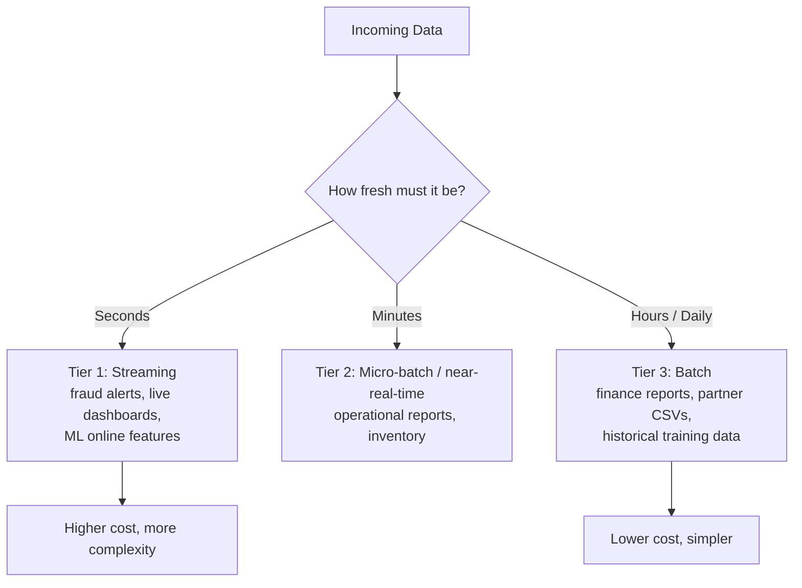

> **Example:** Payment events → Tier 1 (fraud team needs them in under 30 s). Supplier price CSVs → Tier 3 (they arrive once a night anyway).

---

## Part 3: Scale estimation (back-of-the-envelope)

Interviewers don't want exact answers. They want to see that you can **turn vague scale into numbers that drive decisions.** The standard recipe is:

1. Assume users and events
2. Compute average per second
3. Apply a peak factor
4. Multiply by event size
5. Compute daily and yearly storage
6. Account for retention, replication and compression

Let's do it for a ShopKart that has grown to a large company.

### Assumptions (say them out loud, and ask if they're reasonable)

- 100 million daily active users
- Each user generates ~50 clickstream events/day (views, clicks, searches)
- Average event size: ~1 KB (JSON with metadata)
- 200 production databases feeding CDC at an aggregate of ~20,000 row changes/sec average, ~1 KB each
- 5,000 partner/batch files per day, ~100 MB each
- Third-party API pulls: ~50 GB/day
- Peak traffic ≈ 3-4× average (sales events, evening spikes)

### Step 1: Clickstream

- Events per day: 100M × 50 = **5 billion/day**
- Average rate: 5,000,000,000 ÷ 86,400 ≈ **~58,000 events/sec**
- Peak (×3.5): ≈ **~200,000 events/sec**
- Daily volume: 5B × 1 KB = **~5 TB/day**
- Peak bandwidth: 200,000 × 1 KB ≈ **~200 MB/s**

### Step 2: CDC from databases

- Per day: 20,000 × 86,400 ≈ **1.73 billion changes/day**
- Volume: ≈ **~1.7 TB/day**
- Peak (×3): ~60,000 changes/sec ≈ **~60 MB/s**

### Step 3: Batch files and APIs

- Files: 5,000 × 100 MB = **~0.5 TB/day**
- APIs: **~0.05 TB/day** (small, but rate-limited and flaky, so they bring their own challenges)

### Step 4: Totals

| Source | Volume/day | Peak rate |
|---|---|---|
| Clickstream | ~5 TB | ~200K msgs/s |
| CDC | ~1.7 TB | ~60K msgs/s |
| Batch files | ~0.5 TB | bursty, nightly window |
| APIs | ~0.05 TB | negligible |
| **Total raw** | **≈ 7.3 TB/day** | **≈ 260K msgs/s, ~260 MB/s (~2 Gbps) in streaming peak** |

### Step 5: Storage

We'll store data in two forms, and the reasoning will become clear in Chapter 7:

- **Raw zone** (original, for replay), compressed ~3×: 7.3 ÷ 3 ≈ **2.4 TB/day → ~880 TB/year**
- **Curated zone** (clean, columnar format like Parquet, ~6× compression vs raw JSON): 7.3 ÷ 6 ≈ **1.2 TB/day → ~440 TB/year**
- **Total ≈ 1.3 PB/year** (the object store handles internal replication for us)
- Retain 5 years → **~6.5 PB**. This is why **tiered storage** (hot, warm and cold) matters for cost.

### Step 6: The message buffer (previewing Chapter 3)

Streaming data (clickstream + CDC ≈ 6.7 TB/day) gets buffered in a log for replay:

- Retention 7 days: 6.7 × 7 ≈ **47 TB**
- Replication factor 3: ≈ **~140 TB** of broker disk

### What do these numbers tell us?

This is the part that earns points in the interview. **Numbers matter only if they drive decisions.**

| Number | Design decision it forces |
|---|---|
| 260K msgs/s peak | A single server is impossible, so we need a **horizontally partitioned** log (hundreds of partitions) |
| Peak ≈ 3.5× average | Provision for peak, or autoscale, and add **buffering** to absorb bursts |
| ~7 TB/day, PBs total | Object storage plus columnar formats plus tiering, **not** a traditional RDBMS |
| ~140 TB of buffer | Brokers with large disks, replication, and partitions spread across many machines |
| Write-heavy ingestion, read-heavy analytics | **Separate** the write path (append-only) from the read path (columnar scans) |
| 4 different source types | No single ingestion method will do, so we need **multiple patterns** (Chapter 4) |

### Common estimation mistakes

1. **Designing for the average** instead of the peak. Sale days will humble you.
2. **Forgetting replication and retention** when sizing storage (a 3× multiplier on the buffer).
3. **Ignoring growth.** Always say, "I'll design for 3-5× headroom."
4. **Treating all data equally.** Different tiers have different SLAs.
5. **Not stating assumptions.** An unstated assumption looks like a guess.

---

## Part 4: Clarifying questions to ask the interviewer

This is what separates strong candidates from average ones. In the first few minutes, ask things like:

1. How many **sources**, and of what types (databases, event streams, files, APIs)?
2. What are the **data volumes and event rates**? Do you have peak numbers?
3. What **freshness** do consumers need? Is there a real-time requirement?
4. Who are the **consumers** (BI, ML, ad hoc analysts)?
5. Is data **structured, semi-structured or unstructured**?
6. How **often do schemas change**, and who owns them?
7. What are the **compliance** needs (PII, GDPR, retention, deletion)?
8. Is this **multi-tenant**, and is it single-region or multi-region?
9. What's the **tolerance for duplicates or loss**?
10. Do we need to support **replay/backfill**?

---

## Part 5: The target architecture (a first sketch)

We won't build this yet. This is the picture we'll **earn piece by piece**, with each chapter justifying a box. Think of it as a map of the destination:

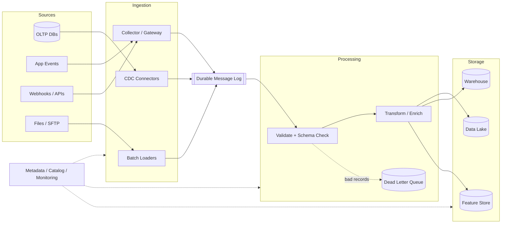

Every box is the answer to a failure we've already seen:

- **Durable message log** → fixes "server fell over and data vanished"
- **Validate + schema check** → fixes the silent `city` breakage
- **DLQ** → fixes "one bad record shouldn't block everything"
- **Raw plus curated storage** → fixes "can't recompute"
- **Metadata and monitoring** → fixes "nobody trusts the data"

---

## How to say this in an interview

> *"Before designing, let me pin down requirements. Functionally, we need to ingest from databases, event streams, files and APIs, validate and transform, and deliver to a lake, warehouse and feature store, with schema management and replay. Non-functionally, durability comes first, then correctness, availability, and tiered freshness from seconds to hours. At 100M DAU with ~50 events each, that's ~5B events/day, ~58K/s average and ~200K/s at peak, and across all sources ~7 TB/day raw, or ~1.3 PB/year after compression. That tells me I need a horizontally partitioned durable buffer, object storage with columnar formats, and multiple ingestion patterns."*

---

## Key terms from this chapter

- **Functional vs non-functional requirements:** what the system does vs how well it does it.
- **SLA / SLO:** an agreed (or target) level of freshness, availability and so on.
- **Peak factor:** the multiplier between average and worst-case load.
- **Retention:** how long data is kept in a given tier.
- **Replication factor:** the number of copies of the data (RF=3 means three copies).
- **Tiered storage:** hot, warm and cold storage, trading access speed for cost.
- **Effectively-once:** duplicates may occur internally, but results behave as if each event were processed once.

---

## Checkpoint

Try answering these before we move on:

1. Why do we rank **durability above freshness** for an ingestion platform?
2. Walk through the math: how do you get from 100M users to ~200K events/sec at peak?
3. Why do we **classify data into freshness tiers** instead of making everything real-time?
4. Name two numbers from the estimation and the design decision each one forces.
5. Name three clarifying questions you'd ask in the first five minutes.

If anything is fuzzy, tell me which part and I'll re-explain it with a different example. When you're ready, say **"Understood, next"** and we'll go to **Chapter 3: Decoupling with a durable message log (Kafka)**, where our team's first real design attempt appears: they try a direct write to the warehouse, it fails in spectacular ways, they try a simple queue, hit its limits, and discover why a *distributed log* is the answer.


-----------------------------------------------------------------------------------------------------------------------
-----------------------------------------------------------------------------------------------------------------------
-----------------------------------------------------------------------------------------------------------------------
-----------------------------------------------------------------------------------------------------------------------


# Chapter 3: Decoupling with a durable message log

## The story: three attempts to build the "front door"

In Chapter 2 we decided the platform needs a durable buffer between sources and everything downstream. The team now has to build it. They don't get it right the first time, and each failed attempt teaches something an interviewer wants you to know.

---

## Attempt 1: Write directly to the warehouse

The simplest idea is that every source writes straight into the warehouse through an ingestion API.

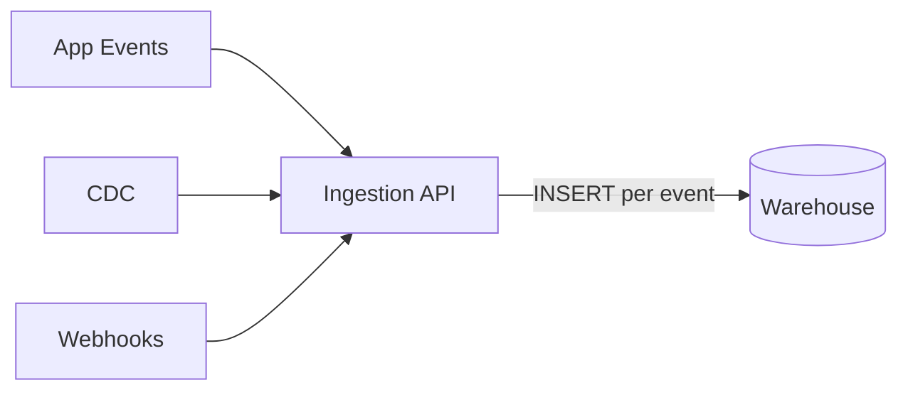

### What goes wrong

**Problem 1: Warehouses hate tiny writes.**
Analytical warehouses (Redshift, BigQuery, Snowflake) are built for **bulk loads**, not 200,000 single-row `INSERT`s per second. Each insert creates tiny files or segments, performance collapses, and the bill explodes.

**Problem 2: The warehouse goes down, so ingestion goes down.**
Say the warehouse is in maintenance for 2 hours. The API can't write, so it either rejects data (**data loss**, because the mobile app won't retry forever) or holds it in memory (**crash**). Our ingestion availability is now capped by our *least* reliable downstream system.

**Problem 3: Spikes pass straight through.**
A flash sale triples traffic and the warehouse feels it immediately. There is nothing to absorb the burst.

**Problem 4: One destination only.**
The ML team now wants the same events in a feature store. Do we write twice? What if the second write fails after the first succeeds? We're back to the N × M tangle of Chapter 1.

> **Lesson:** Producers and consumers need to be separated **in time** (they don't run at the same moment) and **in space** (they don't know about each other). We need something in the middle that **accepts data fast, stores it safely, and lets consumers take it at their own pace.**

---

## Attempt 2: A traditional message queue

The team adds a message queue (think RabbitMQ, ActiveMQ or SQS). Producers put messages in, consumers take messages out.

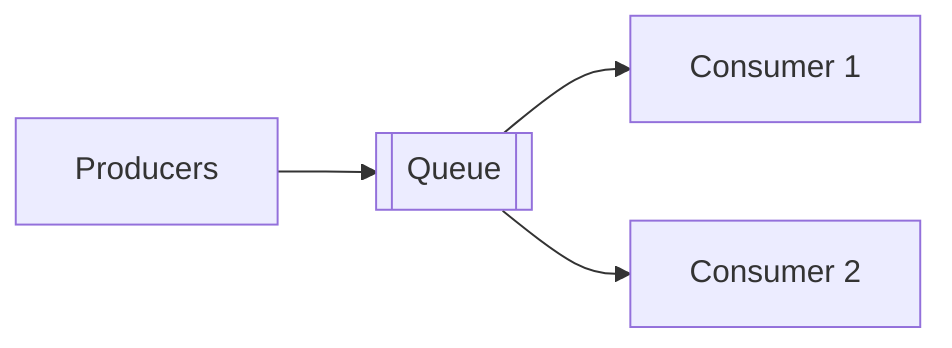

**How a classic queue works:** a message is delivered to *one* consumer, and once that consumer **acknowledges** it, the message is **deleted**.

This fixes Attempts 1's biggest problems. Producers get fast acknowledgements, spikes are absorbed, and the warehouse can be down while messages wait. Everyone celebrates for about three weeks. Then the new problems appear.

### What goes wrong

**Problem 1: Multiple consumers can't each get the data.**
The warehouse loader consumes a message and it's **deleted**. The ML feature pipeline and the fraud detector never see it. To give each consumer a copy, you create one queue per consumer and **duplicate every message into each**. Producers or brokers now have to know all the consumers, and the coupling is back.

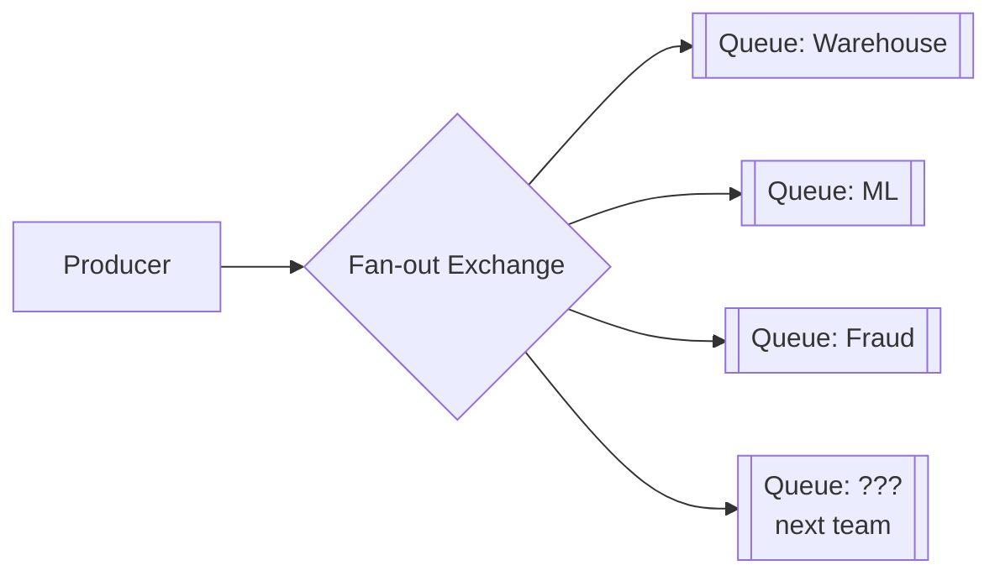

Every new consumer means a new queue, and storage is multiplied for each.

**Problem 2: No replay.**
Three months later the data science team finds a bug and needs to reprocess last year's events. The messages were deleted on acknowledgement, so they are **gone**. This is Pain 5 from Chapter 1 again.

**Problem 3: A slow consumer causes a mess.**
If a consumer falls behind, the queue grows. Classic brokers keep queue state in memory and on disk with per-message bookkeeping (who got what, who acked what). At hundreds of millions of messages, the broker itself slows down. The queue was designed to be **nearly empty**, not to hold terabytes.

**Problem 4: Throughput ceiling and no real ordering at scale.**
A single queue lives on a single node. To scale you create multiple queues, but then you lose any global ordering, and per-entity ordering (all events of order #123 in sequence) is hard to guarantee when competing consumers race each other.

**Problem 5: Per-message bookkeeping is expensive.**
Tracking the individual delivery state of 200K messages/sec is heavy work for the broker.

> **Lesson:** A queue is about **tasks to be done** (process this, then it's finished). What we need is a **record of things that happened** (events) that many independent readers can read, re-read and catch up on.

---

## Attempt 3: The distributed commit log (Kafka)

Engineers at LinkedIn faced exactly this problem around 2010. They had many data sources and many consumers and nothing that scaled. They built **Apache Kafka** on a deceptively simple idea:

> **What if we don't delete messages on consumption? What if we just append everything to a log and let each consumer remember its own position?**

### The core mental model: an append-only log

A **log** is just an ordered sequence of records, where new ones are added **only at the end**. Each record gets a sequential number called its **offset**.

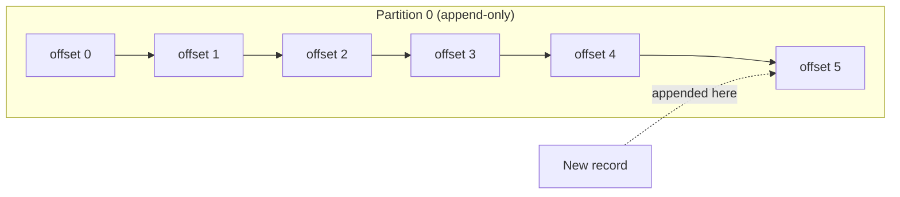

Reading doesn't remove anything. Each consumer simply keeps a **bookmark** (its offset):

- The warehouse loader is at offset 5.
- The fraud detector is at offset 3 and is a bit slow.
- The ML pipeline just started and is at offset 0.

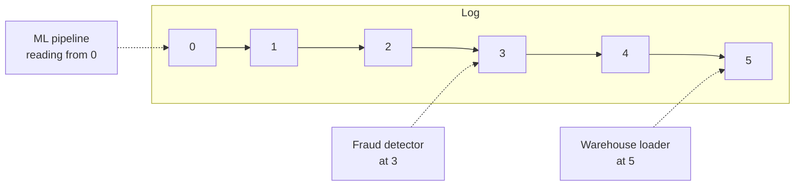

**This one change fixes almost everything from Attempt 2:**

| Problem with queue | How the log fixes it |
|---|---|
| Message deleted after one consumer | Messages stay for a **retention period** (e.g., 7 days) regardless of consumption |
| Can't add consumers cheaply | A new consumer just picks an offset and reads. **No extra copy** of the data |
| No replay | **Reset the offset** to the past and re-read |
| Broker tracks per-message state | The broker tracks **nothing per message**. Consumers store a single number (the offset) |
| Slow consumers hurt the broker | A slow consumer just has a lower offset. The broker doesn't care |

**Consumer lag** is a key metric here: `lag = latest offset − consumer's offset`. If lag keeps growing, the consumer can't keep up, and this is the number to alert on.

---

## Scaling the log: topics and partitions

One log on one machine can't handle 260K msgs/s and 140 TB (the numbers from Chapter 2). So we **split the log into pieces.**

- A **topic** is a named stream of a certain kind of data, such as `clickstream.events`, `orders.cdc`, `payments.events`.
- Each topic is divided into **partitions**. Each partition is its own independent, ordered, append-only log.
- Different partitions live on **different brokers** (servers), so the load is spread out.

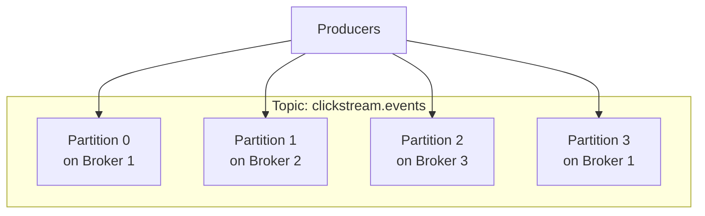

### Which partition does a record go to?

The producer picks a partition using the record's **key**:

```
partition = hash(key) % number_of_partitions
```

- **With a key** (say `user_id`), all events for the same user land in the **same partition**, so they stay in order.
- **Without a key**, records are spread round-robin (or in sticky batches) for even load, but there is no per-entity ordering.

> **Example:** For `orders.cdc`, key = `order_id`. Then `created → paid → shipped` for order #123 are guaranteed to be read in that order, because they sit in the same partition.

### The critical ordering rule (frequently asked)

> **Kafka guarantees ordering only *within a partition*, not across partitions.**

So if you need ordering for an entity, **choose the key as that entity's ID.** If you need *global* ordering across everything, you'd have to use one partition, which kills parallelism. That trade-off is the one to articulate in an interview.

### How many partitions do we need? (Using our numbers)

Rough rule: one partition comfortably handles around **10 MB/s** of writes (this varies with hardware and message size).

- Clickstream peak ≈ 200 MB/s → 200 ÷ 10 = **~20 partitions minimum**
- But partitions also set **consumer parallelism** (explained below), and we want headroom for growth and for hot keys. So we pick something like **100-200 partitions** for the clickstream topic.
- Too many partitions has costs too: more open files, slower leader elections, more memory, longer recovery. So we don't go to 10,000 "just in case."

> **Important:** You can *increase* partitions later, but doing so changes `hash(key) % N`, so the same key may map to a different partition from then on and **per-key ordering breaks across the boundary**. That's why you size generously up front.

---

## Consumers: consumer groups

Now the parallelism question. 200K msgs/sec is too much for one consumer process. We need **many instances of the same consumer working together.**

A **consumer group** is a set of consumer instances that share a job. Kafka assigns **each partition to exactly one consumer within the group**.

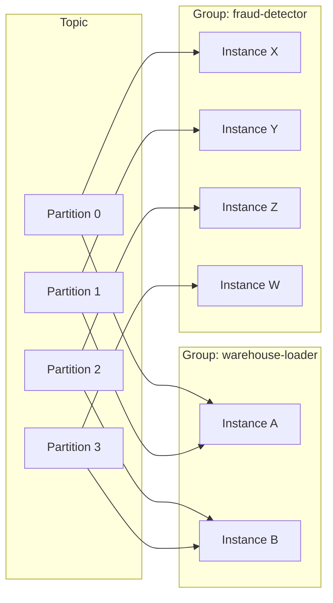

Three rules to remember:

1. **Within a group:** each partition is read by **one** instance (this gives load-sharing and preserves per-partition order).
2. **Across groups:** each group independently reads **all** the data (this gives pub/sub fan-out, and every team gets its own full copy of the stream with no extra storage).
3. **Max parallelism per group = number of partitions.** With 100 partitions, 100 instances can work in parallel, and a 101st instance would sit idle.

This is how the log gets both behaviors: **queue-like** load balancing inside a group, and **pub/sub-like** broadcasting between groups.

**Rebalancing:** if an instance dies or a new one joins, Kafka **reassigns partitions** among the group. During a rebalance, consumption can briefly pause. Modern setups use incremental/cooperative rebalancing to minimize that.

### How a consumer tracks progress: committing offsets

A consumer periodically **commits** its offset ("I've processed up to here"), stored in Kafka itself. If it crashes and restarts, it resumes from the last committed offset.

The timing of the commit decides your delivery guarantee (we cover this fully in Chapter 10, but here's the taste):

- **Commit before processing** → if it crashes mid-processing, the record is **lost** (at-most-once).
- **Commit after processing** → if it crashes after processing but before committing, the record is **processed twice** (at-least-once).

---

## Why is Kafka so fast? (A favorite follow-up question)

It seems odd that writing everything to **disk** could handle hundreds of MB/s. The reasons:

1. **Sequential I/O.** Appending to the end of a file is vastly faster than random disk access, and even spinning disks do hundreds of MB/s sequentially.
2. **OS page cache.** Recent data is served from RAM by the operating system without Kafka managing its own cache.
3. **Zero-copy.** Data goes from disk/page cache to the network socket without being copied through the application's memory (the `sendfile` system call).
4. **Batching and compression.** Producers batch many records into one request and compress the batch (e.g., LZ4, Zstd), cutting network and disk usage.
5. **Dumb broker, smart client.** The broker doesn't track per-message state. Consumers pull at their own pace and store their own offsets.

---

## Producer-side details that matter

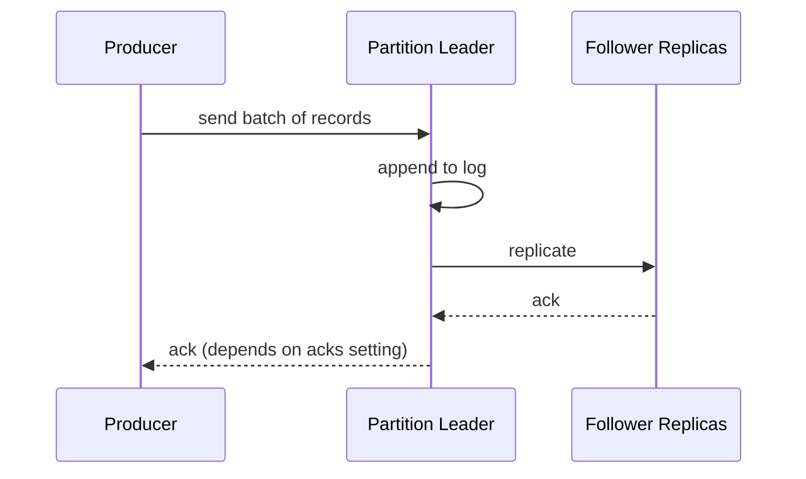

The `acks` setting is a **durability vs latency** dial. We preview it here and cover replication in depth in Chapter 9:

| `acks` | Meaning | Risk |
|---|---|---|
| `0` | Don't wait for any ack | Fastest, but data can be lost silently |
| `1` | Wait for the partition leader only | If the leader dies before replicating, data is lost |
| `all` | Wait for all in-sync replicas | Slowest, but safest. **This is what we use for payments and orders** |

Since durability is our top priority (Chapter 2), our default is `acks=all` with replication factor 3. For low-value, high-volume data such as raw UI hover events, a team might accept `acks=1` for speed. This is a good example of **tiering by data importance**.

Other producer features: **batching** (`linger.ms`, batch size) trades a few milliseconds of latency for much higher throughput, and **idempotent producers** prevent duplicates caused by producer retries (more in Chapter 10).

---

## Retention and compaction

How long does the log keep data?

- **Time-based:** keep 7 days.
- **Size-based:** keep up to X TB per partition.
- **Log compaction:** for "latest state per key" topics (like a `user_profile` changelog), keep only the **most recent record for each key** and discard older ones. This is great for rebuilding the current state of a table.

Remember that Kafka is our **buffer and replay window (days)**, *not* our permanent archive. The long-term raw copy goes into the data lake (Chapter 7), and that is how we can still backfill after the 7 days are up.

---

## Putting it together: where the log sits in our platform

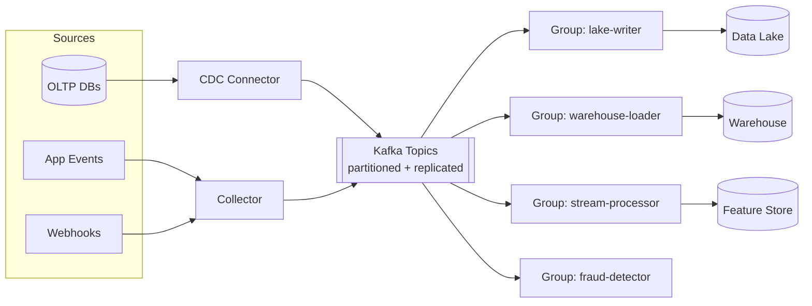

Compare this with Chapter 1's tangle:

- **N + M** instead of N × M
- A warehouse outage means consumers lag but **nothing is lost**, and they catch up later
- Adding a consumer costs **no extra storage** and no change to producers
- Replay is one offset reset away

---

## Trade-offs and "when would you NOT use it?"

Interviewers love honest trade-offs:

| Strength | Cost |
|---|---|
| High throughput, durable, replayable | Operational complexity (a cluster to run, monitor and upgrade) |
| Many independent consumers | Ordering only per partition |
| Cheap fan-out | Partition count is hard to change safely |
| Decouples teams | Not ideal for per-message routing, priorities or delayed delivery (a classic queue is better for task queues with complex routing) |

> **Alternatives to name:** Amazon Kinesis, Google Pub/Sub, Azure Event Hubs, Apache Pulsar, Redpanda. Managed services trade control for less operational burden. The concepts you've learned transfer directly.

---

## How to say this in an interview

> *"I'd put a durable, partitioned, replicated log like Kafka between producers and consumers. Writing directly to the warehouse couples availability and can't handle tiny writes, and a traditional queue deletes messages on consumption, so it can't support multiple independent consumers or replay. With a log, records are appended and retained for a window, each consumer group tracks its own offset, so we get cheap fan-out, backpressure tolerance and replay. Topics are split into partitions for throughput, keyed by entity ID so per-entity ordering holds, and consumer groups scale up to the partition count. I'd use `acks=all` with replication factor 3 for critical topics."*

---

## Key terms from this chapter

- **Topic / Partition:** a named stream / one ordered shard of it.
- **Offset:** the sequence number of a record within a partition.
- **Consumer group:** instances sharing a job, with one consumer per partition.
- **Consumer lag:** how far behind the consumer is from the log's latest offset.
- **Retention:** how long records stay in the log.
- **Log compaction:** keep only the latest record per key.
- **Rebalance:** reassigning partitions when group membership changes.
- **`acks`:** the producer's durability setting.

---

## Checkpoint

1. Why can't we write straight from sources to the warehouse? Give at least two reasons.
2. What does a log do differently from a queue that enables **replay** and **multiple consumers**?
3. If you need all events of one customer processed in order, what do you choose as the key, and why does it work?
4. Your topic has 12 partitions. How many consumer instances in one group can usefully run? What happens with 15?
5. What happens to `hash(key) % N` ordering if you later change N from 12 to 24?
6. Explain two reasons sequential disk writes make Kafka fast.

Tell me which of these feels shaky and I'll go deeper with another example. When you're ready, say **"Understood, next"** and we'll move to **Chapter 4: Ingestion patterns**, where the team discovers that *getting data into the log* is a different problem for each kind of source: why querying the database every night breaks, how CDC reads the database's own transaction log, how to handle files, webhooks and rate-limited APIs, and push vs pull.


-----------------------------------------------------------------------------------------------------------------------
-----------------------------------------------------------------------------------------------------------------------
-----------------------------------------------------------------------------------------------------------------------
-----------------------------------------------------------------------------------------------------------------------


# Chapter 4: Ingestion patterns

## The story: "The log exists. Now how do we fill it?"

In Chapter 3 the team built a durable, partitioned log. Everyone assumed the hard part was over. Then the first onboarding meeting went like this:

- **Orders team:** "Our data is in Postgres. How do you get it?"
- **Marketing:** "We get CSVs from an ad agency by SFTP, and Google Ads has an API."
- **Payments:** "Stripe sends us webhooks."
- **Mobile team:** "Our app emits events from phones that are often offline."

The team realizes that **getting data into the log is a different problem for each kind of source**. We'll walk through each source type the way the team did: the obvious approach, why it broke, and what replaced it.

---

## Part 1: Databases (the hardest and most important)

### Attempt 1: Full snapshot ("dump the whole table every night")

```sql
SELECT * FROM orders;   -- every night at 2 AM
```

Simple and correct, and it works great for a 50,000-row table. But `orders` now has **2 billion rows**.

| Problem | Why it hurts |
|---|---|
| Huge load on the production DB | A multi-hour scan fights with checkout traffic (Pain 2 from Chapter 1) |
| Wasteful | 99.9% of the rows didn't change since yesterday |
| Slow freshness | Data is at best 24 hours old |
| Takes longer as data grows | Eventually the 2 AM job doesn't finish before 9 AM |

**Where it still makes sense:** small reference tables (countries, currencies, product categories) with a few thousand rows. Don't over-engineer those.

### Attempt 2: Incremental polling with `updated_at`

"Only fetch what changed" gives the idea:

```sql
SELECT * FROM orders WHERE updated_at > :last_watermark;
```

We save the highest `updated_at` seen (the **watermark**) and use it next time. Much lighter. Then reality bites:

**Problem 1: Deletes are invisible.**
A deleted row doesn't appear in `WHERE updated_at > ...`. It's just *gone*, so the warehouse keeps showing a cancelled, deleted order forever. (Workarounds like soft-deletes need every application team to cooperate.)

**Problem 2: Not every table has a reliable `updated_at`.**
Some developers forget it, and some bulk-update scripts bypass it (`UPDATE ... ` run directly in SQL without touching the column).

**Problem 3: The in-flight transaction trap.**
Imagine:

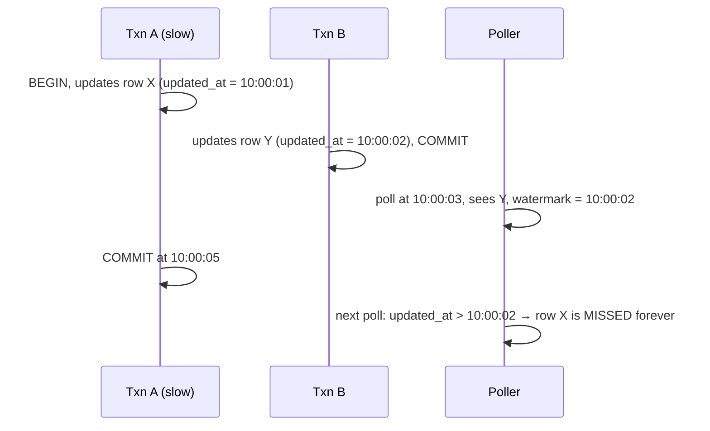

Row X's timestamp (10:00:01) is *older* than our watermark, but it only became visible *after* we moved the watermark. **We silently lose data.** (Common mitigation: re-read an overlap window, e.g., watermark minus 5 minutes, and deduplicate. It's a patch, not a cure.)

**Problem 4: Intermediate states are lost.**
If an order goes `created → paid → shipped` between two polls, we only see `shipped`. For analytics like "how long do orders sit in `paid`?", the history is **gone**.

**Problem 5: Still queries the production DB** on a schedule, and the more often you poll, the more load.

> **Lesson:** Querying a database to infer changes is fundamentally lossy. But the database *already* records every change precisely for its own purposes. Can we read that?

### Attempt 3 (the winner): Change Data Capture (CDC)

Every serious database writes every committed change to an internal, ordered log **before** applying it, so it can recover from crashes and feed its own replicas:

| Database | Its internal log |
|---|---|
| PostgreSQL | WAL (write-ahead log), read through *logical decoding* |
| MySQL | binlog |
| MongoDB | oplog / change streams |
| SQL Server / Oracle | transaction log / redo log |

**Log-based CDC** means a connector (e.g., **Debezium**) *pretends to be a replica*, reads this log, and converts every change into an event that goes into Kafka.

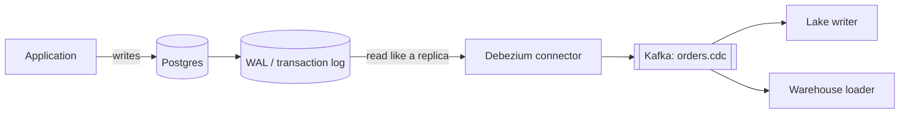

A typical CDC event looks like:

```json
{
  "op": "u",                       // c=create, u=update, d=delete, r=snapshot read
  "ts_ms": 1761554100123,
  "source": {"db":"shop","table":"orders","lsn": 88231904, "txId": 5521},
  "before": {"order_id": 123, "status": "paid",    "amount": 499},
  "after":  {"order_id": 123, "status": "shipped", "amount": 499}
}
```

Notice what CDC gives us compared with polling:

| Concern | Polling | Log-based CDC |
|---|---|---|
| Deletes | Missed | Captured (`op: "d"`) |
| Intermediate states | Lost | Every change captured |
| Load on production | Repeated queries | Light, just reads the log the DB already writes |
| Latency | Poll interval | Sub-second to seconds |
| Needs `updated_at`? | Yes | No |
| Ordering | Approximate | Exact commit order (LSN/binlog position) |
| Before and after values | No | Yes |

### CDC in practice: the details interviewers probe

**1. Initial snapshot, then streaming.**
A new connector can't just read the log, because the log only holds recent changes and the table already has 2 billion rows. So the connector does:

1. Take a **consistent snapshot** of the existing table and emit it as `op: "r"` events.
2. Record the log position at the start of the snapshot.
3. Switch to **streaming from that position**, so nothing falls in the gap.

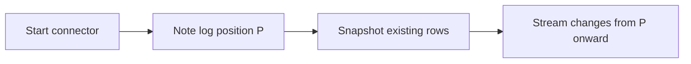

**2. Key and partitioning.**
Use the **primary key** as the Kafka message key, so all changes to one row go to one partition and stay in order (Chapter 3's rule applied).

**3. Replication slot risk (a classic production incident).**
In Postgres, the database **keeps WAL files until the CDC consumer has read them**. If the connector is down for a day, WAL piles up and can **fill the production disk and crash the database**. So you must alert on slot lag and set limits. This is a very good "war story" to mention.

**4. Schema changes.**
When someone does `ALTER TABLE orders ADD COLUMN coupon_code`, the connector must notice and publish the new schema. We'll fully solve this with a schema registry in Chapter 5.

**5. Transactions.**
One DB transaction can touch several tables. CDC events carry a transaction ID so consumers can group them if atomicity matters.

**6. Delete semantics downstream.**
A `d` event must become a **tombstone or soft-delete marker** in the lake/warehouse, otherwise deleted rows live forever.

### Variation: the Transactional Outbox pattern

Sometimes the source team owns a *service*, not just a database, and doesn't want consumers coupled to its internal table structure. (If you rename a column, every CDC consumer breaks again!)

**Outbox pattern:** the service writes its business change **and** a well-defined "event" row into an `outbox` table **in the same DB transaction**. CDC then ships *only the outbox table*.

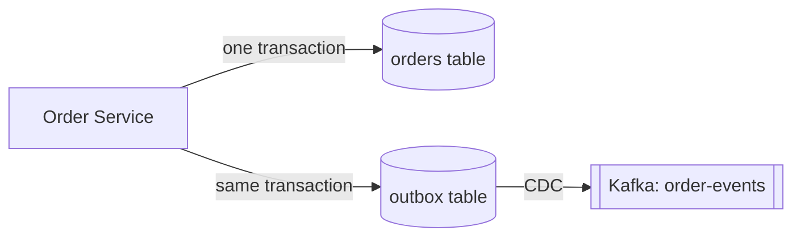

This gives atomicity (no "DB updated but event lost") and a **stable, intentional event contract** instead of leaking table internals. Mention it as the answer to "what if the source team doesn't want raw table changes exposed?"

---

## Part 2: Application events (clickstream)

These are not rows in a database. They're events produced by mobile apps and websites. At 200K events/sec peak, the app **cannot** talk directly to Kafka (millions of devices, untrusted networks, no auth control). We need a front door.

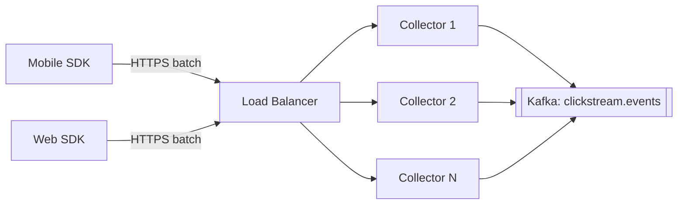

**The collector (gateway) is deliberately thin and stateless.** It does only:

- **Authenticate** (API key or token per app)
- **Light validation** (is it valid JSON? is it too large? is the required envelope present?)
- **Enrich** (server receive time, IP-derived geo, assigning an ID if missing)
- **Produce to Kafka** with `acks=all`, and only then return 200

Because it's stateless, scaling is easy: add more instances behind the load balancer. And because it writes to a durable log immediately, **the app gets a fast ack** and downstream slowness never reaches the user's phone.

**Key design points:**

1. **Client-side batching.** The SDK buffers events and sends, say, 20 at a time or every 30 seconds. This saves battery and cuts request counts by an order of magnitude.
2. **Offline mode.** A phone in a tunnel stores events locally and sends them later. So events arrive **late and out of order**. This is where **event time vs processing time** comes from. Every event must carry its own `event_time` (when it happened on the device) and the collector adds `received_time`. We deal with late data in Chapter 6.
3. **Duplicates are normal.** If the phone sends a batch and the response times out, the SDK **retries**, and the batch arrives twice. So every event carries a unique **`event_id`** (UUID) assigned **at creation**, which lets us deduplicate later (Chapter 10).
4. **Clock skew.** Phone clocks are wrong (sometimes by years). Store both timestamps, and compute a correction from the difference between the device's send time and the server's receive time.
5. **Backpressure and load shedding.** If the platform is overloaded, the collector can return `429`/`503` with a `Retry-After` header so SDKs back off with jitter. For truly low-value events, **sampling** may be acceptable (a business decision).
6. **Bot and abuse protection.** Rate limiting per API key/IP prevents a buggy client from flooding the pipeline. (This is where CDN and edge layers can help, and we'll revisit it in Chapter 12.)

---

## Part 3: Webhooks (third parties pushing to us)

Stripe, Razorpay, Shopify and others send HTTP `POST` requests to a URL we expose when something happens.

**Naive approach:** receive the webhook, parse it, write to the warehouse, then respond `200`.

**What goes wrong:** if our processing takes 20 seconds, the provider times out and **retries**, so now we process it twice. Or our DB is down and we return `500`, so the provider retries a few times and then **gives up**, and the payment event is lost.

**The robust pattern: "acknowledge fast, process later."**

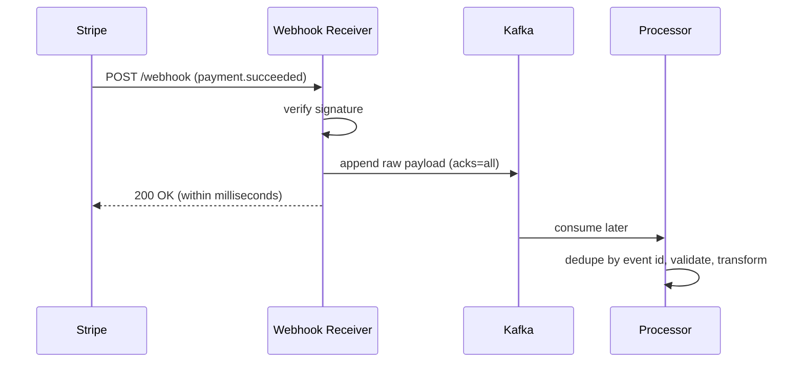

Checklist for webhook receivers:

- **Verify the signature** (HMAC with a shared secret) so attackers can't forge "payment succeeded" events.
- **Persist first, respond second.** Return `200` only once the payload is safely in the log.
- **Idempotency.** Providers retry, so dedupe on the provider's event ID.
- **Out-of-order delivery.** `refund.created` can arrive before `payment.succeeded`. Use the provider's timestamps or sequence numbers, or re-fetch the object's current state from the API.
- **Reconciliation.** Webhooks can still be missed. A periodic job that **pulls from the provider's API** and compares totals fills the gaps. (Push for speed, pull for completeness.)

---

## Part 4: Files (partner CSVs, SFTP drops, exports)

Files seem easy but are full of traps.

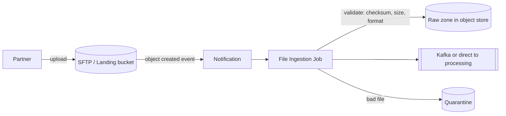

Problems and fixes:

| Problem | Example | Solution |
|---|---|---|
| **Partial files** | We read the CSV while the partner is still uploading it | Have the partner upload to `.tmp` and rename when done, or send a **manifest/`_SUCCESS` marker** or checksum last. Only process after the marker appears |
| **Duplicate delivery** | The partner re-sends yesterday's file | Track processed files (name + checksum) in a **ledger** |
| **Late or missing files** | "Where's today's file?" | Expected-arrival SLAs plus an alert if the file isn't there by 6 AM |
| **Bad formats** | Encoding is Latin-1 not UTF-8, a delimiter is inside a quoted field, dates are `27/10/26` vs `10/27/26` | Validate against an expected schema, and **quarantine** failed files for review without blocking others |
| **Huge files** | A single 50 GB file | Split into chunks and process in parallel, ideally in a splittable format |
| **Event-driven vs scheduled** | Polling the bucket every minute | Use storage **event notifications** (e.g., object-created events) to trigger processing |

The first thing we do is **save an untouched copy in the raw zone**. If our parsing logic has a bug, we can reprocess the original later.

---

## Part 5: Third-party APIs (we have to pull)

Google Ads, Facebook Ads, Salesforce and similar services don't push. We call them.

The difficulties are almost all about *someone else's limits*:

- **Rate limits and quotas.** Exceed them and we're throttled or blocked. Use a **token-bucket limiter** per API credential, and respect `Retry-After`.
- **Pagination.** Use **cursor-based** pagination where possible (offset-based can skip or repeat records when data changes mid-crawl).
- **Incremental sync.** Remember a **cursor or watermark** per source and fetch only newer data. Persist it **only after the data is durably stored**, otherwise a crash can lose a window.
- **Flaky responses.** Retries with **exponential backoff plus jitter** (we go deeper in Chapter 11).
- **Data that changes retroactively.** Ad platforms revise yesterday's spend numbers for days. So re-pull a trailing window (for example the last 7 days) and **upsert**.
- **Schema drift.** The vendor adds fields without warning.

---

## Part 6: Push vs pull, and who is responsible?

```mermaid
flowchart LR
    subgraph PUSH ["Push: source sends to us"]
        A1[App SDK] --> A2[Our Collector]
        B1[Stripe] --> B2[Our Webhook endpoint]
    end
    subgraph PULL ["Pull: we fetch from source"]
        C1[Our Connector] --> C2[(Postgres log)]
        D1[Our Scheduler] --> D2[Google Ads API]
        E1[Our Loader] --> E2[(SFTP)]
    end
```

| | Push | Pull |
|---|---|---|
| Who controls pace | The source | Us |
| Latency | Lower (event-driven) | Depends on the poll interval |
| Risk | We can be overwhelmed. We must be always-on and protect ourselves | We can overload the source. We must be gentle |
| Failure handling | The source must retry, and may give up | We retry from our saved position |
| Best for | Events, webhooks | Databases, APIs, files |

---

## Part 7: One framework, many connectors

If each of these source types is a separate custom program, we're back to Chapter 1's mess. The team's insight is to define a **standard connector framework** (e.g., **Kafka Connect**, Airbyte or Fivetran-style connectors):

```mermaid
flowchart LR
    CFG["Connector config<br/>(YAML/JSON, in Git)"] --> FW[Connector Framework / Runtime]
    FW --> SRC1[Postgres CDC connector]
    FW --> SRC2[S3/SFTP connector]
    FW --> SRC3[REST API connector]
    FW --> SINK[Kafka]
    FW --> OFF[(Offsets, status, retry state)]
```

The framework handles the shared concerns **once**: offset/position storage, retries, scaling out workers, monitoring, secrets management and schema registration. Onboarding a new source becomes writing a **config file**, which is functional requirement F8 (self-service onboarding) from Chapter 2.

---

## Part 8: Choosing the pattern, a decision table

| Source | Best pattern | Typical freshness | Biggest risk to mention |
|---|---|---|---|
| Large OLTP database | Log-based CDC (+ initial snapshot) | Seconds | Replication slot or log growth, schema changes |
| Small reference table | Periodic full snapshot | Hours/daily | None, keep it simple |
| Service with a stable event contract | Outbox + CDC | Seconds | Extra table and discipline from the team |
| Mobile/web events | SDK → collector → Kafka | Seconds | Duplicates, late data, bots |
| Third-party webhooks | Receive → persist → ack → process | Seconds | Forged requests, retries, out-of-order |
| Partner files | Landing zone + manifest + ledger | Hours | Partial or duplicate files, late arrival |
| SaaS APIs | Scheduled incremental pull with cursor | Minutes-hours | Rate limits, retroactive changes |

---

## How to say this in an interview

> *"Different sources need different ingestion patterns. For OLTP databases I'd use log-based CDC like Debezium: it reads the WAL or binlog, captures deletes and every intermediate state, adds minimal load on production, and gives commit-ordered events. It starts with a consistent snapshot, then streams, keyed by primary key. Polling on `updated_at` misses deletes and can lose in-flight transactions. For app events I'd have a stateless collector behind a load balancer that authenticates, lightly validates, and writes to Kafka before acking, with client-side batching, an `event_id` for dedup, and both event time and receive time. For webhooks, verify the signature, persist, then ack, and reconcile through the provider's API. Files go through a landing zone with manifests and a processed-file ledger, and APIs are pulled incrementally with rate limiting and a trailing re-pull window. All of it runs on a common connector framework so onboarding is configuration."*

---

## Key terms from this chapter

- **CDC (Change Data Capture):** reading the DB's transaction log to stream every change.
- **WAL / binlog / oplog:** the DB's internal ordered change log.
- **Watermark:** the saved position/timestamp marking how far we've ingested.
- **Initial snapshot:** the one-time consistent copy before streaming begins.
- **Tombstone:** a marker meaning "this key was deleted".
- **Outbox pattern:** writing business data and an event row in one transaction, then shipping the event table via CDC.
- **Event time vs processing time:** when something happened vs when we saw it.
- **Idempotency key / `event_id`:** a unique ID for safely detecting repeats.
- **Landing zone / quarantine:** where raw files arrive and where bad files wait for review.

---

## Checkpoint

1. Give three concrete reasons `updated_at` polling is unreliable, and say how CDC avoids each.
2. Explain the "in-flight transaction" trap in your own words.
3. Why does CDC need an initial snapshot, and how does it avoid a gap between the snapshot and streaming?
4. A Postgres replication slot's consumer is down for 24 hours. What can happen to the production database, and what would you do to prevent it?
5. Why must a webhook receiver persist the payload *before* returning `200`?
6. A phone sends the same batch twice because of a timeout. What two things in our design handle that?
7. When would you deliberately choose a plain full snapshot over CDC?

Take your time, and tell me what's unclear. When you're ready, say **"Understood, next"** and we'll go to **Chapter 5: Validation, schema registry and schema evolution**. That's where the team finally fixes the "city got renamed and the dashboard silently showed zeros" disaster from Chapter 1, with data contracts, Avro/Protobuf schemas, compatibility rules (backward, forward, full), and what to do with the records that fail validation.


-----------------------------------------------------------------------------------------------------------------------
-----------------------------------------------------------------------------------------------------------------------
-----------------------------------------------------------------------------------------------------------------------
-----------------------------------------------------------------------------------------------------------------------


# Chapter 5: Validation, schema registry and schema evolution

## The story: the day the dashboard showed zero

Remember the disaster from Chapter 1? A backend developer renamed `user_city` to `city`. Script #7 crashed, but script #12 silently wrote NULLs, and for three days the CEO's dashboard showed **zero revenue for Hyderabad**.

By Chapter 4 we have a log and good connectors, but the problem is still alive. Imagine the same rename today:

1. Debezium notices the column change and starts emitting events with `city` instead of `user_city`.
2. The events flow into Kafka happily. Kafka doesn't look inside messages.
3. Every consumer breaks, or worse, silently misbehaves.

**A fast, durable pipeline just delivers bad data faster.** So the team asks: *how do we guarantee that what's in the pipeline is what consumers expect, and what happens when it isn't?*

---

## Part 1: What can actually go wrong with data?

Before choosing tools, classify the failures. Interviewers love a structured answer here.

| Category | Example | Detected by |
|---|---|---|
| **Structural** | The JSON is malformed. Field `amount` is a string `"abc"` instead of a number. A required field is missing | Schema validation |
| **Field-level (semantic)** | `age = -5`, `email` has no `@`, `country = "Indai"`, timestamp in the year 2099 | Rules per field (range, regex, enum) |
| **Cross-field / business** | `shipped_at < created_at`; `discount > price`; `status = refunded` but there was never a payment | Business rules |
| **Referential** | An order references `user_id = 9999` that doesn't exist | Lookups against reference data |
| **Duplicates** | The same event delivered twice | Dedup by key (Chapter 10) |
| **Volume / freshness anomalies** | The orders feed normally delivers 2M rows/hour and today delivers 12 | Statistical monitors |
| **Schema drift** | A column renamed, a type changed, a field removed | Schema registry and compatibility checks |

Each category is caught best at a **different layer**, which is the key idea of this chapter.

---

## Part 2: The team's attempts

### Attempt 1: "Validate at the end, in the warehouse"

Load everything, then run SQL checks (`SELECT COUNT(*) WHERE amount < 0`) once the data has landed.

**Why it fails:**
- By the time we find the problem, the bad data has already been **copied to many places** (lake, features, search index) and may already have been **used in a dashboard or an ML training run**.
- It's the most **expensive** place to fix things. The later a defect is found, the more it costs to clean up.
- Nobody knows *who* introduced it or when.

### Attempt 2: "Schema-on-read, let every consumer deal with it"

Producers send flexible JSON. Each consumer parses what it needs.

```json
{"order_id": 123, "user_city": "Hyderabad", "amount": 499}
```

Flexible and quick, which is why people love it. But:

- **Every consumer writes its own defensive parsing.** Ten consumers means ten different interpretations of "what's valid".
- **Breakage is silent** (the NULL city) because JSON happily lets a field vanish.
- **JSON is verbose.** Field names repeat in every message, so at 7 TB/day we pay a lot for network, storage and CPU.
- Nobody knows what the data is *supposed* to look like. The "schema" lives in people's heads.

### Attempt 3: "Validate in every consumer"

Put validation libraries in each consumer. This is better, but you now maintain the rules in N places, they drift apart, and the bad record still sits in the log, so *every* consumer wastes time rejecting it.

> **Lesson:** Validation must be **centralized and shared**, and a **contract between producer and consumer** must exist **before** data flows. That's the idea of a **schema registry**.

---

## Part 3: Schemas and the Schema Registry

### What's a schema?

A formal description of a record's structure. Here is an example in **Avro**:

```json
{
  "type": "record",
  "name": "OrderCreated",
  "namespace": "com.shopkart.orders",
  "fields": [
    {"name": "order_id",   "type": "long"},
    {"name": "user_id",    "type": "long"},
    {"name": "city",       "type": "string"},
    {"name": "amount",     "type": "double"},
    {"name": "coupon",     "type": ["null", "string"], "default": null},
    {"name": "event_time", "type": {"type": "long", "logicalType": "timestamp-millis"}}
  ]
}
```

It tells everyone the field names, types, which are optional (`coupon` has a default) and what the timestamp means.

### Choosing a serialization format

| Format | Pros | Cons |
|---|---|---|
| **JSON** | Human-readable, universal | Big, slow, no enforced types, no built-in evolution rules |
| **Avro** | Compact binary, schema stored separately, **excellent evolution rules**, great with Kafka and Hadoop | Not human-readable, needs the schema to decode |
| **Protobuf** | Compact, fast, strong typing, great for RPC and cross-language, good evolution via field numbers | Slightly more tooling friction for data engineering |
| **JSON Schema** | Keeps JSON while adding validation | Still verbose |

For a data platform, **Avro** (or Protobuf) with a registry is the common answer. Typically it's 3-10× smaller than JSON, which matters at our scale.

### The Schema Registry

A **schema registry** is a small, central service that:

1. **Stores** every schema version, with an ID.
2. **Enforces compatibility rules** when a new version is registered.
3. Lets producers and consumers **look up** a schema by ID.

How a message looks on the wire: instead of embedding the whole schema in every message (wasteful), we put a tiny **schema ID** in front of the payload:

```
[ magic byte (1) ][ schema ID (4 bytes) ][ compact binary payload ... ]
```

```mermaid
sequenceDiagram
    participant P as Producer
    participant R as Schema Registry
    participant K as Kafka
    participant C as Consumer
    P->>R: register / fetch schema for topic "orders" (first time)
    R-->>P: schema ID = 42 (only if compatible)
    P->>K: [id=42][binary payload]
    C->>K: poll
    K-->>C: [id=42][binary payload]
    C->>R: fetch schema 42 (first time, then cached)
    R-->>C: schema
    C->>C: decode payload using schema 42
```

Important details:

- **Clients cache schemas locally**, so the registry is only hit on the first sight of a new ID. So the registry is not in the hot path per message, and a brief registry outage doesn't stop ingestion of known schemas. (Run it highly available anyway, typically 2-3 instances backed by a Kafka topic or DB.)
- **The producer can't publish data that doesn't match a registered schema.** Serialization fails *at the source*, so bad structure never enters the log. This is "**fail early, fail at the edge**".

---

## Part 4: Schema evolution (and the compatibility rules)

Schemas *must* change because the business changes. The art is changing them **without breaking anyone**. Think of it as a game of **who upgrades first**.

### The two directions

- **Backward compatible:** consumers using the **new** schema can read data written with the **old** schema. (A new reader can understand old data.)
- **Forward compatible:** consumers using the **old** schema can read data written with the **new** schema. (An old reader can tolerate new data.)
- **Full compatible:** both.

| Mode | What it guarantees | Who must upgrade first | Safe changes (Avro rules) |
|---|---|---|---|
| **BACKWARD** (the usual default) | New schema reads old data | **Consumers first**, then producers | Add field **with a default**, delete a field |
| **FORWARD** | Old schema reads new data | **Producers first**, then consumers | Add a field, delete a field **that had a default** |
| **FULL** | Both | **Any order** | Add or delete only fields **with defaults** |
| **\*_TRANSITIVE** variants | The same check against **all** previous versions, not only the latest | | Needed when you must be able to replay *old* data from the log or lake |
| **NONE** | No checks | Coordinate by hand (don't) | |

> **Why "transitive" matters for us:** we can replay 7 days of the log and read years of the lake. A new reader must understand data from *every* historic version, not just the previous one. For a long-lived platform, `FULL_TRANSITIVE` or `BACKWARD_TRANSITIVE` is common.

### Safe vs breaking changes: examples

| Change | Safe? | Why |
|---|---|---|
| Add `coupon` with default `null` | ✅ | Old data lacks it, so readers fill in the default. Old readers ignore it |
| Add a required field with no default | ❌ | Old data has no value, so the new reader has nothing to fill in |
| Remove a field that has a default | ✅ | Readers use the default |
| Remove a field that has no default | ⚠️ Breaks forward compatibility | Old readers expect it |
| Rename a field | ❌ | It looks like "delete + add", and a consumer expecting the old name sees nothing |
| Change `int` → `long` | ✅ (widening is allowed in Avro) | No precision lost |
| Change `string` → `int` | ❌ | Meaning changes |
| Change the **meaning** (amount from rupees to paise) | ❌❌ **Nothing in a schema detects it** | Needs contracts and communication |

That last row is subtle and a good one to mention. **A schema can validate structure but not semantics.** That's why data contracts exist (Part 5).

### Fixing the "city" disaster properly: the expand/contract pattern

How *should* the developer have renamed `user_city` to `city`?

```mermaid
flowchart LR
    A["Step 1 · EXPAND<br/>Add new field 'city' (default null).<br/>Keep 'user_city'. Producer writes BOTH."] --> B["Step 2 · MIGRATE<br/>Consumers switch to read 'city'."]
    B --> C["Step 3 · CONTRACT<br/>Once no one reads user_city<br/>(verified via lineage), remove it."]
```

Each step is a **compatible** change that the registry will accept, and every consumer keeps working throughout. The rename takes weeks instead of seconds, which is a good trade for not corrupting the CEO's dashboard.

And what if the developer *tried* the one-shot rename? **The registry rejects it** at registration time, and in our CI pipeline the build fails *before deploy*:

```mermaid
flowchart LR
    DEV[Developer changes schema in Git] --> CI[CI pipeline]
    CI -->|"compatibility check against registry"| R[(Schema Registry)]
    R -->|incompatible| FAIL[Build FAILS: 'removing user_city breaks consumers']
    R -->|compatible| DEPLOY[Deploy to production]
```

The problem is caught **at code review time**, not three days later by an executive.

### Schema changes in CDC

For CDC sources, the table is the schema. When a DBA runs `ALTER TABLE ... ADD COLUMN`, the connector sees the new column and registers a new schema version. If the registry rejects it as incompatible (for example a dropped column), the connector **fails loudly and pauses** instead of publishing data that would break consumers. Alerts fire, humans decide. That's the right outcome, because stopping is better than silent corruption. (Note the earlier warning: while it's paused, the replication slot retains log files. Monitor it.)

---

## Part 5: Data contracts, going beyond structure

A schema says *"amount is a double."* It does not say *"amount is in INR, tax-inclusive, never negative, and refreshed within 5 minutes."* A **data contract** is a fuller agreement between producer and consumers:

```yaml
dataset: orders.created
owner: orders-team@shopkart.com
schema: com.shopkart.orders.OrderCreated   # registry reference
semantics:
  amount: "Final payable amount in INR, tax inclusive"
  event_time: "UTC, when the user clicked Pay"
quality:
  - amount >= 0
  - city in reference.cities
  - null_rate(user_id) == 0
sla:
  freshness: "< 5 min"
  availability: "99.9%"
pii:
  user_id: pseudonymous
  email: restricted        # masked downstream
compatibility: FULL_TRANSITIVE
change_policy: "30 days notice for breaking changes"
```

Why this matters:

- **Ownership:** a named team is accountable.
- **Testable:** the quality rules are executed automatically.
- **Shifts responsibility left:** the **producer** is responsible for the quality of what it emits, instead of everyone downstream cleaning up.
- Contracts can be **verified in the producer's CI**, so a code change that violates its own contract is blocked.

---

## Part 6: The validation layers (where do we check what?)

We don't run everything in one place. The principle is: **cheap checks early, expensive checks later, and never block the hot path unnecessarily.**

```mermaid
flowchart LR
    SRC[Source] --> L1
    subgraph L1 ["Layer 1 · Edge (collector / connector)"]
        S1[Schema and serialization check<br/>auth, size limits, required envelope]
    end
    L1 --> K[["Kafka raw topic"]]
    K --> L2
    subgraph L2 ["Layer 2 · Stream processing"]
        S2[Field rules: ranges, regex, enums<br/>cross-field business rules<br/>light lookups, dedup]
    end
    L2 -->|valid| K2[["Kafka clean topic"]]
    L2 -->|invalid| DLQ[["Dead Letter Queue + error metadata"]]
    K2 --> L3
    subgraph L3 ["Layer 3 · Storage / batch"]
        S3[Referential checks, reconciliation counts,<br/>volume and distribution anomaly detection,<br/>freshness checks]
    end
    L3 --> DW[(Curated lake / warehouse)]
    L3 -.alert.-> ALERT[On-call / data owners]
```

| Layer | Checks | Why here |
|---|---|---|
| **1. Edge** | Valid schema, auth, size limits, required headers | Cheap, per-record, and stops garbage before it spreads. Keep it **thin**, because a slow collector hurts producers |
| **2. Stream** | Field and cross-field rules, light enrichment lookups, dedup | Per-record logic at stream speed |
| **3. Storage/batch** | Referential integrity over big joins, row-count reconciliation vs the source, distribution drift ("average order value jumped 40×"), freshness | These need aggregate views of the data over time, which are impossible record-by-record |

Tools you can name: Great Expectations, Deequ, Soda, dbt tests, and Monte Carlo-style data observability. Don't over-focus on tool names, but showing you know the category helps.

### Raw first, always

A key principle: **keep the unvalidated original in the raw zone/topic.** Validation produces a *new* clean stream, it does not overwrite the original. If our validation rules were wrong (they will be, at some point), we can fix them and **reprocess from the raw data**.

---

## Part 7: What do we do with bad records?

This is a classic interview question: "**What happens when a record fails validation?**" There isn't one answer, and you should present the options with their trade-offs.

| Strategy | What it does | Use when | Danger |
|---|---|---|---|
| **Fail-fast (halt)** | Stop the pipeline | Data is critical and *any* corruption is unacceptable (e.g., financial ledger) | One bad record blocks everyone: a **poison pill** |
| **Drop silently** | Discard the record | Almost never | **Silent data loss**, the exact thing we fear |
| **Dead Letter Queue (DLQ)** | Route the bad record, plus the error reason, to a separate topic or store. The pipeline continues | The default for most pipelines | The DLQ must be **monitored and replayed**, or it becomes a data graveyard |
| **Tag and pass** | Let the record through with a quality flag (`is_valid=false`, `errors=[...]`) | Analytics where partial data is better than none, and consumers can filter | Consumers might forget to filter |
| **Auto-repair** | Fix the obvious (trim whitespace, normalize case, default a missing country) | Known, deterministic, harmless fixes | Over-eager "repairs" can hide real problems. Log every repair |

```mermaid
flowchart TD
    R[Incoming record] --> V{Valid?}
    V -->|yes| OK[Clean topic]
    V -->|"no: fixable and deterministic"| FIX[Auto-repair, log the change] --> OK
    V -->|"no: not fixable"| D{Criticality?}
    D -->|"critical (payments)"| H["DLQ + page on-call<br/>+ possibly halt that stream"]
    D -->|normal| Q["DLQ + metrics + ticket"]
    D -->|"low value (hover events)"| T["Count and sample only"]
    H --> FIXR[Fix rule or data] --> REPLAY[Replay from DLQ]
    Q --> FIXR
```

What a DLQ record should contain, so people can actually diagnose it:

```json
{
  "original_payload": "...raw bytes...",
  "error_type": "RANGE_VIOLATION",
  "error_detail": "amount=-499 violates amount >= 0",
  "source_topic": "orders.created",
  "partition": 17, "offset": 8839201,
  "failed_at": "2026-10-27T09:12:44Z",
  "pipeline_version": "validator-v3.2",
  "schema_id": 42
}
```

Having the original topic, partition and offset means we can trace back to the exact source record. We'll go much deeper on DLQs, retries and replay in **Chapter 11**.

### Quality thresholds as circuit breakers

If 0.1% of records are bad, that's normal noise. If **40%** are bad, something upstream is broken, and sending 40% of the data to the DLQ isn't a solution. So we add **thresholds**: when the invalid rate exceeds X% in a window, **alert loudly and optionally pause** that dataset's propagation downstream. This is the safety net for the "silent zeros" scenario.

---

## Part 8: Trade-offs to articulate

| Decision | Strictness side | Flexibility side |
|---|---|---|
| Compatibility mode | `FULL_TRANSITIVE`: safest, but constrains producers | `BACKWARD` only: more freedom, but replaying old data may break |
| Reject vs accept bad data | Reject at the edge: clean data, but producers get errors and may lose events if they can't retry | Accept and quarantine: no loss, but the burden shifts downstream |
| Validate at the collector | Early catch, but adds latency on the hot path | Defer to the stream: the collector stays fast, but garbage enters the raw topic |
| Binary format | Compact and typed, but not human-readable | JSON is easy to debug, but big and loose |

A sensible default for our platform: the **edge enforces schema only** (cheap, structural) while **rich rules run in the stream** and invalid records go to the DLQ. The raw topic is kept for reprocessing.

---

## How to say this in an interview

> *"I'd treat schemas as contracts enforced centrally. Each topic has an Avro or Protobuf schema in a schema registry. Producers serialize with a schema ID, and the registry rejects incompatible changes, ideally in CI, so a rename like `user_city` → `city` is caught before deploy. I'd use `FULL_TRANSITIVE` compatibility so we can replay old data, and apply expand/contract for breaking changes: add the new field, migrate consumers, then remove the old. Validation is layered: structural checks at the edge, field and business rules in the stream, and referential, volume and freshness checks in batch. Invalid records go to a DLQ with error metadata rather than being dropped or blocking the pipeline, and I'd have quality thresholds that alert, or pause propagation, if the failure rate spikes. The raw data is always preserved so we can fix rules and replay."*

---

## Key terms from this chapter

- **Schema:** a formal description of record structure and types.
- **Schema registry:** a central service that stores schema versions and enforces compatibility.
- **Avro / Protobuf:** compact binary formats with strong schema and evolution support.
- **Backward / forward / full compatibility:** new readers read old data / old readers read new data / both.
- **Transitive:** compatibility checked against all earlier versions.
- **Expand/contract:** a safe multi-step approach to breaking changes.
- **Data contract:** schema plus semantics, quality rules, SLAs, ownership and a change policy.
- **DLQ (dead letter queue):** the parking place for records that failed processing.
- **Poison pill:** a bad record that repeatedly crashes or blocks a consumer.
- **Schema drift:** uncontrolled change in structure over time.

---

## Checkpoint

1. Why is validating only in the warehouse (the end of the pipeline) the most expensive option?
2. Explain what travels on the wire when a producer sends an Avro message, and why the schema isn't included in every message.
3. A producer adds a new required field with no default. Which compatibility direction breaks, and why?
4. Why does `BACKWARD` mean "consumers upgrade first", while `FORWARD` means "producers upgrade first"?
5. Walk through the expand/contract steps to rename a field safely.
6. Why can a schema never catch "amount changed from rupees to paise"? What catches it instead?
7. A record fails a business rule. List the options for handling it and when you'd choose each.
8. Why do we keep the raw, unvalidated data even after building the validator?

Tell me which part feels fuzzy. When you're ready, say **"Understood, next"** and we'll go to **Chapter 6: Transformation**. The team has clean, validated data in the log, but analysts need it joined, aggregated and reshaped. We'll follow their journey from nightly ETL scripts, to ELT in the warehouse, to stream processing, and see why late-arriving data, windowing, and the Lambda vs Kappa architecture debate came about.


-----------------------------------------------------------------------------------------------------------------------
-----------------------------------------------------------------------------------------------------------------------
-----------------------------------------------------------------------------------------------------------------------
-----------------------------------------------------------------------------------------------------------------------


# Chapter 6: Transformation

## The story: "The data is clean. Why can't anyone use it?"

After Chapter 5, the team has validated records flowing through Kafka. They hold a launch party, and on Monday morning three requests arrive:

- **Analyst Asha:** "Orders have `user_id`, but I need the user's *city* and *tier*. That's in a different system. And amounts are in 12 currencies. I need everything in INR."
- **Fraud team:** "We need *transactions per card in the last 5 minutes*, updated continuously."
- **Compliance:** "Phone numbers and emails must **not** reach the analytics tables in plain text."
- **Finance:** "Daily revenue must match the payment provider's totals to the rupee."

**Validated data is not the same as usable data.** Raw events are shaped for the *source application's* needs, not for analysis. Transformation is the bridge. In this chapter the team tries three generations of approaches, and each one fixes the last one's limits.

---

## Part 1: What does "transformation" actually include?

Interviewers like a clear taxonomy:

| Type | Example | State needed? |
|---|---|---|
| **Cleaning / standardizing** | Trim spaces, `"hyd"` → `"Hyderabad"`, timestamps → UTC, `paise` → `rupees` | No (stateless) |
| **Parsing / flattening** | Explode a nested JSON `items[]` array into one row per item | No |
| **Masking / tokenizing (PII)** | `9876543210` → `98XXXXXX10`, or `email` → hash/token | No (but needs a secret or key service) |
| **Enrichment** | Add `city` and `tier` by looking up `user_id`; convert currency using the day's exchange rate | Needs reference data (a lookup) |
| **Deduplication** | Drop the second copy of `event_id = abc` | **Yes**, must remember what it has seen |
| **Aggregation** | Orders per city per hour; transactions per card in 5 minutes | **Yes** |
| **Joins** | Join orders with payments (two streams) | **Yes**, usually both sides |
| **Sessionization** | Group a user's events into sessions (a 30-minute inactivity gap ends one) | **Yes** |
| **Derived features for ML** | "User's average order value over 30 days" | **Yes** |

The **stateless vs stateful** split is the single most important idea for scaling and failure handling later. Stateless work scales trivially, while stateful work needs a careful design.

---

## Part 2: Generation 1: classic ETL (nightly batch scripts)

**ETL = Extract → Transform → Load.** Data is pulled out, transformed on a dedicated processing server, and only then loaded into the warehouse.

```mermaid
flowchart LR
    S[(Sources)] -->|Extract| ETL["ETL Server<br/>(custom scripts / Informatica / SSIS)<br/>Transform here"]
    ETL -->|Load| W[(Warehouse<br/>only final tables)]
```

This made sense in the 1990s-2000s because warehouses were **expensive and limited in compute**, so you protected them by sending only finished, minimal data.

### Why the team outgrew it

| Problem | Explanation |
|---|---|
| **The ETL server is a bottleneck** | It must hold and crunch terabytes. Scaling means buying a bigger machine (vertical scaling) |
| **Transformations are baked in** | If Asha later needs a column the script dropped, you must change the script and re-extract from the source |
| **Raw data is thrown away** | Back to Chapter 1's Pain 5: no recompute |
| **Slow feedback** | A bug in the logic isn't found until the next morning's run, and fixing it means a long re-run |
| **Only engineers can change it** | Analysts depend on a backlog of tickets to alter logic |
| **Latency** | Strictly "tomorrow" |

---

## Part 3: Generation 2: ELT (load first, transform inside the warehouse/lake)

Then the world changed:

- **Cloud storage became cheap** (object storage costs cents per GB).
- **Cloud warehouses and lakehouses became massively parallel and elastic** (BigQuery, Snowflake, Redshift, Databricks), so transformation could happen *inside* them at great speed.

So the order flipped to **ELT = Extract → Load → Transform**:

```mermaid
flowchart LR
    S[(Sources)] -->|Extract + Load as-is| RAW[(Raw / Bronze zone)]
    RAW -->|"SQL / Spark transforms<br/>(dbt, Spark jobs)"| CLEAN[(Cleaned / Silver)]
    CLEAN -->|"SQL transforms"| MART[(Business marts / Gold)]
```

### What improved

| Benefit | Why |
|---|---|
| **Raw data is always kept** | We can re-transform any time, with new logic, over all history |
| **Compute scales elastically** | The engine is distributed, not a single server |
| **Analysts can own transformations** | SQL (with version control and tests, e.g., dbt) is accessible |
| **Faster iteration** | Change a SQL model and rebuild |
| **Separation of storage and compute** | Pay for compute only while transforming |

### The "medallion" layering (a vocabulary worth knowing)

| Layer | Contents | Who uses it |
|---|---|---|
| **Bronze / Raw** | Exact copy of what arrived, append-only, schema attached. Never modified | Engineers, replay |
| **Silver / Cleaned** | Validated, deduplicated, standardized types and timezones, PII masked, joined with reference data | Data scientists, analysts |
| **Gold / Curated** | Business-level aggregates and dimensional models (daily revenue by city, customer 360) | Dashboards, reports, executives |

```mermaid
flowchart LR
    B["Bronze<br/>raw, immutable"] --> S["Silver<br/>clean, conformed"] --> G["Gold<br/>business-ready"]
    B -.replay if logic was wrong.-> S
```

Because every layer is **derivable from the one before it**, a bug in Gold is fixed by recomputing from Silver, and a bug in Silver by recomputing from Bronze.

### Why ELT still wasn't enough

The fraud team's request ("transactions per card in the last 5 minutes") can't be met by a job that runs hourly or nightly. Batch ELT has an inherent **latency floor** of minutes to hours, and for use cases like fraud detection, live inventory, personalization and alerting, that is too slow. Which brings us to...

---

## Part 4: Generation 3: stream processing

Instead of waiting for a big pile of data and then processing it, **process each event (or tiny batch) as it arrives**, continuously.

```mermaid
flowchart LR
    K[["Kafka: orders.clean"]] --> SP["Stream Processor<br/>(Flink / Spark Structured Streaming / Kafka Streams)"]
    REF[(Reference data:<br/>users, FX rates)] --> SP
    SP --> K2[["Kafka: orders.enriched"]]
    SP --> FS[(Feature Store / Redis)]
    SP --> L[(Lake / Warehouse)]
```

### Batch vs streaming: the mental shift

| | Batch | Streaming |
|---|---|---|
| Data | Bounded (a finite file or table) | **Unbounded** (never ends) |
| Run | Starts, finishes | Runs forever |
| Latency | Minutes-hours | Milliseconds-seconds |
| Failure recovery | Re-run the job | Resume from a **checkpoint** |
| Complexity | Lower | Higher (state, time, ordering, late data) |
| Cost | Pay only while running | Always-on cluster |

**Micro-batch vs true streaming:**
- **Micro-batch** (Spark Structured Streaming): chop the stream into tiny batches (e.g., every 1-5 seconds) and process each as a mini batch job. It's simpler, has high throughput, and latency is in seconds.
- **True record-at-a-time** (Flink, Kafka Streams): lower latency (milliseconds) and richer time semantics, but it takes more care to operate.

---

## Part 5: The hard part of streaming: **time**

This is where interviewers separate those who've memorized tools from those who understand streaming.

### Event time vs processing time

Recall from Chapter 4: a phone in a tunnel sends events late.

- **Event time:** when the thing *actually happened* (the device's clock, a field in the record).
- **Processing time:** when our system *happened to see it*.

Imagine counting "orders per minute":

```mermaid
sequenceDiagram
    participant U as User phone
    participant P as Our processor
    U->>U: 10:00:30 order placed (offline)
    Note over U: enters tunnel, 7 minutes pass
    U->>P: 10:07:40 arrives
    Note over P: processing time = 10:07<br/>event time = 10:00
    P->>P: Which minute does this belong to?
```

If we use **processing time**, this order is counted in the 10:07 minute, so the 10:00 count is **wrong forever**. For correct business analytics, we almost always want **event time**.

### Windows: slicing an endless stream

To aggregate over an infinite stream we need **windows**:

```mermaid
flowchart TB
    subgraph TUMBLING ["Tumbling: fixed, non-overlapping (e.g. every 5 min)"]
        T1["00-05"] --- T2["05-10"] --- T3["10-15"]
    end
    subgraph SLIDING ["Sliding: fixed size, overlapping (5 min window, moves every 1 min)"]
        S1["00-05"] --- S2["01-06"] --- S3["02-07"]
    end
    subgraph SESSION ["Session: gap-based, variable length (close after 30 min of inactivity)"]
        SS1["user A: events ... gap ... closes"]
    end
```

| Window | Use |
|---|---|
| **Tumbling** | "Revenue per 5 minutes", the simplest |
| **Sliding / hopping** | "Transactions per card in the *last* 5 minutes, updated every second" (the fraud use case) |
| **Session** | "A user's browsing session", ending after 30 minutes of silence |

### Watermarks: "how long do we wait for stragglers?"

When can we say the 10:00-10:05 window is **complete** and emit its result? We can never be sure a late event isn't still on its way. A **watermark** is the system's moving estimate: *"I believe I've now seen all events with event time ≤ T."*

```
watermark = (max event time seen so far) − (allowed lateness / out-of-orderness bound)
```

Example with a 2-minute tolerance:

1. The newest event seen has event time 10:07.
2. Watermark = 10:05.
3. The window 10:00-10:05 is now considered **closed**, and the result is emitted.
4. An event with event time 10:03 that arrives *after* this is **late data**.

### What do we do with late data?

| Option | Behavior | Trade-off |
|---|---|---|
| **Drop** | Ignore it | Simple, but the counts are slightly wrong |
| **Allowed lateness** | Keep the window's state a while longer and **update (re-emit) the result** when stragglers arrive | More accurate, but downstream must handle updates (upserts) |
| **Side output** | Send late events to a separate stream or table for later correction | Nothing lost, but needs a correction job |
| **Wait longer** (bigger watermark delay) | Fewer late events | Higher latency for *every* result |

**The core trade-off: latency vs completeness.** Waiting longer means more accurate results but a slower answer. There's no free lunch, and you should state it explicitly.

> **A pragmatic pattern:** emit a fast, *approximate* result at the watermark (good for dashboards), then let a **batch job recompute the exact numbers** from the raw data later (good for finance). This leads to Lambda architecture below.

---

## Part 6: Stateful processing: how streams "remember"

Dedup, aggregations, joins and sessions all need to **remember** things. Where does that memory live?

- Each processor instance keeps **state** locally (in memory, spilling to an embedded store like RocksDB), partitioned by **key**. Remember Chapter 3: records with the same key go to the same partition and thus to the same processor instance. That's what makes local state possible without a network call per record.

```mermaid
flowchart LR
    K[["Kafka partitions<br/>(keyed by card_id)"]] --> W1["Worker 1<br/>state: cards A, D, G"]
    K --> W2["Worker 2<br/>state: cards B, E, H"]
    K --> W3["Worker 3<br/>state: cards C, F, I"]
    W1 --> CP[("Checkpoint store<br/>S3 / HDFS")]
    W2 --> CP
    W3 --> CP
```

### What if a worker crashes?

The state in its memory is gone. The solution is **checkpointing**:

1. Periodically (e.g., every 30 s) the framework takes a **consistent snapshot** of all state **plus the Kafka offsets** at that moment, and saves it to durable storage.
2. On failure, restart workers, **restore state from the last checkpoint**, and **rewind Kafka offsets to the matching positions**.
3. Reprocess the few seconds since the checkpoint.

The state and the offset are saved *together*, so they are consistent with each other. This is the foundation of "exactly-once" state semantics, covered in Chapter 10.

### State growth is a real danger

"Remember every `event_id` we've ever seen for dedup" grows forever and will eventually exhaust memory or disk. Solutions:

- **TTL on state** (dedup only within a 24-hour window, which is usually enough since duplicates come from retries soon after)
- **Bloom filters** (compact, probabilistic "probably seen", at the cost of rare false positives)
- Spilling state to **RocksDB on local SSD**
- Tuning **window/lateness** so old window state can be discarded

### Hot keys and skew

If one key is overwhelmingly popular (say a mega-merchant `merchant_id = 1` accounts for 40% of events), one worker is overloaded while others idle. Fixes: **salting** (split the key into `key#0..key#9`, aggregate partially, then combine), **pre-aggregation (combiners)** before the shuffle, or isolating hot keys. We'll return to this in Chapter 8.

---

## Part 7: Joins and enrichment

### Stream enrichment with reference data (the most common)

*Orders stream + users table → orders with city/tier.* Options:

| Approach | How | Pros | Cons |
|---|---|---|---|
| **Remote lookup per event** | Call a user service or DB for each event | Always fresh | Slow, and 100K events/s will crush the service. Needs caching |
| **Cached lookup** | Local cache with TTL in front of the lookup | Fast, protects the source | Stale up to the TTL |
| **Stream-table join (changelog)** | Ingest the users table via CDC (Chapter 4) into a compacted topic and hold it as **local state** in the processor, partitioned by `user_id`. Co-partition both streams by the same key | Fast (local), consistent, no extra load on the source | Needs state, and requires the same key and partition count |
| **Broadcast join** | Small table (like currency rates) copied to every worker | Very fast | Only for small tables |

This is a natural place for **caching** to come up in the interview. Cache reference data in the processor, with TTLs, invalidated through CDC updates.

### Stream-stream joins

*Join orders with payments*, where both arrive as streams and may come minutes apart. You must buffer one side in state **for a bounded time interval** ("match a payment within 30 minutes of the order"), otherwise state grows without limit. An unmatched order after 30 minutes is emitted as "unpaid" or sent for investigation.

---

## Part 8: Lambda vs Kappa architecture

The team now has a dilemma. **Streaming gives speed, but its results can be approximate** (late data, bugs, restarts). **Batch gives accuracy, but slowly.** What do we do?

### Lambda architecture (2011-ish, Nathan Marz)

Run **two parallel paths** and merge:

```mermaid
flowchart LR
    SRC[Raw events] --> BATCH["Batch layer<br/>recomputes everything from full history<br/>accurate, slow"]
    SRC --> SPEED["Speed layer<br/>stream processing on recent data<br/>fast, approximate"]
    BATCH --> SERVE["Serving layer<br/>merge batch view + real-time view"]
    SPEED --> SERVE
    SERVE --> Q[Queries / dashboards]
```

- The batch layer periodically produces the "truth".
- The speed layer fills the gap for the most recent minutes.
- Queries combine the two.

**Pain points teams reported:**

1. **Two codebases** that must produce the same results: a batch job in Spark SQL and a streaming job in Flink. They *will* drift apart.
2. Double the operational and debugging burden.
3. A subtle logic difference means "the dashboard number and the report number disagree".

### Kappa architecture (Jay Kreps, 2014)

> *"If the log keeps all the data and can be replayed, we don't need a separate batch layer. Use **one streaming codebase**. To reprocess, just replay the log with the new logic."*

```mermaid
flowchart LR
    LOG[["Durable log<br/>(Kafka, long retention or tiered storage)"]] --> V1["Stream job v1 (running)"]
    LOG --> V2["Stream job v2 (new logic, replays from start)"]
    V1 --> T1[(Output table v1)]
    V2 --> T2[(Output table v2)]
    T2 -.cut over when caught up.-> APP[Consumers]
```

- One codebase and one mental model.
- To fix a bug or change logic, start the new version, replay from the beginning, and **swap over** when it catches up.

**Limits of pure Kappa:** keeping years of data in Kafka is expensive (though **tiered storage** makes it more viable), and replaying huge history through a streaming engine can be slower and costlier than a batch engine doing the same scan.

### Where modern platforms land (a pragmatic hybrid)

Most real platforms today use a **unified engine** (e.g., Spark or Flink that handles both batch and streaming with the same API/SQL) plus the **lake as the long-term replay source**:

```mermaid
flowchart LR
    K[["Kafka (days of retention)"]] --> STR["Streaming job<br/>low-latency outputs (fraud, features, live dashboards)"]
    K --> LAKE[("Lake: Bronze<br/>full history")]
    LAKE --> BATCHJ["Batch job (same logic/SQL)<br/>backfills, corrections, heavy history"]
    STR --> SERVE[(Serving stores)]
    BATCHJ --> WH[(Warehouse / Gold)]
```

This gets the benefits of both while keeping a **single logic definition**. In an interview, say clearly: *"I'd avoid maintaining two divergent codebases. I'd use one engine with unified batch and streaming APIs, with the lake as the replay source for backfills."*

---

## Part 9: Putting transformation into our platform

```mermaid
flowchart LR
    RAWT[["Kafka: raw topics<br/>(schema-valid)"]] --> BRZ["Lake writer<br/>→ Bronze (raw, immutable)"]
    RAWT --> VAL["Stream job 1<br/>validate · dedupe · standardize · mask PII"]
    VAL -->|bad| DLQ[["DLQ"]]
    VAL --> CLEANT[["Kafka: clean topics"]]
    CLEANT --> ENR["Stream job 2<br/>enrich (stream-table joins) · derive"]
    ENR --> ENRT[["Kafka: enriched topics"]]
    ENRT --> RT["Real-time aggregations<br/>→ Feature store / Redis / OLAP store"]
    ENRT --> SLV["Silver tables (lake / warehouse)"]
    SLV --> GLD["Batch/ELT jobs (dbt / Spark SQL)<br/>→ Gold marts"]
    BRZ -.backfill / reprocess.-> SLV
```

Notice:
- **Bronze is written from the raw topic**, *independently* of the validator. If our validator breaks, we still keep everything.
- **PII masking happens before the data reaches broad-access zones.** Raw/Bronze is restricted to a small set of people, and Silver/Gold contain only masked or tokenized values.
- Jobs communicate through **Kafka topics**, so each stage can be scaled, deployed and replayed independently.

### Idempotent and deterministic transformations

Two properties make recompute and replay safe, and you should say them out loud:

- **Deterministic:** the same input always gives the same output. Avoid `now()`, random values and external lookups that change over time *inside* the transformation, or capture them as part of the input (for example, "exchange rate **as of** the event's date").
- **Idempotent writes:** re-running a job doesn't create duplicates. Use **upserts/MERGE by key**, or **overwrite a partition atomically**, instead of blind appends. (More in Chapter 10.)

### PII handling in transformation

| Technique | What it does | When |
|---|---|---|
| **Masking** | `98XXXXXX10` | Display and analytics where the pattern doesn't matter |
| **Hashing (with salt/pepper)** | Irreversible, but equal inputs → equal outputs, so joins still work | Joining on email without exposing it |
| **Tokenization** | Replace with a random token, mapping held in a secured vault | Reversible by authorized services only |
| **Encryption (field-level)** | Reversible with keys | Needed to restore the original later |
| **Dropping the field** | Gone | When it isn't needed at all (the best option: data minimization) |

For GDPR/DPDP "right to be forgotten", **tokenization is very helpful**: delete the token mapping and all downstream copies become meaningless. (More in Chapter 14.)

---

## Part 10: Choosing the tools and trade-offs

| Need | Typical choice | Why |
|---|---|---|
| Heavy batch / large history | **Spark** (batch) | Mature, scalable, SQL + code |
| SQL-based warehouse transforms | **dbt** on a warehouse/lakehouse | Version control, tests, lineage for analysts |
| Low-latency stateful streaming | **Flink** | Event-time semantics, strong state and checkpointing |
| Simple stream processing inside the app/Kafka ecosystem | **Kafka Streams / ksqlDB** | No separate cluster to operate |
| Seconds-level latency with team familiarity with Spark | **Spark Structured Streaming** | One API for batch and streaming |

| Decision | Choose the left when... | Choose the right when... |
|---|---|---|
| Streaming vs batch | Latency of seconds really matters (fraud, personalization) | Hours is fine (finance reports). It's much cheaper and simpler |
| ETL vs ELT | You must **not** land sensitive raw data (strict compliance) | You want flexibility and replay (default today, with PII protections) |
| Wait longer for late data vs emit early | Accuracy matters (billing) | Freshness matters (live dashboards) |

---

## How to say this in an interview

> *"I'd store raw data immutably in a Bronze layer, then transform in layers. A streaming job validates, deduplicates, standardizes and masks PII, and a second stage enriches using stream-table joins with reference data held as local state or cached, then writes Silver, with dbt/Spark producing Gold marts. For latency-sensitive use cases like fraud I'd use stateful stream processing with event-time windows and watermarks to handle late and out-of-order data, trading off latency against completeness, with late events either updating results or going to a side output. State is partitioned by key and checkpointed together with Kafka offsets for recovery. To avoid Lambda's two-codebase problem, I'd use a unified engine and use the lake as the replay source for backfills, so a logic fix is a recompute from Bronze. Transformations are deterministic and writes are idempotent, so reruns are safe."*

---

## Key terms from this chapter

- **ETL vs ELT:** transform before loading vs load raw and transform inside the warehouse/lake.
- **Medallion (Bronze/Silver/Gold):** raw → cleaned → business-ready layers.
- **Stateless vs stateful:** whether processing needs memory of past records.
- **Event time / processing time:** when it happened vs when we saw it.
- **Window (tumbling, sliding, session):** a slice of an unbounded stream.
- **Watermark:** the estimate of how complete event time is.
- **Late data / allowed lateness / side output:** events that arrive after the watermark and the options for handling them.
- **Checkpoint:** a snapshot of state plus offsets for recovery.
- **Hot key / skew:** a key with disproportionate traffic.
- **Lambda / Kappa:** batch+speed layers vs a single replayable stream.
- **Idempotent / deterministic:** safe to repeat / same input gives the same output.
- **Tokenization:** replacing sensitive values with tokens held in a vault.

---

## Checkpoint

1. Why did classic ETL become a bottleneck, and what two changes made ELT possible?
2. What does each of Bronze, Silver and Gold contain, and why does this layering make bug fixes easier?
3. A phone sends an order that arrives 7 minutes late. Explain event time vs processing time using this, and why counting by processing time is wrong.
4. Explain a watermark with an example. What happens to an event that arrives behind it, and what are your options?
5. Which window would you use for: (a) revenue per 5 minutes, (b) transactions per card in the last 5 minutes, (c) user browsing sessions?
6. A stream worker crashes. How is its state recovered, and why are offsets saved together with state?
7. Your dedup state keeps growing without bound. Give two ways to control it.
8. Compare Lambda and Kappa. What's the main pain of Lambda, and what limits pure Kappa?
9. How would you enrich 100K orders/sec with user data without crushing the user service?

Tell me which parts are shaky and I'll take another angle with new examples. When you're ready, say **"Understood, next"** and we'll go to **Chapter 7: Storage**. The team has to decide *where all this data lands*: why a warehouse alone wasn't enough, how data lakes turned into "data swamps", what lakehouse table formats (Iceberg, Delta, Hudi) fixed, why Parquet beats CSV by 10×, the small-files problem, partitioning layouts, compaction, and tiering for cost.


-----------------------------------------------------------------------------------------------------------------------
-----------------------------------------------------------------------------------------------------------------------
-----------------------------------------------------------------------------------------------------------------------
-----------------------------------------------------------------------------------------------------------------------


# Chapter 7: Storage

## The story: "The pipeline works. But where does the data live?"

By now the team has clean, enriched data flowing out of the stream processors. Then three people walk in with three different storage demands:

- **Finance:** "I need fast, correct SQL on 5 years of orders. Joins, aggregations, no surprises."
- **Data science:** "I need to read *all* the raw clickstream, 300 TB of it, with Spark and Python. And images and logs too."
- **Compliance:** "A customer asked us to delete their data. Prove it's gone from *everywhere*."

No single storage system seems to satisfy all three. The team goes through three generations of storage, and each one is a reaction to the previous generation's failures.

---

## Part 1: Generation 1, the data warehouse

A **data warehouse** is a database built for analytics (OLAP): columnar storage, massively parallel queries, strong SQL, ACID transactions. Examples include Teradata, Redshift, Snowflake and BigQuery.

```mermaid
flowchart LR
    ETL[Transformed data] --> W[("Warehouse<br/>structured tables")]
    W --> BI[BI / SQL users]
```

It was wonderful for finance, who finally had fast, reliable SQL. But as the company grew:

| Problem | Why it hurt |
|---|---|
| **Expensive** | Early warehouses coupled storage and compute on the same expensive hardware. Storing 1 PB of raw clickstream there was unthinkable |
| **Schema-on-write** | You must define the table *before* loading. Dumping raw JSON, logs or images isn't natural |
| **Structured data only** | Text, images, audio and semi-structured blobs didn't fit |
| **ML access was awkward** | Data scientists wanted to read files with Spark or Python at scale, not pull rows through a SQL connection |
| **Vendor lock-in** | Data in a proprietary format, reachable only through the vendor's engine |
| **Raw data discarded** | Too costly to keep, so the Chapter 1 "can't recompute" problem returned |

> **Lesson:** We need a place to store *everything, cheaply, in its original form*, and decide how to use it later.

---

## Part 2: Generation 2, the data lake

The idea: dump all data, raw and processed, as **files in cheap, scalable storage**, and let different engines read them.

- First this was **HDFS** (Hadoop). Now it's mostly **object storage**: Amazon S3, Google Cloud Storage, Azure Blob/ADLS.

### Why object storage?

| Property | Detail |
|---|---|
| **Extremely cheap** | Roughly cents per GB-month, far cheaper than warehouse storage |
| **Practically infinite** | No capacity planning |
| **Highly durable** | Designed for around 11 nines (99.999999999%) durability, with data replicated across multiple facilities automatically (this is the replication we deferred in Chapter 2's estimate) |
| **Separates storage from compute** | Spin compute clusters up and down independently, even many engines on the same data |
| **Open** | Any engine (Spark, Presto/Trino, Flink, Python) can read the same files |

**Schema-on-read:** store first, interpret when reading. Everyone was excited.

```mermaid
flowchart LR
    SRC[Pipelines] --> LAKE[("Data Lake on object storage<br/>files: JSON, CSV, Parquet...")]
    LAKE --> SPARK[Spark / ML]
    LAKE --> TRINO[Trino / Presto SQL]
    LAKE --> PY[Python notebooks]
```

### The data swamp: why lakes went bad

A year later the lake was a mess, and people started calling it a **data swamp**. The problems were precise, and interviewers like candidates who can list them:

| Problem | Concrete example |
|---|---|
| **No ACID transactions** | A job writing 1,000 files fails after writing 600. Readers now see **half-written data**. There is no atomic "commit" |
| **No schema enforcement** | One job writes `amount` as a string and another as a number. The table is unreadable |
| **No updates or deletes** | Files are immutable. To change one row you must rewrite the whole file. A GDPR deletion means scanning and rewriting petabytes by hand |
| **Concurrent writers corrupt each other** | Two jobs overwrite the same folder and one wipes out the other's output |
| **Slow metadata** | Finding which files make up a table means **listing** millions of objects in a bucket, which is slow and, historically, eventually consistent |
| **The small files problem** | Streaming ingestion writes millions of tiny files, so queries crawl (details below) |
| **No history** | You can't ask "what did this table look like yesterday?" |
| **Poor performance** | CSV/JSON scans read *everything* |

Fixing these happens in two stages: first the **file format** (performance), then the **table format** (reliability).

---

## Part 3: File formats, why Parquet beats CSV by 10×

### Row-oriented vs column-oriented storage

Take an `orders` table with 100 columns. An analyst asks:

```sql
SELECT SUM(amount) FROM orders WHERE city = 'Hyderabad';
```

This touches **2 columns out of 100**.

```mermaid
flowchart TB
    subgraph ROW ["Row-oriented (CSV, JSON, Avro): each record stored together"]
        direction LR
        R1["[id1, user1, Hyd, 499, ...100 cols]"] --- R2["[id2, user2, Del, 250, ...100 cols]"] --- R3["[id3, user3, Hyd, 799, ...100 cols]"]
    end
    subgraph COL ["Column-oriented (Parquet, ORC): each column stored together"]
        direction LR
        C1["city: Hyd, Del, Hyd, ..."] --- C2["amount: 499, 250, 799, ..."] --- C3["other 98 columns... (never read)"]
    end
```

- **Row format:** to read 2 columns you must read all 100 columns of every row. You read **50× more data than needed**.
- **Columnar format:** read *only* the `city` and `amount` column chunks. **Column pruning** skips 98% of the file.

### Why columnar also compresses better

Values in the same column are similar (`Hyderabad, Hyderabad, Delhi, Hyderabad...`), which allows powerful encodings:

- **Dictionary encoding:** store `{0: Hyderabad, 1: Delhi}` once, then the column becomes `0,0,1,0...`
- **Run-length encoding (RLE):** `Hyderabad ×1000` instead of repeating it
- **Delta encoding:** store timestamps as small differences
- Then a general compressor (Snappy, Zstd) on top

This is how we got the ~6× compression assumed in Chapter 2.

### Predicate pushdown and row-group statistics

A Parquet file is divided into **row groups** (say ~128 MB each), each containing column chunks. Each chunk stores **min/max statistics**.

```mermaid
flowchart TB
    F["Parquet file"] --> RG1["Row group 1<br/>amount: min=10, max=300"]
    F --> RG2["Row group 2<br/>amount: min=450, max=9000"]
    F --> RG3["Row group 3<br/>amount: min=20, max=290"]
    Q["Query: WHERE amount > 1000"] -.skips.-> RG1
    Q -.reads.-> RG2
    Q -.skips.-> RG3
```

For `WHERE amount > 1000`, the engine reads the footer, sees that row groups 1 and 3 have `max < 1000`, and **skips them without reading the data**. That is **predicate pushdown** (data skipping).

### Choosing a format

| Format | Layout | Best for | Notes |
|---|---|---|---|
| **CSV / JSON** | Row, text | Interchange, debugging | Large, slow, no types, no schema |
| **Avro** | Row, binary | **Streaming and Kafka**, write-heavy, full-record reads | Great schema evolution (Chapter 5) |
| **Parquet** | Columnar | **Analytics** (the lake standard) | Pruning + pushdown + compression |
| **ORC** | Columnar | Similar to Parquet, common in Hive ecosystems | |

**The rule of thumb:** *Row formats for moving data (Kafka, Avro), columnar formats for storing and querying data (Parquet).* The pipeline typically converts Avro → Parquet when writing to the lake.

---

## Part 4: Layout, partitioning, small files and compaction

### Partitioning the lake

Even with Parquet, scanning 5 years of orders for *yesterday's* revenue is wasteful. We organize files into **directories by a partition column**:

```
s3://shopkart-lake/silver/orders/
    event_date=2026-10-25/part-0001.parquet
    event_date=2026-10-26/part-0001.parquet
    event_date=2026-10-27/part-0001.parquet
```

A query with `WHERE event_date = '2026-10-26'` reads only that folder. This is **partition pruning**.

**Choosing the partition key:**

| Guideline | Reason |
|---|---|
| Choose a column that is **commonly filtered**, usually a date | The benefit of pruning |
| **Low-to-moderate cardinality** | Too many distinct values means too many tiny partitions |
| Prefer **event date** over ingestion date for analytics, but keep ingestion time as a column | Analysts ask about *when things happened*. But late events then land in old partitions |

**Over-partitioning trap:** partitioning by `user_id` (100 million values) creates 100 million tiny folders, and the metadata alone cripples the system. Partitioning by `date` then `hour` for a low-volume table does the same. Aim for partitions holding at least hundreds of MB each.

### The small files problem

Streaming ingestion naturally produces many small files. If a stream job writes a file every minute for each of 100 partitions:

- 100 files/min × 60 × 24 = **144,000 files/day** for one table, each perhaps 2 MB.

Why is this terrible?

1. **Every file open has overhead** (an object-store API call, a file footer read). Reading 144,000 files of 2 MB is far slower than reading 300 files of 1 GB.
2. **Metadata explosion** in listings and query planning.
3. **Poor compression and statistics** because each tiny file has few rows.
4. **API cost** (object-store requests are billed).

**The fix is compaction:** a background job merges many small files into fewer large ones (target around **128 MB-1 GB** per file).

```mermaid
flowchart LR
    S["1000 files × 2 MB<br/>(from streaming writes)"] -->|"compaction job"| B["4 files × 500 MB"]
```

There is a tension to name: **freshness vs file size.** Writing more often means fresher data but smaller files. The usual answer is to write small files frequently (to a "hot" area, or committed at each checkpoint) and compact in the background, so readers see both fresh and efficient data.

### Clustering / sorting within files

Beyond partitions, sort or cluster data by a commonly-filtered column (e.g., `city`) so that each row group's min/max range is narrow, making pushdown skip far more. **Z-ordering / multi-dimensional clustering** extends this to several columns at once.

---

## Part 5: Generation 3, the table format and the lakehouse

Parquet fixed performance, but the swamp's reliability problems (no ACID, no updates, no history) remained. They are fixed by adding a **metadata layer on top of the files**, called an **open table format**: **Apache Iceberg**, **Delta Lake** and **Apache Hudi**.

> **The key idea:** a "table" is no longer *"whatever files are in this folder."* A table is **a list of files tracked in a transaction log or metadata tree.** Readers consult the metadata, not the folder listing.

### How it works (Iceberg-style)

```mermaid
flowchart TB
    CAT["Catalog<br/>pointer to current metadata file"] --> M["Table metadata file<br/>schema, partition spec, snapshots list"]
    M --> S1["Snapshot N-1"]
    M --> S2["Snapshot N (current)"]
    S2 --> ML["Manifest list"]
    ML --> MF1["Manifest A<br/>list of data files + stats"]
    ML --> MF2["Manifest B"]
    MF1 --> D1[("data-001.parquet")]
    MF1 --> D2[("data-002.parquet")]
    MF2 --> D3[("data-003.parquet")]
```

(Delta Lake uses a simpler ordered JSON transaction log plus checkpoint files in `_delta_log/`, but the principle is the same.)

### How a write becomes atomic (ACID on object storage)

1. The writer **writes the new Parquet data files** (invisible to readers, since no metadata points to them yet).
2. It then writes new manifest and metadata files describing the new snapshot.
3. Finally it does a single **atomic swap** of the catalog's "current metadata" pointer (compare-and-swap).

If the job crashes at step 1 or 2, the pointer is untouched, so **readers never see partial data** (just orphaned files to clean up later). The commit is the pointer swap, which is all-or-nothing.

### Concurrent writers: optimistic concurrency

Two writers both read snapshot N and prepare changes. The first to swap the pointer wins. The second finds the pointer moved to N+1, so it **checks for conflicts** (did we touch the same files?). If none, it **rebases** and retries. If conflicting, it fails and retries. No locks, and readers are never blocked.

### What this unlocks

| Capability | How |
|---|---|
| **ACID transactions** | The atomic pointer commit |
| **Schema enforcement and evolution** | The schema is stored in metadata, and writes that don't match are rejected. Columns tracked by ID so renames are safe |
| **Time travel** | Old snapshots stay until expired. `SELECT * FROM orders VERSION AS OF ...` or `TIMESTAMP AS OF '2026-10-20'`. Also easy rollback after a bad job |
| **Row-level UPDATE / DELETE / MERGE** | Without rewriting the whole table (see below) |
| **Efficient planning** | The manifests hold file lists and min/max stats, so no object-store listing. Data skipping happens from metadata alone |
| **Partition evolution / hidden partitioning** (Iceberg) | Change from daily to hourly partitioning without rewriting old data, and queries needn't mention the partition column |
| **Incremental reads** | "Give me only files added since snapshot X" supports downstream incremental pipelines |

### Updates and deletes: copy-on-write vs merge-on-read

Parquet files are immutable, so how do we change one row?

| Strategy | How | Write cost | Read cost | Best for |
|---|---|---|---|---|
| **Copy-on-write (CoW)** | Rewrite the **entire affected file(s)** with the change applied | High (write amplification) | Low (clean files) | Read-heavy tables, infrequent updates |
| **Merge-on-read (MoR)** | Write a small **delta/delete file** noting the change. Readers merge it at query time. Compaction folds deltas in later | Low | Higher (merge at read) | Frequent updates, CDC upserts |

For our **CDC pipeline** (Chapter 4), which emits constant updates and deletes, **MoR** is usually the right pick, with periodic compaction. GDPR deletion becomes: issue a `DELETE WHERE user_id = X`, then let compaction plus snapshot expiry physically remove the bytes.

### Applying CDC to a table: the MERGE pattern

```sql
MERGE INTO silver.orders t
USING staged_changes s
  ON t.order_id = s.order_id
WHEN MATCHED AND s.op = 'd' THEN DELETE
WHEN MATCHED THEN UPDATE SET *
WHEN NOT MATCHED THEN INSERT *
```

Because `MERGE` is **keyed**, re-running the same batch produces the same result. That's **idempotency** (Chapter 6's requirement, which we complete in Chapter 10). Remember to **deduplicate within the batch** first, keeping only the latest change per key by LSN/sequence.

### Housekeeping that is part of operating the lake

| Task | Why |
|---|---|
| **Compaction** | Fix small files |
| **Snapshot expiration** | Old snapshots pin old files forever. Expire by policy (e.g., keep 7-30 days) |
| **Orphan file cleanup** | Remove files left by failed writes |
| **Re-clustering / Z-order** | Maintain data-skipping effectiveness |

### The lakehouse

Put an open table format on top of object storage, add a SQL engine, and you get **warehouse-like reliability and performance on lake-like cost and openness**. That's the **lakehouse**.

```mermaid
flowchart LR
    subgraph ENG ["Multiple engines (compute, scale independently)"]
        SPK[Spark] 
        TRN[Trino]
        FLK[Flink]
        WHE[Warehouse engine]
    end
    ENG --> TF["Open table format<br/>Iceberg / Delta / Hudi<br/>(ACID, schema, time travel)"]
    TF --> PQ[("Parquet files on object storage")]
```

---

## Part 6: One platform, several kinds of storage

No single store is best for everything. A mature platform uses **polyglot storage**, each matched to its access pattern. Name the pattern and be able to justify each box:

| Store | Role | Latency | Typical technology | Fed from |
|---|---|---|---|---|
| **Raw/Bronze** | Immutable archive, replay source | n/a (batch) | Object storage + Parquet/Avro (with a table format) | Kafka |
| **Silver/Gold lakehouse tables** | Analytics, ML training, ad hoc SQL | Seconds-minutes | Iceberg/Delta on object storage | Stream and batch jobs |
| **Warehouse** (optional) | Highest-concurrency BI, governed marts | Sub-second to seconds | Snowflake / BigQuery / Redshift | Gold layer |
| **Real-time OLAP store** | Live dashboards, sub-second aggregations on fresh data (e.g., "orders per minute by city") | Milliseconds | Druid / Pinot / ClickHouse | Kafka directly |
| **Online feature store / KV** | ML serving: "user's last-5-minute order count" | Single-digit ms | Redis / DynamoDB / Cassandra | Stream job |
| **Offline feature store** | Training sets with point-in-time correctness | Batch | Lakehouse tables | Same pipeline |
| **Search index** | Free-text and filter queries | ms | Elasticsearch/OpenSearch | Kafka |

```mermaid
flowchart LR
    K[["Enriched Kafka topics"]] --> LW["Lake writer<br/>(commit per checkpoint)"] --> LH[("Lakehouse<br/>Bronze/Silver/Gold")]
    K --> RT[("Real-time OLAP<br/>Pinot/Druid")]
    K --> FS[("Online store<br/>Redis/DynamoDB")]
    K --> ES[("Search index")]
    LH --> WH[("Warehouse marts")]
    LH --> ML["ML training<br/>(offline features)"]
    LH --> BI["BI / SQL"]
    WH --> BI
```

A point that interviewers love: the **same stream feeds the online and offline feature stores through one pipeline**, which avoids **training/serving skew** (a model trained on features computed one way but served features computed another).

---

## Part 7: Writing from the stream into the lake correctly

This is where Chapters 3, 6 and 7 meet.

1. A **sink** (Flink/Spark job or Kafka Connect) reads from Kafka and writes Parquet files.
2. File commits are tied to **checkpoints**: on each checkpoint (say every 1-5 minutes), the sink **closes its files and commits them to the table in one atomic snapshot**, together with the Kafka offsets it covers.
3. If the job crashes between checkpoints, **uncommitted files are never referenced** and are discarded. The job resumes from the last committed offsets, so **no duplicates and no loss**, which gives exactly-once into the lake (we derive this fully in Chapter 10).

```mermaid
sequenceDiagram
    participant K as Kafka
    participant S as Sink job
    participant O as Object store
    participant T as Table metadata
    loop between checkpoints
        K->>S: records
        S->>O: write in-progress Parquet files
    end
    Note over S: checkpoint barrier
    S->>O: finalize files
    S->>T: atomic commit (files + offsets)
    Note over S,T: crash before commit → files orphaned, replay from last offsets
```

**Late data and partitions:** an event for `event_date = 2026-10-20` arriving today must be written into the **old** partition. This produces small files in old partitions, which compaction handles later. With a table format, appending files to an old partition is just another atomic commit.

---

## Part 8: Data modeling for analytics (brief but interview-relevant)

Gold tables are not just copies of operational tables. A common design is the **star schema**:

```mermaid
flowchart TB
    F["FACT: orders<br/>order_id, user_key, product_key, date_key, amount, qty"]
    D1["DIM: users<br/>city, tier, signup_date"]
    D2["DIM: products<br/>category, brand"]
    D3["DIM: date<br/>day, week, month, is_holiday"]
    F --> D1
    F --> D2
    F --> D3
```

- **Fact tables:** events or measurements, large and append-heavy (orders, clicks).
- **Dimension tables:** descriptive context, smaller (users, products).

**Slowly Changing Dimensions (SCD Type 2)** handles history. When a user moves from Delhi to Hyderabad, don't overwrite. Add a new row:

| user_id | city | valid_from | valid_to | is_current |
|---|---|---|---|---|
| 7 | Delhi | 2024-01-01 | 2026-08-14 | false |
| 7 | Hyderabad | 2026-08-14 | 9999-12-31 | true |

So "revenue by the city the user lived in **at the time of the order**" is answerable. CDC (with its before/after values and timestamps) is the ideal source for building SCD2.

Some teams denormalize into wide, flat tables for simple fast scans (storage is cheap), while others keep star schemas for governance and reuse. State your reasoning rather than treating either as universally correct.

---

## Part 9: Cost and tiering

Remember our estimate: **~1.3 PB/year**, ~6.5 PB over 5 years. Storing all of it hot is wasteful, because most data is rarely queried after a few weeks.

```mermaid
flowchart LR
    H["HOT: 0-30 days<br/>Standard storage<br/>queried constantly"] -->|lifecycle rule| W["WARM: 30-180 days<br/>Infrequent-access class<br/>cheaper, retrieval fee"]
    W -->|lifecycle rule| C["COLD: 180 days - 5 years<br/>Archive class<br/>very cheap, slow/expensive retrieval"]
    C -->|retention policy| X["Delete / legal hold"]
```

Cost levers to mention:

1. **Columnar format + good compression** (Zstd), the biggest single lever.
2. **Lifecycle policies** moving objects between storage classes automatically.
3. **Retention policies** (raw clickstream kept 13 months, financial data 7 years for audit).
4. **Compaction** reduces both metadata overhead and request costs.
5. **Snapshot expiry and orphan cleanup** so deleted data doesn't linger.
6. **Aggregate and downsample old data** (keep hourly aggregates once the raw events are 2 years old).
7. **Avoid over-retaining the Kafka buffer.** Days, not months, since the lake is the long-term store.

Also remember the **trade-off** with tiering: archive tiers have retrieval delays and fees, so a "backfill from 2 years ago" becomes slower and costs real money. That's acceptable if you've planned for it.

---

## Part 10: Trade-offs summary

| Decision | Option A | Option B |
|---|---|---|
| Warehouse vs lakehouse | Warehouse: best BI concurrency and simplicity, higher cost, less open | Lakehouse: cheap, open, handles ML and unstructured data, more operational work |
| CoW vs MoR | CoW: fast reads, slow writes | MoR: fast writes, slower reads until compaction |
| Partition granularity | Fine (hourly): precise pruning, risk of small files | Coarse (daily): fewer files, less pruning |
| Commit frequency | Frequent: fresher, more small files | Infrequent: fewer files, staler |
| Snapshot retention | Long: more time travel, more storage | Short: cheaper, less recovery ability |
| Table format | Iceberg: engine-neutral, strong partition evolution | Delta: tight Spark/Databricks integration. Hudi: strong in upsert-heavy, incremental workloads |

---

## How to say this in an interview

> *"For storage I'd go with a lakehouse: object storage as the durable, cheap, replicated base, Parquet as the columnar format, and an open table format like Iceberg or Delta for ACID commits, schema enforcement, time travel and row-level updates. Raw data lands immutably in Bronze, with Silver and Gold layers above it. Tables are partitioned by event date, with compaction to avoid small files and clustering to improve data skipping. The stream sink commits files atomically on each checkpoint together with the Kafka offsets, so we get exactly-once into the lake. CDC data is applied with keyed MERGE statements, and I'd use merge-on-read for update-heavy tables. Different access patterns get specialized stores: a real-time OLAP store for sub-second dashboards, a KV store for online features, and a search index. Cost is controlled through compression, lifecycle tiering from hot to archive, and retention policies."*

---

## Key terms from this chapter

- **Data warehouse / data lake / lakehouse:** structured analytics DB / raw files on cheap storage / lake plus warehouse-like reliability.
- **Data swamp:** an ungoverned lake that has become unusable.
- **Object storage:** S3/GCS/Blob, cheap, durable, immutable objects.
- **Columnar format (Parquet/ORC):** values stored by column, enabling pruning and compression.
- **Predicate pushdown / data skipping:** skipping row groups or files using min/max stats.
- **Partition pruning:** reading only the relevant partition folders.
- **Small files problem / compaction:** too many tiny files / merging them into larger ones.
- **Open table format (Iceberg/Delta/Hudi):** a metadata layer providing ACID, schema, time travel and updates.
- **Snapshot / time travel:** a consistent table version / querying a past version.
- **Optimistic concurrency:** writers proceed without locks and retry on conflict.
- **Copy-on-write / merge-on-read:** rewrite files on update / record deltas and merge when reading.
- **Star schema / SCD Type 2:** facts and dimensions / history-preserving dimension rows.
- **Tiering / lifecycle policy:** automatically moving data to cheaper storage classes.

---

## Checkpoint

1. Why couldn't the warehouse alone serve the team, and what specifically went wrong with the first data lakes?
2. Explain column pruning and predicate pushdown using `SELECT SUM(amount) WHERE city='Hyderabad'`.
3. Why do we use Avro in Kafka but Parquet in the lake?
4. What is the small files problem, why does streaming cause it, and what's the fix? What's the tension between freshness and file size?
5. Describe how an Iceberg/Delta commit is atomic even though object storage has no transactions. What do readers see if the writer crashes midway?
6. Compare copy-on-write and merge-on-read, and say which you'd use for CDC-heavy tables.
7. A user requests GDPR deletion. How is it executed in a lakehouse, and why might the bytes still exist for a while?
8. Why would you add a real-time OLAP store and an online feature store when you already have a lakehouse?
9. Your table is partitioned by `user_id` and queries are painfully slow. What went wrong, and what would you change?
10. How would you cut storage costs on 6.5 PB without losing the ability to replay recent data?

Tell me which parts need another pass and I'll explain them differently. When you're ready, say **"Understood, next"** and we'll move to **Chapter 8: Partitioning and sharding**. Until now we've said "spread the data across machines" in several places (Kafka partitions, state partitioning, lake partitions). In Chapter 8 we'll treat it as a first-class topic, covering range vs hash vs consistent hashing, hot keys and skew, resharding without downtime, and how those choices show up in Kafka, the stream processors, the storage layer and the metadata services.


-----------------------------------------------------------------------------------------------------------------------
-----------------------------------------------------------------------------------------------------------------------
-----------------------------------------------------------------------------------------------------------------------
-----------------------------------------------------------------------------------------------------------------------


# Chapter 8: Partitioning and sharding

## The story: "We keep saying 'spread it across machines.' How, exactly?"

The team is reviewing the architecture on a whiteboard and Asha, the analyst, makes an observation:

> "You've said 'split it up' about five times now. Kafka partitions, stream state by key, lake partitions by date, the key-value store for features... Is that all the same thing? Because last week our stream job fell over and the Kafka topic was fine. What's going on?"

Two things were going on at once, and both are classic partitioning problems:

1. One merchant (`merchant_id = 1`, a giant retailer) was producing 40% of all events. **One partition and one worker were drowning while the other 99 sat idle.**
2. An engineer "fixed" a slow topic by bumping its partition count from 100 to 150. The next day, order #123's `shipped` event was processed *before* its `created` event.

Both are the result of not understanding partitioning properly. This chapter makes it a first-class topic.

---

## Part 1: Why split data at all?

A single machine has hard limits:

| Limit | Example from our numbers |
|---|---|
| **Storage** | ~7 TB/day of raw data, with a 140 TB Kafka buffer, doesn't fit on one disk |
| **Write throughput** | 200 MB/s of peak ingest exceeds what one server's network and disk can sustain with replication |
| **Compute** | Processing 260K events/sec with joins and state needs many CPU cores |
| **Memory** | Dedup and window state for billions of keys |
| **Fault isolation** | One machine = one blast radius |

**Vertical scaling** (a bigger machine) runs out of road: it gets super-linearly expensive, has a ceiling, and remains a single point of failure. So we use **horizontal scaling**: split the data into pieces and spread them over many machines.

### Terminology (the same idea with different names)

| System | Their word |
|---|---|
| Kafka, DynamoDB, Flink | **Partition** |
| MongoDB, Elasticsearch, relational "sharding" | **Shard** |
| HBase | **Region** |
| Cassandra | **Token range / vnode** |
| Spanner, Bigtable | **Split / tablet** |
| Redis Cluster | **Hash slot** |

In an interview, "partitioning" and "sharding" are used interchangeably. If asked, you can say that "sharding" usually means partitioning *across machines*, while "partitioning" can also mean splitting within a single system (like Hive-style date folders).

### Partitioning vs replication (don't mix them up)

- **Partitioning:** *different* data on *different* nodes (splits the dataset for scale).
- **Replication:** the *same* data on *multiple* nodes (copies for durability and availability). That's Chapter 9.

They combine: each partition is itself replicated.

```mermaid
flowchart TB
    subgraph Topic
        P0["Partition 0"]
        P1["Partition 1"]
        P2["Partition 2"]
    end
    P0 --> B1["Broker 1: leader"]
    P0 -.replica.-> B2["Broker 2: follower"]
    P1 --> B2b["Broker 2: leader"]
    P1 -.replica.-> B3["Broker 3: follower"]
    P2 --> B3b["Broker 3: leader"]
    P2 -.replica.-> B1b["Broker 1: follower"]
```

---

## Part 2: Attempt 1, range partitioning

**Idea:** divide the key space into contiguous ranges.

```mermaid
flowchart LR
    subgraph RANGE ["Partition by order_id range"]
        R1["Node 1<br/>order_id 1 - 1B"]
        R2["Node 2<br/>1B - 2B"]
        R3["Node 3<br/>2B - 3B (newest)"]
    end
    W[New orders] --> R3
```

The same idea applies to dates (Jan, Feb, Mar), or alphabetical ranges (A-F, G-M, ...).

### The good

- **Range queries are efficient.** "All orders from Jan 1 to Jan 7" touches one or a few partitions. Data is also sorted within a partition, so scans are fast.
- Easy to reason about and to locate data.

### The bad: hotspots

Our order IDs and timestamps are **monotonically increasing**. All *new* writes go to the **last** range, so Node 3 absorbs 100% of write traffic while Nodes 1 and 2 sit idle holding cold history.

The same happens with time-ordered keys everywhere: partition by `event_time` and today's partition is always the hot one. On sale day, the problem is 10× worse.

**Mitigation:** prefix the key with a hash bucket, e.g. `(hash(order_id) % 16, timestamp)`. Writes spread across 16 ranges, but a time-range query now has to query all 16 buckets and merge (scatter-gather). You've traded range-scan efficiency for write distribution, which is a recurring theme.

> **Where range partitioning is the right call:** the **lake** (partitioning folders by date), where we *want* time-range pruning and writes are spread across many writers and files anyway. And systems like HBase, Bigtable and Spanner, which pair ranges with **automatic splitting** of hot ranges.

---

## Part 3: Attempt 2, hash partitioning with modulo

**Idea:** destroy the ordering on purpose so that data spreads evenly.

```
partition = hash(key) % N
```

With a good hash function, keys scatter uniformly, so no hotspot from monotonic IDs. Kafka's default partitioner works this way (a murmur2 hash of the key, modulo the partition count).

| Property | Result |
|---|---|
| Even distribution | ✅ |
| Point lookups by key | ✅ (compute the partition directly, no lookup table) |
| Range queries | ❌ Neighbouring keys are scattered, so you must ask every partition |
| Ordering across keys | ❌ (we never wanted it) |

### The resharding disaster

The team has 3 nodes and adds a 4th, so the formula changes from `% 3` to `% 4`. Look at 12 keys (using their hash values 0-11 for simplicity):

| key hash | `% 3` | `% 4` | Moves? |
|---|---|---|---|
| 0, 1, 2 | 0, 1, 2 | 0, 1, 2 | stays |
| 3 | 0 | 3 | **moves** |
| 4 | 1 | 0 | **moves** |
| 5 | 2 | 1 | **moves** |
| 6 | 0 | 2 | **moves** |
| 7 | 1 | 3 | **moves** |
| 8 | 2 | 0 | **moves** |
| 9 | 0 | 1 | **moves** |
| 10 | 1 | 2 | **moves** |
| 11 | 2 | 3 | **moves** |

**9 of 12 keys (75%) change location.** In general, going from N to N+1 nodes relocates about **N/(N+1)** of all data. For a cache this means a flood of misses, and for a database it means shuffling terabytes across the network while serving traffic. That's exactly what happened when the engineer bumped Kafka partitions from 100 to 150: `hash(key) % 150` is a different mapping than `% 100`, so a key's new records went to a *different* partition than its old ones, and ordering for that key broke at the seam.

> **Lesson:** `hash % N` is fine as long as N never changes. We need a scheme where adding capacity moves only the *minimum* data.

---

## Part 4: Attempt 3, consistent hashing

**Idea (Karger et al., 1997):** instead of dividing by N, place both **nodes and keys on the same circular hash space** (a "ring"). Each key belongs to the **first node clockwise** from its position.

```mermaid
flowchart LR
    NA(("Node A")) --> K1["key1"] --> NB(("Node B")) --> K2["key2"] --> K3["key3"] --> NC(("Node C")) --> K4["key4"] --> NA
```

*Read clockwise around the ring: key1 belongs to Node B, key2 and key3 belong to Node C, key4 belongs to Node A. Each key goes to the next node clockwise.*

### Adding a node

Insert Node D between B and C (right after key2's position):

```mermaid
flowchart LR
    NA(("Node A")) --> K1["key1"] --> NB(("Node B")) --> K2["key2"] --> ND(("NEW Node D")) --> K3["key3"] --> NC(("Node C")) --> K4["key4"] --> NA
```

Only the keys in the slice between B and D (here key2) move, from C to D. **All other keys stay put.** On average only about **1/N** of the keys move, instead of N/(N+1). That's the whole point.

Removing (or losing) a node works symmetrically: its keys fall to the next node clockwise, and nothing else moves.

### Problem: uneven slices

With only 3 nodes at random ring positions, one node might own 60% of the ring. When a node dies, **all its load goes to a single neighbour**, which may then collapse too, in a **cascading failure**. Heterogeneous machines (some bigger) are also hard to represent.

### Virtual nodes (vnodes)

Each physical node claims **many** points on the ring (e.g., 128-256 "tokens"):

```mermaid
flowchart LR
    A1(("A-1")) --> B1(("B-1")) --> C1(("C-1")) --> A2(("A-2")) --> C2(("C-2")) --> B2(("B-2")) --> A3(("A-3")) --> B3(("B-3")) --> C3(("C-3")) --> A1
```

| Benefit | Why |
|---|---|
| **Even load** | Many small slices average out |
| **Failure spreads widely** | When A dies, its many small slices go to many different nodes, so no single neighbour is crushed |
| **Heterogeneous hardware** | A node with twice the capacity takes twice the vnodes |
| **Smoother joins** | A new node picks up a little from everyone |

Used by Cassandra, DynamoDB (Dynamo paper), Riak, and many caches and load balancers.

---

## Part 5: The practical winner, fixed logical partitions

Consistent hashing is elegant, but most data-platform systems use a simpler variant that's easier to operate:

> **Decide on a fixed, large number of logical partitions up front, much greater than the number of nodes. Hash keys to a partition. Then assign *whole partitions* to nodes. To rebalance, move whole partitions between nodes.**

```mermaid
flowchart TB
    K["key"] -->|"hash(key) % 240"| LP["Logical partition (0..239)"]
    LP --> MAP[("Assignment table: partition → node<br/>(metadata)")]
    MAP --> N1["Node 1: partitions 0-79"]
    MAP --> N2["Node 2: partitions 80-159"]
    MAP --> N3["Node 3: partitions 160-239"]
```

**Adding Node 4:** steal some partitions from each existing node (say 20 from each) and update the assignment table. The **key → partition mapping never changes**, so no key gets re-hashed, and only the moved partitions' data travels.

| System | How it does this |
|---|---|
| **Kafka** | A topic has a fixed partition count, and partitions are assigned to brokers |
| **Redis Cluster** | 16,384 hash slots (CRC16 of the key mod 16384), with slots assigned to nodes |
| **Elasticsearch** | Fixed number of primary shards per index, allocated across nodes |
| **Flink** | Keys hash into a fixed number of **key groups** (set by max parallelism), and key groups are assigned to workers |
| **DynamoDB** | Keys hash to partitions that the service splits and moves transparently |

### The catch

The partition count is a **long-term commitment**. Too few means you can't scale out further (a partition is the unit of parallelism and of movement). Too many means overhead (metadata, open files, replication traffic, slow recovery). This is why Part 8 spends time on sizing it.

### Alternative: dynamic splitting

HBase, Bigtable and Spanner start with few ranges and **automatically split** a range when it grows too big or too hot, then move the halves. This adapts without a pre-chosen count, and it works for range partitioning. The risk: splitting under heavy load adds work at the worst time, and a single very hot key can't be split (a range containing one key is indivisible).

### Manual vs automatic rebalancing

Fully automatic rebalancing sounds nice, but it can be dangerous. A node that's briefly slow may be wrongly deemed "dead", triggering a rebalance that moves lots of data, adding load to the network and other nodes, which makes *them* slow, and so on: a **rebalance storm**. Many production teams prefer **automated recommendations with a human approving**, or throttled automation (like Kafka's Cruise Control with bandwidth limits).

---

## Part 6: Hot keys and skew

Even a perfect hash can't fix this: **the hash spreads *keys* evenly, not *traffic*.** If one key is 40% of traffic, whichever partition owns it is crushed.

### Real examples in our platform

| Hot key | Why |
|---|---|
| `merchant_id = 1` | A giant retailer is 40% of the events |
| `sku_id` for a flash-sale item | Everyone is buying it at once |
| `user_id = null` / anonymous | Every anonymous event hashes to the **same** partition (a **null-key hotspot**, a very common bug) |
| `country = "IN"` | A low-cardinality key, so most data lands in a few partitions |
| Timestamp as key | Today's key is always hot (the range-partitioning problem, again) |
| A bot or a buggy client | One device ID flooding 50K events/sec |

### Numbers

100 partitions, and one key has 40% of traffic: that partition gets **40%** versus the **1%** expected, so it's **40× overloaded**. Adding more partitions doesn't help, since the hot key still maps to exactly one partition.

### Fixes (know several, and know their trade-offs)

```mermaid
flowchart TD
    H[Hot key detected] --> Q{Do we need per-key ordering for it?}
    Q -->|No| S["Salting: key = merchant_id#rand(0..9)<br/>spreads over 10 partitions"]
    Q -->|Yes| O["Order on a finer key (e.g. order_id)<br/>or dedicated partition(s) with extra capacity"]
    S --> AGG["Two-stage aggregation:<br/>1) partial agg per salted key<br/>2) combine per merchant_id"]
    H --> P2["Pre-aggregate before the shuffle<br/>(combiners / local aggregation)"]
    H --> I["Isolate: route known hot keys to a separate topic or job"]
    H --> N2["Null keys: use fallback key (device_id)<br/>or round-robin"]
```

1. **Salting.** Append a random suffix (0-9) to the key, which spreads one hot key over 10 partitions. Cost: downstream aggregation becomes **two-stage** (partial results per salt, then a combine step), and **per-key ordering is lost** across the salts.
2. **Choose a finer-grained key.** Instead of `merchant_id`, key by `order_id`. This gives you ordering where it matters (within an order) and spreads merchant 1's load across millions of order IDs.
3. **Pre-aggregation (local combine).** Before data is shuffled across the network, aggregate within each worker, so merchant 1's 40% collapses into a handful of partial sums.
4. **Dedicated capacity.** Give a known mega-key its own topic, job or partition set, scaled separately.
5. **Fix null and default keys.** A fallback such as `device_id`/`anonymous_id`, or leave the key null so the producer spreads data across partitions (and accept no ordering for those records).
6. **Detect early.** Monitor **per-partition** throughput and consumer lag, not just topic totals. One lagging partition hides inside a healthy average.

> **Interview insight:** "How do you handle a hot partition?" is almost guaranteed. The ideal answer: **identify** (per-partition metrics), **decide whether ordering is required**, then **salt, refine the key, or isolate**, and mention the cost of two-stage aggregation.

---

## Part 7: Choosing the partition key

The key decision is the most consequential partitioning choice. Run every candidate through this checklist:

| Criterion | Question | Bad example |
|---|---|---|
| **High cardinality** | Are there many more distinct values than partitions? | `country` (about 200 values), `status` (5 values) |
| **Even distribution** | Is traffic spread across values? | `merchant_id` with one giant merchant |
| **Matches access pattern** | Does the key co-locate what is read or processed together? | Partitioning by `order_id` when the main query is "all orders for a user" |
| **Required ordering** | Do events that must stay in order share this key? | `random` key when per-order order matters |
| **Stable/immutable** | Does the key never change for a record? | `email` (users change it) |
| **Known at write time** | Is it always present? | `user_id` for anonymous traffic |

### Worked example: keys for each ShopKart stream

| Topic | Candidate key | Chosen key and reasoning |
|---|---|---|
| `orders.cdc` | `order_id` / `user_id` | **`order_id`** (the primary key). All changes to one order stay ordered, and distribution is excellent |
| `payments.events` | `payment_id` / `order_id` | **`order_id`**. This **co-partitions** with orders so the order-payment join is local (Part 9) |
| `clickstream.events` | `user_id` / `session_id` / `device_id` | **`user_id`**, with a fallback to `device_id` for anonymous traffic. It keeps a user's events together for sessionization and per-user features, and the fallback avoids the null-key hotspot. Bots are throttled at the collector |
| `inventory.events` | `sku_id` | **`sku_id`**: ordering of stock changes per SKU matters. Flash-sale SKUs are hot, so monitor, and consider a finer key if ordering allows |
| `ads.spend` (API pull) | `campaign_id` | `campaign_id`, which is low volume and not sensitive to skew |

Notice the pattern: **the partition key is chosen to match the *downstream processing*, not just the source.** Choosing it well here saves you from expensive repartitioning ("shuffles") later.

---

## Part 8: How many partitions? (sizing)

We use the numbers from Chapter 2: clickstream peak ≈ **200 MB/s**.

**Constraint 1: broker throughput.**
A partition comfortably handles around 10 MB/s (a rule of thumb that depends on hardware and message size):
200 ÷ 10 = **20** partitions minimum.

**Constraint 2: consumer parallelism (usually the binding one).**
A partition is read by at most one consumer instance in a group. If one instance of our heavy enrichment job processes ~2 MB/s:
200 ÷ 2 = **100** instances needed, so at least **100** partitions.

**Constraint 3: headroom.**
We designed for 3-5× growth, and we want room to scale consumers during backlog catch-up (after an outage, a consumer must process faster than real time). Multiply: 100 × 2-3 ≈ **200-300**.

**Constraint 4: cost of too many.**
Each partition has files, memory, replication traffic and leader-election overhead. With RF=3, 240 partitions means 720 replicas. Across, say, 20 brokers, that's 36 per broker, which is comfortable. (Brokers handle thousands each, but metadata overhead and recovery time grow with count. Don't go to 100,000 "just in case.")

**Decision:** about **240** partitions for the clickstream topic. A number with many divisors (240 divides by 2, 3, 4, 5, 6, 8, 10, 12, 15, 20, 24, 30, 40, 48, 60, 80, 120) means consumer counts can scale evenly, with each instance getting the same number of partitions.

```mermaid
flowchart LR
    A["Throughput need<br/>200 MB/s ÷ 10 = 20"] --> M{"max of constraints"}
    B["Consumer parallelism<br/>200 ÷ 2 = 100"] --> M
    C["Growth + catch-up headroom<br/>× 2-3"] --> M
    M --> R["≈ 240 partitions"]
    D["Overhead limit<br/>(don't over-provision)"] -.upper bound.-> R
```

---

## Part 9: Cross-partition problems

Partitioning isn't free. Anything that needs data from **more than one partition** gets harder.

### 1. Joins and co-partitioning

To join orders and payments, matching keys must meet on the same worker. If both topics are keyed by `order_id`, use the **same partitioner** and the **same partition count**, then partition *k* of orders and partition *k* of payments contain the same `order_id`s, so a worker joins locally with **no network shuffle**. This is **co-partitioning**.

```mermaid
flowchart LR
    subgraph O ["orders (key = order_id, 240 partitions)"]
        O7["partition 7"]
    end
    subgraph P ["payments (key = order_id, 240 partitions)"]
        P7["partition 7"]
    end
    O7 --> W7["Worker 7: local join<br/>(no shuffle)"]
    P7 --> W7
```

If the partition counts differ (say 240 and 150), co-partitioning breaks and you need a **repartition (shuffle)**, which is expensive. That's an argument for standardizing partition counts across related topics.

### 2. Ordering

Order is guaranteed only within a partition (Chapter 3). Anything needing a global order must either use a single partition (kills scale) or impose order later using **sequence numbers/timestamps** in a sorting step.

### 3. Secondary indexes

Our online feature store is sharded by `user_id`. How do we look up by `email`? Options:

| Approach | How | Trade-off |
|---|---|---|
| **Local (document-partitioned) index** | Each shard indexes its own data, so a query by email goes to **every** shard (scatter-gather) | Writes are simple and fast, reads are slow and have tail latency |
| **Global (term-partitioned) index** | A separate index sharded by `email` | Reads hit one shard, but writes touch multiple shards and the index is often updated asynchronously, so it can be briefly stale |

### 4. Cross-partition transactions

Atomically updating data on two partitions needs distributed transactions (two-phase commit), which are slow and fragile. Our platform mostly **avoids them** by design: events are immutable appends, and per-key operations stay inside one partition. (The lake's atomic commits, Chapter 7, work through a single pointer swap, not 2PC.)

### 5. Scatter-gather queries

A query without the partition key has to ask every partition and merge. It's fine for batch analytics, and painful for latency-sensitive serving. That's another reason to choose the key to match the dominant access pattern.

---

## Part 10: Resharding in practice

Back to the incident: "someone bumped partitions from 100 to 150 and ordering broke." What *should* the team have done?

### Kafka: why in-place partition increase is dangerous

Kafka lets you add partitions, but:

1. `hash(key) % 150` differs from `% 100`, so **future records for a key go to a different partition than its past records**. A consumer reading the new partition may see `shipped` before the older `created` has been processed from the old partition.
2. For **compacted topics**, the same key can now exist in two partitions, which breaks "latest value per key".
3. Stateful consumers hold state for the key in the *old* partition's worker, while new data goes to another worker.

### The safe procedure: a new topic and a migration

```mermaid
sequenceDiagram
    participant PR as Producers
    participant V1 as Topic v1 (100 partitions)
    participant MIG as Repartitioning job
    participant V2 as Topic v2 (240 partitions)
    participant C as Consumers
    Note over PR,C: Phase 1: copy
    V1->>MIG: read from earliest
    MIG->>V2: write with the new partitioner
    Note over PR,C: Phase 2: switch writers
    PR->>V2: producers cut over to v2 (at a known point)
    Note over PR,C: Phase 3: drain and switch readers
    C->>V1: consumers finish v1 completely (per key ordering preserved)
    C->>V2: then continue on v2
    Note over V1: retire v1 after retention
```

The crucial rule for ordering: **a consumer must fully drain v1 for a key before consuming that key's v2 records.** Many teams do this with a brief, planned cutover window, or an offset boundary recorded at the switch.

### Rebalancing brokers (not changing partition count)

Adding brokers to a Kafka cluster does **not** automatically move existing partitions onto them. You need to **reassign partitions** (with a throttle, so replication traffic doesn't starve production traffic), commonly using tools like Cruise Control. This is the "move whole partitions between nodes" rebalancing from Part 5.

### Stateful stream jobs: rescaling

For a Flink job with key groups, you take a **savepoint** (a consistent snapshot of state and offsets), then restart with a **different parallelism** (up to the max parallelism). State is redistributed by key group. The job's *max parallelism* is the fixed logical-partition count, so choose it generously up front, as it's hard to change later.

### Generic online resharding recipe (for stores like a feature store)

1. **Create the new layout** alongside the old.
2. **Dual-write** new updates to both.
3. **Backfill** history into the new layout.
4. **Verify** (compare counts, checksums, sampled reads).
5. **Cut reads over** (gradually, canary first).
6. **Stop dual-write and decommission** the old layout.

It's slower than flipping a switch, but safe and reversible until the final step, which is the standard way to resize any production data system.

---

## Part 11: Partitioning across the whole platform

Every layer partitions, with a different scheme and key, matched to its purpose:

```mermaid
flowchart LR
    LB["Collectors<br/>stateless<br/>(load balancer, no partitioning)"] --> K
    K[["Kafka<br/>hash(key) % 240<br/>fixed partitions, assigned to brokers"]] --> SP
    SP["Stream jobs<br/>keyBy → key groups<br/>state partitioned by key"] --> LK
    SP --> KV
    LK[("Lakehouse<br/>range: event_date folders<br/>+ clustering/Z-order within files")]
    KV[("Online store / OLAP<br/>hash slots / hash partitions<br/>by entity key")]
```

| Layer | Scheme | Key | Why |
|---|---|---|---|
| Collectors | None (stateless, load balanced) | n/a | Any instance can handle any request |
| Kafka topics | Hash into a fixed number of partitions | Entity ID (`order_id`, `user_id`) | Per-entity ordering and parallelism |
| Stream state | Hash into key groups | Same key as the topic (so no reshuffle) | Local state with no network call |
| Lakehouse tables | Range by date, plus clustering/bucketing | `event_date`, then a frequently filtered column | Partition pruning and data skipping |
| Online KV / feature store | Hash slots / consistent hashing | `user_id` | Single-key lookups in milliseconds |
| Real-time OLAP (Pinot/Druid) | Time segments plus hash partitioning | time + a dimension | Fast time-sliced aggregation |
| Metadata services (registry, catalog) | Usually **not partitioned**: small, replicated | n/a | Not worth the complexity at this size |

The last row is also a good interview point: **don't shard what doesn't need sharding.** Partitioning adds complexity, so apply it only where volume demands.

---

## Trade-offs summary

| Decision | Option A | Option B |
|---|---|---|
| Range vs hash | Range: efficient range scans, risk of hotspots | Hash: even spread, point lookups, no range scans |
| `hash % N` vs fixed logical partitions | `% N`: simplest, but resharding moves ~everything | Fixed logical partitions: cheap rebalancing, but the count is a long-term commitment |
| Many vs few partitions | Many: more parallelism and headroom, more overhead and slower recovery | Few: simple, but limits scale-out |
| Salting a hot key | Spreads load, but loses ordering and needs two-stage aggregation | Finer natural key or dedicated capacity: keeps ordering but needs a suitable key |
| Auto vs manual rebalancing | Auto: fast reaction, but risk of rebalance storms | Manual or throttled: safer, slower |
| Global vs local secondary index | Global: fast reads, complex writes, stale | Local: simple writes, scatter-gather reads |

---

## How to say this in an interview

> *"I'd partition at every layer, matched to its purpose. Kafka topics use hash partitioning on an entity key, such as `order_id` for orders and CDC, and `user_id` with a `device_id` fallback for clickstream, so per-entity ordering holds and consumers scale in parallel. I'd use a fixed, generously sized logical partition count (around 240 for clickstream, derived from peak throughput, consumer parallelism and growth headroom), because changing it later breaks `hash % N` and key ordering. Related topics like orders and payments share a key and partition count so joins are co-partitioned and avoid shuffles. Stream state is partitioned by the same key, and Flink's key groups make rescaling possible. The lakehouse is range-partitioned by event date with clustering for data skipping. For hot keys like a giant merchant or a flash-sale SKU, I'd monitor per-partition lag, and then either refine the key, salt with two-stage aggregation if ordering isn't needed, or isolate the key. Resharding is done by migrating to a new topic and draining the old one to preserve ordering, never by bumping the partition count in place."*

---

## Key terms from this chapter

- **Partition / shard:** a slice of the dataset placed on one node.
- **Horizontal vs vertical scaling:** more machines vs a bigger machine.
- **Range partitioning:** contiguous key ranges per partition.
- **Hash partitioning:** `hash(key) % N`.
- **Consistent hashing / vnodes:** a ring where adding nodes moves only about 1/N of keys / many ring points per physical node for balance.
- **Fixed logical partitions:** a large, fixed partition count, with whole partitions assigned to nodes.
- **Hot key / skew / hotspot:** traffic concentrated on one key or partition.
- **Salting:** adding a random suffix to spread a hot key.
- **Co-partitioning:** related datasets sharing a key, partitioner and partition count for local joins.
- **Scatter-gather:** querying all partitions and merging.
- **Key group / max parallelism (Flink):** the fixed logical partitioning of stream state.
- **Rebalance storm:** cascading data movement caused by overly eager rebalancing.

---

## Checkpoint

1. Why does `hash(key) % N` fail when N changes? Use the 3-node to 4-node example to explain why about 75% of keys move.
2. How does consistent hashing reduce the data moved, and what problem do virtual nodes solve?
3. Why do many systems (Kafka, Redis Cluster, Flink) use a fixed number of logical partitions instead of consistent hashing?
4. Merchant #1 produces 40% of events and one worker is overloaded. Would adding more partitions help? Why or why not? List two fixes and their costs.
5. What is the "null key hotspot", and how do you avoid it for anonymous clickstream events?
6. How did we arrive at about 240 partitions for clickstream? Walk through the constraints.
7. Why is bumping a Kafka topic from 100 to 150 partitions risky for ordered, keyed data, and what's the safe alternative?
8. What is co-partitioning, and what must be true of two topics for a local join to work?
9. Your feature store is sharded by `user_id` but a new feature needs lookups by `email`. What are your options and trade-offs?
10. When would you choose range partitioning over hash partitioning?

Tell me which parts need another pass, and I'll explain them with fresh examples. When you're ready, say **"Understood, next"** and we'll go to **Chapter 9: Replication and durability**. We've been saying "RF=3" and "`acks=all`" since Chapter 3, and now we'll finally earn those words: leader-follower replication, in-sync replicas, what really happens when a broker dies mid-write, the split-brain problem, quorums, `min.insync.replicas`, unclean leader election, multi-AZ and multi-region designs, and the CAP/PACELC trade-offs underneath it all.


-----------------------------------------------------------------------------------------------------------------------
-----------------------------------------------------------------------------------------------------------------------
-----------------------------------------------------------------------------------------------------------------------
-----------------------------------------------------------------------------------------------------------------------


-----------------------------------------------------------------------------------------------------------------------
-----------------------------------------------------------------------------------------------------------------------
-----------------------------------------------------------------------------------------------------------------------
-----------------------------------------------------------------------------------------------------------------------


-----------------------------------------------------------------------------------------------------------------------
-----------------------------------------------------------------------------------------------------------------------
-----------------------------------------------------------------------------------------------------------------------
-----------------------------------------------------------------------------------------------------------------------


-----------------------------------------------------------------------------------------------------------------------
-----------------------------------------------------------------------------------------------------------------------
-----------------------------------------------------------------------------------------------------------------------
-----------------------------------------------------------------------------------------------------------------------


-----------------------------------------------------------------------------------------------------------------------
-----------------------------------------------------------------------------------------------------------------------
-----------------------------------------------------------------------------------------------------------------------
-----------------------------------------------------------------------------------------------------------------------


-----------------------------------------------------------------------------------------------------------------------
-----------------------------------------------------------------------------------------------------------------------
-----------------------------------------------------------------------------------------------------------------------
-----------------------------------------------------------------------------------------------------------------------


-----------------------------------------------------------------------------------------------------------------------
-----------------------------------------------------------------------------------------------------------------------
-----------------------------------------------------------------------------------------------------------------------
-----------------------------------------------------------------------------------------------------------------------


-----------------------------------------------------------------------------------------------------------------------
-----------------------------------------------------------------------------------------------------------------------
-----------------------------------------------------------------------------------------------------------------------
-----------------------------------------------------------------------------------------------------------------------


-----------------------------------------------------------------------------------------------------------------------
-----------------------------------------------------------------------------------------------------------------------
-----------------------------------------------------------------------------------------------------------------------
-----------------------------------------------------------------------------------------------------------------------


-----------------------------------------------------------------------------------------------------------------------
-----------------------------------------------------------------------------------------------------------------------
-----------------------------------------------------------------------------------------------------------------------
-----------------------------------------------------------------------------------------------------------------------


-----------------------------------------------------------------------------------------------------------------------
-----------------------------------------------------------------------------------------------------------------------
-----------------------------------------------------------------------------------------------------------------------
-----------------------------------------------------------------------------------------------------------------------


-----------------------------------------------------------------------------------------------------------------------
-----------------------------------------------------------------------------------------------------------------------
-----------------------------------------------------------------------------------------------------------------------
-----------------------------------------------------------------------------------------------------------------------


-----------------------------------------------------------------------------------------------------------------------
-----------------------------------------------------------------------------------------------------------------------
-----------------------------------------------------------------------------------------------------------------------
-----------------------------------------------------------------------------------------------------------------------


-----------------------------------------------------------------------------------------------------------------------
-----------------------------------------------------------------------------------------------------------------------
-----------------------------------------------------------------------------------------------------------------------
-----------------------------------------------------------------------------------------------------------------------


-----------------------------------------------------------------------------------------------------------------------
-----------------------------------------------------------------------------------------------------------------------
-----------------------------------------------------------------------------------------------------------------------
-----------------------------------------------------------------------------------------------------------------------


-----------------------------------------------------------------------------------------------------------------------
-----------------------------------------------------------------------------------------------------------------------
-----------------------------------------------------------------------------------------------------------------------
-----------------------------------------------------------------------------------------------------------------------


