# Likes and Reactions Counter

## 1. Opening hook

Facebook shipped the Like button in February 2009. It looked like the simplest feature on the page: one tap, one number goes up. Then a single post went viral. Millions of people tried to increment the same number in the same minute. That one number became the hottest row in the whole database.

## 2. Clarifying questions

Here is what I would ask the interviewer. Each answer changes the architecture.

1. **Is it a single "like," or multiple reaction types (like, love, haha, and so on)?**
   - Single: one counter per object.
   - Multiple: a counter per (object, type), and a "change reaction" becomes a decrement plus an increment that must stay atomic.

2. **Can a user un-like or switch their reaction?**
   - If never, you can skip per-user state.
   - If yes, you must store who reacted with what, or you will double count on retries.

3. **Must the count be exact, or is "approximately right, converging fast" acceptable?**
   - Exact pushes you toward synchronous, strongly consistent writes.
   - Approximate lets you batch and aggregate asynchronously, which is where throughput comes from.

4. **How stale can a displayed count be?** Ask separately about the actor and everyone else.
   - If I like a post, I must see my own like immediately.
   - Other viewers seeing 1,203 versus 1,240 for a few seconds is probably fine.

5. **Do we need "did I like this?" for every post in a feed, and a "who reacted" list?**
   - Viewer state on 50 posts per feed load is a batch lookup problem.
   - The reactor list is a paginated read on a second access pattern.

6. **How skewed is traffic?** Do viral or celebrity objects exist?
   - Uniform load: partition by object ID and you are done.
   - Heavy skew: one object can overwhelm any single shard. That forces a hot-key strategy.

7. **What is the peak write rate on one object, not just overall?**
   - Overall QPS decides how many shards you need.
   - Single-object QPS decides whether one counter can survive at all.

8. **What can be reacted to: posts only, or comments, replies, and media too?**
   - This decides whether the target is a polymorphic `(object_type, object_id)` key.
   - It also affects how many counters exist.

9. **Single region or global users with one global count?**
   - Single region keeps ownership simple.
   - Global needs a rule for who owns a write and how regional counts merge.

10. **Do downstream systems consume like events (notifications, ranking, analytics)?**
    - If yes, you need a durable event log as a first-class part of the design.
    - If no, the counter store can be the only sink.

## 3. Scope

I will proceed with these defaults unless you tell me otherwise.

- **Reactions:** 6 types, one reaction per user per object. Users can change or remove it.
- **Objects:** posts and comments.
- **Accuracy:** counts may lag by a few seconds. They must converge to the exact truth and never drift permanently.
- **Scale:** about 100K reaction writes per second overall. A viral object can hit 50K per second on its own.
- **Regions:** single region first. Multi-region comes late as its own version.

**P0**
- React, change, and remove, idempotent per (user, object). A retry or double tap never counts twice.
- Read the reaction counts for an object, with bounded staleness.

**P1**
- Viewer state: "which reaction did I leave?" for every post in a feed page, with read-your-writes for the actor.
- Absorb a viral object's write burst without hurting other objects.

**P2, cut for now**
- The paginated "who reacted" list. It is a second read path that adds nothing to the counting problem.
- Notifications, ranking signals, and analytics. They consume the event stream but do not shape the counter.
- Abuse and bot detection. It is orthogonal to counting.
- Per-reaction-type breakdowns in analytics dashboards.

**The crux:** counting a viral object's reactions correctly under extreme write contention. Two forces fight here.
- Exactness: no double counts, and no lost updates.
- Throughput: 50K increments per second on one logical number.

Most of our time goes there. We will walk several naive attempts before landing on the real design.

Do these defaults and scope work for you? Tell me what to change, or say "go" and I will start V0.


-----------------------------------------------------------------------------------------------------------------------
-----------------------------------------------------------------------------------------------------------------------
-----------------------------------------------------------------------------------------------------------------------
-----------------------------------------------------------------------------------------------------------------------


# V1: Split the hot counter into slots

## Break it

A celebrity posts a photo. Post 987 goes viral. Likes arrive at 50K per second.

Every like runs `UPDATE reaction_counts ... count = count + 1` on one row. PostgreSQL locks that row until the transaction commits. The next writer waits for the lock to clear.

A commit takes about 2 ms, because the WAL must be flushed to disk. So one row can serve about 500 transactions per second. Writers arrive 100 times faster than that.

Here is what happens next:

- Each blocked writer holds a database connection while it waits.
- A pool of 500 connections is exhausted in about 10 ms.
- Every other post's writes now wait for a free connection.
- One viral post stalls reactions for the whole app.

The crux is that one logical number cannot be updated serially at 50K per second.

## Naive attempts at the crux

**Attempt 1: bigger machine, faster disk.**
This looked reasonable because lock hold time is just commit latency. NVMe with group commit might cut it from 2 ms to 0.5 ms. That gives 2,000 per second on the row. We are still 25 times short, and the ceiling is physical.

**Attempt 2: optimistic concurrency, no lock.**
Priya's team lead and a colleague argue it out:

> **Dev A:** "Drop the lock. Read the count, then `UPDATE ... WHERE count = <old>`. If zero rows change, retry."
> **Dev B:** "At 50K per second, nearly every attempt reads a stale value. Almost all of them lose and retry. The retries add load. Throughput goes down, not up."

This is livelock. The hot row is still the bottleneck, and now it is also busy.

**Attempt 3: counters in app server memory, flushed every second.**
This is very fast. It breaks the guarantees we built in V0:

- A server crash loses up to a second of likes.
- The ledger and the tally are no longer in one transaction.
- The actor no longer sees their own like instantly.

Batching is a real idea, but it needs a durable queue under it. We will earn that in a later version. It is rejected here.

**The insight:** the count does not have to live in one row. It only has to be summable. Ten rows that add up to 1,000 are as good as one row holding 1,000.

## Solve it: striped counters

Think of a supermarket. One checkout line is slow. Open 128 registers and the shop total is the sum of all registers.

We turn each (object, reaction type) counter into up to 128 slot rows. A write picks one slot. A read sums them.

**How to pick the slot:**

| Option | Spreads load | Keeps slot counts non-negative | Verdict |
|---|---|---|---|
| Random per write | Yes | No. An un-like may hit a different slot than the like did | Rejected |
| By app server ID | Only as even as the load balancer | Same problem as random | Rejected |
| `hash(user_id) % 128` | Yes, users are well spread | Yes. A user's like and un-like always hit the same slot | Chosen |

The number of slots follows from the numbers:

- A viral post's 50K per second is mostly "like", say 70%, so about 35K per second on one reaction type.
- With 128 slots that is about 273 per second per row.
- Each row can take about 500 per second, so there is margin.

- ✅ **Gained:** the lock contention on one object is spread over 128 rows. Exactness and idempotency from V0 are unchanged. Every counter write is still in the same transaction as the ledger write.
- ⚠️ **Given up:**
  - A read now sums up to 128 rows per reaction type. A viral object has up to 768 rows (6 types × 128).
  - Reads are heavier for hot objects.
  - Writes can deadlock if two transactions lock slot rows in different orders (covered below).
  - The single primary still has to absorb all the writes.
- ❌ **Rejected:** a separate "hot object" table with a manual promotion step. It needs a detector and a migration at the worst possible moment. Lazy slot creation handles it with no switch.

## Schema change (delta only)

```sql
ALTER TABLE reaction_counts ADD COLUMN slot SMALLINT NOT NULL DEFAULT 0;
ALTER TABLE reaction_counts DROP CONSTRAINT reaction_counts_pkey;
ALTER TABLE reaction_counts
  ADD PRIMARY KEY (object_type, object_id, reaction_type, slot);
```

Slot rows are created lazily. A cold object with 3 likes has at most 3 rows. Only a viral object grows toward 768.

`reactions` (the ledger) is unchanged.

## Who writes, who reads

| Structure | Lives in | Who writes, and when | Who reads, and when |
|---|---|---|---|
| `reactions` | PostgreSQL primary | Reaction Service, every react, change, remove | Reaction Service, viewer state and change detection |
| `reaction_counts` (now slotted) | PostgreSQL primary | Reaction Service, in the same transaction, to the row at `hash(user_id) % 128` | Reaction Service, object counts via `SUM` across slots |

## Implement it

**Slot function (Reaction Service, Python):**

```python
import mmh3
N_SLOTS = 128

def slot_for(user_id: int) -> int:
    return mmh3.hash(str(user_id)) % N_SLOTS   # Python % is non-negative here
```

**Write path.** The API is unchanged: `PUT /v1/objects/post/987/reaction {"reaction": "love"}`. Steps 1 to 4 (ledger insert, branch on row count, `FOR UPDATE`, ledger update) are exactly as in V0. Only the counter writes change.

1. Reaction Service computes `slot = slot_for(42)`, say 57.
2. It builds a list of counter deltas. For a first reaction it is `[(2, +1)]`. For a change from like (1) to love (2) it is `[(1, -1), (2, +1)]`.
3. It sorts the list by `reaction_type` ascending, then runs one statement per delta:

```sql
INSERT INTO reaction_counts (object_type, object_id, reaction_type, slot, count)
VALUES (1, 987, $type, 57, $delta)
ON CONFLICT (object_type, object_id, reaction_type, slot)
DO UPDATE SET count = reaction_counts.count + EXCLUDED.count;
```

4. `COMMIT`.

**Why sort?** Take two users who share slot 57. User X changes like to love. User Y changes love to like.

- Without ordering, X locks the like row and waits for the love row.
- Y locks the love row and waits for the like row.
- That is a deadlock.

Sorting by `reaction_type` makes both lock the like row first. One simply waits for the other.

**Why a negative delta never inserts a bad row:** the user's earlier reaction was written to the same slot, because the slot comes from `user_id`. The row to decrement therefore always exists.

**Read path: object counts**

```sql
SELECT reaction_type, SUM(count) AS total
FROM reaction_counts
WHERE object_type = 1 AND object_id = 987
GROUP BY reaction_type;
```

The primary key prefix `(object_type, object_id)` makes this an index range scan. It reads at most 768 rows. A cold object reads a handful.

Viewer state is unchanged from V0.

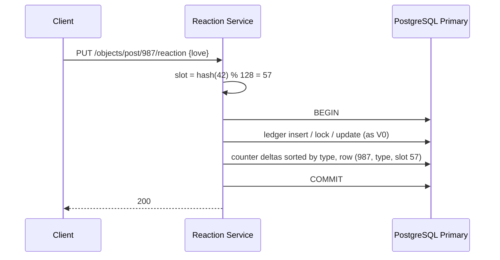

## Current state (V1)

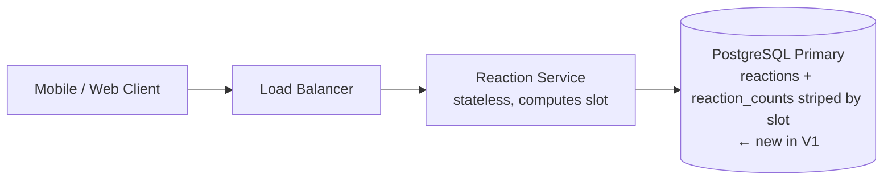

**Write path (react, change, remove)**
1. Client sends `PUT` or `DELETE` to the Load Balancer.
2. The Load Balancer forwards it to a Reaction Service instance.
3. Reaction Service computes `slot = hash(user_id) % 128`. ← new in V1
4. It opens one transaction and writes the `reactions` ledger row, as in V0.
5. It applies counter deltas, sorted by reaction type, to the slot rows. ← new in V1
6. It commits and returns 200.

**Read path: object counts**
1. Client calls `GET` for an object.
2. Reaction Service runs `SUM(count) GROUP BY reaction_type` over the object's slot rows. ← changed in V1
3. It returns per-type counts.

**Read path: viewer state:** unchanged from V0.

## Interview follow-ups

**Q: Why not just use Redis `INCR` for the hot counter?**
A: A single Redis key is also a single-threaded hot spot, though it is faster, at roughly 100K ops per second. More importantly, it breaks the atomic link between ledger and tally. A crash between the two writes leaves them permanently out of sync. Redis fits later as a cache, not as the source of truth. Striping fixes the contention at the source.

**Q: Why hash the user ID rather than pick a random slot?**
A: Random slots let a user's un-like land on a different slot than their like. That makes slots go negative and complicates repair. A deterministic slot keeps each slot non-negative, so the sum is always honest.

## Recap

| Concept | The Insight |
|---|---|
| Row lock as ceiling | One row serves about 1 ÷ commit time. At 2 ms that is 500 per second, no matter how big the machine is. |
| Optimistic retry | Retrying under heavy contention adds load and lowers throughput. |
| Striped counter | The count only needs to be summable, so split it across rows and sum on read. |
| Slot by user hash | Keeps a user's like and un-like in the same slot, so no slot goes negative. |
| Sorted lock order | Updating rows in a fixed order prevents deadlocks on change-reaction. |

**Interview arc:** *"If asked how you handle a viral post: one counter row caps at about 500 updates per second because of its row lock, so I split it into 128 slot rows chosen by user hash and sum them on read, which spreads the contention at the cost of a heavier read."*

**Next:** the row lock is no longer the problem. Now 50K transactions per second, each with two writes and a WAL flush, hit one primary, and the primary itself runs out of write capacity.


-----------------------------------------------------------------------------------------------------------------------
-----------------------------------------------------------------------------------------------------------------------
-----------------------------------------------------------------------------------------------------------------------
-----------------------------------------------------------------------------------------------------------------------


# V2: Shard by object

## Break it

Every like on every object now lands on one PostgreSQL primary. Each write is a transaction with a ledger upsert, one or two counter upserts, and a WAL flush.

A well-tuned primary handles about 8K of these per second. We budgeted 100K per second overall.

Here is the failure at peak:

- Writers arrive at 100K per second against a ceiling of 8K.
- Commit latency climbs from 2 ms to over 100 ms as the WAL queue grows.
- Connection pools fill, and every object's writes stall together.
- The disk also holds every reaction ever made, so the single machine runs out of space as well as throughput.

V1 removed the row lock as the bottleneck. Now the whole machine is the bottleneck. We need more than one primary, and that means splitting the data.

## The mechanism

Think of a library with one librarian. Add more librarians and give each a range of shelves. Each librarian handles only their own shelves.

Sharding does that to a database. We split the data across several primaries. A rule decides which primary owns which row. Every request is routed to the owner.

The rule is the shard key. It matters more than anything else in this version.

## Candidate shard keys

The write transaction touches two tables, `reactions` (keyed by user and object) and `reaction_counts` (keyed by object). V0 relied on both being updated in one transaction. The shard key must keep that true.

| Shard key | Write transaction | Read counts | Viewer state for 50 posts | Verdict |
|---|---|---|---|---|
| `user_id` | Ledger is local, but the counter for an object lives on every shard. Each write needs a cross-shard transaction (2PC) | Scatter to every shard | One shard | Rejected |
| `object_id` | Ledger row and counter rows sit on the same shard. Single-shard transaction | One shard | Fans out across shards | Chosen |
| `(object_id, user bucket)` | Single shard | Scatter across buckets | Fans out | Deferred. This is a hot-object fix, covered in the next version |

We choose `object_id`. It keeps the transaction from V0 and V1 intact, with exactness and idempotency unchanged. The ledger row for (user 42, post 987) lives on post 987's shard, not user 42's shard.

The price is viewer state. A feed page has 50 posts spread across shards. With 16 physical shards, 50 random posts touch about 15 of them. So one feed load becomes about 15 parallel queries. That is acceptable for now. A later cache version will remove most of them.

## Hotspots

The traffic shape creates one. A viral object lives on exactly one shard. That shard receives all 50K per second for post 987.

That is above the 8K ceiling of one host. Sharding by object spreads normal load, but it does not solve the viral object. That is the next version's job. The candidate fixes are:

- Spread the hot object across several shards.
- Buffer its writes in a queue and apply them in batches.
- Detect it early and promote it.

We name them here and build one in V3. Folding it in now would put two mechanisms in one version.

## Resharding cost

Sizing first. 100K writes per second at 8K per host needs at least 13 hosts. We take 16, so the average load is about 6K per host with headroom.

Now the routing choice. The obvious rule is `hash(object) % 16`. It breaks when we add a 17th host:

- An object stays put only if `hash % 16` equals `hash % 17`.
- That is true for about 1 key in 17.
- So about 94% of all rows would move.

That is a full migration at the worst time. Instead we add one level of indirection:

- Hash each object into one of **1024 logical shards**. This number never changes.
- A **shard map** assigns each logical shard to a physical host. Each host starts with 64.
- Adding a host means moving some logical shards. Each move is 1/1024 of the data, and only that slice pauses.

| Option | Resharding cost | Complexity | Verdict |
|---|---|---|---|
| `hash % N` | About 94% of rows move when N goes 16 to 17 | Lowest | Rejected |
| Consistent hash ring | About 1/N of rows move | Needs ring and vnode management | Rejected. Not needed |
| Logical shards plus shard map | Move whole logical shards, one at a time | A small lookup table | Chosen |

- ✅ **What we gained:** about 16 times the write capacity. Single-shard transactions are kept. Resharding has a bounded blast radius.
- ⚠️ **What we gave up:**
  - Viewer state fans out to about 15 shards per feed page.
  - Each shard is still a single primary, so it is a single point of failure.
  - A viral object still pins one shard.
  - Every request now needs a shard-map lookup.
- ❌ **Rejected:** sharding by `user_id`. It makes every write a cross-shard transaction. 2PC adds a coordinator round trip and blocks on failures.
- ❌ **Rejected:** a second copy of the ledger keyed by user, to make viewer state a single-shard read. That is a dual write across shards, and the two copies can disagree.

## Schema change (delta only)

On every physical host, the same two tables exist, plus one column on each:

```sql
ALTER TABLE reactions        ADD COLUMN logical_shard SMALLINT NOT NULL;
ALTER TABLE reaction_counts  ADD COLUMN logical_shard SMALLINT NOT NULL;
CREATE INDEX ON reactions (logical_shard);
CREATE INDEX ON reaction_counts (logical_shard);
```

The primary keys are unchanged. The new column exists only so we can move one logical shard's rows later.

The shard map is a new tiny structure:

```sql
CREATE TABLE shard_map (
  logical_shard  SMALLINT PRIMARY KEY,   -- 0..1023
  physical_host  TEXT     NOT NULL,      -- 'pg-07.internal'
  state          TEXT     NOT NULL DEFAULT 'active'  -- 'active' | 'moving'
);
```

## Who writes, who reads

| Structure | Lives in | Who writes, and when | Who reads, and when |
|---|---|---|---|
| `reactions` | The owning PostgreSQL shard | Reaction Service, every react, change, remove | Reaction Service, viewer state and change detection |
| `reaction_counts` | The owning PostgreSQL shard | Reaction Service, in the same transaction | Reaction Service, object counts |
| `shard_map` | A small replicated config store (3-node etcd, or a tiny Postgres) | The resharding operator, only during a move | Every Reaction Service instance. It loads at start and watches for changes |

## Implement it

**Routing (Reaction Service, Python):**

```python
import mmh3
N_LOGICAL = 1024

def logical_shard(object_type: int, object_id: int) -> int:
    return mmh3.hash(f"{object_type}:{object_id}") % N_LOGICAL

def pool_for(ls: int):
    return pools[shard_map[ls].physical_host]   # shard_map is cached, updated by a watch
```

**Write path.** The API is unchanged: `PUT /v1/objects/post/987/reaction {"reaction": "love"}`.

1. Reaction Service computes `ls = logical_shard(1, 987)`, say 417.
2. It looks up `shard_map[417]`, say `pg-07`.
3. If `state = 'moving'`, it waits briefly and retries. Otherwise it takes a connection from the `pg-07` pool.
4. It runs the V1 transaction on `pg-07`. Every insert now also sets `logical_shard = 417`:

```sql
INSERT INTO reactions (user_id, object_type, object_id, reaction_type, logical_shard)
VALUES (42, 1, 987, 2, 417)
ON CONFLICT (user_id, object_type, object_id) DO NOTHING;
```

```sql
INSERT INTO reaction_counts (object_type, object_id, reaction_type, slot, count, logical_shard)
VALUES (1, 987, 2, 57, 1, 417)
ON CONFLICT (object_type, object_id, reaction_type, slot)
DO UPDATE SET count = reaction_counts.count + EXCLUDED.count;
```

5. `COMMIT` on `pg-07`. The ledger row and every counter row are on the same host, so this is one local transaction.

**Read path: object counts.** Same `SUM ... GROUP BY` query as V1, sent to the one host that owns the object.

**Read path: viewer state.** This is the changed flow.

```
POST /v1/reactions/mine
{ "object_type": "post", "object_ids": [987, 988, 989, ...50 ids] }
```

1. Reaction Service computes `logical_shard` for each ID.
2. It groups the IDs by `physical_host`.
3. It sends one query per host, in parallel:
   ```sql
   SELECT object_id, reaction_type FROM reactions
   WHERE user_id = 42 AND object_type = 1
     AND object_id = ANY($ids_for_this_host);
   ```
4. It merges the results into one map and returns it.
5. If one shard is slow or down, it returns the rest with a partial flag, and the client shows those posts with no reaction highlighted.

**Resharding (operator procedure, adding host 17):**

1. Pick 60 logical shards from the busiest hosts.
2. Start PostgreSQL logical replication to `pg-17`. Use a row filter `WHERE logical_shard IN (...)`.
3. Wait for it to catch up.
4. For each moving shard, set `state = 'moving'`. Writes to that shard pause. This lasts under a second.
5. Confirm the replica is caught up. Then update `physical_host = 'pg-17'` and set `state = 'active'`.
6. Delete the old rows later.

Each move touches 1/1024 of the traffic, so a mistake is contained.

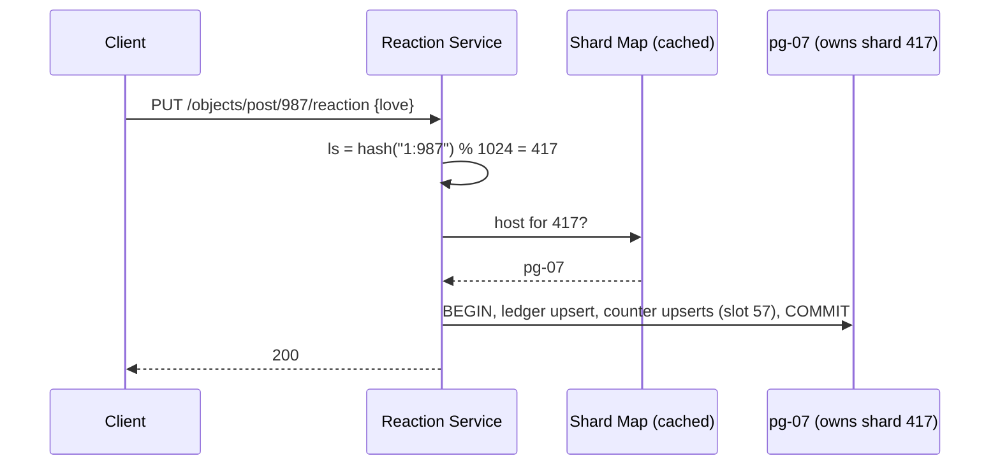

## Current state (V2)

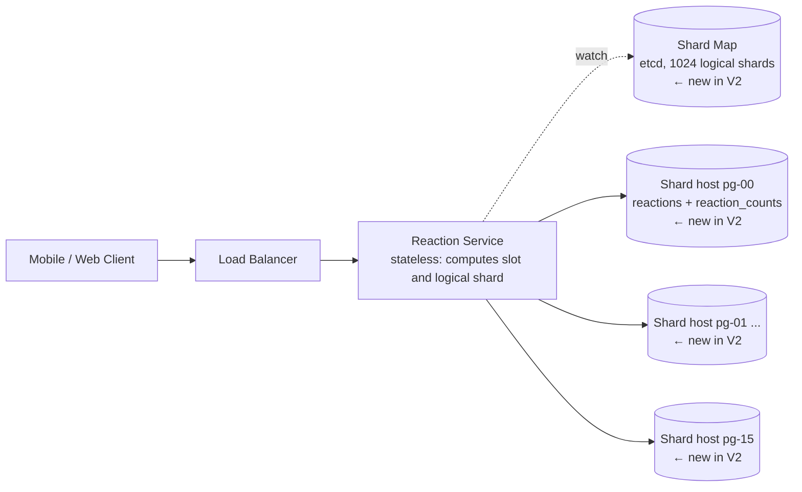

Each shard host holds 64 logical shards. The tables are the V1 striped tables plus a `logical_shard` column.

**Write path (react, change, remove)**
1. Client sends `PUT` or `DELETE` to the Load Balancer.
2. The Load Balancer forwards it to a Reaction Service instance.
3. Reaction Service computes `logical_shard(object)` and looks up the host in its cached shard map. ← new in V2
4. It computes `slot = hash(user_id) % 128`, as in V1.
5. It opens one transaction on that host. It writes the `reactions` row, then the sorted counter deltas.
6. It commits and returns 200.

**Read path: object counts**
1. Client calls `GET` for an object.
2. Reaction Service routes to the owning host. ← changed in V2
3. It runs `SUM(count) GROUP BY reaction_type` over the slot rows and returns the counts.

**Read path: viewer state**
1. Client sends the IDs of the current feed page.
2. Reaction Service groups the IDs by owning host. ← changed in V2
3. It runs one batch `SELECT` per host in parallel, about 15 per feed load.
4. It merges the results and returns them.

**Resharding path (operator)**
1. Replicate selected logical shards to the new host.
2. Pause each shard briefly, flip its shard-map entry, and resume. ← new in V2

## Interview follow-ups

**Q: Why not consistent hashing?**
A: A ring gives bounded movement too, but it needs vnode management and its placement is implicit. Here we already have a fixed set of 1024 logical shards. A lookup table gives the same bounded movement, makes placement explicit, and lets us move any shard by hand, such as a hot one.

**Q: What if a shard host dies?**
A: Today, writes and reads for its 64 logical shards fail while the other 15 hosts are healthy. The blast radius is about 1/16 of objects. It is still a real outage for those objects. Replication is a later version and fixes this.

## Recap

| Concept | The Insight |
|---|---|
| Shard key choice | Pick the key that keeps the write transaction on one shard. Here that is the object, so ledger and counters stay together. |
| Cost moves to reads | Sharding by object makes viewer state a fan-out. You pay on the read side for a cheap write side. |
| Hot objects survive sharding | A viral object is still one key on one shard. Sharding spreads objects but cannot split one. |
| Logical shards | Fix 1024 logical shards and map them to hosts. Adding a host moves slices, not 94% of the data. |
| Shard map | A small cached lookup is the only new routing state. Moves flip one entry. |

**Interview arc:** *"If asked how you scale writes past one primary: sharding by user would make every like a cross-shard transaction, so I shard by object, keeping the ledger and counters co-located in one local transaction. I route through 1024 logical shards mapped to hosts, so adding capacity moves small slices instead of rehashing everything."*

**Next:** post 987 is still 50K likes per second on a single shard that can take 8K. Sharding spread the objects, but one object is now the problem again.


-----------------------------------------------------------------------------------------------------------------------
-----------------------------------------------------------------------------------------------------------------------
-----------------------------------------------------------------------------------------------------------------------
-----------------------------------------------------------------------------------------------------------------------


# V3: Absorb the viral burst with a durable log and batch apply

## Break it

Marcus watches a live final and taps the heart on post 987. So do 50K other people each second.

Post 987 lives on one logical shard, say 417, on host `pg-07`. Every like is its own transaction with its own WAL flush. `pg-07` tops out at about 8K of those per second.

Here is what happens at peak:

- 42K writes per second have nowhere to go.
- In 60 seconds, 2.5M requests are queued or timing out.
- Clients retry the timeouts, which adds load.
- The other objects on `pg-07`'s 64 logical shards share the same WAL and connection pool. They stall too.

V1 removed the row lock. V2 spread objects across hosts. But one object is still one key on one host. The 8K ceiling comes from the number of transactions, not the number of likes.

## Naive attempts at the crux

**Attempt 1: a bigger host for hot shards.**
This looked reasonable because the ceiling is host capacity. A larger machine might reach 15K per second. We are still 3x short. Any object can go viral, so we would be buying that hardware for every shard.

**Attempt 2: detect hot objects and move them to a dedicated shard.**
Two engineers argue it out:

> **Dev A:** "Watch the per-object rate. When it passes 5K per second, migrate that object to its own host."
> **Dev B:** "The detector needs a few minutes of data. By then `pg-07` is already down. And a dedicated host still caps at 8K, but the object is doing 50K."

The detector fires too late. Even when it works, the ceiling is unchanged.

**Attempt 3: split the object across shards by user bucket.**
This is a real fix. The ledger key becomes `(object_id, hash(user) % B)`, and each bucket is its own shard. It breaks in two ways:

- Existing ledger rows for post 987 are all on `pg-07`. Changing the routing mid-spike strands them.
- Every count read becomes a scatter across B shards.

It stays in our back pocket as a fallback for objects beyond what this version can absorb.

**The insight:** the cost is per transaction, not per like. A transaction of 2,000 likes costs one WAL flush. So 50K likes per second can ride in about 25 transactions per second.

## Solve it: a durable log, then batch apply

Think of a post office. Customers drop letters through a slot into a durable mailbag. A clerk takes a full sack of 2,000 letters, sorts them, and files them in one pass. Dropping a letter is fast. Filing happens at the clerk's pace.

We split the write path in two:

1. **Accept.** The Reaction Service appends the user's desired reaction to a durable log. It acknowledges right after.
2. **Apply.** A new Reaction Applier reads the log in batches and runs one transaction per batch.

**Why a log, and why this storage class.** The access pattern is append-only, ordered per key, replayable, and bursty. A partitioned commit log (Kafka) fits that shape. A relational table cannot absorb the burst. A cache is not durable. This also answers the V1 objection to in-memory batching, because the log survives a crash.

**Two design rules make it safe:**

- **Events say what the user wants, not what to add.** The event is "user 42 wants love on post 987", never "+1". The Applier compares it with the ledger row. Replaying an event cannot double count.
- **One partition per logical shard.** Partition number equals `logical_shard`. All events for an object land in one partition, in order. All objects in that partition live on one host. So each batch is one local transaction, as in V2.

| Option | Absorbs 50K/s on one object | Complexity | Keeps ledger + counter in one transaction | Verdict |
|---|---|---|---|---|
| Detect hot, then promote to dedicated shard | No, the host still caps at 8K | Detector plus live migration | Yes | Rejected |
| Split object across shards by user bucket | Yes | Re-routing live rows, scatter reads | Yes, per bucket | Held as fallback |
| Redis `INCR` plus async flush | Yes | Low | No, ledger and tally drift on a crash | Rejected |
| Durable log, then batch apply | Yes, about 25 commits per second | One new component | Yes, inside each batch | Chosen |

- ✅ **What we gained:**
  - The 8K per-transaction ceiling stops mattering. `pg-07` sees about 25 commits per second from the hot object.
  - The counter slot rows from V1 are touched once per batch, not once per like.
  - The log is also a durable event stream, which later feeds notifications and analytics.
  - Resharding gets gentler: during a move we just pause the partition. Producers keep appending and no client sees an error.
- ⚠️ **What we gave up:**
  - **Read-your-writes is broken for now.** The write returns before the ledger or counters change. Marcus's tap shows up after the lag. The client shows his tap optimistically in the meantime, but a refresh inside the lag window shows the old state. Restoring this is a P1, and the caching version will fix it.
  - **Counts lag.** Normal lag is under a second. During a backlog it grows. Scope allows a few seconds.
  - **A new stateful system to run.** Kafka brokers, partitions, and consumer lag all need operating.
  - **Head-of-line blocking.** A hot object delays the other objects in its partition if the Applier falls behind.
  - **A ceiling remains.** One Applier handles one partition, so one object tops out at roughly 60K events per second. That is above our 50K target, but not by much. Beyond that, Attempt 3 is the fallback.
- ❌ **What we considered and rejected:**
  - Queueing only hot objects. That needs the detector from Attempt 2, plus two code paths.
  - A Redis counter as the source of truth. It cannot be tied to the ledger transactionally.

## Schema and topic changes

The tables `reactions` and `reaction_counts` are unchanged. One small table is new on every shard host:

```sql
CREATE TABLE applied_offsets (
  partition_id SMALLINT PRIMARY KEY,   -- equals logical_shard
  next_offset  BIGINT   NOT NULL       -- next log offset to apply
);
```

The new Kafka topic:

```
topic: reaction-commands
partitions: 1024 (partition id = logical_shard)
replication factor: 3, min.insync.replicas: 2
retention: 7 days
dead-letter topic: reaction-commands-dlq
```

**Event payload** (message key and partition are both `logical_shard`):

```json
{ "user_id": 42, "object_type": 1, "object_id": 987, "desired": 2, "ts": 1793600000123 }
```

`desired` is `null` for a remove.

## Who writes, who reads

| Structure | Lives in | Who writes, and when | Who reads, and when |
|---|---|---|---|
| Topic `reaction-commands` | Kafka cluster (3+ brokers) | Reaction Service, on every `PUT` and `DELETE` | Reaction Applier, continuously |
| Topic `reaction-commands-dlq` | Kafka cluster | Reaction Applier, for events it cannot process | On-call engineer, via a replay tool |
| `reactions` | Owning PostgreSQL shard | **Reaction Applier**, once per batch (was Reaction Service) | Reaction Service, for viewer state. Applier, for change detection |
| `reaction_counts` | Owning PostgreSQL shard | **Reaction Applier**, once per batch | Reaction Service, for object counts |
| `applied_offsets` | Owning PostgreSQL shard | Reaction Applier, in the same transaction as the batch | Reaction Applier, on partition start |
| `shard_map` | etcd | Resharding operator | Reaction Service and Reaction Applier (watch) |

## Implement it

**API.** The path is unchanged. The response is not.

```
PUT /v1/objects/post/987/reaction
{ "reaction": "love" }

-> 202 Accepted
{ "status": "accepted", "reaction": "love" }
```

`DELETE` also returns 202.

**Step 1: Accept (Reaction Service)**

```python
producer = AIOKafkaProducer(acks="all", enable_idempotence=True, linger_ms=5)

async def put_reaction(user_id, obj_type, obj_id, reaction):
    ls = logical_shard(obj_type, obj_id)          # from V2
    event = {"user_id": user_id, "object_type": obj_type, "object_id": obj_id,
             "desired": REACTION_IDS[reaction], "ts": now_ms()}
    await producer.send_and_wait("reaction-commands",
                                 json.dumps(event).encode(),
                                 key=str(ls).encode(), partition=ls)
    return 202
```

If the produce fails, the service returns 503 and the client retries. A retry is safe because the event is "set state", not "add one".

**Step 2: Apply (Reaction Applier)**

Each Applier instance owns a set of partitions, for example 64 of them. It runs one loop per partition.

```python
async def run_partition(p):
    next_off = await load_offset(p)               # SELECT next_offset FROM applied_offsets
    consumer.seek(TopicPartition("reaction-commands", p), next_off)
    while True:
        events = await consumer.getmany(max_records=2000, timeout_ms=50)
        if events:
            await apply_batch(p, events)
```

`apply_batch` does the real work:

1. **Collapse.** Keep only the last event per `(object_type, object_id, user_id)`. A user who tapped like, unlike, and love inside the batch becomes one event.
2. **Read old state, locking rows:**
   ```sql
   SELECT r.user_id, r.object_type, r.object_id, r.reaction_type
   FROM reactions r
   JOIN unnest($1::bigint[], $2::smallint[], $3::bigint[])
        AS k(user_id, object_type, object_id)
     USING (user_id, object_type, object_id)
   FOR UPDATE OF r;
   ```
3. **Compute net deltas in memory.** For each user, compare old and new:
   ```python
   deltas = defaultdict(int)       # (obj_type, obj_id, reaction_type, slot) -> net change
   for key, new in final.items():
       old = old_map.get(key)
       if old == new: continue                   # replay or no-op
       slot = slot_for(key.user_id)              # V1 function, now called here
       if old is not None: deltas[(*key.obj, old, slot)] -= 1
       if new is not None: deltas[(*key.obj, new, slot)] += 1
   ```
4. **BEGIN, then write the ledger in bulk.** One statement for sets and changes, one for removes:
   ```sql
   INSERT INTO reactions (user_id, object_type, object_id, reaction_type, logical_shard)
   SELECT * FROM unnest($1::bigint[], $2::smallint[], $3::bigint[],
                        $4::smallint[], $5::smallint[])
   ON CONFLICT (user_id, object_type, object_id)
   DO UPDATE SET reaction_type = EXCLUDED.reaction_type, updated_at = now();
   ```
   ```sql
   DELETE FROM reactions r
   USING unnest($1::bigint[], $2::smallint[], $3::bigint[]) AS k(user_id, object_type, object_id)
   WHERE r.user_id = k.user_id AND r.object_type = k.object_type
     AND r.object_id = k.object_id;
   ```
5. **Write the counters in bulk.** The batch is sorted by `(object_type, object_id, reaction_type, slot)`. It has at most 768 rows per object:
   ```sql
   INSERT INTO reaction_counts (object_type, object_id, reaction_type, slot, count, logical_shard)
   SELECT * FROM unnest($1::smallint[], $2::bigint[], $3::smallint[],
                        $4::smallint[], $5::bigint[], $6::smallint[])
   ON CONFLICT (object_type, object_id, reaction_type, slot)
   DO UPDATE SET count = reaction_counts.count + EXCLUDED.count;
   ```
6. **Record progress in the same transaction:**
   ```sql
   INSERT INTO applied_offsets (partition_id, next_offset) VALUES ($1, $2)
   ON CONFLICT (partition_id) DO UPDATE SET next_offset = EXCLUDED.next_offset;
   ```
7. `COMMIT`.

**Why the offset lives in PostgreSQL, not Kafka.** If the Applier crashes after the commit but before a Kafka offset commit, the batch would replay. Storing the offset in the same transaction removes that gap. A crashed or replaced Applier reads `applied_offsets` and resumes exactly where the data stopped. Each batch is applied once.

**Sizing, one line.** A bulk upsert of 2,000 ledger rows commits in roughly 30 to 40 ms, so one Applier drains about 50 to 60K events per second per partition. That is an estimate, so load-test it. At 2,000 events per batch, the hot object costs about 25 commits per second.

**Failure handling:**

- **Bad event** (unknown reaction type, malformed JSON): retry three times, then publish to `reaction-commands-dlq` and advance the offset. One bad event never blocks a partition.
- **Shard host down:** the Applier retries the batch with backoff and jitter. The partition stalls but the log keeps absorbing writes.
- **Resharding (changed from V2):** the operator pauses the partition's loop instead of making writers retry. `applied_offsets` moves with the logical shard, because its `partition_id` equals the `logical_shard`. After the `shard_map` flip, the loop resumes against the new host.

**Observability:** consumer lag per partition (the headline metric, alert above 30 seconds), batch size and commit latency, DLQ depth, and produce error rate.

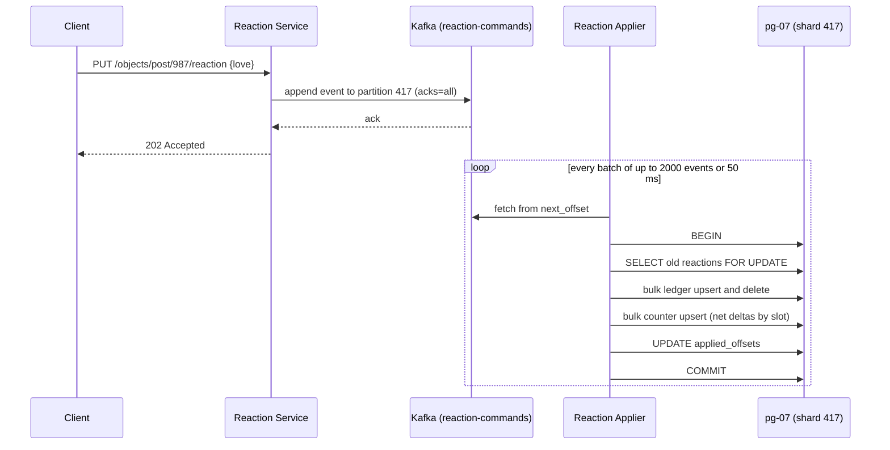

## Current state (V3)

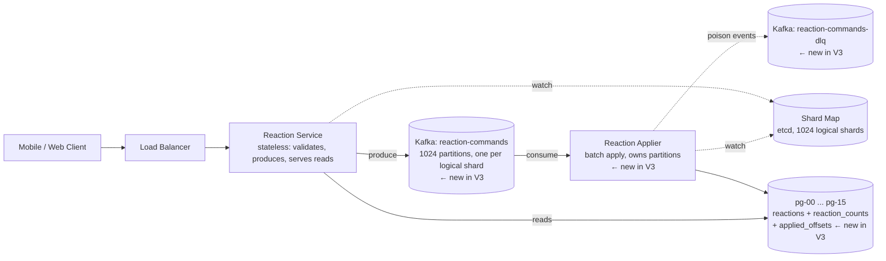

**Write path (react, change, remove)**
1. Client sends `PUT` or `DELETE` to the Load Balancer.
2. The Load Balancer forwards it to a Reaction Service instance.
3. Reaction Service computes `logical_shard(object)` and appends a "desired state" event to Kafka `reaction-commands`, partition equal to that logical shard. ← changed in V3
4. Kafka acknowledges after replication, and Reaction Service returns 202. ← changed in V3
5. Reaction Applier reads a batch from that partition, collapses it per user, and computes net deltas by slot. ← new in V3
6. It runs one PostgreSQL transaction on the owning host. The transaction covers the bulk `reactions` write, bulk `reaction_counts` deltas, and the `applied_offsets` update. ← new in V3
7. If an event is bad, it goes to `reaction-commands-dlq` after retries. ← new in V3

**Read path: object counts**
1. Client calls `GET` for an object.
2. Reaction Service routes to the owning host through the shard map.
3. It runs `SUM(count) GROUP BY reaction_type` over the slot rows. This is unchanged from V2, but the data now lags writes by the Applier lag. ← changed in V3

**Read path: viewer state**
1. Client sends the IDs of the current feed page.
2. Reaction Service groups the IDs by owning host and runs one parallel batch `SELECT` per host.
3. It merges and returns. This is unchanged from V2, but it is also stale by the Applier lag. ← changed in V3

**Resharding path (operator)**
1. Replicate the selected logical shards to the new host.
2. Pause the Applier's partition loop. Producers keep appending. ← changed in V3
3. Flip the `shard_map` entry and resume the loop against the new host.

## Interview follow-ups

**Q: You made writes async. Are your counts still exact?**
A: Yes, they converge to exact. Events carry desired state and the ledger diff produces the deltas. Replays are no-ops, and the offset commits in the same transaction as the data. What we lost is freshness, not correctness, and that is the trade the scope allowed.

**Q: What if the Applier falls behind on the viral partition?**
A: Lag grows, and objects sharing that partition see stale counts, but nothing is lost because the log holds the backlog. The first response is more capacity per batch. If one object stays above the roughly 60K per second ceiling, we split its ledger by user bucket across partitions, which is Attempt 3 and was deliberately held back.

## Recap

| Concept | The Insight |
|---|---|
| Cost per transaction | The ceiling is commits per second, not likes per second. Batching 2,000 likes into one commit gives about 25 commits per second at 50K likes per second. |
| Log before database | A durable log absorbs a burst, so the database drains at its own pace instead of falling over. |
| Desired-state events | Events say "user wants love", not "+1". Replays and retries then cannot double count. |
| Partition equals logical shard | Per-object ordering and single-host batches come from one routing rule. |
| Offset in the same transaction | Storing progress with the data makes each batch apply exactly once, even across crashes. |
| What was paid | Read-your-writes and instant counts are gone for now. Lag is the new metric to watch. |

**Interview arc:** *"If asked how you handle a viral object doing 50K likes per second on one shard: per-like transactions cap a host at about 8K, and moving the object to its own shard doesn't change that cap, so I put a durable log in front, partitioned by logical shard, and apply it in batches of 2,000 as one transaction with the offset stored inside it, which turns 50K writes per second into about 25 commits per second."*

**Next:** every shard host is still a single primary. If `pg-07` dies, its 64 logical shards stop applying and reading until someone recovers it, and the next version adds replication.


-----------------------------------------------------------------------------------------------------------------------
-----------------------------------------------------------------------------------------------------------------------
-----------------------------------------------------------------------------------------------------------------------
-----------------------------------------------------------------------------------------------------------------------


# V4: Replicate each shard for failover

## Break it

At 14:02, the disk controller on `pg-07` fails. `pg-07` owns 64 of the 1024 logical shards, about 1/16 of all objects. Post 987 is one of them.

Here is what happens with the V3 design:

- The Applier's batch transactions on `pg-07` fail. Its 64 partitions stall.
- Kafka keeps absorbing writes, so no like is lost. The backlog grows.
- Every count read and viewer-state read for those objects errors out.
- Recovery is a restore from backup plus WAL replay. For a host holding about 3 TB, that takes 30 to 60 minutes.
- Anything newer than the last archived WAL is gone from Postgres, along with its matching `applied_offsets` row.

So 6% of objects are dark for up to an hour. In V2 we noted that each shard host is a single point of failure. The log protects the writes. Nothing protects the availability of the shard itself.

## The mechanism

Think of a newspaper with a night editor and two deputies. The deputies read every page the editor files. If the editor collapses, a deputy takes over within minutes and the paper still goes out.

Replication does the same for a database. The primary streams its write-ahead log to standby copies. If the primary dies, a standby is promoted. The questions are how the stream is acknowledged and who decides the promotion.

## Are read replicas justified?

Reads outnumber writes here, roughly 50 to 1 at peak. I assume about 5M reads per second against 100K writes.

Two standbys give three times the read capacity. That is nowhere near 50 times. So read offload is a bonus, not the reason for replicas. Failover is the reason. Caching, in the next version, does the heavy lifting on reads.

The standbys exist anyway, so we let them serve reads. That is cheap for us because count reads are already stale by the Applier lag. A replica lag of 100 ms is invisible next to it.

## Sync, semi-sync, or async?

| Mode | Commit waits for | Data lost on failover | Cost | Verdict |
|---|---|---|---|---|
| Synchronous to all standbys | Every standby | None | Any standby outage blocks commits | Rejected |
| Semi-sync (`ANY 1` of 2) | One standby | None | About 1 to 2 ms per commit, and the primary's availability depends on at least one standby | Rejected |
| Asynchronous | Local disk only | Replication lag, typically under 1 s | Fastest commit, no coupling | Chosen |

Async normally means losing the last second of committed data on failover. That would be dangerous if Postgres were the only durable copy. It is not. Kafka is.

The 202 in V3 means the event is durable in Kafka with `acks=all`. Postgres is a derived view of the log. And `applied_offsets` commits in the same transaction as the data. So a promoted standby holds a consistent snapshot, with its data and its offset from the same moment.

After promotion, the Applier reads that offset and replays the missing seconds from Kafka. Events are desired-state, so the replay is idempotent. Zero committed likes are lost, and we never paid for synchronous commit.

Semi-sync would be the right call in V0 to V2, where Postgres was the only durable store. Here it buys nothing.

## Who promotes, and what about split-brain?

The dangerous failure is a primary that is alive but cut off from the network. A standby is promoted. The old primary still thinks it is the leader. Two primaries now accept writes and diverge.

There are four established fixes:

| Fix | Mechanism | Verdict |
|---|---|---|
| Leader lease with TTL | The primary must renew a key in etcd. If it cannot, it demotes itself before the TTL ends. A standby may only promote after the key expires | Chosen |
| Routing-layer fencing | Clients reach the primary only through a health-checked endpoint that asks "are you the leader?" | Chosen, as a second layer |
| STONITH | Power off the old node through the cloud API before promoting | Rejected as the main guard. It depends on a working control plane, and it is slow |
| Rewind after the fact | `pg_rewind` replays the old primary back to the fork point so it can rejoin as a standby | Chosen for cleanup |

The lease works because of timing. The old primary must give up writes within `loop_wait + retry_timeout`, which is 20 s. A standby may promote only after the 30 s TTL. The two windows never overlap.

```python
# Patroni's loop, in pseudocode
while True:
    if i_am_leader:
        ok = etcd.refresh(key="/pg-07/leader", value=me, ttl=30)
        if not ok and elapsed_since_last_success() > 20:
            demote_to_read_only()            # stop accepting writes
    else:
        if etcd.get("/pg-07/leader") is None and my_lag_bytes < 16_000_000:
            if etcd.create_if_absent("/pg-07/leader", me, ttl=30):
                promote()
    sleep(10)
```

The lag cap stops a badly lagging standby from being promoted. We already run a 3-node etcd for the shard map, so we reuse it.

- ✅ **What we gained:**
  - Failover drops from 30 to 60 minutes to about 30 to 40 seconds.
  - Zero committed likes are lost, because Kafka replays the gap.
  - A zone failure no longer takes out 1/16 of objects.
  - Reads get about 3 times more capacity.
- ⚠️ **What we gave up:**
  - Standby reads can lag. A user who refreshes may hit replica A, then replica B, and see a count that goes backwards by a few likes.
  - After failover, counts for that host's objects briefly regress. They catch up as the Applier replays.
  - The fleet triples to 48 Postgres nodes.
  - There is a new system to operate: Patroni and failover drills.
  - Read-your-writes is still missing. Replicas do not restore it.
- ❌ **What we considered and rejected:**
  - Backups only. Recovery takes too long.
  - Application-level dual writes to two hosts. The two copies can disagree, which is the same flaw that sank the second ledger in V2.
  - Cross-region replicas now. That belongs in the multi-region version.

## Schema and config changes (delta only)

The tables are unchanged. The `shard_map` entry now names a cluster instead of a single host:

```sql
-- physical_host now holds a cluster name; Patroni resolves who is leader
UPDATE shard_map SET physical_host = 'pg-07' WHERE logical_shard BETWEEN ...;
```

Patroni config, per node of cluster `pg-07`:

```yaml
scope: pg-07
etcd3: { hosts: [etcd-1:2379, etcd-2:2379, etcd-3:2379] }
bootstrap:
  dcs:
    ttl: 30
    loop_wait: 10
    retry_timeout: 10
    maximum_lag_on_failover: 16777216     # 16 MB
    synchronous_mode: false               # async, per decision above
postgresql:
  parameters:
    wal_level: replica
    max_wal_senders: 5
    hot_standby: "on"
    wal_keep_size: 8GB
```

Placement: one primary and two standbys, each in a different availability zone.

## Who writes, who reads

| Structure | Lives in | Who writes, and when | Who reads, and when |
|---|---|---|---|
| `reactions`, `reaction_counts`, `applied_offsets` | Cluster primary | Reaction Applier, once per batch | Applier, on the primary only (`FOR UPDATE` and offset reads need it) |
| Same tables, replicated | The two standbys | PostgreSQL streaming replication | Reaction Service, for count reads and viewer state |
| `/pg-NN/leader` key | etcd | The current primary's Patroni agent, every 10 s | Standbys' Patroni agents, and the routing layer |
| `shard_map` | etcd | Resharding operator | Reaction Service and Applier |

## Implement it

**Routing in the Reaction Service**

```python
def read_pool(ls: int, user_id: int):
    cluster = shard_map[ls].physical_host                   # 'pg-07'
    reps = healthy_replicas(cluster)                        # lag < 5 s, from replica health checks
    if not reps:
        return primary_pool(cluster)                        # fall back
    return reps[mmh3.hash(str(user_id)) % len(reps)]        # sticky per user

def primary_pool(cluster):
    return pools[f"{cluster}-primary"]                      # endpoint = HAProxy, health check GET :8008/primary
```

The sticky pick sends one user to the same standby every time. That removes most of the backwards-count glitches.

**Applier recovery after failover**

1. The Applier's batch fails with a connection error.
2. It retries with exponential backoff and jitter. The HAProxy health check keeps routing to the dead node until Patroni updates the leader.
3. After the new primary is up, it runs `SELECT next_offset FROM applied_offsets WHERE partition_id = $p`.
4. It calls `consumer.seek(partition, next_offset)`.
5. It resumes batching. Events between that offset and the lost tail are replayed. The ledger comparison turns each already-applied event into a no-op.

**Failover timeline**

1. 14:02:00. `pg-07` primary stops renewing the lease.
2. 14:02:30. The key expires. Standby B is the most caught up. It takes the key and promotes.
3. 14:02:35. HAProxy sees `/primary` return 200 from B. Writes can flow.
4. 14:02:40. The Applier reconnects, reseeks, and drains the backlog. At 50 to 60K events per second per partition, 40 s of backlog drains quickly.
5. Later. The old node returns, runs `pg_rewind`, and rejoins as a standby.

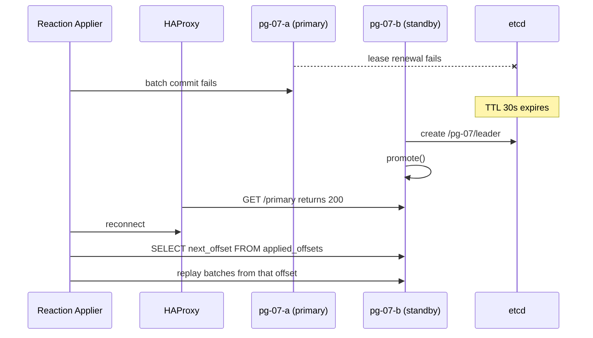

## Current state (V4)

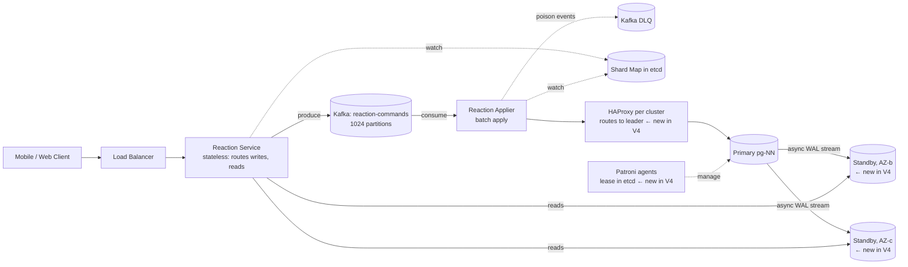

There are 16 clusters, each with one primary and two standbys.

**Write path (react, change, remove)**
1. Client sends `PUT` or `DELETE` to the Load Balancer, then a Reaction Service instance.
2. Reaction Service appends a desired-state event to Kafka `reaction-commands`, partition equal to the logical shard, and returns 202. Unchanged from V3.
3. Reaction Applier reads a batch and computes net deltas. Unchanged.
4. It reaches the cluster's current primary through HAProxy and runs one transaction. ← changed in V4
5. The primary streams WAL to both standbys asynchronously. ← new in V4
6. On failover, the Applier reads `applied_offsets` on the new primary and replays from there. ← new in V4

**Read path: object counts**
1. Client calls `GET` for an object.
2. Reaction Service finds the owning cluster and picks a healthy standby, sticky by user, or the primary if none is healthy. ← changed in V4
3. It runs `SUM(count) GROUP BY reaction_type` and returns the counts.

**Read path: viewer state**
1. Client sends the IDs of the current feed page.
2. Reaction Service groups IDs by cluster and sends one batch `SELECT` per cluster, to a standby. ← changed in V4
3. It merges and returns the results.

**Resharding path (operator):** unchanged from V3. The new cluster's primary receives the logical replication, and its own standbys follow by streaming.

## Interview follow-ups

**Q: Async replication can lose committed data. Why are you comfortable with that?**
A: Postgres is not the durable store here, Kafka is. The ack to the client means Kafka has the event on 3 brokers. The offset lives in the same transaction as the data, so a promoted standby is internally consistent. The Applier replays from the offset it finds, and replays are no-ops. I would choose semi-sync only if Postgres were the sole copy.

**Q: How do you stop two primaries after a network partition?**
A: A leader lease in etcd. The old primary must demote itself within 20 s of failing to renew. A standby cannot promote until the 30 s TTL has expired. The two windows do not overlap. HAProxy checks `/primary` as a second layer, and `pg_rewind` repairs the old node afterwards.

## Recap

| Concept | The Insight |
|---|---|
| Replicas for availability | Standbys exist mainly for failover. Read offload gives about 3 times capacity, not the 50 times we need. |
| Async is safe here | The log is the durable record, so losing the last second of Postgres commits costs nothing after replay. |
| Offset beside data | A promoted standby has data and offset from the same moment, so it resumes cleanly. |
| Lease before promotion | The standby promotes only after the old leader's lease expires, so two primaries never overlap. |
| Sticky replica reads | Pinning a user to one standby avoids counts jumping backwards between refreshes. |

**Interview arc:** *"If asked how a shard survives losing its primary: restoring from backup takes an hour, so each shard has two async standbys under a leader lease in etcd, and because the Kafka log is the durable record and the offset commits with the data, a promoted standby just replays the missing seconds, so failover takes about 40 seconds with no lost likes."*

**Next:** a viral post is read millions of times per second, and every read sums up to 768 rows on a standby. Caching is next. It will also give the actor their own like back instantly, which we gave up in V3.


-----------------------------------------------------------------------------------------------------------------------
-----------------------------------------------------------------------------------------------------------------------
-----------------------------------------------------------------------------------------------------------------------
-----------------------------------------------------------------------------------------------------------------------


# V5: Cache the reads, and give the actor their own like back

## Break it

Marcus's final is still on. Post 987 is being read 300K times per second, because every feed load and every post view asks for its counts.

Each count read is `SUM(count) GROUP BY reaction_type` over up to 768 slot rows. On a standby, that costs about 0.3 ms of CPU. So one standby serves about 3K of these per second, and `pg-07`'s two standbys serve about 6K.

We are 50 times short. Here is the cascade:

- The two standbys saturate their CPUs.
- Replica lag grows, because replay competes with queries.
- Our routing rule drops any standby with lag over 5 s, so reads fall back to the primary.
- The primary now serves reads and also runs the Applier's batch commits. Applier lag grows.
- The other 63 logical shards on `pg-07` slow down with it.

The same objects get the same answer over and over, and we recompute it every time.

There is a second problem. Marcus taps the heart, gets a 202, and refreshes. The Applier has not applied the event yet, so the heart is empty. We gave up read-your-writes in V3. Reads are the dominant pressure, so this version is a caching version. The actor fix rides along because it is the same Redis cluster with a second key family.

## The mechanism

Think of a pub that gets asked "what's the score?" a thousand times a minute. The barman stops checking the TV each time. He chalks the score on a board and glances at the TV only now and then.

A cache is the chalkboard. It holds a recent answer so most reads never touch the database. Three questions matter: what to cache, where, and how the board gets corrected.

## Justify the cache against the read pattern

- Reads outnumber writes about 50 to 1.
- The traffic is skewed. A few objects take most reads.
- Counts already tolerate a few seconds of staleness by scope.
- The answer is small, six integers per object.

All four point the same way. This is close to the ideal cache workload.

## Which layer?

| Layer | What it would cache | Verdict |
|---|---|---|
| Client | Counts on screen | Rejected. Clients already show what they have. It does nothing for 300K readers |
| CDN | Count responses | Rejected. Counts ride inside personalized feed responses, which are not cacheable at the edge. The public post page is a small share of reads |
| In-process (L1) | Counts on each Reaction Service instance | Chosen, 1 s TTL. This protects Redis from hot keys |
| Shared Redis (L2) | Counts, and each user's own reactions | Chosen |
| DB buffer cache | Slot rows | Already there. It does not remove the `SUM` CPU cost |

We say no to a CDN explicitly. It would add a layer without removing load.

## Invalidation: why not invalidate on write?

| Strategy | How it works | Why or why not |
|---|---|---|
| Invalidate on write | Delete the key whenever a like lands | Rejected. The hot key mutates continuously, so it is deleted 25 times per second and always cold |
| TTL only | Expire after N seconds | Fine for cold objects. For hot ones, every expiry sends a herd to the DB |
| TTL plus push refresh | The Applier writes fresh totals after committing a batch for hot objects. TTL covers the rest | Chosen |

The Applier is the only writer of counts, so it knows exactly when an object changed. That makes push refresh cheap and precise.

## Versioning, so stale data never overwrites fresh data

Two writers touch the same cache key. The Applier pushes after a commit. A reader fills from a standby after a miss. The standby may be behind, so a late fill could overwrite a newer push.

Every cache entry carries `v`, the partition's `applied_offsets.next_offset` at the time of the read. A write is accepted only if its `v` is not lower than the stored one. The count and its `v` come from one SQL statement, so they are a consistent snapshot.

## Cache stampede: the known sub-problem

Stampede means a popular key expires and thousands of readers all miss at once. All of them hit the DB. The established fixes:

| Fix | Mechanism | Sketch |
|---|---|---|
| Single-flight | Within one process, concurrent misses share one in-flight load | `inflight[key] = inflight.get(key) or create_task(load())` |
| Distributed lock | One caller across the fleet refreshes. The rest serve stale | `SET lock:key id NX PX 2000` |
| Probabilistic early refresh | Each reader may refresh a bit before expiry, with higher odds nearer the deadline | `if now - delta*beta*log(rand()) >= exp: refresh()` |
| Push refresh | Do not wait for expiry. The writer refreshes | The Applier's post-commit hook |

For this system:

- **Hot objects** use push refresh. Their entry never expires in practice.
- **Everything else** uses soft expiry, serving stale while one caller refreshes, plus single-flight and TTL jitter.

Probabilistic refresh is rejected because push already covers the keys where it would matter.

## Hot keys inside Redis

Post 987's cache key takes 300K reads per second. One Redis node handles about 100K ops per second. The cache would become the new hot spot. The fixes are:

- Replicate the key under suffixes, such as `rc:1:987#0` to `#7`, and pick one at random.
- Read from Redis replicas.
- Add an in-process L1 in front.

L1 wins. With 200 Reaction Service instances and a 1 s L1 TTL, the key is fetched from Redis at most 200 times per second. No suffix logic or key-spreading is needed.

## Gained, given up, rejected

- ✅ **What we gained:**
  - The DB serves misses only. At a roughly 99% hit rate, 5M reads per second becomes about 50K per second.
  - The viral key is served from process memory.
  - Marcus sees his own heart at once, via the viewer overlay.
  - Viewer-state fan-out drops from about 15 DB queries per feed load to about 1 Redis call, on a typical hit.
- ⚠️ **What we gave up:**
  - **More staleness.** Counts can now be 1 s (L1) plus Applier lag plus, for cold objects, up to about 5 s (TTL). That fits "a few seconds".
  - **Cold-start risk.** If Redis dies, 5M reads per second land on the standbys.
  - **Another stateful system** to size and operate. The cache fits in about 20 GB for 100M active objects at about 200 bytes each.
  - **Two writers per key.** The version rule is now load-bearing, so it needs tests.
- ❌ **Rejected:**
  - Redis `INCR` as the source of truth. We already ruled that out in V1 and V3.
  - Having the Applier `HINCRBY` the cache by the batch delta. A missed or repeated delta would drift the cache until the key expired. Re-reading the SUM is self-correcting.

## Cache shapes (first appearance)

All of this lives in one Redis Cluster, 6 shards with a replica each.

**Counts**

```
key:   rc:{object_type}:{object_id}        e.g. rc:1:987
type:  hash
fields: c1..c6 = count per reaction type
        v      = applied_offsets.next_offset when computed
        exp    = soft expiry (epoch ms)
hard TTL: 60 s  (PEXPIRE on every write)
```

**Viewer overlay**

```
key:   rv:{user_id}                         e.g. rv:42
type:  hash
field: "{object_type}:{object_id}"          e.g. "1:987"
value: "{reaction}|{ts_ms}|{kafka_offset}"  reaction 0 = none
hard TTL: 10 min, refreshed on write
```

The 10 min TTL is longer than any backlog we expect. A lag alert fires well before that.

## Who writes, who reads

| Structure | Lives in | Who writes, and when | Who reads, and when |
|---|---|---|---|
| L1 count cache | Reaction Service process memory | Reaction Service, on any count load | Reaction Service, every count read |
| `rc:*` | Redis Cluster | Reaction Applier, after a commit, for hot objects. Reaction Service, on a miss fill | Reaction Service, on an L1 miss |
| `rv:*` | Redis Cluster | Reaction Service, after Kafka acks (the actor's write). Reaction Service, on a DB fill, only for absent fields | Reaction Service, for every viewer-state read |
| `reactions`, `reaction_counts`, `applied_offsets` | PostgreSQL clusters | Applier, as in V4 | Reaction Service, on cache misses only, from standbys |

## Implement it

### Count read path

```
GET /v1/objects/post/987/reactions
-> 200 { "counts": {"like": 1203441, "love": 88120}, "version": 5918233 }
```

1. Reaction Service checks L1 (`cachetools.TTLCache(maxsize=10_000, ttl=1)`). A hit returns immediately.
2. On an L1 miss, it joins the single-flight for this key. Only one caller continues.
3. It runs `HGETALL rc:1:987` on Redis.
4. **Hit and `exp` is in the future:** return and fill L1.
5. **Hit but `exp` has passed (soft-expired):** return the stale value now. Try `SET lock:rc:1:987 <id> NX PX 2000`. The winner refreshes in the background. Everyone else just serves stale.
6. **Miss:** load from a standby. This is one statement, so it is one snapshot:

```sql
SELECT 'c' AS k, reaction_type::int AS a, SUM(count)::bigint AS b
FROM reaction_counts
WHERE object_type = 1 AND object_id = 987
GROUP BY reaction_type
UNION ALL
SELECT 'v', 0, next_offset FROM applied_offsets WHERE partition_id = 417;
```

7. Write the result with the compare-and-set script below. Jitter the soft expiry: `exp = now + 5000 * uniform(0.8, 1.2)`.

**Compare-and-set (Lua, runs atomically in Redis):**

```lua
-- KEYS[1] = rc key; ARGV[1] = version; ARGV[2] = soft expiry ms;
-- ARGV[3..] = field, value pairs (c1..c6)
local cur = tonumber(redis.call('HGET', KEYS[1], 'v') or '-1')
if tonumber(ARGV[1]) < cur then return 0 end        -- older data loses
redis.call('HSET', KEYS[1], 'v', ARGV[1], 'exp', ARGV[2],
           unpack(ARGV, 3))
redis.call('PEXPIRE', KEYS[1], 60000)
return 1
```

### Applier push (the only change to the write side)

After `COMMIT` in V3's `apply_batch`, add:

```python
hot = [obj for obj, n in events_per_object.items() if n >= 50]   # count from this batch
for (otype, oid) in hot:
    sums, v = await primary.fetch_counts_and_version(otype, oid, p)  # same SQL, on the primary
    await redis.evalsha(CAS_SHA, 1, f"rc:{otype}:{oid}", v,
                        now_ms() + 5000, *flatten_counts(sums))
```

- It reads from the primary, right after commit, so the value is as fresh as it can be.
- For post 987 that is about 25 extra `SUM`s per second, which is trivial.
- A Redis failure here is logged and ignored. The TTL covers it.
- The Applier does not push for cold objects. They would cost up to 2,000 extra reads per batch.

### Viewer overlay: write at accept

This changes V3's accept step by one line. The Redis write happens after Kafka acks.

```python
meta = await producer.send_and_wait(...)                # V3, unchanged
try:
    await redis.evalsha(OVERLAY_SET_SHA, 1, f"rv:{user_id}",
                        f"{obj_type}:{obj_id}", desired or 0, ts, meta.offset)
except RedisError:
    pass                                                # best effort
return 202
```

Because Redis is written after the ack, the overlay never claims something that is not durable.

```lua
-- OVERLAY_SET: newer ts wins, so two quick taps landing out of order do not flip the state
local cur = redis.call('HGET', KEYS[1], ARGV[1])
if cur then
  local cur_ts = tonumber(string.match(cur, '|(%d+)|'))
  if cur_ts and cur_ts > tonumber(ARGV[3]) then return 0 end
end
redis.call('HSET', KEYS[1], ARGV[1], ARGV[2] .. '|' .. ARGV[3] .. '|' .. ARGV[4])
redis.call('EXPIRE', KEYS[1], 600)
return 1
```

### Viewer overlay: read path

```
POST /v1/reactions/mine
{ "object_type": "post", "object_ids": [987, 988, 989] }
-> 200 { "reactions": { "987": {"r": "love", "pending": true}, "988": {"r": null} } }
```

1. Reaction Service runs `HMGET rv:42 1:987 1:988 1:989`. That is one call to one Redis node.
2. For ids that hit, use the value.
3. For ids that miss, group by cluster and run the V4 batch `SELECT` on a standby. Then write the results back with `HSETNX`-style fills, value `{reaction}|0|-1`, so any real tap (ts greater than 0) always wins over a fill. "No reaction" is cached too, as `0`.
4. `pending` is true when the entry's Kafka offset is at or beyond the cached count's `v` for that partition. That means the count does not include it yet. The client keeps its optimistic +1 only while `pending` is true.

### Failure handling

- **Redis timeout:** 20 ms budget, then fall back to a standby.
- **Circuit breaker:** after repeated Redis failures, trip it. Serve L1 and stale entries only, and shed excess misses with 503 and `Retry-After`. This stops a cold cache from taking down the standbys.
- **Observability:** L1 and L2 hit rates, soft-expired serves, CAS rejections (a high count means two writers are racing), standby query rate, and the staleness gauge (`now - exp` on served entries).

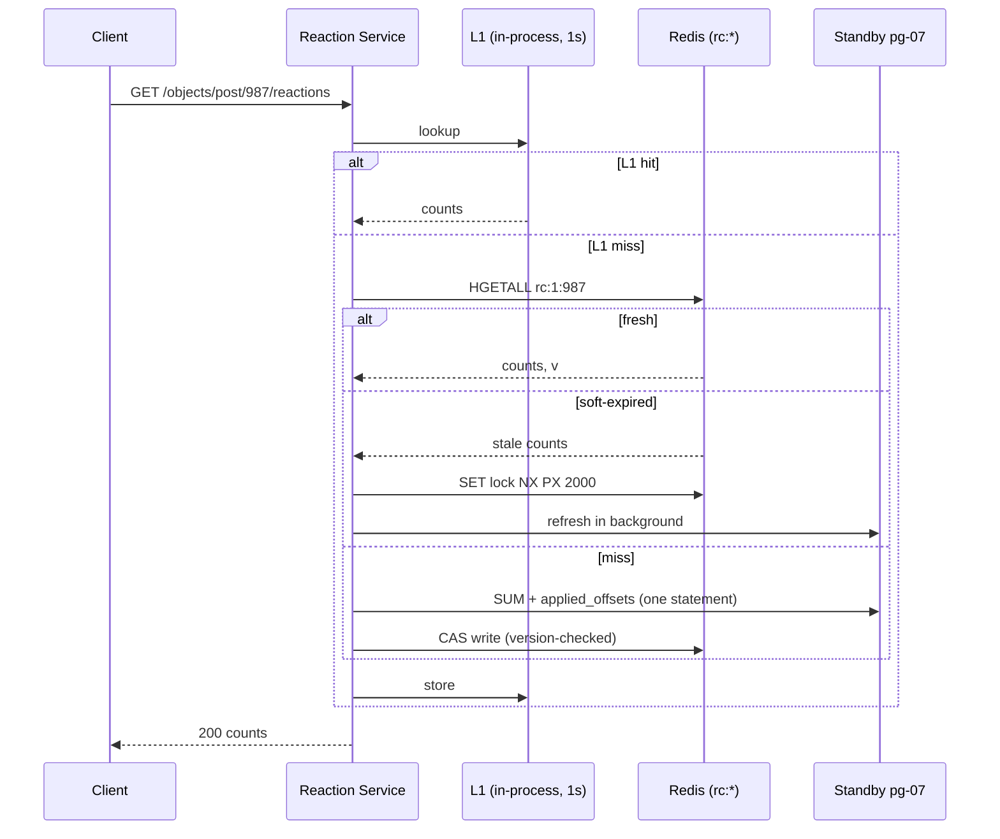

## Current state (V5)

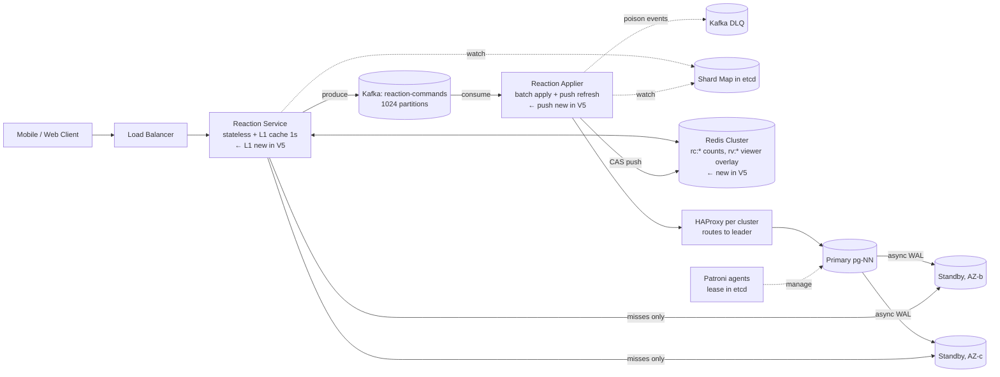

**Write path (react, change, remove)**
1. Client sends `PUT` or `DELETE` to the Load Balancer, then a Reaction Service instance.
2. Reaction Service appends a desired-state event to Kafka `reaction-commands`, partition equal to the logical shard. It waits for the ack.
3. It writes the actor's overlay entry in Redis `rv:{user}`, with the Kafka offset. Failure here is ignored. ← new in V5
4. It returns 202.
5. Reaction Applier reads a batch, computes net deltas by slot, and commits one transaction on the cluster primary through HAProxy. This includes the `applied_offsets` update. Unchanged from V4.
6. For objects with 50 or more events in the batch, the Applier re-reads the sums from the primary and pushes them to `rc:*` with the version check. ← new in V5
7. The primary streams WAL to both standbys asynchronously. On failover, the Applier replays from `applied_offsets`. Unchanged from V4.

**Read path: object counts**
1. Client calls `GET` for an object.
2. Reaction Service checks L1, then Redis `rc:*`. ← changed in V5
3. On a miss, it runs the combined `SUM` and version query on a standby, then fills Redis with the version check. ← changed in V5
4. Soft-expired entries are served stale while one caller refreshes. ← new in V5

**Read path: viewer state**
1. Client sends the IDs of the current feed page.
2. Reaction Service reads `rv:{user}` for all IDs in one call. ← changed in V5
3. For ids not found, it runs one batch `SELECT` per cluster on a standby, then fills the overlay without overwriting real taps. ← changed in V5
4. It marks `pending` where the entry is newer than the cached count version. ← new in V5

**Resharding path (operator):** unchanged from V4. Cache entries are keyed by object, not by host, so a move does not invalidate them.

## Interview follow-ups

**Q: Why not just invalidate the cache whenever a like is applied?**
A: The viral key mutates continuously, so it would be deleted constantly and every reader would miss. Invalidation also creates a window where readers stampede the DB. Instead, the Applier pushes the new value with a version number, so the key is never empty and an old fill cannot overwrite a newer push.

**Q: Redis goes down at peak. What happens?**
A: Reads fall through to the standbys, which cannot carry 5M per second. So we do three things. L1 keeps serving hot objects for its 1 s TTL. A circuit breaker sheds excess misses with a 503 and retry hint rather than collapsing the standbys. Redis Cluster has a replica per shard, so most outages are a failover, not a loss. Writes are unaffected, because the Redis write in the accept path is best-effort.

## Recap

| Concept | The Insight |
|---|---|
| Cache the skew | 50:1 reads and a few very hot objects make this a near-ideal cache workload. |
| Push beats invalidate | The Applier is the only writer, so it can refresh hot keys itself. Deleting a key that changes 25 times a second just guarantees misses. |
| Version every fill | Count and offset come from one query, and Redis only accepts newer versions. Stale fills cannot overwrite fresh pushes. |
| Stampede has options | Single-flight, locks, early refresh, and push each fit different keys. Hot keys get push, the rest get soft expiry. |
| L1 for hot keys | A 1 s in-process cache turns 300K reads per second on one key into about 200 per second on Redis. |
| Overlay restores read-your-writes | The actor's own tap is cached after the Kafka ack, with the offset, so Marcus sees his heart immediately and the client knows how long to keep its +1. |

**Interview arc:** *"If asked how you serve millions of count reads: recomputing a 768-row sum per read saturates the standbys, and invalidating on write is useless on a key that changes every few milliseconds, so I put an in-process L1 and a Redis L2 in front, let the Applier push version-checked totals for hot objects, and keep a per-user overlay written after the Kafka ack, which cuts DB reads by about 100 times and gives the actor their own reaction back immediately."*

**Next:** everything still runs in one region. A user in Singapore pays about 200 ms round trip to our Virginia cluster, and a regional outage takes the whole product down. Multi-region comes next, starting with who owns each write.


-----------------------------------------------------------------------------------------------------------------------
-----------------------------------------------------------------------------------------------------------------------
-----------------------------------------------------------------------------------------------------------------------
-----------------------------------------------------------------------------------------------------------------------


# V6: Go multi-region with one home per shard

## Break it

Aisha opens the app in Singapore. Our whole stack runs in Virginia, so every call from her phone crosses the Pacific.

- The round trip is about 200 ms.
- A cold connection needs about 3 round trips for TCP and TLS before the first byte. That is 600 ms before the feed's reaction data arrives.
- About 40% of our users are outside North America, so all of them pay this.
- Her heart tap waits 200 ms for the Kafka ack before the overlay is written.

At 09:10 the Virginia region loses networking for three hours. Every user on earth sees no counts and cannot tap.

Two pressures show up here: distance and regional survival. One mechanism cures both, which is a full copy of the serving path in each region. So they stay in one version. The hard part is deciding who owns each write.

## The mechanism

Think of a global newspaper. Each city has a local newsstand with that day's paper, so readers don't call head office. Only one editor per story decides what is true.

For us, every region gets local reads and a local front door for writes. Each piece of data still has one region that is allowed to change it. That region is its home.

I assume three regions: `us-east`, `eu-west`, `ap-southeast`.

## Who owns a write?

| Option | How it works | Verdict |
|---|---|---|
| One global primary region, remote regions read-only | Every write crosses to one region. If that region dies, writes stop worldwide | Rejected |
| Active-active counters (a PN-counter CRDT per region) | Each region counts locally and regions merge by summing | Rejected. A counter cannot enforce "one reaction per user per object". Two regions could both count the same user. We would need a global ledger anyway |
| One home region per logical shard | The ledger and counters for a shard are changed in exactly one region. Other regions accept writes and forward them | Chosen |

Home is assigned per logical shard, not per user. We spread the 1024 logical shards across the three regions, about 341 each, weighted by capacity. We do not place by geography. Writes are accepted locally in any case, so placement does not affect the user's latency. It only decides where the Applier and the primary run.

This also keeps the V2 rule: the ledger row and its counters stay in one local transaction on one primary.

## How a remote write reaches its home

| Option | Ack latency | Data lost if the source region is destroyed | Accepts writes if the home region is down | Verdict |
|---|---|---|---|---|
| Produce directly into the home region's Kafka | About 200 ms | None | No | Rejected |
| Produce to local Kafka, mirror to home | About 10 ms | Events not yet mirrored, about 1 s | Yes, they queue locally | Chosen |

A like is low-value data. Losing the last second of acknowledged likes in a whole-region disaster is acceptable. For a payments system I would pick the first row. Say that trade out loud in the interview.

## Cross-region conflicts

This is the known sub-problem. The conflict here is narrow. One user's events for one object can arrive from two regions, for example a phone in Singapore and a laptop in London. The established fixes:

| Fix | Mechanism | Fit here |
|---|---|---|
| Single writer per key | Only the home region changes the key | Used for the counters and the ledger |
| Last-writer-wins register | Each event carries a timestamp. Apply only if newer than what the row holds | Used for the per-user desired state |
| CRDT merge | Commutative merge, no coordination | Rejected, as above |

LWW sketch:

```python
winner = max(events_for_key, key=lambda e: (e.ts, e.src_rank))   # tie-break by region rank
if old and winner.ts <= old.event_ts:
    skip()          # stale or replayed event
```

One catch. A remove used to delete the ledger row. A late older "set" from another region would then bring it back. So a remove now leaves a **tombstone**: the row stays with `reaction_type = 0` and the new `event_ts`. A nightly job deletes tombstones older than 7 days, which is past Kafka retention.

## Gained, given up, rejected

- ✅ **What we gained:**
  - Reads in every region are served locally, so Aisha's reads drop from about 200 ms to a few ms. Her tap acks in about 10 ms.
  - Writes are still accepted if a home region is down.
  - Counters stay exact and idempotent, because each shard has one writer.
  - Losing a region affects the 1/3 of shards homed there, and only until we fail them over.
- ⚠️ **What we gave up:**
  - **Remote likes are slower to appear.** A Singapore like on a Virginia-homed object takes about 0.5 to 1 s to reach any count. Hot objects are faster, because the Applier pushes to every region's Redis directly.
  - **Acknowledged likes can be lost** if a source region is destroyed before its mirror catches up. The window is about 1 s.
  - **Region failover is a deliberate act.** We do not automate it blindly. A cross-region network partition looks exactly like a dead region.
  - **Cost.** Each cluster grows to 4 nodes, so 64 Postgres nodes. We run three Kafka clusters, three Redis clusters, and mirror links.
  - A user who travels may see their overlay missing and fall back to a standby that is a second behind.
- ❌ **Rejected:**
  - Active-active with CRDTs, for the ledger reason above.
  - Automatic cross-region failover with a shared lease. The lease store would itself span the partition.
  - Writing to two regions at the application level. That is the dual-write flaw from V2 again.

## Schema, topic and config changes (delta only)

```sql
-- reactions: add the LWW timestamp. reaction_type = 0 is a tombstone.
ALTER TABLE reactions ADD COLUMN event_ts BIGINT NOT NULL DEFAULT 0;

-- applied_offsets: one row per (partition, source region)
ALTER TABLE applied_offsets ADD COLUMN source SMALLINT NOT NULL DEFAULT 0;
ALTER TABLE applied_offsets DROP CONSTRAINT applied_offsets_pkey;
ALTER TABLE applied_offsets ADD PRIMARY KEY (partition_id, source);

-- new: per-partition epoch and batch counter, used for cache versions and fencing
CREATE TABLE partition_state (
  partition_id SMALLINT PRIMARY KEY,
  epoch        INT    NOT NULL DEFAULT 1,
  batch_seq    BIGINT NOT NULL DEFAULT 0
);
```

`shard_map` entries gain a home and an epoch. The map moves to a 5-node etcd spread 2/2/1 across the three regions. It changes rarely, so quorum latency does not matter, and losing one region keeps quorum.

```json
/shard_map/417 -> {"cluster":"pg-07","home":"us-east","epoch":1,"state":"active"}
```

Topics. Each region has one ingest topic per destination home:

```
reaction-ingest-to-us-east
reaction-ingest-to-eu-west
reaction-ingest-to-ap-southeast
   1024 partitions each, RF 3, retention 7 days, partition = logical_shard
```

Offset-preserving cluster links mirror `reaction-ingest-to-X` from each other region into region X as `{src}.reaction-ingest-to-X`. Offsets are identical on both sides. That matters in failover. Events now carry their origin:

```json
{ "user_id": 42, "object_type": 1, "object_id": 987, "desired": 2,
  "ts": 1793600000123, "src": "ap-southeast" }
```

Cache delta: `rc:*` gains fields `o_us`, `o_eu`, `o_ap` (the applied offset per source), and `v` becomes `epoch << 40 | batch_seq`. That fits in the 53 bits Lua compares exactly.

Replication layout per cluster: one primary in the home region, one standby in another AZ of the same region (fast failover, as in V4), and one standby in each of the two other regions.

## Who writes, who reads

| Structure | Lives in | Who writes, and when | Who reads, and when |
|---|---|---|---|
| `reaction-ingest-to-H` | Source region's Kafka | Reaction Service in that region, on every tap, with H taken from the shard map | Cluster link (to H). The home Applier, if the source is H itself |
| `{src}.reaction-ingest-to-H` | Home region's Kafka | Cluster links | Home Applier |
| `reactions`, `reaction_counts`, `applied_offsets`, `partition_state` | Home cluster primary | Home Applier, per batch | Home Applier |
| Same tables, replicated | Standbys in all three regions | Streaming replication | Reaction Service in the same region, on cache misses |
| `rc:*` | Redis in each region | Home Applier pushes to all three regions (best effort). Reaction Service on local miss fills | Reaction Service in that region |
| `rv:*` | Redis in the user's region | Reaction Service in that region, after the local Kafka ack | Reaction Service in that region |
| `shard_map` | 5-node etcd | Region-failover operator | Every Reaction Service and Applier (watch) |

## Implement it

### Write path (Aisha, Singapore, object homed in us-east)

```
PUT /v1/objects/post/987/reaction   { "reaction": "love" }   -> 202
```

1. Reaction Service in `ap-southeast` computes `ls = 417`.
2. It reads `/shard_map/417`, which says home `us-east`, epoch 1.
3. It produces to the local topic `reaction-ingest-to-us-east`, partition 417, with `acks=all`.
4. It writes `rv:{user}` in the local Redis, as in V5, and returns 202. About 10 ms in total.
5. The cluster link copies the record to `ap-southeast.reaction-ingest-to-us-east` in Virginia. About 200 ms.
6. The Virginia Applier for partition 417 consumes three streams: its local topic and the two mirrored ones. It runs one loop and one batch per round.

### Applier batch (changed parts only)

```python
final = {}
for e in events:                                    # events from all 3 sources
    k = (e.user_id, e.object_type, e.object_id)
    if k not in final or (e.ts, rank[e.src]) > (final[k].ts, rank[final[k].src]):
        final[k] = e                                # LWW across sources

for k, e in final.items():
    old = old_map.get(k)                            # (reaction_type, event_ts), 0 = tombstone/absent
    if old and e.ts <= old.event_ts:
        continue                                    # stale event, ignore
    old_r = old.reaction_type if old else 0
    new_r = e.desired or 0
    if old_r != new_r:
        slot = slot_for(k[0])
        if old_r: deltas[(*k[1:], old_r, slot)] -= 1
        if new_r: deltas[(*k[1:], new_r, slot)] += 1
    ledger_rows.append((*k, new_r, e.ts))           # always advances event_ts
```

The ledger write is now guarded:

```sql
INSERT INTO reactions (user_id, object_type, object_id, reaction_type, event_ts, logical_shard)
SELECT * FROM unnest($1::bigint[], $2::smallint[], $3::bigint[],
                     $4::smallint[], $5::bigint[], $6::smallint[])
ON CONFLICT (user_id, object_type, object_id)
DO UPDATE SET reaction_type = EXCLUDED.reaction_type,
              event_ts = EXCLUDED.event_ts, updated_at = now()
WHERE reactions.event_ts < EXCLUDED.event_ts;
```

The V3 `DELETE` is gone. A remove is an upsert with `reaction_type = 0`. Counter deltas and the bulk counter upsert are unchanged.

The progress write and the epoch fence go in the same transaction:

```sql
UPDATE partition_state SET batch_seq = batch_seq + 1
WHERE partition_id = $p AND epoch = $my_epoch;     -- 0 rows -> abort, we are fenced

INSERT INTO applied_offsets (partition_id, source, next_offset) VALUES ($p, $s, $o)
ON CONFLICT (partition_id, source) DO UPDATE SET next_offset = EXCLUDED.next_offset;
```

If the epoch update touches 0 rows, a newer home exists. The old Applier stops.

### Cache pushes and count reads

1. After commit, for hot objects, the Applier reads sums, per-source offsets and `batch_seq` in one statement, as in V5.
2. It runs the same CAS script against the Redis cluster in all three regions, with a 50 ms timeout each. Failures are ignored. The TTL covers them.
3. A region's Reaction Service reads L1, then local `rc:*`, then the standby for its own region (or the nearest one if that one is unhealthy). The fill is version-checked.
4. `pending` for the overlay (V5) now compares the entry's Kafka offset with the count's `o_{src}` for that entry's source. One offset no longer describes the partition.

### Region failover (operator runbook)

Triggered by a human, or by a 2-of-3 region health quorum, because a partition looks like a dead region.

1. Confirm the home region `H` is down and not just unreachable.
2. For each shard homed in `H`, promote the standby in region `R2`. In Patroni that means removing its `standby_cluster` setting.
3. Write `/shard_map/{ls}` with `home = R2, epoch = epoch + 1`, and set `partition_state.epoch` on the new primary. This needs etcd quorum, which survives one region loss.
4. Reaction Services now produce to `reaction-ingest-to-R2` for these shards.
5. The new Applier reads `applied_offsets` per source from the promoted standby. It first drains the leftover `reaction-ingest-to-H` topics directly from the surviving regions, from those offsets. Mirrors preserve offsets, so they match. Then it switches to `to-R2`. LWW makes the interleaving safe.
6. When `H` returns, its old database is discarded and re-seeded as a standby from the new primary. It is not rewound, because it may hold batches that never replicated.

Events produced inside `H` and not yet mirrored are lost. That is the cost chosen above. Counts for those objects dip by the replication lag, then catch up.

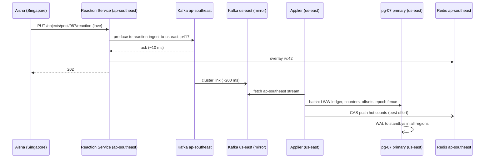

## Current state (V6)

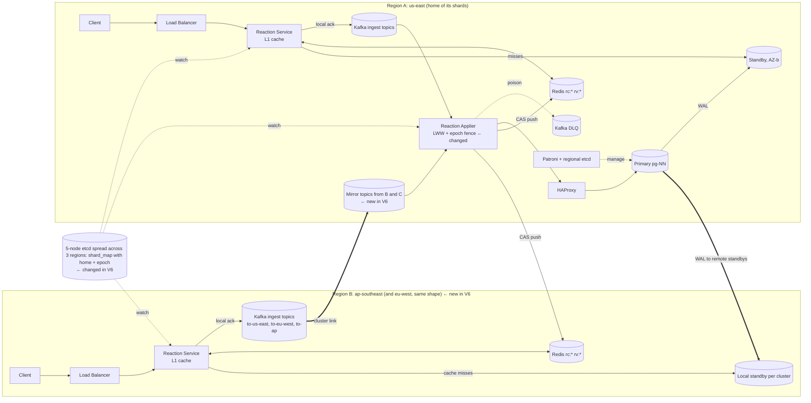

Each region runs this whole stack. A shard's Applier and primary run only in its home region. Every region has local Redis and local standbys.

**Write path (react, change, remove)**
1. Client reaches the nearest region's Load Balancer and a Reaction Service instance. ← changed in V6
2. Reaction Service looks up the shard's home in `shard_map` and produces a desired-state event with `ts` and `src` to the local `reaction-ingest-to-{home}` topic. ← changed in V6
3. After the local ack, it writes the overlay `rv:{user}` in the local Redis and returns 202.
4. If the home is another region, the cluster link mirrors the event there. ← new in V6
5. The home Applier merges its streams, picks the newest event per user and object, and drops events older than the ledger's `event_ts`. ← changed in V6
6. It commits one transaction on the home primary: ledger upsert (removes are tombstones), counter deltas, per-source offsets, and an epoch-fenced batch counter. ← changed in V6
7. For hot objects, it pushes version-checked totals to the Redis cluster in every region. ← changed in V6
8. WAL streams async to the local standby and to the standbys in the other two regions.

**Read path: object counts**
1. Client calls `GET`. The nearest region's Reaction Service checks L1, then local Redis `rc:*`.
2. On a miss, it queries the cluster's standby in its own region and fills Redis with the version check. ← changed in V6
3. Soft-expired entries are served stale while one caller refreshes. Unchanged from V5.

**Read path: viewer state**
1. Client sends the feed's object IDs to its region.
2. Reaction Service reads `rv:{user}` from the local Redis.
3. Missing IDs go to local standbys and are filled without overwriting real taps. Marked `pending` against the per-source offsets. ← changed in V6

**Region failover path (operator)**
1. Promote the remote standby, bump the shard's epoch, and update the shard map. ← new in V6
2. The new Applier drains leftover mirrored topics, then switches to the new home's topic. The epoch fence blocks the old Applier.

## Interview follow-ups

**Q: Why not active-active, so every region applies likes locally?**
A: The invariant is one reaction per user per object. A counter alone cannot hold it, because two regions would each count the same user. You need the ledger row, and the ledger has to be updated by one owner. So I keep one home per shard and make every other region a fast local front door.

**Q: Your 202 means only local Kafka has the event. Is that a problem?**
A: It is a deliberate trade. Writes stay fast and keep working when the home is down. The cost is that if a source region is destroyed, we lose the last second of its unmirrored events. For likes that is fine. For money I would produce straight to the home region and pay 200 ms.

## Recap

| Concept | The Insight |
|---|---|
| One home per shard | The ledger and counters have a single writer region. That avoids merging counts and keeps the V2 single-host transaction. |
| Local ingest, then mirror | A local Kafka ack gives a 10 ms tap and survives a home outage. The price is a roughly 1 s loss window if a source region is destroyed. |
| LWW plus tombstones | Rare cross-region conflicts on one user's reaction are resolved by timestamp, and a remove stays as a tombstone so old events cannot undo it. |
| Offset-preserving mirrors | Offsets match across clusters, so a new home can resume from a promoted standby's saved offsets. |
| Epoch fencing | Each failover bumps an epoch, and every batch checks it in its own transaction. The old home can never write again. |
| Region failover is deliberate | A cross-region partition looks like a dead region, so a human or a quorum decides. |

**Interview arc:** *"If asked how you go global: active-active counters cannot enforce one reaction per user, so each logical shard gets one home region that owns its ledger and counters, every region accepts writes into a local Kafka and mirrors them home with last-writer-wins on the rare cross-region conflict, and regions serve reads from local Redis and standbys, which gives 10 ms taps and local reads, with failover done by promoting a remote standby and bumping an epoch that fences the old home."*

**Next:** the design now covers every scoped requirement. The final wrap-up pulls it together: the full architecture, every flow, the "why not X" arsenal, and the master recap.


-----------------------------------------------------------------------------------------------------------------------
-----------------------------------------------------------------------------------------------------------------------
-----------------------------------------------------------------------------------------------------------------------
-----------------------------------------------------------------------------------------------------------------------


# Final wrap-up: High-Volume Likes and Reactions Counter

## Full architecture

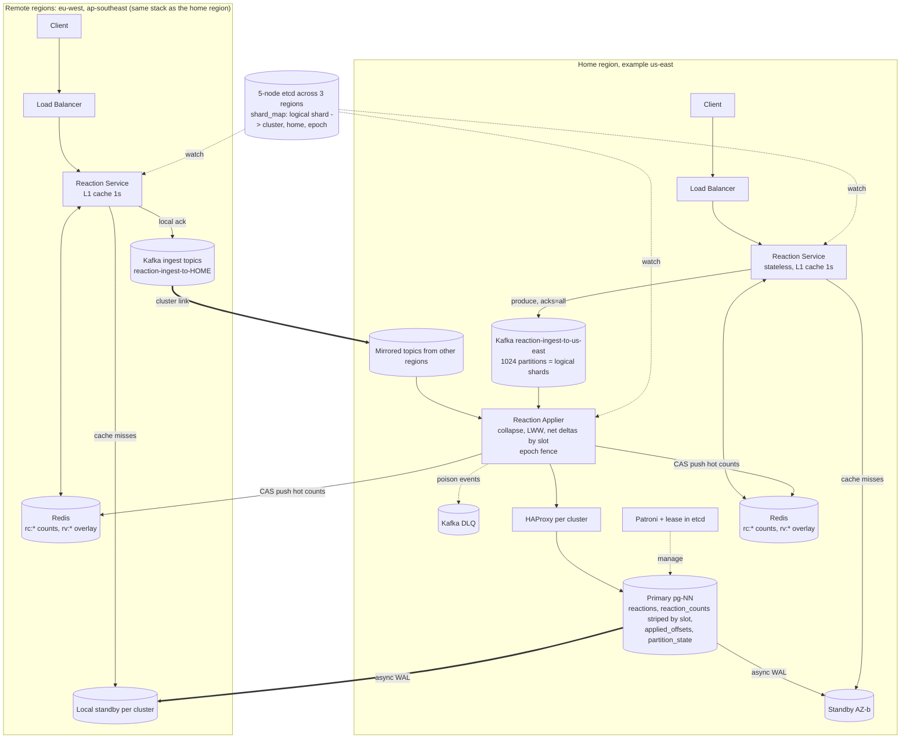

Every region runs the full stack. A logical shard's Applier and primary run only in its home region. Every region has local Redis, local Kafka, and local standbys.

## Every end-to-end path

### Path 1: write, object homed in the user's own region

1. Client sends `PUT /v1/objects/post/987/reaction {"reaction":"love"}` to the nearest Load Balancer.
2. Reaction Service computes `logical_shard = hash("1:987") % 1024`, then reads the shard map for the home region.
3. It produces a desired-state event (`user_id`, `object`, `desired`, `ts`, `src`) to the home ingest topic, partition equal to the logical shard.
4. After the Kafka ack, it writes `rv:{user}` in local Redis. A failure here is ignored.
5. It returns 202.
6. The Applier reads a batch of up to 2,000 events and keeps the newest event per user and object.
7. It locks the existing ledger rows with `SELECT ... FOR UPDATE` and compares old state to desired state.
8. It computes net deltas per `(object, reaction_type, slot)`, with `slot = hash(user_id) % 128`.
9. One transaction on the primary writes the ledger upsert (removes become tombstones), the counter upsert, `applied_offsets`, and the epoch-fenced `batch_seq`.
10. For objects with 50 or more events in the batch, it pushes version-checked totals to Redis in all three regions.
11. WAL streams asynchronously to the standbys.

### Path 2: write, object homed in another region

Steps 1 to 5 are the same, except the event goes to the local topic `reaction-ingest-to-{home}`. Then:

6. The cluster link mirrors the event to the home region, about 200 ms.
7. The home Applier merges the local and mirrored streams. It resolves conflicts by last-writer-wins on `(ts, region rank)`.
8. Steps 7 to 11 of Path 1 follow.

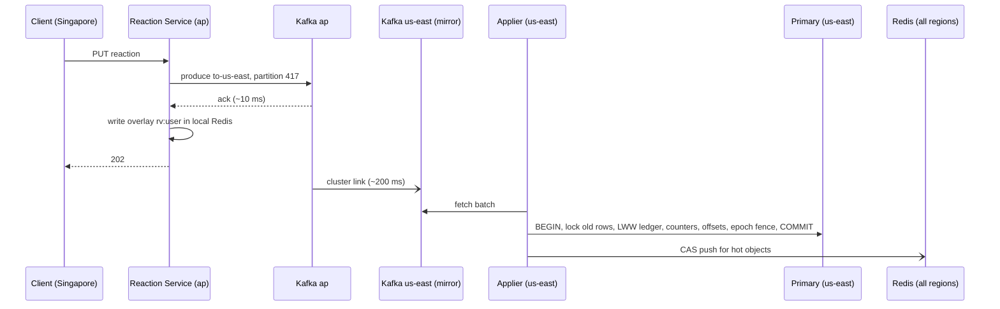

### Path 3: read object counts

1. Client calls `GET /v1/objects/post/987/reactions` in its nearest region.
2. Reaction Service checks L1 (1 s TTL). A hit returns immediately.
3. On an L1 miss, single-flight lets one caller go on. It reads `rc:1:987` from local Redis.
4. If the entry is fresh, return it. If soft-expired, return it stale while one lock winner refreshes it.
5. On a miss, one SQL statement reads `SUM(count) GROUP BY reaction_type` plus the offsets from a local standby. That gives a consistent snapshot.
6. It fills Redis through the Lua compare-and-set, which accepts only equal or newer versions.

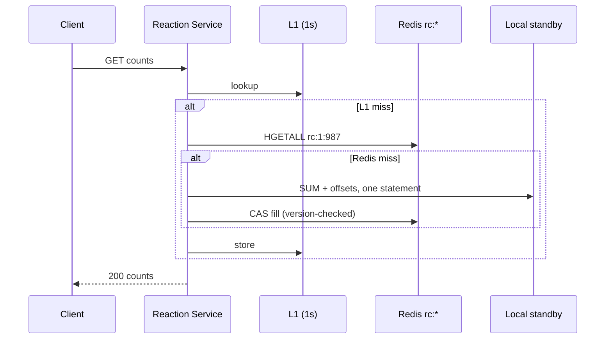

### Path 4: read viewer state for a feed page

1. Client sends `POST /v1/reactions/mine` with the page's object IDs.
2. Reaction Service runs `HMGET rv:{user}` on local Redis. That is one call.
3. For IDs not found, it groups them by cluster and runs one batch `SELECT` on local standbys, in parallel.
4. It fills the overlay without overwriting real taps. A real tap has `ts` above 0, and a fill carries `ts = 0`.
5. It marks an entry `pending` while its Kafka offset is not yet included in the cached count's per-source offset. The client keeps its optimistic +1 only while `pending` is true.

### Path 5: failover inside a region (a primary dies)

1. The primary stops renewing its etcd lease.
2. After the 30 s TTL, the most caught-up standby takes the key and promotes. The lag cap is 16 MB.
3. HAProxy sees `/primary` return 200 from the new node.
4. The Applier retries with backoff and jitter. It reads `applied_offsets` on the new primary and seeks Kafka to those offsets.
5. It replays the gap. Replays are no-ops because events are desired-state.
6. The old node runs `pg_rewind` and rejoins as a standby.

### Path 6: failover across regions (a home region dies)

1. A human, or a 2-of-3 health quorum, confirms the region is dead and not merely partitioned.
2. Promote the standby in a surviving region for each shard homed in the dead region.
3. Write `home = R2, epoch + 1` to the shard map and to `partition_state`.
4. Reaction Services produce to `reaction-ingest-to-R2`.
5. The new Applier drains the leftover mirrored topics from saved offsets, then switches to its own topic.
6. The epoch fence blocks the old Applier from ever committing again.
7. The old database is discarded and re-seeded when the region returns.

### Path 7: resharding (adding a host)

1. Replicate chosen logical shards to the new host with a row-filtered logical replication.
2. Pause that partition's Applier loop. Producers keep appending.
3. Confirm the replica caught up, flip the `shard_map` entry, and resume the loop.
4. Delete the old rows later. Each move touches 1/1024 of the traffic.

## "Why not X" arsenal

| Question | Defensible one-line answer |
|---|---|
| Why not Redis `INCR` as the source of truth? | It cannot be tied transactionally to the per-user ledger, so a crash leaves them permanently out of sync, and a single key is still a hot spot. |
| Why not shard by user? | Every like would touch the object's counter on another shard, so each write becomes a cross-shard 2PC. Sharding by object keeps ledger and counters in one local transaction. |
| Why not just move a viral object to a dedicated shard? | The detector fires too late, and a dedicated host still caps at about 8K transactions per second while the object does 50K. Batching removes the cap instead. |
| Why async replication when it can lose commits? | Kafka is the durable record and the offset commits in the same transaction as the data, so a promoted standby replays the gap and loses nothing. |
| Why not invalidate the cache on write? | A viral key changes 25 times per second, so it would always be cold. Pushing versioned totals keeps it warm and stops old fills from overwriting new data. |
| Why not active-active CRDT counters across regions? | A counter cannot enforce one reaction per user per object. You need a ledger with a single owner, so each shard gets one home region. |
| Why not a CDN? | Counts ride inside personalized feed responses that the edge cannot cache, so a CDN adds a layer without removing load. |
| Why not consistent hashing for shards? | A fixed 1024 logical shards plus a lookup table gives the same bounded movement, with explicit placement and manual control over hot shards. |

## Master recap

| Version | Concept | The Insight |
|---|---|---|
| V0 | Ledger plus tally | The ledger answers "did this user react", the tally answers "how many". |
| V0 | Primary key as idempotency | One row per (user, object) makes a double tap unable to double count. |
| V0 | One transaction | Ledger and tally commit together, so they never disagree. |
| V1 | Row lock as ceiling | One row serves about 1 ÷ commit time, around 500 per second. |
| V1 | Striped counter | Counts only need to be summable, so split across 128 rows and sum on read. |
| V1 | Slot by user hash, sorted lock order | A user's like and un-like share a slot, and fixed lock order prevents deadlocks. |
| V2 | Shard key choice | Shard by object so the write transaction stays on one host. |
| V2 | Cost moves to reads | Viewer state becomes a fan-out across shards. |
| V2 | Logical shards | 1024 fixed logical shards mapped to hosts, so resharding moves slices, not 94% of data. |
| V3 | Cost per transaction | The ceiling is commits per second, so batching 2,000 likes gives about 25 commits per second. |
| V3 | Log before database | A durable log absorbs the burst and the database drains at its own pace. |
| V3 | Desired-state events, offset in the same transaction | Replays cannot double count, and each batch applies once. |
| V4 | Replicas for availability | Standbys exist for failover, not read capacity. |
| V4 | Async is safe here | The log is the durable record, so a lost Postgres tail is replayed. |
| V4 | Lease before promotion | A standby promotes only after the old leader's lease expires, so two primaries never overlap. |
| V5 | Cache the skew | 50:1 reads and a few hot objects suit a cache. |
| V5 | Push beats invalidate, version every fill | The Applier refreshes hot keys, and Redis rejects older versions. |
| V5 | L1 plus overlay | A 1 s in-process cache shields Redis, and the overlay restores read-your-writes. |
| V6 | One home per shard | A single writer region keeps the ledger and counters exact. |
| V6 | Local ingest, then mirror | A 10 ms tap and survival of home outages, paid for with a roughly 1 s loss window. |
| V6 | LWW, tombstones, epoch fencing | Rare conflicts resolve by timestamp, removes persist, and a failed-over home can never write again. |

## What next?

Pick one:

- **(a) Drill deeper** into any piece, such as the Applier batch logic, the version scheme in Redis, the region failover runbook, or the user-bucket split held back in V3.
- **(b) Mock Q&A**, where I play interviewer, pressure-test the whole design, and point out where an answer would lose points.


-----------------------------------------------------------------------------------------------------------------------
-----------------------------------------------------------------------------------------------------------------------
-----------------------------------------------------------------------------------------------------------------------
-----------------------------------------------------------------------------------------------------------------------


-----------------------------------------------------------------------------------------------------------------------
-----------------------------------------------------------------------------------------------------------------------
-----------------------------------------------------------------------------------------------------------------------
-----------------------------------------------------------------------------------------------------------------------


-----------------------------------------------------------------------------------------------------------------------
-----------------------------------------------------------------------------------------------------------------------
-----------------------------------------------------------------------------------------------------------------------
-----------------------------------------------------------------------------------------------------------------------


-----------------------------------------------------------------------------------------------------------------------
-----------------------------------------------------------------------------------------------------------------------
-----------------------------------------------------------------------------------------------------------------------
-----------------------------------------------------------------------------------------------------------------------


-----------------------------------------------------------------------------------------------------------------------
-----------------------------------------------------------------------------------------------------------------------
-----------------------------------------------------------------------------------------------------------------------
-----------------------------------------------------------------------------------------------------------------------


-----------------------------------------------------------------------------------------------------------------------
-----------------------------------------------------------------------------------------------------------------------
-----------------------------------------------------------------------------------------------------------------------
-----------------------------------------------------------------------------------------------------------------------


-----------------------------------------------------------------------------------------------------------------------
-----------------------------------------------------------------------------------------------------------------------
-----------------------------------------------------------------------------------------------------------------------
-----------------------------------------------------------------------------------------------------------------------


-----------------------------------------------------------------------------------------------------------------------
-----------------------------------------------------------------------------------------------------------------------
-----------------------------------------------------------------------------------------------------------------------
-----------------------------------------------------------------------------------------------------------------------


-----------------------------------------------------------------------------------------------------------------------
-----------------------------------------------------------------------------------------------------------------------
-----------------------------------------------------------------------------------------------------------------------
-----------------------------------------------------------------------------------------------------------------------


-----------------------------------------------------------------------------------------------------------------------
-----------------------------------------------------------------------------------------------------------------------
-----------------------------------------------------------------------------------------------------------------------
-----------------------------------------------------------------------------------------------------------------------


-----------------------------------------------------------------------------------------------------------------------
-----------------------------------------------------------------------------------------------------------------------
-----------------------------------------------------------------------------------------------------------------------
-----------------------------------------------------------------------------------------------------------------------


-----------------------------------------------------------------------------------------------------------------------
-----------------------------------------------------------------------------------------------------------------------
-----------------------------------------------------------------------------------------------------------------------
-----------------------------------------------------------------------------------------------------------------------


-----------------------------------------------------------------------------------------------------------------------
-----------------------------------------------------------------------------------------------------------------------
-----------------------------------------------------------------------------------------------------------------------
-----------------------------------------------------------------------------------------------------------------------


-----------------------------------------------------------------------------------------------------------------------
-----------------------------------------------------------------------------------------------------------------------
-----------------------------------------------------------------------------------------------------------------------
-----------------------------------------------------------------------------------------------------------------------


-----------------------------------------------------------------------------------------------------------------------
-----------------------------------------------------------------------------------------------------------------------
-----------------------------------------------------------------------------------------------------------------------
-----------------------------------------------------------------------------------------------------------------------


-----------------------------------------------------------------------------------------------------------------------
-----------------------------------------------------------------------------------------------------------------------
-----------------------------------------------------------------------------------------------------------------------
-----------------------------------------------------------------------------------------------------------------------


