# Likes & Reactions Counter: The Story

We'll go one chapter at a time. Don't move on until a chapter feels solid, and tell me when you're ready for the next one.

**Roadmap**

| Ch | Topic |
|----|-------|
| 1 | The problem, requirements, scale math, and the naive solution (this message) |
| 2 | Why the naive solution breaks (hot rows, locks, read amplification) |
| 3 | Separating "who liked" from "how many" |
| 4 | Caching with Redis and its failure modes |
| 5 | Write buffering and batching (Kafka and aggregation) |
| 6 | Sharding and the celebrity-post "hot key" problem |
| 7 | Replication, consistency, and idempotency |
| 8 | CDN and read-path optimization |
| 9 | Reactions (multi-type), unlike, and comments |
| 10 | Error handling, reconciliation, and failure scenarios |
| 11 | Final architecture and interview cheat sheet |

---

## Chapter 1: The Story Begins

### 1.1 The startup days

Imagine it's 2010 and you're an engineer at a tiny photo-sharing startup called **SnapGram**, with 5,000 users. The product manager walks over:

> "Users want to like photos. Show a heart, show the count, and show whether *I* already liked it."

You build this in an afternoon. It's a good, correct solution for that scale, and the rest of this series is about what happens when that stops being true.

### 1.2 Requirements (what you clarify first in an interview)

**Functional requirements**
1. A user can **like** a post (also video, photo, or comment).
2. A user can **unlike**.
3. Anyone viewing a post sees the **total like count**.
4. The viewer sees whether **they** liked it (the filled red heart).
5. Later: **reactions** (👍 ❤️ 😂 😮 😢 😡), each with its own count.
6. Optionally: "who liked this?" (a paginated list of users).

**Non-functional requirements**

| Requirement | Meaning |
|---|---|
| **High write throughput** | Millions of like events per second at peak |
| **Very high read throughput** | Every feed render shows counts for ~10-50 posts |
| **Low latency** | Tapping the heart should feel instant (<100 ms) |
| **High availability** | A like service outage shouldn't break the app |
| **Eventual consistency is OK for the count** | Nobody cares if it shows 1,203 vs 1,205 |
| **Strong consistency for "did I like it?"** | If I liked it, the heart must stay red |
| **No double-counting** | One user can like a post only once |
| **Durability** | A like, once acknowledged, must not be lost |

> 💡 **Interview insight:** The most important sentence in this design is *"the count can be approximate and eventually consistent, but the user's own like state must be accurate."* It unlocks almost every optimization later. State it early in the interview.

### 1.3 Scale math (back-of-envelope)

Interviewers love this step. Let's assume Meta/Instagram scale:

- 1 billion DAU
- Each user likes ~5 things/day → **5 B likes/day**
- Writes per second (average): 5×10⁹ / 86,400 ≈ **~58,000 likes/sec**
- Peak (3-5× average, e.g. during a World Cup final): **~200-300K writes/sec**
- Each user views ~200 posts/day in feeds → **200 B post-views/day**
- Reads per second (average): ≈ **2.3 M reads/sec**, peak ~**10 M/sec**

**Read:write ratio ≈ 40:1.** This is a read-heavy system overall, but the writes are special because they're concentrated on hot items.

**Storage**
- One like record: `(user_id 8B, post_id 8B, timestamp 8B, type 1B)` ≈ ~25-30 B, call it 32 B with overhead.
- 5 B likes/day × 32 B = **160 GB/day**, about **58 TB/year**.

So the *like records* are big and need sharding eventually, but the *counters* are tiny: 1 B posts × 8 B = 8 GB. Hold on to that, it matters in Chapter 3.

### 1.4 The naive solution (SnapGram, 2010)

You do the obvious thing: one table, one database.

```sql
CREATE TABLE likes (
  user_id   BIGINT,
  post_id   BIGINT,
  created_at TIMESTAMP,
  PRIMARY KEY (user_id, post_id)   -- prevents double-likes
);
```

**API**

```
POST   /posts/{id}/like      → INSERT INTO likes ...
DELETE /posts/{id}/like      → DELETE FROM likes WHERE ...
GET    /posts/{id}/likes     → SELECT COUNT(*) FROM likes WHERE post_id = ?
```

**Architecture**

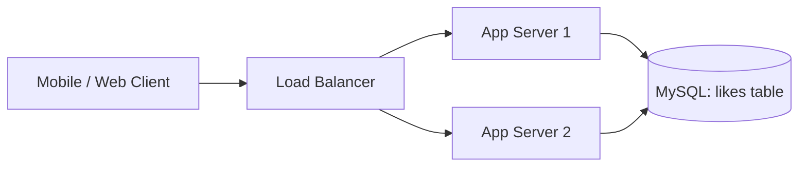

**Worked example**

1. Alice (user 7) likes post 100: `INSERT INTO likes VALUES (7, 100, now())`.
2. Bob (user 9) likes post 100: `INSERT INTO likes VALUES (9, 100, now())`.
3. Carol opens post 100: `SELECT COUNT(*) FROM likes WHERE post_id = 100` returns **2**.
4. Alice double-taps the heart again. The primary key `(7, 100)` already exists, so the DB rejects it and there's no double-count. The primary key gives us **idempotency for free**.

To show Carol's own heart state, `SELECT 1 FROM likes WHERE user_id=? AND post_id=?`.

It's simple, correct, and strongly consistent. For 5,000 users it works perfectly.

### 1.5 First cracks (a teaser for Chapter 2)

SnapGram grows to 5 million users. Then one day a celebrity posts a photo:

- The `COUNT(*) WHERE post_id = 100` now scans **2 million rows** every time anyone opens the post.
- Thousands of people are hitting "like" on the same post at the same moment.
- The DB CPU hits 100%, the feed slows down, and the whole app starts timing out.

Why? That's Chapter 2.

---

### ✅ Chapter 1 recap (what to say in an interview)

- **Clarify requirements first:** like/unlike, count, "did I like it", reactions, eventual consistency for counts.
- **Quantify scale:** ~58K writes/s average, ~300K peak, ~2-10M reads/s, ~160 GB/day of like records.
- **Key insight:** the read:write ratio is ~40:1, and the count can be approximate while the user's own like state must be exact.
- **Naive design:** one `likes(user_id, post_id)` table, with `COUNT(*)` for the count and the composite primary key for idempotency.

### 🧠 Quick check before we move on

1. Why does the composite primary key `(user_id, post_id)` matter for correctness?
2. Why is it acceptable for the *count* to be eventually consistent but not the user's *own* like state?
3. Why are the counters (8 GB) so much smaller than the like records (58 TB/year), and why might that be useful?

Answer these in your own words, or just say "got it, next." Then we go to **Chapter 2: Why the naive solution breaks**, where we watch the celebrity post kill the database and discover hot rows, lock contention, and read amplification.


-----------------------------------------------------------------------------------------------------------------------
-----------------------------------------------------------------------------------------------------------------------
-----------------------------------------------------------------------------------------------------------------------
-----------------------------------------------------------------------------------------------------------------------


# Chapter 2: Why the Naive Solution Breaks

## 2.1 The Sunday outage

SnapGram now has 5 million users. On a Sunday afternoon a famous footballer posts a photo of his newborn. Within minutes:

- 2 million people open that post.
- 100,000 people per second are tapping ❤️.
- The on-call pager goes off, the database CPU is at 100%, and the *entire app* is timing out, including posts that have nothing to do with the footballer.

Let's find out why, one problem at a time.

---

## 2.2 Problem A: `COUNT(*)` is O(n)

Our read path was:

```sql
SELECT COUNT(*) FROM likes WHERE post_id = 100;
```

Even with an index on `post_id`, the database must **walk every matching index entry and count them**. There is no stored "total"; it's computed on every call.

| Likes on post | Work per read |
|---|---|
| 50 | trivial |
| 50,000 | ~50K index entries touched |
| 2,000,000 | ~2M index entries touched, tens to hundreds of ms |

**Read amplification:** a feed shows ~20 posts at once, so one feed load fires 20 `COUNT(*)` queries. If a few are celebrity posts, a single feed load can touch millions of index entries. Multiply by millions of users scrolling and you get the outage.

> 🧠 **Concept: read amplification.** One logical user action (open the feed) turns into much more physical work (20 queries, each scanning thousands of rows). Spotting it is half of system design.

**Attempt 1: "Add an index."** We already have one. A *covering* index on `post_id` makes the scan faster, but it's still **O(n)**. Indexing makes a lookup cheap, but it can't make counting free.

**Attempt 2: "Add a read replica."** This spreads the reads across machines, but each read is still expensive. We're paying a huge cost many times instead of making the cost small. A replica gives you more *capacity*, not *efficiency*.

---

## 2.3 The first real fix: a denormalized counter

The team's insight: **don't recount, store the answer.** Add a counter column to the posts table:

```sql
ALTER TABLE posts ADD COLUMN like_count BIGINT DEFAULT 0;
```

Now the write path becomes a **transaction**:

```sql
BEGIN;
  INSERT INTO likes (user_id, post_id, created_at) VALUES (7, 100, now());
  UPDATE posts SET like_count = like_count + 1 WHERE post_id = 100;
COMMIT;
```

And the read path becomes:

```sql
SELECT like_count FROM posts WHERE post_id = 100;   -- O(1) primary-key lookup
```

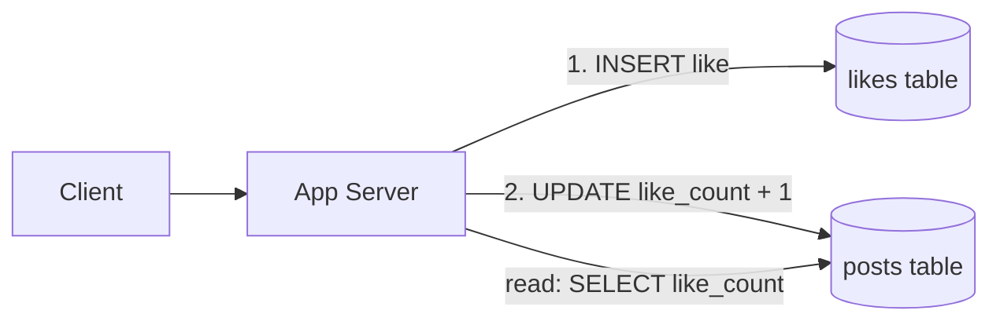

Reads are now a primary-key lookup, about 1 ms regardless of how many likes there are. The team celebrates. 🎉

This technique is called **denormalization**: we store a derived value (the count) redundantly to make reads cheap, and the price is that we must now keep it in sync with the source of truth (`likes`).

### A subtle bug they hit first: the lost update

Some engineers wrote the increment in application code:

```python
count = db.query("SELECT like_count FROM posts WHERE post_id=100")   # reads 100
db.execute("UPDATE posts SET like_count = ? WHERE post_id=100", count + 1)
```

| Time | Alice's request | Bob's request | DB value |
|---|---|---|---|
| t1 | reads 100 | | 100 |
| t2 | | reads 100 | 100 |
| t3 | writes 101 | | 101 |
| t4 | | writes 101 | **101** ❌ (should be 102) |

This is a **read-modify-write race**. The fix is to make the increment **atomic inside the database**: `SET like_count = like_count + 1`. The DB takes a lock, reads, adds, and writes as one indivisible step. Remember this pattern; it comes back with Redis `INCR` later.

---

## 2.4 The new villain: the hot row

The atomic `UPDATE` is correct, but how does the database make it atomic? **It takes an exclusive row lock.** In InnoDB (MySQL), when a transaction updates a row, no other transaction can update that same row until the first one *commits*.

On the celebrity post, **every single like fights for the same row** (`post_id = 100`):

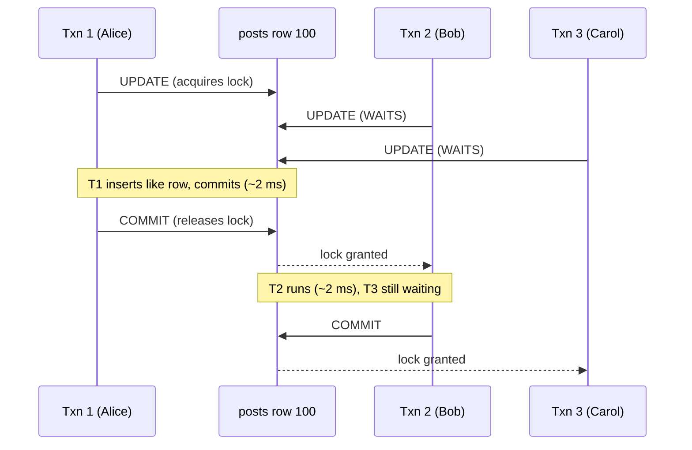

Writes to this row are **serialized**: one at a time, no matter how many CPU cores or servers you have.

### The math that kills us

- Each transaction holds the lock for roughly **1-2 ms**. This includes the `INSERT`, the `UPDATE`, and the commit, which must flush to disk (fsync).
- Maximum throughput for one row ≈ 1 / 0.002 s = **~500 updates/sec**.
- The celebrity post receives **100,000 likes/sec**.

That's a **200× gap**. The queue grows by ~99,500 requests every second.

> 🧠 **Concept: hot row / hot key.** Adding hardware doesn't help when all the traffic funnels into **one logical item**. Throughput is capped by the *serial section* (the lock). This is Amdahl's Law in practice: the part that can't be parallelized limits the whole system.

### How a hot row becomes a full outage (the cascade)

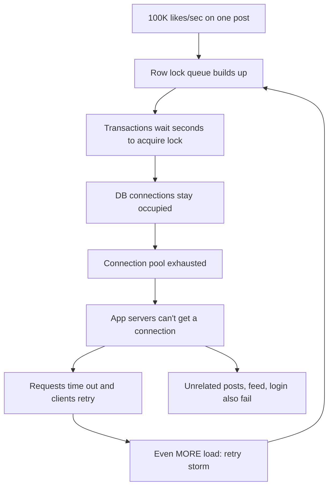

Step by step:

1. Each waiting like holds a **DB connection** (typically only 100-500 per DB).
2. Within seconds, **all connections are stuck waiting on one row**.
3. Now a request to like a *different, normal* post can't even get a connection. The **blast radius** of one hot post covers the whole platform.
4. Users see spinners and tap the heart again, and clients auto-retry. That's a **retry storm**, which multiplies the load.
5. Lock waits exceed `innodb_lock_wait_timeout` (50 s by default), so some transactions fail and roll back, and the user's like is lost.

---

## 2.5 Other cracks that appear at this stage

| Problem | What happens |
|---|---|
| **Dual-write consistency** | The `likes` insert and the counter update must be atomic. A transaction guarantees this but makes the lock held *longer*. Without a transaction, a crash between the two leaves the count wrong forever. |
| **Deadlocks** | Transactions that touch multiple rows (a user liking several things in a batch) in different orders can deadlock; the DB kills one. |
| **Single-node write ceiling** | Even with no hot row, one MySQL primary handles maybe 10-20K simple writes/sec. We need ~300K at peak. |
| **Table growth** | The `likes` table adds 160 GB/day. A single machine's disk and index memory can't hold 58 TB/year. |
| **Replica lag** | Reading counts from replicas gives stale numbers, and writes pile up on the primary. |

---

## 2.6 What we learned (the problem statement, refined)

We now know the *real* problems we have to solve:

1. **Reads must not scan.** Store the count; don't compute it. ✅ (denormalization)
2. **Writes to the same counter must not serialize on a DB row lock.** ❌ still open.
3. **The like *records* (huge, 58 TB/yr) and the like *counts* (tiny, 8 GB) have totally different needs**, yet we've been storing them in the same database. ❌ still open.
4. **A hot item must not take down unrelated traffic** (isolation). ❌ still open.
5. **Retries must be safe** (idempotency). Partially solved by the primary key.

---

### ✅ Chapter 2 recap (interview-ready answers)

- **Why not `COUNT(*)`?** It's O(n) per read, and the feed multiplies it by ~20 (read amplification).
- **Why not a plain counter column?** It makes reads O(1) but turns the row into a **hot row**: row-level exclusive locks serialize writes, so throughput is ≈ 1/lock-hold-time ≈ 500/s per row, versus 100K/s demand.
- **Why is a hot row so dangerous?** Lock waits tie up connections, the pool exhausts, retries amplify the load (retry storm), and unrelated traffic fails too.
- **Always do the increment atomically** (`count = count + 1`), never read-modify-write in the app.

### 🧠 Quick check

1. Why doesn't adding more app servers or more CPU cores to the DB fix the hot-row problem?
2. Why does a read replica not solve the `COUNT(*)` problem, while a denormalized counter does?
3. Explain in one sentence how a single viral post can break a totally unrelated user's feed (hint: connections).

When you're comfortable, say **"next"** and we'll go to **Chapter 3: Separating "who liked" from "how many"**, where we split the system into two components with different storage, consistency, and scaling needs. That split shapes the rest of the design.


-----------------------------------------------------------------------------------------------------------------------
-----------------------------------------------------------------------------------------------------------------------
-----------------------------------------------------------------------------------------------------------------------
-----------------------------------------------------------------------------------------------------------------------


# Chapter 3: Separating "Who Liked" from "How Many"

## 3.1 The whiteboard moment

After the Sunday outage, the SnapGram team meets in a war room. Someone writes two questions on the whiteboard:

> **Q1.** "Did Alice like post 100?"
> **Q2.** "How many people liked post 100?"

Then a senior engineer says: *"We've been using one table and one database to answer both. They're completely different questions, and they want completely different systems."*

Chapter 2 hinted at this: the like records are ~58 TB/year, while the counters are ~8 GB. Let's compare the two kinds of data properly.

---

## 3.2 Two kinds of data

| Property | **Like relationship** (the edge) | **Like counter** (the aggregate) |
|---|---|---|
| What it is | Fact: "user 7 liked post 100 at 10:03" | A number: "post 100 has 2,041,977 likes" |
| Size | ~58 TB/year (grows forever) | ~8 GB total (1B posts × 8 B) |
| Write pattern | Insert/delete, spread across many users and posts | Increment, **concentrated on hot posts** |
| Read pattern | Point lookup: `(user, post)`; list likers; list a user's likes | Point lookup by `post_id`, billions of times/day |
| Consistency need | **Strong-ish** (my heart must stay red) | **Eventual is fine** (±few is invisible) |
| Durability need | **Must never be lost** (source of truth) | Can be **rebuilt** from the edges |
| Bottleneck | Disk capacity and total write volume | Lock/CPU contention on a few hot keys |
| Ideal storage | Distributed, disk-based, horizontally sharded | In-memory, extremely fast increments |

Trying to serve both from one `MySQL` table is like using one truck both as a freight train and as a sports car.

> 🧠 **Concept: source of truth vs derived data.** The **like edges** are the *source of truth*. The **counter** is *derived data*, a precomputed answer to `COUNT(*)`. Derived data can be thrown away and recomputed, so it can live in a fast, slightly less durable store. Spotting this distinction is a classic senior-level signal in interviews.

---

## 3.3 The new architecture: two stores

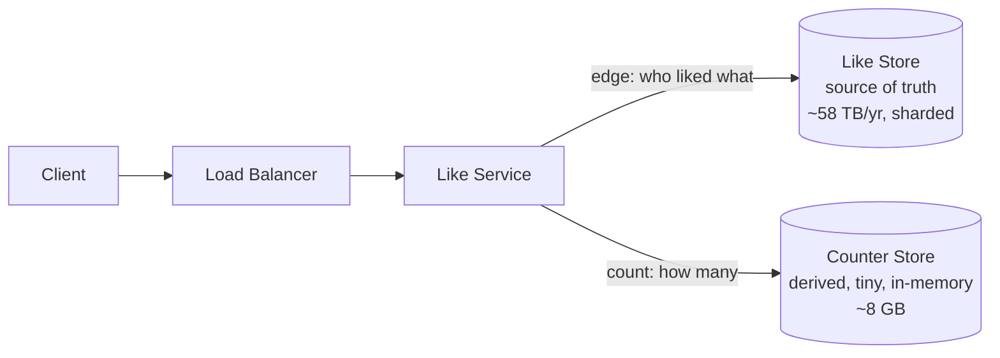

**Responsibilities**

- **Like Store** answers "did *I* like it?" and "who liked it?", and it is the durable record.
- **Counter Store** answers "how many?" and it is optimized for fast reads and increments.
- **Like Service** is the stateless layer that coordinates the two.

---

## 3.4 Designing the Like Store (the edges)

### Step 1: list the access patterns first

In NoSQL-style design, you design tables around *queries*, not around entities. The like edges must support:

| # | Query | Frequency |
|---|---|---|
| A | Did user U like post P? (point lookup) | Extremely high: every post on every feed |
| B | Insert/delete a like `(U, P)` | High (the write path) |
| C | List the users who liked post P, newest first, paginated | Low: only when someone taps "see who liked" |
| D | List the posts user U liked (a "Liked posts" page) | Low |

### Step 2: choose keys per pattern

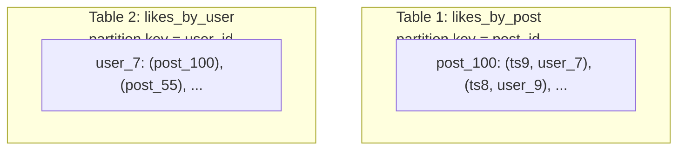

- **Pattern A** (`did U like P?`) uses `likes_by_user` with a point lookup on `(user_id, post_id)`. The data for one user lives on one partition, so it's one fast lookup.
- **Pattern C** (list likers of P) uses `likes_by_post`: one partition holds all likers of a post, sorted by time, so pagination is a cheap range scan.
- **Pattern D** uses `likes_by_user`: a range scan within one user's partition.

Writing the same fact into **two tables** (one per query pattern) is **denormalization for reads**, the same idea as the counter but applied to the edges. Every like becomes two writes, and we accept that as the price of fast reads.

### Step 3: pick the technology (what to say in the interview)

| Option | Fit |
|---|---|
| **Sharded MySQL/Postgres** | Familiar; strong consistency; you manage the sharding yourself (Vitess, application-level). Good for ≤ tens of TB. |
| **Cassandra / ScyllaDB (wide-column)** | Built for massive write throughput, partitioned by key, tunable consistency, easy horizontal scale. Excellent fit for the edge tables. |
| **DynamoDB** | Same idea, managed. Partition key + sort key maps directly onto our tables. |

> 🎤 **Interview framing:** *"The edge table is an append-heavy, key-value-shaped workload with known access patterns and no joins. That's a textbook fit for a partitioned wide-column or key-value store, so I'd choose Cassandra or DynamoDB, and I'd justify any choice by listing the queries first."*

(We'll go deep on **sharding and the hot-partition problem for `likes_by_post`** in Chapter 6. A celebrity post puts millions of rows in one partition, which is a problem of its own.)

---

## 3.5 Designing the Counter Store (the aggregates)

Requirements:

- Key: `post_id`. Value: integer (or a small map of reaction → count later).
- Handles **millions of reads/sec** and **hundreds of thousands of increments/sec**.
- Latency in sub-milliseconds.
- Loss of recent increments is *tolerable* (we can recompute), but we'd rather not.

That is the profile of an **in-memory key-value store** such as **Redis**, where `INCR post:100:likes` is atomic and takes microseconds. And 8 GB fits comfortably in memory, even replicated.

We'll treat the counter store carefully in Chapters 4-6, because it has its own problems (hot keys, loss on crash, cache stampede). For now, just accept the *shape*: **a tiny, fast, derived store**.

---

## 3.6 Walking through the flows

### Flow 1: Alice likes post 100

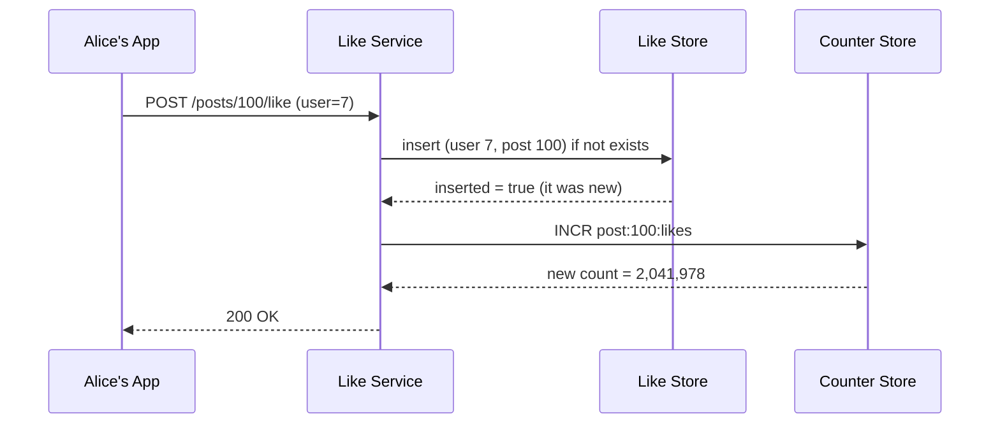

### Flow 2: Carol opens the feed (20 posts)

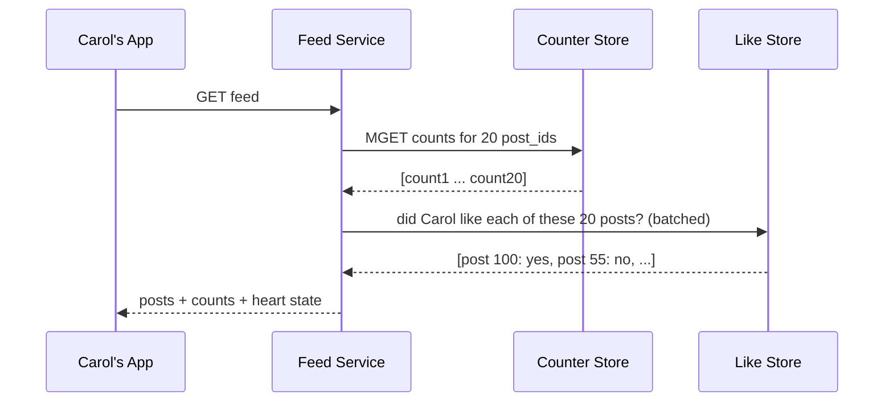

Notice the split: **counts come from the counter store, heart state comes from the like store**. Each question goes to the system built for it.

Also notice `MGET` and the batched lookup: we **fetch 20 posts in one round trip**, not 20 separate calls. Batching is a recurring interview point.

---

## 3.7 The new problem: keeping two stores in sync

Splitting the system fixed the hot-row issue in principle, but it introduced the **dual-write problem**. Two separate systems can't share one database transaction. Consider what can go wrong in Flow 1:

| Scenario | What happens | Result |
|---|---|---|
| **Crash after edge insert, before counter increment** | The like exists; the count was never bumped | **Undercount** (permanent drift) |
| **Counter increment first, then edge insert fails** | Count went up; no edge exists | **Overcount** (and the user's heart isn't red) |
| **Client retries a request that already succeeded** | The edge insert says "already exists", but a naive service increments again | **Double count** |
| **Unlike races with like** | Two concurrent requests from the same user interleave | Count and edge disagree |

Two useful rules emerge, and we'll make them rigorous in Chapters 5, 7, and 10:

1. **Only increment the counter if the edge insert actually created a new row.** The "insert if not exists" result tells us whether this like was new, and that is the key to **idempotency**.
2. **The edge is the truth, the counter is a cache of it.** Because the counter is derived, we can run a periodic **reconciliation** job that recomputes counts from the edges and repairs drift.

---

## 3.8 Why this separation matters (interview talking points)

1. **Independent scaling.** The edge store scales by *disk and partitions* (58 TB). The counter store scales by *memory and replicas* (8 GB, but heavy QPS).
2. **Independent consistency choices.** Edges lean strong; counters are eventual.
3. **Failure isolation.** If the counter store is down, users can still like, and we show an approximate count. If the edge store is slow, counts still render.
4. **The right data structure per job.** A disk-based, partitioned store for facts; an in-memory store for numbers.
5. **It sets up everything that follows:** caching, write batching, sharding, and replication each apply to one store or the other.

---

### ✅ Chapter 3 recap

- Two questions, two kinds of data: **edges** (who liked, source of truth, big) and **counters** (how many, derived, tiny).
- Edges live in a **partitioned key-value/wide-column store**, with tables designed per access pattern (`likes_by_user` for "did I like?", `likes_by_post` for "who liked?"), a denormalization for read speed.
- Counters live in an **in-memory store** (Redis-style) with atomic increments.
- The split introduces the **dual-write problem**, with undercounts, overcounts, and double counts. The mitigations are *"increment only if the edge insert was new"* and *reconciliation from the edges*.

### 🧠 Quick check

1. Why can the counter store be less durable than the edge store?
2. Why do we write each like into *two* edge tables, and what is the cost?
3. In Flow 1, what exactly goes wrong if the service increments the counter *without* checking whether the edge insert was new?
4. If the counter store goes down completely, what user-visible behavior would you design for?

When you're ready, say **"next"** and we'll go to **Chapter 4: Caching with Redis**, where we meet the first real counter-store design, atomic `INCR`, the cache-aside pattern, and the failure modes that make caching harder than it looks: stampedes, cold starts, and crashes.


-----------------------------------------------------------------------------------------------------------------------
-----------------------------------------------------------------------------------------------------------------------
-----------------------------------------------------------------------------------------------------------------------
-----------------------------------------------------------------------------------------------------------------------


# Chapter 4: Caching with Redis

## 4.1 The story so far

After Chapter 3, SnapGram has two stores: **edges** (durable, partitioned) and **counters** (fast, in memory). The team's first instinct for the counter store is the most common tool in the industry: **put a cache in front of the database**.

This chapter follows three attempts, each fixing the previous one and creating a new problem. By the end you'll know why "just add Redis" is never a complete answer.

---

## 4.2 Attempt 1: cache-aside with invalidate-on-write

**Cache-aside** (lazy loading) is the textbook pattern:

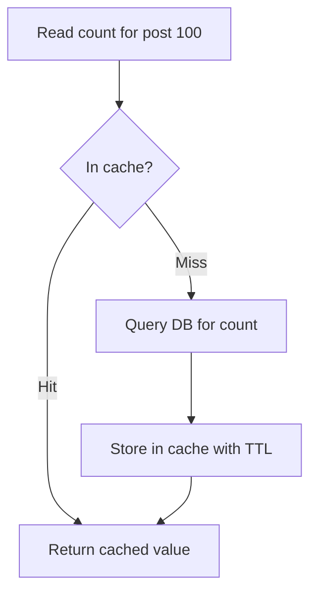

**Writes:** after updating the database, **delete** the cache key so the next read refetches a fresh value.

```
on like(post 100):
    DB.insert_edge(...); DB.update_count(...)
    cache.delete("count:post:100")
```

Reads are now served from memory, and the DB sees only misses. For normal posts this works very well, and the typical hit rate is above 95%.

### Why it fails on the celebrity post

On a post with 100K likes/sec:

1. Every like **deletes** the key.
2. So the **next read is always a miss**, and so is the next.
3. Every miss goes to the DB, back to the hot row.

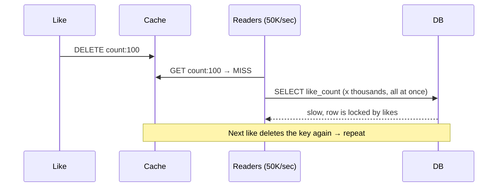

On the hottest item, the cache provides **zero protection**. Hot items are exactly where you need it most.

> 🧠 **Lesson:** *invalidate-on-write is fine for rarely-changing data, but it's a trap for high-write counters.* The cache entry gets killed faster than it can be useful.

---

## 4.3 The cache stampede (thundering herd)

Even with TTL expiry (no invalidation), a hot key creates a nasty failure. Suppose the key `count:100` has a TTL of 60 s and expires:

- At that instant, 50,000 readers/sec all see a **miss** at the same moment.
- All 50,000 fire the *same* DB query.
- The DB is overwhelmed, queries slow down, so the cache refill takes **longer**, so *more* readers miss meanwhile. It's a self-reinforcing collapse.

This is a **cache stampede** (also called a thundering herd or dog-piling).

### Defenses (know all of these)

| Technique | How it works | Trade-off |
|---|---|---|
| **Request coalescing / single-flight** | Within one app server, concurrent misses for the same key share **one** in-flight DB call; the rest wait for its result | Cuts load per server, but 1,000 servers still make 1,000 calls |
| **Distributed lock on refill** | The first misser takes a lock (`SET lock:100 NX EX 5`); others wait briefly or serve stale data | Extra latency; need lock timeouts so a crash doesn't deadlock |
| **TTL jitter** | TTL = 60 s ± random(0-10 s), so keys don't all expire together | Mostly helps *many keys* expiring at once (mass-expiry avalanche) |
| **Stale-while-revalidate** | Serve the slightly old value while *one* background worker refreshes it | Brief staleness (fine for counts!) |
| **Probabilistic early refresh** | Each reader, as expiry approaches, refreshes with a small random probability, so refresh happens *before* the expiry cliff | Slightly more complex |
| **Never expire hot keys** | Keep hot counters permanently in Redis (see Attempt 2) | Need another way to keep them correct |

> 🎤 **Interview line:** *"For counters, staleness is acceptable, so I'd use stale-while-revalidate with a single refresher. The user never sees a miss, and the DB sees one query per key per refresh interval no matter the read volume."*

---

## 4.4 Attempt 2: make Redis the live counter (not just a cache)

The team realizes the deeper mistake. They were treating the counter as *data owned by the DB that Redis mirrors*. For a counter, flip it: **Redis owns the live count**, and the DB gets updates later.

```
on like(post 100):
    if edge_store.insert_if_absent(user 7, post 100):   # was it new?
        redis.INCR("count:100")
```

**Why `INCR` is safe:** Redis executes commands on a **single thread**, one at a time. `INCR` is therefore atomic. There are no lost updates, no row locks, and no DB connections tied up. A single Redis node does roughly **100K+ simple ops/sec** with sub-millisecond latency.

Reads become `GET count:100`, or `MGET` for 20 posts in one round trip.

| | DB counter column | Redis `INCR` |
|---|---|---|
| Increment cost | ~1-2 ms (lock + fsync) | ~10 µs |
| Max rate on one key | ~500/s | ~100K+/s |
| Durability | Disk-backed | Memory (needs care, below) |

It's a massive improvement, and it also brings **new failure modes** that interviewers love.

---

## 4.5 Problem: the cold-start race

What if the key `count:100` isn't in Redis yet (a new Redis node, an eviction, a restart)?

Redis treats a missing key as **0**, so `INCR` on a missing key creates it with value **1**.

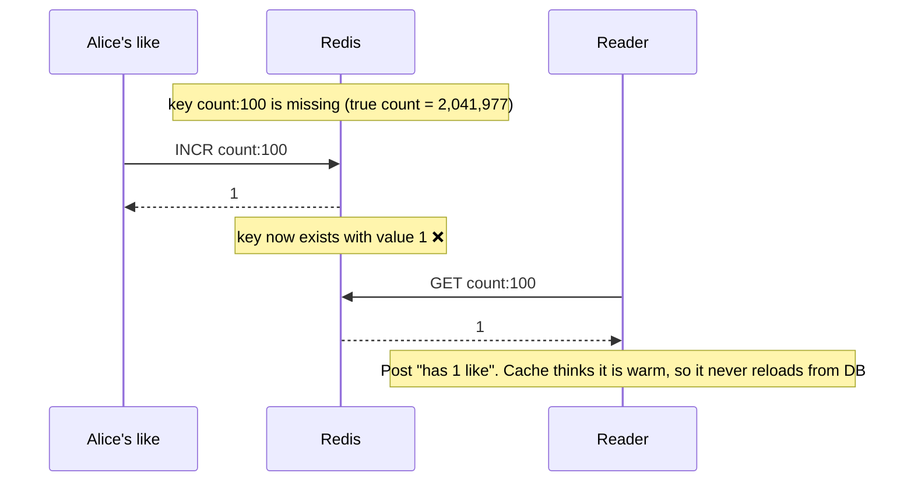

The count silently **resets to ~1** and then *looks* legitimate.

### Fixes

1. **Lua script (atomic check-and-increment):** run `if EXISTS key then INCR key else return NIL`. If `NIL`, the service loads the true count from the DB, then `SET key value NX` (set only if still absent), then retries the increment.
2. **Load-before-write with lock:** the first requester for a cold key takes a lock, loads from the DB, sets the key, and releases it.
3. **Warm-up on creation:** when a post is created, initialize `count:{post} = 0` immediately, so a missing key later is *abnormal* and handled explicitly.

> 🧠 **Concept: atomicity across multiple steps** requires Lua scripts or transactions in Redis, because two separate commands (`EXISTS`, then `INCR`) can interleave with other clients.

---

## 4.6 Problem: Redis crashes and memory is volatile

Redis lives in RAM. If a node dies, the counters on it vanish. The options:

| Mechanism | What it does | Loss window | Cost |
|---|---|---|---|
| **None (pure cache)** | Rebuild everything from the DB after a crash | Everything, until rebuilt | Cold-start storm on the DB |
| **RDB snapshots** | Periodic point-in-time dump to disk (e.g. every 5 min) | Up to minutes of increments | Cheap, fast restart |
| **AOF (append-only file)** | Log every write; `fsync` every second or every write | ~1 s (everysec) or ~0 (always) | More disk I/O, slower |
| **Replication** | A replica holds a copy; **failover** promotes it | Increments not yet replicated (replication is async) | Extra memory and nodes |

For counters we pick **replication + AOF (everysec)** and accept that a failover may lose ~1 s of increments.

**Why that's acceptable:** the counter is *derived* (Chapter 3). The edges in the Like Store are the truth, so a **reconciliation job** repairs the drift (Chapter 10). Losing 1,000 increments out of 2 million is invisible to users.

### The cold cluster after a total loss

If an entire Redis cluster is lost, everything is cold at once, and every read tries to hit the DB for 1 B keys. This is a **cache avalanche**. Mitigations:

- **Lazy warm-up of hot keys first** (recent and trending posts, ~1% of posts get ~99% of traffic).
- **Rate-limit and coalesce** DB fallbacks.
- **Serve from replica or stale snapshot** while rebuilding.
- **Pre-warm** a standby cluster from the latest RDB.

---

## 4.7 Memory sizing, a correction from Chapter 1

Earlier I said counters are ~8 GB (1 B posts × 8 bytes). That is the *raw payload*. Real Redis has per-key overhead (key string, pointers, metadata), roughly **50-100 bytes per key**:

- 1 B keys × ~80 B ≈ **~80 GB**. That's still easy for a small Redis cluster, but not "8 GB".

**Better trick:** most reads hit **recent or popular** posts. Keep only the *hot working set* in Redis (say the last 30 days' posts, ~5-10% of keys) with an eviction policy (**allkeys-LRU**), and let older counts live in the DB, loaded on demand and cached with a TTL. This is where the access pattern (**power law / Zipf**) saves us money.

> 🎤 Interviewers value hearing you *correct yourself* with better numbers. It shows you reason about real systems, not slogans.

---

## 4.8 Caching the *other* question: "Did I like it?"

The heart state is a per-(user, post) fact. How do we cache that?

- **Option A:** cache each fact, `liked:{user}:{post} → 1`, with a TTL. Simple, but the key count is enormous (users × posts).
- **Option B (better):** only cache what the feed *asks*. On a feed load we ask "which of these 20 posts did Carol like?" and check the edge store with one batched read, then cache the result for the session.
- **Option C (clever):** a **Bloom filter** per user, or per shard of edges, answers "definitely not liked" with no DB hit. Most posts a user *hasn't* liked, so the Bloom filter eliminates most lookups. The cost is false positives (we then confirm in the DB) but never false negatives.

The heart state needs **read-your-own-writes** consistency: right after Alice taps like, her app should show a red heart even if the server cache hasn't caught up. The usual trick is **optimistic UI**: the client flips the heart *immediately* and syncs in the background (revisited in Chapters 7 and 8).

---

## 4.9 Multi-layer caching (the final read path)

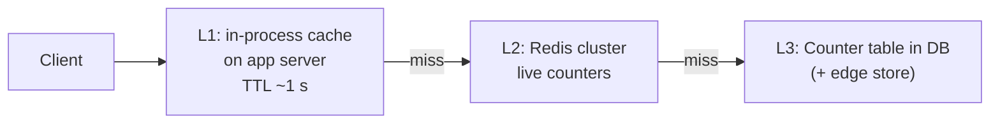

- **L1 (local, 1-2 s TTL):** absorbs the *hottest* keys. A celebrity post asked 50K times/sec per cluster becomes ~1 Redis call per server per second. Counts being 1 s stale is invisible.
- **L2 (Redis):** the live counter.
- **L3 (DB):** the durable fallback.

---

## 4.10 What's still broken

We've solved the lock problem and the read problem, but look at what remains:

| Remaining issue | Why it hurts |
|---|---|
| **One Redis key still lives on one node** | `INCR count:100` at 300K/sec exceeds what a single Redis thread handles (~100K/s). A **hot key** is still a bottleneck. |
| **The edge write is still synchronous** | Each like waits for the edge store write (with its two tables) before acknowledging. Latency and write load add up. |
| **Every like = 1 Redis op + 2 edge writes** | At 300K/sec peak that's ~900K ops/sec of work, much of it unnecessary for a number users only skim. |
| **Failover loses some increments** | We need reconciliation (Ch. 10). |

This is the setup for **write buffering and batching**: instead of incrementing once per like, we could count likes in small groups and apply one `INCRBY 500` instead of 500 `INCR`s.

---

### ✅ Chapter 4 recap (interview-ready)

- **Cache-aside + invalidate-on-write fails on hot counters**: constant invalidation means constant misses, so the DB is hit again.
- **Cache stampede** defenses: single-flight, locks, TTL jitter, stale-while-revalidate, probabilistic early refresh.
- **Redis as the live counter** uses atomic `INCR` (single-threaded execution), sub-ms latency, and no row locks.
- **Cold-start race:** `INCR` on a missing key yields 1. Fix it with Lua check-and-incr, `SET NX` warm-up, or initializing at post creation.
- **Durability:** replication + AOF (everysec), accept ~1 s loss, and **reconcile from edges**. Counters are derived data.
- **Memory:** budget for per-key overhead; keep the hot working set with LRU.
- **Layers:** L1 local (seconds) → L2 Redis → L3 DB. **Heart state** uses batched reads, Bloom filters, and optimistic UI.
- **Open problem:** a single hot key is still limited to one Redis node's throughput.

### 🧠 Quick check

1. Why is invalidate-on-write bad for counters, and what do we do instead?
2. A Redis node restarts empty. Alice's like arrives before anyone has read `count:100`. Walk through what goes wrong with a plain `INCR` and how a Lua script prevents it.
3. Why is it acceptable to lose ~1 second of increments on failover, and what do we rely on to repair it?
4. How does a 1-second in-process L1 cache turn 50K reads/sec on one post into a trivial load?

When you're ready, say **"next"** and we'll go to **Chapter 5: Write buffering and batching**, where Kafka and in-memory aggregation cut the write load by 100× or more, and we deal with the ordering, duplicates, and delivery guarantees that come with it.


-----------------------------------------------------------------------------------------------------------------------
-----------------------------------------------------------------------------------------------------------------------
-----------------------------------------------------------------------------------------------------------------------
-----------------------------------------------------------------------------------------------------------------------


# Chapter 5: Write Buffering and Batching

## 5.1 The story: the World Cup final

Four months after the Sunday outage, SnapGram is on Redis counters and the edge store. Then comes the World Cup final. A goal is scored, and for the next 90 seconds the platform sees **300K likes/sec**.

The dashboards show:

| Component | Load at peak |
|---|---|
| Edge store (2 writes per like) | ~600K writes/sec |
| Redis (`INCR` per like) | 300K ops/sec |
| Like Service threads | Blocked waiting on both stores |
| p99 latency of the heart tap | 2.3 s 😬 |

An engineer asks:

> "Why are we doing 300K separate increments on the counter? Nobody reads the count 300K times a second and notices each tick. Why not **add them up first**?"

That question is the heart of this chapter. The idea is to **trade a little freshness for a massive reduction in work**.

---

## 5.2 Idea 1: batch increments in memory

Each app server keeps a small in-memory map and flushes it periodically:

```
buffer = { post_100: 0, post_55: 0, ... }

on like(post 100):    buffer[post_100] += 1
every 1 second:       for each (post, delta): redis.INCRBY("count:post", delta)
                      buffer.clear()
```

**Worked example.** Post 100 gets 100,000 likes/sec spread across 500 app servers, about 200 likes/sec per server.

| Approach | Redis ops/sec on `count:100` |
|---|---|
| `INCR` per like | 100,000 |
| Flush each server every 1 s with `INCRBY` | **500** (one per server) |

That's a **200× reduction** on the hot key, and the counter is at most about 1 s stale.

### Why this alone isn't enough

| Failure | Consequence |
|---|---|
| App server crashes | Up to 1 s of buffered increments is **gone**, and it can be *thousands* for a hot post |
| Rolling deploys | Every deploy drops buffers unless you drain gracefully |
| The user was acked before the count was durable | A silent loss, with no replay possible |
| Buffer only covers *counts* | The edge writes still hit the DB synchronously |

> 🧠 **Lesson:** buffering in volatile memory buys speed by risking data. We want the buffer to be **durable**, so we need a **log**.

---

## 5.3 Idea 2: a durable log in the middle (Kafka)

The team moves the buffer out of the app servers and into a **distributed commit log**. The Like Service just *appends an event* and acks. Everything else happens asynchronously.

### Why a log (Kafka) and not a regular queue or DB?

| Property | Why it matters here |
|---|---|
| **Sequential disk appends** | Millions of writes/sec on cheap hardware (no random I/O) |
| **Partitioned** | Scale writes by adding partitions; ordering is guaranteed *within* a partition |
| **Replicated** | `acks=all` + `min.insync.replicas=2`: an acked event survives a broker loss |
| **Retained and replayable** | Consumers track an *offset*, so you can rewind and reprocess after a bug, which is perfect for rebuilding counters |
| **Multiple independent consumer groups** | The edge writer and counter aggregator each read the same stream at their own pace |

### The new pipeline

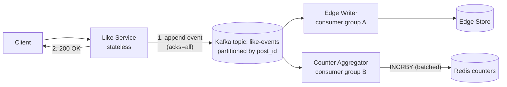

**An event looks like this:**

```json
{ "event_id": "9f3a-...", "type": "LIKE", "user_id": 7, "post_id": 100, "ts": 1761892200123 }
```

**What the user waits for now:** one Kafka append (~2-5 ms), instead of two DB writes plus a Redis call. The heart-tap latency collapses from seconds to milliseconds.

---

## 5.4 The Counter Aggregator: windowed counting

The aggregator consumes events and counts them in a **tumbling window** (e.g. 1 s):

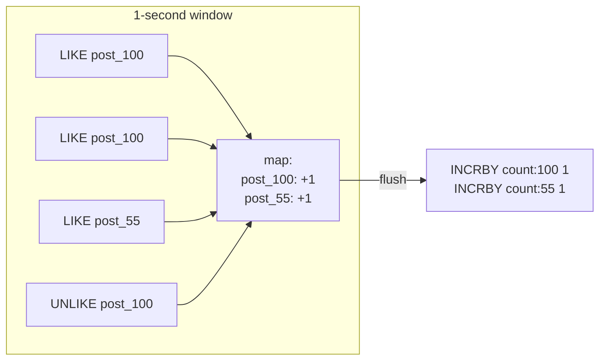

Net effect: 4 events become **2 Redis ops**. On a celebrity post, 100K events/sec become **1 `INCRBY` per window** (per aggregator instance).

Notice what happened to the Chapter 4 "hot key" worry: Redis now sees roughly **one write per hot key per aggregator per second**. The single-key Redis limit is effectively solved *for writes*.

---

## 5.5 The delivery-semantics trap

Kafka consumers track an **offset** (their bookmark). The order of "do work" and "save bookmark" decides what happens on a crash:

| Order | Crash between the two steps | Result |
|---|---|---|
| Commit offset **then** do work | Work never happened; bookmark moved on | **At-most-once** (events lost → undercount) |
| Do work **then** commit offset | Work happened; bookmark didn't move → events replayed | **At-least-once** (duplicates → overcount) |
| Do work and commit offset *atomically* | Neither or both | **Exactly-once** (hard) |

Losing likes is unacceptable and double counting is unacceptable. The industry-standard answer isn't magic exactly-once; it's **at-least-once delivery + idempotent processing**.

### Making it idempotent, stage by stage

**Stage 1: Edge Writer (idempotent by nature).** Inserting `(user 7, post 100)` twice is harmless because the primary key dedupes it. Crucially, the Edge Writer only emits a counter delta when the insert **was actually new**:

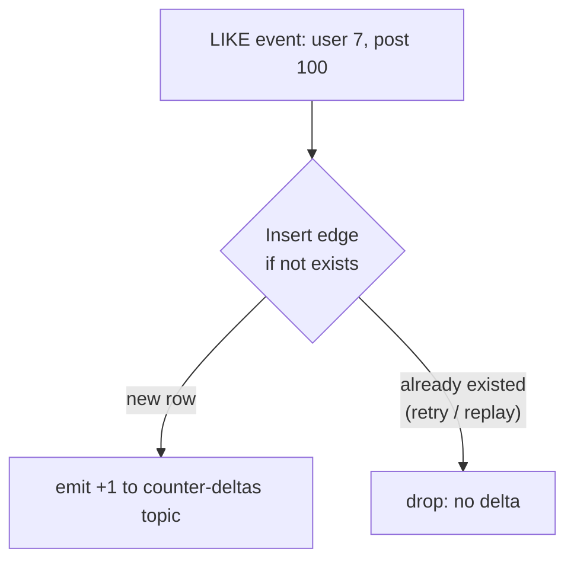

This is the Chapter 3 rule ("increment only if the edge insert was new") made concrete. It also covers the double-tap and the client retry, because the dedupe happens at the source of truth.

**Stage 2: Counter Aggregator (idempotent by batch ID).** Replays can still re-apply a flushed batch. We make each flush uniquely identifiable and refuse to apply it twice, using a Lua script:

```
-- batch_id = "partition-3:offsets-1000-1999"
if redis.call("EXISTS", "applied:" .. batch_id) == 0 then
    redis.call("INCRBY", KEYS[1], delta)
    redis.call("SET", "applied:" .. batch_id, 1, "EX", 86400)
end
```

Replay the same batch after a crash and nothing happens the second time. (Alternatives: Kafka transactions or Flink checkpointing for true exactly-once pipelines, and I'd name them in the interview.)

> 🎤 **Interview line:** *"I don't rely on exactly-once delivery. I use at-least-once delivery with idempotent consumers: dedupe at the edge via the primary key, and idempotent batch application on the counter. Duplicates become harmless."*

---

## 5.6 Ordering: like, unlike, like

A user taps like, unlike, like quickly. Three events: `LIKE, UNLIKE, LIKE`. If these are processed out of order (`UNLIKE` first), the final state is wrong.

- **Fix:** partition Kafka by `post_id`, so all events for one post, including all of one user's events on that post, land in the **same partition**, which Kafka keeps in order.
- Edge Writer processes them sequentially: `insert → delete → insert`, so the final state is "liked" ✅.
- An `UNLIKE` for an edge that doesn't exist is a **no-op** and emits no delta.

For extra safety, edges can store a **version/timestamp** and apply *last-write-wins* (ignore an event older than the stored one). That makes the edge store converge even if some reordering sneaks in.

---

## 5.7 The sync/async decision and "read-your-own-writes"

Now that the edge write is asynchronous, a problem appears:

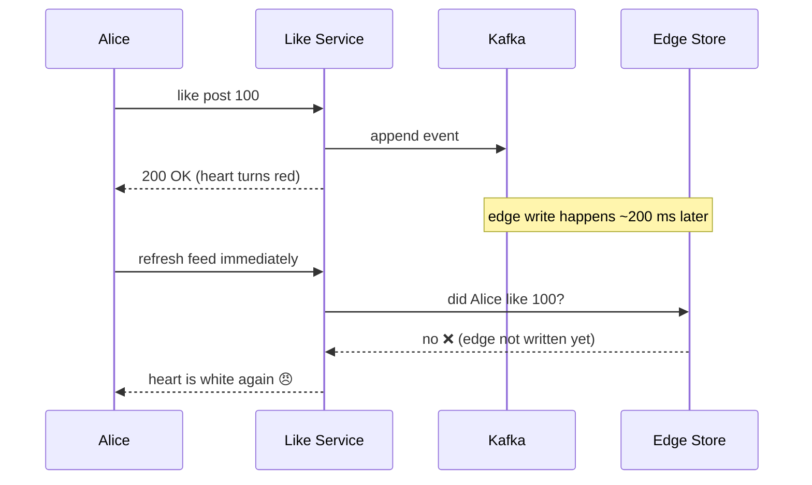

Users hate a like that "un-likes" itself. The usual fixes:

| Approach | How | Trade-off |
|---|---|---|
| **Optimistic UI** | The client keeps the heart red locally and doesn't re-fetch right away | Doesn't help across devices |
| **Recent-likes cache** | On the sync path, also `SET liked:{user}:{post} 1 EX 300` in Redis. Heart-state reads check this first, then the edge store | Small extra write; covers the lag window |
| **Sync edge write, async counter** | Write the edge directly before acking; only the count is asynchronous | Higher latency and DB load, but simplest correctness |

I'd recommend the **recent-likes cache plus Kafka**. If that Redis entry is lost, Kafka still holds the event, and the edge store catches up shortly afterward, so the worst case is a briefly stale heart.

---

## 5.8 Absorbing bursts and backpressure

Kafka now acts as a **shock absorber**:

- A spike of 300K/s is simply appended. If the Edge Writer can only sustain 200K/s, **consumer lag** grows (events wait in the log), but nothing is lost and the user-facing path stays fast.
- Operationally we monitor **consumer lag** and autoscale consumers up to the partition count (one consumer per partition max).
- If lag grows for long, counts drift behind. We alert and degrade gracefully rather than fail.

**Batching writes to the edge store** also matters. The Edge Writer groups inserts and flushes them in batches (e.g. up to 500 rows or 50 ms). In Cassandra, batch only rows in the *same partition* (multi-partition batches create coordinator hotspots), and use async parallel writes otherwise.

**Edge protection:** per-user rate limits (e.g. 10 likes/sec) and bot detection reject abuse *before* it reaches Kafka, so a malicious client can't create artificial load.

---

## 5.9 Before/after at peak (300K likes/sec)

| | Before (Ch. 4) | After (Ch. 5) |
|---|---|---|
| Heart-tap latency | Seconds at peak | ~5-10 ms (Kafka append) |
| Redis ops | 300K `INCR`/s | ~tens of thousands `INCRBY`/s at most (and ~1/s per hot key per aggregator) |
| Edge writes | Synchronous, spiky | Async, batched, smoothed |
| Crash safety | Loss on buffer or Redis loss | Events durable in Kafka, replayable |
| Count freshness | Immediate | ~1-2 s stale (acceptable) |

**The cost:** more moving parts (Kafka, consumers, offsets, dedupe logic) and an eventually consistent counter. That's an excellent trade for a like count.

---

## 5.10 What's still unsolved

1. **Hot partition:** with `partition = post_id`, the celebrity post's 100K events/sec all land on **one Kafka partition and one consumer**, and the edge writes to `likes_by_post` hit **one storage partition**.
2. **Redis capacity and placement:** how do we spread 1 B counters across a cluster, and what happens when we add nodes?
3. **Edge store sharding strategy** for 58 TB/year.
4. **Kafka down?** We'll cover the fallback in Chapter 10.

All of these are **sharding** questions. That's next.

---

### ✅ Chapter 5 recap (interview-ready)

- **Why batch?** Users can't perceive per-like count ticks, so coalesce writes for a 100-200× load reduction on hot keys.
- **In-memory buffering is fast but lossy**; **a durable log (Kafka)** gives durability, replay, ordering per partition, burst absorption, and multiple consumers.
- **Pipeline:** Like Service → Kafka → Edge Writer (dedupe via PK, emits delta only if new) → Counter Aggregator (window, `INCRBY`, idempotent batch ID).
- **Delivery semantics:** at-most-once loses, at-least-once duplicates, so use **at-least-once + idempotency**.
- **Ordering:** partition by `post_id`; unlike on a missing edge is a no-op; use versions for last-write-wins.
- **Read-your-own-writes:** optimistic UI plus a short-TTL recent-likes cache.
- **Backpressure:** consumer lag is the signal, with autoscaling, rate limits, and batched writes.

### 🧠 Quick check

1. The aggregator crashes after calling `INCRBY` but before committing its Kafka offset. What happens on restart, and which mechanism prevents a double count?
2. Why do we emit a counter delta only when the edge insert was *new*, instead of for every event?
3. Why partition by `post_id`, and what new problem does that introduce for celebrity posts?
4. Alice taps like and instantly refreshes, and the heart is white. Explain why, and give two fixes.

Say **"next"** when ready, and we'll go to **Chapter 6: Sharding and the hot-key problem**, covering how to split Redis, Kafka, and the edge store across machines, why naive `hash % N` breaks when you add nodes, consistent hashing, and how to survive a celebrity post that overwhelms any single shard.


-----------------------------------------------------------------------------------------------------------------------
-----------------------------------------------------------------------------------------------------------------------
-----------------------------------------------------------------------------------------------------------------------
-----------------------------------------------------------------------------------------------------------------------


# Chapter 6: Sharding and the Hot-Key Problem

## 6.1 The story: one machine isn't enough

By now SnapGram has Kafka, Redis counters, and an edge store. Then the capacity planner shows up with three problems:

| Problem | Number |
|---|---|
| Redis counters in RAM (with per-key overhead) | ~80 GB, and growing |
| Redis ops at peak | one node tops out around 100K ops/sec |
| Edge store | ~58 TB/year, with 3 replicas ≈ 174 TB/year |

No single machine holds 174 TB, and no single Redis thread serves peak traffic. We must **split the data across many machines**. That is **sharding** (also called partitioning).

> 🧠 **Terminology:** *partition* = a slice of the data. *Shard* = a partition living on its own node(s). Cassandra and Kafka say "partition", Redis and MySQL say "shard". Same idea.

---

## 6.2 Step 1: choosing a shard key

The shard key decides **which node owns which data**. A good key must:

1. **Spread load evenly** (no hot shards).
2. **Keep related data together**, so common queries touch **one** shard.
3. Be **stable**: the key's value doesn't change.

Let's apply it to each store:

| Store | Query | Natural shard key |
|---|---|---|
| Counter (Redis) | `GET count:{post}` | `post_id` |
| `likes_by_user` | "Did Alice like post 100?" | `user_id` |
| `likes_by_post` | "Who liked post 100?" | `post_id` |
| Kafka events | per-(user, post) ordering | see 6.6 |

Notice that **different stores use different keys**. That's fine, because each store answers different queries.

---

## 6.3 Step 2: how do we map key → node?

### Attempt 1: `hash(key) % N`

With N = 4 nodes: `node = hash(post_id) % 4`.

It's simple and spreads load evenly. The problem appears when traffic grows and we **add a 5th node** (N: 4 → 5).

Let's take keys with hash values 0-19 and see where they land:

| hash | %4 | %5 | moved? |
|---|---|---|---|
| 0, 1, 2, 3 | 0, 1, 2, 3 | 0, 1, 2, 3 | no |
| 4 | 0 | 4 | **yes** |
| 5 | 1 | 0 | **yes** |
| 6-19 | ... | ... | **yes** (all 14 move) |

Only **4 of 20 keys (20%) stay put, so 80% of keys move.** For a cache, that means ~80% of Redis keys suddenly "miss", every read falls to the DB, and we cause a **cache avalanche** at exactly the moment we were trying to add capacity. For the edge store, it means moving 80% of 58 TB.

> 🎤 **Interview line:** *"Modulo hashing remaps almost every key when N changes, so resizing becomes a mass migration."*

### Attempt 2: consistent hashing

Place both **nodes and keys on a ring** (hash space 0 → 2³²). A key belongs to the **first node clockwise** from its position.

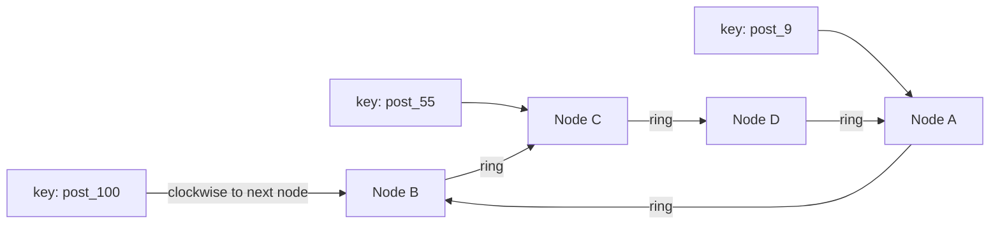

**Adding Node E** between B and C: only the keys between B and E (previously owned by C) move to E. On average only **1/(N+1) ≈ 20%** of keys move (4 → 5 nodes), and nobody else is disturbed.

**Problem: uneven slices.** With only 4 points on the ring, one node might own 40% of the ring and another 10%. The fix is **virtual nodes (vnodes)**: each physical node appears on the ring at, say, 128-256 random positions.

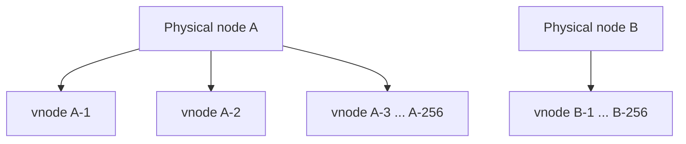

Benefits of vnodes:
- Load evens out statistically.
- A new node steals many small slices **from every existing node**, so the migration load is spread across the cluster.
- A node with more RAM can get more vnodes (weighted capacity).
- When a node dies, its load spreads over *all* the others, not just its neighbour (no domino overload).

**Who uses what:** Cassandra, DynamoDB, and Riak use consistent hashing with vnodes. **Redis Cluster** uses a close cousin: **16,384 fixed hash slots**, where `slot = CRC16(key) % 16384` and slots are assigned to nodes. Adding a node means *moving whole slots*. Same effect, simpler bookkeeping.

### Other strategies (know the trade-offs)

| Strategy | Idea | Good for | Weakness |
|---|---|---|---|
| **Hash** | spread by hash of key | even load, point lookups | range scans touch every shard |
| **Range** | `post_id` 0-1M on shard 1, etc. | range scans | **hot shard**: new posts all land on the newest range |
| **Directory / lookup** | a service maps key → shard | total flexibility, move one hot key | lookup service is a dependency and SPOF |
| **Logical shards** | 1,024 logical shards mapped to few physical nodes | trivial rebalancing | needs the mapping table |

> 💡 **Practical tip:** start with many **logical shards** (e.g. 1,024) on few machines. When you need capacity, you move whole logical shards to new machines, and the key→logical-shard mapping never changes. Instagram famously did this.

---

## 6.4 Step 3: sharding the counter store (Redis Cluster)

- ~80 GB of counters ÷ ~10 shards ≈ 8 GB per shard, with each shard also having a replica (Chapter 7).
- Each shard handles ~10% of keys and ~10% of traffic.

### The scatter-gather read problem

A feed loads 20 posts, whose counters live on up to **10 different shards**. The Feed Service must:

1. Group the 20 keys **by shard** (the client library knows the slot map).
2. Send one **pipelined `MGET`** per shard in parallel.
3. Merge the results.

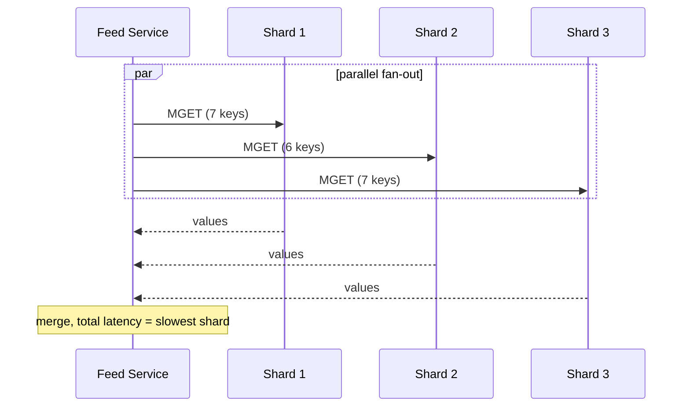

**Tail latency gotcha:** the total latency is the **slowest** of the parallel calls. If each shard has a 1% chance of being slow, with 10 shards you hit a slow one ~10% of the time. Mitigations:
- **Hedged requests:** if a shard hasn't answered in ~p95 time, send the same read to its replica and take the first reply.
- **Tight timeouts + graceful degradation:** if a counter times out, render the post *without* a count rather than blocking the feed.
- **L1 cache** (Chapter 4) so many keys never leave the app server.

---

## 6.5 Step 4: sharding the edge store (and a trap)

**`likes_by_user`** (partition key = `user_id`): one user has at most thousands to tens of thousands of likes, so partitions stay small and spread evenly. ✅

**`likes_by_post`** (partition key = `post_id`): this is the trap. The celebrity post has **2,000,000+ rows in one partition**:

| Problem | Why it hurts |
|---|---|
| **Unbounded partition size** | One partition can hit GBs and break node limits (Cassandra recommends keeping partitions around ≤100 MB) |
| **Hot partition** | 100K writes/sec go to the **same replica set** of 3 nodes, so one slice of the cluster melts while others idle |
| **Slow "who liked" scans** | Pagination deep into a giant partition is expensive |

### Fix: bucketing (a composite partition key)

Split a post's likers across **many partitions** by adding a bucket to the key:

```
partition key = (post_id, bucket)
bucket = hash(user_id) % 64        -- spread by user, for writes
   or  = day(created_at)           -- time buckets, for "latest likes"
```

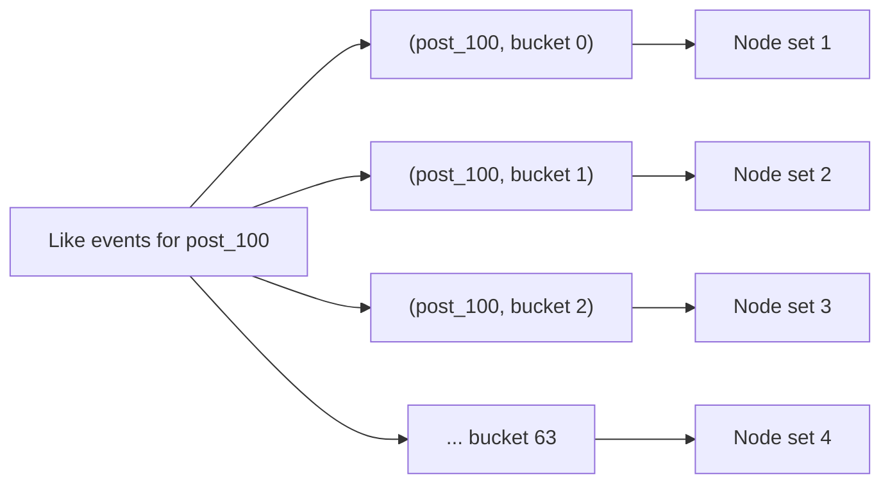

- **Writes** spread over 64 partitions, which means different nodes. ✅
- **Point lookup** "did Alice like 100?" is served by `likes_by_user`, so no bucket math is needed there.
- **"Who liked?" list:** fine-grained ordering across buckets is unnecessary. Show the latest N likers by reading the newest **time bucket(s)**, or merge a few buckets. Users don't expect a perfectly ordered list of 2 million names.
- **Adaptive bucketing:** most posts have 1 bucket. Only posts detected as hot get 64 buckets, so normal posts stay simple.

> 🧠 **Concept: key salting / bucketing.** When a single logical key is too hot or too large, append a small suffix (random or derived) to spread it across partitions, and pay with a **fan-out on reads**. Write-heavy, read-rare data (like the liker list) is a perfect candidate.

---

## 6.6 Step 5: the Kafka hot partition (a refinement of Chapter 5)

In Chapter 5 I partitioned Kafka by `post_id` to keep ordering. Now we can see the cost: the celebrity post's 100K events/sec go to **one partition → one consumer**, which is one bottleneck.

**Look at what ordering we actually need:** only events for the *same (user, post) pair* must stay ordered (like → unlike → like). Events from *different* users don't care about each other.

> **Better partition key: `hash(user_id, post_id)`**

```mermaid
flowchart LR
    E["100K events/s for post_100<br/>from millions of users"] --> H{"partition =<br/>hash(user_id, post_id)"}
    H --> P0[Partition 0]
    H --> P1[Partition 1]
    H --> P2[Partition 2]
    H --> PN[Partition ... 127]
    P0 --> C0[Consumer 0]
    P1 --> C1[Consumer 1]
    P2 --> C2[Consumer 2]
    PN --> CN[Consumer N]
```

- The celebrity post's load is spread over **all partitions** ✅
- Each (user, post) pair stays on one partition, so **per-pair ordering holds** ✅
- Counter aggregation is just **addition, which is commutative**: each aggregator does its own `INCRBY`, and the order doesn't matter ✅

This is a great interview moment: *you identify which ordering guarantee is truly required and choose the weakest key that satisfies it.*

---

## 6.7 Step 6: the hot key in Redis (single key, 100K+ ops/sec)

Even after Chapter 5's batching, the celebrity key can still be hot, mostly on the **read** side:

| Hot-key scenario | Pressure | Solutions |
|---|---|---|
| **Hot reads** (50K+ reads/sec of `count:100`) | One Redis shard's CPU | L1 in-process cache (1-s TTL); read replicas; CDN/edge cache (Chapter 8) |
| **Hot writes** (before batching) | One shard's single thread | Batching (Ch. 5); **split counters** (below) |

### Split counters (a.k.a. sharded counters)

Represent the count as **K sub-counters** on **different shards**:

```
count:100:0, count:100:1, ..., count:100:15       (each hashes to a different shard)

write:  INCRBY count:100:{random 0..15} delta
read:   MGET all 16 → sum
```

```mermaid
flowchart LR
    AGG[Aggregators] -->|"random sub-key"| S0["count:100:0 → Shard 1"]
    AGG --> S1["count:100:1 → Shard 4"]
    AGG --> S2["count:100:2 → Shard 7"]
    AGG --> SN["... :15 → Shard 9"]
    S0 --> SUM["Reader: sum of 16 sub-counters<br/>(cache result 1s)"]
    S1 --> SUM
    S2 --> SUM
    SN --> SUM
```

Write load is divided by 16, at the cost of **reads touching 16 keys**. That's why we use it **only for detected hot keys**, and cache the summed result for ~1 s so the 16-key read happens roughly once per second, not once per viewer.

### Detecting hot keys automatically

You can't hand-label celebrities. Approaches:
- **Heavy-hitter sketches** (Count-Min Sketch or Space-Saving) running in the like service or aggregator to track the top-K keys by rate, using tiny memory.
- Redis `--hotkeys` / server-side key-access sampling, or proxy-level (Envoy/twemproxy) stats.
- A **threshold rule**: if `count:{post}` exceeds X ops/sec for Y seconds, **promote** it to split mode and publish the flag in a config store. Demote when it cools.

> 🎤 **Interview line:** *"Sharding distributes keys, not load. A single key is never split by a hash function, so hot keys need a separate mechanism: caching for reads, key-splitting or batching for writes."*

---

## 6.8 Resharding without downtime

Eventually we need more shards. The safe playbook (it works for Redis, edge store, anything):

```mermaid
flowchart TD
    A["1. Add new nodes (empty)"] --> B["2. Assign them vnodes / slots"]
    B --> C["3. Stream data from old owners → new owner<br/>(background, throttled)"]
    C --> D["4. During migration: reads check new then old;<br/>writes go to new (or both)"]
    D --> E["5. Verify counts / checksums match"]
    E --> F["6. Flip ownership, delete old data"]
```

Key points:
- **Throttle** migration so it doesn't steal capacity from live traffic.
- **Dual-write or forward** during the move so nothing is lost.
- Redis Cluster has this built in: `MIGRATE` per slot, plus `-ASK`/`-MOVED` redirects that tell the client where a key lives mid-move.
- Because counters are *derived*, for the counter store you can also choose to **build a new cluster in the background** by replaying from Kafka or reconciling from edges, then switch over.

---

## 6.9 Hot *shard* vs hot *key* vs hot *partition*

| Term | What's unbalanced | Fix |
|---|---|---|
| **Hot key** | One key gets disproportionate traffic | Cache, batch, split the key |
| **Hot shard** | One node gets more than its share (bad hash, uneven vnodes, a few popular keys co-located) | Vnodes, re-balance, move logical shards |
| **Hot partition** (Kafka / Cassandra) | One partition receives most events | Better partition key, salting/bucketing |

---

### ✅ Chapter 6 recap (interview-ready)

- Shard because **data (58 TB/yr), memory (80 GB), and QPS** exceed one node.
- **Shard key = even spread + co-locate what's queried together + stable.** Different stores use different keys: `user_id` for `likes_by_user`, `post_id` for counters.
- **`hash % N` is bad**: ~80% of keys move when N goes 4 → 5. **Consistent hashing with vnodes** moves only ~1/(N+1); Redis Cluster uses 16,384 slots. Prefer **many logical shards** to ease rebalancing.
- Feed reads become **scatter-gather**: group keys by shard, pipeline, hedge slow requests, degrade gracefully.
- **`likes_by_post` has an unbounded, hot partition**, so use **bucketed keys** `(post_id, bucket)`, adaptively for hot posts.
- **Kafka:** partition by `hash(user_id, post_id)`, because only per-pair ordering matters and aggregation is commutative.
- **Hot-key defenses:** L1/replica caching for reads, batching and **split counters** for writes, **auto-detection** via heavy-hitter sketches.
- **Resharding:** add nodes, stream data, dual-write, verify, flip. Throttle everything.

### 🧠 Quick check

1. With 4 → 5 nodes, why do ~80% of keys move under modulo hashing but ~20% under consistent hashing?
2. What problem do virtual nodes solve, and what extra benefit do they give when a node dies?
3. Why is `(post_id, bucket)` a good partition key for `likes_by_post` but a *bad* design for the counter's `GET`? (Think about read fan-out.)
4. Why can we partition Kafka by `hash(user_id, post_id)` without breaking correctness of the count?
5. A single post is hot for *reads*. Name three layers where you can absorb that load.

Say **"next"** when ready, and we'll go to **Chapter 7: Replication, consistency, and idempotency**, covering leader-follower vs leaderless replication, quorum math (R + W > N), what "eventual consistency" really means for a like count, failover and split-brain, and end-to-end idempotency keys.


-----------------------------------------------------------------------------------------------------------------------
-----------------------------------------------------------------------------------------------------------------------
-----------------------------------------------------------------------------------------------------------------------
-----------------------------------------------------------------------------------------------------------------------


# Chapter 7: Replication, Consistency, and Idempotency

## 7.1 The story: the 3 AM node failure

Last month a machine in the Redis cluster died at 3 AM. It owned 10% of the counters. The consequences were ugly:

- Counters for 100M posts vanished, so feeds showed blank counts.
- The DB was flooded with fallback reads (the cache avalanche from Chapter 4).
- The on-call engineer spent two hours rebuilding.

The postmortem's first line: *"We had exactly one copy of this data."*

Hardware fails constantly. At thousands of machines, something is dying every day. **Replication** means keeping multiple copies of the same data on different machines, so that losing one machine loses nothing.

**What replication buys us:**

| Benefit | Explanation |
|---|---|
| **Durability** | Data survives a disk or machine loss |
| **Availability** | If one copy is down, another serves traffic |
| **Read scalability** | Reads spread across copies (great for our 40:1 read-heavy load) |
| **Lower latency** | Put copies in regions near the users |

**What it costs:** copies can disagree, and keeping them in sync is the hard part. This chapter is about that trade-off.

---

## 7.2 Model 1: leader-follower (primary-replica)

One node is the **leader** and accepts all writes. It streams changes to **followers**, which serve reads.

```mermaid
flowchart LR
    W[Writes] --> L[("Leader")]
    L -->|"replication stream"| F1[("Follower 1")]
    L -->|"replication stream"| F2[("Follower 2")]
    R1[Reads] --> F1
    R2[Reads] --> F2
    R3[Reads] --> L
```

This is how Redis (primary/replica), MySQL, and Postgres work. A single writer means no write conflicts, which is why the model is so popular.

### Sync vs async replication

When the leader gets a write, does it wait for followers before acking the client?

| Mode | Leader acks when... | Durability | Latency | Availability |
|---|---|---|---|---|
| **Synchronous** | all followers confirmed | Strongest | Slowest (waits on the slowest follower) | One slow or dead follower blocks writes |
| **Asynchronous** | the leader alone has written it | Weakest: a leader crash can lose the last writes | Fastest | Writes continue even if followers die |
| **Semi-synchronous** | at least 1 follower confirmed | Good | Moderate | Tolerates the others being down |

**What we pick:**
- **Edge store (source of truth):** semi-sync or quorum writes. A like must not be lost once acked.
- **Redis counters (derived data):** **async**. We accept losing about a second of increments on failover, because reconciliation repairs it (Chapter 10).

> 🧠 **Principle:** pay for durability only where the data is the source of truth. Spending sync-replication latency on derived data is waste.

### Replication lag

With async replication, followers are always slightly behind, typically milliseconds but seconds under load. That produces the classic anomalies.

**Anomaly 1: reading your own write**

```mermaid
sequenceDiagram
    participant A as Alice
    participant L as Leader
    participant F as Follower (lagging)
    A->>L: like post 100
    L-->>A: OK
    A->>F: "did I like post 100?"
    F-->>A: no ❌ (hasn't received the write yet)
```

**Fixes (read-your-writes consistency):**
- Route a user's reads to the **leader for a short window** (say 10 s) after they write.
- Or track the write's **log position/timestamp** and only read from a follower that has caught up to it.
- Or use the **recent-likes cache** from Chapter 5, so heart state never depends on follower freshness.

**Anomaly 2: time going backwards (monotonic reads)**

Bob refreshes the page twice. The first read hits an up-to-date follower and shows **1,203**. The second hits a lagging follower and shows **1,198**. The count went *down*, and users notice.

**Fix:** **sticky routing**. Always send the same user (or session) to the same replica, so they see time move forward only. Another cheap trick for counts: have the client ignore a number lower than the last one it displayed for that post (unless the user just unliked).

### Failover and split-brain

When the leader dies, a follower must be **promoted**:

```mermaid
flowchart TD
    A["Leader stops responding"] --> B["Failure detector: no heartbeat for N seconds<br/>(Redis Sentinel / cluster quorum)"]
    B --> C["Majority agrees the leader is dead"]
    C --> D["Elect the most up-to-date follower"]
    D --> E["Promote it; repoint other followers and clients"]
    E --> F["Old leader, if it returns, must become a follower"]
```

**What can go wrong:**

| Problem | Explanation |
|---|---|
| **Lost writes** | With async replication, the new leader may lack the old leader's last writes. For counters that means a few lost increments, so we reconcile. |
| **False failure** | A network blip makes a healthy leader look dead, and failover happens needlessly (causing churn). Tune the timeout: too short means flapping, too long means long outages. |
| **Split-brain** | The old leader was only *partitioned*, not dead. Now **two nodes both think they're the leader** and both accept writes. The data diverges. |

**Preventing split-brain:**
- **Majority quorum for elections**: a leader needs votes from a majority (3 of 5 nodes), so two leaders can't both win in different partitions.
- **Epochs / term numbers (fencing tokens)**: each new leader gets a higher number, and followers and storage reject writes from an older epoch. A stale leader gets fenced out.
- **Leader steps down** if it loses contact with the majority.

> 🎤 **Interview line:** *"To avoid split-brain, I use majority-quorum election plus monotonically increasing epochs for fencing. A minority-partition leader can't commit, and stale-epoch writes are rejected."*

---

## 7.3 Model 2: leaderless replication (Cassandra / DynamoDB style)

For the edge store we want massive write throughput with no single leader per partition. In **leaderless** systems, any replica accepts writes, and the client or coordinator sends each write to **N replicas** (typically N = 3).

### Quorum math

- **N** = number of replicas for a key
- **W** = replicas that must acknowledge a write
- **R** = replicas that must answer a read

**If R + W > N, every read overlaps at least one replica that has the latest write.**

Example with N = 3:

| Config | R + W | Behavior |
|---|---|---|
| W=1, R=1 | 2 (not > 3) | Fast, but reads can be stale |
| **W=2, R=2** | **4 (> 3)** | **Strongly consistent reads** (quorum) |
| W=3, R=1 | 4 | Reads fast; writes need all nodes (low write availability) |
| W=1, R=3 | 4 | Writes fast; reads slow |

```mermaid
flowchart LR
    C[Coordinator] -->|write| R1[("Replica 1 ✅ has it")]
    C -->|write| R2[("Replica 2 ✅ has it")]
    C -.->|"write (slow or down)"| R3[("Replica 3 ❌ missed it")]
    Q["Read with R=2 asks any 2 replicas:<br/>{R1,R2}, {R1,R3}, or {R2,R3}<br/>every pair includes at least one up-to-date replica"]
```

**Our choice for the edge store**
- **Writing likes:** `W=2` (`LOCAL_QUORUM` in Cassandra). Durable, and it tolerates one dead replica.
- **Reading "did I like it?":** `R=2` (or `R=1` plus the recent-likes cache, since stale heart state is rare and cheap to mask).
- **Reading the liker list:** `R=1` is fine, because nobody audits that list.

> 🧠 **Consistency is tunable per query.** Say this in the interview. It shows you treat consistency as a dial and not a binary.

### How replicas heal themselves

Replicas can fall out of sync (a node was down, a write was dropped). Three repair mechanisms:

| Mechanism | When it runs | What it does |
|---|---|---|
| **Hinted handoff** | During the outage | The coordinator stores the missed write as a "hint" and delivers it when the node returns |
| **Read repair** | On a read | The coordinator notices a stale replica among the responses and pushes the fresh value to it |
| **Anti-entropy (Merkle trees)** | Background | Replicas compare hash trees of their data, find differing ranges quickly, and sync only those |

### Conflicts and last-write-wins

If Alice's `LIKE` hits replica 1 and her `UNLIKE` hits replica 2 at nearly the same moment, which wins? The common rule is **last-write-wins (LWW)** by timestamp.

**Danger:** LWW relies on **clocks**, and clocks across machines are never perfectly in sync (skew of milliseconds to seconds). A slow clock can make an older write "win".

For likes this is tolerable, because the stakes are one user's heart. Where precision matters, use **client-supplied sequence numbers** (e.g. a per-user-per-post version that increments on each toggle), so ordering doesn't depend on server clocks.

---

## 7.4 Model 3: multi-region (multi-leader) and why counters are special

SnapGram now has users in the US, Europe, and India, and wants each region to accept likes locally (low latency, regional failover). That means **multiple leaders**, one per region, replicating to each other asynchronously.

**The conflict problem:**

```mermaid
sequenceDiagram
    participant US as US region (count = 100)
    participant IN as India region (count = 100)
    Note over US,IN: A cross-region link delay means each region sees only its own writes for ~200 ms
    US->>US: 5 users like → local count = 105
    IN->>IN: 3 users like → local count = 103
    US-->>IN: sync (I'm at 105)
    IN-->>US: sync (I'm at 103)
    Note over US,IN: If the rule is "take the latest value" → someone's likes are lost ❌ (105 or 103; the truth is 108)
```

Replicating the *value* with last-write-wins loses increments. We must replicate the **operations**, or use a data type designed for this.

### CRDTs (conflict-free replicated data types)

A **CRDT** is a data structure whose merge operation is **commutative, associative, and idempotent**, so replicas can exchange state in any order, any number of times, and always converge to the same result.

**G-Counter (grow-only counter), perfect for likes:**

Each region keeps **its own slot** and only ever increments that slot. The total is the sum of all slots.

```
Each replica holds:   { US: 105, EU: 40, IN: 103 }
Total likes = 105 + 40 + 103 = 248

Merge of two replicas' views = per-slot MAX:
  replica A sees { US: 105, EU: 38, IN: 100 }
  replica B sees { US: 102, EU: 40, IN: 103 }
  merged        = { US: 105, EU: 40, IN: 103 }   ✅ regardless of order or repeats
```

Why it works: each slot has a single writer (its region), so there are no write conflicts. `max` is idempotent, so duplicate or reordered sync messages are harmless.

**PN-Counter (positive-negative)**: for unlikes, keep two G-Counters, `P` (likes) and `N` (unlikes). The value is `sum(P) − sum(N)`.

**Per-user like state: an OR-Set (observed-remove set) or LWW-element-set.** It handles "Alice likes in the US while unliking in India" with a defined, deterministic outcome.

> 🧠 **This ties back to Chapter 6.** The "split counters" we used for hot keys (`count:100:0..15`) are the same idea as a G-Counter: many independent slots that are summed on read. Count-style data parallelizes naturally.

### Routing in practice

- A user's writes go to their **home region** (via geo-DNS or the load balancer).
- Counters from all regions are merged asynchronously, so a global count may lag another region's by ~100-500 ms.
- **Failover:** if a region dies, traffic reroutes to another region and its counter slot stays frozen until recovery. Nothing is lost, because the dead region's slot already replicated everywhere it could.

---

## 7.5 The consistency menu (what to claim for each piece)

| Data | Consistency target | Mechanism |
|---|---|---|
| Edge (who liked) | Strong-ish / read-your-writes | Quorum (W=2, R=2) or recent-likes cache |
| Counter (how many) | **Eventual**, bounded staleness (~seconds) | Async replication, batching, L1 cache |
| Heart on my own device | Immediate | Optimistic UI |
| Cross-region count | Eventual, convergent | CRDT slots / G-Counter |
| Liker list | Eventual | `R=1` |

**CAP and PACELC in one paragraph.** During a network **P**artition, a system must pick **C**onsistency or **A**vailability. For likes we pick **availability**: people can keep liking even when replicas can't talk. **PACELC** adds: *Else* (when there's no partition) you still trade **L**atency against **C**onsistency, and we again pick latency (async replication, caches). Both choices are safe because the count tolerates being briefly off, which is the sentence from Chapter 1 paying off.

---

## 7.6 End-to-end idempotency

Replication, retries, Kafka replays, and failovers all mean **the same operation can arrive more than once**. Correctness requires that duplicates are harmless. This is the single most valuable concept in this chapter.

### Where duplicates come from

```mermaid
flowchart TD
    A["User double-taps"] --> X["Duplicate request"]
    B["Client times out, auto-retries (request actually succeeded)"] --> X
    C["Load balancer retries on another server"] --> X
    D["Kafka redelivers after consumer crash (at-least-once)"] --> X
    E["Failover replays the replication log"] --> X
```

### Natural idempotency vs needing help

| Operation | Idempotent? | Why |
|---|---|---|
| `SET liked(user 7, post 100) = true` | **Yes** | Doing it twice leaves the same state |
| `INSERT edge IF NOT EXISTS` | **Yes** | The primary key dedupes |
| `INCR count` | **No** | Each call changes the result |
| `INCRBY 500` (a batch) | **No** | A replay adds another 500 |

**The design principle:** *make the fact idempotent (the edge), and derive the non-idempotent thing (the count) only from first-seen facts.*

### Layered defenses

| Layer | Mechanism |
|---|---|
| **Client** | Generate a unique `idempotency_key` (UUID) *per user action*; reuse the same key on retries. Use **exponential backoff with jitter** so retries don't create a storm. |
| **API / Like Service** | Short-TTL dedupe cache: `SET idem:{key} 1 NX EX 300`. If the key already existed, return the original result without reprocessing. |
| **Kafka producer** | Enable the **idempotent producer** (`enable.idempotence=true`) so broker-level retries don't duplicate messages. |
| **Edge Writer** | `INSERT IF NOT EXISTS`, and emit a counter delta **only if the insert was new** (Chapter 5). |
| **Counter Aggregator** | Apply each batch once, keyed by `batch_id` (Chapter 5's Lua script). |
| **Reconciliation** | The final safety net: recompute counts from the edges and fix drift (Chapter 10). |

**Worked example: a retry storm that stays correct**

1. Alice taps like. The client creates `idem=abc-123`, sends the request, and the server writes an event to Kafka and acks.
2. The ack is lost on a flaky network, so the client retries with `idem=abc-123`.
3. The Like Service sees `abc-123` in the dedupe cache and returns OK without a second event. (Even if the cache had expired, the next steps still protect us.)
4. Suppose a duplicate event reaches Kafka anyway. The Edge Writer's `INSERT IF NOT EXISTS` returns "already exists", so **no delta is emitted**.
5. Net result: **exactly one like and exactly one count increment**, even though delivery was at-least-once at several layers.

> 🎤 **Interview line:** *"I make the edge write idempotent via the (user, post) primary key and drive the counter only from newly inserted edges. Every layer is safe to retry, so I can use at-least-once everywhere and still get an effectively-once count."*

### Retry hygiene

- **Exponential backoff with jitter**: wait `random(0, base × 2^attempt)`. Without jitter, thousands of clients retry in lockstep and re-create the spike.
- **Retry budgets and circuit breakers**: cap retries at a small fraction of traffic, and stop calling a failing dependency (Chapter 10).
- **Timeouts everywhere**: no unbounded waits.

---

### ✅ Chapter 7 recap (interview-ready)

- **Replicate for durability, availability, read scale, and locality.** The cost is keeping copies consistent.
- **Leader-follower:** simple, single writer. Pick sync, async, or semi-sync **per data class** (edges durable, counters async). Handle **replication lag** with read-your-writes (leader reads or recent-likes cache) and monotonic reads (sticky routing).
- **Failover** brings lost writes, false positives, and **split-brain**. Prevent split-brain with majority-quorum election and **epoch/fencing tokens**.
- **Leaderless quorums:** N, R, W with **R + W > N**. A typical choice is N=3, W=2, R=2, tunable per query. Repairs: hinted handoff, read repair, Merkle-tree anti-entropy. LWW depends on clocks, so use version numbers where it matters.
- **Multi-region counters:** replicating values loses increments. Use **CRDTs** (G-Counter/PN-Counter) with per-region slots and `max` merge.
- **We choose availability and low latency (AP/EL)**, which is safe because the count can be approximate.
- **Idempotency end to end:** idempotency keys, an idempotent edge insert, deltas emitted only for new edges, batch-ID dedupe, and reconciliation as the net.

### 🧠 Quick check

1. Why do we choose async replication for Redis counters but quorum writes for the edge store?
2. Explain split-brain and two mechanisms that prevent it.
3. With N=3, why does W=2, R=2 guarantee a read sees the latest acknowledged write? What would W=1, R=1 risk?
4. US and India each increment a counter independently. Why does "take the latest value" lose likes, and how does a G-Counter avoid that?
5. Bob refreshes and sees the count go *down* from 1,203 to 1,198. What caused it, and what are two fixes?
6. Trace one like through every layer and say which layer would catch a duplicate if the others failed.

Say **"next"** when ready, and we'll go to **Chapter 8: CDN and read-path optimization**, covering what *can* be cached at the edge (and what can't), how to serve hot-post counts without touching your backend, push vs pull updates (polling vs WebSockets/SSE), and designing the feed's batched read path end to end.


-----------------------------------------------------------------------------------------------------------------------
-----------------------------------------------------------------------------------------------------------------------
-----------------------------------------------------------------------------------------------------------------------
-----------------------------------------------------------------------------------------------------------------------


# Chapter 8: CDN and Read-Path Optimization

## 8.1 The story: the viral live stream

SnapGram launches **Live**. A pop star goes live, and **8 million people** watch at once. The ❤️ counter on her stream is visible to everyone and updates constantly.

Chapters 4-7 handled writes and storage well, but the **read side** is now the problem:

| Metric | Value |
|---|---|
| Viewers of one stream | 8 M |
| Each client refreshes the count every 2 s | **4 M reads/sec on one key** |
| Redis shard that owns `count:stream:1` | Maxes out near 100K ops/sec |
| L1 in-process cache (1 s TTL) | Helps, but 2,000 app servers still send ~2,000 req/s to that one Redis key |

So what stops the 4 M requests from reaching our servers at all? The answer is to **move the reads closer to the user**, which is where CDNs and smart client design come in.

---

## 8.2 What a CDN does (and what it can't do)

A **CDN (Content Delivery Network)** is a global fleet of cache servers (**PoPs**, points of presence) close to users. A request goes to the nearest PoP. On a **hit**, the PoP answers directly. On a **miss**, it fetches from our servers (the **origin**) and caches the result.

```mermaid
flowchart LR
    U1["Users in Mumbai"] --> P1["PoP Mumbai"]
    U2["Users in London"] --> P2["PoP London"]
    U3["Users in NYC"] --> P3["PoP New York"]
    P1 -->|"miss only"| SH["Origin shield<br/>(one mid-tier cache)"]
    P2 -->|"miss only"| SH
    P3 -->|"miss only"| SH
    SH -->|"miss only"| O["Origin: our servers"]
```

### The golden rule: cache what is the same for everyone

| Data | Same for all viewers? | CDN-cacheable? |
|---|---|---|
| Like **count** of a post | Yes | ✅ Yes, for a few seconds |
| **Did I like it?** (heart state) | No, per-user | ❌ No |
| Photo and video bytes | Yes | ✅ Yes (the classic CDN use) |
| "Who liked" first page (public posts) | Yes | ✅ Short TTL |
| The personalized feed | No | ❌ No |

This leads to the most important design move in the chapter.

> 🧠 **Split the response into a *shared* part and a *personal* part.** Shared data (counts) goes through the CDN and caches. Personal data (heart state) is small, goes to the origin, and never caches at the shared layer.

If we returned one JSON blob with both the count and the heart state, the whole response would be per-user and **uncacheable**, which is a common mistake.

---

## 8.3 Caching counts at the edge

### The endpoint

```
GET /v1/posts/100/counts          → { "likes": 2041977, "reactions": {...} }

Response headers:
  Cache-Control: public, s-maxage=2, stale-while-revalidate=5
```

- **`public`**: shared caches (the CDN) may store it.
- **`s-maxage=2`**: the CDN may serve it for 2 seconds (`max-age` would control the browser instead).
- **`stale-while-revalidate=5`**: after 2 s, the CDN may keep serving the stale copy while it refreshes in the background, so users never wait on a refresh.

**No cookies, no auth tokens in the cache key**, otherwise each user gets their own cache entry and the hit rate drops to zero.

### Request collapsing and the origin shield

When the 2 s TTL expires, thousands of simultaneous requests could all miss. Modern CDNs do **request collapsing**: while one request to origin is in flight, all others for the same key *wait for it* instead of making their own. This is the Chapter 4 **stampede** defense, built in at the CDN.

Add an **origin shield** (a designated mid-tier cache) so that all PoPs miss against *one* shared cache, not directly against the origin.

### The math

- 4 M reads/sec arrive at ~300 PoPs.
- Each PoP fetches the key at most once per 2 s → 300 / 2 = **150 req/s** to the shield.
- The shield fetches from origin once per 2 s → **0.5 req/s** to our servers.

We reduced **4,000,000 req/s to 0.5 req/s** (a ~8 million× reduction) on that key, and the cost is that the count can be about 2-7 seconds stale. Users cannot tell.

### The batch-endpoint trap

A feed wants counts for 20 posts. The tempting design is `GET /counts?ids=100,55,9,...` (one request). But cache keys are the **entire URL**, so every distinct set and order of 20 ids is a different key. The combinations are effectively unbounded, so **the hit rate collapses to ~0%**.

| Design | CDN hit rate | Trade-off |
|---|---|---|
| One batched URL per feed | ~0% (every combination is unique) | Only 1 round trip |
| One cacheable URL **per post** | Very high on hot posts | 20 requests (HTTP/2-3 multiplexes them, but it's still more) |
| **Counts embedded in the feed response** (server-side hydration) | Not a CDN concern | The origin reads them from L1/Redis, which we've already built |

**What to say in the interview:** the personalized feed is *not* CDN-cacheable, so the Feed Service hydrates counts server-side from L1/Redis (Chapters 4 and 6). The **CDN's role** is for *shared surfaces*: viral post pages, embedded widgets on other websites, public profile pages, and the polling endpoint for a live event. Knowing where a CDN does *not* help is as valuable as knowing where it does.

---

## 8.4 The feed read path, end to end

This is the single most important flow to be able to draw on a whiteboard.

```mermaid
sequenceDiagram
    participant C as Client
    participant FS as Feed Service
    participant RK as Ranking Service
    participant L1 as L1 local cache
    participant R as Redis counters
    participant RL as Recent-likes cache
    participant ES as Edge store
    C->>FS: GET feed (user 7)
    FS->>RK: which 20 post ids?
    RK-->>FS: [100, 55, 9, ...]
    par hydrate in parallel
        FS->>L1: counts for 20 ids
        L1-->>FS: 14 hits, 6 misses
        FS->>R: MGET 6 missing (grouped by shard)
        R-->>FS: 6 counts
    and
        FS->>RL: did user 7 like these 20?
        RL-->>FS: 3 yes, 4 unknown
        FS->>ES: batched lookup for 4 unknown
        ES-->>FS: results
    end
    FS-->>C: 20 posts with counts and heart state
```

**Principles at work**

| Principle | Where it shows up |
|---|---|
| **Hydrate in parallel** | Count lookups and heart-state lookups don't depend on each other, so latency is `max(...)`, not a sum |
| **Batch per dependency** | One `MGET` per Redis shard, one batched read for the edge store, never 20 sequential calls |
| **Layered caches** | L1 → Redis → DB for counts; recent-likes cache → Bloom filter → edge store for hearts |
| **Tight timeouts** | e.g. 30 ms on count lookups. Late means *skip* |
| **Graceful degradation** | If counts time out, return the post **without a count** (UI shows just the heart). If heart state times out, show white and let the client reconcile. **Never fail the whole feed over a like count.** |
| **Hedged requests** | Re-send a slow read to a replica after the p95 latency (Chapter 6) |

**Latency budget (illustrative, p99 target ~150 ms for the whole feed):** ranking 40 ms → hydration 30 ms (in parallel) → serialization 10 ms → network. A like count is a *decoration*, so it gets a small slice of the budget and is the first thing to sacrifice.

> 🧠 **Priority insight:** know which data is *essential* to the response (the post itself) versus *decorative* (counts, reactions). Decorations get tight timeouts and fallbacks.

---

## 8.5 Free win: display rounding

Look at how apps actually show counts: **"2.1M"**, **"13.4K"**, **"1,203"**. Past about 1,000, users see rounded numbers. That gives us a huge optimization opportunity.

**Idea:** if the UI shows `2.1M`, then the difference between 2,041,977 and 2,041,978 is invisible. The *displayed* value only changes when the count crosses a rounding boundary (e.g. 2.1M → 2.2M).

| Optimization | Effect |
|---|---|
| **Longer TTLs for big counts** | A post with 2 M likes can be cached for 30-60 s, while a post with 12 likes uses 1-2 s (small numbers change visibly) |
| **Push only on display change** | For live updates (8.6), publish an update only when the *formatted* value changes, which can cut push traffic by 100× or more |
| **Cheaper aggregation** | Large counters can be approximated, e.g. updated only every few seconds in Redis |

**Adaptive TTL:** `ttl = f(count)`. Small counts get short TTLs (the number visibly ticks), large counts get long TTLs. It costs nothing and is a good "bonus" point in an interview.

---

## 8.6 Live updates: polling vs push

For the Live stream, the heart counter should tick up in near real time. We have four options:

| Technique | How it works | Pros | Cons |
|---|---|---|---|
| **Short polling** | Client asks every N s | Simple; CDN-cacheable ✅ | Wasteful; latency ≈ N; traffic ∝ viewers |
| **Long polling** | The server holds the request until there's news | Fewer empty responses | Many open requests; reconnect churn |
| **SSE (Server-Sent Events)** | One long-lived **one-way** HTTP stream, server → client | Simple, auto-reconnect, works over HTTP; perfect for broadcast | One-way only |
| **WebSocket** | Persistent **two-way** socket | Bidirectional, low overhead | Stateful connections, harder to load-balance and scale |

For "broadcast a number to 8 M viewers" we only need **one-way** pushes, so **SSE** fits, and WebSocket is fine if the app already has one for chat. Polling remains the right choice for ordinary, non-live posts.

### Architecture for live push

```mermaid
flowchart LR
    CA["Counter Aggregator<br/>(Chapter 5)"] -->|"count update, ≤1 per second per hot post"| PS[("Pub/Sub<br/>channel per post_id")]
    PS --> G1["Push Gateway 1<br/>100K connections"]
    PS --> G2["Push Gateway 2<br/>100K connections"]
    PS --> GN["Push Gateway N"]
    G1 -->|"SSE / WebSocket"| V1["Viewers"]
    G2 --> V2["Viewers"]
    GN --> V3["Viewers"]
```

**Walkthrough**

1. A viewer opens the stream, and the client opens a connection to a **Push Gateway** (via an L4 load balancer) and **subscribes** to `stream:1`.
2. The gateway subscribes to the **pub/sub channel** for that post (Redis Pub/Sub, Kafka, or an internal bus). One subscription per gateway per post, not per viewer.
3. The aggregator (which already produces `INCRBY` batches every ~1 s) also **publishes the new total** to the channel.
4. Each gateway **fans out** the message to its local subscribers over the open connections.

**Design details that interviewers probe**

| Question | Answer |
|---|---|
| How many gateways? | 8 M connections ÷ ~100K per gateway ≈ **80 gateways** (plus headroom). Connections are memory-bound (file descriptors, socket buffers). |
| Send deltas or totals? | **Absolute totals.** They're idempotent: if a message is lost or duplicated, the next one repairs it. Deltas would drift. |
| How often? | **Throttle to ≤ 1 update/sec/post** and send only if the *displayed* value changed (8.5). |
| What if a client reconnects? | On connect, the client fetches the current count over HTTP (CDN-cached), *then* subscribes. It never depends on having seen every message. |
| Who gets push? | Only **actively viewed hot items** (live streams, viral posts open on screen). Everyone else polls or refreshes with the feed. |
| What if a gateway dies? | Its clients reconnect (with **jittered backoff**) to another gateway. Nothing is lost, because totals are state, not events. |
| Fan-out cost | Fan-out happens at the **gateway tier**, so the pub/sub system sees ~80 subscribers per post, not 8 M. |

> 🎤 **Interview line:** *"I make push messages idempotent state snapshots, throttled and display-aware. Missing a message is harmless, and clients converge on the next one."*

---

## 8.7 Client-side optimizations

The cheapest request is the one that never gets sent.

| Technique | Benefit |
|---|---|
| **Optimistic UI** | The heart flips and the count adds +1 instantly on tap, with no wait. If the server rejects it, roll back. |
| **Don't poll off-screen or backgrounded content** | Cuts traffic dramatically (most feed posts are never on screen) |
| **Local cache of last-seen counts** | Instant render, then refresh |
| **Never show a count going backward** (unless the user just unliked) | Hides replication-lag anomalies from Chapter 7 |
| **Debounce taps** | A user hammering the heart sends one request per short window, with the intent resolved (liked vs not) |
| **Jittered refresh intervals** | `interval = base ± random` so millions of clients don't synchronize (avoids a thundering herd at the CDN) |
| **Adaptive refresh** | Poll faster for items that are changing quickly, slower otherwise |

---

## 8.8 The full layered defense for a hot read

Let's follow the 4 M req/s on the viral stream's count through every layer:

```mermaid
flowchart TD
    A["4,000,000 req/s from clients"] --> B["Client: skip off-screen,<br/>jittered intervals, local cache<br/>→ say 3,000,000 req/s"]
    B --> C["CDN PoPs: s-maxage plus<br/>request collapsing<br/>→ about 150 req/s to shield"]
    C --> D["Origin shield<br/>→ about 0.5 req/s"]
    D --> E["Origin: L1 cache<br/>→ ~0 Redis reads"]
    E --> F["Redis replica / split counters<br/>(only on refresh)"]
    A -.-> G["Or: push via gateways<br/>eliminates polling entirely"]
```

| Layer | What it absorbs |
|---|---|
| Client | Redundant and off-screen requests |
| CDN edge | Almost all repeat reads for shared data |
| Origin shield | Multi-PoP duplicate misses |
| L1 (app server) | Remaining hot-key reads |
| Redis replicas / split counters | The true misses |
| Push (live) | Replaces polling for the hottest items |

The origin sees almost nothing, which is how a system serves 8 M viewers with a modest backend.

---

## 8.9 Invalidation: do we even need it?

Counts change constantly, so one might expect trouble with cache invalidation (famously hard). For counts we use **time-based expiry only** (`s-maxage`, `stale-while-revalidate`). We **never purge**, because the data is *allowed to be a few seconds stale*. No purge API, no invalidation bugs.

The only exceptions: **deleted or removed posts** (legal or abuse takedowns) must disappear quickly. For those, use a **purge/ban API** or a **short TTL on the post metadata**, and have the counts endpoint return `404` once the post is gone. Mention this edge case, and you'll sound like you've shipped it.

---

## 8.10 What's still unsolved

1. **Reactions:** 👍❤️😂😮😢😡 mean six counters per post, not one. How do we store them, and how do we batch and display them?
2. **Unlike and change-of-reaction:** switching 👍 to ❤️ is a decrement plus an increment that must be consistent.
3. **Comments:** a like on a *comment* means a vastly larger key space (billions of comments).
4. **Failures:** what happens when Kafka, Redis, or a whole region fails, and how do we prove the counts are right?

Chapters 9 and 10 cover these.

---

### ✅ Chapter 8 recap (interview-ready)

- A **CDN** only helps with data that's the **same for everyone**. Split responses into a **shared part (counts)** and a **personal part (heart state)**.
- Cache counts with `Cache-Control: public, s-maxage=2, stale-while-revalidate=5`. **Request collapsing + origin shield** cut 4 M req/s to ~0.5 req/s at origin.
- **Batch-URL caching trap:** unique id-combinations kill the hit rate. The personalized feed hydrates counts server-side, and the CDN serves shared surfaces and live polling.
- **Feed read path:** parallel hydration, batched per dependency, layered caches, tight timeouts, **graceful degradation** (counts are decoration, never fail the feed over them).
- **Display rounding** (`2.1M`) allows longer TTLs and fewer pushes, so use **adaptive TTL**.
- **Live updates:** SSE or WebSocket through **push gateways** fed by pub/sub, sending **idempotent absolute totals**, throttled to ≤1/s and only on displayed change. Reconnect pattern: fetch via HTTP, then subscribe.
- **Client tricks:** optimistic UI, no off-screen polling, jitter, monotonic display.
- **Counts expire by TTL, no invalidation.** Only takedowns need purge.

### 🧠 Quick check

1. Why would returning `{count, did_i_like}` in one JSON from one URL make the CDN useless?
2. Why does `GET /counts?ids=...` for 20 posts defeat the cache, and what are two alternatives?
3. Explain how request collapsing and an origin shield turn 4 M req/s into ~0.5 req/s.
4. Why do push messages carry absolute totals instead of "+37" deltas?
5. How does knowing the UI shows "2.1M" let you cache and push less?
6. Your count lookup is slow. Why is it right to return the post *without* a count instead of waiting?

Say **"next"** when ready, and we'll go to **Chapter 9: Reactions (multi-type), unlike, and comments**, where we extend the data model to six reaction types, handle switching and removing reactions atomically, and tackle the billions-of-comments key-space problem.


-----------------------------------------------------------------------------------------------------------------------
-----------------------------------------------------------------------------------------------------------------------
-----------------------------------------------------------------------------------------------------------------------
-----------------------------------------------------------------------------------------------------------------------


# Chapter 9: Reactions, Unlike, and Comments

## 9.1 The story: "Like isn't enough"

SnapGram's product team returns from a user-research session:

> "People want to react with more than a heart: 👍 ❤️ 😂 😮 😢 😡. Also, users keep changing their minds. They tap 😂, then switch to ❤️. And comments need likes too."

Engineering's first reaction: "It's just the like counter, six times." That turns out to be almost right, but a few details break the naive version:

| New feature | What it does to the design |
|---|---|
| Six reaction types | One counter becomes six per post, and the edge row needs a *type* |
| **Switching** a reaction | One user action changes *two* counters (−1 old, +1 new) |
| **Removing** a reaction | Needs to know *which* counter to decrement |
| Likes on **comments** | The key space jumps from ~1 B posts to ~100 B+ comments |

---

## 9.2 The edge model: one row per (user, target)

### The tempting wrong design

```
PRIMARY KEY (user_id, post_id, reaction_type)
```

This allows Alice to hold 👍 *and* ❤️ *and* 😂 on the same post at once, which breaks the product rule (one reaction per user per post). The system would need extra logic to enforce it.

### The right design

```
PRIMARY KEY (user_id, target_type, target_id)     -- reaction_type is a COLUMN, not part of the key
```

The primary key now enforces "one reaction per user per target" automatically, and **switching a reaction is an update of a column, not a delete plus insert**.

```
likes_by_user         (a.k.a. reactions_by_user)
  partition key : user_id
  clustering    : target_type, target_id
  columns       : reaction (enum), version, updated_at

reactions_by_target
  partition key : (target_id, bucket)               -- bucketing from Chapter 6
  clustering    : created_at, user_id               -- created_at = time of FIRST reaction (immutable)
  columns       : reaction (enum)
```

> 💡 **Subtle but valuable:** don't put a *mutable* field (like `updated_at` or `reaction`) in a clustering key. In Cassandra-style stores, changing a clustering key means **delete the old row and insert a new one**, which leaves **tombstones** (delete markers) that slow down reads. Cluster on immutable fields and keep mutable ones as plain columns.

### Generalizing the target

Posts, videos, photos, and comments are all just **targets**. We use a global `(target_type, target_id)` pair, with IDs generated by a Snowflake-style generator (time-ordered, globally unique). **One reaction service and one pipeline serve every content type**, which is an easy design-simplification point in an interview.

---

## 9.3 The counter model: one hash per target

### Options

| Design | Redis shape | Pros | Cons |
|---|---|---|---|
| **A. Six separate keys** | `rc:100:like`, `rc:100:love`, ... | Simple | 6× key overhead (~80 B each); feed needs 6 lookups per post (120 per page) |
| **B. One hash per target** | `HASH rc:100 { like: 2041977, love: 503112, haha: 88000, ... }` | One key per post, one round trip, compact (small hashes use a memory-efficient encoding) | The whole hash lives on one shard (hot key, see below) |
| **C. Packed integer/blob** | six counters packed into one string | Tiny | Not atomic per field; awkward to update |

**We choose B.** `HINCRBY rc:100 love 1` is atomic per field, and `HGETALL rc:100` returns all six counts in one call, which is all the feed needs.

**Total count:** derive it as the sum of the six fields on read. It's six integers, trivially cheap, and it can never disagree with the parts. (Storing a separate `total` field creates one more thing that can drift.)

**What the UI shows:** the top 2-3 reaction icons by count plus the total: `❤️😂👍 2.6M`. That's computed from the one `HGETALL`.

### The hot-key defenses still apply, per field

For a celebrity post, use the **split counters** from Chapter 6 on the hash:

```
rc:100:{0..15}   each a HASH of six fields on a different shard
write: HINCRBY rc:100:{random 0..15} love delta
read : HGETALL all 16 → sum per field (cache the sum ~1 s in L1)
```

The aggregator's window (Chapter 5) now keys on `(target, reaction)` instead of just `target`:

```mermaid
flowchart LR
    subgraph W["1-second aggregation window"]
    A["+1 like on post_100"] --> M
    B["+1 love on post_100"] --> M
    C["-1 like, +1 love on post_100<br/>(a switch)"] --> M
    M["map:<br/>(post_100, like): 0<br/>(post_100, love): +2"]
    end
    M -->|"pipelined"| R["HINCRBY rc:100 love 2<br/>(zero-delta entries are skipped)"]
```

Notice the switch (−1 like, +1 love) **cancels** against the plain like in the same window. That's even more write reduction for free.

---

## 9.4 The hard part: switching and removing reactions atomically

### The event model matters

Chapter 5 used events like `LIKE` and `UNLIKE`. With reactions, the tempting events are `ADD(love)` and `REMOVE(like)`, and they're **dangerous**, because a switch becomes two separate events that can be lost, duplicated, or reordered independently.

**Better: make events describe the desired final state.**

```json
{ "event_id": "9f3a-...", "user_id": 7, "target": "post:100",
  "desired": "love",          // or null to remove
  "client_seq": 42,           // per-user-per-target sequence number
  "ts": 1761892200123 }
```

This is a **"set" operation, not a "delta"**, and set operations are naturally **idempotent**: applying `desired = love` twice leaves the same state. The *consumer* (Edge Writer) computes the actual delta by comparing the stored state with the desired one.

### The transition table

| Stored state | Desired | Edge write | Counter deltas emitted |
|---|---|---|---|
| none | 👍 | insert | `+like` |
| 👍 | ❤️ (switch) | update column | `−like`, `+love` |
| ❤️ | none (remove) | delete | `−love` |
| 👍 | 👍 (repeat) | no-op | **none** |
| none | none (repeat unlike) | no-op | **none** |

```mermaid
stateDiagram-v2
    [*] --> None
    None --> Like: react(like) / +like
    None --> Love: react(love) / +love
    Like --> Love: react(love) / -like, +love
    Love --> Like: react(like) / -love, +like
    Like --> None: remove / -like
    Love --> None: remove / -love
    Like --> Like: react(like) / no-op
    Love --> Love: react(love) / no-op
```

Every arrow carries its counter deltas. Because **deltas are generated only from actual state changes**, duplicates and replays produce *no* deltas, which is the Chapter 5 and 7 idempotency rule extended to multiple counters.

### Worked example

Alice's stored reaction on post 100 is 👍.

1. She switches to ❤️, producing event `{desired: love, client_seq: 8}`.
2. The Edge Writer reads her current row `{reaction: like, version: 7}`.
3. Since `like ≠ love`, it updates the row to `{reaction: love, version: 8}` and emits two deltas: `(post_100, like, −1)` and `(post_100, love, +1)`.
4. Kafka **redelivers** the same event (consumer crashed before committing its offset).
5. The Edge Writer now sees stored `love`, desired `love`, which is a **no-op**, so it emits nothing and the counts stay correct.

### Who guarantees the read-compare-write is atomic?

Between "read current state" and "write new state", could another event for the same `(user, target)` sneak in? We have two options:

| Approach | How | Cost |
|---|---|---|
| **Compare-and-set (CAS) in the DB** | `UPDATE ... IF reaction = 'like'` (Cassandra LWT / DynamoDB conditional write) | Extra round trips (Paxos in Cassandra), higher latency |
| **Single-writer by partitioning** | Kafka partition key = `hash(user_id, target_id)` (Chapter 6), so **one consumer thread owns all events for that pair, in order** | No DB coordination needed |

We already partitioned this way in Chapter 6, so the **single-writer principle** gives us serialized processing per `(user, target)` for free. We still store a `version`/`client_seq` and drop events with an older sequence number (protecting against rare reordering, such as producer retries or partition reassignment during a rebalance).

> 🎤 **Interview line:** *"Events are idempotent 'set state' commands, not deltas. The consumer computes deltas from state transitions, and Kafka partitioning by (user, target) gives a single writer per pair, so there are no distributed transactions."*

### The negative-count problem

Because counters are eventually consistent and reconciled later, an `−1` could occasionally apply before its matching `+1`. For example, after a Redis failover loses a recent increment but not the later decrement, the count could become **−1**.

- **Clamp on read:** `display = max(0, value)`.
- **Reconciliation** (Chapter 10) repairs the stored number from the edges.
- Don't clamp on *write* (e.g. refusing to decrement below 0), because that makes the counter drift permanently high.

---

## 9.5 The comments problem: a much bigger key space

| Target | Count (order of magnitude) | Distribution |
|---|---|---|
| Posts | ~1 B | Power law: a few very hot, most tiny |
| Comments | **~100 B** (maybe far more) | **Extremely sparse:** the vast majority have **zero** reactions |

### Why the post design doesn't transfer directly

- Redis per-key overhead (~80 B) × 100 B comments = **~8 TB** of RAM. That's far too expensive for data that is mostly zeros.
- A page of comments shows **20+ comments at once**, and each needs a count. If each count is a separate Redis lookup, reads multiply (the read amplification from Chapter 2).

### Solution 1: don't store zeros (lazy materialization)

A comment has **no counter until its first reaction**. A missing counter means 0. This single rule eliminates most of the key space: if only ~5% of comments ever get a reaction, memory drops 20×.

### Solution 2: tiering (hot in memory, cold on disk)

```mermaid
flowchart TD
    R["Read counts for 20 comments"] --> L1["L1 + Redis: hot / recent comments<br/>(TTL or LRU)"]
    L1 -->|"miss"| CS[("Comment store row<br/>like_count column, denormalized")]
    CS -->|"populate on read, short TTL"| L1
```

- **Hot tier (Redis):** comments with recent activity, evicted by LRU or TTL (e.g. 24 h of inactivity).
- **Cold tier (the comment's own row):** a denormalized `reaction_counts` column in the comment store, **updated in batches by the aggregator** (say every few seconds, or when the Redis entry is evicted: *write-back*).

### Solution 3: co-locate the count with the comment

Comments are always fetched **together, per post** ("load 20 comments for post 100"). If the comment store is sharded by `post_id` (all comments of a post on one shard, ordered by time or rank), then **the comment rows and their counts come back in the same read**, with no per-comment counter lookups at all.

```mermaid
sequenceDiagram
    participant C as Client
    participant CSvc as Comment Service
    participant CS as Comment Store (sharded by post_id)
    participant R as Redis (hot overlay)
    C->>CSvc: GET comments for post 100 (page 1)
    CSvc->>CS: range read, 20 rows, with stored reaction_counts
    CS-->>CSvc: 20 comments
    CSvc->>R: MGET fresher counts for the few hot ones
    R-->>CSvc: overrides
    CSvc-->>C: comments with counts merged
```

The Redis **overlay** only fixes up the handful of hot comments whose stored counts are slightly stale. This is a nice example of choosing a data layout that makes the common read a single sequential access.

### "Top comments" needs ordering by popularity

Ranking by reactions needs a sorted structure:

- **Redis sorted set per post:** `ZADD topcomments:100 <score> <comment_id>`, but keep only the **top K (e.g. 200)** and trim the rest. Scores are updated by the **aggregator** in batches, not on every reaction.
- **Score isn't just likes.** Real systems blend reactions, recency, reply count, and author signals (e.g. Wilson score or time-decay), so a new comment with 10 likes can beat an old one with 12, and a brigaded comment can be downweighted.
- **Recompute periodically** (every 30-60 s for hot posts) instead of on every event. The ranking tolerates staleness.

---

## 9.6 The API (idempotent by design)

```
PUT    /v1/targets/{type}/{id}/reaction     body: { "reaction": "love" }
DELETE /v1/targets/{type}/{id}/reaction
GET    /v1/targets/{type}/{id}/reactions   → counts by type (CDN-cacheable, Chapter 8)
GET    /v1/targets/{type}/{id}/reactors?reaction=love&cursor=...   → paginated users
```

- **`PUT` and `DELETE` are idempotent HTTP verbs.** `PUT love` ten times equals `PUT love` once. A natural fit for our "set desired state" events.
- We use `PUT`/`DELETE` and **not** `POST /like` and `POST /unlike`, precisely because they model *state*, not *actions*.
- Include an `Idempotency-Key` header (Chapter 7) for the extra dedupe layer.
- **Pagination** for reactors uses **cursors** (opaque tokens encoding the last `(created_at, user_id)`), not `OFFSET`. Offsets make the DB skip millions of rows, and they also shift when new reactions arrive.

---

## 9.7 Lifecycle and abuse (the "what about..." questions)

| Scenario | Handling |
|---|---|
| **User deletes their account** | Async job reads their `reactions_by_user` partition (one cheap range scan, since it's keyed by `user_id`) and emits removal events, so the counts decrement through the normal pipeline. This is also why `reactions_by_user` exists. |
| **Post or comment deleted** | Mark as deleted and stop serving counts. Lazily delete counters (`DEL rc:100`), and delete or TTL the edges in the background in throttled batches. No hurry, since the content is hidden. |
| **Bots and like farms** | Per-user and per-IP **rate limits** at the API gateway, anomaly detection (burst patterns, device fingerprints) feeding a **fraud flag**, and **quarantined reactions** that are stored but excluded from public counts until reviewed. Because we keep the edges as the source of truth, we can retroactively remove fake reactions and let the counters reconcile. |
| **Blocked users** | A reaction from someone the author blocked is hidden from the author's view, which is handled at *read time* via a filter and not by changing global counts. |
| **Privacy settings** ("hide like counts") | A display flag on the post: counts are still tracked, but the API omits them. Don't branch the write path for it. |
| **Analytics** | A *third* consumer group on the same Kafka topic feeds the data warehouse (reactions by type, region, hour). That's the payoff of the log from Chapter 5: new consumers cost the write path nothing. |

---

## 9.8 Updated storage summary

| Store | Key | Holds | Notes |
|---|---|---|---|
| `reactions_by_user` (Cassandra/DynamoDB) | `user_id` → `(target_type, target_id)` | My reaction, version | Heart state lookups, account deletion |
| `reactions_by_target` | `(target_id, bucket)` → `(created_at, user_id)` | Who reacted and what | Reactor lists, bucketed for hot posts |
| Redis hashes | `rc:{target}` (split into N sub-hashes if hot) | Six counters | Live counts, hot tier |
| Comment store | sharded by `post_id` | Comment + `reaction_counts` | Cold-tier counts, co-located with the content |
| Redis ZSET | `topcomments:{post}` | Top-K comment ranking | Batch-updated |
| Kafka | partition by `hash(user_id, target_id)` | `desired state` events | Replayable truth for downstream consumers |

---

### ✅ Chapter 9 recap (interview-ready)

- **Edge key = `(user, target)`** with `reaction` as a *column*, so one-reaction-per-user is enforced by the key and a switch is an in-place update. Avoid mutable fields in clustering keys (tombstones).
- **Counters = one Redis hash per target** (`HINCRBY` per field, `HGETALL` for reads). Derive the total, don't store it. Hot posts use split sub-hashes.
- **Events are idempotent "set desired state" commands.** The Edge Writer computes deltas from state *transitions* (none→A: +A, A→B: −A +B, A→none: −A, A→A: nothing). Duplicates produce no deltas.
- **Atomicity without distributed transactions:** Kafka partitioning by `(user, target)` gives a single writer per pair. Add a version/sequence number for safety.
- **Negative counts:** clamp on read, repair by reconciliation, never clamp on write.
- **Comments:** lazy-create counters, tier hot (Redis) vs cold (denormalized column), co-locate counts with comments by sharding on `post_id`, and keep a batch-updated top-K sorted set for ranking.
- **API:** `PUT`/`DELETE` reaction (idempotent verbs), cursor pagination.
- **Lifecycle:** account deletion via `reactions_by_user`, lazy cleanup, fraud quarantine, and extra consumers (analytics) at no cost to the write path.

### 🧠 Quick check

1. Why is `PRIMARY KEY (user_id, post_id, reaction_type)` a bad design for single-choice reactions?
2. Alice switches 👍→❤️ and Kafka delivers the event twice. Walk through what the Edge Writer emits each time.
3. Why do we send "desired state" events instead of `ADD`/`REMOVE` events?
4. Why does Kafka partitioning by `hash(user_id, target_id)` remove the need for CAS in the edge store?
5. Why can't we store a Redis counter for every comment, and what three techniques fix it?
6. A counter reads −3 after a failover. What do you show the user, and what fixes the stored number?
7. Why `PUT /reaction` instead of `POST /like` and `POST /unlike`?

Say **"next"** when ready, and we'll go to **Chapter 10: Error handling, reconciliation, and failure scenarios**, covering dead-letter queues, circuit breakers, what happens when Kafka, Redis, or a whole region fails, how reconciliation jobs repair drift, monitoring and SLOs, and graceful degradation.


-----------------------------------------------------------------------------------------------------------------------
-----------------------------------------------------------------------------------------------------------------------
-----------------------------------------------------------------------------------------------------------------------
-----------------------------------------------------------------------------------------------------------------------


# Chapter 10: Error Handling, Reconciliation, and Failure Scenarios

## 10.1 The story: the quiet corruption

SnapGram has Kafka, sharded Redis, replicated edges, and a CDN. The graphs are green, but a data analyst files a strange ticket:

> "A creator's post shows **48,200** likes. I exported the reactor list and counted **47,611**. Which is right?"

Nobody had crashed and no alerts had fired, but over months, tiny failures had added up: a Redis failover that lost a second of increments, a consumer bug that was fixed after replaying a few batches, and a deploy that dropped an in-memory window. Each was small, and the **drift accumulated silently**.

Failures in this system come in two kinds:

| Kind | Example | How it shows up | Defense |
|---|---|---|---|
| **Loud failures** | A node crashes, a queue backs up | Errors, alerts, timeouts | Retries, failover, degradation |
| **Silent failures** | Lost increments, duplicate applies, bugs | Numbers are *wrong*, nothing alarms | **Reconciliation and verification** |

Most engineers prepare for loud failures. Interviewers love hearing that you also planned for the silent ones.

---

## 10.2 The principle: failures are normal

At thousands of machines, something is always broken. Design assumes it:

1. **Every network call can fail, hang, or return late.** Use timeouts everywhere.
2. **Every message can arrive twice, late, or out of order.** Be idempotent (Chapters 5, 7, 9).
3. **Every dependency can be down.** Decide in advance what the user sees without it.
4. **Failure should be contained.** One bad component must not take down unrelated ones (blast radius).
5. **Derived data can be rebuilt.** Know the source of truth and keep a path to recompute from it.

---

## 10.3 Retry hygiene (a deeper look)

Retries fix transient errors and cause outages when done badly.

**A retry storm:** a Redis shard slows down. Every like-service instance retries 3 times, so load triples on the shard that is *already struggling*, and it collapses completely.

| Technique | What it does |
|---|---|
| **Timeouts** | Every call has a deadline (e.g. 50 ms to Redis). Without one, threads pile up waiting forever. |
| **Exponential backoff** | Wait 100 ms, 200 ms, 400 ms... so a recovering dependency gets room. |
| **Jitter** | `sleep = random(0, base × 2^attempt)`. Prevents all clients from retrying in lockstep. |
| **Retry budget** | Cap retries to ~10% of traffic. If more than that is failing, retrying won't help. |
| **Retry only safe operations** | Our operations are idempotent (Chapter 9), so retries are safe. Never auto-retry a non-idempotent call. |
| **Retry at one layer only** | If client, gateway, service, and DB driver each retry 3 times, one failure becomes 3⁴ = 81 attempts. Pick a layer. |

---

## 10.4 Circuit breakers, bulkheads, and load shedding

### Circuit breaker

When a dependency is failing, stop calling it for a while. That protects the dependency and lets us fail fast.

```mermaid
stateDiagram-v2
    [*] --> Closed
    Closed --> Open: error rate over threshold (e.g. 50% in 10 s)
    Open --> HalfOpen: after cool-down (e.g. 30 s)
    HalfOpen --> Closed: probe requests succeed
    HalfOpen --> Open: probe fails
```

- **Closed:** normal operation.
- **Open:** calls fail immediately with a fallback (e.g. "return the cached or no count"). No load reaches the dependency.
- **Half-open:** let a few probe requests through. If they succeed, close; otherwise reopen.

### Bulkheads (isolation)

Like watertight compartments in a ship, give each dependency its **own thread/connection pool**. If Redis hangs and fills its pool, the edge-store pool and the rest of the service still work. This stops a slow dependency from exhausting shared resources, the same mechanism as the Chapter 2 cascade.

### Load shedding and rate limiting

When overloaded, deliberately drop low-value work to protect the core:

| Priority | Examples | Under overload |
|---|---|---|
| **P0** (never drop) | Accepting the like event, durable append to Kafka | Protect |
| **P1** | Heart-state lookups | Degrade to cache-only |
| **P2** | Count refreshes, reactor lists, live push | Serve stale or skip |
| **P3** | Analytics, top-comment re-ranking | Pause entirely |

Use **token-bucket rate limits** per user and per IP, and return `429 Too Many Requests` with a `Retry-After` header. Fail *early and cheaply* at the gateway, before spending backend resources.

---

## 10.5 The pipeline's error handling: poison messages and the DLQ

Back to the Kafka consumers from Chapter 5. What happens when one event simply **cannot be processed**? For example, it has a malformed payload, references a deleted post, or hits a bug.

If the consumer retries forever, it **blocks its whole partition** (**head-of-line blocking**), and every later event waits behind the poison message.

```mermaid
flowchart TD
    E["Event arrives"] --> P{"Process"}
    P -->|"success"| C["Commit offset"]
    P -->|"transient error"| R["Retry with backoff<br/>(bounded: e.g. 3 attempts)"]
    R --> P
    R -->|"still failing"| RT["Retry topic<br/>(delayed redelivery)"]
    RT --> P2{"Process again"}
    P2 -->|"success"| C
    P2 -->|"permanent error"| DLQ["Dead Letter Queue<br/>+ alert, keep full context"]
    DLQ --> M["Engineer inspects, fixes bug,<br/>then replays from DLQ"]
```

- **Bounded retries** with backoff for transient errors (a downstream blip).
- A **retry topic** with delays, so slow retries don't block the main partition.
- A **Dead Letter Queue (DLQ)** for events that fail permanently. We **park** them with error details and the original event, then move on, so one bad event never stops the stream.
- **Alert on DLQ depth.** A growing DLQ means a systematic bug, not noise.
- **Replay tooling:** after fixing the bug, reprocess the DLQ. This is safe *because processing is idempotent*.

---

## 10.6 Failure scenarios, one by one

For each, state **what breaks, what the user sees, what we do, and how we recover**. Interviewers often go through these like a checklist.

### Scenario A: Redis shard dies

```mermaid
sequenceDiagram
    participant FS as Feed Service
    participant RP as Redis primary (dead)
    participant RR as Redis replica
    participant CB as Circuit breaker
    FS->>RP: MGET counts
    RP--xFS: timeout
    Note over FS,CB: Breaker opens; counts served from L1 / stale or omitted
    Note over RR: Failure detector, then majority agrees, then the replica is promoted (~10-30 s)
    FS->>RR: MGET counts (after promotion)
    RR-->>FS: values (missing up to ~1 s of increments)
```

| | |
|---|---|
| **User sees** | Counts briefly stale or missing for the keys on that shard. Likes still work, since writes go to Kafka and the edge store. |
| **We do** | Replica promotion with epoch fencing (Chapter 7). Reads fall back to L1 and the CDN's stale copy (`stale-if-error`). |
| **Data loss** | Up to ~1 s of async-replicated increments. |
| **Recovery** | Replay the **aggregated deltas** for that window from Kafka (idempotent batch IDs make this safe), plus reconciliation (10.7). |

### Scenario B: the whole Redis cluster is lost

| | |
|---|---|
| **User sees** | Counts degrade to "stale or missing." Feeds still render. |
| **Danger** | **Cache avalanche** (Chapter 4): a flood of fallback reads hits the DB. |
| **We do** | The circuit breaker stops the flood. A **rebuild job** repopulates the **hot working set first** (recent and trending posts) from the persistent counters, a snapshot (RDB), or recomputation from edges. Throttle the rebuild to protect the DB. |
| **Prevention** | Replicas in another AZ, **cross-region snapshots**, and a periodically refreshed warm standby. |

### Scenario C: Kafka is unavailable

This is the scariest one, because Kafka is on the write path.

| Option | Behavior |
|---|---|
| **Fail the like** | Show an error. Honest but poor UX. |
| **Local durable buffer (outbox)** | The Like Service writes the event to a **local disk-backed queue** and retries publishing in the background. The user is acked; a short outage becomes a delay. |
| **Fallback direct write** | Write the edge straight to the edge store (idempotent insert) and let reconciliation fix the counter later. |

**Choose layered fallbacks:** Kafka down → write to the **outbox**; outbox full or app server dying → client keeps **optimistic UI** and retries with the same idempotency key. Multi-AZ Kafka (`replication.factor=3`, `min.insync.replicas=2`, `acks=all`) makes a total outage rare; **MirrorMaker or cluster linking** replicates to a second region for disaster recovery.

> **The outbox pattern in general:** to atomically "write to DB *and* publish an event" without distributed transactions, write both into the *same* database transaction (the event goes into an `outbox` table), and a separate relay publishes outbox rows to Kafka. It solves the dual-write problem from Chapter 3.

### Scenario D: Edge store (Cassandra) node or AZ down

| | |
|---|---|
| **User sees** | Nothing, if quorum holds. With N=3, W=2 we tolerate one node loss. |
| **We do** | `LOCAL_QUORUM` operations continue. Hinted handoff and read repair catch up the recovered node (Chapter 7). |
| **If quorum is lost** | The Edge Writer stops and **consumer lag grows**, but Kafka holds the events safely. Heart state falls back to the recent-likes cache. When the store recovers, the lag drains. |

### Scenario E: Consumer lag (slow Edge Writer or Aggregator)

| | |
|---|---|
| **User sees** | Counts and the liker list falling behind real time. |
| **We do** | **Autoscale consumers** up to the partition count. Alert on lag (in seconds, not just in messages). If the partition count itself is the limit, add partitions in advance (they're easy to add, but changing the key-to-partition mapping later is not, so over-provision at the start). |

### Scenario F: Aggregator crashes mid-window

| | |
|---|---|
| **Danger** | In-memory windowed counts lost and offsets not yet committed. |
| **Why we're safe** | We **commit offsets only after the batch flush** (at-least-once), so the batch is reprocessed on restart. The idempotent batch ID (Chapter 5) prevents double-applying if the flush had already happened. |

### Scenario G: an entire region fails

```mermaid
flowchart TD
    A["Region US-East fails"] --> B["Global load balancer / geo-DNS<br/>removes the region (health checks)"]
    B --> C["Traffic shifts to US-West / EU"]
    C --> D["Other regions have replicated edges (async)<br/>and CRDT counter slots (Chapter 7)"]
    D --> E["Likes from the last ~seconds, not yet replicated, are<br/>recovered when the region returns; counters merge via max"]
```

- **RPO** (data we may lose): a few seconds of not-yet-replicated writes.
- **RTO** (time to recover service): minutes, mostly DNS and routing.
- Pre-provision capacity in surviving regions (**N+1**), or surviving regions will be overloaded by the failover traffic (a cascading failure).

### Scenario H: a bad deploy corrupts counts

The nastiest scenario: a bug in the aggregator doubles every increment for an hour.

| Defense | How it helps |
|---|---|
| **Canary deploys** | Roll out to 1% of traffic first, and compare error rates and **count-vs-edge drift** against the baseline |
| **Automatic rollback** | Triggered by SLO regressions |
| **Replayable Kafka log** | After the fix, **recompute counters** for the affected window by replaying events |
| **Edges untouched** | The source of truth is intact, so counters can always be repaired |

> 🎤 **Interview line:** *"The edge store and the Kafka log are my sources of truth. Everything else, including counters, caches, and rankings, is derived and rebuildable. That makes every failure above recoverable."*

---

## 10.7 Reconciliation: repairing silent drift

This is the answer to the opening ticket.

### Why drift happens

| Cause | Example |
|---|---|
| Async replication loss | Redis failover drops ~1 s of increments |
| Bugs | A consumer double-applied for an hour |
| Operational errors | A manual `SET` on a counter |
| Races | Window flush during rebalance |
| Fraud cleanup | Fake reactions removed from the edges, but counters not yet decremented |

### The repair strategy: compare, then fix

```mermaid
flowchart TD
    S["Pick a sample of targets<br/>(priority: hot, recent, flagged)"] --> E["Compute the true count<br/>from the edge store"]
    E --> C{"Compare to Redis counter"}
    C -->|"within tolerance"| OK["Do nothing"]
    C -->|"drift"| F["Fix with idempotent SET<br/>(or INCRBY of the difference)"]
    F --> L["Log drift size, source guess,<br/>and emit a metric"]
```

**1. Exact counting is expensive.** Counting 2 M edges for one post means scanning a huge partition. So we reconcile in tiers:

| Tier | Strategy |
|---|---|
| **Small and medium posts** | Recount directly from `reactions_by_target`, cheap per post |
| **Hot posts** | Count each bucket (Chapter 6's bucketed partitions) in parallel and sum them. Persist **per-bucket subtotals** periodically as checkpoints, then recount only changes since the checkpoint |
| **Everything** | A nightly **batch job** (Spark/Flink) that scans edge snapshots and recomputes all counts into a **shadow table**, then diffs against the live counters |

**2. Use `SET`, not `INCRBY`, for the repair.** Reconciliation sets the counter to the *recomputed value*. But there's a race: while we recount, live increments continue, and a naive `SET` could overwrite fresh increments. Two safe patterns:

- **Delta-based fix:** `INCRBY (true_count_at_T − redis_count_at_T)`, where both numbers are read at the same logical moment (or for the same Kafka offset).
- **Snapshot offset alignment:** compute the recount *as of Kafka offset X*, then add only events after X. This is the **Lambda/Kappa-style** correction: **batch truth + streaming delta**.

**3. Prioritize.** Reconcile hot and recently modified posts continuously (a drift on a post with 10 M views matters more than one with 3). Reconcile the long tail on a slow cadence, since an old, quiet post can't drift further.

**4. Treat drift as a metric, not just a fix.** Track `|redis − truth| / truth` per run. A healthy system shows tiny, stable drift. A **spike** in drift means a new bug, so page someone. Reconciliation is both a repair tool and a **canary for undetected defects**.

### Verifying the pipeline itself: end-to-end checks

- **Synthetic probes (canary likes):** a test account likes a test post every minute, and a monitor asserts that the count reflects it within the SLO (e.g. 5 s). This tests the whole path, so a **broken pipeline is detected even when no real errors appear**.
- **Dual-run audits:** compute counts two independent ways (e.g. streaming vs batch) and alert on divergence.
- **Checksums and row counts** between Kafka offsets, edge writes, and aggregator input/output (event-count conservation: events in = edge-writes + dedups + DLQ).

---

## 10.8 Monitoring, SLIs, and SLOs

You can't defend what you can't see. Define **SLIs** (measurements) and **SLOs** (targets):

| Area | SLI | Example SLO |
|---|---|---|
| **Write availability** | % of like/react requests succeeding | 99.99% |
| **Write latency** | p99 time to ack | < 100 ms |
| **Count freshness** | Time from a like to being reflected in the count (end-to-end, from canary probes) | p99 < 5 s |
| **Read latency** | p99 feed hydration for counts and hearts | < 50 ms |
| **Read availability** | % of feeds rendered | 99.99% (counts are best-effort, so don't count their absence as an outage) |
| **Correctness** | Reconciliation drift rate | < 0.01% of counters drifting > 1% |
| **Durability** | Acked likes lost | 0 (in the edge store and Kafka) |

**Key dashboards and alerts**

| Signal | Why it matters |
|---|---|
| **Consumer lag (seconds)** | Early warning of the pipeline falling behind |
| **DLQ depth and rate** | Systematic bugs |
| **Redis memory, evictions, hit rate, hot keys** | Capacity and skew |
| **Replication lag** | Staleness and failover risk |
| **p99 and p99.9 latency per dependency** | Tail latency is where users feel pain |
| **Error budget burn rate** | Alert on *how fast* we're spending allowed failures, not on single blips |
| **Cache hit ratios per layer (L1, CDN, Redis)** | A drop signals trouble before errors do |

**Alerting philosophy:** page on **user-impacting symptoms** (SLO burn, freshness violations), not on every cause (a single node CPU spike). Causes go to dashboards and tickets.

**Tracing and logging:** propagate a **trace ID** from the client through every hop (service → Kafka event → consumers), so one slow like can be followed end to end. Log the `event_id` and `idempotency_key` on each hop for forensic debugging.

---

## 10.9 Graceful degradation: the master table

Decide the failure behavior **before** the incident:

| Dependency down | Core promise kept | Degraded behavior |
|---|---|---|
| **Redis counters** | Like still recorded | Counts from L1/CDN stale copy, or hidden; hearts from edge store |
| **Edge store** | Like accepted into Kafka | Heart via recent-likes cache plus optimistic UI; edges catch up later |
| **Kafka** | Like accepted | Outbox buffer, or direct idempotent edge write, plus later reconciliation |
| **Recent-likes cache** | Correctness | Fall back to edge store reads (slower) |
| **CDN** | Reads served | Origin serves with higher load; L1 and rate limits protect it |
| **Push gateways** | Counts visible | Clients fall back to polling |
| **Ranking / top-comments** | Comments shown | Sort by time instead of popularity |
| **Whole region** | Service up | Reroute to other regions; brief staleness |

> 🧠 **The meta-rule:** the like is a **write that must not be lost**, and the count is a **read that may be wrong**. Every degradation choice keeps the first and sacrifices the second.

---

## 10.10 Testing for failure

| Practice | Purpose |
|---|---|
| **Chaos engineering** (kill nodes, inject latency, partition networks in prod-like environments) | Verify that failovers, breakers, and fallbacks actually work |
| **Game days** | Rehearse region failover and Redis rebuilds with the on-call team |
| **Load testing with a celebrity-shaped workload** (Zipf-distributed keys, bursts) | Find hot-key bugs before the World Cup does |
| **Replay tests** | Re-run recorded event streams against a new build and compare counts with the expected result |
| **Idempotency tests** | Feed every event twice, and shuffled, and assert identical final state |
| **Backup and restore drills** | A backup you've never restored is a hope, not a backup |

---

### ✅ Chapter 10 recap (interview-ready)

- **Loud vs silent failures:** loud ones need failover and degradation, and silent ones need **reconciliation and verification**.
- **Retry hygiene:** timeouts, exponential backoff **with jitter**, retry budgets, retries at one layer only, and idempotent operations only.
- **Containment:** **circuit breakers**, **bulkheads** (separate pools per dependency), **load shedding** by priority, and rate limiting with `429`.
- **Poison messages:** bounded retries → retry topic → **DLQ** with alerting and replay. Never block the partition.
- **Scenarios:** Redis shard loss (promote, replay, reconcile), Redis cluster loss (breaker plus throttled hot-first rebuild), Kafka outage (**outbox pattern**, direct idempotent edge write), edge-store quorum loss (lag, not loss), consumer lag (autoscale), aggregator crash (commit after flush, plus batch IDs), region loss (reroute, N+1 capacity, CRDT merge), bad deploy (canary, rollback, replay).
- **Reconciliation:** recount from edges (tiered: direct, bucket subtotals, nightly batch), fix with **delta or offset-aligned repairs** to avoid races, prioritize hot posts, and treat drift as a **metric**. Add **canary likes** for end-to-end verification.
- **SLOs:** write availability, p99 latency, **count freshness**, correctness (drift), and durability (zero acked likes lost). Alert on SLO burn, not on causes.
- **Degradation table:** protect the write, sacrifice read freshness.

### 🧠 Quick check

1. Why can unbounded retries at every layer turn one slow Redis shard into a full outage?
2. A malformed event keeps crashing a consumer. What happens without a DLQ, and what happens with one?
3. Kafka is down for 2 minutes. Describe two ways to keep accepting likes, and how correctness is restored afterwards.
4. Why does reconciliation use "recompute as of offset X, then add later events" instead of just `SET count = recount`?
5. The pipeline silently stops applying increments, but no component reports errors. What detects this?
6. Explain the rule "the like is a write that must not be lost; the count is a read that may be wrong," and give three degradation choices that follow from it.

Say **"next"** when ready, and we'll go to **Chapter 11: the final architecture and interview cheat sheet**. We'll assemble every piece into one diagram, walk the write and read paths end to end, review the key trade-offs and how to pace a 45-minute interview, list the follow-up questions interviewers ask, and finish with a rapid-fire Q&A.


-----------------------------------------------------------------------------------------------------------------------
-----------------------------------------------------------------------------------------------------------------------
-----------------------------------------------------------------------------------------------------------------------
-----------------------------------------------------------------------------------------------------------------------


# Chapter 11: Final Architecture and Interview Cheat Sheet

## 11.1 The journey in one table

Every component exists because something broke. This table is the story you can tell in an interview, and it makes you sound like you've lived it.

| Ch | What broke | What we introduced |
|----|-----------|--------------------|
| 1 | Nothing yet (5K users) | One `likes` table, `COUNT(*)`, a composite PK for idempotency |
| 2 | `COUNT(*)` is O(n); a plain counter creates a **hot row** (lock serialization, ~500/s max) | Denormalized counter with atomic increments |
| 3 | One DB serving two very different jobs | Split **edges** (truth, 58 TB/yr) from **counters** (derived, tiny) |
| 4 | Invalidate-on-write kills the cache on hot keys; stampedes; cold-start race; Redis volatility | Redis as the **live counter** (`INCR`), single-flight, SWR, Lua guards, AOF and replicas, L1/L2/L3 |
| 5 | 300K writes/s, synchronous dual writes, crash loss | **Kafka** as a durable buffer, windowed aggregation, at-least-once plus idempotent consumers |
| 6 | One machine can't hold the data or the QPS; `hash % N` reshuffles 80% of keys; hot partitions | **Consistent hashing / slots**, bucketed partitions, `hash(user, target)` Kafka keys, split counters |
| 7 | Machines die; replicas disagree; multi-region conflicts | Leader-follower and quorums, fencing, **CRDT G-Counters**, end-to-end idempotency |
| 8 | 8 M viewers on one count | **CDN** (shared vs personal split), request collapsing, push gateways, display rounding |
| 9 | Six reactions, switches, billions of comments | `(user, target)` key, Redis hashes, **"set desired state"** events, lazy and tiered comment counters |
| 10 | Silent drift, outages, poison messages | DLQ, breakers, bulkheads, outbox, **reconciliation**, SLOs, degradation table |

---

## 11.2 The final architecture

```mermaid
flowchart TB
    subgraph Clients
        C["Mobile / Web<br/>optimistic UI, idempotency key"]
    end

    C --> CDN["CDN + origin shield<br/>(shared counts only)"]
    C --> GW["API Gateway<br/>auth, rate limit, 429"]
    CDN -.->|"miss"| GW

    GW --> LS["Like / Reaction Service<br/>(stateless)"]
    GW --> FS["Feed Service<br/>(hydration)"]
    GW --> PG["Push Gateways<br/>(SSE / WebSocket)"]

    LS -->|"dedupe key"| IDC[("Idempotency cache<br/>Redis, TTL 5 min")]
    LS -->|"recent-likes"| RLC[("Recent-likes cache")]
    LS -->|"append event, acks=all"| K[("Kafka: reaction-events<br/>key = hash(user, target)")]
    LS -.->|"Kafka down"| OB[("Local outbox")]
    OB -.-> K

    K --> EW["Edge Writers<br/>consumer group A"]
    K --> AN["Analytics / fraud<br/>consumer group C"]
    EW -->|"insert/update if changed"| ES[("Edge Store (Cassandra / DynamoDB)<br/>reactions_by_user<br/>reactions_by_target (bucketed)")]
    EW -->|"deltas, only on real state change"| DK[("Kafka: counter-deltas<br/>key = target")]
    EW -.->|"poison"| DLQ[("DLQ")]

    DK --> CA["Counter Aggregators<br/>1 s windows, idempotent batch IDs"]
    CA -->|"HINCRBY (sub-hashes if hot)"| RC[("Redis Cluster counters<br/>sharded + replicated")]
    CA -->|"totals, throttled"| PS[("Pub/Sub")]
    CA -->|"write-back (cold tier)"| CST[("Comment / Post store<br/>denormalized counts")]
    PS --> PG

    FS --> L1["L1 in-process cache (1 s)"]
    L1 --> RC
    FS --> RLC
    FS --> ES
    FS --> BF["Bloom filters"]

    REC["Reconciliation jobs<br/>(batch + hot-first)"] -.->|"recount"| ES
    REC -.->|"repair"| RC
    MON["Monitoring: lag, drift, canary likes, SLO burn"] -.-> LS
    MON -.-> K
    MON -.-> RC
```

**How to read it, and how to explain it in the interview:**

- **Top (read tier):** CDN for shared counts, Feed Service for personalized hydration, push gateways for live items.
- **Middle (write tier):** a stateless service that does *almost nothing*: dedupe, validate, append to Kafka, ack.
- **Bottom (async tier):** Kafka-driven workers that write edges (truth) and aggregate counters (derived).
- **Safety net:** reconciliation and monitoring, which are the answer to silent drift.

---

## 11.3 The write path (like → durable → visible)

```mermaid
sequenceDiagram
    participant C as Client
    participant GW as Gateway
    participant LS as Reaction Service
    participant K as Kafka
    participant EW as Edge Writer
    participant ES as Edge Store
    participant CA as Aggregator
    participant R as Redis
    C->>C: Optimistic UI: heart red, count +1
    C->>GW: PUT /posts/100/reaction {love} + Idempotency-Key
    GW->>GW: auth, rate limit
    GW->>LS: forward
    LS->>LS: dedupe check (idem key)
    LS->>K: append "desired=love" (acks=all)
    LS-->>C: 200 OK (~5-10 ms)
    K->>EW: event (ordered per user+target)
    EW->>ES: read current, compare, write if changed
    ES-->>EW: new / changed / no-op
    EW->>K: counter delta (only if state changed)
    K->>CA: delta
    CA->>CA: 1 s window, net per (target, reaction)
    CA->>R: HINCRBY (idempotent batch ID)
    Note over R: count visible to readers within ~1-3 s
```

**Say out loud:** *the user waits only for one Kafka append. The edge write is the source of truth, and the counter is derived from first-seen facts.*

## 11.4 The read path (feed → counts + hearts)

```mermaid
flowchart LR
    F["GET feed"] --> R1["Rank → 20 post IDs"]
    R1 --> P{"hydrate in parallel"}
    P --> A["Counts: L1 → Redis MGET<br/>(grouped per shard, hedged)"]
    P --> B["Hearts: recent-likes cache → Bloom → Edge store (batched)"]
    A --> M["Merge"]
    B --> M
    M --> O["Response<br/>(missing count = omit, not fail)"]
```

**Say out loud:** *counts are decoration with a tight timeout, hearts are personal, and nothing about likes is allowed to fail the feed.*

---

## 11.5 Key design decisions and trade-offs (the justification table)

| Decision | Chosen | Alternative | Why |
|---|---|---|---|
| Edge store | Wide-column (Cassandra/DynamoDB) | Sharded MySQL | Append-heavy, key-value access, no joins, easy horizontal scale |
| Counter store | Redis (hashes) | Counter column in the DB | No row locks, microsecond increments, fits in memory |
| Consistency (counts) | Eventual, seconds | Strong | Approximate counts are invisible, which buys throughput and availability |
| Consistency (my heart) | Read-your-writes | Eventual | Users notice their own like vanishing |
| Write path | Async via Kafka | Synchronous dual write | Burst absorption, durability, replay, multiple consumers |
| Delivery | At-least-once + idempotency | Exactly-once | Simpler, robust, no distributed transactions |
| Event model | "Set desired state" | `ADD`/`REMOVE` deltas | Idempotent by nature; deltas derived from real transitions |
| Kafka key | `hash(user, target)` | `post_id` | Spreads the hot post while keeping the ordering we need |
| Hot key writes | Batching + split counters | Bigger Redis | One key can't be spread by hashing |
| Hot key reads | L1 + CDN + replicas | More Redis nodes | Absorb at the cheapest layer |
| Multi-region counters | CRDT G/PN-counter | Last-write-wins | LWW loses increments |
| Drift handling | Reconciliation | Hope | Derived data must be repairable |

> 🧠 **If you remember one line:** *"The edge is the truth, the counter is a cache of it. Make every operation idempotent, make every write durable before acking, and let reads be fast and slightly wrong."*

---

## 11.6 How to pace a 45-minute interview

| Time | What to do | Chapters it draws on |
|---|---|---|
| 0-5 min | **Clarify requirements and state the key insight** (count approximate, my heart exact). Ask: reactions? comments? live? regions? | 1 |
| 5-10 min | **Scale math**: ~58K writes/s average, ~300K peak, ~2-10M reads/s, 160 GB/day of edges | 1 |
| 10-15 min | **API and data model**: `PUT/DELETE reaction`, edge tables per access pattern, counter store | 3, 9 |
| 15-25 min | **High-level design** and the write path: Kafka, workers, Redis. Explain the dual-write and idempotency story | 3, 5 |
| 25-35 min | **Deep dive** where the interviewer points: hot keys, sharding, caching, replication, consistency | 4, 6, 7, 8 |
| 35-42 min | **Failure modes**, reconciliation, monitoring | 10 |
| 42-45 min | **Wrap-up**: summarize trade-offs, mention extensions | 11 |

**Tips**
1. **Drive the conversation.** After each component, say *"the next problem this creates is X, so I'd add Y."* It mirrors how we learned this.
2. **Name the trade-off every time.** "Batching reduces load but adds ~1 s staleness, which is acceptable for counts."
3. **Justify every technology by access pattern**, not by fashion.
4. **Mention numbers.** Even rough ones show you reason quantitatively.
5. **Don't over-build at the start.** Begin with the simple design (Chapter 1-3) and *evolve* it when the interviewer pushes on scale.
6. **Admit uncertainty gracefully.** "I'd benchmark this" beats a made-up fact.

---

## 11.7 Common mistakes to avoid

| Mistake | Why it hurts |
|---|---|
| Jumping straight to Kafka and Redis | You haven't shown *why* they're needed |
| `COUNT(*)` or a single counter row at scale | Misses read amplification and hot rows |
| Treating the count as strongly consistent | Wastes enormous effort and kills availability |
| `hash % N` for sharding | The classic resharding trap |
| Partitioning by `post_id` only | Creates a hot partition on celebrity posts |
| Exactly-once as the plan | Prefer at-least-once plus idempotency |
| Caching a per-user response in the CDN | Zero hit rate |
| Ignoring unlike and switching | The state machine is where subtle bugs hide |
| No reconciliation story | Drift is guaranteed, so it needs a repair path |
| Forgetting abuse (bots, rate limits) | Fraud is a real production problem |

---

## 11.8 Follow-up questions interviewers ask (with crisp answers)

**1. "How do you prevent a user from liking twice?"**
The `(user, target)` primary key makes the edge insert idempotent. Counter deltas are emitted only if the insert or update actually changed state, and retries carry an idempotency key.

**2. "A post has 100K likes/sec. What breaks first?"**
The single Redis key and the single Kafka or storage partition. Fixes: batch with 1 s windows (200× fewer writes), partition Kafka by `(user, target)`, split counters for hot keys, bucket the `reactions_by_target` partitions, and absorb reads with L1, CDN, and replicas.

**3. "How do you keep Redis and the DB consistent?"**
I don't try to make them transactionally consistent. The edge store is the truth, and the counter is derived from first-seen facts through an idempotent pipeline. Reconciliation periodically repairs drift.

**4. "What if Redis loses data?"**
Replicas and AOF cut the loss to ~1 s. The rest is recoverable by replaying Kafka deltas, recounting from edges, and rebuilding the hot set first while throttling DB load.

**5. "Why not just use a database counter with sharding?"**
Sharding doesn't help a single hot row, because the lock serializes writes to one key. Even with fast storage, the per-key throughput ceiling remains, so we need batching or split counters.

**6. "How do you show 'did I like it' for 20 posts fast?"**
One batched lookup: recent-likes cache first, then a Bloom filter to skip definite negatives, then a batched edge-store read for the rest. The client's optimistic UI covers the replication-lag window.

**7. "How do you scale to a new region?"**
Add regional edge-store replicas and Redis clusters. Route users to a home region. Replicate edges asynchronously and counters as CRDT slots, so merges are conflict-free.

**8. "How do you handle a viral post becoming hot unexpectedly?"**
Automatic hot-key detection (heavy-hitter sketches), then promote the key to split mode, lengthen its cache TTLs, and publish the flag through a config store. Demote when it cools.

**9. "Strong or eventual consistency?"**
Eventual for counts (seconds), read-your-writes for a user's own state, and quorum for the durable edge store. Consistency is chosen per data type, using the cheapest guarantee that the product tolerates.

**10. "How do you test this?"**
Idempotency tests (duplicate and shuffled events), replay tests, Zipf-shaped load tests, chaos experiments (killing nodes and partitioning networks), canary probes in production, and restore drills.

**11. "How would you add 'trending' or 'most liked this hour'?"**
A stream-processing job (Flink) consumes the same Kafka stream with sliding windows and a top-K sketch, writing results to a ranking store. It's one more independent consumer group, with no change to the write path.

**12. "How would you reduce costs?"**
Keep only the hot working set in Redis (LRU), create counters lazily, use TTL and tiering for old posts, compress cold edges, run batch jobs at off-peak times, and use longer cache TTLs for large (rounded) counts.

---

## 11.9 Rapid-fire Q&A (flashcards)

| Q | A |
|---|---|
| Why is `COUNT(*)` bad at scale? | O(n) per read, multiplied by feed read amplification |
| What is a hot row? | One row that all writers lock, which caps throughput at ~1/lock-hold-time |
| Source of truth vs derived? | Edges are truth; counters are rebuildable |
| What does `R + W > N` guarantee? | Read and write quorums overlap, so reads see the latest acked write |
| Why vnodes? | Even load, smoother rebalancing, spread failover load |
| Why is modulo hashing bad for resharding? | Most keys remap when N changes |
| What is a cache stampede? | Many simultaneous misses on an expired hot key overwhelm the backend |
| Defense against stampede? | Single-flight, locks, SWR, jitter, early refresh |
| At-least-once + ? | Idempotent processing, which gives an effectively-once result |
| Why partition Kafka by `(user, target)`? | Per-pair ordering, with load spread across partitions |
| What's a G-Counter? | Per-replica slots, merged by `max`, summed for the value |
| Why absolute totals in push messages? | Idempotent state, so lost or duplicate messages self-heal |
| What's the outbox pattern? | Write the event with the data in one local transaction; a relay publishes it, avoiding dual-write inconsistency |
| What's a DLQ for? | Parking poison messages so they don't block the stream |
| How do you detect silent failure? | Canary likes, drift metrics, event-count conservation checks |
| Why not cache `{count, did_i_like}` together at the CDN? | It's per-user, so the hit rate is zero |
| Why `PUT`, not `POST /like`? | Idempotent, state-based semantics |
| Why clamp negatives on read, not write? | Clamping writes causes permanent upward drift |
| What do you sacrifice during failures? | Count freshness and accuracy, never the durability of the like |

---

## 11.10 One-minute elevator summary (memorize this)

> "I'd split the problem into two kinds of data: **edges**, which record who reacted and are the durable source of truth, and **counters**, which are derived and can be eventually consistent. Writes go through a stateless service that appends an idempotent 'set desired state' event to **Kafka** and acks in milliseconds. Consumers write edges to a partitioned wide-column store, emit counter deltas only on real state changes, and aggregators batch them in one-second windows into a sharded, replicated **Redis** hash per target. Hot keys are handled with batching, split counters, and bucketed partitions. Reads combine an in-process cache, Redis, a CDN for shared counts, and server-side hydration in the feed, with graceful degradation when anything is slow. Everything is at-least-once and idempotent, replication is tuned per data type, multi-region counters use CRDTs, and a **reconciliation** pipeline plus canary probes catch and repair drift. The guiding rule: *never lose a like, but let the count be a few seconds stale.*"

---

## 🎓 Series complete

You now have the full chain of reasoning, from a single table to a globally distributed system, with the *why* behind every step. To lock it in:

1. **Redraw the final architecture from memory** and explain each arrow with the problem it solves.
2. **Pick any chapter and explain it out loud** in 3 minutes, as if to an interviewer.
3. **Take the follow-up Q&A** in 11.8 and answer them without looking.

If you'd like, I can run a **mock interview** now: I play the interviewer, ask the question cold, push back on your choices, and give you feedback on structure, depth, and trade-offs. I can also do a **deep-dive drill** on any chapter you feel least sure about. Which would you prefer?


-----------------------------------------------------------------------------------------------------------------------
-----------------------------------------------------------------------------------------------------------------------
-----------------------------------------------------------------------------------------------------------------------
-----------------------------------------------------------------------------------------------------------------------


-----------------------------------------------------------------------------------------------------------------------
-----------------------------------------------------------------------------------------------------------------------
-----------------------------------------------------------------------------------------------------------------------
-----------------------------------------------------------------------------------------------------------------------


-----------------------------------------------------------------------------------------------------------------------
-----------------------------------------------------------------------------------------------------------------------
-----------------------------------------------------------------------------------------------------------------------
-----------------------------------------------------------------------------------------------------------------------


-----------------------------------------------------------------------------------------------------------------------
-----------------------------------------------------------------------------------------------------------------------
-----------------------------------------------------------------------------------------------------------------------
-----------------------------------------------------------------------------------------------------------------------


-----------------------------------------------------------------------------------------------------------------------
-----------------------------------------------------------------------------------------------------------------------
-----------------------------------------------------------------------------------------------------------------------
-----------------------------------------------------------------------------------------------------------------------


-----------------------------------------------------------------------------------------------------------------------
-----------------------------------------------------------------------------------------------------------------------
-----------------------------------------------------------------------------------------------------------------------
-----------------------------------------------------------------------------------------------------------------------


-----------------------------------------------------------------------------------------------------------------------
-----------------------------------------------------------------------------------------------------------------------
-----------------------------------------------------------------------------------------------------------------------
-----------------------------------------------------------------------------------------------------------------------


-----------------------------------------------------------------------------------------------------------------------
-----------------------------------------------------------------------------------------------------------------------
-----------------------------------------------------------------------------------------------------------------------
-----------------------------------------------------------------------------------------------------------------------


-----------------------------------------------------------------------------------------------------------------------
-----------------------------------------------------------------------------------------------------------------------
-----------------------------------------------------------------------------------------------------------------------
-----------------------------------------------------------------------------------------------------------------------


-----------------------------------------------------------------------------------------------------------------------
-----------------------------------------------------------------------------------------------------------------------
-----------------------------------------------------------------------------------------------------------------------
-----------------------------------------------------------------------------------------------------------------------


-----------------------------------------------------------------------------------------------------------------------
-----------------------------------------------------------------------------------------------------------------------
-----------------------------------------------------------------------------------------------------------------------
-----------------------------------------------------------------------------------------------------------------------


-----------------------------------------------------------------------------------------------------------------------
-----------------------------------------------------------------------------------------------------------------------
-----------------------------------------------------------------------------------------------------------------------
-----------------------------------------------------------------------------------------------------------------------


-----------------------------------------------------------------------------------------------------------------------
-----------------------------------------------------------------------------------------------------------------------
-----------------------------------------------------------------------------------------------------------------------
-----------------------------------------------------------------------------------------------------------------------


