# Distributed Job Scheduler

## 1. Opening Hook

In 1975, Unix shipped with `cron`. It ran on one machine, read one file, and fired commands at set times.

That was fine until companies had thousands of machines. Then a nightly billing job on one box became a problem. If that box died at 2:59 AM, nobody got invoiced.

If you ran cron on two boxes for safety, customers got invoiced twice. A distributed scheduler exists to answer one question: how do we run each job exactly when due, without missing it and without running it twice?

## 2. Clarifying Questions

These are the questions whose answers change the architecture.

| # | Question | What it pushes toward |
|---|----------|----------------------|
| 1 | Who submits jobs: internal services via API, or end users via UI? | Internal means trusted callers and simple auth. External means multi-tenancy, quotas, isolation. |
| 2 | Are jobs one-time, recurring (cron expressions), or both? | Recurring means a "next fire time" generator. One-time only is a simpler delay queue. |
| 3 | Does the scheduler run the job code, or just trigger a callback (HTTP/queue message)? | Triggering means a thin dispatcher. Running code means a worker fleet, resource isolation, sandboxing. |
| 4 | What delivery guarantee: at-most-once, at-least-once, or exactly-once? | At-least-once plus idempotent jobs is cheap. True exactly-once needs fencing and leases everywhere. |
| 5 | How precise must firing be: within 1 second, or within a minute? | Second-level precision forces in-memory timing structures. Minute-level lets you poll a DB. |
| 6 | Scale: how many scheduled jobs, and how many fire per second at peak? | Millions of rows with a few hundred fires per second fits one DB. Tens of thousands per second forces sharding. |
| 7 | Can jobs be long-running (minutes to hours), or short (seconds)? | Long jobs need heartbeats, leases, and checkpointing. Short jobs only need a timeout. |
| 8 | Do jobs have dependencies (DAGs), or are they independent? | DAGs mean a workflow engine like Airflow. Independent jobs keep the core simple. |
| 9 | What happens on failure: retry, how many times, and what about missed fires after an outage? | Retry policy and misfire policy (run once, run all, skip) are separate design decisions. |

## 3. Scope (proposed defaults)

I will assume these unless you correct me.

**Assumptions:** internal service callers, one-time and cron jobs, the scheduler triggers a job (via HTTP callback or queue message) but does not host job code, at-least-once delivery, roughly 1-second precision, tens of millions of scheduled jobs, a few thousand fires per second at peak, and independent jobs.

**P0**
- Submit, update, and cancel a job (one-time or cron).
- Fire each job on time, with no missed fires when a node dies.

**P1**
- Retries with backoff and a defined misfire policy.
- Run history and status visible to the caller.

**P2 (cutting, and why)**
- Job DAGs and dependencies. That is a separate workflow-engine problem.
- Running arbitrary job code. We trigger, we don't host.
- Multi-tenant quotas and priorities. Real, but they don't change the core design.
- Exactly-once. We settle for at-least-once with idempotency keys, which is what most real schedulers do.

**The crux:** *how do many scheduler nodes share one set of due jobs without any job firing twice or being dropped?* This is the claim-and-lease problem, and it gets most of our time. Sharding and failover will build on it.

## What I need from you

Reply with one of these:
- Your answers to the questions above, or just the ones you care about.
- "Go with defaults" to accept the assumptions as written.
- Any scope changes, such as pulling DAGs in or raising the precision bar.

Once you confirm, I'll start V0.


-----------------------------------------------------------------------------------------------------------------------
-----------------------------------------------------------------------------------------------------------------------
-----------------------------------------------------------------------------------------------------------------------
-----------------------------------------------------------------------------------------------------------------------


# V0: One Scheduler, One Database

## The scenario

Priya is a platform engineer. She wants "send daily invoices" to run at 02:00 every night.

Today she edits a crontab on one app server. Nobody else can see it. It has no API, no history, and it dies when the server is redeployed.

So we build the dumbest central version. Jobs live in a table. One process watches the clock.

Think of a school office. There is one wall calendar and one clerk. Every second the clerk looks at the calendar, rings the bell for anything due, and crosses it off or moves it to the next date.

## What V0 guarantees

With one clerk, two people can never ring the same bell. A job can't fire twice because only one process exists.

That guarantee comes from having no concurrency at all. Later versions deliberately trade it away.

## Why a relational database

The core query is "give me active jobs whose `next_fire_at` has passed, oldest first." That is a range scan on a timestamp, plus a transactional update when we advance the job. A relational store with a partial index fits that directly.

## Data model (first appearance, full schema)

```sql
CREATE TABLE jobs (
  job_id         UUID PRIMARY KEY,
  owner          TEXT NOT NULL,
  schedule_type  TEXT NOT NULL,          -- 'ONCE' | 'CRON'
  cron_expr      TEXT,                   -- e.g. '0 2 * * *' (null for ONCE)
  next_fire_at   TIMESTAMPTZ NOT NULL,   -- the only column the scheduler polls
  status         TEXT NOT NULL DEFAULT 'ACTIVE',  -- ACTIVE | CANCELLED | COMPLETED
  callback_url   TEXT NOT NULL,
  payload        JSONB,
  created_at     TIMESTAMPTZ NOT NULL DEFAULT now()
);

CREATE INDEX idx_jobs_due ON jobs (next_fire_at) WHERE status = 'ACTIVE';

CREATE TABLE job_runs (
  run_id         UUID PRIMARY KEY,
  job_id         UUID NOT NULL REFERENCES jobs(job_id),
  scheduled_for  TIMESTAMPTZ NOT NULL,   -- when it SHOULD have fired
  started_at     TIMESTAMPTZ NOT NULL,   -- when we actually fired
  http_status    INT,
  outcome        TEXT                    -- 'SUCCESS' | 'FAILED'
);
```

The partial index covers only `ACTIVE` rows. Cancelled and completed jobs don't bloat it.

`scheduled_for` and `started_at` are separate on purpose. Their gap is our lateness, which is the first metric we will want.

## Who writes, who reads, where it lives

Both tables live in one Postgres instance.

| Structure | Who writes | Who reads |
|-----------|-----------|-----------|
| `jobs` | API service (insert, cancel). Scheduler process (advance `next_fire_at`, mark `COMPLETED`). | Scheduler process (due query). API service (get job). |
| `job_runs` | Scheduler process, after each dispatch. | API service (history endpoint). |

## Implementation

### API

```http
POST /v1/jobs
{
  "schedule_type": "CRON",
  "cron_expr": "0 2 * * *",
  "callback_url": "https://billing.internal/hooks/send-invoices",
  "payload": {"region": "IN"}
}
-> 201 {"job_id": "9f3c...", "next_fire_at": "2026-11-03T02:00:00Z"}
```

```http
DELETE /v1/jobs/9f3c...            -> 204   (sets status = 'CANCELLED')
GET    /v1/jobs/9f3c.../runs       -> 200   (last N rows from job_runs)
```

### Submit (API service)

1. Validate the cron expression with `croniter`.
2. Compute the first `next_fire_at` from the expression (or use `run_at` for ONCE).
3. `INSERT INTO jobs (...)`.
4. Return `job_id`.

### Fire (scheduler process, one loop)

```python
while True:
    rows = db.query("""
        SELECT job_id, schedule_type, cron_expr, next_fire_at,
               callback_url, payload
        FROM jobs
        WHERE status = 'ACTIVE' AND next_fire_at <= now()
        ORDER BY next_fire_at
        LIMIT 500
    """)
    if not rows:
        time.sleep(1); continue

    for j in rows:
        resp = http.post(j.callback_url, json=j.payload,
                         headers={"Idempotency-Key": f"{j.job_id}:{j.next_fire_at.isoformat()}"},
                         timeout=10)
        db.execute("INSERT INTO job_runs (...) VALUES (...)")
        if j.schedule_type == "ONCE":
            db.execute("UPDATE jobs SET status='COMPLETED' WHERE job_id=%s", j.job_id)
        else:
            nxt = croniter(j.cron_expr, max(j.next_fire_at, now())).get_next(datetime)
            db.execute("UPDATE jobs SET next_fire_at=%s WHERE job_id=%s", nxt, j.job_id)
```

Three choices in this loop matter:

- **Dispatch, then advance.** If the process crashes between the HTTP call and the `UPDATE`, the job fires again on restart. That is at-least-once, which matches our scope.
- **Idempotency-Key header.** The key is `job_id:scheduled_time`. A callee can dedupe a re-fire. We use it heavily later.
- **`max(next_fire_at, now())` for cron.** After a long outage we skip missed fires instead of firing 200 times. A real misfire policy comes later.

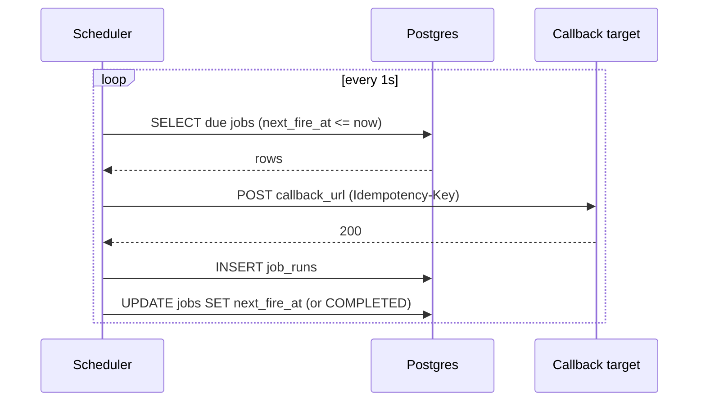

## Solve it: trade-offs of V0

✅ **What we gained**
- No double fire, by construction.
- Jobs are durable, queryable, and managed through an API.
- A few hundred lines of code.

⚠️ **What we gave up**
- The scheduler is a single point of failure. If it dies at 01:59, nothing fires until someone restarts it.
- Dispatch is sequential. At about 50 ms per callback, that is roughly 20 fires per second, far below our few-thousand peak.
- One Postgres is both the store and the clock.

❌ **Considered and rejected**
- **In-memory timers only** (a `ScheduledExecutorService`): fast, but every restart loses every job.
- **Redis ZSET as the primary store**: great for the due-lookup, but durability and querying are weaker. It may return later as an accelerator.
- **Keeping host-level cron**: no API, no history, tied to one machine.

## Current state

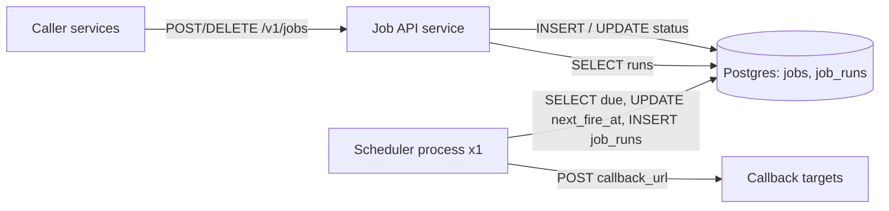

Everything in this diagram is new in V0.

**Every current flow**

1. **Submit:** Caller sends `POST /v1/jobs`. The API service validates the schedule, computes `next_fire_at`, and inserts into `jobs`.
2. **Fire:** The scheduler polls `jobs` every second for due rows. For each row it POSTs to `callback_url`, inserts into `job_runs`, then advances `next_fire_at` or marks the job `COMPLETED`.
3. **Cancel:** Caller sends `DELETE /v1/jobs/{id}`. The API service sets `status='CANCELLED'`. The partial index drops it from the due query.
4. **History:** Caller sends `GET /v1/jobs/{id}/runs`. The API service reads `job_runs`.

## Interview follow-ups

**"Why poll the DB instead of using a timer or delay queue?"**
Timers live in memory and vanish on restart. Polling a durable indexed column makes the database the source of truth. A restart loses nothing but a second or two of latency. Polling is also cheap at this scale because the partial index keeps the scan tiny.

**"What if the scheduler crashes right after calling the callback?"**
The job fires again on restart, because we advance `next_fire_at` only after dispatch. That is deliberate at-least-once. The `Idempotency-Key` lets the target ignore the duplicate. The alternative, advancing first, risks silently dropping a fire.

## Recap

| Concept | The Insight |
|---------|-------------|
| Source of truth | Jobs live in a durable table, not in a process's memory or a host's crontab. |
| Due query | A partial index on `next_fire_at` for ACTIVE rows makes "what's due now" a cheap range scan. |
| Dispatch vs. advance order | Dispatch first and advance second gives at-least-once. The reverse gives at-most-once. |
| Idempotency key | `job_id:scheduled_time` lets receivers dedupe the re-fires we accept. |
| V0's guarantee | No double fire, because there is only one scheduler. The price is availability and throughput. |

**Interview arc:** *"A host crontab can't be queried, shared, or survive a redeploy, so jobs move into a durable table with a single scheduler polling an indexed `next_fire_at`. That gives us simplicity and no double fires, and costs us availability and throughput."*

## Next

Priya's scheduler pod gets evicted at 01:59, and nobody notices until 02:20. The obvious fix is a second scheduler for safety. The crux starts there: what happens when both of them see the same due row?

Say "next" when you're ready for V1.


-----------------------------------------------------------------------------------------------------------------------
-----------------------------------------------------------------------------------------------------------------------
-----------------------------------------------------------------------------------------------------------------------
-----------------------------------------------------------------------------------------------------------------------


# V1: Two Schedulers, Zero Double Fires

This is the crux version. We add a second scheduler for availability and throughput, and we make sure a job never fires twice.

## Break it

It is 02:00:00. Priya's "send daily invoices" job is due, along with 4,999 other jobs.

We now run two scheduler pods, A and B. Both wake on the same one-second tick.

At 02:00:00.003, A runs the due query and gets 500 rows. At 02:00:00.005, B runs the same query and gets the same 500 rows.

Both POST to `billing.internal/hooks/send-invoices`. Two invoice emails go out to every customer.

Our `Idempotency-Key` header would let the target dedupe, but we can't depend on every target doing that. The scheduler itself should not hand out the same job twice.

## The naive attempts

### Attempt 1: run two copies and hope

Two copies, two clerks, one wall calendar. It looked reasonable because V0 already worked, so just run it twice.

It breaks the moment both clerks read the calendar before either crosses anything off. The due query is a plain `SELECT`, and a plain `SELECT` takes no lock.

### Attempt 2: check-then-set a flag

A short dialogue:

> **Meera:** Add a `RUNNING` status. A selects the rows, then sets them to `RUNNING`. B filters out `RUNNING` rows.
>
> **Arjun:** A selects at 02:00:00.003. B selects at 02:00:00.005. A's `UPDATE` lands at .008. Both selects ran before either update.
>
> **Meera:** So the flag is checked, but not atomically with the read.
>
> **Arjun:** Right. Two steps with a gap in the middle always race.

This is check-then-act. It looked fine because it works in a single-threaded test. Under concurrency, both nodes pass the check and both fire.

### Attempt 3: leader election with a hot standby

Elect one active scheduler, for example with a ZooKeeper or etcd lease. The standby does nothing until the leader dies.

This is a real pattern, and it does remove double fires. It breaks two ways here:

- **Throughput:** one node still does all the dispatching. We are back at about 20 fires per second, and the second pod is idle. Our peak is a few thousand.
- **Split brain:** a leader that stalls on a long GC pause can still believe it is leader after the lease moves. Now two nodes dispatch, and we are back to double fires.

We reject it for dispatch. Leader-style ownership comes back in a later version, but for a different purpose.

### Attempt 4: claim each row with a conditional update

Each node loops over its rows and runs this per row:

```sql
UPDATE jobs SET claimed_by = 'A' WHERE job_id = ? AND claimed_by IS NULL;
```

It checks the row count: 1 means we won, 0 means someone else did. This is correct, because the check and the write are one atomic statement.

It wastes work. A and B both race for the same 500 rows. Each wins about half, and each makes roughly 500 round trips, with half of them returning 0. We want the nodes to pull disjoint batches in the first place.

## The mechanism, in plain language

Postgres can lock a row while you read it. That is `SELECT ... FOR UPDATE`. A second node asking for the same row normally waits, which would serialize our schedulers.

`SKIP LOCKED` changes that. A locked row is skipped, as if it weren't in the table.

Think of two clerks pulling forms from a shared in-tray. Each grabs a stack in a single motion. The tray shows only what is still in it, so they can never hold the same form.

## Solve it: atomic batch claim

Each node runs one statement that selects due rows with `FOR UPDATE SKIP LOCKED` and marks them as claimed, in the same transaction. The transaction commits immediately. The HTTP dispatch happens after the commit, so we never hold a database lock during a network call.

| Option | Double fire safe? | Uses all nodes? | Cost |
|--------|------------------|----------------|------|
| Two blind pollers | No | Yes | Duplicates |
| Check-then-set flag | No | Yes | Race window |
| Leader + standby | Mostly (split-brain risk) | No | One node's throughput |
| Per-row conditional update | Yes | Yes | Wasted round trips from contention |
| **Batch claim with `SKIP LOCKED`** | **Yes** | **Yes** | **Needs a claim column and index change** |

**Scaling note.** The schedulers now hold no job state in memory except the batch they are dispatching. All durable state is in Postgres. That is what makes adding nodes safe. We need no load balancer, because schedulers pull their own work.

✅ **What we gained**
- N schedulers share work with no overlap.
- Throughput scales roughly linearly with nodes until Postgres becomes the limit.
- Losing one node no longer stops firing.

⚠️ **What we gave up / new problem**
- A node that crashes after claiming leaves its rows as `claimed_by = 'A'` forever. Nothing releases them, so those jobs never fire. This is V2.
- Postgres is still one box taking all the claim traffic. That is a later version.
- A job cancelled while claimed may still fire once more. We accept that: the cancel arrived after the claim.

❌ **Considered and rejected**
- **Distributed lock per job (Redis `SET NX`, ZooKeeper):** adds a second system and still needs expiry handling. The database already gives us atomic row claims.
- **Holding the `FOR UPDATE` lock during dispatch:** a crash would release the lock automatically, which is attractive. But it pins a connection and an open transaction for every in-flight HTTP call, and hundreds of slow callbacks would exhaust the pool.

## Implement it

### Schema delta

```sql
ALTER TABLE jobs
  ADD COLUMN claimed_by TEXT,
  ADD COLUMN claimed_at TIMESTAMPTZ;

DROP INDEX idx_jobs_due;
CREATE INDEX idx_jobs_due ON jobs (next_fire_at)
  WHERE status = 'ACTIVE' AND claimed_by IS NULL;
```

The partial index now excludes claimed rows, so the due scan stays small even while a big batch is in flight.

| Column | Who writes | Who reads |
|--------|-----------|-----------|
| `claimed_by`, `claimed_at` | Scheduler nodes: set on claim, cleared on finish. | Scheduler nodes (index predicate, finish guard). Operators, for debugging. |

Everything still lives in the same Postgres instance.

### Claim (scheduler node, replaces the V0 `SELECT`)

```sql
UPDATE jobs
SET claimed_by = :node_id, claimed_at = now()
WHERE job_id IN (
  SELECT job_id FROM jobs
  WHERE status = 'ACTIVE'
    AND claimed_by IS NULL
    AND next_fire_at <= now()
  ORDER BY next_fire_at
  LIMIT 500
  FOR UPDATE SKIP LOCKED
)
RETURNING job_id, schedule_type, cron_expr, next_fire_at, callback_url, payload;
```

`:node_id` is the pod name, such as `sched-7f9c`.

### Finish (scheduler node, replaces the V0 `UPDATE`)

```sql
-- recurring
UPDATE jobs
SET next_fire_at = :nxt, claimed_by = NULL, claimed_at = NULL
WHERE job_id = :id AND claimed_by = :node_id;

-- one-time
UPDATE jobs
SET status = 'COMPLETED', claimed_by = NULL, claimed_at = NULL
WHERE job_id = :id AND claimed_by = :node_id;
```

The `claimed_by = :node_id` guard means a node only finishes rows it still owns. Today that is a no-op safety check. In V2 it becomes essential.

### Loop (changed lines only)

```python
rows = db.query(CLAIM_SQL, node_id=NODE_ID)     # atomic, commits immediately
for j in rows:
    resp = http.post(j.callback_url, json=j.payload,
                     headers={"Idempotency-Key": f"{j.job_id}:{j.next_fire_at.isoformat()}"},
                     timeout=10)
    db.execute("INSERT INTO job_runs (...) VALUES (...)")
    db.execute(FINISH_SQL, ...)                 # guarded by claimed_by = NODE_ID
```

The dispatch loop stays sequential per node. Speeding up dispatch inside one node is a separate concern, and node count handles it for now.

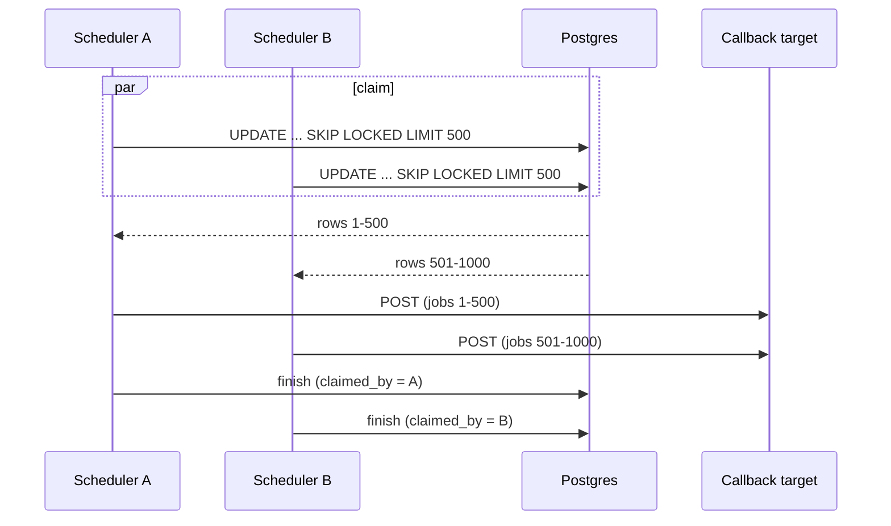

## Current state

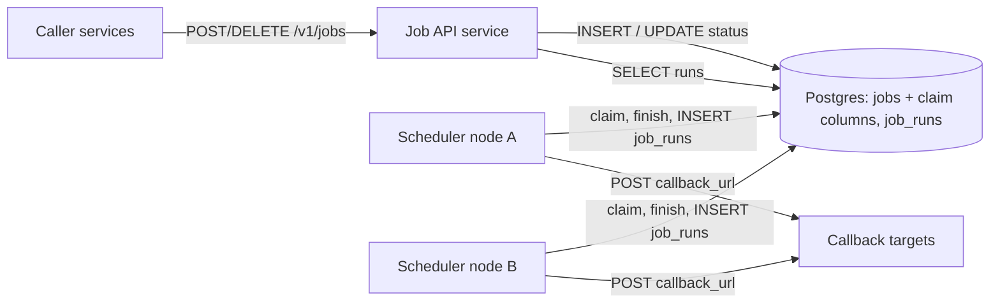

Changes in V1: scheduler nodes are now N, and `jobs` has `claimed_by` and `claimed_at` (new in V1).

**Every current flow**

1. **Submit:** unchanged from V0. The API service validates, computes `next_fire_at`, and inserts into `jobs`.
2. **Fire:**
   1. Each scheduler node polls every second with the atomic claim statement.
   2. Each node gets a disjoint batch of up to 500 rows, stamped with its `node_id`.
   3. The node POSTs to each `callback_url` with the idempotency key.
   4. It inserts into `job_runs`.
   5. It runs the finish `UPDATE`, guarded by `claimed_by`, to advance or complete the job.
3. **Cancel:** unchanged. The API sets `status = 'CANCELLED'`. A job already claimed may fire one last time.
4. **History:** unchanged. The API reads `job_runs`.

## Interview follow-ups

**"Why not a Redis lock per job instead?"**
It adds a second system with its own failure modes, and the lock still needs an expiry. Postgres already gives us atomic claims on the same rows that hold the schedule. Fewer moving parts, and the claim and the job state commit together.

**"Does `SKIP LOCKED` give you exactly-once?"**
No. It prevents two nodes from claiming the same row at the same time. If a node crashes after dispatch but before finish, the job can fire again once it is recovered. Delivery is still at-least-once, so the idempotency key stays.

## Recap

| Concept | The Insight |
|---------|-------------|
| Check-then-set | A read and a write as two steps always leave a gap for another node to slip through. |
| Atomic claim | `UPDATE ... WHERE job_id IN (SELECT ... FOR UPDATE SKIP LOCKED)` is one statement, so two nodes cannot take the same row. |
| `SKIP LOCKED` | Each node gets a disjoint batch with no waiting, so throughput scales with nodes. |
| Short transactions | Commit the claim first and dispatch after, so no DB lock is held across a network call. |
| Leader election | It removes double fires but wastes N-1 nodes, and a stalled leader can reintroduce them. |

**Interview arc:** *"If asked how multiple schedulers avoid double firing: blind polling and check-then-set race on the read, so we make claiming a single atomic `UPDATE ... FOR UPDATE SKIP LOCKED` statement that hands each node a disjoint batch and commits before any network call."*

## Next

Node A claims 500 jobs at 02:00:01 and the pod is OOM-killed at 02:00:02. Those 500 rows say `claimed_by = 'sched-A'` forever, and our index skips them. They never fire, and nothing alerts. Next is V2: leases, so a dead node's claims expire and get recovered.

Say "next" when you're ready.


-----------------------------------------------------------------------------------------------------------------------
-----------------------------------------------------------------------------------------------------------------------
-----------------------------------------------------------------------------------------------------------------------
-----------------------------------------------------------------------------------------------------------------------


# V2: Leases, So a Dead Node's Claims Come Back

This is still the crux. V1 made claiming safe. V2 makes a claim temporary.

## Break it

It is 02:00:01. Scheduler A claims 500 rows, including Priya's `send-invoices`. Each row now says `claimed_by = 'sched-A'`.

At 02:00:02 the pod is OOM-killed. Kubernetes starts a new pod named `sched-D`. Nobody mentions `sched-A` again.

Our V1 due query requires `claimed_by IS NULL`. Those 500 rows never match it, and the partial index skips them too. Invoices never go out, and nothing alerts.

Priya finds out at 02:20 when finance asks where the invoices are. That is the same outage as V0, with extra steps.

## The naive attempts

### Attempt 1: alert on stuck rows and fix by hand

Add a dashboard query for old claims, page someone, and have them run `UPDATE ... SET claimed_by = NULL`. It looked reasonable because the failure is rare.

It breaks on the clock. A human takes minutes, and our precision target is about one second. At 02:00 a stuck batch also means thousands of late jobs, not one.

### Attempt 2: release your own claims on startup

> **Meera:** When a pod boots, it clears every row with `claimed_by = its own name`.
>
> **Arjun:** The replacement pod is `sched-D`, not `sched-A`. Pod names change on every restart.
>
> **Meera:** Then use a stable ID per slot, like a StatefulSet ordinal.
>
> **Arjun:** And when the autoscaler removes slot 7 and never brings it back? Its rows stay claimed forever.

It only recovers nodes that return. A node that is scaled away, evicted to another zone, or lost to a hardware failure never comes back to clean up.

### Attempt 3: a reaper job that frees old claims

A cron job runs every minute: `UPDATE jobs SET claimed_by = NULL WHERE claimed_at < now() - interval '60 seconds'`. This works, and many real systems do it.

It has three costs:
- It is a second component that must itself stay alive.
- Recovery lag is the claim age limit plus the reaper interval, so up to two minutes.
- It judges by claim age, not by whether the node is alive. A healthy node working through a slow batch gets its rows stolen.

We keep the idea of "claims expire," but not as a separate process.

## The mechanism, in plain language

A claim should work like a library loan. You borrow a book for a fixed period. If you don't return or renew it by the due date, the book goes back on the shelf for the next reader.

That is a lease. The claim carries an expiry time. Past the expiry, the row counts as unclaimed, and the normal claim query can take it.

No reaper is needed. The recovery path and the normal path are the same SQL.

A dead node stops renewing, so its leases run out. A healthy node renews, so its leases never do.

## Known sub-problem: a node that is slow, not dead

This is the dangerous case. Scheduler A hits a 70-second GC pause or a network partition. Its lease expires at 60 seconds, and B reclaims the rows and fires them. Then A wakes up, still holding its in-memory batch, and fires them too.

There are three established defenses. We need the second and third.

| Defense | Mechanism | Fits here? |
|---------|-----------|-----------|
| Long lease only | Make the lease so long that pauses never outlast it. | Not alone. It delays dead-node recovery by the same amount, and no length is truly safe. |
| Local deadline check | The node tracks its own lease deadline and stops dispatching once it passes. | Yes. It is cheap and stops most zombie fires. |
| Fencing token | Every claim bumps a counter. Writes must present the current counter, or they are rejected. | Yes. It stops a zombie from corrupting job state. |

Neither defense can fully stop a zombie that already sent its HTTP request before pausing. That duplicate is the at-least-once cost we accepted in scope, and the idempotency key covers it.

## Solve it

Three changes, all one mechanism (the lease):

1. The claim sets `lease_expires_at = now() + 60s` and bumps `claim_token`.
2. The due query also matches rows whose lease has expired.
3. Nodes renew leases on rows they haven't dispatched yet. Finish writes check `claim_token`.

All time comparisons use the database's `now()`, never the node's wall clock. That removes clock skew between nodes from the lease logic.

We pick 60 seconds because a 500-row batch at about 50 ms per callback takes about 25 seconds. That leaves a wide margin. Shorter leases risk false expiry on slow batches.

✅ **What we gained**
- A dead node's rows automatically return to the pool.
- No new component, since recovery reuses the claim query.
- A zombie node can't overwrite newer job state.

⚠️ **What we gave up / new problem**
- Jobs held by a dead node fire up to 60 seconds late. That misses our 1-second precision target for them. It applies only to the in-flight batch of a crashed node, not to normal firing.
- Each poll now skips claimed-but-unexpired rows. That is at most N nodes × 500 rows, which is small.
- A node can still send a duplicate in the pause scenario. The idempotency key handles that.

❌ **Considered and rejected**
- **A 5-second lease for fast recovery:** one GC pause or slow callback would expire healthy leases and cause the double fires we are trying to avoid.
- **Node heartbeat table plus a reaper:** two structures and a second process for what one column already does.
- **Dispatching under `FOR UPDATE` so a crash auto-releases:** already rejected in V1. It pins connections for the whole batch.

## Implement it

### Schema delta

```sql
ALTER TABLE jobs
  ADD COLUMN lease_expires_at TIMESTAMPTZ,
  ADD COLUMN claim_token BIGINT NOT NULL DEFAULT 0,
  DROP COLUMN claimed_at;

DROP INDEX idx_jobs_due;
CREATE INDEX idx_jobs_due ON jobs (next_fire_at) WHERE status = 'ACTIVE';

ALTER TABLE job_runs ADD COLUMN claim_token BIGINT;   -- audit: which claim fired this
```

The index no longer excludes claimed rows, because expired claims must stay visible to the due query.

| Column | Who writes | Who reads |
|--------|-----------|-----------|
| `claimed_by` | Scheduler node, on claim and finish. | Operators only, for debugging. |
| `lease_expires_at` | Scheduler node, on claim, renewal, and finish (cleared). | Every scheduler node's claim query. |
| `claim_token` | Scheduler node, incremented on each claim. | The same node's renew and finish guards. Operators for audit. |
| `job_runs.claim_token` | Scheduler node, when it logs a run. | Operators, to spot duplicate fires. |

All of it lives in the same Postgres instance.

### Claim (changed `WHERE` and `SET`)

```sql
UPDATE jobs
SET claimed_by = :node_id,
    claim_token = claim_token + 1,
    lease_expires_at = now() + interval '60 seconds'
WHERE job_id IN (
  SELECT job_id FROM jobs
  WHERE status = 'ACTIVE'
    AND next_fire_at <= now()
    AND (claimed_by IS NULL OR lease_expires_at < now())
  ORDER BY next_fire_at
  LIMIT 500
  FOR UPDATE SKIP LOCKED
)
RETURNING job_id, schedule_type, cron_expr, next_fire_at, callback_url,
          payload, claim_token, lease_expires_at, now() AS db_now;
```

The node converts `lease_expires_at - db_now` into a local TTL and tracks it with a monotonic clock. It never compares its own wall clock to the database's.

### Dispatch loop (changed parts)

```python
batch = db.query(CLAIM_SQL, node_id=NODE_ID)
deadline = time.monotonic() + (batch.lease_expires_at - batch.db_now).total_seconds() - 5  # safety margin

for j in batch.rows:
    if time.monotonic() >= deadline:
        break                           # lease about to lapse; leave the rest for reclaim
    http.post(j.callback_url, json=j.payload,
              headers={"Idempotency-Key": f"{j.job_id}:{j.next_fire_at.isoformat()}"},
              timeout=10)
    db.execute("INSERT INTO job_runs (..., claim_token) VALUES (..., %s)", j.claim_token)
    n = db.execute(FINISH_SQL, id=j.job_id, token=j.claim_token)
    if n == 0:
        metrics.incr("lease_lost")      # someone else reclaimed it; our state write was rejected
```

The 5-second margin stops the node before the lease expires, not after.

### Renewal (background task, every 20 seconds)

```sql
UPDATE jobs
SET lease_expires_at = now() + interval '60 seconds'
WHERE (job_id, claim_token) IN (SELECT * FROM unnest(:ids, :tokens))
RETURNING job_id;
```

It renews only rows the node hasn't dispatched yet. If a row is missing from `RETURNING`, the lease was lost, and the node drops that job from its local list.

### Finish (added token guard)

```sql
UPDATE jobs
SET next_fire_at = :nxt, claimed_by = NULL, lease_expires_at = NULL
WHERE job_id = :id AND claim_token = :token;
```

The completion variant for one-time jobs is the same, with `status = 'COMPLETED'` in the `SET`. A stale token matches no rows, so a zombie cannot touch state that B has since advanced.

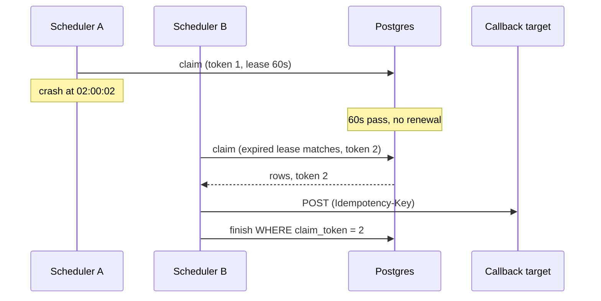

## Current state


New in V2: `lease_expires_at`, `claim_token`, the renewal task, and the expired-lease clause in the claim query.

**Every current flow**

1. **Submit:** unchanged from V0.
2. **Fire:**
   1. A node runs the claim query. It matches unclaimed rows and rows whose lease has expired.
   2. The claim sets `claimed_by`, bumps `claim_token`, and sets the lease to 60 seconds.
   3. The node sets a local deadline from the returned TTL, minus a 5-second margin.
   4. A background task renews the lease on undispatched rows every 20 seconds.
   5. For each job, the node POSTs to the callback, inserts into `job_runs`, then runs the finish `UPDATE` guarded by `claim_token`.
   6. If the finish matches zero rows, the node logs `lease_lost` and moves on.
3. **Recover (new):** if a node dies, its leases expire after at most 60 seconds. The next node's claim query picks those rows up through the same path as step 1.
4. **Cancel:** unchanged. A job already claimed may fire once more.
5. **History:** unchanged.

## Interview follow-ups

**"Why not use a heartbeat to detect dead nodes?"**
A node heartbeat tells you the node is alive, not that each row is still being worked. A lease per row is self-describing: expiry means "nobody is working this, and nobody may." It also needs no separate detector, since the claim query handles expiry.

**"Doesn't the lease break if node clocks drift?"**
We never compare node time to database time. Expiry is set and checked with the database's `now()`. The node only measures elapsed time locally with a monotonic clock, which drift does not affect.

## Recap

| Concept | The Insight |
|---------|-------------|
| Claim without expiry | A crashed node's claims become permanent, so jobs silently never fire. |
| Lease | A claim with an expiry time. Expiry puts the row back in the normal claim path, so no reaper is needed. |
| Renewal | Healthy nodes extend leases on work in progress, so only dead or stalled nodes lose rows. |
| Fencing token | A per-claim counter that makes a zombie's state writes fail. |
| Local deadline | The node stops itself before its lease lapses, which shrinks the zombie window. |
| Recovery cost | Recovery lag is up to the lease length. A shorter lease means faster recovery but more false expiries. |

**Interview arc:** *"If asked how you survive a scheduler crashing mid-batch: permanent claims strand jobs, a reaper adds lag and a second process, so claims become 60-second leases folded into the same claim query, with a fencing token so a zombie that wakes up can fire a duplicate at worst, never corrupt job state."*

## Next

At 02:00:00 sharp, 300,000 daily jobs are due in the same second. Each node dispatches one job at a time at about 20 per second. With 10 nodes, the last job fires over 25 minutes late. Next is V3: separating claiming from dispatching, so a node claims fast and a pool of workers does the slow HTTP calls.

Say "next" when you're ready.


-----------------------------------------------------------------------------------------------------------------------
-----------------------------------------------------------------------------------------------------------------------
-----------------------------------------------------------------------------------------------------------------------
-----------------------------------------------------------------------------------------------------------------------


# V3: Split Claiming from Dispatching

V2 made claims safe and recoverable. V3 fixes the next bottleneck: how fast we can actually fire jobs. The scheduler nodes currently do two different jobs, and only one of them is fast.

## Break it

Priya's invoice job is one of 300,000 daily jobs due at exactly 02:00:00. Callers love round numbers, so cron schedules pile up on the hour.

We run 10 scheduler nodes. Each node claims a batch, then POSTs to callbacks one at a time at about 50 ms each. That is 20 fires per second per node, or 200 per second in total.

300,000 ÷ 200 = 1,500 seconds. The last invoice job fires 25 minutes late.

It gets worse when targets are slow. The billing hook takes its full 10-second timeout.

- Our batch is 500 rows, and the lease is 60 seconds.
- The V2 deadline check stops a node after about 5 jobs.
- The other 495 rows sit claimed until the lease expires, then the next node claims them and fires about 5 more.

That is roughly 5 jobs per minute per node. The lease protects us from double fires, but throughput collapses because the lease now has to cover dispatch time we don't control.

## The naive attempts

### Attempt 1: add more scheduler nodes

To drain 300,000 jobs in 30 seconds we need 10,000 fires per second. At 20 per second per node, that is 500 nodes.

It looked reasonable because V1 made nodes safe to add. It breaks on cost and contention. 500 pods mostly sit waiting on HTTP, and 500 pollers hammer the same claim query on one Postgres. We would be paying for I/O wait.

### Attempt 2: dispatch concurrently inside each scheduler node

> **Meera:** Make the dispatch loop async. 200 calls in flight per node, so 4,000 fires per second each.
>
> **Arjun:** Fine for fast targets. What happens when billing is slow?
>
> **Meera:** Slots fill with 10-second calls.
>
> **Arjun:** And the batch we claimed is waiting on those slots, with a lease ticking. Dispatch time is still inside the lease.

This is a real option, and a small system can stop here. The trick is to claim only as many rows as you have free slots. It fixes raw throughput. It still ties the lease to the slowest callback, and one slow target can fill every slot. The clock-sensitive claim loop also shares a process with unpredictable network I/O.

### Attempt 3: a queue between the two jobs

The scheduler only decides what is due. It hands each due job to a queue. A separate worker fleet does the HTTP calls. This is the one we build.

## The mechanism, in plain language

Think of a restaurant. The host seats you and writes the order on a ticket. The kitchen cooks it. If the host also cooked, the dining room would stall every time a dish took longer.

The ticket rail between them is the queue. The host works at the speed of writing tickets. The kitchen adds cooks when the rail fills up.

Why a queue as a new storage class: workers need many competing consumers, per-message acknowledgement, and automatic redelivery of anything not acknowledged. Database rows don't do this cheaply, and we would be rebuilding it with leases on another table.

## Which queue

| Option | Per-message ack/redelivery | Scales consumers freely | Fit |
|--------|---------------------------|------------------------|-----|
| In-process async (Attempt 2) | n/a | Only by adding scheduler nodes | Lease stays coupled to dispatch |
| Kafka | Offset per partition, not per message | Capped by partition count | One slow callback blocks every message behind it in its partition |
| **SQS-style queue** | **Per-message visibility timeout** | **Any number of consumers** | **Matches variable-latency I/O jobs** |

We don't need ordering between jobs, so Kafka's main strength buys us nothing. Its per-partition ordering would hurt us, because callback latency varies wildly.

## Solve it

**Scaling model.** Schedulers become claimers. They hold only a claimed batch for a fraction of a second. Workers hold at most 100 in-flight messages, and the queue still owns each of those. All state is recoverable from Postgres or the queue, which is what lets us add or kill either fleet freely. We need no load balancer. Workers pull work, so competing consumers balance themselves.

Three changes:

1. The scheduler claims, **enqueues**, then advances `next_fire_at`. It no longer calls any callback.
2. Workers consume the queue, POST the callback, write `job_runs`, then delete the message.
3. The lease shrinks from 60 seconds to 10, and the renewal task goes away. The lease now only covers claim-to-enqueue, which takes hundreds of milliseconds.

Rough numbers, stated once: each scheduler enqueues about 2,000 jobs per second. 10 nodes enqueue the 300,000 burst in about 15 seconds. A worker with 100 concurrent slots does up to 2,000 fires per second against fast targets, so a fleet of about 10 workers keeps pace. The last job fires about 15 seconds late instead of 25 minutes.

### Failure windows

| Crash point | What happens | Recovery |
|-------------|-------------|----------|
| Scheduler dies after claim, before enqueue | Rows stay claimed. | Lease (10 s) expires, another scheduler reclaims. |
| Scheduler dies after enqueue, before advance | Same job is reclaimed and enqueued again. | Duplicate message, same `run_key`. Idempotency key absorbs it. |
| Worker dies after POST, before delete | Message reappears after the 30 s visibility timeout. | Duplicate POST, same `Idempotency-Key`. |
| Worker dies before POST | Message reappears after 30 s. | Another worker fires it, up to 30 s late. |

Every window ends in either a late fire or a duplicate with the same key. Nothing is dropped.

✅ **What we gained**
- Dispatch throughput scales by adding workers, independent of scheduler count.
- Slow callbacks stall workers only, never the claim loop.
- The lease drops from 60 s to 10 s, so dead-scheduler recovery is 6x faster.
- Renewal logic is deleted.

⚠️ **What we gave up / new problems**
- One more system to run and monitor, with its own failure modes.
- `COMPLETED` now means handed to the queue, not executed. The real outcome lives in `job_runs`.
- A cancel that arrives after enqueue can still fire, and the window now includes queue wait.
- The 02:00 burst now sends about 600K row updates plus 300K `job_runs` inserts at one Postgres primary in seconds. That pressure is deferred to a later version.
- A single slow target can still fill worker slots. A per-target bulkhead is deferred.
- A failed callback is still not retried. That is next.

❌ **Considered and rejected**
- **Kafka:** per-partition head-of-line blocking and no per-message ack.
- **In-process async only:** workable for small scale, but the lease stays tied to dispatch time and one process carries both concerns.
- **Asking callers to jitter their schedules:** worth recommending, but we can't rely on it.

## Implement it

### Config and message shape (first appearance)

```
Queue: job-dispatch (SQS standard)
VisibilityTimeout: 30s       # above 10s HTTP timeout + DB write
ReceiveMessageWaitTime: 20s  # long polling
MessageRetentionPeriod: 4d
```

```json
{
  "run_key": "9f3c...:2026-11-03T02:00:00Z",
  "job_id": "9f3c...",
  "scheduled_for": "2026-11-03T02:00:00Z",
  "callback_url": "https://billing.internal/hooks/send-invoices",
  "payload": {"region": "IN"},
  "claim_token": 7
}
```

`run_key` is `job_id:scheduled_for`, the same format as the idempotency key from V0. Payload is capped at 64 KB at the API so messages stay small.

### Who writes, who reads

| Structure | Who writes | Who reads |
|-----------|-----------|-----------|
| `jobs` | API (insert, cancel). Scheduler nodes (claim, advance). | Scheduler nodes (claim). API (get). |
| `job-dispatch` queue | Scheduler nodes (send). | Worker fleet (receive, delete). |
| `job_runs` | **Workers** (moved from scheduler). | API (history). Operators. |

Schema delta: `job_runs` gets a `worker_id TEXT` column. Nothing else changes in Postgres.

### Claim (changed values only)

```sql
-- same V2 claim, with:
--   lease_expires_at = now() + interval '10 seconds'
--   LIMIT 1000
```

### Scheduler loop (replaces the V2 dispatch loop)

```python
batch = db.query(CLAIM_SQL, node_id=NODE_ID)
deadline = time.monotonic() + (batch.lease_expires_at - batch.db_now).total_seconds() - 2
enqueued = []

for chunk in chunks(batch.rows, 10):             # SQS batch limit is 10
    if time.monotonic() >= deadline:
        break                                    # unsent rows stay claimed; lease expiry reclaims them
    resp = sqs.send_message_batch(QueueUrl=Q, Entries=[
        {"Id": str(i), "MessageBody": json.dumps(to_msg(j))} for i, j in enumerate(chunk)])
    failed = {int(f["Id"]) for f in resp.get("Failed", [])}
    enqueued += [j for i, j in enumerate(chunk) if i not in failed]

db.execute(ADVANCE_SQL, ids=[j.job_id for j in enqueued],
           tokens=[j.claim_token for j in enqueued],
           nxts=[next_fire(j) for j in enqueued])
```

`next_fire(j)` is the croniter computation from V0.

The order is **enqueue, then advance**. If we crash between them, we get a duplicate, not a drop.

### Advance (bulk, guarded by token)

```sql
-- recurring
UPDATE jobs j
SET next_fire_at = v.nxt, claimed_by = NULL, lease_expires_at = NULL
FROM unnest(:ids::uuid[], :tokens::bigint[], :nxts::timestamptz[]) AS v(job_id, tok, nxt)
WHERE j.job_id = v.job_id AND j.claim_token = v.tok;
```

The one-time variant sets `status = 'COMPLETED'` instead of `next_fire_at`.

### Worker loop (new component)

```python
async def run_worker():
    while True:
        n = min(10, slots.free())                 # receive only what we can start now
        if n == 0:
            await asyncio.sleep(0.01); continue
        resp = sqs.receive_message(QueueUrl=Q, MaxNumberOfMessages=n, WaitTimeSeconds=20)
        for m in resp.get("Messages", []):
            slots.take()
            asyncio.create_task(handle(m))

async def handle(m):
    try:
        b = json.loads(m["Body"])
        r = await http.post(b["callback_url"], json=b["payload"],
                            headers={"Idempotency-Key": b["run_key"]}, timeout=10)
        await db.execute("""INSERT INTO job_runs
              (run_id, job_id, scheduled_for, started_at, http_status, outcome, claim_token, worker_id)
              VALUES (gen_random_uuid(), %s, %s, now(), %s, %s, %s, %s)""",
              b["job_id"], b["scheduled_for"], r.status_code,
              "SUCCESS" if r.ok else "FAILED", b["claim_token"], WORKER_ID)
        sqs.delete_message(QueueUrl=Q, ReceiptHandle=m["ReceiptHandle"])
    finally:
        slots.release()
```

The "receive only what you can start" rule matters. A message received but waiting for a slot burns its visibility timeout and gets redelivered to someone else.

Note the failure case: a non-2xx response still deletes the message, so it is logged as FAILED and lost. Retries come next.

### Autoscaling

Scale workers on `ApproximateAgeOfOldestMessage`. Above 5 seconds, add workers. Queue depth alone misleads, because a deep queue of fast jobs is fine.

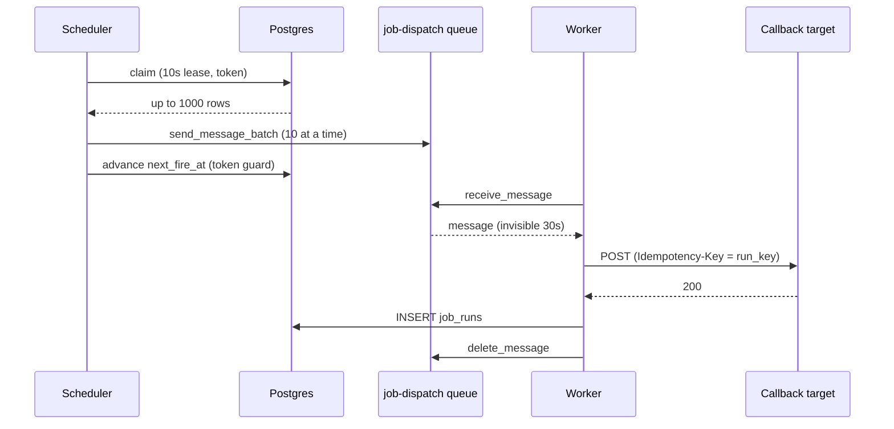

## Current state

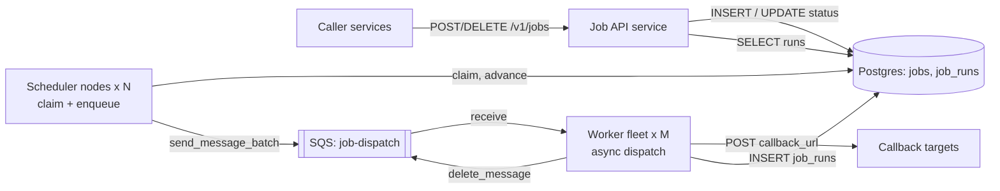

New in V3: the SQS `job-dispatch` queue and the worker fleet. Schedulers no longer call callbacks. `job_runs` is now written by workers.

**Every current flow**

1. **Submit:** unchanged from V0.
2. **Fire (changed):**
   1. A scheduler node claims up to 1,000 due rows with a 10-second lease.
   2. It sends them to `job-dispatch` in batches of 10, then bulk-advances `next_fire_at` (or marks `COMPLETED`) guarded by `claim_token`.
   3. A worker receives messages, up to as many as it has free slots.
   4. It POSTs the callback with `Idempotency-Key = run_key`.
   5. It inserts into `job_runs`.
   6. It deletes the message from the queue.
3. **Recover (changed):**
   - Dead scheduler: the 10-second lease expires and another scheduler reclaims.
   - Dead worker: the 30-second visibility timeout expires and another worker receives the message.
4. **Cancel:** unchanged, except a job already enqueued can still fire once.
5. **History:** unchanged. The API reads `job_runs`.

## Interview follow-ups

**"Why not make the scheduler's dispatch async and skip the queue?"**
At modest scale, it's a fine answer: claim only as many rows as free slots. I would split at the point where the lease has to cover unpredictable callback time. The queue lets the lease cover only claim-to-enqueue, scales dispatch separately, and keeps a slow target from slowing the clock-critical loop.

**"What if the queue is down?"**
Postgres stays the source of truth. Schedulers can't enqueue, so their leases expire and the rows are reclaimed on the next poll. Jobs go late but are never lost. When the queue returns, the backlog drains in due-time order. Alerting is on `enqueue_failed` rate and oldest-due-job age.

## Recap

| Concept | The Insight |
|---------|-------------|
| Two jobs in one process | Deciding what is due is fast and clock-critical. Calling callbacks is slow and unpredictable. They should not share a loop. |
| Queue between them | Workers scale on queue age independently, and the claim lease only has to cover enqueue time. |
| Enqueue, then advance | A crash in between creates a duplicate, never a drop. The idempotency key absorbs it. |
| Per-message visibility | A dead worker's message reappears after a timeout, which is the V2 lease idea applied to the worker side. |
| Why not Kafka | Per-partition ordering and offset commit let one slow callback block everything behind it. We need neither. |

**Interview arc:** *"If asked how you handle a 300K-job burst at 02:00: schedulers that also dispatch fire 200 jobs per second and stretch the lease around slow callbacks, so we split claiming from calling with a per-message-ack queue, letting schedulers enqueue fast on a 10-second lease and workers scale on queue age."*

## Next

Billing returns a 503 at 02:00:05 for 90 seconds. The worker logs `FAILED`, deletes the message, and the daily invoice job is lost until tomorrow. V4 adds retries with exponential backoff and jitter, a dead-letter queue for jobs that keep failing, and a defined policy for jobs that miss their window entirely.

Say "next" when you're ready.


-----------------------------------------------------------------------------------------------------------------------
-----------------------------------------------------------------------------------------------------------------------
-----------------------------------------------------------------------------------------------------------------------
-----------------------------------------------------------------------------------------------------------------------


# V4: Retries, Backoff, and a Dead-Letter Queue

V3 made firing fast. V4 handles the case where the callback fails. This version covers failure handling only. What to do about jobs that miss their window entirely (the misfire policy) is a separate concern, and it comes next.

## Break it

It is 02:00:05. Billing deploys a bad release and returns 503 for 90 seconds.

Priya's `send-invoices` job is one of 40,000 jobs pointed at billing hooks. Our workers do this today:

1. POST the callback and get a 503.
2. Insert a `job_runs` row with outcome `FAILED`.
3. Delete the message.

The job is gone. Billing recovers at 02:01:35, but invoices won't go out until 02:00 tomorrow. Nothing alerts, because from our side the message was handled.

## What retries have to get right

A retry has to answer four questions:

- **Which failures deserve one?** A 503 is probably temporary. A 404 on the callback URL will fail the same way forever.
- **How long to wait?** Too short and we hammer a service that is trying to recover.
- **How many times?** Forever is a leak.
- **What happens after the last attempt?** Someone must be able to see it and act.

## Naive attempts (lighter walk, since this isn't the crux)

- **Retry immediately in the worker, in a loop.** It looked reasonable because the failure is brief. 40,000 failed jobs retried three times in a row is 120,000 extra calls in about a minute, aimed at a service that is trying to boot. Our workers also sit in the loop and burn slots.
- **Retry on a fixed delay, say 30 seconds.** The failures all happened in the same second, so the retries land in the same second. We get a synchronized wave of 40,000 calls at 02:00:35, then another at 02:01:05, and so on.
- **Ask callers to resubmit failed jobs.** They don't see failures, and they can't know the original deadline.

## The mechanism, in plain language

When many clients fail together, they should come back spread out over time. Think of a stadium emptying after a game. If everyone leaves the instant the whistle blows, the exit jams. If each person waits a random few minutes, the flow stays steady.

That is exponential backoff with jitter. The wait ceiling doubles after each failure. The actual wait is a random value below the ceiling.

## Known sub-problem: choosing the backoff shape

| Strategy | Wait after failure n | Behavior | Verdict |
|----------|---------------------|----------|---------|
| Fixed | always 30 s | Synchronized waves | Rejected |
| Exponential, no jitter | 10 × 2ⁿ s | Fewer retries over time, but still synchronized | Rejected |
| **Full jitter** | `random(0, min(cap, 10 × 2ⁿ))` | Retries smear across the whole window | Chosen |
| Equal jitter | half fixed, half random | Guarantees a minimum wait, less spread | Reasonable alternative |
| Decorrelated jitter | random between base and 3 × last wait | Needs the previous wait stored | Not worth the extra state |

We choose full jitter with a 1-second floor. The ceilings are 20, 40, 80, 160, 320, then 600 seconds (the cap). With 7 attempts, the expected total retry window is roughly 10 minutes. That comfortably covers a 90-second outage.

## Where the delay lives

| Option | How | Verdict |
|--------|-----|---------|
| Worker sleeps, then retries | Holds a slot for the whole delay | Rejected: 40,000 sleeping jobs would stall the fleet |
| Re-send a new delayed message | `DelaySeconds`, max 15 min | Workable, but we must carry the attempt count in the body ourselves |
| **Change the visibility timeout of the same message** | `ChangeMessageVisibility` | Chosen: the message stays in the queue, and SQS already counts receives for us |

This reuses the visibility-timeout idea from V3 instead of adding a retry table or a delay service. The delay lives in the queue, not in worker memory. The worker frees its slot immediately.

## Solve it

Four rules:

1. **Classify the response.** 2xx is success. 408, 425, 429, 5xx, timeouts, and connection errors are retryable. Any other 4xx or 3xx is a permanent failure.
2. **Retryable failure:** compute a full-jitter delay and set the message's visibility timeout to it. If the response has a `Retry-After` header, use the larger of the two values.
3. **Attempts exhausted:** after attempt 7, move the message to a dead-letter queue and log it.
4. **Same key on every attempt.** The `Idempotency-Key` is still `run_key`. If attempt 1 timed out but billing actually processed it, attempt 2 is a safe duplicate.

✅ **What we gained**
- A 90-second outage no longer loses jobs, and it recovers without any human action.
- Retries spread out instead of arriving in waves.
- Exhausted jobs are kept for inspection and replay, not silently dropped.
- No new store. The attempt count comes from SQS's own receive counter.

⚠️ **What we gave up / new problems**
- Attempts count every receive, including redeliveries after a worker crash. A crash eats one attempt. That is acceptable.
- A job can fire up to 10 minutes late after repeated failures. That is by design, but it breaks the 1-second precision target for those jobs.
- During an outage we still call the failing target on every attempt. A per-target circuit breaker would stop that. It is deferred.
- A per-minute cron job can have a retry still in flight when its next run starts. Two runs with different `run_key`s overlap. A per-job concurrency policy is deferred.

❌ **Considered and rejected**
- **A retry table in Postgres:** another write on the 02:00 hot path, and it duplicates what the queue already does.
- **Infinite retries:** a permanently broken target would generate traffic forever and hide the problem.
- **Retrying all failures:** a 404 or 400 will never succeed, so retrying wastes slots.

## Implement it

### Queue config (delta from V3)

```
job-dispatch:       RedrivePolicy { deadLetterTargetArn: job-dispatch-dlq, maxReceiveCount: 10 }
job-dispatch-dlq:   MessageRetentionPeriod: 14d
```

The redrive policy is a backstop. A poison message that crashes workers before they can log anything still ends up in the DLQ after 10 receives. Normal exhaustion is handled by the worker at attempt 7, so we can record what happened.

### Schema delta

```sql
ALTER TABLE job_runs ADD COLUMN attempt INT NOT NULL DEFAULT 1;
-- outcome values: SUCCESS | RETRY | FAILED_PERMANENT | DEAD_LETTERED
```

Every attempt gets its own `job_runs` row. A job that succeeded on attempt 3 shows two `RETRY` rows and one `SUCCESS` row.

### Who writes, who reads

| Structure | Who writes | Who reads |
|-----------|-----------|-----------|
| `job-dispatch` queue | Schedulers (send). Workers (change visibility, delete). | Workers (receive). |
| `job-dispatch-dlq` | Workers (on attempt 7). SQS redrive (on count 10). | Operators (inspect, redrive). Alerting on queue depth. |
| `job_runs` | Workers (one row per attempt). | API (history). Operators. |

### Worker handler (replaces the V3 `handle`)

```python
RETRYABLE = {408, 425, 429}
BASE, CAP, MAX_ATTEMPTS = 10, 600, 7

def backoff(n):                               # n = attempt that just failed
    return max(1.0, random.uniform(0, min(CAP, BASE * 2 ** n)))

async def handle(m):
    try:
        b = json.loads(m["Body"])
        n = int(m["Attributes"]["ApproximateReceiveCount"])   # 1 on first delivery
        retry_after = 0
        try:
            r = await http.post(b["callback_url"], json=b["payload"],
                                headers={"Idempotency-Key": b["run_key"]}, timeout=10)
            if r.ok:                            kind = "SUCCESS"
            elif r.status_code >= 500 or r.status_code in RETRYABLE:
                kind = "RETRYABLE"
                retry_after = int(r.headers.get("Retry-After", 0))
            else:                               kind = "PERMANENT"
            code = r.status_code
        except (httpx.TimeoutException, httpx.ConnectError):
            kind, code = "RETRYABLE", None

        if kind == "SUCCESS":
            await log_run(b, n, code, "SUCCESS");           sqs.delete_message(...)
        elif kind == "PERMANENT":
            await log_run(b, n, code, "FAILED_PERMANENT");  sqs.delete_message(...)
        elif n >= MAX_ATTEMPTS:
            await log_run(b, n, code, "DEAD_LETTERED")
            sqs.send_message(QueueUrl=DLQ, MessageBody=m["Body"],
                             MessageAttributes={"last_status": str(code), "attempts": str(n)})
            sqs.delete_message(...)                          # DLQ first, delete second
        else:
            delay = min(CAP, max(backoff(n), retry_after))
            await log_run(b, n, code, "RETRY")
            sqs.change_message_visibility(QueueUrl=Q, ReceiptHandle=m["ReceiptHandle"],
                                          VisibilityTimeout=int(delay))
    finally:
        slots.release()
```

`log_run` is the `job_runs` insert from V3, now with `attempt`. `sqs.delete_message(...)` stands for the V3 call with the same queue URL and receipt handle.

Two ordering choices:
- **DLQ first, then delete.** A crash in between puts a duplicate in the DLQ, never a loss.
- **Log before changing visibility.** If the visibility call fails, the message reappears after the original 30-second timeout and we retry sooner than planned. That is harmless.

### Operator replay (new, used rarely)

```
aws sqs start-message-move-task \
  --source-arn <job-dispatch-dlq-arn> --destination-arn <job-dispatch-arn>
```

Redriven messages get a fresh receive count, so they get a fresh set of 7 attempts, with the same `run_key`.

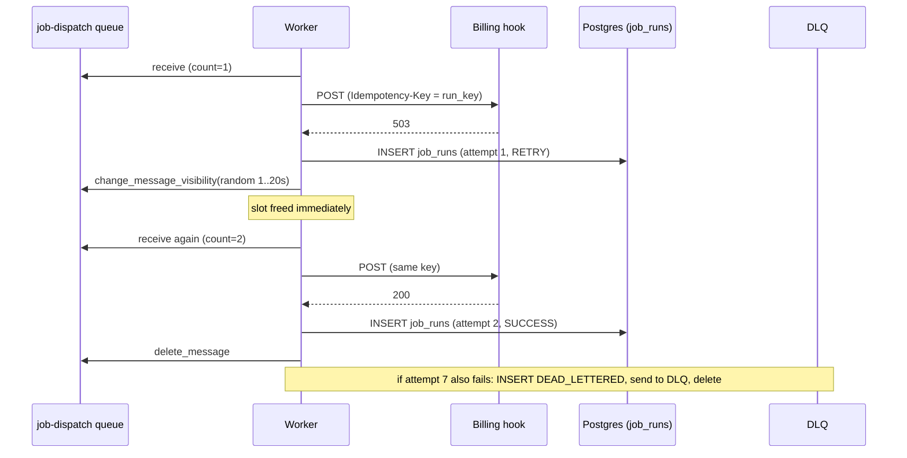

## Current state

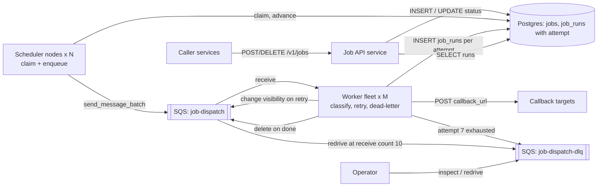

New in V4: the DLQ, the retry classification in workers, the `attempt` column, and the redrive backstop.

**Every current flow**

1. **Submit:** unchanged from V0.
2. **Schedule-side fire:** unchanged from V3. A scheduler claims rows (10-second lease), sends them to `job-dispatch`, and advances `next_fire_at`, guarded by `claim_token`.
3. **Dispatch (changed):**
   1. A worker receives a message and reads the attempt number from SQS.
   2. It POSTs with `Idempotency-Key = run_key` and classifies the response.
   3. Success or permanent failure: it logs `job_runs` and deletes the message.
   4. Retryable failure below attempt 7: it logs `RETRY`, then sets the message's visibility timeout to a full-jitter delay (or `Retry-After`, if larger, up to 600 s). The message is retried by whichever worker receives it next.
4. **Dead-letter (new):** on attempt 7, the worker logs `DEAD_LETTERED`, sends the message to the DLQ, then deletes it from `job-dispatch`. An operator can inspect and redrive.
5. **Recover:** unchanged from V3. A dead scheduler is covered by its 10-second lease. A dead worker is covered by the 30-second visibility timeout, and that receive counts as an attempt.
6. **Cancel:** unchanged. A job already enqueued, or in a retry cycle, can still fire.
7. **History:** unchanged, but now shows one row per attempt.

## Interview follow-ups

**"Why not re-enqueue with a delay instead of changing visibility?"**
It works, and `DelaySeconds` is fine under 15 minutes. But we would carry the attempt count in the message body, and a crash between re-enqueue and delete creates a duplicate with a different count. Changing visibility keeps one message and lets SQS count receives for us.

**"How do you stop a retry from double-running a non-idempotent job?"**
We can't guarantee it from our side, so we make duplicates detectable. Every attempt carries the same `Idempotency-Key`, and the callee must dedupe on it. For callbacks that cannot, a caller can set max attempts to 1 per job, which turns retries off and gives at-most-once for that job. That is a per-job option we would add if the interviewer pushes on it.

## Recap

| Concept | The Insight |
|---------|-------------|
| Classify before retrying | 5xx, 429, and timeouts are temporary. Most other 4xx are not, and retrying them wastes slots. |
| Jitter | Failures that happen together retry together unless the wait is randomized. |
| Delay lives in the queue | Changing visibility frees the worker slot and reuses V3's mechanism. No sleeping workers and no retry table. |
| Same key every attempt | A timed-out attempt may have succeeded, so retries must be safe to duplicate. |
| DLQ | A bounded retry budget plus a place to inspect and replay what ran out. |
| Redrive backstop | A message that crashes workers still ends up in the DLQ at receive count 10. |

**Interview arc:** *"If asked what happens when a callback returns 503: dropping the job loses it and immediate or fixed-delay retries create synchronized storms, so we classify the failure, delay the same SQS message with full-jitter exponential backoff, keep the idempotency key constant across attempts, and dead-letter after 7 tries for replay."*

## Next

The whole scheduler fleet is down for 40 minutes because of a bad deploy. When it comes back, 40 minutes of per-minute cron jobs are overdue, and each is overdue many times over. Does it fire 40 runs per job, one run, or none? V5 is the misfire policy: how a job declares what "late" means, and how the claim query enforces it.

Say "next" when you're ready.


-----------------------------------------------------------------------------------------------------------------------
-----------------------------------------------------------------------------------------------------------------------
-----------------------------------------------------------------------------------------------------------------------
-----------------------------------------------------------------------------------------------------------------------


# V5: Misfire Policy, or What "Late" Means

V4 handled a callback that fails. V5 handles a job that the scheduler itself fires late, which is a different problem. A retry is about failure after dispatch. A misfire is about lateness before dispatch.

## Break it

At 01:58 a bad deploy takes down every scheduler node. At 02:38 the fleet comes back, so 40 minutes of firing were missed.

Three jobs show what that costs:

- **Cache refreshers:** 5,000 jobs run `* * * * *`. Each missed 40 runs, 200,000 fires in total.
- **Karan's metering job:** it runs `*/5 * * * *` and closes one 5-minute usage window per run. Each of 200 such jobs missed 8 windows. Each window covers different data.
- **Priya's reminder:** a one-time job at 02:10 pings on-call with "deploy freeze starts in 10 minutes."

Our code today is the `max(next_fire_at, now())` line from V0. At 02:38 every job fires once, for its oldest missed time, then jumps to the next future time. Nobody chose that behavior, but it is a policy.

It is right for the cache refreshers. The 40th refresh makes the other 39 pointless.

It is wrong for Karan. 7 of each job's 8 windows are never closed, so usage goes unbilled and nothing alerts. It is also wrong for Priya, whose "freeze starts in 10 minutes" message arrives 28 minutes after the freeze began.

## Naive attempts

Misfire is not the crux, so this walk is light.

1. **Fire everything that was missed.** It looked reasonable because "run every scheduled time" sounds like correctness. It sends 201,600 fires at once, and 200,000 of them are redundant refreshes. Each cache job also runs 40 times in parallel against its callee. The claim order is oldest first, so live jobs due now wait behind the backlog.
2. **Always skip to the next future time.** This is V0's accident made official. It protects the cache refreshers and silently drops Karan's windows.
3. **One global lateness threshold, say 5 minutes.** A nightly report that is 6 hours late is still valuable. A reminder that is 2 minutes late is already useless. Lateness tolerance is a property of the job, so the platform can't set it.

## The mechanism, in plain language

Imagine a newspaper carrier back from 8 days of sick leave. There are three reasonable things to do:

- **Deliver all 8 issues.** A subscriber who files every issue for reference wants this.
- **Deliver only the latest.** Most readers want this.
- **Deliver nothing and resume tomorrow.** Someone subscribed to a "today's special" flyer wants this.

The carrier can't tell which subscriber is which. The subscriber has to say.

The same applies here. Each job states a **misfire policy**, plus a **grace period**. Lateness within the grace period is normal and fires as usual. Beyond it, the job has misfired, and the policy decides what happens. Real schedulers expose the same idea: Quartz has misfire instructions, and Kubernetes CronJobs have a starting deadline.

| Policy | What happens to missed fires | Protects | Costs | Fits |
|--------|-----------------------------|----------|-------|------|
| `FIRE_ONCE` (default) | One run, for the earliest missed time. The rest are collapsed. | Never loses the job entirely | Collapses N windows into 1 | Idempotent refresh and sync jobs |
| `SKIP` | None. Wait for the next scheduled time. | No stale work | Missed fires are gone | Reminders, time-boxed notices |
| `FIRE_ALL` | One run per missed time, oldest first, paced. | No lost windows | A burst of runs, overlapping on the callee | Metering, billing periods |

## Where the decision lives

| Option | Verdict |
|--------|---------|
| In the callee, using a lateness header | We send the header, but a bound on blast radius can't depend on every callee. The 200,000 calls would still land. |
| In workers, checked before the POST | Too late for the decision. The message already exists, `next_fire_at` has already advanced, and worker lateness mixes in queue wait and retries. |
| **In the scheduler, between claim and enqueue** | Chosen. The scheduler has the schedule and `db_now` in hand, and a skipped fire costs one DB write instead of a queue message. |

## Solve it

Three rules:

1. **Grace first.** If `db_now - next_fire_at` is within `misfire_grace_seconds`, the fire is on time and nothing changes. The default is 60 seconds. That covers the 10-second lease recovery from V2 and normal poll delay, so a dead scheduler is not a misfire.
2. **Plan from stored state only.** The scheduler computes the plan from the stored `next_fire_at` and the cron expression, not from when it happens to run. That keeps `run_key` stable if another scheduler reclaims the row.
3. **Pace `FIRE_ALL`.** A job enqueues at most 10 missed fires per claim cycle. Then `next_fire_at` advances to the first unsent time, not to the future. The job is still due, so the next poll claims it again. The backlog drains without dropping anything.

For the outage above, the fleet sends 5,000 messages for the cache jobs and 1,600 for Karan's windows. That is 6,600 messages instead of 201,600.

✅ **What we gained**
- Each job declares what late means, so Karan's windows survive and Priya's stale reminder is dropped.
- Recovery bursts are bounded and paced.
- Every dropped fire is recorded as a `MISFIRE_SKIPPED` row in `job_runs`, so nothing disappears silently.
- No new store or component, and the claim query is unchanged apart from two returned columns.

⚠️ **What we gave up / new problems**
- `FIRE_ALL` runs for different windows can overlap on the callee. Callees must use `X-Scheduled-For`. A per-job concurrency limit is deferred.
- The default `FIRE_ONCE` is safe but still collapses windows. A caller who forgets to set `FIRE_ALL` on a metering job loses data.
- Claim order is still oldest first, so a big backlog is claimed before fresh jobs. This costs seconds, because `SKIP` and `FIRE_ONCE` jobs are cheap to process. A priority lane is deferred.
- `missed_count` is capped at 1,000. A job that missed more reports the cap.

❌ **Considered and rejected**
- **A platform-wide threshold:** lateness tolerance belongs to the job.
- **A `job_occurrences` table with one row per missed time:** 200,000 writes during recovery, for times that cron math already gives us deterministically.
- **Auto-detecting the right policy:** the platform can't know whether a job's runs are redundant or distinct.

## Implement it

### API and schema delta

```http
POST /v1/jobs
{
  "schedule_type": "CRON",
  "cron_expr": "*/5 * * * *",
  "callback_url": "https://metering.internal/hooks/close-window",
  "misfire_policy": "FIRE_ALL",
  "misfire_grace_seconds": 300
}
```

```http
POST /v1/jobs
{
  "schedule_type": "ONCE",
  "run_at": "2026-11-03T02:10:00Z",
  "callback_url": "https://oncall.internal/hooks/freeze-notice",
  "misfire_policy": "SKIP",
  "misfire_grace_seconds": 120
}
```

The API validates the policy against the three values and the grace to between 0 and 86,400 seconds.

```sql
ALTER TABLE jobs
  ADD COLUMN misfire_policy TEXT NOT NULL DEFAULT 'FIRE_ONCE',   -- FIRE_ONCE | SKIP | FIRE_ALL
  ADD COLUMN misfire_grace_seconds INT NOT NULL DEFAULT 60;

ALTER TABLE job_runs ADD COLUMN skipped_count INT;   -- outcome gains: MISFIRE_SKIPPED
```

| Structure | Who writes | Who reads |
|-----------|-----------|-----------|
| `jobs.misfire_policy`, `misfire_grace_seconds` | API (on submit and update). | Scheduler nodes (returned by the claim). |
| `job_runs` rows with `MISFIRE_SKIPPED` | Scheduler nodes (new: schedulers now write this table too). | API history endpoint, operators. |
| `job-dispatch` message fields `late_by_seconds`, `missed_count` | Scheduler nodes. | Workers, who forward them to the callee as headers. |

### Claim (one change)

The V3 claim statement adds `misfire_policy, misfire_grace_seconds` to its `RETURNING` list. The `WHERE`, the lease, and the token logic are untouched.

### Planning (new, runs in the scheduler after the claim)

```python
CATCHUP = 10    # missed fires enqueued per job per claim cycle

def plan(j, now):
    due, once = j.next_fire_at, j.schedule_type == "ONCE"
    if (now - due).total_seconds() <= j.misfire_grace_seconds:           # on time: V3 behavior
        nxt = None if once else croniter(j.cron_expr, max(due, now)).get_next(datetime)
        return Plan(fires=[due], skipped=0, missed=0, nxt=nxt, done=once)

    if once:                                                              # misfired one-time job
        if j.misfire_policy == "SKIP":
            return Plan(fires=[], skipped=1, missed=1, nxt=None, done=True)
        return Plan(fires=[due], skipped=0, missed=1, nxt=None, done=True)

    first_future = croniter(j.cron_expr, now).get_next(datetime)
    missed = count_times(j.cron_expr, due, now, cap=1000)                 # wraps croniter, includes `due`
    if j.misfire_policy == "SKIP":
        return Plan(fires=[], skipped=missed, missed=missed, nxt=first_future, done=False)
    if j.misfire_policy == "FIRE_ONCE":
        return Plan(fires=[due], skipped=missed - 1, missed=missed, nxt=first_future, done=False)

    # FIRE_ALL: oldest first, paced
    times = [t for t in islice(cron_times(j.cron_expr, start=due), CATCHUP + 1) if t <= now]
    nxt = times[CATCHUP] if len(times) > CATCHUP else first_future       # leftover stays due
    return Plan(fires=times[:CATCHUP], skipped=0, missed=missed, nxt=nxt, done=False)
```

`cron_times` yields `due` first, then each later cron time. Every `fires` entry is derived from `next_fire_at` and the cron expression, never from `now()`, so a reclaim after a crash rebuilds the same `run_key`s.

### Scheduler loop (changed parts)

```python
batch = db.query(CLAIM_SQL, node_id=NODE_ID)
plans = [(j, plan(j, batch.db_now)) for j in batch.rows]

msgs = [to_msg(j, t, late_by=int((batch.db_now - t).total_seconds()), missed=p.missed)
        for j, p in plans for t in p.fires]
sent = send_in_batches(msgs)            # V3 sender; returns job_ids whose messages ALL went out

todo = [(j, p) for j, p in plans if not p.fires or j.job_id in sent]
with db.transaction():
    updated = db.query(ADVANCE_SQL, ...)                         # RETURNING job_id
    for j, p in todo:
        if j.job_id in updated and p.skipped:
            db.execute("""INSERT INTO job_runs
                (run_id, job_id, scheduled_for, started_at, outcome, attempt, claim_token, skipped_count)
                VALUES (gen_random_uuid(), %s, %s, now(), 'MISFIRE_SKIPPED', 0, %s, %s)""",
                j.job_id, j.next_fire_at, j.claim_token, p.skipped)
```

If any message for a job fails to send, the job is not advanced. Its lease expires, and it is re-planned. Messages that did go out are duplicates with the same `run_key`.

### Advance (V3's two variants merged)

```sql
UPDATE jobs j
SET next_fire_at = COALESCE(v.nxt, j.next_fire_at),
    status = CASE WHEN v.done THEN 'COMPLETED' ELSE j.status END,
    claimed_by = NULL, lease_expires_at = NULL
FROM unnest(:ids::uuid[], :tokens::bigint[], :nxts::timestamptz[], :dones::bool[])
     AS v(job_id, tok, nxt, done)
WHERE j.job_id = v.job_id AND j.claim_token = v.tok
RETURNING j.job_id;
```

### Message and worker deltas

```json
{ "...": "V3 fields unchanged", "late_by_seconds": 2280, "missed_count": 8 }
```

```python
headers={"Idempotency-Key": b["run_key"],
         "X-Scheduled-For": b["scheduled_for"],
         "X-Late-By-Seconds": str(b["late_by_seconds"]),
         "X-Missed-Count": str(b["missed_count"])}
```

Retries from V4 are unaffected. A retried run keeps its original `scheduled_for`, and it is never counted as a misfire.

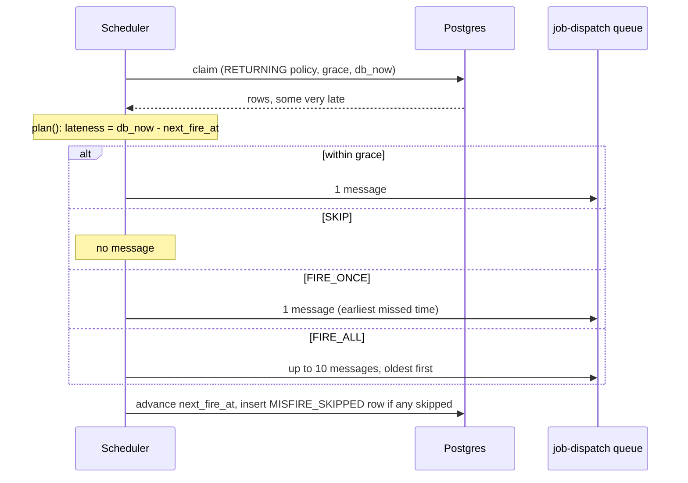

## Current state

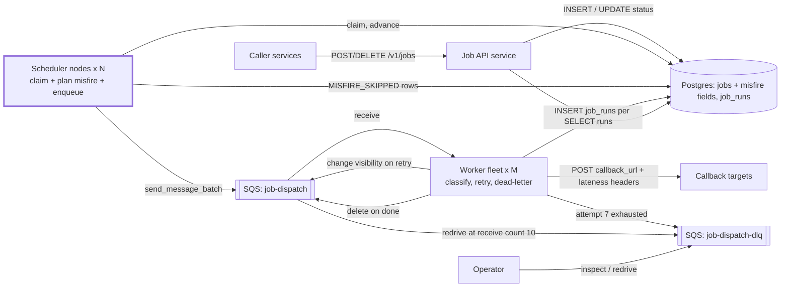

New in V5: the plan step in the scheduler, the two `jobs` columns, `MISFIRE_SKIPPED` rows written by schedulers, and lateness fields on messages and headers.

**Every current flow**

1. **Submit (changed):** the API accepts `misfire_policy` and `misfire_grace_seconds` and validates them. Everything else is as in V0.
2. **Fire (changed):**
   1. A scheduler claims up to 1,000 due rows on a 10-second lease. The result includes the policy fields and `db_now`.
   2. For each row it runs `plan()`. On-time rows fire normally. Misfired rows follow their policy.
   3. It sends the planned messages to `job-dispatch` in batches of 10.
   4. In one transaction it advances `next_fire_at` (or marks `COMPLETED`), guarded by `claim_token`. It also writes a `MISFIRE_SKIPPED` row if any fires were dropped.
3. **Dispatch (changed slightly):** unchanged from V4, except the POST also carries `X-Scheduled-For`, `X-Late-By-Seconds`, and `X-Missed-Count`.
4. **Dead-letter:** unchanged from V4.
5. **Recover:** unchanged. A dead scheduler is recovered within the 60-second default grace, so its jobs are late, not misfired.
6. **Cancel:** unchanged.
7. **History (changed):** the API now also returns `MISFIRE_SKIPPED` rows, with the skipped count.

## Interview follow-ups

**"Why not just give callees the lateness header and let them decide?"**
We do send it, but the platform still has to bound its own blast radius. 200,000 redundant calls hit the callees and our workers before any callee gets to decide. Deciding in the scheduler turns a skip into one DB write instead of a queue message, a worker slot, and an HTTP call. The header is a supplement for callees with finer rules.

**"If a scheduler crashes after enqueue, how do you avoid firing different runs when another node reclaims?"**
Plans come from stored state: the row's `next_fire_at` and its cron expression. A reclaim re-plans the same missed times, so it generates the same `run_key`s. `FIRE_ONCE` always uses the earliest time, and `FIRE_ALL` always takes the oldest 10 from the same start. The duplicate messages are then absorbed by the idempotency key.

## Recap

| Concept | The Insight |
|---------|-------------|
| Misfire vs. retry | A misfire is lateness before dispatch. A retry is failure after dispatch. They have separate mechanisms. |
| Policy lives on the job | Whether a missed run is redundant, distinct, or worthless is a business fact the platform cannot guess. |
| Grace period | Normal recovery delay is not a misfire, so only genuinely late fires reach the policy. |
| Three policies | `FIRE_ONCE` collapses, `SKIP` drops, `FIRE_ALL` catches up in a paced way. |
| Plan from stored state | Deterministic `run_key`s survive a scheduler crash and reclaim. |
| Paced catch-up | Advancing to the first unsent time drains a backlog without dropping or bursting. |
| Record every skip | A dropped fire is an audit row, never silent. |

**Interview arc:** *"If asked what happens when the scheduler is down for 40 minutes: firing everything bursts 200,000 redundant calls, and always skipping silently drops billing windows, so each job declares a grace period and a policy (fire-once, skip, or paced fire-all), decided in the scheduler from stored state so run keys stay stable and every drop is recorded."*

## Next

At 02:00:00, 300,000 daily jobs are due together. That means roughly 900,000 row writes in about 15 seconds: the claim, the advance, and the `job_runs` insert for each job. That is around 60,000 writes per second, far beyond what one Postgres primary comfortably sustains. V6 is sharding the `jobs` table: which shard key spreads the burst, and what a hot shard looks like at 02:00.

Say "next" when you're ready.


-----------------------------------------------------------------------------------------------------------------------
-----------------------------------------------------------------------------------------------------------------------
-----------------------------------------------------------------------------------------------------------------------
-----------------------------------------------------------------------------------------------------------------------


# V6: Sharding the Job Store

V5 settled what late means. V6 fixes the next bottleneck, which is how many row writes the database can take per second. This version covers sharding only. Replication and failover come after it.

## Break it

It is 02:00:00 and 300,000 daily jobs are due together. Each fire costs three row writes on the one Postgres primary: the claim `UPDATE`, the advance `UPDATE`, and the `job_runs` `INSERT`.

That is 900,000 row writes. To enqueue everything within about 15 seconds, we need 60,000 writes per second. One tuned primary sustains roughly 10,000 per second for this write shape, because every advance also rewrites the `next_fire_at` index entry and writes WAL.

The failure is not just slowness. It goes like this:

1. At 02:00:00, ten schedulers each claim 1,000 rows. The claims commit quickly.
2. The advance writes and `job_runs` inserts pile up behind each other on the primary.
3. By 02:00:30 the gap between claim and advance is around 40 seconds. The V3 lease is 10 seconds.
4. Leases expire on rows that were already enqueued but not yet advanced.
5. Another scheduler reclaims those rows and enqueues them again.
6. Each duplicate adds more writes, so the backlog grows faster.

The idempotency key keeps duplicate callbacks harmless to correct callees. But we are now generating load on ourselves, and the lease no longer means anything.

Storage is a second clock. `job_runs` grows by roughly 10 million rows a day, and one instance eventually runs out of room and vacuum headroom.

## Naive attempts (lighter walk, since this isn't the crux)

1. **A bigger box.** It looked reasonable because it needs no code change. It buys about 2x, and we are 6x over. It also keeps one primary as the single point of failure for every job.
2. **Move the due-queue to Redis.** A Redis ZSET would cut writes from three per fire to one. But the lease and token must change atomically with `next_fire_at`, and V1 and V2 depend on that being one SQL statement. Splitting it across two stores brings back the race we removed.
3. **Partition the table by time.** Postgres range partitioning on `next_fire_at` makes scans and vacuum cheaper. It does not add write capacity, because every partition still lives on one primary.

## The mechanism, in plain language

Imagine the school office's wall calendar has grown to a million entries and one clerk can't keep up. You split it into 8 calendars in 8 offices, each with its own clerk. Every job lives in exactly one office.

A rule tells you which office. That rule is the **shard key**. A good key spreads work evenly. It also puts rows you read together in the same office.

## Choosing the shard key

| Candidate key | What it optimizes | What it breaks |
|---------------|------------------|----------------|
| `next_fire_at` time range | The due query touches one shard. | All jobs due at 02:00 sit on one shard. That is the worst possible hotspot. |
| `owner` | "List my jobs" is one shard. | One big caller owns 200,000 jobs, so one shard carries them. Skewed by tenant. |
| **hash(`job_id`)** | Even spread, and every per-job operation is one shard. | Anything keyed by owner becomes scatter-gather. |

A short dialogue on the time key:

> **Meera:** Shard by fire time. The scheduler only ever looks at "now," so it only touches one shard.
>
> **Arjun:** And at 02:00 that one shard takes all 300,000 jobs while seven sit idle.
>
> **Meera:** Then use the minute as the key, and rotate.
>
> **Arjun:** Every advance moves the row to a new time bucket. Now each fire is a cross-shard move.

We choose `hash(job_id)`. Every operation we have is per job: submit, claim, advance, cancel, history, and the `job_runs` insert. All of them can find their shard from the `job_id` alone, so there is no lookup table.

## Hotspots

The 02:00 burst is skewed in time, not in key. Random job IDs spread it evenly, so every shard sees the same burst at the same moment, each at 1/8 of the load. The fix for a time spike is capacity, not rebalancing.

If one shard runs hot anyway (a noisy neighbor, uneven hardware), there are three fixes:

| Fix | Mechanism | Fits here? |
|-----|-----------|-----------|
| Move buckets off the hot shard | Change entries in the bucket map and copy those rows. | Yes. It is the same tool we use for resharding. |
| Add shards | Same as above, with a new destination. | Yes, for sustained growth. |
| Salt or split a hot key | Append a suffix so one key becomes several. | No. A job is one row, so there is no hot key to split. |

## Resharding cost

How we map `job_id` to a shard decides how painful growth is. There are three real options:

| Option | Rows moved going from 8 to 9 shards | Control over what moves | Extra moving parts |
|--------|-------------------------------------|------------------------|-------------------|
| `hash % N` | About 8/9, roughly 89% | None | None |
| Consistent-hash ring | About 1/9, roughly 11% | Indirect, via virtual nodes | Ring and vnode tuning |
| **Fixed 1024 buckets plus a map** | **About 114 buckets, roughly 11%** | **Full: we pick which buckets move** | **A small shard map** |

With `hash % N`, changing N changes the answer for almost every job. With buckets, a job's bucket never changes. Only the bucket's address changes.

## Solve it

Three rules:

1. **Bucket function.** `bucket = hash(job_id) % 1024`. The bucket is stored on every row.
2. **Shard map.** A small versioned map says which shard owns which buckets. We start with 8 shards of 128 buckets each.
3. **One cycle, one shard.** A scheduler runs the whole claim, plan, enqueue, advance cycle against a single shard. The V5 transaction (advance plus `MISFIRE_SKIPPED` rows) therefore stays single-shard and atomic.

Why 8 shards: the 60,000 writes per second split into about 7,500 per shard. That is inside the roughly 10,000 budget, with room to add shards later.

**Scaling note.** The scheduler nodes remain stateless. They don't own shards. Every node polls every shard, and `SKIP LOCKED` plus leases keep them from colliding. We rejected a static node-to-shard assignment because a dead node would leave its shard unpolled until someone noticed. The mechanism we already built gives us failover for free.

✅ **What we gained**
- Write capacity grows by adding shards. Each shard sees about 1/8 of the burst, which brings the claim-to-advance gap back under the 10-second lease.
- Every per-job operation touches exactly one shard, so we need no cross-shard transactions.
- Resharding moves about 11% of rows, not about 89%.
- Storage and vacuum load split 8 ways.

⚠️ **What we gave up / new problems**
- Owner-based queries become scatter-gather across 8 shards. At a few QPS that is fine. A global owner index is deferred.
- A shard primary that fails stops about 1/8 of jobs. Replication and failover are the next version.
- Operations multiply by 8: migrations, backups, monitoring, and connections.
- During a bucket move, writes to those buckets pause for a short freeze.
- The shard map is a new piece of shared state that every component must read correctly.

❌ **Considered and rejected**
- **Static node-to-shard assignment:** a dead node strands its shard.
- **A lookup table from `job_id` to shard:** it becomes a hot, global store, and the hash makes it unnecessary.
- **Sharding the queue too:** SQS standard queues scale on their own, so there is nothing to split.

## Implement it

### Schema delta

Applied identically on every shard. Each shard holds both `jobs` and `job_runs`, co-located by `job_id`.

```sql
ALTER TABLE jobs     ADD COLUMN bucket SMALLINT NOT NULL;
ALTER TABLE job_runs ADD COLUMN bucket SMALLINT NOT NULL;
CREATE INDEX idx_jobs_bucket ON jobs (bucket);                    -- bucket moves and cleanup
CREATE INDEX idx_jobs_owner  ON jobs (owner, created_at DESC);    -- scatter-gather listing
```

### The new storage class: shard map

The shard map is a tiny, read-mostly document that needs versioning and safe rollback. It goes in a managed config store (AWS AppConfig), not a database. A database would add a global dependency to every request for data that changes a few times a year.

```json
{
  "version": 1,
  "n_buckets": 1024,
  "shards": {
    "s0": {"dsn": "postgres://s0.internal/jobs", "buckets": [[0, 127]]},
    "s1": {"dsn": "postgres://s1.internal/jobs", "buckets": [[128, 255]]},
    "s7": {"dsn": "postgres://s7.internal/jobs", "buckets": [[896, 1023]]}
  },
  "moving": []
}
```

(s2 through s6 follow the same pattern.)

### Bucket function and routing

```python
import hashlib

N_BUCKETS = 1024

def bucket_of(job_id: UUID) -> int:
    h = hashlib.md5(job_id.bytes).digest()
    return int.from_bytes(h[:4], "big") % N_BUCKETS

def shard_for(job_id_or_bucket):
    b = job_id_or_bucket if isinstance(job_id_or_bucket, int) else bucket_of(job_id_or_bucket)
    return SHARDMAP.bucket_to_shard[b]        # 1024-entry list, rebuilt when the map version changes
```

Two details:
- **Never use Python's built-in `hash()`.** It is randomized per process, so two nodes would disagree about where a job lives.
- **Hash even though UUIDv4 is already random.** If we ever switch to time-ordered IDs, the hash keeps the spread even.

### Who writes, who reads

| Structure | Who writes | Who reads |
|-----------|-----------|-----------|
| `jobs` on shard `shard_for(job_id)` | API (insert, cancel). Scheduler pollers (claim, advance). | Scheduler pollers. API (get). |
| `job_runs` on the same shard | Workers (attempts). Scheduler pollers (`MISFIRE_SKIPPED`). | API history (one shard). |
| Shard map (AppConfig) | Operator resharding tool. | API, schedulers, workers. All cache it for 5 seconds. |
| `job-dispatch` message | Schedulers, who now add a `bucket` field. | Workers, who use it to find the shard without rehashing. |

### API (changed lines)

```python
job_id = uuid4()
b = bucket_of(job_id)
shard_for(b).execute("INSERT INTO jobs (job_id, bucket, ...) VALUES (%s, %s, ...)", job_id, b)
# DELETE /v1/jobs/{id} and GET /v1/jobs/{id}/runs: shard_for(id), single-shard query
# GET /v1/jobs?owner=billing  ->  query all 8 shards in parallel, merge by created_at DESC
```

### Claim (one added predicate)

```sql
-- V2/V3 claim, plus:
  AND bucket = ANY(:owned_buckets)
-- RETURNING list adds: bucket
```

`:owned_buckets` is the shard's buckets from the map, minus any marked `moving`. It also makes rows left behind after a move invisible to the claim.

### Scheduler (one poller task per shard)

```python
async def poll_shard(shard):
    while True:
        owned = SHARDMAP.owned(shard.name)               # excludes 'moving', 5 s cache
        async with shard.pool.acquire() as db:           # via PgBouncer, transaction pooling
            batch = await db.query(CLAIM_SQL, node_id=NODE_ID, owned=owned)
            plans = [(j, plan(j, batch.db_now)) for j in batch.rows]    # V5, unchanged
            sent = send_in_batches(build_msgs(plans))                   # V3 sender; msgs carry bucket
            await advance_and_log(db, plans, sent)                      # V5 transaction, one shard
        if not batch.rows:
            await asyncio.sleep(1)

for shard in SHARDS:
    asyncio.create_task(poll_shard(shard))    # a slow shard cannot stall the other seven
```

### Worker (changed line)

```python
shard_for(b["bucket"]).execute("INSERT INTO job_runs (..., bucket) VALUES (..., %s)", ..., b["bucket"])
```

Everything else in the V4 handler is unchanged.

### Resharding runbook (adding s8)

The day-one move from the single instance to 8 shards is this same procedure, run eight times.

1. **Create `s8`** with the same schema, empty.
2. **Pick 114 buckets**, about 14 from each old shard, so every shard sheds equally. Start filtered logical replication from each source:
   ```sql
   CREATE PUBLICATION mv_s3 FOR TABLE
     jobs     WHERE (bucket IN (3, 19, 35, ...)),
     job_runs WHERE (bucket IN (3, 19, 35, ...));
   ```
   Writes keep flowing to the old shard while the copy runs.
3. **Freeze when lag is near zero.** Set `moving: [...]` in the map. Schedulers skip those buckets. The API returns `503` with `Retry-After: 5` for writes to them. Workers retry `job_runs` inserts for up to 20 seconds, which is under the 30-second visibility timeout. Wait 10 seconds, which is two cache TTLs, until lag is zero and no leases remain on those rows.
4. **Flip.** Point the buckets at `s8`, bump the map version, and clear `moving`.
5. **Clean up** later, off-peak, by dropping the subscription and deleting the moved rows in batches. The claim predicate already ignores them, so leftovers are harmless.

The freeze lasts about 15 seconds and touches 11% of jobs. The default 60-second grace from V5 covers it, so those jobs run late rather than misfiring. A job with a grace under 15 seconds could misfire, so we schedule moves away from 02:00.

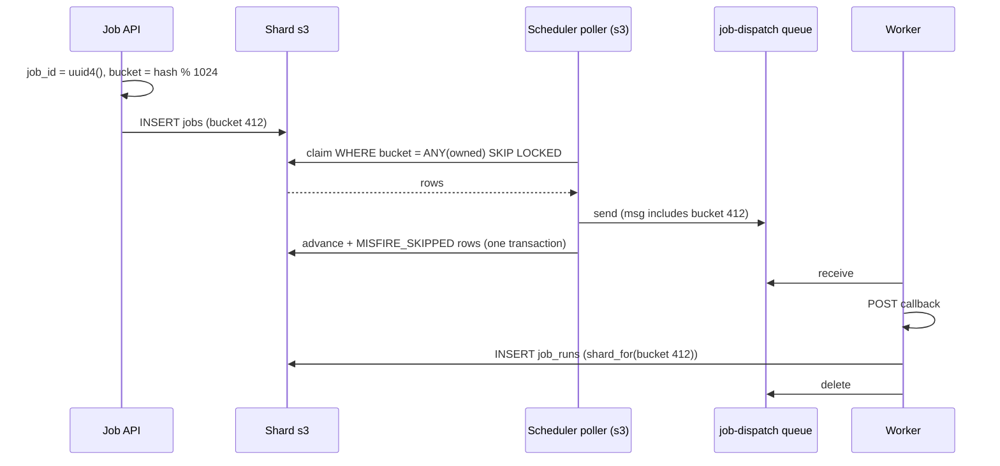

## Current state

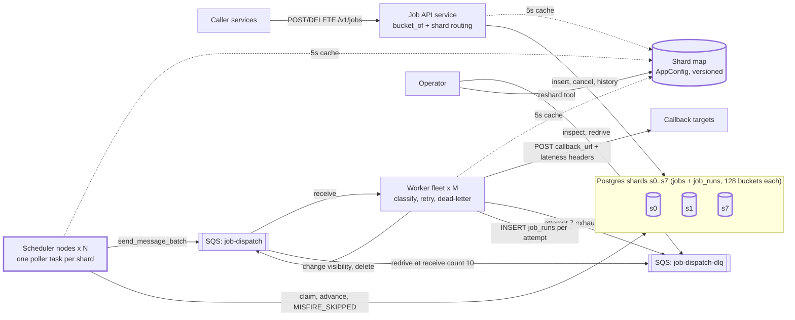

New in V6: the 8 shards (s2 through s6 follow the same pattern as the three drawn), the shard map, the `bucket` column, per-shard pollers, and bucket routing in the API and workers.

**Every current flow**

1. **Submit (changed):** the API generates `job_id`, computes `bucket`, and inserts into `shard_for(bucket)`. Validation and next-fire computation are unchanged.
2. **Fire (changed):**
   1. Each scheduler node runs one poller task per shard.
   2. A poller claims up to 1,000 due rows on its shard (10-second lease, `bucket = ANY(owned)`).
   3. It plans misfires, enqueues to `job-dispatch` with the `bucket` field, and advances rows in one transaction on that same shard.
3. **Dispatch (changed slightly):** unchanged from V4, except the `job_runs` insert is routed with `shard_for(bucket)`.
4. **Dead-letter:** unchanged from V4.
5. **Recover:** unchanged. A dead scheduler's leases expire, and any node's poller for that shard reclaims. A dead worker's message reappears after its visibility timeout.
6. **Cancel:** unchanged, but routed by `job_id` to one shard.
7. **History:** unchanged, one shard.
8. **List by owner (new):** the API queries all 8 shards in parallel and merges the results.
9. **Reshard (new, rare, operator-run):** copy, freeze, flip, and clean up, as in the runbook.

## Interview follow-ups

**"Why not consistent hashing?"**
It also moves about 1/9 of keys when adding a shard, so cost is not the difference. The bucket map gives us control. We choose which buckets move, so we can shed a specific hot shard or move exactly 14 buckets from each old shard. It is also easy to explain, debug, and diff. The cost is a small shard map, which we version and cache.

**"What if one shard is down?"**
Only the jobs in its 128 buckets are affected, about 1/8. The other seven pollers are separate tasks, so they keep firing. The affected jobs go late and then follow their misfire policy. Today there is no automatic recovery for the downed shard. Adding replicas with failover is the next version.

## Recap

| Concept | The Insight |
|---------|-------------|
| Write ceiling | The 02:00 burst needs about 60,000 row writes per second against a primary that sustains about 10,000. The overload makes leases expire and creates duplicates. |
| Shard key | `hash(job_id)` makes every per-job operation single-shard and spreads the burst evenly. Time and owner keys create hotspots. |
| Logical buckets | 1024 fixed buckets plus a map means resharding moves about 11% of rows, not about 89%, and we choose which ones. |
| One cycle, one shard | The claim, plan, enqueue, and advance steps all run on one shard, so V5's transaction stays atomic. |
| Pollers per shard | Every node polls every shard, so leases and `SKIP LOCKED` give failover for free, and one slow shard cannot stall the rest. |
| The cost | Owner queries scatter-gather, ops multiply by 8, and a shard failure is still unhandled. |

**Interview arc:** *"If asked how you scale the job store: one primary can't take 60,000 writes per second at the 02:00 burst, and a bigger box, Redis, or partitions don't add write capacity, so we shard by hash(job_id) into 1024 logical buckets mapped to 8 Postgres shards, run every claim-to-advance cycle on a single shard, and keep a bucket map so adding a shard moves about 11% of rows instead of rehashing about 89%."*

## Next

It is 02:00:10 and shard s3's primary dies. About 1/8 of all jobs stop firing, and the job rows are on a single disk that is gone. V7 is replication: whether replicas are justified here at all, how many, sync or async, and how a replica is promoted without losing a claim or a lease.

Say "next" when you're ready.


-----------------------------------------------------------------------------------------------------------------------
-----------------------------------------------------------------------------------------------------------------------
-----------------------------------------------------------------------------------------------------------------------
-----------------------------------------------------------------------------------------------------------------------


# V7: Replication, So a Dead Primary Doesn't Mean Dead Jobs

V6 spread writes across 8 shards. Each shard is still one machine with one disk. V7 covers replication only. Region-level failure is a different problem, and it comes after this.

## Break it

It is 02:00:10 and shard s3's primary host dies. The disk is gone with it.

s3 holds 128 of 1,024 buckets, so about 37,500 of the 300,000 jobs due at 02:00 live there. They stop firing.

The bigger problem is recovery. All we have is last night's backup and archived WAL. Restoring takes about an hour, and the restore is manual.

Anything written since the last archived WAL is gone. That includes jobs whose submit calls already returned `201`. Priya registered a new cron job at 01:59:58 and got her `job_id`. Nobody will ever fire it, and nobody knows it is missing.

## Are read replicas justified here?

No, not for reads.

- Writes at the burst peak are about 7,500 per shard per second, but the average is a few per second.
- Reads are `GET /v1/jobs/{id}` and the history endpoint. That is a few hundred QPS across all shards, which one primary handles easily.
- A replica serving history would show a stale `job_runs` right after a fire. We would take a consistency cost to solve a problem we don't have.

We add replicas for **durability and failover**, not read scaling. No client reads from them. That also means we have no staleness to reason about.

## Naive attempts (lighter walk, since this isn't the crux)

1. **Backups and WAL archiving only.** It looked reasonable because it is cheap and standard. Recovery is manual and takes about an hour. Acknowledged writes since the last archived WAL are lost.
2. **An async replica with automatic failover.** This is the common default. A replica trails the primary by a small, variable lag. If the primary dies, we promote the replica.

Here is how the second one breaks. During the 02:00 burst the replica trails by about 200 ms, which is roughly 1,500 row writes.

- Scheduler B claims job J. The commit sets `claim_token = 6` and is acknowledged. The replica never receives it and still holds token 5.
- The primary dies and the replica is promoted.
- Scheduler C claims J on the new primary. The token is 6 again, for a different claimant.
- B's finish `UPDATE ... WHERE claim_token = 6` now matches C's claim. B advances the row and clears C's lease while C is still working.

The fencing token from V2 only works if tokens never repeat. An acknowledged write that disappears breaks that rule. The same lag also loses acknowledged job submissions.

3. **Application-level dual write to two primaries.** It looked reasonable because both sides always have the data. It brings back the V1 race at the storage layer: two writers, no arbiter, and conflicts to reconcile. We reject it without further walk.

## The mechanism, in plain language

A bank teller won't hand you a receipt until the transaction is recorded in two vaults in two buildings. If one building burns down, the other has every receipt ever issued.

Replication copies the primary's write-ahead log (WAL) to other nodes. The question is when the primary may tell the client "committed."

| Mode | Commit waits for | Acknowledged data lost if primary dies | Cost |
|------|------------------|----------------------------------------|------|
| Async | Nothing | The last ~lag of writes | No added latency |
| Sync to all replicas | Both replicas | None | Any one replica down blocks all writes |
| **Quorum (any 1 of 2 replicas)** | **One replica, whichever is first** | **None, for a single failure** | **About +1 to 2 ms cross-AZ round trip per commit** |

Postgres calls the third option quorum commit. It is the "semi-synchronous" idea: one extra copy is always durable before the client hears yes.

We pick quorum commit. It keeps the invariant we need: **nobody ever acts on a write that wasn't acknowledged, and every acknowledged write survives.** A scheduler enqueues only after its claim returns, and the claim returns only after the commit is on two nodes.

The latency cost is small here. Claim and advance are batch statements of up to 1,000 rows, so about 2 commits cover 1,000 fires.

## Known sub-problem: failover

Replicas are only useful if something promotes one. There are three established ways.

**1. Manual promotion.** A human runs `pg_ctl promote` on the replica with the highest LSN.
- Fits: nothing here. Our recovery target is under a minute, and at 02:00 nobody types that fast.

**2. A consensus store runs the election (Patroni with etcd).** Each node's agent renews a leader key in etcd, which is a linearizable key-value store with TTLs.

```python
# runs on every node
if etcd.cas(key="jobs-s3/leader", expect=me_or_none, value=me, ttl=30):
    be_primary()          # renewed every 10 s
else:
    follow_leader()       # replica; if the leader key expires, try to take it
```

- Fits: yes. It is the self-managed answer. The election cannot live in Postgres itself, because the thing that died is the thing holding the state.

**3. Managed failover (RDS Multi-AZ DB cluster).** The provider runs the same logic, with one writer and two standbys that confirm commits.
- Fits: yes, if we run on AWS. It has the same semantics as (2) with less operational work.

We implement (2) so the mechanism is visible. Option (3) is a reasonable swap-in.

### Split brain

The old primary might not be dead, only partitioned. Two nodes would both accept writes.

Two layers stop that:
- Patroni demotes the primary when it can't renew its leader key.
- Quorum commit makes a partitioned primary unable to acknowledge commits, because no standby can confirm them. Even a stale primary can't invent acknowledged writes.

### Promotion rule

With 2 replicas and "any 1 confirms," at least one replica holds every acknowledged commit, but we don't know which. So promotion requires **both** surviving replicas to be reachable. The one with the highest LSN wins.

If both can't be reached, that is two failures at once. Patroni refuses to promote automatically and pages a human. That is our declared limit: we survive any single node or single-AZ failure.

## Solve it

Each shard becomes a three-node cluster, one node per AZ:
- Quorum commit: any 1 of 2 replicas must confirm.
- Patroni plus a 3-node etcd cluster (one node per AZ, shared by all 8 shards) handles election and promotion.
- Stable per-shard DNS points at whichever node is primary, so the shard map's `dsn` never changes.

Shard count goes from 8 to 24 Postgres nodes. That is 3x the database cost. We accept it because losing acknowledged data costs more.

✅ **What we gained**
- Zero loss of acknowledged writes under a single failure, so V2's fencing tokens never repeat.
- Automatic recovery, in about 30 to 50 seconds instead of an hour.
- Priya's `201` means the job survives a primary dying.

⚠️ **What we gave up / new problems**
- Every commit waits for a cross-AZ round trip, about 1 to 2 ms.
- During the 30 to 50 second failover, that shard's jobs are late. Jobs with the V5 default 60-second grace still fire normally. Jobs with a shorter grace follow their misfire policy.
- Two simultaneous failures need a human.
- etcd becomes a dependency. If etcd is unreachable, Patroni would demote primaries by default. We enable failsafe mode to prevent that.
- Replica lag is now a metric to watch. A lagging replica makes failover slower.

❌ **Considered and rejected**
- **Async replication:** it can lose acknowledged writes and repeat fencing tokens.
- **Sync to both replicas:** any single replica failure would block that shard's writes.
- **Serving reads from replicas:** no read pressure to relieve, and it would add staleness.
- **Multi-master:** brings back the double-writer race we removed in V1.

## Implement it

### Topology and who does what

| Component | Writes | Reads |
|-----------|--------|-------|
| Primary (per shard) | Application writes. Streams WAL to both replicas. | Application reads (all of them). |
| Replica x2 (per shard, other AZs) | Apply received WAL. Send confirmations to the primary. | Nothing from clients. Patroni reads their LSN for election. |
| etcd (3 nodes, one per AZ) | Patroni agents (leader key, cluster state). | Patroni agents. |
| Shard map `dsn` | Operator tool (changes rarely). | API, schedulers, workers. |

Each replica lives in a different AZ from its primary and from the other replica.

### Patroni config (per shard, shown once)

```yaml
scope: jobs-s3
etcd3:
  hosts: etcd-a:2379,etcd-b:2379,etcd-c:2379
bootstrap:
  dcs:
    ttl: 30
    loop_wait: 10
    retry_timeout: 10
    failsafe_mode: true               # an etcd outage must not demote all 8 primaries
    synchronous_mode: quorum          # Patroni 4+: any 1 of the 2 standbys must confirm
    postgresql:
      parameters:
        synchronous_commit: "on"
        wal_level: replica
        max_wal_senders: 10
        hot_standby: "on"
```

In quorum mode Patroni maintains the equivalent of this Postgres setting for us:

```
synchronous_standby_names = 'ANY 1 (s3_r1, s3_r2)'
```

Patroni promotes a standby only when it can confirm it holds all acknowledged commits.

### Routing

The shard map's `dsn` becomes a stable name such as `s3.jobs.internal`. A network load balancer health-checks each node on Patroni's REST endpoint (`GET :8008/primary`). Only the current leader returns 200. After a failover the check flips within one or two intervals, and no client config changes.

### Client behavior during failover (API, schedulers, workers)

```python
@retry(on=(OperationalError, ConnectionError),
       backoff=full_jitter(base=0.5, cap=10),     # same jitter idea as V4
       deadline=60)
def with_shard(shard, fn):
    with shard.pool.acquire() as db:
        return fn(db)
```

| Component | During the failover window |
|-----------|---------------------------|
| Scheduler poller for s3 | Connection errors, retries with jitter. The other 7 pollers are separate tasks and keep going. |
| Worker `job_runs` insert to s3 | Fails, so the worker does not delete the message. After the 30-second visibility timeout, it reappears and the POST repeats with the same `Idempotency-Key`. This costs one attempt from V4's budget. |
| API writes to s3 | Returns `503` with `Retry-After: 5`. Reads of s3 fail the same way. |

No schema changes and no new tables. Everything built in V0 to V6 runs unchanged against the primary.

### Failover timeline for our 02:00:10 scenario

| Time | Event |
|------|-------|
| 02:00:10 | s3 primary host dies. Last renewal of its leader key was up to 10 s earlier. |
| up to 02:00:40 | The leader key's 30-second TTL expires. Both replicas confirm they hold everything. |
| about 02:00:42 | The replica with the higher LSN promotes. |
| about 02:00:50 | The load balancer's health check marks it as primary. Pollers reconnect. |
| 02:00:50 | Leases from the dead node expired long ago. s3's claim query picks those rows up. |

Rows claimed but not yet advanced are re-enqueued with the same `run_key`. The idempotency key absorbs those duplicates. Rows due 02:00:00 are now about 50 seconds late. With the default 60-second grace they fire normally.

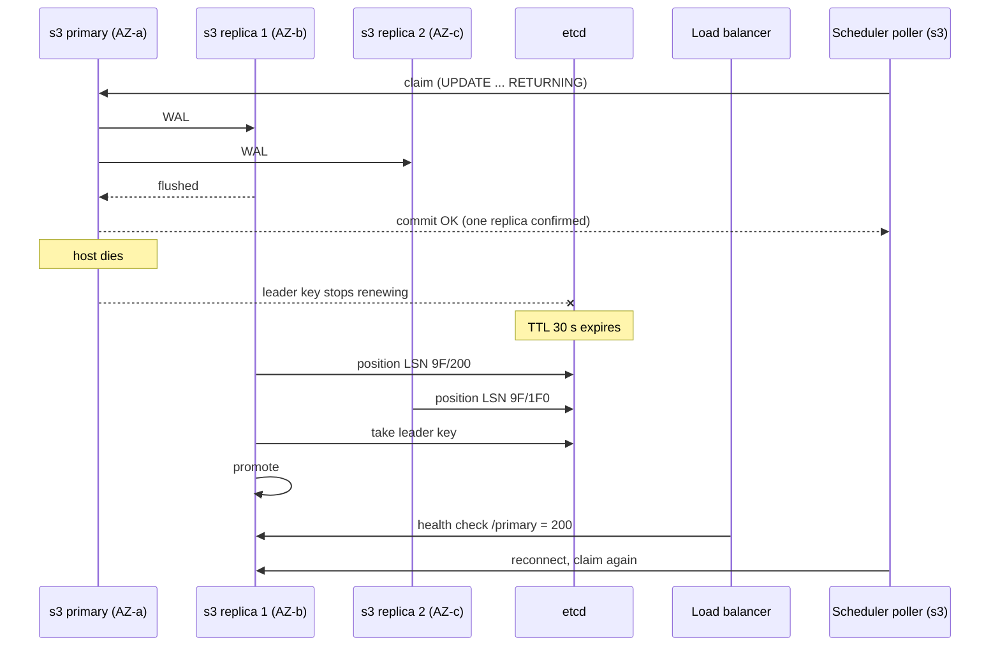

## Current state

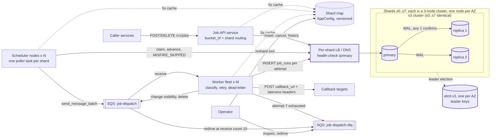

New in V7: each shard is a primary plus two replicas in three AZs, quorum commit, the etcd cluster, Patroni, and the per-shard load balancer. Clients still talk only to the primary.

**Every current flow**

1. **Submit (changed durability):** the API generates `job_id`, computes `bucket`, and inserts into the primary of `shard_for(bucket)`. The `201` is returned only after one replica has confirmed the commit.
2. **Fire (changed durability):**
   1. A scheduler poller claims up to 1,000 due rows on the shard primary, on a 10-second lease. The claim returns only after a replica confirms it.
   2. It plans misfires, enqueues to `job-dispatch` with the `bucket` field, and advances rows in one transaction on that same shard.
3. **Dispatch:** unchanged from V4. A worker receives, POSTs with the idempotency key, writes `job_runs` to the shard primary, and deletes the message. If that insert fails, the message is left to reappear.
4. **Dead-letter:** unchanged from V4.
5. **Recover:** a dead scheduler's leases expire and are reclaimed. A dead worker's message reappears. Both are unchanged from V3.
6. **Failover (new):** if a shard primary dies, its leader key expires, the more advanced replica promotes, and the load balancer flips. Pollers, workers, and the API retry with jittered backoff.
7. **Cancel:** unchanged. Routed by `job_id` to one shard primary.
8. **History:** unchanged. One shard primary.
9. **List by owner:** unchanged. Scatter-gather across the 8 primaries.
10. **Reshard:** unchanged from V6, but each source and destination is now a cluster. The copy reads from the primary, and the destination replicates normally.

## Interview follow-ups

**"Why not read replicas to scale reads?"**
Reads are a few hundred QPS across all shards, and the writes are the bottleneck, not reads. Serving history from a replica would also show a stale `job_runs` right after a fire. We use the replicas for durability and promotion, and clients never read from them. If the read load changed, I'd add replicas for the owner-listing endpoint only, and I'd accept a short staleness there.

**"Doesn't synchronous replication hurt latency?"**
It adds a cross-AZ round trip of about 1 to 2 ms per commit. Our hot paths commit once per batch of 1,000 rows, so the cost per fire is tiny. Quorum commit means the commit waits for the faster of two replicas, not both, so one slow replica doesn't stall us. The alternative is losing acknowledged writes and repeating fencing tokens, which is much worse.

## Recap

| Concept | The Insight |
|---------|-------------|
| Replicas for durability | With almost no read pressure, replicas exist to survive a dead primary, not to serve reads. |
| Async failover | It can lose acknowledged writes, including claim tokens, which breaks V2's fencing. |
| Quorum commit | One replica confirms before the client hears yes, so acknowledged writes survive any single failure. |
| Election outside Postgres | A consensus store (etcd) with a TTL'd leader key picks the primary, because the dead node can't. |
| Promotion rule | Promote the highest LSN, and only when both surviving replicas are reachable. Two failures page a human. |
| Failover window | About 30 to 50 seconds late, absorbed by V5's grace period or its misfire policy. |

**Interview arc:** *"If asked how you survive a shard primary dying: backups lose acknowledged writes and take an hour, and async replicas can repeat fencing tokens, so each shard runs quorum commit across three AZs where one replica must confirm every commit, with etcd-backed leader election that promotes the most advanced replica in about 30 to 50 seconds."*

## Next

A whole region goes dark: all three AZs, the SQS queue, and the workers. V8 is multi-region, starting with who owns each job's writes and how two regions avoid both firing it.

Say "next" when you're ready.


-----------------------------------------------------------------------------------------------------------------------
-----------------------------------------------------------------------------------------------------------------------
-----------------------------------------------------------------------------------------------------------------------
-----------------------------------------------------------------------------------------------------------------------


# V8: Multi-Region

V7 survives a dead node or a dead AZ. V8 covers losing a whole region. This version is about write ownership and regional failover only.

## Break it

It is 02:00:10. Priya's `send-invoices` job lives on shard s2, in Mumbai (ap-south-1). The whole region loses power and stays dark for 3 hours.

V7's three AZs share one regional failure domain, so all three go together. Shards s0 to s3 are unreachable, which is 4 of 8 shards. 150,000 of the 300,000 jobs due at 02:00 live on them.

So do the regional SQS queue, with tens of thousands of undelivered messages, and half the worker fleet.

Recovery today means restoring from cross-region backups. Restore plus WAL replay takes about 90 minutes and is manual. WAL is archived every 5 minutes, so up to 5 minutes of acknowledged writes are gone. That includes jobs whose submit already returned `201`.

## Naive attempts (lighter walk, since this isn't the crux)

1. **Cold backups in a second region.** It looked reasonable because it is cheap and every team already has it. It breaks on time and certainty. RTO is about 90 minutes, RPO is about 5 minutes, and a tired human runs an untested runbook at 02:00.
2. **Both regions run the full scheduler on every job.** It looked reasonable because there is nothing to fail over. It breaks the moment it runs: every job fires twice on every tick, by design. Idempotency keys absorb a rare duplicate. They are not meant to absorb 300,000 standing duplicates. Two schedulers also advance the same `next_fire_at` with no arbiter, which is the V1 race again.

## The mechanism, in plain language

Picture a bank with branches in two cities. Every account has exactly one home branch, and only the home branch may change its balance. The other branch keeps a copy that trails by a few seconds.

If the home branch burns down, head office hands those accounts to the other branch. Head office is a registry both branches trust. It also stamps a new edition number on the accounts. Any slip carrying the old edition number is ignored.

Map it to our system:

- Home branch is the **home region** of a shard.
- The copy is an **async standby cluster** in the other region.
- Head office is a small **consensus store** that records who owns what.
- The edition number is an **epoch**.

## Candidate approaches

| Approach | Who may write a job | Optimizes | What it breaks |
|----------|--------------------|-----------|---------------|
| Active-passive | One region owns everything. The other is a standby. | Simplest to reason about. | The standby region is idle, so we pay 2x for nothing. Singapore callers pay 60 ms on every submit. The failover path is untested until a disaster. |
| Sync cross-region replication | Same owner, but commits wait for the other region. | RPO of zero. | A commit pays ~60 ms. With 2 data regions, losing one stalls the other's commits. Fixing that needs a third full data region. |
| **Home-shard active-active** | **Each shard has one home region. Its async standby is in the other region.** | **Both regions do real work. Submits are local. One region's loss affects only its half.** | **RPO is the replication lag, a few seconds. Needs a failover mechanism.** |

We pick the third. Shards s0 to s3 are homed in Mumbai, and s4 to s7 in Singapore. The shard count and the bucket math from V6 do not change. The shard map just gains an owner region.

Ownership is by shard, so every job has exactly one writer. We never resolve conflicts, because we never allow two writers. That is the right fit here, because `next_fire_at` can't be merged: two regions firing one job is a double fire, not a conflict to reconcile.

## Known sub-problem: who decides a region is dead?

There are three established answers.

**1. Peer health checks.** Each region pings the other and adopts its shards after 3 failures.

```python
if ping(peer).failed_times(3):
    adopt(peer)
```

A cable cut between the regions leaves both alive. Both pings fail and both adopt, so every job fires from both regions. Rejected.

**2. A human decides.** It is safe against false positives. RTO is 15 to 30 minutes at 02:00. We keep it as a manual override only.

**3. A consensus lease in a third site (chosen).** Each region must keep renewing a lease in a store that spans three sites. A region that can't renew stops itself. Another region may adopt only after the lease is gone.

```python
# in the failover controller of the peer region
if etcd.get("/lease/region/ap-south-1") is None:        # absent on 2 checks, 5 s apart
    etcd.txn(
      compare=[ create_revision("/lease/region/ap-south-1") == 0,
                value("/ownership/s2") == '{"region":"ap-south-1","epoch":1}' ],
      success=[ put("/ownership/s2", '{"region":"ap-southeast-1","epoch":2}') ])
```

The transaction is atomic and linearizable, so two regions can't both win it.

A new storage class enters here: a **linearizable key-value store with TTLs, spanning 3 sites**. It needs compare-and-set to flip ownership, and it must survive losing one region. A regional Postgres can't do that, and an eventually consistent global table could let two regions both think they won. We use etcd again, as a separate 3-node cluster with one node each in Mumbai, Singapore, and a witness region (say Tokyo). It stores only ownership and leases, never job data.

## Solve it

Five rules:

1. **Home and buddy.** Each shard has a 3-node home cluster (V7, unchanged) and a 3-node async standby cluster in the other region. Cross-region traffic is WAL only.
2. **Single owner per shard**, recorded in etcd as `{region, epoch}`.
3. **Region lease.** Each region's keeper renews `/lease/region/{R}` every 10 seconds with a 60-second TTL. If it can't renew, its pollers stop 15 seconds before the lease can expire.
4. **Adoption.** After the lease is gone, the standby region flips ownership with `epoch + 1`, promotes its standby clusters, and runs an adoption sweep.
5. **Epoch floor on tokens.** Claim tokens never go below `epoch << 32`, so a new epoch's tokens always beat the old epoch's.

Four layers keep the old region from doing harm:

| Layer | What it stops |
|-------|--------------|
| Self-fence 15 s before lease expiry | A partitioned but alive region firing after the other has adopted. |
| Keeper checks ownership on every renewal | A region that returns from a long pause and tries to resume. |
| Epoch floor in `claim_token` | A stalled poller whose connection now lands on the promoted primary. |
| `Idempotency-Key = run_key` | Any residual duplicate callback in the overlap window. |

The queues are regional, so messages in the dead region's SQS are lost to us. The adoption sweep covers that gap. Before opening a shard, it rewinds `next_fire_at` to the earliest fire in the last 15 minutes that has no recorded run. V5's misfire policy then decides what to do. `SKIP` drops it, `FIRE_ONCE` fires once, and `FIRE_ALL` replays it, paced. The failover is a controlled misfire.

✅ **What we gained**
- Region loss costs about 2 minutes instead of 90, with no human in the loop.
- Both regions carry real traffic, so the standby path is warm and tested every day.
- Submits are local. No cross-region write on the hot path.
- One writer per job at any moment, decided by consensus, with no conflict resolution.
- A regional failure affects only that region's half.

⚠️ **What we gave up / new problems**
- RPO is the replication lag, usually under 1 second and up to about 3 seconds during the burst. A job created in the last few seconds can vanish. `201` is no longer absolute across a region loss. Callers should re-register jobs under their own stable names so a reconcile loop can restore them.
- The failover window is about 2 minutes, which is beyond V5's default 60-second grace. Jobs that need tighter behavior must set `misfire_grace_seconds` of 300 or more, or accept their policy firing.
- The sweep re-fires some jobs. Callees must honor the idempotency key.
- Database cost doubles, from 24 nodes to 48.
- A lagging standby makes the home primary retain WAL. We cap this with `max_slot_wal_keep_size`.
- Callers' locality can skew one region's share of jobs. A cross-region bucket move uses the V6 runbook.
- Reads and cancels for a remote job pay ~60 ms. Owner listing is scatter-gather across both regions.
- Failback is deliberate and manual.

❌ **Considered and rejected**
- **Cold backups only:** 90-minute RTO and an untested runbook.
- **Active-passive:** idle cost, remote submits, and an untested failover path.
- **Synchronous cross-region replication:** it couples each region's availability to the other's.
- **Multi-master or last-write-wins:** `next_fire_at` isn't mergeable, and two writers means two fires.
- **Peer health checks:** a partition makes both sides adopt.

## Implement it

### Shard map delta

```json
{
  "version": 12,
  "shards": {
    "s2": { "dsn": "s2.jobs.internal", "buckets": [[256, 383]],
            "owner_region": "ap-south-1", "epoch": 1, "state": "ACTIVE",
            "standby_region": "ap-southeast-1" },
    "s5": { "dsn": "s5.jobs.internal", "buckets": [[640, 767]],
            "owner_region": "ap-southeast-1", "epoch": 1, "state": "ACTIVE",
            "standby_region": "ap-south-1" }
  }
}
```

The other six shards follow the same pattern. `state` is `ACTIVE` or `ADOPTING`, and pollers and the API treat `ADOPTING` like V6's `moving`. The map in AppConfig is now derived. The authority is etcd.

### Who writes, who reads, where it lives

| Structure | Lives | Who writes | Who reads |
|-----------|-------|-----------|-----------|
| `/ownership/{shard}` | Global etcd, 3 nodes in 3 regions | Failover controller (CAS only) | Keepers, controllers, map publisher |
| `/lease/region/{R}` | Same global etcd | Region keeper, every 10 s | The peer region's controller |
| Shard map | AppConfig, one copy per region | Map publisher, on ownership change | API, schedulers, workers (5 s cache) |
| Standby clusters | Peer region, 3 nodes per shard | Receive WAL from the home primary | Nobody until promoted |
| `job-dispatch` and DLQ | Per region (regional SQS) | That region's schedulers and workers | That region's workers, and operators |
| `s{n}.jobs.internal` DNS | Route53, TTL 5 s | Controller, on adoption | API, schedulers, workers |

### Standby cluster config (shown once)

```yaml
# s2 standby, in ap-southeast-1: its own Patroni scope and regional etcd
scope: jobs-s2-sin
bootstrap:
  dcs:
    standby_cluster:
      host: s2.mum.jobs.internal       # stable regional name; never flipped
      port: 5432
      primary_slot_name: sin_standby
    postgresql:
      parameters:
        max_slot_wal_keep_size: 50GB   # a dead standby must not fill the home primary's disk
```

It already carries V7's quorum-commit settings, so after promotion it commits with quorum like any home cluster.

### Submit (changed): IDs land in the local region

```python
def new_job_id(local_region):
    while True:                          # about 2 tries, since half the buckets are local
        j = uuid4()
        if SHARDMAP.owner_region_of(bucket_of(j)) == local_region:
            return j
```

A non-local `GET`, `DELETE`, or history request is proxied to the owner region's API with a 2-second timeout.

### Region keeper (runs in each region)

```python
while True:
    t0 = time.monotonic()
    lease = etcd.lease(ttl=60)
    ok = etcd.txn(
        compare=[value(f"/ownership/{s}") == own_json(s) for s in MY_SHARDS],
        success=[put(f"/lease/region/{MY_REGION}", NODE_ID, lease=lease)])
    if ok:
        KEEPER.deadline = t0 + 60 - 15       # pollers must stop here, before the lease can lapse
    else:
        fence_shards()                       # ownership moved under us: stop those shards for good
    time.sleep(10)
```

If etcd is unreachable, `deadline` simply stops advancing, and the pollers stop themselves.

### Poller gate and claim (changed lines)

```python
s = SHARDMAP.get(shard.name)
if s.owner_region != MY_REGION or s.state != "ACTIVE" or time.monotonic() >= KEEPER.deadline:
    await asyncio.sleep(1); continue
# ... V6 cycle, with :epoch_floor = s.epoch << 32
```

```sql
SET claimed_by = :node_id,
    claim_token = GREATEST(claim_token + 1, :epoch_floor),   -- was: claim_token + 1
    lease_expires_at = now() + interval '10 seconds'
```

### Failover steps (peer-region controller, after winning the CAS)

1. Set the map `state` to `ADOPTING`, so the API returns `503` with `Retry-After: 5` for those buckets.
2. Promote each standby: `curl -XPATCH http://s2-sin-1:8008/config -d '{"standby_cluster": null}'`.
3. Run the adoption sweep on each promoted primary.
4. Publish the map with `owner_region = ap-southeast-1`, `epoch = 2`, `state = ACTIVE`.
5. Flip DNS `s2.jobs.internal` to the Singapore load balancer, with a 5-second TTL.
6. Singapore's pollers pick up the shards on their next loop.

### Adoption sweep (runs on the promoted primary, per shard)

```python
cutoff = failover_started - timedelta(minutes=15)       # covers the V4 retry cap plus margin

for batch in scan_active_cron_jobs(db, buckets, size=5000):
    recorded = load_completed_runs(db, batch, since=cutoff)   # (job_id, scheduled_for) pairs
    for j in batch:
        t = earliest_unrecorded(j, cutoff, recorded)          # first cron time in [cutoff, next_fire_at)
        if t: rewind(j.job_id, t)       # UPDATE jobs SET next_fire_at = t WHERE job_id = ... AND next_fire_at > t
```

A fire counts as recorded only if `job_runs` has `SUCCESS`, `FAILED_PERMANENT`, `DEAD_LETTERED`, or `MISFIRE_SKIPPED` for it. A `RETRY` row doesn't count, because its message was lost with the queue.

One-time jobs, which V3 left `COMPLETED` with `next_fire_at` unchanged, get one statement:

```sql
UPDATE jobs j SET status = 'ACTIVE', claimed_by = NULL, lease_expires_at = NULL
WHERE j.status = 'COMPLETED' AND j.schedule_type = 'ONCE' AND j.next_fire_at >= :cutoff
  AND NOT EXISTS (SELECT 1 FROM job_runs r
                  WHERE r.job_id = j.job_id AND r.scheduled_for = j.next_fire_at
                    AND r.outcome IN ('SUCCESS','FAILED_PERMANENT','DEAD_LETTERED','MISFIRE_SKIPPED'));
```

Standby `job_runs` lags by the same few seconds. A fire completed in the last second may be missing there and fire again. The `run_key` is identical, so that duplicate is absorbed.

### Failover timeline for Mumbai going dark

| Time | Event |
|------|-------|
| 02:00:10 | Mumbai goes dark. The last renewal was at most 10 s earlier. |
| up to 02:00:55 | Any surviving Mumbai pollers self-fence at `last_ok + 45`. |
| about 02:01:10 | The lease key expires. Singapore's controller sees it absent on two checks, 5 s apart. |
| about 02:01:20 | CAS flips s0 to s3 to Singapore, epoch 2, state `ADOPTING`. |
| about 02:01:40 | Standbys are promoted. The sweep runs. |
| about 02:02:00 | Map is `ACTIVE`, DNS is flipped, and Singapore's pollers start. |
| 02:02 to 02:04 | The 150,000 overdue rows are about 2 minutes late, so each follows its misfire policy. |

### Failback (manual, rare)

1. Keep Mumbai's old primaries fenced. They can't resume, because the keeper's ownership check fails.
2. Export any rows beyond the last replicated LSN for audit and reconciliation.
3. Rebuild Mumbai's clusters as standbys of Singapore.
4. Off-peak, run the V6 freeze, flip ownership with `epoch = 3`, promote, and flip DNS.

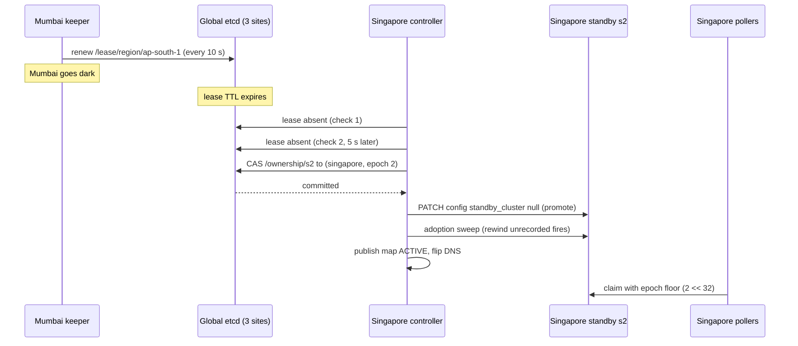

## Current state

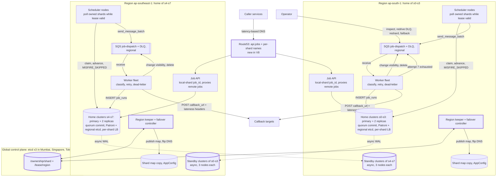

New in V8: Route53 routing, standby clusters in the buddy region, the keepers and controllers, the global etcd, and the owner region and epoch on every shard. The DLQ-to-main redrive edge from V4 is unchanged inside each region's queue box.

**Every current flow**

1. **Submit (changed):** the caller reaches the nearest healthy region. The API generates a `job_id` whose bucket is homed locally, computes the schedule, and inserts into that shard's primary. The commit is confirmed by one in-region replica, and the standby copies it asynchronously.
2. **Fire (changed gates):**
   1. Pollers run only for shards this region owns, only while `state = ACTIVE`, and only before the keeper's deadline.
   2. The claim uses the epoch floor on `claim_token`.
   3. Plan, enqueue to the regional queue, and advance on one shard, as in V6.
3. **Dispatch:** unchanged from V4 and V5, inside the region. The regional queue, workers, and `job_runs` writes are all local.
4. **Dead-letter:** unchanged, with a regional DLQ.
5. **Recover:** a node, AZ, scheduler, or worker failure is unchanged from V7.
6. **Region failover (new):** lease expiry, then an ownership CAS, then promote, sweep, publish, and DNS flip, then the adopting region's pollers start.
7. **Cancel (changed):** routed by `job_id` to the owner shard, and proxied if the owner is the other region.
8. **History (changed):** same routing as cancel.
9. **List by owner:** scatter-gather across all 8 shards, now across both regions.
10. **Reshard:** unchanged from V6. A bucket move across regions uses the same runbook.
11. **Failback (new, manual):** fence, audit, rebuild as standby, then a planned off-peak switch with a new epoch.

## Interview follow-ups

**"Why not synchronous cross-region replication for zero RPO?"**
It couples each region's availability to the other's. With two data regions, losing one blocks the other's commits unless you degrade to async at the worst moment. Every commit also pays about 60 ms. For a scheduler the loss window is a few seconds. The rewind sweep and the idempotency key cover fires. The one real cost is a lost submit, which callers can reconcile.

**"How do you prevent both regions firing the same job during a partition?"**
Ownership is a single record in a 3-site consensus store, and only the owner's pollers run. A region that can't renew its lease stops itself 15 seconds before the lease can expire. A peer may adopt only after the lease is gone. Tokens carry an epoch floor, so stalled writers lose their guard. The tiny residual overlap yields duplicate callbacks with the same `Idempotency-Key`.

## Recap

| Concept | The Insight |
|---------|-------------|
| Region as a failure domain | V7's three AZs share one region, so a regional outage takes all of them. |
| Home-shard ownership | Each job has exactly one writer region, so there are no conflicts to resolve, only a clean handoff. |
| Consensus lease | A region proves it is alive by renewing in a 3-site store, and stops itself before the lease can lapse. |
| Adoption as a controlled misfire | Rewind to the earliest unrecorded fire and let V5's policy decide what to do with it. |
| Epoch floor | A new epoch's tokens always exceed the old one's, so stale writers can't match. |
| Async buddy trade | RPO is seconds instead of zero, in exchange for local commits and independent region health. |

**Interview arc:** *"If asked how you survive a region outage: cold backups take 90 minutes and lose minutes of data, running both regions on everything double-fires every job, and sync replication ties each region to the other, so each shard gets one home region with an async standby in the other, ownership is a compare-and-set in a 3-site consensus store guarded by a region lease and an epoch floor on claim tokens, and adoption rewinds unrecorded fires so the misfire policy and idempotency keys finish the job."*

## Next

A single billing endpoint hangs for 10 seconds on every call. Within a minute all of Singapore's worker slots are stuck waiting on it, and other callers' jobs queue behind it. V9 is failure isolation: a per-target circuit breaker and bulkhead so one sick callee can't starve the fleet.

Say "next" when you're ready.


-----------------------------------------------------------------------------------------------------------------------
-----------------------------------------------------------------------------------------------------------------------
-----------------------------------------------------------------------------------------------------------------------
-----------------------------------------------------------------------------------------------------------------------


# V9: Bulkheads, So One Sick Callee Can't Starve the Fleet

V8 protected us from a region dying. V9 protects us from one slow callee. My last teaser named a circuit breaker and a bulkhead together. They are two mechanisms, so V9 is the bulkhead and V10 is the breaker.

## Break it

It is 02:00:05 in Singapore. About 150,000 jobs are due, and 20,000 of them (13%) call billing hooks.

Billing's database locks up. Its endpoints don't fail. They hang until our 10-second timeout.

The worker fleet has 20 workers × 100 slots, which is 2,000 slots. A normal job holds a slot for about 50 ms. A billing job holds one for 10 s, which is 200 times longer.

Slot time follows that ratio:

- Billing: 0.13 × 10 s = 1.3
- Everything else: 0.87 × 0.05 s = 0.04

Within seconds, billing holds about 97% of all slots. SQS gives each worker whatever message is next, so we have no way to pick around billing.

The other 130,000 jobs share about 60 slots. That is about 1,200 fires per second, so they take about 2 minutes instead of seconds. Every V4 retry of a billing job re-enters the queue and takes the next free slot. The pressure doesn't fade.

## Naive attempts

1. **Shorten the timeout to 2 seconds.** It looked reasonable because the damage scales with hold time. Billing's slot share drops to about 86%, which is still starvation. The reports job that legitimately takes 8 seconds now fails every attempt.
2. **Let the autoscaler add workers.** V3 scales on oldest message age, so it will. Each new worker is also consumed by billing, which then has even more concurrent calls aimed at a database that is already drowning. We pay for slots that do nothing and make the outage worse.

A short dialogue on a third idea:

> **Meera:** One queue per callback host. Billing's queue backs up and nothing else notices.
>
> **Arjun:** We have 5,000 distinct hosts. Every worker long-polls thousands of queues?
>
> **Meera:** Group the small ones together.
>
> **Arjun:** Then one sick small host starves its whole group.

## The mechanism, in plain language

A ship's hull is split into watertight compartments called bulkheads. A hole floods one compartment, and the ship stays afloat.

For us, each callback host gets its own compartment of worker slots. A host may hold at most N slots at once. Once it reaches N, extra jobs for that host wait elsewhere, and the slots stay free for everyone else.

## Candidate approaches

| Option | Isolation | Cost |
|--------|-----------|------|
| Shorter timeout | Weak, since it only shrinks hold time | Breaks legitimately slow callees |
| Queue per host | Strong | Thousands of queues and pollers per worker |
| Fast and slow lanes | Medium | Needs us to predict which callee is slow |
| Global per-host counter in Redis | Exact cap | A new dependency on every job's hot path |
| **Per-worker, per-host concurrency cap** | **Strong for our slots** | **Local state only. The global cap is workers × N, so it moves with fleet size.** |

We choose the last row. The cap exists to protect our slots, not to throttle the callee. Exactness isn't needed.

## The one hard problem: where does a rejected job go?

A worker may already hold a message for a host that is at its cap. It has three options:

- **Hold it and wait for a permit.** The message's visibility timeout runs down, and the slot sits idle.
- **Return it with `ChangeMessageVisibility`.** The message reappears, but every receive increments `ApproximateReceiveCount`. V4 treats that count as the attempt number, so a job bounced 7 times would be dead-lettered without ever being called.
- **Re-send a copy and delete the original (chosen).** We carry the true attempt count in the message body.

The attempt number becomes `attempts_used + ApproximateReceiveCount`. A bounce adds `receive_count - 1` to `attempts_used`, because the current receive is a bounce, not an attempt.

Bounces use a growing, jittered delay, the same full-jitter idea as V4. Without growth, a saturated host would bounce thousands of messages every few seconds.

## Solve it

Four rules:

1. **Key by host.** The compartment is the callback URL's host. The service is what gets sick, not a single endpoint.
2. **Default cap of 20 per worker** (20% of 100 slots). A single host can never take more than a fifth of any worker. Operators can override per host, for example 60 for a reports service and 5 for a fragile legacy system.
3. **Bounce, don't wait.** A message for a full host is re-sent with a delay and the worker's slot is released immediately.
4. **Bounded patience.** After 30 deferrals (about 27 minutes), the job is dead-lettered.

Applied to the incident:

- Billing holds at most 20 of 100 slots per worker. The other 80 slots keep running at full speed.
- Billing's own throughput is capped at 400 concurrent calls across 20 workers. That drains its 20,000 jobs in about 8 minutes instead of failing them.
- All the other jobs finish in seconds, as they would on a normal night.

✅ **What we gained**
- One sick callee can no longer take more than about 20% of the fleet.
- No shared state and no new dependency, because the cap is a local counter.
- Other callers are unaffected from the first second. No failures need to be counted first.
- Attempt counts stay honest, so a bounce never uses a retry.

⚠️ **What we gave up / new problems**
- Billing's jobs run late, up to about 8 minutes in this incident. The V5 misfire check happened at the scheduler, so it never sees lateness added after enqueue.
- The total cap is workers × 20. Autoscaling adds workers and raises the concurrency aimed at a sick host. V10 addresses this.
- Bouncing costs about 10 re-sends per deferred job, roughly 200,000 extra SQS send and delete pairs over the incident (about 400 per second). That is small, but not zero.
- A crash between receiving a message and re-sending its copy costs one attempt, because the receive count went up without a real call.
- The cap limits concurrency, not request rate. It does not protect the callee from load.
- Two services behind one front door share a compartment.

❌ **Considered and rejected**
- **Shorter timeout alone:** it fixes the wrong variable and breaks slow callees.
- **Queue per host:** thousands of queues and pollers for a problem a counter solves.
- **Global Redis counter:** exact, but it puts a new dependency on every job's hot path.
- **Fast and slow lanes:** it requires predicting slowness, and a callee that was fast yesterday is slow today.
- **Autoscaling harder:** it feeds the sick host more calls.

## Implement it

### Config (shown once)

```json
{
  "bulkhead": {
    "default_cap": 20,
    "max_deferrals": 30,
    "overrides": { "reports.internal": 60, "legacy-erp.internal": 5 }
  }
}
```

It lives in AppConfig, the same store as the shard map. Operators write it, and workers read it with a 5-second cache.

### Message delta

```json
{ "...": "V5 fields unchanged", "attempts_used": 0, "deferrals": 0 }
```

Schedulers send both fields as 0. Only a bounce changes them.

### Who writes, who reads

| Structure | Who writes | Who reads |
|-----------|-----------|-----------|
| Bulkhead config | Operators. | Workers. |
| In-flight counter per host | Each worker process, in memory, incrementing on start and decrementing on finish. | The same worker's admission check. |
| Deferred message (new copy in the regional `job-dispatch`) | The deferring worker. | Any worker in the same region. |
| `job_runs` | Workers, on real attempts only. A bounce writes nothing to Postgres. | API, operators. |
| `bulkhead_deferred` metric | Workers. | Dashboards and alerts. |

### Worker handler (changes to V4's `handle`)

```python
inflight = Counter()                       # per worker; asyncio is single-threaded, so no lock

def cap(host):
    return CFG.bulkhead.overrides.get(host, CFG.bulkhead.default_cap)

async def handle(m):
    b = json.loads(m["Body"])
    host = urlsplit(b["callback_url"]).netloc.lower()
    rc = int(m["Attributes"]["ApproximateReceiveCount"])

    if inflight[host] >= cap(host):
        await defer(m, b, rc, host)
        slots.release()                    # a bounced message never occupies a slot
        return

    inflight[host] += 1
    try:
        n = b.get("attempts_used", 0) + rc          # was: n = receive count
        # ... V4 body unchanged: POST, classify, log_run, delete / retry / dead-letter ...
    finally:
        inflight[host] -= 1
        slots.release()
```

`n` is the only line that changes inside the V4 body. `backoff(n)` and the `MAX_ATTEMPTS` check use it as before.

### Deferral (new)

```python
async def defer(m, b, rc, host):
    d = b.get("deferrals", 0)
    real_attempts = b.get("attempts_used", 0) + rc - 1       # this receive was not an attempt

    if d >= CFG.bulkhead.max_deferrals:
        await log_run(b, real_attempts, None, "DEAD_LETTERED")
        sqs.send_message(QueueUrl=DLQ, MessageBody=m["Body"],
                         MessageAttributes={"last_status": "BULKHEAD", "attempts": str(real_attempts)})
        sqs.delete_message(QueueUrl=Q, ReceiptHandle=m["ReceiptHandle"])
        return

    delay = int(random.uniform(1, min(60, 5 * 2 ** d)))      # grows: ~5, 10, 20, 40, then 60 s
    clone = {**b, "deferrals": d + 1, "attempts_used": real_attempts}
    sqs.send_message(QueueUrl=Q, MessageBody=json.dumps(clone), DelaySeconds=delay)   # copy first
    sqs.delete_message(QueueUrl=Q, ReceiptHandle=m["ReceiptHandle"])                  # delete second
    metrics.incr("bulkhead_deferred", tags={"host": host})
```

The order is send, then delete. A crash in between creates a duplicate with the same `run_key`, never a loss. The idempotency key absorbs the duplicate.

Retries from V4 are unchanged: they still use `ChangeMessageVisibility` on the same message.

### Alerting

Page on `bulkhead_deferred` rate per host above a threshold, and on `max_deferrals` dead-letters. Those two signals name the sick callee, which V4's retry logging alone never did.

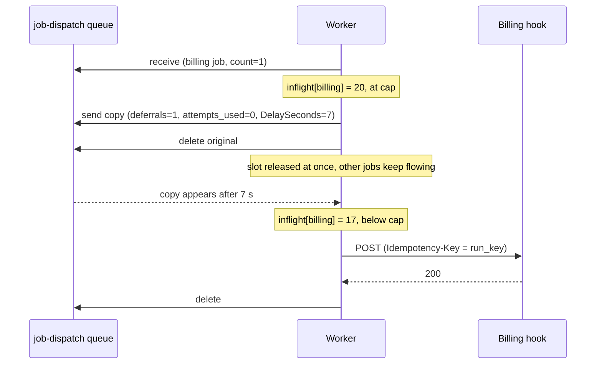

## Current state

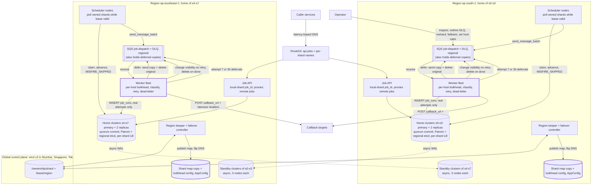

New in V9: the per-host admission check inside workers, the deferral path (a new message copy back into the regional queue), the bulkhead config in AppConfig, and two new fields on messages. The DLQ edges are drawn into the queue boxes because the DLQ lives inside each regional `job-dispatch` box, as in V8.

**Every current flow**

1. **Submit:** unchanged from V8. The API creates a local-region `job_id`, computes the schedule, and inserts into the shard primary after one replica confirms.
2. **Fire:** unchanged from V8. Pollers run for owned shards while the lease is valid. The claim carries the epoch floor, then plan, enqueue, and advance happen on one shard.
3. **Dispatch (changed):**
   1. A worker receives a message and takes a slot.
   2. It reads the callback host and checks `inflight[host]` against its cap.
   3. Under the cap: it increments the counter, POSTs with the idempotency key, logs `job_runs`, deletes the message or retries per V4, then decrements the counter and frees the slot.
   4. At the cap: it sends a copy with a longer delay and incremented `deferrals`, deletes the original, and frees the slot.
4. **Dead-letter (changed):** on attempt 7 as before, and also after 30 deferrals. Both log `DEAD_LETTERED`.
5. **Recover:** unchanged. A dead scheduler, worker, node, or AZ recovers as in V7. A dead worker's in-flight count disappears with it.
6. **Region failover:** unchanged from V8.
7. **Cancel:** unchanged. Routed by `job_id` to the owner shard, proxied if needed.
8. **History:** unchanged. Only real attempts appear.
9. **List by owner:** unchanged. Scatter-gather across 8 shards.
10. **Reshard:** unchanged from V6.
11. **Failback:** unchanged from V8.

## Interview follow-ups

**"Why not just a circuit breaker?"**
A breaker has to see failures before it trips, and during that time every slot can fill with 10-second calls. The bulkhead limits the damage from the first second, with no failure counting at all. The breaker is the complement: once the host is clearly sick, it stops spending even the 20 slots on it. I'd add it next, and it needs the bulkhead as its safety net while it learns.

**"Why per worker instead of a global limit per host?"**
A global limit needs shared state on every job. That is a Redis hop in the hot path, and one more thing that can fail. A local counter costs nothing and needs no coordination. The price is that total concurrency is workers × N, which moves with autoscaling. That is acceptable for protecting our own slots. It is not acceptable for protecting the callee, and I would not claim it is.

## Recap

| Concept | The Insight |
|---------|-------------|
| Slot starvation | A slow callee holds slots 200× longer than a fast one, so it can take about 97% of the fleet from a 13% share of the jobs. |
| Bulkhead | Cap concurrent calls per callback host, so one sick callee floods one compartment, not the whole ship. |
| Local counter | A per-worker cap needs no shared state, and costs the exactness we don't need. |
| Defer by re-sending | Returning a message with visibility changes inflates the receive count, so we send a copy and carry the true attempt count in the body. |
| Bounded patience | Growing, jittered deferral delays and a deferral limit keep the bounce cost low and still surface a dead callee. |
| Not a rate limit | The cap protects our slots from the callee. It does not protect the callee from us. |

**Interview arc:** *"If asked what happens when one callee hangs: a shorter timeout breaks slow callees and autoscaling feeds the sick host, so each worker caps in-flight calls per callback host, re-sends excess messages with growing jittered delay and the true attempt count in the body, and dead-letters after 30 deferrals, which keeps any one host to about 20% of the fleet from the first second."*

## Next

Billing stays sick for 40 minutes. Our bulkhead keeps everyone else safe, but we still spend 400 slots on calls that will time out, and each autoscaled worker adds 20 more. V10 is the per-host circuit breaker: when to open it, how a half-open probe tests recovery, and where its state lives so 20 workers agree.

Say "next" when you're ready.


-----------------------------------------------------------------------------------------------------------------------
-----------------------------------------------------------------------------------------------------------------------
-----------------------------------------------------------------------------------------------------------------------
-----------------------------------------------------------------------------------------------------------------------


# V10: The Circuit Breaker

V9 caps how many slots a sick callee can take. It does nothing about the calls that still go to it. V10 stops sending them.

## Break it

Billing's database locks up at 02:00:05 and stays sick until 02:40.

Our bulkhead is working. Billing is capped at 20 slots per worker. But 20 workers × 20 is still 400 concurrent calls, each hanging for 10 s. That is 40 failed calls per second, aimed at a database that is already drowning.

Meanwhile V4 spends each billing job's retry budget on calls we already know will fail:

- 20,000 billing jobs × 7 attempts is 140,000 doomed calls.
- Backoff ceilings sum to about 20 minutes, with an expected total near 10. So by about 02:12 all 20,000 jobs have exhausted their attempts and sit in the DLQ.
- Billing recovers at 02:40. Nothing retries. An operator redrives 20,000 messages by hand.

The retry budget exists for a job's own problems. A callee outage should not spend it.

## Naive attempts (lighter walk, since this isn't the crux)

1. **Longer retry schedule.** It looked reasonable because the outage is longer than our retries. It keeps the 400-call hammering going for 40 minutes, so we are still piling load on a sick service. We also hold 20% of every worker on calls that all end in a timeout.
2. **An operator sets billing's cap to 0.** The V9 override already exists. It breaks on the human at 02:00, and on remembering to undo it at 02:40. It also breaks on V9's own limit: a capped-out job is dead-lettered after 30 deferrals, about 27 minutes. The outage is 40.
3. **A shared breaker in Redis.** A short dialogue:

> **Meera:** Put each host's breaker state in Redis. All 20 workers agree instantly, and only one probes.
>
> **Arjun:** Every job's hot path now reads Redis. What do we do when Redis is down?
>
> **Meera:** Fail open, I guess.
>
> **Arjun:** Then we have no protection exactly when infrastructure is failing. Fail closed, and nothing fires.

## The mechanism, in plain language

A fuse box trips when the wiring is overloaded. It cuts current before the house burns. After a blackout, nobody flips every switch at once. You reset the main, check one light, then turn appliances back on one at a time.

A circuit breaker does the same for callbacks. It watches recent calls to one host. When most of them fail, it opens, and calls to that host are held back without being tried. After a cooldown, it lets one probe through. If the probe succeeds, it closes and the host's load ramps back up.

Retries answer "this call failed, try again later." The bulkhead answers "this host may use only so much of us." The breaker answers "this host is down, so stop asking."

## Where the state lives

| Option | Agreement | Cost |
|--------|-----------|------|
| Shared in Redis or DynamoDB | Exact. One state, one probe. | A new dependency on every job's hot path. See the dialogue above. |
| Derived from `job_runs` in Postgres | Stale, and the data is spread over 8 shards. | Heavy reads on stores built for writes. |
| **Local per worker** | **Each worker decides alone.** | **Each worker spends one wave of calls learning. Each probes separately.** |

We choose local, and we don't need agreement. The learning cost is one cap's worth of calls per worker. That is the same 10-second wave that V9 already allows. It is bounded and happens once per outage. The probe cost is 20 calls per cooldown instead of 400 concurrent, so it is small. This is the same trade as V9: no shared state, and we give up exactness we don't need.

Local state needs no new storage class. It is a dictionary in each worker's memory.

## Known sub-problem: recovery stampede

The danger is the moment the breaker closes. If every worker goes straight to its full cap, billing sees 400 concurrent calls at once and falls over again. Three established fixes help, and they stack.

1. **Single trial call (half-open).** After the cooldown, exactly one call is allowed.
   ```python
   if state == HALF_OPEN and not probing: probing = True; allow_one()
   ```
2. **Jittered, growing cooldown.** Each failed probe doubles the next wait, and each worker picks a random point in the range, so probes spread out.
   ```python
   open_until = now + uniform(d / 2, d)     # d = min(120, 10 * 2**(trips - 1))
   ```
3. **Slow start.** After a successful probe, the allowed concurrency doubles every 5 seconds until it reaches the V9 cap.
   ```python
   allowed = min(cap, 2 ** int((now - closed_at) / 5))    # 1, 2, 4, 8, 16, cap
   ```

We use all three. Fix 1 gives us a safe test. Fix 2 keeps 20 workers from probing in lockstep. Fix 3 means a recovering service sees concurrency grow gradually, reaching the full 400 only after about 25 seconds. We reject active health pings because we don't know each callee's health endpoint, and a `/health` that returns 200 can lie.

## Solve it

Five rules:

1. **Key by host.** The same key as the V9 bulkhead.
2. **Count host health, not job success.** Timeouts, connection errors, 5xx, 408, 425, and 429 are failures. A 2xx is a success. A permanent 4xx like 404 also counts as a success for the breaker, because the host answered.
3. **Trip on rate.** Open when the last 20 calls hold at least 10 samples and at least 50% failures.
4. **An open breaker defers without charging the job.** The worker re-sends a copy with a delay that matches the remaining open time. It uses no attempt and no deferral count.
5. **Bounded patience, by age.** If a job has been deferred by an open breaker for more than 2 hours, it is dead-lettered. Without a bound, a permanently dead callee would hold messages until SQS retention expires.

In our incident, the first 10-second wave of timeouts trips every worker's breaker at about 02:00:15. After that:

- Billing sees about 20 probes per cooldown instead of 400 concurrent calls. That is roughly 0.2 calls per second instead of 40.
- Billing's 20,000 jobs wait in the queue without losing attempts.
- When billing recovers at 02:40, a probe succeeds, the ramp runs, and the backlog drains.

✅ **What we gained**
- Total doomed calls drop from 140,000 to about 800 over 40 minutes.
- A sick callee gets room to recover instead of a sustained pounding.
- Jobs survive a long outage with their retry budgets intact, instead of landing in the DLQ.
- Slot capacity returns to healthy callees.
- No new store and no new dependency.

⚠️ **What we gave up / new problems**
- Each worker still spends one wave learning, about 20 calls. A freshly autoscaled worker does it again, so 20 new workers can send a second 400-call wave.
- Local state means each worker probes separately. Worst case that is 20 probes per cooldown. A shared breaker would send one.
- Worker restarts forget state, which is safe but repeats the learning cost.
- Breaker state is per host, not per endpoint. One failing endpoint on a busy host can open the breaker for its healthy neighbors. A per-host `enabled: false` override handles hosts like that.
- Jobs for a sick host run very late, up to the 2-hour age cap. V5's misfire policy is evaluated at the scheduler, so it doesn't see this lateness.
- Deferred copies cost about 200 send-and-delete pairs per second at our incident size.
- A crash between receiving a message and re-sending its copy costs one attempt, as in V9.

❌ **Considered and rejected**
- **Longer retry schedule:** keeps the pounding going.
- **Manual cap of 0:** needs a human, and V9's 30-deferral limit dead-letters it anyway.
- **Shared Redis breaker:** a hot-path dependency whose failure modes are both bad.
- **State derived from Postgres:** stale, and heavy reads on shards tuned for writes.
- **Active health pings:** we don't know each callee's health endpoint, and it can be wrong.

## Implement it

### Config (delta to the V9 bulkhead config)

```json
{
  "breaker": {
    "window": 20, "min_calls": 10, "failure_rate": 0.5,
    "open_base_seconds": 10, "open_cap_seconds": 120,
    "ramp_step_seconds": 5, "max_age_seconds": 7200,
    "overrides": { "legacy-erp.internal": { "enabled": false } }
  }
}
```

It lives in the same AppConfig document as the V9 bulkhead config, with the same 5-second cache. The message gains one field: `defer_started_at`, set the first time an open breaker defers it, otherwise `null`.

### Who writes, who reads

| Structure | Who writes | Who reads |
|-----------|-----------|-----------|
| Breaker state per host (in memory) | The worker's handler, after every call. | The same worker's admission check. |
| Breaker config | Operators. | Workers. |
| Deferred copy for an open breaker | The deferring worker, into the regional `job-dispatch`. | Any worker in that region. |
| `defer_started_at` | The first worker to defer the message. | Later workers, for the age check. |
| `job_runs` | Unchanged. Real attempts only. | Unchanged. |
| `breaker_state{host}`, `breaker_deferred` metrics | Workers. | Dashboards and alerts. |

### Breaker class (new, shown once)

```python
class Breaker:
    def __init__(self):
        self.state, self.window = "CLOSED", deque(maxlen=CFG.window)
        self.open_until, self.open_count = 0.0, 0
        self.probing, self.ramp_start = False, None

    def admit(self, now):                       # returns (verdict, seconds_to_wait)
        if self.state == "OPEN":
            if now < self.open_until:
                return "reject", self.open_until - now
            self.state, self.probing = "HALF_OPEN", False
        if self.state == "HALF_OPEN":
            if self.probing:
                return "reject", 5.0
            self.probing = True
            return "probe", 0.0
        return "go", 0.0

    def record(self, now, ok, probe):
        if probe:
            self.probing = False
            if ok:
                self.state, self.ramp_start = "CLOSED", now
                self.window.clear()
            else:
                self._open(now)
        elif self.state == "CLOSED":            # late results from before a trip are ignored
            self.window.append(ok)
            n = len(self.window)
            if n >= CFG.min_calls and self.window.count(False) / n >= CFG.failure_rate:
                self._open(now)

    def _open(self, now):
        self.state, self.ramp_start = "OPEN", None
        self.window.clear()
        self.open_count += 1
        d = min(CFG.open_cap, CFG.open_base * 2 ** (self.open_count - 1))
        self.open_until = now + random.uniform(d / 2, d)

    def allowed(self, now, cap):                # slow start after closing
        if self.ramp_start is None:
            return cap
        c = 2 ** int((now - self.ramp_start) / CFG.ramp_step)    # 1, 2, 4, 8, 16, ...
        if c >= cap:
            self.ramp_start, self.open_count = None, 0           # ramp done: forget past trips
            return cap
        return c
```

`open_count` resets only after the ramp finishes. A host that trips again during its ramp therefore gets a longer cooldown, not a fresh 10 s.

### Worker handler (changes to V9's `handle`)

```python
breakers = defaultdict(Breaker)                  # per worker, per host, in memory

async def handle(m):
    b = json.loads(m["Body"])
    host = urlsplit(b["callback_url"]).netloc.lower()
    rc = int(m["Attributes"]["ApproximateReceiveCount"])
    br, now = breakers[host], time.monotonic()
    verdict, wait = br.admit(now) if breaker_enabled(host) else ("go", 0.0)

    if verdict == "reject":                      # new in V10, checked BEFORE the V9 bulkhead
        await defer_open(m, b, rc, host, wait)
        slots.release(); return

    if verdict == "go" and inflight[host] >= min(cap(host), br.allowed(now, cap(host))):
        await defer(m, b, rc, host)              # V9 bulkhead deferral, unchanged
        slots.release(); return

    inflight[host] += 1
    try:
        n = b.get("attempts_used", 0) + rc
        # ... V4 body: POST, classify into kind: SUCCESS | PERMANENT | RETRYABLE ...
        br.record(time.monotonic(), ok=(kind != "RETRYABLE"), probe=(verdict == "probe"))
        # ... V4 body continues: log_run, delete / retry / dead-letter ...
    finally:
        if verdict == "probe" and br.probing:    # handler died before recording: a failed probe
            br.record(time.monotonic(), ok=False, probe=True)
        inflight[host] -= 1
        slots.release()
```

A probe skips the bulkhead check. It is one call, so it cannot exceed the cap.

### Deferral for an open breaker (new)

```python
async def defer_open(m, b, rc, host, wait):
    started = b.get("defer_started_at") or utcnow_iso()
    real_attempts = b.get("attempts_used", 0) + rc - 1       # this receive was not an attempt

    if (utcnow() - parse_iso(started)).total_seconds() > CFG.breaker.max_age_seconds:
        await log_run(b, real_attempts, None, "DEAD_LETTERED")
        sqs.send_message(QueueUrl=DLQ, MessageBody=m["Body"],
                         MessageAttributes={"last_status": "BREAKER_OPEN", "attempts": str(real_attempts)})
        sqs.delete_message(QueueUrl=Q, ReceiptHandle=m["ReceiptHandle"])
        return

    delay = min(900, int(wait + random.uniform(0, 10)))      # SQS DelaySeconds max is 900
    clone = {**b, "attempts_used": real_attempts, "defer_started_at": started}   # deferrals NOT incremented
    sqs.send_message(QueueUrl=Q, MessageBody=json.dumps(clone), DelaySeconds=delay)   # copy first
    sqs.delete_message(QueueUrl=Q, ReceiptHandle=m["ReceiptHandle"])                  # delete second
    metrics.incr("breaker_deferred", tags={"host": host})
```

The `+ random.uniform(0, 10)` spreads the copies, so 20,000 deferred messages don't all reappear in the same second. Send-then-delete matches V9, so a crash gives a duplicate with the same `run_key`, never a loss.

Alerting: page on `breaker_state{host} == OPEN` for hosts with more than N pending jobs, and on any dead-letter with `last_status = BREAKER_OPEN`. These name the sick callee, which V4 and V9 only hinted at.

### Incident timeline

| Time | Event |
|------|-------|
| 02:00:05 | Billing hangs. Each worker sends up to 20 calls. |
| about 02:00:15 | The first timeouts land. Each worker's window holds 20 failures, so every worker's breaker opens. |
| 02:00:15 to 02:40 | Calls are deferred without charge. Each worker probes after 5 to 120 s cooldowns (growing with each failed probe). About 20 probes arrive per cycle. |
| 02:40 | A probe succeeds. That worker closes and ramps 1, 2, 4, 8, 16, 20 over about 25 s. |
| about 02:43 | The other workers' probes succeed on their own schedules. The 20,000-job backlog drains. No job lost an attempt or reached the DLQ. |

```mermaid
sequenceDiagram
    participant Q as job-dispatch queue
    participant W as Worker (breaker for billing)
    participant T as Billing hook
    W->>T: 20 concurrent calls
    T--xW: all time out at 10 s
    Note over W: window: 20 failures, so OPEN, cooldown 10 s
    W->>Q: receive billing job
    W->>Q: send copy, DelaySeconds about 12, attempts_used unchanged
    W->>Q: delete original
    Note over W: slot free at once
    Note over W: cooldown ends, HALF_OPEN
    W->>T: one probe
    T--xW: timeout, OPEN again, cooldown doubles
    Note over W: 40 minutes later, a probe returns 200
    W->>W: CLOSED, slow start 1, 2, 4, 8, 16, cap
```

## Current state

```mermaid
graph TB
    C[Caller services] -->|latency-based DNS| R53["Route53: api.jobs + per-shard names"]
    R53 --> APIA
    R53 --> APIB
    subgraph RA["Region ap-south-1: home of s0-s3"]
        APIA["Job API<br/>local-shard job_id, proxies remote jobs"]
        SCHA["Scheduler nodes<br/>poll owned shards while lease valid"]
        WA["Worker fleet<br/>per-host breaker + bulkhead, classify, retry, dead-letter"]:::new
        QA[["SQS job-dispatch + DLQ, regional<br/>(holds bulkhead and breaker deferred copies)"]]
        HA[("Home clusters s0-s3: primary + 2 replicas<br/>quorum commit, Patroni + regional etcd, per-shard LB")]
        SBA[("Standby clusters of s4-s7<br/>async, 3 nodes each")]
        KA["Region keeper + failover controller"]
        MAPA[("Shard map + bulkhead + breaker config, AppConfig")]:::new
    end
    subgraph RB["Region ap-southeast-1: home of s4-s7"]
        APIB["Job API<br/>local-shard job_id, proxies remote jobs"]
        SCHB["Scheduler nodes<br/>poll owned shards while lease valid"]
        WB["Worker fleet<br/>per-host breaker + bulkhead, classify, retry, dead-letter"]:::new
        QB[["SQS job-dispatch + DLQ, regional<br/>(holds bulkhead and breaker deferred copies)"]]
        HB[("Home clusters s4-s7: primary + 2 replicas<br/>quorum commit, Patroni + regional etcd, per-shard LB")]
        SBB[("Standby clusters of s0-s3<br/>async, 3 nodes each")]
        KB["Region keeper + failover controller"]
        MAPB[("Shard map + bulkhead + breaker config, AppConfig")]:::new
    end
    subgraph CP["Global control plane: etcd x3 in Mumbai, Singapore, Tokyo witness"]
        ETCD[("/ownership/shard + /lease/region")]
    end
    APIA --> HA
    SCHA -->|claim, advance, MISFIRE_SKIPPED| HA
    SCHA -->|send_message_batch| QA
    QA -->|receive| WA
    WA -->|defer: send copy + delete original| QA
    WA -->|INSERT job_runs, real attempts only| HA
    WA -->|change visibility on retry, delete on done| QA
    WA -->|attempt 7, 30 deferrals, or 2h breaker age| QA
    APIB --> HB
    SCHB -->|claim, advance, MISFIRE_SKIPPED| HB
    SCHB -->|send_message_batch| QB
    QB -->|receive| WB
    WB -->|defer: send copy + delete original| QB
    WB -->|INSERT job_runs, real attempts only| HB
    WB -->|change visibility on retry, delete on done| QB
    WB -->|attempt 7, 30 deferrals, or 2h breaker age| QB
    WA -->|POST callback_url + lateness headers, probes when half-open| T[Callback targets]
    WB -->|POST callback_url + lateness headers, probes when half-open| T
    HA -. "async WAL" .-> SBB
    HB -. "async WAL" .-> SBA
    KA <--> ETCD
    KB <--> ETCD
    KA -->|publish map, flip DNS| MAPA
    KB -->|publish map, flip DNS| MAPB
    OPS[Operator] -->|inspect, redrive DLQ, reshard, failback, set host caps and breaker overrides| QA
    classDef new stroke-width:3px
```

New in V10: the per-host breaker state inside each worker (in memory), the breaker section of the AppConfig document, the `defer_started_at` message field, and the half-open probe path to callbacks.

**Every current flow**

1. **Submit:** unchanged from V8. The API creates a local-region `job_id`, computes the schedule, and inserts into the shard primary after one replica confirms.
2. **Fire:** unchanged from V8. Pollers run for owned shards while the lease is valid. The claim carries the epoch floor, then plan, enqueue, and advance happen on one shard.
3. **Dispatch (changed):**
   1. A worker receives a message and takes a slot.
   2. It asks the host's breaker. If the breaker is open, it sends a delayed copy, deletes the original, and frees the slot. This costs no attempt and no deferral.
   3. If the breaker says go, the V9 bulkhead check runs next, with the cap reduced during slow start. At the cap, it defers as in V9.
   4. Otherwise it POSTs with the idempotency key and classifies the response. It records host health in the breaker, then logs `job_runs` and deletes or retries per V4.
   5. If half-open, exactly one call is sent as a probe. Its result closes or reopens the breaker.
4. **Dead-letter (changed):** on attempt 7, after 30 bulkhead deferrals, or after 2 hours of breaker deferral. All log `DEAD_LETTERED`.
5. **Recover:** unchanged from V7 and V8 for schedulers, nodes, AZs, and regions. A dead worker's breaker state disappears with it, and its replacement relearns.
6. **Region failover:** unchanged from V8.
7. **Cancel:** unchanged. Routed by `job_id` to the owner shard, proxied if needed.
8. **History:** unchanged. Only real attempts appear.
9. **List by owner:** unchanged. Scatter-gather across 8 shards.
10. **Reshard:** unchanged from V6.
11. **Failback:** unchanged from V8.

## Interview follow-ups

**"Each worker has its own breaker. Doesn't that mean 20 probes and 20 learning waves?"**
Yes, and I accept both. The learning wave is one cap's worth of calls per worker, about the same 10 seconds of exposure V9 already allowed. Probes are 20 calls per cooldown, around 0.2 per second against 40 per second before. A shared breaker would shrink both to one, but it puts a store on every job's hot path. Its failure modes are fail-open, which leaves us unprotected during an outage, or fail-closed, which stops all firing. Local state trades a small, bounded cost for no new failure mode.

**"What stops a recovering service from being crushed the moment the breaker closes?"**
Three things stack. Half-open lets one probe through, not a flood. Each failed probe doubles the cooldown, with jitter so workers don't probe in lockstep. After a success, the allowed concurrency doubles every 5 seconds, from 1 up to the cap, so the full 400 calls only return after about 25 seconds. Slow start is what guards the recovery itself.

## Recap

| Concept | The Insight |
|---------|-------------|
| Retry vs. bulkhead vs. breaker | Retry handles one failed call. The bulkhead limits a host's share of us. The breaker stops calling a host that is down. |
| Host health, not job success | A 404 means the host answered, so the breaker counts it healthy. Timeouts, 5xx, and 429 count as failures. |
| Don't charge the job | An open-breaker deferral uses no attempt, so a 40-minute outage can't burn a 10-minute retry budget. |
| Half-open | One probe call tests recovery, and each failed probe doubles the next cooldown. |
| Slow start | Concurrency ramps 1, 2, 4, 8, 16, cap after recovery, so the callee isn't hit with full load at once. |
| Local state | No shared store, at the cost of one learning wave and one probe per worker. |
| Age cap | A permanently dead callee ends in the DLQ after 2 hours instead of holding messages indefinitely. |

**Interview arc:** *"If asked what happens when a callee is down for 40 minutes: retries spend each job's attempts on calls we know will fail, and a bulkhead alone still sends 400 doomed calls at once, so each worker keeps a local per-host breaker that opens on a 50% failure rate, defers jobs without charging attempts, sends one jittered probe per growing cooldown, and ramps concurrency 1, 2, 4, 8, 16 after recovery, so the callee gets about 0.2 probes per second while sick and a gradual return when healthy."*

## Next

At 02:00 an ops dashboard has 3,000 browser tabs open. Each polls `GET /v1/jobs/{id}/runs` every 2 seconds, which is 1,500 reads per second landing on shard primaries in the middle of the burst. V11 is caching: whether this read pattern justifies a cache at all, which layer it belongs in, and whether a CDN is warranted.

Say "next" when you're ready.


-----------------------------------------------------------------------------------------------------------------------
-----------------------------------------------------------------------------------------------------------------------
-----------------------------------------------------------------------------------------------------------------------
-----------------------------------------------------------------------------------------------------------------------


# V11: Caching the Read Path

V10 protected us from a sick callee. V11 deals with a different load: people watching the scheduler. This version is about caching only. I'll also be honest about how much caching is actually needed.

## Break it

Neha is on call for the 02:00 billing run. She opens the ops dashboard, and so do 1,199 teammates on the incident bridge. All of them watch the same job, `send-invoices`.

Another 1,800 tabs watch about 900 other jobs. Every tab polls `GET /v1/jobs/{id}/runs` every 2 seconds.

That is 1,500 reads per second, and 600 of them hit one job. That job lives on shard s2, which is already near its 7,500 writes per second burst.

The chain goes like this:

1. The history query is `SELECT ... FROM job_runs WHERE job_id = ? ORDER BY started_at DESC LIMIT 20`.
2. I gave `job_runs` only a primary key on `run_id` in V0. Nobody noticed, because V0 had a few hundred rows.
3. Now each shard holds about 17M rows. That assumes 14 days of history at about 1.25M rows per day per shard.
4. With no index on `job_id`, each read scans the table. A scan takes about 2 seconds.
5. s2 gets about 710 reads per second. The hot job brings 600 of them, and about 110 are its share of the long tail.
6. Each scan holds a PgBouncer server connection for 2 seconds. A shard has about 100 server connections, so it can finish about 50 scans per second. Reads arrive at 14 times that rate.
7. The scheduler's poller on s2 shares the same pool. Its advance statement waits behind the scans.
8. The 10-second lease from V3 expires before the advance runs. Another poller reclaims the rows and enqueues them again.
9. Tabs time out and retry, which adds more reads.

Dashboards have starved the claim path. That is the V6 failure, caused by readers this time.

## First fix: the index, not a cache

This one is not a caching decision. The query needs an index.

```sql
CREATE INDEX CONCURRENTLY idx_runs_job ON job_runs (job_id, started_at DESC);
```

After that, a read is an index range scan of 20 rows. It takes about 0.3 ms. At 710 reads per second, s2 spends about 0.2 of one core on them. The melt is gone.

## Is a cache still justified?

Barely. This is the least-justified mechanism in the whole design, and in an interview I would say so.

CPU is not the reason. Three smaller reasons remain:

- **Hot key.** One incident puts 600 reads per second on one shard. A bigger bridge of 12,000 tabs would put 6,000 per second there. Load follows how many people are watching, not how many jobs exist.
- **Fan-out.** `GET /v1/jobs?owner=...` queries all 8 shards. A tab polling the list costs 8 reads, so list polling multiplies the load.
- **Cross-region proxy.** Reads for a job owned by the other region are proxied (V8). 600 per second at about 60 ms each holds about 36 cross-region calls in flight, for data nobody needs fresher than a few seconds.

So we add a small cache, because it is nearly free. We keep it small, and we say what it does not do.

## The mechanism, in plain language

Think of the school office. A hundred people want to know whether the 02:00 bell rang. Each one walks to the filing room, and the clerk digs through the folders every time.

The clerk could instead copy the answer onto a whiteboard in the hallway and refresh it every few seconds. People read the board.

That is a cache. It trades a small amount of freshness for far fewer trips to the filing room. It only works when many people ask the same question, and when the answer can be a few seconds old.

## Where to cache

| Layer | What it would hold | Verdict |
|-------|-------------------|---------|
| Client (`ETag`, 304) | Response bodies | Skip. It saves bandwidth, but the database read still happens on every poll. |
| CDN | Same | No. Responses are per-job and authenticated, and callers are internal. Freshness is 3 seconds, so an edge would need per-caller keys and purges and would buy nothing. |
| **API in-process** | **Final JSON for hot reads** | **Yes. No new dependency, and cache loss costs nothing but a cold start.** |
| Shared Redis | Same | No. It saves about 3 loads per second on the hot key, which is nothing. It adds a hot-path dependency with the same fail-open or fail-closed problem as V10. |
| Postgres buffer cache | Pages | Already there. It helps once the index exists. |

## What is cached, and for how long

| Key | Value | TTL (±20% jitter) |
|-----|-------|-------------------|
| `runs:v1:{job_id}:{limit}` | Last N runs as JSON | 3 s |
| `job:v1:{job_id}` | Job row | 5 s |
| `list:v1:{owner}:{cursor}:{limit}` | One page of owner listing, already merged from 8 shards | 5 s |

Why TTL only, with no event-based invalidation:

- `job_runs` is append-only. The cached list changes only when a new row arrives.
- Dashboards already poll every 2 seconds, so they tolerate staleness of a few seconds.
- Event invalidation would need a pub/sub channel from workers to every API instance. That is a new moving part for a display problem.

Staleness only matters in three flows:

- **After cancel.** Another instance may still show `ACTIVE` for up to 6 seconds. The scheduler never reads this cache, because the claim query checks `status` in Postgres. A cancelled job is not fired because of the database, not the cache.
- **After create.** A `GET` right after `POST` must not return a cached 404. We never cache misses.
- **Strict read-after-write.** A caller who needs it sends `Cache-Control: no-cache` and bypasses the cache.

## Known sub-problem: stampede

When a hot entry expires, many requests miss at once. All of them go to the shard.

With a healthy shard this is mild: 60 requests per second per instance at 5 ms load time means about 0.3 concurrent misses. With a stalled shard it is severe. At a 500 ms stall, 60 × 0.5 = 30 requests per instance pile onto the shard. That is 300 across 10 instances, aimed at the shard that is already struggling.

| Fix | Mechanism | Sketch |
|-----|-----------|--------|
| **Single-flight** | The first miss loads. Later misses wait for that load. | `task = inflight.get(key) or start_load(key)` |
| **TTL jitter** | Spread expiry across keys and instances. | `ttl * random.uniform(0.8, 1.2)` |
| Stale-while-revalidate | Serve the expired value while one task refreshes in the background. | `if age < ttl + 1: serve_stale(); refresh_async()` |

We use the first two. Single-flight turns 300 concurrent loads into 10, one per instance. We skip stale-while-revalidate because it adds a background task and more staleness for a problem the first two already solve.

## Solve it

Five rules:

1. **Add the index** on every shard.
2. **Cache in the API process.** Each instance keeps up to 20,000 entries in an LRU map. At about 3 KB each, that is about 60 MB.
3. **TTL jitter and single-flight** on every load.
4. **Never cache a miss or an error.** A failed load propagates to everyone waiting on it. V7's `503` with `Retry-After` still applies.
5. **Only the API reads the cache.** Schedulers and workers never touch it.

We assume 10 API instances per region. Load balancing stays round-robin. Sticky routing by `job_id` would raise the hit rate on the long tail, but it adds routing logic for reads that are already cheap.

Here is what the cache really does for Neha's incident:

| | After the index, no cache | After the cache |
|---|---|---|
| Hot job reads on s2 | 600/s | about 3/s |
| All reads on s2 | about 710/s | about 115/s |
| All reads, all shards | 1,500/s | about 900/s |

The cache flattens the hot spot. It does not shrink total volume much. A job watched by one tab polls every 2 seconds, and the TTL is about 3 seconds. Round-robin sends consecutive polls to different instances, whose caches are mostly cold for that key. The long tail gets close to no hits, and that is fine because those reads cost 0.3 ms.

✅ **What we gained**
- The hot shard's read load drops about 6x, and it stops growing with the size of the incident.
- Fan-out reads and cross-region proxy calls fall for hot keys.
- Stalled shards see 10 loads per hot key instead of 300.
- No new dependency.

⚠️ **What we gave up / new problems**
- Reads can be stale: up to about 3.6 seconds for runs and 6 seconds for job and list.
- The long tail gets almost no benefit.
- Every `job_runs` insert now maintains one more index, which adds cost on the 02:00 write path.
- Each instance caches separately, so a hot key loads up to 10 times per TTL.
- A cold start after a deploy sends one wave of misses.
- The API and the scheduler still share one PgBouncer pool. A separate pool for the API is cheap hygiene, deferred.

❌ **Considered and rejected**
- **Redis:** it saves almost nothing on a key already down to 3 loads per second, and adds a hot-path dependency.
- **CDN:** internal, authenticated, per-job, 3-second freshness.
- **Read replicas:** rejected in V7, and they would show stale runs right after a fire.
- **Rate-limiting or slowing the dashboard:** a good courtesy, but it does not fix the scans.
- **Caching on the scheduler path:** correctness must come from Postgres.

## Implement it

### Cache class (shown once)

```python
class ReadCache:
    def __init__(self, max_entries=20_000):
        self.lru, self.inflight, self.max = OrderedDict(), {}, max_entries

    async def get(self, key, ttl, loader):
        e = self.lru.get(key)
        if e and e[0] > time.monotonic():
            self.lru.move_to_end(key)
            return e[1], "HIT"
        task = self.inflight.get(key)
        if task is None:                                   # first miss starts the load
            task = asyncio.create_task(self._fill(key, ttl, loader))
            self.inflight[key] = task
        return await asyncio.shield(task), "MISS"           # later misses join it

    async def _fill(self, key, ttl, loader):
        try:
            v = await loader()
            if v is not None:                               # never cache a miss (404)
                self.lru[key] = (time.monotonic() + ttl * random.uniform(0.8, 1.2), v)
                while len(self.lru) > self.max:
                    self.lru.popitem(last=False)
            return v
        finally:
            self.inflight.pop(key, None)

    def evict(self, key):
        self.lru.pop(key, None)
```

`shield` keeps one client disconnecting from cancelling the shared load for everyone else.

### Handlers (changed)

```python
cache = ReadCache()

@app.get("/v1/jobs/{job_id}/runs")
async def runs(job_id: UUID, request: Request, limit: int = 20):
    loader = lambda: load_runs(job_id, limit)      # V8 routing: local shard, or proxy to owner region
    if "no-cache" in request.headers.get("Cache-Control", ""):
        return json_response(await loader(), headers={"X-Cache": "BYPASS"})
    body, status = await cache.get(f"runs:v1:{job_id}:{limit}", 3.0, loader)
    return json_response(body, headers={"X-Cache": status})

# GET /v1/jobs/{id}      -> same pattern, key job:v1:{id}, ttl 5.0
# GET /v1/jobs?owner=... -> same pattern, key list:v1:{owner}:{cursor}:{limit}, ttl 5.0
#                           loader = the V6 scatter-gather across 8 shards

@app.delete("/v1/jobs/{job_id}")
async def cancel(job_id: UUID):
    await set_cancelled(job_id)                     # unchanged: UPDATE ... SET status='CANCELLED'
    cache.evict(f"job:v1:{job_id}")                 # this instance only; others expire within 6 s
    return Response(status_code=204)
```

### History query (the loader's SQL)

```sql
SELECT run_id, scheduled_for, started_at, http_status, outcome, attempt
FROM job_runs
WHERE job_id = :id
ORDER BY started_at DESC
LIMIT :limit;       -- served by idx_runs_job
```

### Who writes, who reads

| Structure | Lives in | Who writes | Who reads |
|-----------|----------|-----------|-----------|
| `idx_runs_job` | Each shard's primary | Workers and schedulers, implicitly, on every `job_runs` insert | The history query |
| Read cache | Each API instance's memory | That instance's GET handlers, on a miss. Its DELETE handler, by evicting. | That instance's GET handlers |
| `X-Cache` header, hit-ratio and single-flight-join metrics | Response and metrics pipeline | API | Dashboards, and clients who want to know |

Schedulers and workers never read the cache.

### Observability

We watch three signals:

- Hit ratio per key type.
- Read QPS per shard primary.
- Single-flight joins per second, which spikes when a shard slows down.

Alert if shard read QPS passes a set threshold during the burst.

```mermaid
sequenceDiagram
    participant T as Dashboard tab
    participant A as API instance
    participant C as In-process cache
    participant S as Shard s2 primary
    T->>A: GET /v1/jobs/9f3c/runs
    A->>C: get(runs:v1:9f3c:20)
    alt fresh entry (hit)
        C-->>A: cached rows
    else miss, no load running
        C->>S: SELECT ... ORDER BY started_at DESC LIMIT 20
        S-->>C: rows (via idx_runs_job)
        Note over C: store with TTL 3 s x random(0.8 to 1.2)
    else miss, load already running
        Note over C: wait for the same load (single-flight)
    end
    A-->>T: 200 with X-Cache
```

## Current state

```mermaid
graph TB
    C[Caller services and ops dashboards] -->|latency-based DNS| R53["Route53: api.jobs + per-shard names"]
    R53 --> APIA
    R53 --> APIB
    APIA <-.->|proxy remote-owner requests| APIB
    subgraph RA["Region ap-south-1: home of s0-s3"]
        APIA["Job API x10<br/>in-process read cache + single-flight<br/>local-shard job_id, proxies remote jobs"]:::new
        SCHA["Scheduler nodes<br/>poll owned shards while lease valid"]
        WA["Worker fleet<br/>per-host breaker + bulkhead, classify, retry, dead-letter"]
        QA[["SQS job-dispatch + DLQ, regional<br/>(holds bulkhead and breaker deferred copies)"]]
        HA[("Home clusters s0-s3: primary + 2 replicas<br/>jobs + job_runs with idx_runs_job<br/>quorum commit, Patroni + regional etcd, per-shard LB")]:::new
        SBA[("Standby clusters of s4-s7<br/>async, 3 nodes each")]
        KA["Region keeper + failover controller"]
        MAPA[("Shard map + bulkhead + breaker config, AppConfig")]
    end
    subgraph RB["Region ap-southeast-1: home of s4-s7"]
        APIB["Job API x10<br/>in-process read cache + single-flight<br/>local-shard job_id, proxies remote jobs"]:::new
        SCHB["Scheduler nodes<br/>poll owned shards while lease valid"]
        WB["Worker fleet<br/>per-host breaker + bulkhead, classify, retry, dead-letter"]
        QB[["SQS job-dispatch + DLQ, regional<br/>(holds bulkhead and breaker deferred copies)"]]
        HB[("Home clusters s4-s7: primary + 2 replicas<br/>jobs + job_runs with idx_runs_job<br/>quorum commit, Patroni + regional etcd, per-shard LB")]:::new
        SBB[("Standby clusters of s0-s3<br/>async, 3 nodes each")]
        KB["Region keeper + failover controller"]
        MAPB[("Shard map + bulkhead + breaker config, AppConfig")]
    end
    subgraph CP["Global control plane: etcd x3 in Mumbai, Singapore, Tokyo witness"]
        ETCD[("/ownership/shard + /lease/region")]
    end
    APIA -->|cache miss: read or write shard primary| HA
    SCHA -->|claim, advance, MISFIRE_SKIPPED| HA
    SCHA -->|send_message_batch| QA
    QA -->|receive| WA
    WA -->|defer: send copy + delete original| QA
    WA -->|INSERT job_runs, real attempts only| HA
    WA -->|change visibility on retry, delete on done| QA
    WA -->|attempt 7, 30 deferrals, or 2h breaker age| QA
    APIB -->|cache miss: read or write shard primary| HB
    SCHB -->|claim, advance, MISFIRE_SKIPPED| HB
    SCHB -->|send_message_batch| QB
    QB -->|receive| WB
    WB -->|defer: send copy + delete original| QB
    WB -->|INSERT job_runs, real attempts only| HB
    WB -->|change visibility on retry, delete on done| QB
    WB -->|attempt 7, 30 deferrals, or 2h breaker age| QB
    WA -->|POST callback_url + lateness headers, probes when half-open| T[Callback targets]
    WB -->|POST callback_url + lateness headers, probes when half-open| T
    HA -. "async WAL" .-> SBB
    HB -. "async WAL" .-> SBA
    KA <--> ETCD
    KB <--> ETCD
    KA -->|publish map, flip DNS| MAPA
    KB -->|publish map, flip DNS| MAPB
    OPS[Operator] -->|inspect, redrive DLQ, reshard, failback, set host caps and breaker overrides| QA
    classDef new stroke-width:3px
```

New in V11: the in-process read cache in every API instance, the `idx_runs_job` index on each shard's `job_runs`, and the proxy edge between the two API fleets, which earlier diagrams left implicit.

**Every current flow**

1. **Submit:** unchanged from V8.
2. **Fire:** unchanged from V8.
3. **Dispatch:** unchanged from V10.
4. **Dead-letter:** unchanged from V10.
5. **Recover:** unchanged from V10. The cache is not involved in recovery.
6. **Region failover:** unchanged from V8. Cached entries age out within their TTL, and a miss during the `ADOPTING` window returns the V8 `503`.
7. **Cancel (changed):** the API routes by `job_id` to the owner shard and sets `status = 'CANCELLED'`. It evicts that job's entry on the handling instance only. Other instances show the old state for up to 6 seconds. The scheduler still enforces the cancel in Postgres.
8. **Read job status (changed):** the API checks its cache for `job:v1:{id}`. On a miss it joins or starts a single load against the owner shard, or proxies to the owner region. It never caches a 404.
9. **History (changed):** same pattern with `runs:v1:{id}:{limit}`, 3-second TTL. The query now uses `idx_runs_job`.
10. **List by owner (changed):** the first miss on a key runs the 8-shard scatter-gather, and the merged page is cached for 5 seconds.
11. **Reshard:** unchanged from V6.
12. **Failback:** unchanged from V8.

## Interview follow-ups

**"Why not a shared Redis cache?"**
The only thing Redis improves over per-instance caches is the number of loads on a hot key. We are already down to about 3 per second on a key that was 600 per second. Redis adds a dependency in the read path, and its failure modes are both bad. Open means a stampede onto the shard, and closed means dashboards go dark. I would reach for it only if the API fleet grew large enough that per-instance duplicate loads mattered.

**"Can a stale cache make you fire a cancelled job?"**
No. The cache is read only by the API's GET handlers. The scheduler's claim query checks `status = 'ACTIVE'` in Postgres, so the database enforces the cancel. A stale cache can show a human `ACTIVE` for up to 6 seconds after a cancel. It cannot cause a fire. Callers who need read-after-write send `Cache-Control: no-cache`.

## Recap

| Concept | The Insight |
|---------|-------------|
| Index first | The melt came from a missing index that forced 2-second scans. No cache would have fixed it, because every miss still scans. |
| Is a cache needed? | After the index, reads cost 0.3 ms, so CPU does not justify one. We cache for hot-key spikes, list fan-out, and cross-region proxy cost. |
| Layer choice | In-process at the API. A CDN buys nothing for internal, per-job, 3-second-fresh data, and Redis saves about 3 loads per second. |
| TTL-only invalidation | Append-only runs and display-grade freshness need no event invalidation. Cancel evicts locally. |
| Single-flight | A stalled shard sees 10 loads per hot key instead of 300, exactly when extra load hurts most. |
| What it does not do | The long tail sees almost no hits. The cache flattens the hot spot about 6x and cuts total reads only about 40%. |

**Interview arc:** *"If asked how you'd cache job status for dashboards: the real melt was a missing `(job_id, started_at)` index forcing 2-second scans, and once that's fixed reads cost 0.3 ms, so we add only a small in-process TTL cache with single-flight at the API, which cuts a 600-per-second hot key to about 3, with no Redis or CDN because freshness equals the polling interval and the scheduler never reads the cache."*

## Next

At 02:04 Karan's `* * * * *` metering job is still running its 02:03 window because the callee is slow. The 02:04 fire starts a second run of the same job. Both runs close the same usage window, and the customer is billed twice. We have deferred this overlap problem since V4 and again in V5. V12 is the per-job overlap policy: allow, forbid, or queue concurrent runs, and where that rule is enforced.

Say "next" when you're ready.


-----------------------------------------------------------------------------------------------------------------------
-----------------------------------------------------------------------------------------------------------------------
-----------------------------------------------------------------------------------------------------------------------
-----------------------------------------------------------------------------------------------------------------------


# V12: Overlap Policy, or When the Last Run Is Still Running

V11 closed the read path. V12 closes a gap I have deferred since V4: what happens when a job's previous run is still going when its next fire comes due. This version covers per-job overlap only.

## Break it

Karan's `close-window` job runs every minute (`* * * * *`). Each run closes the usage window for about 500 customer records. It normally takes 20 seconds.

At 02:03:00 the metering database hiccups, and the 02:03 run takes 90 seconds.

Here is what our system sees. The callee answers `202 Accepted` in 50 ms and keeps working in the background. Our worker logs the run as `SUCCESS` at 02:03:00.05 and deletes the message. From our side, the run lasted 50 ms.

At 02:04:00 the scheduler fires the job again. The 02:03 run is still going until 02:04:30. Both runs read the same open records and both bill them.

- 500 records are double-billed per job.
- 200 metering jobs share this callee, so that is 100,000 double-billed records in one minute.
- Two runs now compete for the slow database, so each gets slower. That makes a third overlap more likely.

The `Idempotency-Key` doesn't help. `9f3c:02:03:00Z` and `9f3c:02:04:00Z` look like two legitimate runs.

The root cause is that our system has no concept of "a run is still in progress." `job_runs` records delivery, not completion. V3 admitted this when it said `COMPLETED` means handed to the queue.

## Naive attempts

### Attempt 1: make every callee guard itself

Each callee takes a lock before doing work. It looked reasonable because the callee knows best what must not overlap.

It breaks because we have thousands of callees and we don't own them. Each one has to build a lock with an expiry. The idempotency key can't tell them two runs conflict, because the keys differ. The platform's promise would depend on every team getting it right.

### Attempt 2: hold the HTTP call open for the whole run

The worker's POST returns only when the run finishes. Then "request done" means "run done."

It breaks on slots. This is V9's math again: a 10-minute run holds a worker slot and a connection 12,000 times longer than a 50 ms call. Load balancers also cut idle connections around 60 seconds. If a worker dies mid-call, we lose our only record of the run while the callee keeps going.

### Attempt 3: check `job_runs` before firing

> **Meera:** Before firing, look at the job's last row in `job_runs`. If it's recent, skip.
>
> **Arjun:** The 02:03 row says `SUCCESS`, written at 02:03:00.05.
>
> **Meera:** Right, so it looks finished.
>
> **Arjun:** It means delivered. The callee is still working, and nothing tells us otherwise.

Guessing from run history can't work. We need an explicit signal that a run has ended.

## The mechanism, in plain language

Think of a single-lane bridge with a guard at each end. The guard at the entrance lets a car on only after the guard at the far end confirms the previous car has left.

For each job we keep a **run slot**. It is taken when a run is dispatched and released when that run ends. The **overlap policy** says what to do when a new fire arrives and the slot is taken:

| Policy | New fire while the slot is taken | Fits |
|--------|----------------------------------|------|
| `ALLOW` (default) | Fire anyway. | Reminders and independent runs. Same as today. |
| `FORBID` | Drop it, and record the drop. | Refreshers and syncs, where the next run supersedes the missed one. |
| `QUEUE` | Hold it until the slot frees, then let V5's misfire policy decide. | Metering and billing windows, where every window must run, one at a time. |

A held fire is simply a late fire. We already have rules for those.

## The signal: how do we learn a run has ended?

| Option | Verdict |
|--------|---------|
| Hold the call open (Attempt 2) | Rejected: slot starvation. |
| We poll a status endpoint on the callee | Rejected: needs a contract with every callee. |
| **Callee answers `202`, then reports `POST /v1/runs/{run_key}/complete`** | Chosen. A callee that answers `200` is done on the spot. |

The `run_key` is the same `job_id:scheduled_for` the callee already receives as `Idempotency-Key`. It now doubles as the run's identity.

## Where the slot lives

| Option | Verdict |
|--------|---------|
| Distributed lock (Redis, ZooKeeper) | Rejected: the decision must be atomic with the claim, and this splits it across two stores. It also adds a hot-path dependency. |
| A separate `job_locks` table | Rejected: it is the same shard, with an extra row and a second write per fire. |
| **Columns on the `jobs` row** | Chosen. The claim already row-locks that row, so check and decision are atomic. No new store. |

## Known sub-problem: runs that never end, and late reports

A callee can crash and never call `complete`. A callee can also report after a newer run has started. There are three established fixes:

| Fix | Mechanism | Fits here? |
|-----|-----------|-----------|
| Lease | The slot has an expiry, so nobody is blocked forever. `active_until = now() + max_run_seconds` | Yes. This is V2's idea applied to runs. |
| Fencing by run identity | A release only works if it names the current run. `WHERE active_run_key = :run_key` | Yes. A late report for an old run frees nothing. |
| Callee heartbeats | A callee extends the lease while it works. | Not now. Callers set `max_run_seconds` above their p99 instead. |

The lease has a cost. If a run outlasts its lease, the slot frees, and a new run can overlap it. That is the honest edge of any lease.

## Solve it

Six rules:

1. **Opt in per job.** `overlap_policy` is `ALLOW`, `FORBID`, or `QUEUE`, and applies to CRON jobs only. `ALLOW` jobs pay nothing.
2. **The scheduler decides.** It checks the slot during planning, using the row the claim just locked.
3. **Dispatch takes the slot.** In the same advance transaction that enqueues the fire, the scheduler sets `active_run_key` and a safety lease. A run counts as active from enqueue, not from the first POST. That way a run deferred by an open breaker (V10) still blocks the next fire, so deferred copies don't pile up and then fire together.
4. **Workers and the completion API release it.** Release is always `WHERE active_run_key = :run_key`.
5. **`FORBID` drops the fire and records it.** `QUEUE` makes the job unclaimable until the slot frees, then V5 decides.
6. **`QUEUE` catch-up is one at a time.** The V5 catch-up cap becomes 1, and the within-grace shortcut doesn't apply when two or more fires are due.

Here is the same slow minute under each policy:

| Time | `FORBID` (cache refresher) | `QUEUE` + `FIRE_ALL` (Karan's metering) |
|------|----------------------------|----------------------------------------|
| 02:03:00 | Fires, takes the slot. | Fires, takes the slot. |
| 02:04:00 | Slot taken, so dropped and logged as `OVERLAP_SKIPPED`. | Slot taken, so the job is not claimable. The 02:04 fire is held. |
| 02:04:30 | Callee reports completion. Slot freed. | Callee reports completion. Slot freed. |
| 02:04:31 | Nothing due. | Claimed. It is 31 s late, within grace, so it fires 02:04 on time. |
| 02:05:00 | Fires normally. | Fires normally, because the 02:04 run finished in 20 s. |

Double billing is gone, and `QUEUE` self-heals without a backlog.

✅ **What we gained**
- Runs of a `FORBID` or `QUEUE` job never overlap, without the callee building a lock.
- Check and decision are atomic with the claim. No new store and no new dependency.
- `QUEUE` reuses V5's grace and misfire policies instead of adding a second backlog mechanism.
- `ALLOW` jobs see no extra writes or reads.
- `job_runs` now distinguishes delivered (`ACCEPTED`) from finished (`COMPLETED`).

⚠️ **What we gave up / new problems**
- Callees must opt in with `202` plus `complete`. A callee that answers `202` and never reports blocks its job until `max_run_seconds` (default 300 s).
- Tracked jobs cost about 1 extra write per fire. If 5% of jobs adopt it, that is about 5% more writes at the burst.
- A `FORBID` job whose runs take 90 s on a 60 s schedule runs about every other minute. That is right for refreshers and wrong for metering, which is why `QUEUE` exists.
- A `QUEUE` job whose callee is permanently slower than its schedule falls behind forever. `FIRE_ALL` makes that backlog unbounded. Real fixes are a faster callee, or batching windows using `X-Missed-Count`.
- A lease shorter than a real run lets an overlap through. Callers must set `max_run_seconds` with care.
- Held `QUEUE` rows sit at the front of the due index. They are few, so the scan skips them cheaply. A partial index would be the fix if adoption grew.
- A cancelled job's running callee is not stopped.
- Overlap is per job. Two different jobs that write the same table can still collide. Concurrency groups are deferred.
- An operator redrive from the DLQ (V4) can fire a run that overlaps a newer one. Redrive is a manual act and carries that risk.

❌ **Considered and rejected**
- **Callee-side locks:** we don't own the callees.
- **Holding the call open:** slot starvation, connection limits, and lost state on a worker crash.
- **Redis or ZooKeeper lock:** splits the decision from the claim and adds a hot-path dependency.
- **Guessing from `job_runs` history:** a `SUCCESS` row means delivered, not done.
- **Default `FORBID`:** it would silently start dropping fires for every existing job. Opt-in avoids that.

## Implement it

### API

```http
POST /v1/jobs
{
  "schedule_type": "CRON",
  "cron_expr": "* * * * *",
  "callback_url": "https://metering.internal/hooks/close-window",
  "misfire_policy": "FIRE_ALL",
  "misfire_grace_seconds": 300,
  "overlap_policy": "QUEUE",
  "max_run_seconds": 600
}
```

The API rejects an `overlap_policy` other than `ALLOW` on one-time jobs, `FORBID` combined with `FIRE_ALL` (use `QUEUE` for that), and `max_run_seconds` outside 1 to 86,400. It routes a request by `job_id`, as it does for cancel.

```http
POST /v1/runs/9f3c...:2026-11-03T02:03:00Z/complete
{"outcome": "SUCCESS", "detail": "closed 500 records"}
-> 204
```

The call uses the same service credentials as submit, and must come from the job's owner.

### Schema delta (every shard)

```sql
ALTER TABLE jobs
  ADD COLUMN overlap_policy  TEXT NOT NULL DEFAULT 'ALLOW',   -- ALLOW | FORBID | QUEUE
  ADD COLUMN max_run_seconds INT  NOT NULL DEFAULT 300,
  ADD COLUMN active_run_key  TEXT,
  ADD COLUMN active_until    TIMESTAMPTZ;

-- job_runs outcomes gain: ACCEPTED | COMPLETED | RUN_FAILED | OVERLAP_SKIPPED | RUN_TIMEOUT
CREATE UNIQUE INDEX uq_runs_completion ON job_runs (job_id, scheduled_for, outcome)
  WHERE outcome IN ('COMPLETED', 'RUN_FAILED');
```

The unique index makes completion reports idempotent. The `jobs` columns travel with the row during a V6 reshard.

| Structure | Who writes | Who reads |
|-----------|-----------|-----------|
| `overlap_policy`, `max_run_seconds` | API (submit, update). | Scheduler (claim returns them). Workers (lease extend). |
| `active_run_key`, `active_until` | Scheduler (set on advance, clear a stale one). Workers (release or extend). Completion API (release). Adoption sweep (clear). | Scheduler claim and plan. |
| `job_runs` `ACCEPTED` | Workers. | API history, operators. |
| `job_runs` `COMPLETED`, `RUN_FAILED` | Completion API. | API history, operators. |
| `job_runs` `OVERLAP_SKIPPED`, `RUN_TIMEOUT` | Scheduler. | API history, operators. |
| Message field `tracked` | Scheduler. | Workers. |

### Claim (two changes)

```sql
-- V2 to V6 claim, plus this predicate:
  AND NOT (overlap_policy = 'QUEUE' AND active_run_key IS NOT NULL AND active_until > now())
-- RETURNING adds: overlap_policy, max_run_seconds, active_run_key, active_until
```

### Plan (wraps V5's `plan`)

```python
def plan(j, now):
    active = j.active_run_key is not None and j.active_until > now
    stale  = j.active_run_key is not None and not active          # lease expired, no report ever came
    catchup = 1 if j.overlap_policy == "QUEUE" else CATCHUP

    p = plan_v5(j, now, catchup=catchup)       # V5 plan, with the catch-up cap passed in
    p.stale = stale

    if j.overlap_policy == "FORBID" and active and p.fires:
        return Plan(fires=[], skipped=p.skipped + len(p.fires), missed=p.missed,
                    nxt=p.nxt, done=p.done, overlap=True, stale=False)
    if j.overlap_policy == "FORBID":
        p.fires = p.fires[:1]
    return p
```

One change inside `plan_v5`, for `QUEUE` only:

```python
backlog = (j.overlap_policy == "QUEUE"
           and croniter(j.cron_expr, due).get_next(datetime) <= now)   # two or more fires are due
if not backlog and (now - due).total_seconds() <= j.misfire_grace_seconds:
    ...   # V5 on-time path, unchanged
```

The shortcut jumps to the next future time. Without the `backlog` check it would silently drop held windows, which is exactly what `QUEUE` must not do.

### Scheduler loop (changes to V5/V6)

```python
tracked = lambda j: j.overlap_policy != "ALLOW"

msgs = [to_msg(j, t, late_by=..., missed=p.missed, tracked=tracked(j))
        for j, p in plans for t in p.fires]
# ... send and todo as in V5 ...

with db.transaction():
    updated = db.query(ADVANCE_SQL, ...)     # now also takes :set_keys and :clears, below
    for j, p in todo:
        if j.job_id not in updated:
            continue
        if p.skipped:
            label = "OVERLAP_SKIPPED" if p.overlap else "MISFIRE_SKIPPED"
            db.execute(SKIP_ROW_SQL, label, j.job_id, j.next_fire_at, j.claim_token, p.skipped)
        if p.stale:
            db.execute(TIMEOUT_ROW_SQL, "RUN_TIMEOUT", j.job_id, j.active_run_key)
```

`set_key` is `f"{j.job_id}:{p.fires[-1].isoformat()}"` for tracked jobs that fired, otherwise null. `clear` is `p.stale`.

### Advance (V5's statement, plus the slot)

```sql
UPDATE jobs j
SET next_fire_at = COALESCE(v.nxt, j.next_fire_at),
    status = CASE WHEN v.done THEN 'COMPLETED' ELSE j.status END,
    active_run_key = CASE WHEN v.set_key IS NOT NULL THEN v.set_key
                          WHEN v.clr THEN NULL ELSE j.active_run_key END,
    active_until   = CASE WHEN v.set_key IS NOT NULL
                          THEN now() + interval '2 hours' + make_interval(secs => j.max_run_seconds)
                          WHEN v.clr THEN NULL ELSE j.active_until END,
    claimed_by = NULL, lease_expires_at = NULL
FROM unnest(:ids::uuid[], :tokens::bigint[], :nxts::timestamptz[], :dones::bool[],
            :set_keys::text[], :clrs::bool[]) AS v(job_id, tok, nxt, done, set_key, clr)
WHERE j.job_id = v.job_id AND j.claim_token = v.tok
RETURNING j.job_id;
```

The safety lease at enqueue is 2 hours plus `max_run_seconds`. That covers the worst time a message can spend in our own pipeline: V10's 2-hour age cap, with V4 retries and V9 deferrals inside it. Workers shorten it once the run really starts. This lease is only a net. Normal release comes from a worker or the callee.

### Worker (changes to V4/V9/V10 handlers)

```python
async def finish(b, n, code, outcome, *, release=False, extend=False):
    async with shard_for(b["bucket"]).transaction() as db:        # one transaction, one shard
        await db.execute(INSERT_RUN_SQL, ...)                     # the V4 log_run insert
        if b.get("tracked"):
            if release: await db.execute(RELEASE_SQL, id=b["job_id"], key=b["run_key"])
            if extend:  await db.execute(EXTEND_SQL,  id=b["job_id"], key=b["run_key"])
```

| Callee answer | Worker action |
|---------------|--------------|
| `200` | `finish(..., "SUCCESS", release=True)` |
| `202` and tracked | `finish(..., "ACCEPTED", extend=True)`, then delete the message. The slot stays taken. |
| `202` and not tracked | `finish(..., "SUCCESS")`, as in V4. |
| Permanent failure | `finish(..., "FAILED_PERMANENT", release=True)` |
| Retryable | V4 retry. The slot stays taken, because a retry is the same run. |
| Dead-lettered (V4 attempt 7, V9 deferral limit, V10 age cap) | `finish(..., "DEAD_LETTERED", release=True)` |

Release and the log row share one transaction, so a worker can't log a finished run and fail to free the slot. If the transaction fails, the message is not deleted and reappears (V7 behavior).

```sql
-- RELEASE_SQL: free the slot only if it is still ours
UPDATE jobs SET active_run_key = NULL, active_until = NULL
WHERE job_id = :id AND active_run_key = :key;

-- EXTEND_SQL: the run has really started, so shorten the net to max_run_seconds from now
UPDATE jobs SET active_until = now() + make_interval(secs => max_run_seconds)
WHERE job_id = :id AND active_run_key = :key;
```

### Completion endpoint (new, in the Job API)

```python
@app.post("/v1/runs/{run_key}/complete")
async def complete(run_key: str, body: Completion):
    job_id, scheduled_for = run_key.split(":", 1)            # a UUID has no colons, so split once
    outcome = "COMPLETED" if body.outcome == "SUCCESS" else "RUN_FAILED"
    async with shard_for(bucket_of(UUID(job_id))).transaction() as db:
        await db.execute("""INSERT INTO job_runs
              (run_id, job_id, scheduled_for, started_at, outcome, attempt, bucket)
              VALUES (gen_random_uuid(), %s, %s, now(), %s, 0, %s)
              ON CONFLICT (job_id, scheduled_for, outcome)
                WHERE outcome IN ('COMPLETED','RUN_FAILED') DO NOTHING""",
              job_id, scheduled_for, outcome, bucket_of(UUID(job_id)))
        await db.execute(RELEASE_SQL, id=job_id, key=run_key)
    return Response(status_code=204)
```

A report that arrives after the lease expired is still logged, but its release matches nothing. A late report for an old run can't free a newer run's slot.

### Region failover (V8 sweep, one added step)

The regional queue holding in-flight runs is gone after a region loss, so the adoption sweep also runs:

```sql
UPDATE jobs SET active_run_key = NULL, active_until = NULL
WHERE bucket = ANY(:adopted_buckets) AND active_run_key IS NOT NULL;
```

Otherwise adopted `FORBID` and `QUEUE` jobs would stay blocked on runs that no longer exist.

### Observability

A small task on each scheduler emits per-shard gauges once a minute:

```sql
SELECT max(now() - next_fire_at) FROM jobs
WHERE overlap_policy = 'QUEUE' AND status = 'ACTIVE' AND next_fire_at <= now();   -- queue_lag_seconds
```

We alert on `queue_lag_seconds` growing, on the `OVERLAP_SKIPPED` rate per job, and on the `RUN_TIMEOUT` rate. Rising `RUN_TIMEOUT` names callees that accept work and never report it.

```mermaid
sequenceDiagram
    participant S as Scheduler (shard poller)
    participant DB as Shard primary (jobs row)
    participant Q as job-dispatch queue
    participant W as Worker
    participant T as Metering callee
    participant API as Job API
    S->>DB: claim (not blocked: no active run)
    S->>Q: enqueue 02:03 run (tracked)
    S->>DB: advance, set active_run_key = k:02:03
    W->>Q: receive
    W->>T: POST (Idempotency-Key = k:02:03)
    T-->>W: 202 Accepted
    W->>DB: INSERT ACCEPTED + extend lease
    Note over S,DB: 02:04:00 claim excludes the job (QUEUE, run active), fire held
    T->>API: POST /v1/runs/k:02:03/complete
    API->>DB: INSERT COMPLETED + release (WHERE active_run_key = k:02:03)
    S->>DB: claim (02:04, 31 s late, within grace)
    S->>Q: enqueue 02:04 run, advance, set active_run_key = k:02:04
```

## Current state

```mermaid
graph TB
    C[Caller services and ops dashboards] -->|latency-based DNS| R53["Route53: api.jobs + per-shard names"]
    T[Callback targets]:::new -->|202 runs report POST /v1/runs/key/complete| R53
    R53 --> APIA
    R53 --> APIB
    APIA <-.->|proxy remote-owner requests| APIB
    subgraph RA["Region ap-south-1: home of s0-s3"]
        APIA["Job API x10<br/>in-process read cache + single-flight<br/>completion endpoint<br/>local-shard job_id, proxies remote jobs"]:::new
        SCHA["Scheduler nodes<br/>poll owned shards while lease valid<br/>overlap check + run slot in plan"]:::new
        WA["Worker fleet<br/>per-host breaker + bulkhead, classify, retry, dead-letter<br/>200/202 handling, release or extend run slot"]:::new
        QA[["SQS job-dispatch + DLQ, regional<br/>(holds bulkhead and breaker deferred copies)"]]
        HA[("Home clusters s0-s3: primary + 2 replicas<br/>jobs (run slot columns) + job_runs with idx_runs_job<br/>quorum commit, Patroni + regional etcd, per-shard LB")]:::new
        SBA[("Standby clusters of s4-s7<br/>async, 3 nodes each")]
        KA["Region keeper + failover controller<br/>adoption sweep also clears run slots"]:::new
        MAPA[("Shard map + bulkhead + breaker config, AppConfig")]
    end
    subgraph RB["Region ap-southeast-1: home of s4-s7"]
        APIB["Job API x10<br/>in-process read cache + single-flight<br/>completion endpoint<br/>local-shard job_id, proxies remote jobs"]:::new
        SCHB["Scheduler nodes<br/>poll owned shards while lease valid<br/>overlap check + run slot in plan"]:::new
        WB["Worker fleet<br/>per-host breaker + bulkhead, classify, retry, dead-letter<br/>200/202 handling, release or extend run slot"]:::new
        QB[["SQS job-dispatch + DLQ, regional<br/>(holds bulkhead and breaker deferred copies)"]]
        HB[("Home clusters s4-s7: primary + 2 replicas<br/>jobs (run slot columns) + job_runs with idx_runs_job<br/>quorum commit, Patroni + regional etcd, per-shard LB")]:::new
        SBB[("Standby clusters of s0-s3<br/>async, 3 nodes each")]
        KB["Region keeper + failover controller<br/>adoption sweep also clears run slots"]:::new
        MAPB[("Shard map + bulkhead + breaker config, AppConfig")]
    end
    subgraph CP["Global control plane: etcd x3 in Mumbai, Singapore, Tokyo witness"]
        ETCD[("/ownership/shard + /lease/region")]
    end
    APIA -->|cache miss: read; submit, cancel, completion: write| HA
    SCHA -->|claim, advance + set run slot, skip rows| HA
    SCHA -->|send_message_batch, tracked flag| QA
    QA -->|receive| WA
    WA -->|defer: send copy + delete original| QA
    WA -->|INSERT job_runs + release or extend run slot, one transaction| HA
    WA -->|change visibility on retry, delete on done| QA
    WA -->|attempt 7, 30 deferrals, or 2h breaker age| QA
    APIB -->|cache miss: read; submit, cancel, completion: write| HB
    SCHB -->|claim, advance + set run slot, skip rows| HB
    SCHB -->|send_message_batch, tracked flag| QB
    QB -->|receive| WB
    WB -->|defer: send copy + delete original| QB
    WB -->|INSERT job_runs + release or extend run slot, one transaction| HB
    WB -->|change visibility on retry, delete on done| QB
    WB -->|attempt 7, 30 deferrals, or 2h breaker age| QB
    WA -->|POST callback_url + lateness headers, probes when half-open| T
    WB -->|POST callback_url + lateness headers, probes when half-open| T
    HA -. "async WAL" .-> SBB
    HB -. "async WAL" .-> SBA
    KA <--> ETCD
    KB <--> ETCD
    KA -->|publish map, flip DNS| MAPA
    KB -->|publish map, flip DNS| MAPB
    OPS[Operator] -->|inspect, redrive DLQ, reshard, failback, set host caps and breaker overrides| QA
    classDef new stroke-width:3px
```

New in V12: the run slot columns on `jobs`, the overlap check in the scheduler's plan, the `tracked` flag on messages, the 200/202 handling in workers, the completion endpoint in the Job API, the callee-to-API completion edge, and the extra step in the adoption sweep.

**Every current flow**

1. **Submit (changed):** the API accepts `overlap_policy` and `max_run_seconds`, validates them (CRON only, no `FORBID` with `FIRE_ALL`), and inserts into the shard primary after one replica confirms.
2. **Fire (changed):**
   1. A poller claims due rows on its shard. The claim skips `QUEUE` jobs whose run slot is taken.
   2. `plan()` applies V5's grace and misfire policy, with `QUEUE` catch-up capped at one. `FORBID` drops fires while the slot is taken.
   3. The scheduler enqueues with `tracked` set, then in one transaction advances `next_fire_at`, takes the run slot for the fire it sent, clears any expired slot, and writes `OVERLAP_SKIPPED`, `MISFIRE_SKIPPED`, or `RUN_TIMEOUT` rows.
3. **Dispatch (changed):** a worker passes the V10 breaker and V9 bulkhead, then POSTs. A `200` logs `SUCCESS` and frees the slot. A `202` on a tracked job logs `ACCEPTED` and extends the lease. A permanent failure frees the slot. A retryable failure keeps it, because a retry is the same run.
4. **Complete (new):** the callee calls `POST /v1/runs/{run_key}/complete`. The API logs `COMPLETED` or `RUN_FAILED` and frees the slot, but only if that run still holds it.
5. **Dead-letter (changed):** unchanged triggers (attempt 7, 30 deferrals, 2-hour breaker age). Each now also frees the slot.
6. **Recover:** unchanged from V10, plus one case: a run that never reports expires at its lease, and the next claim logs `RUN_TIMEOUT` and frees the slot.
7. **Region failover (changed):** V8's steps, and the adoption sweep also clears run slots on the adopted shards.
8. **Cancel:** unchanged.
9. **Read job status:** unchanged from V11.
10. **History:** unchanged from V11. It now shows `ACCEPTED`, `COMPLETED`, `RUN_FAILED`, `OVERLAP_SKIPPED`, and `RUN_TIMEOUT` rows.
11. **List by owner:** unchanged from V11.
12. **Reshard:** unchanged from V6. The new columns move with the row.
13. **Failback:** unchanged from V8.

## Interview follow-ups

**"Why not a distributed lock per job, in Redis or ZooKeeper?"**
The decision has to be atomic with the claim. The claim already row-locks the job on its shard, so the slot is two columns on that row, and check and set happen in one transaction. A Redis lock splits that across two stores, needs its own expiry and fencing, and adds a hot-path dependency whose failure modes are both bad. Our slot is a lease with `run_key` as the fence.

**"What if the callee crashes and never reports completion?"**
The slot has a lease. A callee that answers `202` extends it to `max_run_seconds`, and when it lapses, the next claim logs `RUN_TIMEOUT` and frees the slot. A `FORBID` job drops fires and a `QUEUE` job holds fires for at most that long. A late report for the old run is logged but can't release a newer run's slot, because release names the `run_key`. If the callee is actually still running when the lease lapses, a new run can overlap it. That is the cost of any lease, so callers set `max_run_seconds` above their p99.

## Recap

| Concept | The Insight |
|---------|-------------|
| Delivered vs. finished | `SUCCESS` in `job_runs` meant the callee accepted the call. Overlap control needs a real end-of-run signal. |
| Run slot on the job row | Two columns on the row the claim already locks make check and decision atomic, with no new store. |
| Three policies | `ALLOW` does nothing, `FORBID` drops and records, `QUEUE` holds the fire until the slot frees. |
| `QUEUE` reuses V5 | A held fire is just a late fire, so grace and misfire policy decide what happens after. Catch-up is capped at one. |
| Lease plus fence | The lease frees a dead run. The `run_key` check stops a late report from freeing a newer run. |
| Active from enqueue | A run deferred by an open breaker still holds the slot, so deferred copies don't pile up and fire together. |

**Interview arc:** *"If asked how you stop a job overlapping itself: callee locks depend on every callee, holding the call open starves worker slots, and `job_runs` only records delivery, so each job gets a run slot on its own row, taken in the scheduler's advance transaction and released by the worker or an explicit completion call keyed by `run_key`, with a lease for dead runs, where `FORBID` drops the overlapping fire and `QUEUE` holds it until the slot frees and lets the misfire policy run it."*

## Next

On 02:38 the fleet comes back from a 40-minute outage. Scheduler claims go oldest-first, so 200,000 stale `FIRE_ALL` catch-up fires are claimed ahead of the reminder due right now. Priya's on-call reminder waits behind the backlog and fires late, even though it is on time and the backlog is not urgent. V13 is fairness: a priority lane between on-time and backlog fires, and a cap so one tenant's backlog can't starve everyone else.

Say "next" when you're ready.


-----------------------------------------------------------------------------------------------------------------------
-----------------------------------------------------------------------------------------------------------------------
-----------------------------------------------------------------------------------------------------------------------
-----------------------------------------------------------------------------------------------------------------------


# V13: Priority Lanes, So On-Time Work Doesn't Wait Behind Backlog

V12 stopped a job from overlapping itself. V13 deals with work that is on time waiting behind work that is very late.

My last teaser named two things: a priority lane, and a cap so one tenant's backlog can't starve everyone else. Those are two mechanisms. V13 is the lane, and V14 is the per-tenant cap.

## Break it

A tenant I haven't mentioned yet is `telemetry`. It owns 40,000 per-minute jobs, all `FIRE_ALL` with `misfire_grace_seconds = 300`, all calling `telemetry.internal`.

At 01:58 the scheduler fleet goes down for 40 minutes. Each telemetry job misses 40 windows. That is 1.6M catch-up fires, about 800,000 per region.

The fleet returns at 02:38:00. Priya's one-time reminder is due at 02:38:30. It says "freeze ends in 10 minutes", has policy `SKIP`, and has the default 60-second grace. About 10,000 other on-time jobs are due with it.

The wait comes from two shared lines. The numbers below are illustrative.

**1. Claim order (small).**
- The claim sorts by `next_fire_at`, oldest first, so telemetry rows sort ahead of live rows.
- Each node's batch starts with about 1,000 telemetry rows. Each row emits 10 windows, so that is 10,000 messages, about 5 seconds at 2,000 per second.
- A live row in the same batch is sent after those messages.
- Other nodes lease the telemetry rows quickly, so live rows get reached within seconds.

**2. The queue (big).**
- 800,000 telemetry messages land in the regional `job-dispatch` queue over about 40 seconds.
- Priya's message arrives behind them. SQS standard is approximately first-in, first-out.
- Telemetry is capped at 20 slots per worker (V9), so most of those messages are bounced: send a copy, delete the original. Bouncing still costs a receive each.
- The fleet can receive and bounce about 20,000 messages per second. One pass over 800,000 takes about 40 seconds.
- Bounced copies come back with delays and re-enter the pool.

The reminder is claimed at 02:38:32, which is 2 seconds late and on time by V5's rules. It is dispatched around 02:39:30.

Worse, V5's `X-Late-By-Seconds` header is computed at claim time. The callee is told "2 seconds late" when it is actually a minute late.

The wait scales with someone else's backlog. A tenant twice the size, or an outage twice as long, doubles it. No rule in V0 to V12 was broken. The design simply has one line for everybody.

## Naive attempts (lighter walk, since this isn't the crux)

1. **Claim newest first.** It looked reasonable because fresh work goes first.

   > **Meera:** Flip the claim to `ORDER BY next_fire_at DESC`. Live rows win.
   >
   > **Arjun:** Telemetry makes new live fires every minute. The old windows are never the newest, so they never run.
   >
   > **Meera:** And the queue?
   >
   > **Arjun:** Still one line. We fixed the claim and left the bigger wait.

2. **Throttle FIRE_ALL catch-up globally.** Cap catch-up at 1,000 fires per second. It looked reasonable because it targets the noisy work. It breaks when capacity is idle. At 03:00, when nothing else runs, the backlog still drains at 1,000 per second while the fleet could do 20,000. The number also needs hand-tuning per incident.
3. **Autoscale harder.** It looked reasonable because V3 already scales on queue age. Telemetry is capped by its host cap (V9), so new workers mostly add more bounce traffic. Live jobs still sit behind the same line, and we pay for the extra fleet.

## The mechanism, in plain language

A supermarket has an express lane, ten items or fewer. Shoppers with a carton of milk shouldn't wait behind a full cart.

A good express lane has two properties. It has its own till, so the full cart can't take it over. At least one regular till stays open, so full carts still move.

For us, the express lane is a separate path for on-time fires. It needs its own claim pass, its own queue, and its own slice of worker slots.

## Candidate approaches

| Option | Fixes claim order | Fixes queue wait | Cost |
|--------|------------------|------------------|------|
| Sort the claim by lane only | Yes | No | The queue is the larger wait |
| Global throttle on catch-up | No | Partly | Wastes idle capacity, tuned by hand |
| Separate worker fleets per lane | Yes | Yes | About 2x fleet cost, mostly idle |
| **Two claim passes, two queues, per-lane slot limits** | **Yes** | **Yes** | **A second queue and a lane tag on messages** |

SQS standard has no priority attribute, and FIFO queues don't have one either. Two queues is the standard way to get lanes. A second queue is the same storage class as the first, so no new class is involved.

## Where the lane boundary goes

| Boundary | Verdict |
|----------|---------|
| Per-job `misfire_grace_seconds` | Rejected. It can't use the `next_fire_at` index, and a 24-hour grace would make a day-old backlog "live". |
| **Fixed platform window: `LIVE` if the oldest due fire is at most 60 s late** | Chosen. It is one range predicate on the existing index, and it matches V5's default grace. |

The lane belongs to the row at claim time. All messages from one claim go to that lane's queue. This keeps a `FIRE_ALL` job's windows going out oldest first, in one lane.

## Known sub-problem: starving the slow lane

Any priority scheme can starve its low lane. There are three established fixes.

| Fix | Mechanism | Fits here? |
|-----|-----------|-----------|
| Strict priority | `batch = live or catchup` | No. Sustained live load starves catch-up. |
| Weighted share with a floor | `late_limit = 50 if live_full else 200` | Yes, at the scheduler. |
| Reserved capacity (min and max per lane) | `live_max = 90, catchup_max = 50` of 100 slots | Yes, at workers. |
| Aging | A row's priority rises with its age. | No. It needs a computed sort key that defeats the index. |

Together the last two give a guarantee. Live always has at least 50 slots, because catch-up is capped at 50. Catch-up always has at least 10, because live is capped at 90. Neither lane can lock the other out.

## Solve it

Six rules:

1. **Lane by age at claim.** `LIVE` if `next_fire_at` is within the last 60 seconds, otherwise `CATCHUP`. Oldest-first order is kept inside each lane.
2. **Two claim passes per cycle**, `LIVE` first. Each pass is its own claim, plan, enqueue, and advance, with its own lease. Live rows never wait behind catch-up messages in a batch.
3. **A claim floor.** The live pass takes up to 1,000 rows. The catch-up pass takes 200, or 50 if the live pass came back full. A 200-row pass is at most 2,000 messages, about 1 second, so live is polled again soon.
4. **One queue per lane per region.** The message carries `lane`. Every later send (V4 retry visibility, V9 bulkhead copy, V10 breaker copy) uses that lane's queue. A bounced catch-up message must never land in the live queue.
5. **Per-lane slot limits at workers.** Live is capped at 90 and catch-up at 50, out of 100.
6. **Autoscale on live queue age only.** The catch-up queue gets an age alarm but never scales the fleet. This also answers V10's worry that autoscaling aims more concurrency at a sick host.

| At 02:38 | Before (V12) | After (V13) |
|----------|-------------|-------------|
| Priya's reminder dispatched | about 02:39:30, 60 s late, header says 2 s | about 02:38:33, 3 s late |
| The 10,000 other on-time jobs | about 60 s late | within about 5 s |
| Telemetry's 800,000 windows per region | about 7 min, bounded by the 400-call host cap | about 7 min, unchanged |

The backlog does not drain faster. Everyone else just stops waiting for it.

✅ **What we gained**
- On-time latency stops depending on anyone's backlog.
- Neither lane can starve the other, because of the claim floor and the slot minimums.
- Catch-up still uses idle capacity, with no hand-tuned throttle.
- No Postgres schema change. The existing `idx_jobs_due` serves both lanes.
- A region adoption (V8) rewinds rows into the catch-up lane automatically, so adopted backlog can't starve the adopting region's own live jobs.
- Lateness is now measured where it matters: at dispatch.

⚠️ **What we gave up / new problems**
- When live is busy, catch-up drains more slowly, at 50 rows per cycle per poller instead of 200.
- Catch-up is capped at 50 slots even when live is idle. That drains slower than the fleet could. The split is config, so we can tune it.
- A job with a long grace that is 61 to 300 seconds late rides the catch-up lane, though V5 treats it as on time.
- In a saturated live lane, rows older than 60 seconds drop to catch-up. That is the intended degradation, and operators watch it.
- Retries and breaker copies of live messages stay in the live queue. A big sick callee can still fill it.
- Fairness between tenants inside a lane is not addressed. That is V14.
- Two queues to alarm on, and one shared DLQ to understand.

❌ **Considered and rejected**
- **Newest-first claim:** starves old windows and leaves the queue as it was.
- **Global catch-up throttle:** wastes idle capacity.
- **Separate fleets per lane:** about 2x cost for isolation that slot limits already give.
- **Per-job grace as the boundary:** unindexable, and a long grace breaks the meaning of "live".
- **SQS FIFO message groups as priority:** FIFO has no priorities and caps throughput.

## Implement it

### Config (added to the AppConfig document)

```json
{
  "lanes": {
    "live_window_seconds": 60,
    "live_rows": 1000, "catchup_rows": 200, "catchup_rows_floor": 50,
    "worker_slots": { "total": 100, "live_max": 90, "catchup_max": 50 }
  }
}
```

### Queues (per region)

```
job-dispatch            LIVE      VisibilityTimeout 30s, long polling 20s, retention 4d
job-dispatch-catchup    CATCHUP   same settings
both:                   RedrivePolicy { deadLetterTargetArn: job-dispatch-dlq, maxReceiveCount: 10 }
job-dispatch-dlq        shared by both lanes, retention 14d
```

Operator replay changes by one argument. With no destination, SQS returns each message to its original source queue, so its lane is preserved:

```
aws sqs start-message-move-task --source-arn <job-dispatch-dlq-arn>
```

Messages gain one field, `"lane": "LIVE" | "CATCHUP"`.

### Who writes, who reads

| Structure | Who writes | Who reads |
|-----------|-----------|-----------|
| `job-dispatch` (LIVE) | Scheduler, in the live pass. Workers, for retry and deferred copies of live messages. | Workers' live poller. |
| `job-dispatch-catchup` | Scheduler, in the catch-up pass. Workers, for copies of catch-up messages. | Workers' catch-up poller. |
| `job-dispatch-dlq` (shared) | Workers on exhaustion. SQS redrive at receive count 10. | Operators (inspect, redrive to source). |
| Lanes config | Operators. | Schedulers and workers (5-second cache). |
| `jobs`, `job_runs` | Unchanged. | Unchanged. |

### Claim (the V12 claim, one predicate and one limit)

```sql
-- LIVE pass, add:       AND next_fire_at >  now() - make_interval(secs => :live_window)
-- CATCHUP pass, add:    AND next_fire_at <= now() - make_interval(secs => :live_window)
-- LIMIT :n   (1000 for LIVE, 200 or 50 for CATCHUP). Everything else is unchanged:
-- SKIP LOCKED, the 10 s lease, the epoch floor, the QUEUE run-slot exclusion, ORDER BY next_fire_at.
```

### Scheduler loop (replaces the per-shard poller body)

```python
LANE_Q = {"LIVE": Q_LIVE, "CATCHUP": Q_CATCHUP}        # regional queue URLs

async def cycle(shard, lane, limit):                    # the V6 claim -> plan -> send -> advance, per lane
    async with shard.pool.acquire() as db:
        batch = await db.query(CLAIM_SQL, node_id=NODE_ID, owned=owned(shard), lane=lane, n=limit,
                               epoch_floor=floor(shard), live_window=CFG.lanes.live_window_seconds)
        plans = [(j, plan(j, batch.db_now)) for j in batch.rows]          # V5 + V12 plan, unchanged
        sent = send_in_batches(build_msgs(plans, lane=lane), queue=LANE_Q[lane])
        await advance_and_log(db, plans, sent)                            # V12 transaction, unchanged
    metrics.incr("claim_lane_rows", len(batch.rows), tags={"lane": lane})
    return len(batch.rows)

async def poll_shard(shard):
    while True:
        if not gate_open(shard):                        # V8 ownership and lease gate, unchanged
            await asyncio.sleep(1); continue
        n_live = await cycle(shard, "LIVE", CFG.lanes.live_rows)
        late_n = (CFG.lanes.catchup_rows_floor if n_live >= CFG.lanes.live_rows
                  else CFG.lanes.catchup_rows)
        n_late = await cycle(shard, "CATCHUP", late_n)
        if n_live == 0 and n_late == 0:
            await asyncio.sleep(1)
```

`to_msg` adds `lane=lane` to the message body.

### Workers: lane slots (replaces the V3 receive loop)

```python
LANE_MAX = {"LIVE": 90, "CATCHUP": 50}; TOTAL = 100

class LaneSlots:
    def __init__(self): self.used, self.total = Counter(), 0
    def reserve(self, lane, want):                      # take quota BEFORE receiving
        n = max(0, min(want, LANE_MAX[lane] - self.used[lane], TOTAL - self.total))
        self.used[lane] += n; self.total += n
        return n
    def release(self, lane, n=1):
        self.used[lane] -= n; self.total -= n

slots = LaneSlots()

async def poll_lane(lane):
    while True:
        n = slots.reserve(lane, 10)
        if n == 0:
            await asyncio.sleep(0.01); continue
        resp = sqs.receive_message(QueueUrl=LANE_Q[lane], MaxNumberOfMessages=n, WaitTimeSeconds=20,
                                   AttributeNames=["ApproximateReceiveCount"])
        msgs = resp.get("Messages", [])
        slots.release(lane, n - len(msgs))              # hand back what was not received
        for m in msgs:
            asyncio.create_task(handle(m, lane))

async def run_worker():
    await asyncio.gather(poll_lane("LIVE"), poll_lane("CATCHUP"))
```

Reserving before the receive keeps the V3 rule: never hold a message you can't start. It also keeps the two pollers from over-booking slots.

### Workers: handler (changed lines only)

```python
async def handle(m, lane):
    b = json.loads(m["Body"]); Q = LANE_Q[lane]
    # every QueueUrl=Q in V4 (retry), V9 (bulkhead) and V10 (breaker) now means THIS lane's queue
    # every slots.release() becomes slots.release(lane); the DLQ URL is unchanged
    late = max(0, int((utcnow() - parse_iso(b["scheduled_for"])).total_seconds()))
    headers["X-Late-By-Seconds"] = str(late)            # was: the claim-time value in the message
    metrics.observe("dispatch_lateness_seconds", late, tags={"lane": lane})
    # ... V4/V9/V10/V12 body otherwise unchanged ...
```

A retry computes lateness again, so it includes its backoff time. That is accurate.

### Autoscaling and alarms

- Scale workers out when `ApproximateAgeOfOldestMessage` on `job-dispatch` (LIVE) exceeds 5 seconds.
- The catch-up queue only raises an alarm when its oldest message passes 15 minutes. It never adds workers.
- Dashboards: `dispatch_lateness_seconds{lane}` p99, `claim_lane_rows{lane}`, and per-lane in-flight slots.

### Incident timeline (Singapore)

| Time | Event |
|------|-------|
| 02:38:00 | Fleet returns. Every row is older than 60 s, so all telemetry rows are `CATCHUP`. |
| 02:38:00 to 02:38:40 | Catch-up passes enqueue 800,000 windows to `job-dispatch-catchup`. Live is polled about every second. |
| 02:38:30 | Priya's reminder and the other live rows become due. |
| about 02:38:32 | The live pass claims them and sends to `job-dispatch`. |
| about 02:38:33 | A worker's live poller dispatches the reminder, with `X-Late-By-Seconds: 3`. |
| 02:38 to about 02:45 | Catch-up drains at the telemetry host's cap of 400 concurrent calls. |

```mermaid
sequenceDiagram
    participant S as Scheduler poller (one shard)
    participant DB as Shard primary
    participant QL as job-dispatch (LIVE)
    participant QC as job-dispatch-catchup (CATCHUP)
    participant W as Worker (live max 90, catch-up max 50)
    participant T as Callback target
    S->>DB: LIVE claim (due within last 60 s, LIMIT 1000)
    DB-->>S: Priya's reminder and other on-time rows
    S->>QL: send_message_batch
    S->>DB: advance (V12 transaction)
    S->>DB: CATCHUP claim (older than 60 s, LIMIT 200, or 50 if LIVE was full)
    DB-->>S: telemetry rows
    S->>QC: send_message_batch (up to 10 windows per row)
    S->>DB: advance
    par live poller
        W->>QL: receive (reserve up to 90 slots)
        W->>T: POST reminder (X-Late-By-Seconds computed now)
    and catch-up poller
        W->>QC: receive (reserve up to 50 slots)
        W->>T: POST telemetry windows (host cap 20)
    end
```

## Current state

```mermaid
graph TB
    C[Caller services and ops dashboards] -->|latency-based DNS| R53["Route53: api.jobs + per-shard names"]
    T[Callback targets] -->|202 runs report POST /v1/runs/key/complete| R53
    R53 --> APIA
    R53 --> APIB
    APIA <-.->|proxy remote-owner requests| APIB
    subgraph RA["Region ap-south-1: home of s0-s3"]
        APIA["Job API x10<br/>in-process read cache + single-flight<br/>completion endpoint<br/>local-shard job_id, proxies remote jobs"]
        SCHA["Scheduler nodes<br/>poll owned shards while lease valid<br/>per shard: LIVE claim pass, then CATCHUP claim pass<br/>overlap check + run slot in plan"]:::new
        WA["Worker fleet, 100 slots each<br/>one poller per lane: live max 90, catch-up max 50<br/>per-host breaker + bulkhead, classify, retry, dead-letter<br/>200/202 handling, run slot release or extend<br/>dispatch-time lateness header"]:::new
        QAL[["SQS job-dispatch: LIVE lane<br/>retry and deferred copies stay here"]]
        QAC[["SQS job-dispatch-catchup: CATCHUP lane<br/>retry and deferred copies stay here"]]:::new
        DLA[["SQS job-dispatch-dlq<br/>shared by both lanes"]]
        HA[("Home clusters s0-s3: primary + 2 replicas<br/>jobs (run slot columns) + job_runs with idx_runs_job<br/>quorum commit, Patroni + regional etcd, per-shard LB")]
        SBA[("Standby clusters of s4-s7<br/>async, 3 nodes each")]
        KA["Region keeper + failover controller<br/>adoption sweep also clears run slots"]
        MAPA[("Shard map + bulkhead + breaker + lanes config, AppConfig")]:::new
    end
    subgraph RB["Region ap-southeast-1: home of s4-s7"]
        APIB["Job API x10<br/>in-process read cache + single-flight<br/>completion endpoint<br/>local-shard job_id, proxies remote jobs"]
        SCHB["Scheduler nodes<br/>poll owned shards while lease valid<br/>per shard: LIVE claim pass, then CATCHUP claim pass<br/>overlap check + run slot in plan"]:::new
        WB["Worker fleet, 100 slots each<br/>one poller per lane: live max 90, catch-up max 50<br/>per-host breaker + bulkhead, classify, retry, dead-letter<br/>200/202 handling, run slot release or extend<br/>dispatch-time lateness header"]:::new
        QBL[["SQS job-dispatch: LIVE lane<br/>retry and deferred copies stay here"]]
        QBC[["SQS job-dispatch-catchup: CATCHUP lane<br/>retry and deferred copies stay here"]]:::new
        DLB[["SQS job-dispatch-dlq<br/>shared by both lanes"]]
        HB[("Home clusters s4-s7: primary + 2 replicas<br/>jobs (run slot columns) + job_runs with idx_runs_job<br/>quorum commit, Patroni + regional etcd, per-shard LB")]
        SBB[("Standby clusters of s0-s3<br/>async, 3 nodes each")]
        KB["Region keeper + failover controller<br/>adoption sweep also clears run slots"]
        MAPB[("Shard map + bulkhead + breaker + lanes config, AppConfig")]:::new
    end
    subgraph CP["Global control plane: etcd x3 in Mumbai, Singapore, Tokyo witness"]
        ETCD[("/ownership/shard + /lease/region")]
    end
    APIA -->|cache miss: read; submit, cancel, completion: write| HA
    SCHA -->|LIVE and CATCHUP claims, advance + run slot, skip rows| HA
    SCHA -->|LIVE pass: send_message_batch| QAL
    SCHA -->|CATCHUP pass: send_message_batch| QAC
    QAL -->|receive, at most 90 slots| WA
    QAC -->|receive, at most 50 slots| WA
    WA -->|defer, retry visibility, delete: same lane queue| QAL
    WA -->|defer, retry visibility, delete: same lane queue| QAC
    WA -->|INSERT job_runs + release or extend run slot, one transaction| HA
    WA -->|attempt 7, 30 deferrals, or 2h breaker age| DLA
    QAL -.->|redrive at receive count 10| DLA
    QAC -.->|redrive at receive count 10| DLA
    APIB -->|cache miss: read; submit, cancel, completion: write| HB
    SCHB -->|LIVE and CATCHUP claims, advance + run slot, skip rows| HB
    SCHB -->|LIVE pass: send_message_batch| QBL
    SCHB -->|CATCHUP pass: send_message_batch| QBC
    QBL -->|receive, at most 90 slots| WB
    QBC -->|receive, at most 50 slots| WB
    WB -->|defer, retry visibility, delete: same lane queue| QBL
    WB -->|defer, retry visibility, delete: same lane queue| QBC
    WB -->|INSERT job_runs + release or extend run slot, one transaction| HB
    WB -->|attempt 7, 30 deferrals, or 2h breaker age| DLB
    QBL -.->|redrive at receive count 10| DLB
    QBC -.->|redrive at receive count 10| DLB
    WA -->|POST callback_url + dispatch-time lateness headers, probes when half-open| T
    WB -->|POST callback_url + dispatch-time lateness headers, probes when half-open| T
    HA -. "async WAL" .-> SBB
    HB -. "async WAL" .-> SBA
    KA <--> ETCD
    KB <--> ETCD
    KA -->|publish map, flip DNS| MAPA
    KB -->|publish map, flip DNS| MAPB
    OPS[Operator] -->|inspect and redrive shared DLQ, reshard, failback, set host caps, breaker overrides, lane limits| DLA
    classDef new stroke-width:3px
```

New in V13: the second queue per region (`job-dispatch-catchup`), two claim passes per cycle in the scheduler, a `lane` field on messages, two lane pollers with slot limits in workers, the `lanes` section of the AppConfig document, and the shared DLQ drawn as its own node. The DLQ-redrive and operator edges point at that node.

**Every current flow**

1. **Submit:** unchanged from V12.
2. **Fire (changed):**
   1. Per shard, a poller first runs the LIVE claim: due rows whose `next_fire_at` is within the last 60 seconds, up to 1,000 rows.
   2. It plans (V5 misfire, V12 overlap), enqueues to `job-dispatch` with `lane = LIVE`, and runs the V12 advance transaction.
   3. It then runs the CATCHUP claim: older due rows, 200 rows, or 50 if the live pass came back full. It plans, enqueues to `job-dispatch-catchup` with `lane = CATCHUP`, and advances.
3. **Dispatch (changed):**
   1. Each worker runs one poller per lane, reserving slots first: live at most 90, catch-up at most 50, total 100.
   2. A message goes through the V10 breaker and V9 bulkhead, then the POST.
   3. `X-Late-By-Seconds` is computed at dispatch.
   4. Retries (V4) and deferral copies (V9, V10) always go back to the queue of the message's own lane.
4. **Complete:** unchanged from V12.
5. **Dead-letter (changed):** the triggers are unchanged (attempt 7, 30 deferrals, 2-hour breaker age). Both lanes share one DLQ, and a redrive returns each message to its source queue, so the lane is kept.
6. **Recover:** unchanged from V12. A dead worker's messages reappear in their own lane's queue.
7. **Region failover (changed):** V8's steps. The adoption sweep rewinds `next_fire_at`, so adopted rows are older than 60 seconds. They enter the catch-up lane, and the adopting region's own live jobs are not starved.
8. **Cancel:** unchanged.
9. **Read job status:** unchanged from V11.
10. **History:** unchanged from V11.
11. **List by owner:** unchanged from V11.
12. **Reshard:** unchanged from V6.
13. **Failback:** unchanged from V8.

## Interview follow-ups

**"Why not just sort the claim by priority?"**
That fixes the first shared line and leaves the second. A claim order only decides what gets enqueued first. Once 800,000 messages are in one queue, everything behind them waits, and SQS standard has no priority. So the lane has to run end to end: two claim passes, two queues, and slot limits per lane in the workers.

**"Doesn't a priority lane starve the catch-up work?"**
Not here, for three reasons. The claim has a floor: catch-up still gets 50 rows per cycle even when the live pass is full. Workers cap live at 90 slots, so 10 slots are always available to catch-up. Live load is bursty, so catch-up gets 200 rows per cycle and the idle slots most of the time. We watch `queue_age{lane=CATCHUP}` so starvation would be visible.

## Recap

| Concept | The Insight |
|---------|-------------|
| One line for everyone | On-time latency grew with someone else's backlog, and V5's misfire check couldn't see queue wait. |
| Two shared lines | Claim order and the queue both queue work up. Fixing only one leaves the larger wait. |
| Lane by age | A fixed 60-second window is indexable, matches V5's default grace, and isn't gamed by a long per-job grace. |
| Starvation guards | A claim floor at the scheduler and min and max slots per lane at workers mean neither lane locks the other out. |
| Stay in your lane | Retries, bulkhead copies, and breaker copies return to their own lane's queue, so bounces can't pollute live. |
| Measure at dispatch | Lateness computed at claim hid a minute of queue wait behind a "2 seconds late" header. |

**Interview arc:** *"If asked how you stop a backlog delaying on-time jobs: newest-first ordering starves old work, a global throttle wastes idle capacity, and sorting the claim still leaves one shared queue, so fires are split by age into a LIVE and a CATCHUP lane with separate claim passes, separate queues, and per-lane worker slot limits (live at most 90, catch-up at most 50 of 100), plus a claim floor, so on-time jobs dispatch within seconds while the backlog drains with the fleet's spare capacity."*

## Next

Telemetry's 1.6M catch-up windows now sit in their own lane. But Karan's 1,600 metering windows share that same lane, and they wait behind telemetry's. The reverse happens in the live lane when one tenant submits 300,000 jobs for the same minute. V14 is per-tenant fairness: how claims and worker slots split by `owner`, so one tenant's volume can't crowd out another's within a lane.

Say "next" when you're ready.


-----------------------------------------------------------------------------------------------------------------------
-----------------------------------------------------------------------------------------------------------------------
-----------------------------------------------------------------------------------------------------------------------
-----------------------------------------------------------------------------------------------------------------------


# V14: Per-Tenant Fairness

V13 stopped old backlog from delaying on-time work. V14 handles the case where two tenants are both on time, and one is a thousand times bigger.

My last teaser promised "claims and worker slots." I'm building the claim side and deferring the slot side. The reasoning is in "Solve it".

## Break it

It is 09:00:00 on a Thursday. Growth marketing, the `promo` tenant, scheduled a campaign: 2,000,000 one-time "send promo email" jobs, all at `09:00:00`, all calling `mailer.internal`. They were submitted over a week, at modest rates.

Billing has 20,000 "payment reminder" jobs due at the same second. Their contract is dispatch within 5 seconds. Eighteen small tenants have about 10,000 each.

Per region that is roughly 1,000,000 promo rows, 10,000 billing rows, and 5,000 rows for each small tenant. The numbers below are illustrative.

Every one of these rows has the same `next_fire_at`. The V13 claim sorts by `next_fire_at`, so a tie is broken by whatever order Postgres reads the index. Each tenant's rows end up scattered through the batches in proportion to its volume.

- One region claims about 20,000 rows per second (V3). 1.1M due rows take about 55 seconds.
- Promo is 91% of those rows, so it takes about 91% of every batch.
- Billing's 10,000 rows land evenly across the 55 seconds. The median reminder is claimed 27 seconds late, and the last about 55 seconds late.

The queue repeats the problem. SQS is first-in, first-out, approximately, so the order we claim in is the order messages are received. Billing's messages sit behind whatever promo messages were claimed before them.

Bigger campaigns make it worse. At 4M promo jobs the claim takes about 105 seconds. About 40% of billing's rows are claimed after the 60-second live window, and V13 demotes them to the CATCHUP lane. They now wait behind real backlogs.

The same shape appears in the CATCHUP lane. Karan's 1,600 metering windows share an oldest-first claim with telemetry's 800,000.

No earlier rule was broken. Our design has fairness across lanes, hosts, and jobs, but none across tenants. A tenant's wait now scales with another tenant's volume.

## Naive attempts

This is not the crux, so the walk is lighter.

1. **Rate-limit tenants at submit.** It looked reasonable because the flood comes from a tenant.

   > **Meera:** Cap each tenant at 100,000 new jobs per minute at the API.
   >
   > **Arjun:** Promo submitted 2 million jobs over a week. Every minute was under the cap.
   >
   > **Meera:** Cap how many can share one due time, then.
   >
   > **Arjun:** Now we reject a legitimate campaign. And telemetry's backlog was created by our own outage, long after submit.

   Submit-time limits can't see backlogs that our own downtime creates.

2. **A queue per tenant.** About 300 tenants × 2 lanes × 2 regions is 1,200 queues. Every worker would long-poll hundreds of them. This is V9's per-host queue objection again. We would also still need a rule for which queue to read next, so the scheduling problem moves to the worker.

3. **`ORDER BY random()` in the claim.** Each tenant's share is still proportional to its volume, so promo still takes 91% of every batch. It also kills index use, because the claim would scan 1.1M due rows every cycle.

## The mechanism, in plain language

A restaurant has one ticket rail. A party of 80 puts in 80 tickets. If the cook works tickets in arrival order, the couple behind them waits for 80 meals.

A good kitchen takes one ticket per table in turn. The couple waits for a few meals. The party still gets served, and the kitchen never sits idle.

That is weighted round-robin across tenants, or fair queuing. Its guarantee is called max-min fairness:

- Split capacity equally among the tenants that want some.
- A tenant that wants less than its share takes only what it needs.
- The leftover goes to the others.

## Candidate approaches

| Option | Share follows | Wastes idle capacity? | Cost |
|--------|--------------|-----------------------|------|
| Claim by age only (V13) | Volume | No | Big tenants win |
| Submit-time limits | Nothing at fire time | No | Can't see backlogs |
| Queue per tenant | Tenant | No | 1,200 queues and a worker-side scheduler |
| Window function over all due rows | Tenant | No | `row_number()` over about 1M rows per cycle |
| **Index probe per tenant, round-robin by rank** | **Tenant, weighted** | **No** | **A new index and about 300 cheap probes per cycle** |

## Known sub-problem: noisy neighbors

There are three established fixes.

**Hard quota.** Each tenant may claim at most N rows per second.
```python
if claimed[t] >= quota[t]: skip(t)
```
Protective, but it wastes capacity when nobody else is due. It needs a shared counter.

**Token bucket.** Each tenant earns tokens at a fixed rate and spends one per fire.
```python
tokens[t] = min(burst, tokens[t] + rate * dt)
```
Good for protecting a callee from a rate. It needs refill state shared across every node, and it limits a tenant even when we are idle. That makes it the wrong tool for sharing our own capacity. I defer it.

**Weighted round-robin (max-min).** Take each tenant's oldest due rows in turn, with weight setting the turn size.
```sql
ORDER BY rank_within_tenant / weight
```
It shares only what exists and is work-conserving. It needs no counters. We use this one.

## Solve it

Six rules:

1. **Tenant is `owner`.** It comes from the caller's service identity, never from the request body. The API checks it against a registry.
2. **Fair claim.** One index probe per registered tenant takes its oldest due rows, up to a cap proportional to its weight. Rows are then ordered by `rank / weight` and the first `n` are taken. Rank is a row's position among its own tenant's due rows, oldest first.
3. **Work-conserving fill.** If the fair claim returns fewer than `n` rows, a second claim runs with a larger cap. A lone tenant therefore gets the whole batch.
4. **Both lanes.** The fair claim replaces the claim in the LIVE pass and the CATCHUP pass from V13.
5. **The backlog stays in Postgres.** A tenant's unclaimed rows wait as indexed rows, not as a million SQS messages.
6. **No cross-shard coordination.** `hash(job_id)` (V6) puts about 1/8 of every tenant on each shard. Fair on each shard therefore means fair overall.

Why the claim, and not worker slots, is the lever: after the claim, SQS is first-in, first-out. A fair claim means fair queue composition, so each tenant's share of slots follows its share of the queue. A per-tenant slot cap at workers is deferred. Retries and deferred copies re-enter the queue unbalanced, so a retry-heavy tenant could still hold more slots than its share.

Same incident after the fix, with weights billing 4, everyone else 1 (24 weight units, so billing gets 4/24 = 17% of each batch):

| Tenant | Before (V13) | After (V14) |
|--------|--------------|-------------|
| Billing, 10,000 rows | median 27 s, last about 55 s | all claimed in about 3 s |
| A small tenant, 5,000 rows | median 27 s | about 6 s |
| Promo, 1M rows | about 55 s | about 55 s (leftover goes to promo) |

Promo loses nothing. Promo's own mail is limited by its 400-call host cap (V9) either way.

✅ **What we gained**
- A tenant's wait depends on its own volume and weight, not on a neighbor's.
- Capacity is never idle. A lone tenant still gets full throughput.
- No counters, no shared state, and no cross-shard coordination.
- Innocent tenants no longer get demoted to CATCHUP by someone else's flood.
- Per-tenant lateness becomes measurable.

⚠️ **What we gave up / new problems**
- Each cycle probes every registered tenant. About 300 probes is roughly 6 ms when idle, per shard per node.
- When many tenants are due, the claim locks up to cap × tenants rows (about 1,200 here) to keep 1,000. The surplus locks release at commit.
- Weights are relative, not guarantees, and someone must set them.
- Tenants must register before submitting. That is a new onboarding step, and an unknown owner gets `403`.
- Inside a lane, a tenant's old rows can now wait behind another tenant's newer rows. Within a tenant, order is still oldest first.
- Fairness is decided once, at claim time. Retries and deferral copies are not rebalanced.
- This shares our capacity. It does not limit the request rate at a callee.

❌ **Considered and rejected**
- **Submit-time limits:** they can't see due-time density or outage backlogs.
- **Queue per tenant:** 1,200 queues and a worker-side scheduler.
- **Random order:** share stays proportional to volume, and it kills the index.
- **Window function over all due rows:** it scans about 1M rows per cycle.
- **Hard quotas or Redis counters:** they waste idle capacity and add a hot-path dependency.

## Implement it

### Tenant registry (new section in the existing AppConfig document)

```json
{
  "tenants": {
    "q_per_weight": 50,
    "default_weight": 1,
    "weights": { "billing": 4, "metering": 4, "oncall": 4 },
    "owners": ["billing", "metering", "oncall", "promo", "telemetry", "..."]
  }
}
```

It uses the same 5-second cache as the other config sections. The platform team edits it when a tenant onboards.

### API (changed)

```python
owner = identity.service_name                          # from the caller's credential, not the body
if owner not in TENANTS.owners:
    raise HTTPException(403, "unknown_owner")
# INSERT INTO jobs (..., owner, ...) as before; owner is immutable afterward
```

### Schema delta (every shard)

```sql
CREATE INDEX CONCURRENTLY idx_jobs_due_owner ON jobs (owner, next_fire_at) WHERE status = 'ACTIVE';
DROP INDEX idx_jobs_due;     -- after rollout: the claim no longer reads it, so the index count stays the same
-- idx_jobs_owner (owner, created_at DESC) from V6 stays, for listing
```

The V12 lag gauge moves to the same per-owner probe, shown below.

### Who writes, who reads

| Structure | Who writes | Who reads |
|-----------|-----------|-----------|
| `tenants` config | Platform operators. | API (validates owner), schedulers (owners, weights, caps). |
| `jobs.owner` | API, once, at submit. | Fair claim, listing, metrics. |
| `idx_jobs_due_owner` | Every job write, implicitly. | The fair claim. |
| Message field `owner` | Scheduler. | Workers, for metric tags only. |
| `claim_rows_by_owner`, `dispatch_lateness_seconds{owner}` | Scheduler, workers. | Dashboards, alerts. |

### Fair claim (replaces the V13 claim; the LIVE pass is shown)

```sql
WITH cand AS (
  SELECT t.owner, t.w, x.job_id, x.next_fire_at,
         row_number() OVER (PARTITION BY t.owner ORDER BY x.next_fire_at) AS rn
  FROM unnest(:owners::text[], :weights::int[], :caps::int[]) AS t(owner, w, cap)
  CROSS JOIN LATERAL (                                  -- one index probe per tenant
    SELECT job_id, next_fire_at
    FROM jobs
    WHERE owner = t.owner AND status = 'ACTIVE'
      AND next_fire_at <= now()
      AND next_fire_at >  now() - make_interval(secs => :live_window)   -- CATCHUP pass flips this predicate
      AND (claimed_by IS NULL OR lease_expires_at < now())
      AND NOT (overlap_policy = 'QUEUE' AND active_run_key IS NOT NULL AND active_until > now())
      AND bucket = ANY(:owned)
    ORDER BY next_fire_at
    LIMIT t.cap
    FOR UPDATE SKIP LOCKED
  ) x
), pick AS (
  SELECT job_id FROM cand ORDER BY rn::numeric / w, next_fire_at LIMIT :n
)
UPDATE jobs
SET claimed_by = :node_id,
    claim_token = GREATEST(claim_token + 1, :epoch_floor),
    lease_expires_at = now() + interval '10 seconds'
WHERE job_id IN (SELECT job_id FROM pick)
RETURNING job_id, owner, schedule_type, cron_expr, next_fire_at, callback_url, payload, claim_token,
          lease_expires_at, misfire_policy, misfire_grace_seconds, overlap_policy, max_run_seconds,
          active_run_key, active_until, bucket, now() AS db_now;
```

The `ORDER BY rn / w` line is the whole algorithm. A tenant with weight 4 has four of its rows sorted ahead of the next tenant's first.

### Scheduler (changes to V13's `cycle`)

```python
async def cycle(shard, lane, limit, caps):               # V13's cycle; the claim is now the fair claim
    async with shard.pool.acquire() as db:
        batch = await db.query(FAIR_CLAIM_SQL[lane], node_id=NODE_ID, owned=owned(shard),
                               owners=T.owners, weights=T.weights_list, caps=caps, n=limit,
                               epoch_floor=floor(shard), live_window=CFG.lanes.live_window_seconds)
        plans = [(j, plan(j, batch.db_now)) for j in batch.rows]        # V5 + V12 plan, unchanged
        sent = send_in_batches(build_msgs(plans, lane=lane), queue=LANE_Q[lane])   # msgs now carry owner
        await advance_and_log(db, plans, sent)                          # V12 transaction, unchanged
    for owner, c in Counter(j.owner for j in batch.rows).items():
        metrics.incr("claim_rows_by_owner", c, tags={"owner": owner, "lane": lane})
    return len(batch.rows)

async def fair_cycle(shard, lane, limit):
    got = await cycle(shard, lane, limit, caps=[T.q_per_weight * w for w in T.weights_list])
    if got < limit:                                   # work-conserving: nobody else wants the capacity
        short = limit - got
        got += await cycle(shard, lane, short, caps=[short] * len(T.owners))
    return got
```

In V13's `poll_shard`, each call to `cycle(shard, "LIVE", ...)` and `cycle(shard, "CATCHUP", ...)` becomes `fair_cycle(...)`. The 1,000-row live limit, the 200-or-50 catch-up floor, and the 10-second lease are unchanged.

### Worker (one line)

```python
metrics.observe("dispatch_lateness_seconds", late, tags={"lane": lane, "owner": b["owner"]})
```

### Observability

```sql
-- once a minute per shard, replaces the V12 lag gauge
SELECT t.owner, now() - x.next_fire_at AS oldest_due_age
FROM unnest(:owners::text[]) AS t(owner)
CROSS JOIN LATERAL (SELECT next_fire_at FROM jobs
                    WHERE owner = t.owner AND status = 'ACTIVE' AND next_fire_at <= now()
                    ORDER BY next_fire_at LIMIT 1) x;
```

Alert when any tenant's `oldest_due_age` exceeds its contracted dispatch time. Also watch each tenant's claim share against its weight.

```mermaid
sequenceDiagram
    participant S as Scheduler poller (one shard)
    participant CFG as AppConfig (tenants)
    participant DB as Shard primary
    participant QL as job-dispatch (LIVE)
    S->>CFG: owners, weights, caps (5 s cache)
    S->>DB: fair claim n=1000, cap = 50 x weight
    Note over DB: one probe per tenant on idx_jobs_due_owner, locks oldest due rows, orders by rank / weight
    DB-->>S: interleaved rows (promo about 42, billing about 167, each small tenant about 42)
    S->>QL: send_message_batch (owner on each message)
    S->>DB: advance (V12 transaction)
    alt fewer than 1000 rows returned
        S->>DB: fair claim again, cap = shortfall
        DB-->>S: the rest, mostly the one tenant still due
        S->>QL: send_message_batch
        S->>DB: advance
    end
```

## Current state

```mermaid
graph TB
    C[Caller services and ops dashboards] -->|latency-based DNS| R53["Route53: api.jobs + per-shard names"]
    T[Callback targets] -->|202 runs report POST /v1/runs/key/complete| R53
    R53 --> APIA
    R53 --> APIB
    APIA <-.->|proxy remote-owner requests| APIB
    subgraph RA["Region ap-south-1: home of s0-s3"]
        APIA["Job API x10<br/>in-process read cache + single-flight<br/>completion endpoint<br/>owner from identity, checked against tenant registry<br/>local-shard job_id, proxies remote jobs"]:::new
        SCHA["Scheduler nodes<br/>poll owned shards while lease valid<br/>per shard: LIVE pass, then CATCHUP pass<br/>each pass = fair claim, one probe per tenant, weighted round-robin<br/>plus work-conserving fill<br/>overlap check + run slot in plan"]:::new
        WA["Worker fleet, 100 slots each<br/>one poller per lane: live max 90, catch-up max 50<br/>per-host breaker + bulkhead, classify, retry, dead-letter<br/>200/202 handling, run slot release or extend<br/>dispatch-time lateness header, owner-tagged metrics"]:::new
        QAL[["SQS job-dispatch: LIVE lane<br/>retry and deferred copies stay here"]]
        QAC[["SQS job-dispatch-catchup: CATCHUP lane<br/>retry and deferred copies stay here"]]
        DLA[["SQS job-dispatch-dlq<br/>shared by both lanes"]]
        HA[("Home clusters s0-s3: primary + 2 replicas<br/>jobs (run slot columns, idx_jobs_due_owner) + job_runs with idx_runs_job<br/>quorum commit, Patroni + regional etcd, per-shard LB")]:::new
        SBA[("Standby clusters of s4-s7<br/>async, 3 nodes each")]
        KA["Region keeper + failover controller<br/>adoption sweep also clears run slots"]
        MAPA[("Shard map + bulkhead + breaker + lanes + tenants config, AppConfig")]:::new
    end
    subgraph RB["Region ap-southeast-1: home of s4-s7"]
        APIB["Job API x10<br/>in-process read cache + single-flight<br/>completion endpoint<br/>owner from identity, checked against tenant registry<br/>local-shard job_id, proxies remote jobs"]:::new
        SCHB["Scheduler nodes<br/>poll owned shards while lease valid<br/>per shard: LIVE pass, then CATCHUP pass<br/>each pass = fair claim, one probe per tenant, weighted round-robin<br/>plus work-conserving fill<br/>overlap check + run slot in plan"]:::new
        WB["Worker fleet, 100 slots each<br/>one poller per lane: live max 90, catch-up max 50<br/>per-host breaker + bulkhead, classify, retry, dead-letter<br/>200/202 handling, run slot release or extend<br/>dispatch-time lateness header, owner-tagged metrics"]:::new
        QBL[["SQS job-dispatch: LIVE lane<br/>retry and deferred copies stay here"]]
        QBC[["SQS job-dispatch-catchup: CATCHUP lane<br/>retry and deferred copies stay here"]]
        DLB[["SQS job-dispatch-dlq<br/>shared by both lanes"]]
        HB[("Home clusters s4-s7: primary + 2 replicas<br/>jobs (run slot columns, idx_jobs_due_owner) + job_runs with idx_runs_job<br/>quorum commit, Patroni + regional etcd, per-shard LB")]:::new
        SBB[("Standby clusters of s0-s3<br/>async, 3 nodes each")]
        KB["Region keeper + failover controller<br/>adoption sweep also clears run slots"]
        MAPB[("Shard map + bulkhead + breaker + lanes + tenants config, AppConfig")]:::new
    end
    subgraph CP["Global control plane: etcd x3 in Mumbai, Singapore, Tokyo witness"]
        ETCD[("/ownership/shard + /lease/region")]
    end
    APIA -->|cache miss: read; submit, cancel, completion: write| HA
    SCHA -->|fair LIVE and CATCHUP claims, advance + run slot, skip rows| HA
    SCHA -->|LIVE pass: send_message_batch| QAL
    SCHA -->|CATCHUP pass: send_message_batch| QAC
    QAL -->|receive, at most 90 slots| WA
    QAC -->|receive, at most 50 slots| WA
    WA -->|defer, retry visibility, delete: same lane queue| QAL
    WA -->|defer, retry visibility, delete: same lane queue| QAC
    WA -->|INSERT job_runs + release or extend run slot, one transaction| HA
    WA -->|attempt 7, 30 deferrals, or 2h breaker age| DLA
    QAL -.->|redrive at receive count 10| DLA
    QAC -.->|redrive at receive count 10| DLA
    APIB -->|cache miss: read; submit, cancel, completion: write| HB
    SCHB -->|fair LIVE and CATCHUP claims, advance + run slot, skip rows| HB
    SCHB -->|LIVE pass: send_message_batch| QBL
    SCHB -->|CATCHUP pass: send_message_batch| QBC
    QBL -->|receive, at most 90 slots| WB
    QBC -->|receive, at most 50 slots| WB
    WB -->|defer, retry visibility, delete: same lane queue| QBL
    WB -->|defer, retry visibility, delete: same lane queue| QBC
    WB -->|INSERT job_runs + release or extend run slot, one transaction| HB
    WB -->|attempt 7, 30 deferrals, or 2h breaker age| DLB
    QBL -.->|redrive at receive count 10| DLB
    QBC -.->|redrive at receive count 10| DLB
    SCHA -.->|read tenants config, 5 s cache| MAPA
    SCHB -.->|read tenants config, 5 s cache| MAPB
    WA -->|POST callback_url + dispatch-time lateness headers, probes when half-open| T
    WB -->|POST callback_url + dispatch-time lateness headers, probes when half-open| T
    HA -. "async WAL" .-> SBB
    HB -. "async WAL" .-> SBA
    KA <--> ETCD
    KB <--> ETCD
    KA -->|publish map, flip DNS| MAPA
    KB -->|publish map, flip DNS| MAPB
    OPS[Operator] -->|inspect and redrive shared DLQ, reshard, failback, set host caps, breaker overrides, lane limits, tenant weights| DLA
    classDef new stroke-width:3px
```

New in V14: the tenant registry and weights in AppConfig, owner validation in the API, `idx_jobs_due_owner` replacing `idx_jobs_due`, the fair claim with its work-conserving fill in the scheduler, and `owner` on messages and metrics.

**Every current flow**

1. **Submit (changed):** the API takes `owner` from the caller's identity and rejects it with `403` if unregistered. The rest is unchanged from V12.
2. **Fire (changed):**
   1. Per shard, each poller runs the LIVE pass, then the CATCHUP pass, as in V13.
   2. Each pass is a fair claim: one index probe per tenant, rows ordered by rank divided by weight, first `n` kept. If fewer than `n` come back, a second fair claim fills the shortfall.
   3. Plan (V5, V12), enqueue to the lane's queue with `owner` on each message, and the V12 advance transaction are unchanged.
3. **Dispatch:** unchanged from V13, plus an `owner` tag on lateness metrics.
4. **Complete:** unchanged from V12.
5. **Dead-letter:** unchanged from V13.
6. **Recover:** unchanged from V13.
7. **Region failover:** unchanged from V8. Adopted rows are older than 60 seconds, so they enter CATCHUP, and the fair claim shares that lane among tenants.
8. **Cancel:** unchanged.
9. **Read job status:** unchanged from V11.
10. **History:** unchanged from V11.
11. **List by owner:** unchanged from V11.
12. **Reshard:** unchanged from V6. The new index moves with the rows.
13. **Failback:** unchanged from V8.

## Interview follow-ups

**"Why not a queue per tenant?"**
About 300 tenants × 2 lanes × 2 regions is 1,200 queues, and every worker would long-poll all of them. We would also need a policy for which queue to read next, which is the same scheduling problem moved into the worker. Fairness at the claim fixes the order once, where the data is already indexed. After that, SQS preserves it.

**"Doesn't fairness waste capacity when only one tenant is active?"**
No. The first claim takes at most 50 × weight rows per tenant. If it returns fewer than `n` rows, a second claim runs with the cap raised to the shortfall. A lone tenant therefore gets the whole batch, so the 1M-row promo drain takes the same 55 seconds as before. Fairness only changes who goes first when several tenants are due.

## Recap

| Concept | The Insight |
|---------|-------------|
| Fair across what? | V13 fixed age. A big tenant's volume still decides everyone else's wait, because ties and volume set the batch mix. |
| Claim is the lever | SQS is first-in, first-out after the claim, so a fair claim yields a fair queue without per-tenant queues. |
| Max-min, work-conserving | Equal turns among tenants with work. A second fill claim means idle capacity is never wasted. |
| Probe, don't scan | One index probe per tenant on `(owner, next_fire_at)` replaces a window function over a million due rows. |
| Backlog stays in Postgres | A tenant's overflow waits as indexed rows, not as a million queue messages. |
| Local is global | Hash sharding gives each shard 1/8 of every tenant, so per-shard fairness adds up to overall fairness. |

**Interview arc:** *"If asked how one tenant's flood doesn't delay another: oldest-first claims share batches in proportion to volume, submit-time limits can't see due-time bursts or outage backlogs, and queue-per-tenant needs 1,200 queues, so the scheduler runs a fair claim of one index probe per tenant on `(owner, next_fire_at)`, orders by rank over weight, and refills any shortfall, which cut billing's wait from a median of 27 seconds to about 3 while the flooding tenant still finishes in the same 55."*

## Next

The design now covers everything in the scoped P0 and P1 requirements. I'll name two gaps without building them: a per-tenant token bucket to rate-limit calls to a callee, and a per-tenant slot cap at workers. Both are P2-sized add-ons to what exists.

Say "next" for the final wrap-up: the full architecture diagram, every end-to-end path with sequence diagrams, the "why not X" arsenal, the stitched master recap table, and the offer to drill deeper or run a mock interview.


-----------------------------------------------------------------------------------------------------------------------
-----------------------------------------------------------------------------------------------------------------------
-----------------------------------------------------------------------------------------------------------------------
-----------------------------------------------------------------------------------------------------------------------


# Final Wrap-Up: The Distributed Job Scheduler

## 1. Full architecture

One diagram, with the write path and the read path both in it.

```mermaid
graph TB
    C[Caller services and ops dashboards] -->|latency-based DNS| R53["Route53: api.jobs + per-shard names"]
    T[Callback targets] -->|202 runs report POST /v1/runs/key/complete| R53
    R53 --> APIA
    R53 --> APIB
    APIA <-.->|proxy remote-owner requests| APIB
    subgraph RA["Region ap-south-1: home of s0-s3"]
        APIA["Job API x10<br/>owner from identity, tenant registry check<br/>in-process read cache + single-flight<br/>completion endpoint"]
        SCHA["Scheduler nodes (stateless)<br/>one poller per shard, only while region lease is valid<br/>LIVE pass then CATCHUP pass, each a fair claim<br/>plan: misfire policy + overlap policy"]
        WA["Worker fleet, 100 slots each<br/>live poller max 90, catch-up poller max 50<br/>per-host breaker + bulkhead<br/>classify, retry, dead-letter, run slot release"]
        QAL[["SQS job-dispatch: LIVE"]]
        QAC[["SQS job-dispatch-catchup: CATCHUP"]]
        DLA[["SQS job-dispatch-dlq (shared)"]]
        HA[("Home clusters s0-s3: primary + 2 replicas, 3 AZs<br/>jobs + job_runs, quorum commit<br/>Patroni + regional etcd, per-shard LB")]
        SBA[("Async standbys of s4-s7")]
        KA["Region keeper + failover controller"]
        MAPA[("AppConfig: shard map, bulkhead, breaker,<br/>lanes, tenants")]
    end
    subgraph RB["Region ap-southeast-1: home of s4-s7 (mirror of Region A)"]
        APIB["Job API x10"]
        SCHB["Scheduler nodes"]
        WB["Worker fleet"]
        QBL[["SQS LIVE"]]
        QBC[["SQS CATCHUP"]]
        DLB[["SQS DLQ"]]
        HB[("Home clusters s4-s7")]
        SBB[("Async standbys of s0-s3")]
        KB["Region keeper + failover controller"]
        MAPB[("AppConfig copy")]
    end
    subgraph CP["Global control plane: etcd x3 (Mumbai, Singapore, Tokyo witness)"]
        ETCD[("/ownership/shard + /lease/region")]
    end
    APIA -->|submit, cancel, completion: write. cache miss: read| HA
    SCHA -->|fair claim, advance + run slot, skip rows| HA
    SCHA -->|LIVE: send_message_batch| QAL
    SCHA -->|CATCHUP: send_message_batch| QAC
    QAL -->|receive| WA
    QAC -->|receive| WA
    WA -->|defer, retry visibility, delete: same lane| QAL
    WA -->|defer, retry visibility, delete: same lane| QAC
    WA -->|INSERT job_runs + release or extend run slot| HA
    WA -->|exhausted: attempt 7, 30 deferrals, 2h breaker age| DLA
    WA -->|POST callback_url + Idempotency-Key + lateness headers| T
    APIB --> HB
    SCHB --> HB
    SCHB --> QBL
    SCHB --> QBC
    QBL --> WB
    QBC --> WB
    WB --> HB
    WB --> DLB
    WB --> T
    HA -. "async WAL" .-> SBB
    HB -. "async WAL" .-> SBA
    KA <--> ETCD
    KB <--> ETCD
    KA -->|publish map, flip DNS, adoption sweep| MAPA
    KB -->|publish map, flip DNS, adoption sweep| MAPB
    SCHA -.->|read config, 5 s cache| MAPA
    OPS[Operator] -->|redrive DLQ, reshard, failback, tune caps and weights| DLA
```

**Where things live**
- **Source of truth:** Postgres shards, 8 shards by `hash(job_id) % 1024` buckets, each a 3-node quorum-commit cluster.
- **In flight:** regional SQS, two lanes and one shared DLQ.
- **Ownership:** a 3-site etcd.
- **Soft state:** in-process caches and per-worker breaker and bulkhead counters. All of it is safe to lose.

## 2. Every end-to-end path

### Path A: Submit

1. Caller sends `POST /v1/jobs` with schedule, `callback_url`, and the misfire, overlap, and run-length settings.
2. The API takes `owner` from the caller's credential and rejects unregistered owners with `403`.
3. It validates the cron expression, computes the first `next_fire_at`, and picks a `job_id` whose bucket is homed in the local region.
4. It inserts into the shard primary of `shard_for(bucket)`. The `201` returns after one replica confirms the commit.

### Path B: Fire

```mermaid
sequenceDiagram
    participant S as Scheduler poller (one shard)
    participant DB as Shard primary
    participant Q as Lane queue
    S->>S: gate: owner region, state ACTIVE, keeper deadline
    S->>DB: fair claim (LIVE first): one probe per tenant, SKIP LOCKED, 10 s lease, token >= epoch floor
    DB-->>S: rows interleaved by rank / weight
    S->>S: plan each row: grace, misfire policy, overlap policy
    S->>Q: send_message_batch (run_key, lane, owner, tracked)
    S->>DB: one transaction: advance next_fire_at, take run slot, write skip rows
    S->>DB: CATCHUP pass (200 rows, or 50 if LIVE was full)
```

1. Each poller runs only while the region's lease is valid and the shard is `ACTIVE` here.
2. The LIVE claim takes rows due within the last 60 seconds, fairly across tenants. A second claim fills any shortfall.
3. Each row is planned. Within grace it fires. Past grace, `SKIP`, `FIRE_ONCE`, or `FIRE_ALL` (paced) applies. `FORBID` drops a fire while a run is active. `QUEUE` holds it.
4. The scheduler enqueues, then advances in one transaction. A crash in between creates a duplicate, never a loss.
5. The CATCHUP pass repeats this for older rows.

### Path C: Dispatch

```mermaid
sequenceDiagram
    participant Q as Lane queue
    participant W as Worker
    participant T as Callback target
    participant DB as Shard primary
    participant API as Job API
    W->>Q: receive (slots reserved first, per lane)
    W->>W: breaker: open means defer copy, free slot
    W->>W: bulkhead: host at cap means defer copy, free slot
    W->>T: POST (Idempotency-Key = run_key)
    alt 200
        W->>DB: INSERT SUCCESS + release run slot (one transaction)
        W->>Q: delete
    else 202 and tracked
        W->>DB: INSERT ACCEPTED + extend run slot
        W->>Q: delete
        T->>API: POST /v1/runs/run_key/complete
        API->>DB: INSERT COMPLETED + release (WHERE active_run_key = run_key)
    else retryable failure
        W->>DB: INSERT RETRY
        W->>Q: change visibility (full jitter, honors Retry-After)
    else permanent failure
        W->>DB: INSERT FAILED_PERMANENT + release
        W->>Q: delete
    end
```

1. A worker reserves a slot before receiving. Live is capped at 90 and catch-up at 50.
2. An open breaker or a full host bulkhead sends a delayed copy back to the same lane. That costs no attempt.
3. The worker POSTs with `Idempotency-Key = run_key`, plus `X-Scheduled-For`, `X-Late-By-Seconds` (computed now), and `X-Missed-Count`.
4. The response is classified as above.
5. After attempt 7, 30 bulkhead deferrals, or 2 hours of breaker deferral, the job is logged `DEAD_LETTERED`, sent to the DLQ, and deleted, in that order.

### Path D: Cancel

1. `DELETE /v1/jobs/{id}` routes by `job_id` to the owner shard and sets `status = 'CANCELLED'`.
2. The API evicts its own cache entry. Other instances show the old state for up to 6 seconds.
3. The claim checks `status` in Postgres, so a stale cache never causes a fire. A run already enqueued can still fire once.

### Path E: Read status, history, list

1. `GET /v1/jobs/{id}` and `/runs` check the in-process cache, with TTLs of 5 s and 3 s plus jitter.
2. A miss starts one single-flight load on the owner shard, or proxies to the owner region. Misses and errors are never cached.
3. History uses `idx_runs_job (job_id, started_at DESC)`.
4. `GET /v1/jobs?owner=` scatters to all 8 shards and merges. `Cache-Control: no-cache` bypasses the cache.

### Path F: Recovery from small failures

1. **Scheduler dies:** its 10-second leases expire, and any node's poller reclaims the rows.
2. **Worker dies:** its messages reappear after the 30-second visibility timeout. That receive counts as an attempt.
3. **Stuck run:** a run that never reports expires at its lease. The next claim logs `RUN_TIMEOUT` and frees the slot.
4. **Replays:** an operator redrives the DLQ with no destination, so each message returns to its source lane.

### Path G: Shard primary failure

1. The leader key stops renewing, and its 30-second TTL expires.
2. The replica with the highest LSN takes the key and promotes.
3. The per-shard load balancer's `/primary` health check flips.
4. Clients retry with jittered backoff. Total about 30 to 50 seconds. Quorum commit means no acknowledged write is lost.

### Path H: Region failure

```mermaid
sequenceDiagram
    participant KA as Mumbai keeper
    participant E as Global etcd
    participant CB as Singapore controller
    participant SB as Singapore standbys
    participant P as Singapore pollers
    KA->>E: renew /lease/region (every 10 s)
    Note over KA: Mumbai goes dark, survivors self-fence 15 s before lease expiry
    CB->>E: lease absent (two checks, 5 s apart)
    CB->>E: CAS /ownership/shard to (singapore, epoch + 1)
    CB->>SB: promote standby clusters
    CB->>SB: adoption sweep: rewind unrecorded fires, clear run slots
    CB->>CB: publish map ACTIVE, flip DNS
    P->>SB: claim with epoch floor (epoch << 32)
```

1. Ownership changes only by compare-and-set in the 3-site store, after the region's lease is gone.
2. The adoption sweep rewinds each job to its earliest unrecorded fire in the last 15 minutes, so the misfire policy decides what happens. Adopted rows are old, so they enter CATCHUP and can't starve the adopting region's own live jobs.
3. Epoch-floored claim tokens make a returning old writer's guard fail.
4. Total about 2 minutes. RPO is the async lag, usually under 1 second.
5. Failback is manual: fence, audit, rebuild as standby, then a planned off-peak switch with a new epoch.

### Path I: Reshard

1. Create the new shard, then copy about 14 buckets from each old shard with filtered logical replication.
2. Freeze those buckets for about 15 seconds. Schedulers skip them, the API returns `503` with `Retry-After`, and workers retry.
3. Flip the map, then clean up off-peak. About 11% of rows move.

## 3. The "Why not X" arsenal

| Question | Defensible one-line answer |
|----------|---------------------------|
| Why poll Postgres instead of a timer wheel, SQS delay, or Redis ZSET as the clock? | Timers die with the process and SQS delay caps at 15 minutes, while a durable indexed `next_fire_at` keeps claim, lease, and job state in one atomic statement. |
| Why not elect one leader to dispatch? | It idles N-1 nodes, and a paused leader still believes it leads, so `SKIP LOCKED` plus leases gives safe parallelism with no election. |
| Why not a Redis or ZooKeeper lock for claims and overlap? | The decision must be atomic with the row the claim already locks, and a second store adds a hot-path dependency with two bad failure modes. |
| Why at-least-once and not exactly-once? | Exactly-once needs the callee's cooperation, so we make duplicates harmless with a stable `Idempotency-Key = job_id:scheduled_for` instead. |
| Why SQS and not Kafka for dispatch? | Callbacks have wildly varying latency and need per-message ack and delayed redelivery, while Kafka's per-partition offsets let one slow call block those behind it. |
| Why async cross-region replication and one home region per shard, not sync or multi-master? | `next_fire_at` can't be merged, so two writers means two fires, and sync replication would tie each region's availability to the other's. |
| Why not a queue per host or per tenant? | That is thousands of queues and a worker-side scheduler, while a local bulkhead and a fair claim fix the same problems with counters and an index. |
| Why not Redis or a CDN for the read path? | After one index the hot key costs about 3 loads per second, so an in-process TTL cache is enough and keeps a dependency off the path. |

**Known limits, named so you don't have to be asked**
- Total concurrency per host is workers × cap. It protects our slots, not the callee's rate. A token bucket is the next step.
- A per-tenant slot cap at workers would tighten fairness after the claim.
- No DAG or dependency support (cut in scope), and no exactly-once.
- RPO across regions is seconds, not zero.

## 4. Master recap table

| Ver | Concept | The Insight |
|-----|---------|-------------|
| V0 | Source of truth | Jobs live in a durable table, not in a process's memory or a host's crontab. |
| V0 | Due query | A partial index on `next_fire_at` for ACTIVE rows makes "what's due now" a cheap range scan. |
| V0 | Dispatch vs. advance order | Dispatch first and advance second gives at-least-once. The reverse gives at-most-once. |
| V0 | Idempotency key | `job_id:scheduled_time` lets receivers dedupe the re-fires we accept. |
| V0 | V0's guarantee | No double fire, because there is only one scheduler. The price is availability and throughput. |
| V1 | Check-then-set | A read and a write as two steps always leave a gap for another node to slip through. |
| V1 | Atomic claim | One `UPDATE ... WHERE job_id IN (SELECT ... FOR UPDATE SKIP LOCKED)` statement means two nodes cannot take the same row. |
| V1 | `SKIP LOCKED` | Each node gets a disjoint batch with no waiting, so throughput scales with nodes. |
| V1 | Short transactions | Commit the claim first, dispatch after, so no lock is held across a network call. |
| V1 | Leader election | It removes double fires but wastes N-1 nodes, and a stalled leader can reintroduce them. |
| V2 | Claim without expiry | A crashed node's claims become permanent, so jobs silently never fire. |
| V2 | Lease | A claim with an expiry. Expiry puts the row back in the normal claim path, so no reaper is needed. |
| V2 | Renewal | Healthy nodes extend leases on work in progress, so only dead or stalled nodes lose rows. |
| V2 | Fencing token | A per-claim counter that makes a zombie's state writes fail. |
| V2 | Local deadline | The node stops itself before its lease lapses, shrinking the zombie window. |
| V2 | Recovery cost | Recovery lag is up to the lease length. Shorter is faster but risks false expiry. |
| V3 | Two jobs in one process | Deciding what is due is fast and clock-critical. Calling callbacks is slow and unpredictable. |
| V3 | Queue between them | Workers scale on queue age independently, and the lease only covers enqueue time. |
| V3 | Enqueue, then advance | A crash in between creates a duplicate, never a drop. |
| V3 | Per-message visibility | A dead worker's message reappears after a timeout, which is V2's lease applied to workers. |
| V3 | Why not Kafka | Per-partition ordering and offset commit let one slow callback block everything behind it. |
| V4 | Classify before retrying | 5xx, 429, and timeouts are temporary. Most other 4xx are not. |
| V4 | Jitter | Failures that happen together retry together unless the wait is randomized. |
| V4 | Delay lives in the queue | Changing visibility frees the worker slot and needs no retry table. |
| V4 | Same key every attempt | A timed-out attempt may have succeeded, so retries must be safe to duplicate. |
| V4 | DLQ | A bounded retry budget plus a place to inspect and replay what ran out. |
| V4 | Redrive backstop | A message that crashes workers still reaches the DLQ at receive count 10. |
| V5 | Misfire vs. retry | A misfire is lateness before dispatch. A retry is failure after dispatch. |
| V5 | Policy lives on the job | Whether a missed run is redundant, distinct, or worthless is a business fact. |
| V5 | Grace period | Normal recovery delay is not a misfire. |
| V5 | Three policies | `FIRE_ONCE` collapses, `SKIP` drops, `FIRE_ALL` catches up in a paced way. |
| V5 | Plan from stored state | Deterministic `run_key`s survive a scheduler crash and reclaim. |
| V5 | Paced catch-up | Advancing to the first unsent time drains a backlog without dropping or bursting. |
| V5 | Record every skip | A dropped fire is an audit row, never silent. |
| V6 | Write ceiling | The 02:00 burst needs about 60,000 writes per second against a primary that sustains about 10,000. |
| V6 | Shard key | `hash(job_id)` makes every per-job operation single-shard. Time and owner keys create hotspots. |
| V6 | Logical buckets | 1024 fixed buckets plus a map means resharding moves about 11% of rows, not 89%. |
| V6 | One cycle, one shard | Claim, plan, enqueue, and advance run on one shard, so V5's transaction stays atomic. |
| V6 | Pollers per shard | Every node polls every shard, so leases give failover and a slow shard can't stall the rest. |
| V6 | The cost | Owner queries scatter-gather, and ops multiply by 8. |
| V7 | Replicas for durability | With almost no read pressure, replicas exist to survive a dead primary, not to serve reads. |
| V7 | Async failover | It can lose acknowledged writes, including claim tokens, which breaks fencing. |
| V7 | Quorum commit | One replica confirms before the client hears yes, so acknowledged writes survive any single failure. |
| V7 | Election outside Postgres | A consensus store with a TTL'd leader key picks the primary, because the dead node can't. |
| V7 | Promotion rule | Promote the highest LSN, and only when both surviving replicas are reachable. |
| V7 | Failover window | About 30 to 50 seconds late, absorbed by V5's grace period or misfire policy. |
| V8 | Region as failure domain | Three AZs share one region, so a regional outage takes all of them. |
| V8 | Home-shard ownership | Each job has exactly one writer region, so there are no conflicts to resolve. |
| V8 | Consensus lease | A region proves it is alive by renewing in a 3-site store, and stops itself before the lease can lapse. |
| V8 | Adoption as a controlled misfire | Rewind to the earliest unrecorded fire and let V5's policy decide. |
| V8 | Epoch floor | A new epoch's tokens always exceed the old one's, so stale writers can't match. |
| V8 | Async buddy trade | RPO is seconds instead of zero, in exchange for local commits and independent region health. |
| V9 | Slot starvation | A slow callee holds slots 200× longer, so it can take about 97% of the fleet from a 13% share of jobs. |
| V9 | Bulkhead | Cap concurrent calls per callback host, so one sick callee floods one compartment. |
| V9 | Local counter | A per-worker cap needs no shared state, at the cost of exactness we don't need. |
| V9 | Defer by re-sending | Returning a message via visibility inflates the receive count, so send a copy with the true attempt count. |
| V9 | Bounded patience | Growing, jittered deferral delays and a limit keep the bounce cost low. |
| V9 | Not a rate limit | The cap protects our slots from the callee, not the callee from us. |
| V10 | Retry vs. bulkhead vs. breaker | Retry handles one failed call, the bulkhead limits a host's share, the breaker stops calling a host that is down. |
| V10 | Host health, not job success | A 404 means the host answered. Timeouts, 5xx, and 429 count as failures. |
| V10 | Don't charge the job | An open-breaker deferral uses no attempt. |
| V10 | Half-open | One probe call tests recovery, and each failed probe doubles the next cooldown. |
| V10 | Slow start | Concurrency ramps 1, 2, 4, 8, 16, cap after recovery. |
| V10 | Local state | No shared store, at the cost of one learning wave and one probe per worker. |
| V10 | Age cap | A permanently dead callee ends in the DLQ after 2 hours. |
| V11 | Index first | The melt came from a missing index forcing 2-second scans, and no cache would have fixed it. |
| V11 | Is a cache needed? | After the index, reads cost 0.3 ms, so we cache for hot keys, list fan-out, and proxy cost only. |
| V11 | Layer choice | In-process at the API. A CDN buys nothing here and Redis saves about 3 loads per second. |
| V11 | TTL-only invalidation | Append-only runs and display-grade freshness need no event invalidation. |
| V11 | Single-flight | A stalled shard sees 10 loads per hot key instead of 300. |
| V11 | What it does not do | The long tail sees almost no hits. The cache flattens the hot spot, not total volume. |
| V12 | Delivered vs. finished | `SUCCESS` meant the callee accepted the call. Overlap control needs a real end-of-run signal. |
| V12 | Run slot on the job row | Two columns on the row the claim already locks make check and decision atomic. |
| V12 | Three policies | `ALLOW` does nothing, `FORBID` drops and records, `QUEUE` holds the fire. |
| V12 | `QUEUE` reuses V5 | A held fire is just a late fire, so grace and misfire policy decide what happens next. |
| V12 | Lease plus fence | The lease frees a dead run, and the `run_key` check stops a late report freeing a newer run. |
| V12 | Active from enqueue | A breaker-deferred run still holds the slot, so deferred copies don't pile up. |
| V13 | One line for everyone | On-time latency grew with someone else's backlog, and V5's check couldn't see queue wait. |
| V13 | Two shared lines | Claim order and the queue both queue work up, so fixing only one leaves the larger wait. |
| V13 | Lane by age | A fixed 60-second window is indexable and matches V5's default grace. |
| V13 | Starvation guards | A claim floor and min/max slots per lane mean neither lane locks the other out. |
| V13 | Stay in your lane | Retries and deferred copies return to their own lane's queue. |
| V13 | Measure at dispatch | Lateness computed at claim hid a minute of queue wait. |
| V14 | Fair across what? | A big tenant's volume decides everyone else's wait unless the claim shares by tenant. |
| V14 | Claim is the lever | SQS is first-in, first-out after the claim, so a fair claim gives a fair queue. |
| V14 | Max-min, work-conserving | Equal turns among tenants with work, and a fill claim so idle capacity is never wasted. |
| V14 | Probe, don't scan | One index probe per tenant replaces a window function over a million rows. |
| V14 | Backlog stays in Postgres | A tenant's overflow waits as indexed rows, not as a million queue messages. |
| V14 | Local is global | Hash sharding gives each shard 1/8 of every tenant, so per-shard fairness adds up. |

## 5. What next?

Pick one:

- **(a) Drill deeper into one piece.** Good candidates are the fair claim SQL, the lease and fencing interplay, the adoption sweep, or the breaker's state machine.
- **(b) Mock interview.** I play the interviewer, start from "design a distributed job scheduler" with a 45-minute shape, and pressure-test with follow-ups. I'll push on the crux (claim and lease) and the failure windows, and I won't hand you answers until you've tried.

Reply "a" with the piece, or "b".


-----------------------------------------------------------------------------------------------------------------------
-----------------------------------------------------------------------------------------------------------------------
-----------------------------------------------------------------------------------------------------------------------
-----------------------------------------------------------------------------------------------------------------------


# DB-Direct Claim vs. DB + Redis Prefetch

## 1. The two designs

**Design A (what we built).** Postgres is both the store and the clock. A scheduler runs one atomic claim statement (`UPDATE ... FOR UPDATE SKIP LOCKED`), gets a lease and a fencing token, and enqueues. Nothing else holds job state.

**Design B (DB + Redis).** Postgres still stores jobs. A loader copies the jobs due in the next window (say 60 seconds) into a Redis sorted set, scored by fire time. Schedulers take jobs from Redis instead of Postgres.

```mermaid
graph LR
    PG[(Postgres: jobs)] -->|loader: SELECT due in next 60 s| LD[Loader]
    LD -->|"ZADD score = fire_ts, member = job_id:fire_ts"| R[(Redis ZSET: due)]
    SCH[Scheduler] -->|Lua: move due to inflight| R
    SCH -->|send| Q[[Queue]]
    SCH -->|advance next_fire_at| PG
    REC[Reconciler] -.->|compare and repair| PG
    REC -.-> R
```

The whole question is where the truth lives and how many places must agree. Everything below follows from that.

## 2. Two versions of Design B

People mean different things by "Redis prefetch", and the trade-offs differ.

| Variant | Redis is... | The claim happens in... | Postgres is updated... |
|---------|-------------|--------------------------|------------------------|
| B1: Redis as a hint cache | A list of "probably due soon" | Postgres, at fire time | Before firing |
| B2: Redis as the claimer | The dispatcher | Redis (a pop or move) | After firing |

B1 is safe, but it saves almost nothing, because Postgres still does the claim. B2 is where the speed comes from, and where the trouble is. The rest of this answer is about B2.

## 3. The crux: walking three naive Redis designs

Priya's `send-invoices` job is due at 02:00:00. We use it to test each design.

### Attempt 1: pop and fire

The scheduler runs `ZPOPMIN`, fires the job, then advances Postgres. It looked reasonable because the pop is atomic, so two nodes can't take the same job.

It breaks on a crash. The pop removed the job from Redis at 02:00:00.001. The node dies at 02:00:00.002, before firing.

- Redis no longer has the job.
- Postgres still says it is due, but nobody is looking at Postgres.
- Invoices never go out, and nothing alerts.

A destructive pop is at-most-once. It is the unsafe version of V0's "advance before dispatch".

### Attempt 2: move to an in-flight set with a deadline

Fix the crash window with a Lua script that moves jobs from `due` to `inflight` and gives them a deadline. A reaper moves expired entries back.

```lua
-- KEYS[1]=due, KEYS[2]=inflight  ARGV: now_ms, lease_ms, n
local ids = redis.call('ZRANGEBYSCORE', KEYS[1], '-inf', ARGV[1], 'LIMIT', 0, ARGV[3])
for _, id in ipairs(ids) do
  redis.call('ZREM', KEYS[1], id)
  redis.call('ZADD', KEYS[2], ARGV[1] + ARGV[2], id)
end
return ids
```

This is a lease, which is V2's idea rebuilt inside Redis. It still has holes:

> **Meera:** Now the lease lives in Redis, and the schedule lives in Postgres.
>
> **Arjun:** Redis fails over at 02:00:00.5. The replica was 200 ms behind, so the move to `inflight` never arrived.
>
> **Meera:** The replica's `due` still has the job, so another node fires it.
>
> **Arjun:** And the first node already fired it. Two invoices. Or the reverse: the job was already removed in the replica's view and nobody fires it.

Redis replication is asynchronous. Failover can lose an acknowledged move, which is exactly the V7 problem. We solved it for Postgres with quorum commit. Redis has no equivalent guarantee. `WAIT` narrows the window but does not close it.

### Attempt 3: make Redis the authority

Give up and say Redis owns the schedule: `next_fire_at` lives in Redis, and Postgres gets a lazy copy. If Redis loses data, restore from the last Postgres copy.

That is a legitimate design for some systems (see section 7). For invoices, a restore from a stale copy means fires that already happened get fired again, and fires that were scheduled since the copy are missing.

### What the three attempts show

To make B2 safe, Postgres must still hold a claim state with a lease and a fencing token. The Redis move is then a performance layer on top of a claim we already had. That is why B2 is correct only as a cache. And then the cost question matters: what does the cache actually save?

## 4. Honest cost accounting

Our worst case is 300,000 jobs due in one second. V6 counted 3 row writes per fire:

| Write | Cost in Postgres |
|-------|-----------------|
| Claim (`claimed_by`, `lease_expires_at`, `claim_token`) | Touches no indexed column. Postgres can often do this as a cheap in-page (HOT) update. It is also batched, 1,000 rows per statement. |
| Advance (`next_fire_at`) | Changes an indexed column, so it pays index maintenance. |
| `job_runs` insert | New row plus two indexes. |

Redis removes the claim, which is the cheapest of the three writes. After firing, we still have to write the advance and the `job_runs` row.

| | Design A | Design B2 |
|---|----------|-----------|
| Row writes at the 02:00 burst | 900,000 | about 600,000 |
| Writes per second over 15 s | 60,000 | 40,000 |
| Shards needed at the same headroom | 8 | about 6 |

So Redis saves about a third of the load, and we still shard. In exchange we add:

- A Redis cluster per region, with replicas across AZs.
- A loader, a reaper, and a reconciler.
- A second failure domain whose failover is weaker than Postgres's.
- Redis state that must be rebuilt in a region failover (V8).

That is a poor trade at our scale. At 10x our scale, it begins to look reasonable.

## 5. What a correct Design B2 must add

If you do choose it, this is the minimum safe version:

1. **Postgres keeps the claim fields.** The loader stamps each row with a `claim_token` as it loads, so every Redis member is `job_id:fire_ts:token`.
2. **A Lua move** from `due` to `inflight` with a deadline, as above.
3. **A reaper** that returns expired `inflight` entries to `due`.
4. **Fencing at the end.** The advance runs `WHERE claim_token = :token`, as in V2, so a zombie can't corrupt state.
5. **A reconciler** that runs every few seconds. It compares Postgres rows due in the window against Redis and re-adds anything missing. This is also the recovery after a Redis failover or a flush.
6. **Cancel handling.** `ZREM` on cancel, plus a check against Postgres at fire time. That check is one Postgres read per fire, which gives back part of the saving.
7. **Dedup.** The idempotency key stays, because duplicates are still possible.

Notice that items 1, 4, and 7 are things Design A already has. Design B adds items 2, 3, 5, and 6 on top.

## 6. A fourth option: lookahead claim into memory

Most of Redis's benefit can be had with no second store.

**Design C.** The scheduler claims rows due in the next 10 seconds, with a lease longer than the window (say 30 seconds). It keeps them in an in-process min-heap and fires each one at its exact time. Postgres remains the only truth.

| What Redis was supposed to give | How Design C gets it |
|--------------------------------|---------------------|
| Sub-second precision | The heap fires at the right millisecond, with no 1-second poll gap |
| Smoother load | Claims happen ahead of time, spread over the window instead of at the tick |
| Fewer claim queries | One claim per 10 seconds per node |
| Crash safety | The lease. A dead node's rows return when the lease expires |

Its costs are smaller:
- Cancel has a blind spot of up to 10 seconds for rows already held. The fire-time check or an accepted "may fire once more" handles it.
- A node can hold a large batch while others sit idle. Keep the window short, and let V14's fair claim limit the batch.
- Memory and heap management in the scheduler.

Design C is what I would reach for first when the requirement is sub-second precision.

## 7. Side by side

| Dimension | A: DB-direct (ours) | B2: DB + Redis claimer | C: DB + lookahead in memory | R: Redis is authority |
|-----------|--------------------|------------------------|-----------------------------|-----------------------|
| Source of truth | Postgres | Two stores, must agree | Postgres | Redis |
| Durability of acknowledged claims | Quorum commit | Weak (async Redis replication) | Quorum commit | Weak |
| Fire precision | About 1 s (poll interval) | Milliseconds | Milliseconds | Milliseconds |
| Row writes per fire | 3 | 2 | 3 | 0 to 1 |
| Throughput ceiling | About 10K writes/s per shard, scales by sharding | Higher, about 1/3 fewer writes | Same as A | 100K+ ops/s per node |
| Cancel and update | Exact, in one transaction | Two places to update | Blind spot up to the window | Exact in Redis |
| New moving parts | None | Redis, loader, reaper, reconciler | In-memory heap | Redis HA, backup |
| Failure story | Lease expiry | Reconcile after Redis loss | Lease expiry | Restore from backup, accept loss |
| Multi-region | Epoch and fencing (V8) | Redis state rebuilt on adoption | Same as A | Cross-region Redis is hard |

## 8. When to choose which

```mermaid
flowchart TD
    A["Can a lost or duplicated fire cause business harm?"] -->|"Yes: billing, metering, notices"| B["Jobs are records: keep Postgres as the authority"]
    A -->|"No: timers that can be rebuilt"| R["Design R: Redis ZSET is fine as the authority"]
    B --> D{"What does the workload need?"}
    D -->|"Seconds of precision, moderate rate"| E["Design A: DB-direct claim"]
    D -->|"Sub-second precision"| F["Design C: lookahead claim into node memory"]
    D -->|"Sustained rate beyond sharded Postgres"| H["Design B2 with fencing and a reconciler"]
```

| Scenario | Pick | Why |
|----------|------|-----|
| Invoices, metering windows, reminders, any job that is a business record | **A** | Correctness and audit come from one transactional store. |
| Fewer than about 5,000 fires per second, second-level precision | **A** | Anything else is over-engineering. |
| Sub-second precision on durable jobs (for example "fire at 09:00:00.000") | **C** | Precision without a second store. |
| Millions of short-lived timers: session expiry, cart holds, retry delays, "remind in 15 minutes" | **R** | High churn, many get cancelled, and loss is tolerable or rebuildable from another system of record. |
| Timers derived from another table (for example order deadlines computed from orders) | **R** | Redis is just an index. A rebuild from the source table is the recovery. |
| Sustained fire rate above about 50,000 per second even after sharding, jobs still durable | **B2** | Postgres write cost becomes the dominant bill. Accept the second store, and add fencing and a reconciler. |

Real systems show the same split. Sidekiq's scheduled set and BullMQ's delayed jobs use Redis sorted sets, because their jobs are short-lived and queue-like. Quartz's JDBC store and Airflow's scheduler use database row locks, because their schedules are durable records.

**Triggers that should make you reconsider A:**
- Shard primaries stay above about 60% write utilization after batching and index tuning.
- A product requirement says dispatch within 1 second, and the poll interval blocks it.
- More than about 70% of jobs are cancelled before they fire, which suggests timers, not records.

## 9. How to say it in an interview

*"I kept Postgres as the only authority and made the claim a single atomic statement with a lease and fencing token. A Redis prefetch would split the truth across two stores. Redis replication is asynchronous, so a failover can lose an acknowledged claim, and I'd need a Postgres-side claim with a token anyway to stay safe. Redis would remove only the claim write, which is the cheapest of the three, so I'd still shard. I'd add it only if the job volume was above what sharded Postgres sustains or the jobs were rebuildable timers. If I only needed sub-second precision, I'd claim a short lookahead window into node memory instead."*

**"Couldn't you use Redis for speed and Postgres only for backup?"**
Yes, that is Design R, and it is right for rebuildable timers. For billing it fails because "restore from backup" means replaying fires that already happened and losing schedules created since the last copy. The decision is whether the system could regenerate the schedule from somewhere else.

**"Doesn't Redis `WAIT` fix the durability gap?"**
It makes the window smaller by waiting for replica acknowledgement, but Redis does not promise that an acknowledged write survives failover. We'd also still need the reconciler. Quorum commit in Postgres is a stronger guarantee for the one thing we cannot lose.

## 10. Recap

| Concept | The Insight |
|---------|-------------|
| Truth in one place | Every extra store holding scheduling state creates a new "do these agree?" failure. |
| Pop is at-most-once | A destructive Redis pop loses the job if the node dies before firing. |
| Redis lease | Rebuilding V2's lease in Redis works until an async failover drops an acknowledged move. |
| What Redis saves | The claim is the cheapest of three writes, so Redis cuts about 33% of load, not 90%. |
| Lookahead claim | Claiming 10 seconds ahead into memory gives millisecond precision with Postgres still the only truth. |
| When Redis wins | High-churn, rebuildable timers, or rates beyond what sharded Postgres can sustain. |

**Interview arc:** *"If asked why not Redis for job selection: a Redis claimer splits the truth across two stores whose replication can lose an acknowledged claim, and it only removes the cheapest of the three writes, so I keep the claim in Postgres with a lease and fencing token, and I'd choose Redis only for rebuildable high-churn timers or rates beyond sharded Postgres, using a lookahead claim in memory when the real need is sub-second precision."*

Want to go further? I can write out Design C's heap-and-lease code, or run the mock interview with this as one of the pressure questions. Say "mock" or tell me which piece.


-----------------------------------------------------------------------------------------------------------------------
-----------------------------------------------------------------------------------------------------------------------
-----------------------------------------------------------------------------------------------------------------------
-----------------------------------------------------------------------------------------------------------------------


-----------------------------------------------------------------------------------------------------------------------
-----------------------------------------------------------------------------------------------------------------------
-----------------------------------------------------------------------------------------------------------------------
-----------------------------------------------------------------------------------------------------------------------


-----------------------------------------------------------------------------------------------------------------------
-----------------------------------------------------------------------------------------------------------------------
-----------------------------------------------------------------------------------------------------------------------
-----------------------------------------------------------------------------------------------------------------------


-----------------------------------------------------------------------------------------------------------------------
-----------------------------------------------------------------------------------------------------------------------
-----------------------------------------------------------------------------------------------------------------------
-----------------------------------------------------------------------------------------------------------------------


-----------------------------------------------------------------------------------------------------------------------
-----------------------------------------------------------------------------------------------------------------------
-----------------------------------------------------------------------------------------------------------------------
-----------------------------------------------------------------------------------------------------------------------


-----------------------------------------------------------------------------------------------------------------------
-----------------------------------------------------------------------------------------------------------------------
-----------------------------------------------------------------------------------------------------------------------
-----------------------------------------------------------------------------------------------------------------------


