# Distributed Job Scheduler: Chapter 1, The Humble Beginning

We'll go one concept at a time. This chapter covers where everything starts: **one machine, one cron**. Read it, then tell me when it's clear (or what's fuzzy) and we'll move to Chapter 2.

---

## 1. What is a job scheduler?

A job scheduler runs a **task** at the **right time**, **reliably**.

Examples:
- Send a "Your bill is due" email every month on the 1st at 9 AM
- Generate the daily sales report at midnight
- Retry a failed payment 3 times, 10 minutes apart
- Delete expired sessions every hour
- Run a one-off job: "Send this push notification to 1M users at 6:00 PM tomorrow"

So every job has three parts:

| Part | Meaning | Example |
|---|---|---|
| **What** | The code or command to run | `generate_report.sh` |
| **When** | The schedule (one-time or recurring) | `0 0 * * *` (every midnight) |
| **How** | Retry policy, timeout, priority | retry 3 times, timeout 10 min |

---

## 2. The story begins: a startup with one server

Imagine a small company, **ShopEasy**, in 2005. It has **one server** running the website and a database. The engineers need to:

- Email a sales summary every night
- Clear temp files every hour

Unix already has a tool for this: **cron**.

```
# minute hour day month weekday   command
0 0 * * *     /scripts/daily_report.sh
0 * * * *     /scripts/cleanup_temp.sh
```

### How cron works internally

1. A background daemon (`crond`) wakes up **every minute**.
2. It reads the crontab file.
3. It checks which entries match the current time.
4. For each match, it **forks a process** and runs the command.

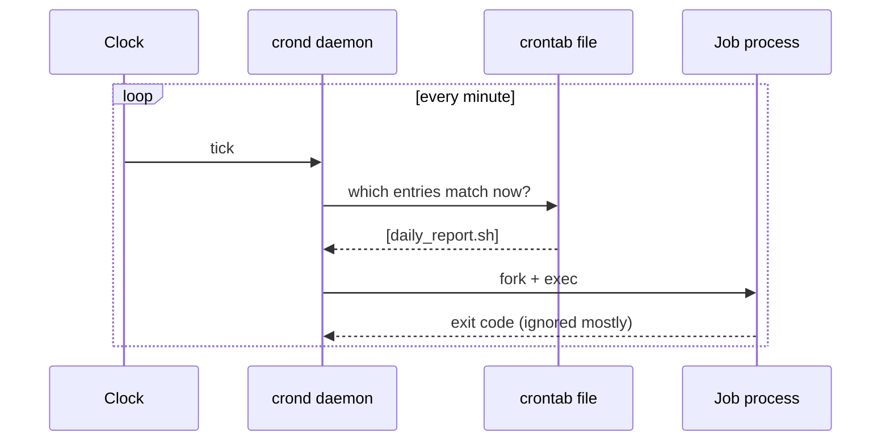

This is **simple, free, and works**. For years, it's enough.

---

## 3. Why cron is good (and why people loved it)

- Zero infrastructure: it ships with the OS
- Easy to understand: one line per job
- Runs jobs close to the data (same machine)

For a single server with a handful of jobs, **cron is the right answer**. In an interview, never start by over-engineering. Always say: *"For a small scale, a single cron on one box works. Let me explain where it breaks."*

---

## 4. The cracks start to show (Problems 1 to 5)

ShopEasy grows. Now it has 50 servers, millions of users, hundreds of jobs. Cron starts hurting.

### Problem 1: Single point of failure (SPOF)

The server running cron dies at 11:58 PM. The midnight report never runs. Nobody notices until the CEO asks, *"Where's my report?"* at 9 AM.

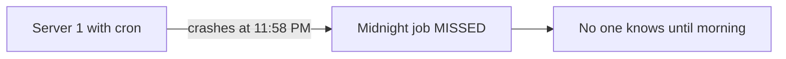

Cron has **no memory of missed runs**. If the machine was down at the scheduled minute, the job is simply skipped forever.

### Problem 2: No visibility

- Did the job succeed or fail?
- How long did it take?
- What was the output?

Cron just runs the command. If it fails, at best it mails root, which nobody reads. There is **no history, no dashboard, no alerts**.

### Problem 3: Can't scale a single job

The nightly job processes 100 million orders. On one machine, it takes **9 hours**. Cron can only start the process **on that one machine**. It can't say, "split this job across 20 machines."

### Problem 4: Resource contention

On the same box, a heavy report job eats all CPU and memory, and the **website slows down**. Cron has no concept of resource limits, queues, or priorities.

### Problem 5: Management chaos

Jobs are scattered across 50 servers' crontabs. Questions like these become impossible to answer:
- "Which jobs exist in our company?"
- "Who owns this job?"
- "Pause all jobs during the deployment."
- "Change the schedule of 30 jobs."

Engineers SSH into machines and edit files by hand. One typo can break production.

---

## 5. First fix attempt: "Put cron on two servers!"

The obvious idea: *if one server dies, another should run the job.* So engineers install the same crontab on **Server A and Server B**.

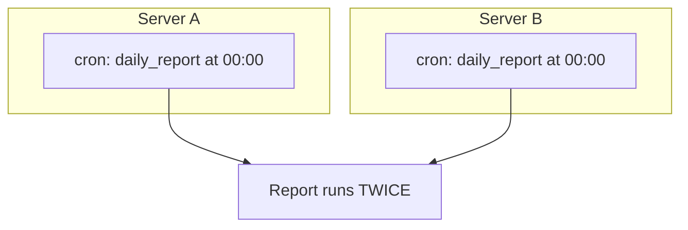

New problem: **duplicate execution**. Both servers fire at midnight. Now:

- The customer gets **two emails**
- The payment job **charges the card twice**
- The report is generated twice, wasting resources

This is a classic distributed systems tradeoff, and you'll hear it in every interview:

> **At-most-once** (might miss a job) vs **at-least-once** (might run twice) vs **exactly-once** (the ideal, very hard).

| Setup | Guarantee | Risk |
|---|---|---|
| Cron on 1 server | at-most-once | Missed if server dies |
| Cron on 2 servers | at-least-once | Duplicate runs |
| Goal | exactly-once (effectively) | Needs coordination |

Engineers then try hacks:
- "Run on A on even days, B on odd days." This breaks when A is down on its day.
- "B checks if A is alive, then decides." This is a primitive version of **leader election**, which we'll formalize later.

These hacks all lead to the same realization: **we need a centralized brain that knows about all jobs and decides who runs what.**

---

## 6. The key insight: separate the "WHEN" from the "WHERE"

This is the **most important conceptual jump** of the whole design.

Cron mixes two concerns:
1. **Scheduling**: *deciding* that a job should run now
2. **Execution**: *actually running* the job's code

The evolution of every serious scheduler (Quartz, Airflow, Kubernetes CronJobs, Google's internal systems) starts by splitting them:

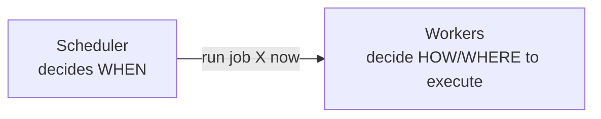

- **Scheduler**: knows all jobs and their schedules, and triggers them at the right time.
- **Workers/Executors**: a fleet of machines that actually run the job code.

Now we can scale workers independently, and workers can die without losing the job (the scheduler can reassign it). But a new question appears: **where does the scheduler keep the list of jobs?** In memory? A file? A database? That's the next chapter's story.

---

## 7. Interview-ready summary of Chapter 1

If asked *"Why not just use cron?"*, answer:

1. **SPOF**: one machine failure means missed jobs
2. **No missed-run recovery**: cron doesn't remember or retry
3. **No observability**: no history, status, or alerts
4. **No horizontal scaling**: one job can't be split across machines
5. **Resource isolation**: jobs compete with production workloads
6. **No central management**: jobs are scattered across servers
7. **Naive HA (cron on N servers)** leads to duplicate execution
8. Therefore we **separate scheduling from execution** and centralize job metadata

---

## Quick check before we move on

1. Why does running the same crontab on two servers cause problems?
2. What is the difference between at-most-once and at-least-once?
3. Why is "separate the scheduler from the workers" such an important idea?

**Reply with your answers, or ask about anything unclear.** Once you're comfortable, **Chapter 2** will cover **Requirements and a first centralized design**: functional and non-functional requirements, back-of-the-envelope estimation, API design, and where to store jobs (the first database choice and its problems).


-----------------------------------------------------------------------------------------------------------------------
-----------------------------------------------------------------------------------------------------------------------
-----------------------------------------------------------------------------------------------------------------------
-----------------------------------------------------------------------------------------------------------------------


# Chapter 2: Requirements and the First Centralized Design

**Story so far:** ShopEasy's engineers realized cron on many boxes doesn't work. They decide to build an internal platform, **"Chronos"**, with a central brain that knows all jobs and a fleet of workers that run them.

A good team doesn't start coding. It starts with **requirements**, and in an interview this is also your first 5 minutes.

---

## 1. Requirements

### Functional requirements (what the system does)

1. **Create** a job: one-time ("run at 6 PM tomorrow") or recurring ("every day at midnight", given as a cron expression)
2. **Update, delete, pause, resume** a job
3. **Execute** the job at the scheduled time on some worker
4. **Retry** on failure (configurable count and backoff)
5. **Track status and history**: PENDING, RUNNING, SUCCESS, FAILED
6. **Query**: "show me the last 10 runs of job X"
7. *(Optional, later chapters)*: priorities, job dependencies (B runs after A), cancel a running job, rate limits per team

### Non-functional requirements (how well it does it)

| Requirement | What it means here |
|---|---|
| **High availability** | Scheduler must not be a SPOF; no missed jobs because a machine died |
| **Scalability** | Millions of jobs, tens of thousands of executions per second at peak |
| **Low scheduling latency** | A job scheduled for 10:00:00 should start by about 10:00:01, not 10:05 |
| **Durability** | Once the API says "job created", it must never be lost |
| **Reliability of execution** | **At-least-once** delivery, made safe with idempotent jobs (explained in a later chapter) |
| **Fault tolerance** | Worker crash mid-job means the job is re-run elsewhere |
| **Observability** | Metrics, logs, alerts, dashboards |
| **Multi-tenancy / isolation** | One team's runaway job must not starve other teams |

**Interview tip:** Say aloud: *"I'll aim for at-least-once execution and ask users to make jobs idempotent, because true exactly-once is impractical in distributed systems."* Interviewers love hearing this.

---

## 2. Back-of-the-envelope estimation

Assumptions (state them in the interview, and ask whether they're okay):

- **10 million** registered (active) job definitions
- **100 million** executions per day

**Execution rate**
- 100M / 86,400 s ≈ **~1,200 executions/sec on average**
- But jobs cluster at round times (00:00, top of the hour, "every 5 minutes"). Assume a **30x peak** → **~35,000 executions/sec**

**Storage**
- Job definition: about 1 KB (name, cron, payload, retry config, owner) → 10M × 1 KB = **~10 GB**. Small!
- Execution record: about 500 B → 100M/day × 500 B = **50 GB/day** → ~1.5 TB per month

**Insights from the numbers:**
1. The **job definitions table is small** (10 GB) but **read very often**.
2. The **execution history table is huge and write-heavy** (append-only). These are *two different workloads*, so they'll eventually need two different storage strategies.
3. The **peak** matters more than the average. The system must survive the "midnight stampede".

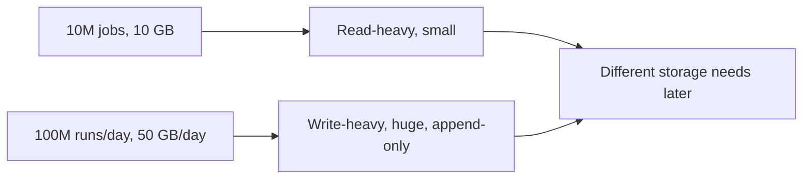

---

## 3. API design

Keep it simple and REST-like:

```
POST   /v1/jobs                    -> create a job
GET    /v1/jobs/{jobId}            -> get a job definition
PUT    /v1/jobs/{jobId}            -> update schedule/payload
DELETE /v1/jobs/{jobId}            -> delete
POST   /v1/jobs/{jobId}/pause      -> pause
POST   /v1/jobs/{jobId}/resume     -> resume
GET    /v1/jobs/{jobId}/executions -> run history (paginated)
```

**Create-job request example:**

```json
{
  "name": "daily-sales-report",
  "schedule": { "type": "CRON", "expression": "0 0 * * *", "timezone": "Asia/Kolkata" },
  "task": { "type": "HTTP", "url": "https://reports.internal/generate", "payload": {"region": "IN"} },
  "retry": { "maxAttempts": 3, "backoff": "EXPONENTIAL", "initialDelaySec": 30 },
  "timeoutSec": 600,
  "idempotencyKey": "client-generated-uuid"
}
```

Details worth mentioning in interviews:
- **`idempotencyKey` on create**: if the client retries `POST /jobs` after a network timeout, we don't create two jobs.
- **Timezone** is explicit. "Midnight" depends on where, and DST (daylight saving) shifts cause real production bugs.
- **Pagination** on execution history because it's huge.

---

## 4. Data model (first version)

**jobs table**

| Column | Example |
|---|---|
| job_id (PK) | `j_123` |
| owner / team | `payments` |
| schedule (cron/one-time) | `0 0 * * *` |
| task_payload | `{url:..., body:...}` |
| retry_policy | `{max:3, backoff:...}` |
| status | `ACTIVE / PAUSED / DELETED` |
| **next_run_time** | `2026-11-03 00:00:00` |
| last_run_time | `2026-11-02 00:00:00` |

**executions table**

| Column | Example |
|---|---|
| execution_id (PK) | `e_9001` |
| job_id (FK) | `j_123` |
| scheduled_time | `2026-11-03 00:00:00` |
| started_at / finished_at | ... |
| status | `PENDING / RUNNING / SUCCESS / FAILED` |
| attempt | `1` |
| worker_id | `w_17` |

### The most important column: `next_run_time`

A cron expression like `0 0 * * *` is a *rule*, not a timestamp. To make scheduling efficient, we **precompute the next time** the job should fire and store it. After each run, we compute the next one.

```
Job: "0 0 * * *" (every midnight)
Now = Nov 2, 00:00:00 -> job fires
Compute next occurrence -> Nov 3, 00:00:00
Update next_run_time = Nov 3, 00:00:00
```

This turns the scheduling question into a simple query: *"Which jobs have `next_run_time <= now`?"*

---

## 5. The first design: Chronos v1

The engineers pick a familiar **relational database (MySQL/Postgres)** and build three components:

1. **API Service**: handles CRUD requests, writes to DB
2. **Scheduler**: loops forever, finds due jobs, hands them to workers
3. **Workers**: run the job code, report status

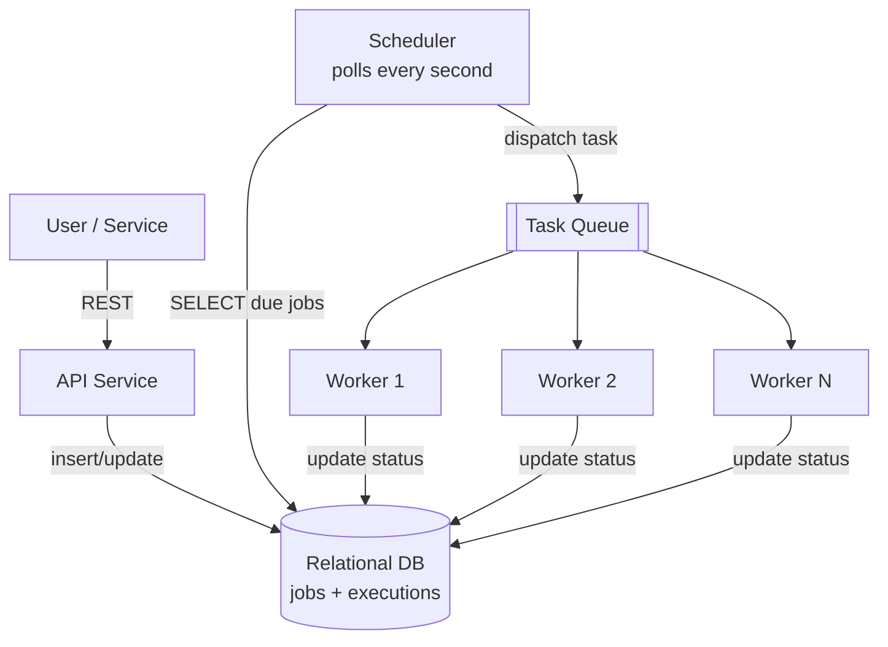

### The scheduler loop (pseudo-code)

```
every 1 second:
    due_jobs = SELECT * FROM jobs
               WHERE status = 'ACTIVE'
                 AND next_run_time <= NOW()
               LIMIT 1000

    for job in due_jobs:
        create execution row (status = PENDING)
        push task to queue
        job.next_run_time = compute_next(job.schedule)
        UPDATE jobs SET next_run_time = ... WHERE job_id = ...
```

### Walk-through example

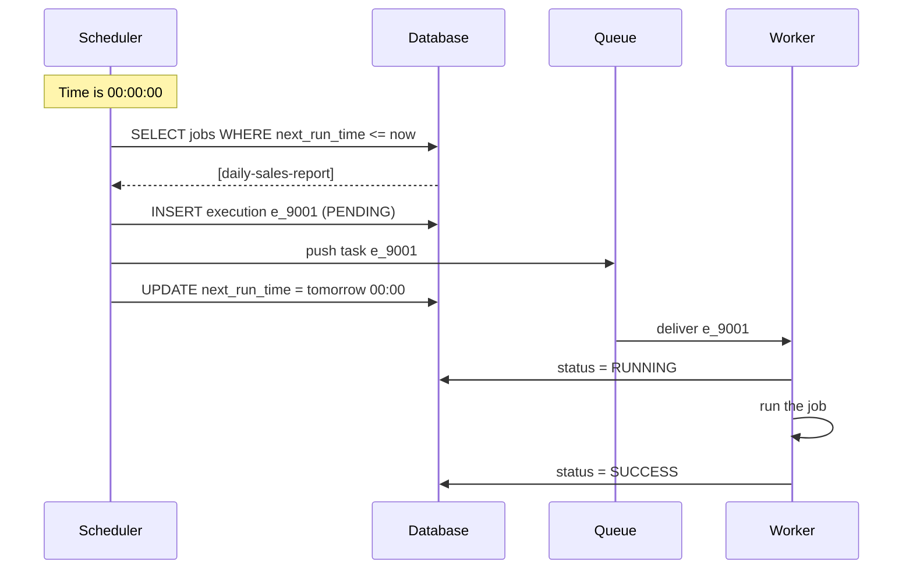

**Why a queue between scheduler and workers?** It's a **buffer**. If 35,000 jobs fire at midnight, the scheduler dumps them in the queue quickly, and workers consume at their own pace. This decouples the two sides, so the scheduler doesn't wait for jobs to finish and workers can scale independently.

**Why an index on `next_run_time`?** Without it, `WHERE next_run_time <= NOW()` scans 10M rows **every second**. With a B-tree index on `(status, next_run_time)`, the DB jumps straight to due rows. This is the first optimization the team makes.

---

## 6. It works! Then production teaches lessons

For a few months, Chronos v1 works. Then the incidents begin.

### Incident 1: The scheduler crashes between two steps

Look at the loop again. Three things happen: **(a)** push to queue, **(b)** update `next_run_time`. They are **not atomic**.

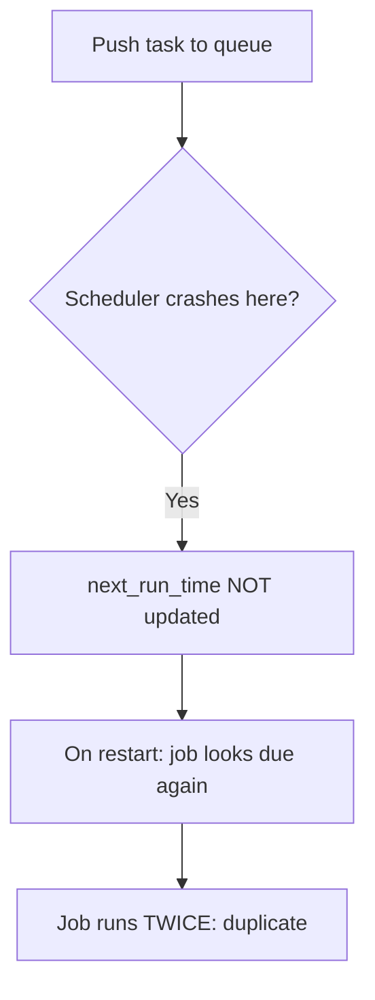

Flip the order (update first, then push) and a crash in between means the job is **never pushed**, so it's **silently lost**.

> This is the classic **dual-write problem**: updating two systems (DB and queue) can't be atomic. Remember this phrase. We'll solve it properly in later chapters (ideas: transactional outbox, or making state transitions inside the DB the single source of truth).

### Incident 2: The scheduler is a SPOF again

We've rebuilt the same weakness as cron, just in a fancier box. If the one scheduler dies, **nothing fires**. The obvious fix is to run **multiple schedulers**. But then...

### Incident 3: Two schedulers pick the same job

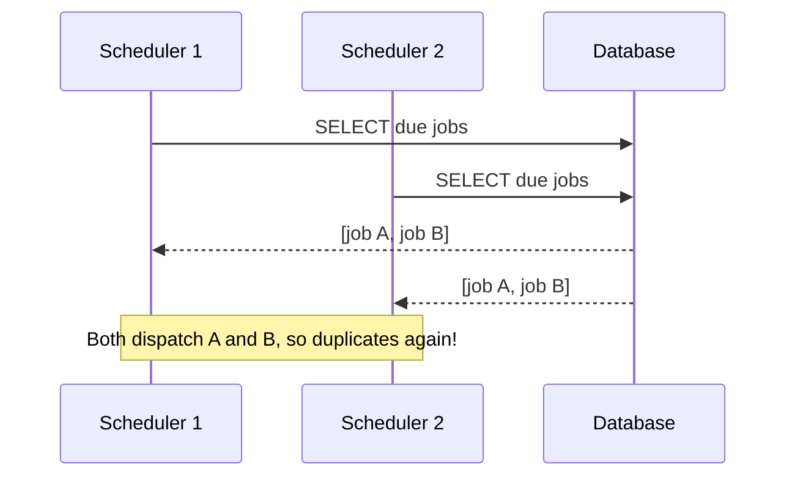

We're back to the **duplicate execution** problem from Chapter 1, just inside our own system.

### Incident 4: The database becomes the bottleneck

Everything flows through one DB: API writes, scheduler polling every second, worker status updates (35k/sec at peak), and execution history inserts (50 GB/day). A **single DB** is both a **SPOF** and a **throughput ceiling**.

### Incident 5: Worker dies mid-job

A worker picked up job e_9001, set it to RUNNING, then the machine crashed. The row says RUNNING forever. Nobody retries it. We need **heartbeats, leases, and timeouts** (a later chapter).

---

## 7. Summary table of v1's flaws, with what fixes them later

| Flaw in v1 | Consequence | Fixed by (upcoming chapters) |
|---|---|---|
| Single scheduler | SPOF, no failover | Multiple schedulers, leader election |
| Non-atomic dispatch + update | Duplicate or lost runs | Atomic state transitions, outbox, idempotency |
| Multiple schedulers pick same job | Duplicate runs | Row locking, partitioning, claims/leases |
| Single DB | SPOF, throughput cap | Replication, sharding |
| Hot polling of DB | Load, latency | Smarter time-bucketing, in-memory timing wheels |
| Worker dies mid-job | Stuck RUNNING jobs | Heartbeats, leases, retries |
| History table grows forever | Storage cost, slow queries | Separate store, TTL, archival |

---

## 8. Interview-ready summary of Chapter 2

1. Clarify **requirements**, state at-least-once with idempotent jobs as the goal.
2. Estimate: ~1.2k/s avg and ~35k/s peak executions, small job table (10 GB), huge execution table (50 GB/day).
3. Expose a small **REST API** with idempotency keys and explicit timezones.
4. Store a precomputed **`next_run_time`** with an index, so "find due jobs" is a cheap range query.
5. v1 architecture: **API → DB ← Scheduler → Queue → Workers**.
6. Call out its flaws proactively: SPOF scheduler, dual-write problem, duplicate pickup, DB bottleneck, stuck jobs.

---

## Quick check before we move on

1. Why do we precompute `next_run_time` instead of evaluating the cron expression for all 10M jobs every second?
2. Why is it a problem that "push to queue" and "update next_run_time" aren't atomic? What happens in each crash order?
3. Why did we put a queue between the scheduler and the workers?

Answer these (or ask about anything unclear), and in **Chapter 3** we'll tackle the scheduler itself: **how to run multiple schedulers safely** (row locking with `SKIP LOCKED`, leader election, and partitioned ownership), plus how to avoid the duplicate and lost job problems.


-----------------------------------------------------------------------------------------------------------------------
-----------------------------------------------------------------------------------------------------------------------
-----------------------------------------------------------------------------------------------------------------------
-----------------------------------------------------------------------------------------------------------------------


# Chapter 3: Running Multiple Schedulers Safely

**Story so far:** Chronos v1 works, but one scheduler is a SPOF (Incident 2). The team runs **three schedulers** for safety, and Incident 3 follows: all three grab the same due jobs and every job fires three times. This chapter is about how engineers fixed that, one attempt at a time.

---

## Attempt 1: Leader election (active-passive)

**Idea:** Run 3 schedulers, but only **one leader** schedules. The others are hot standbys. If the leader dies, one standby takes over.

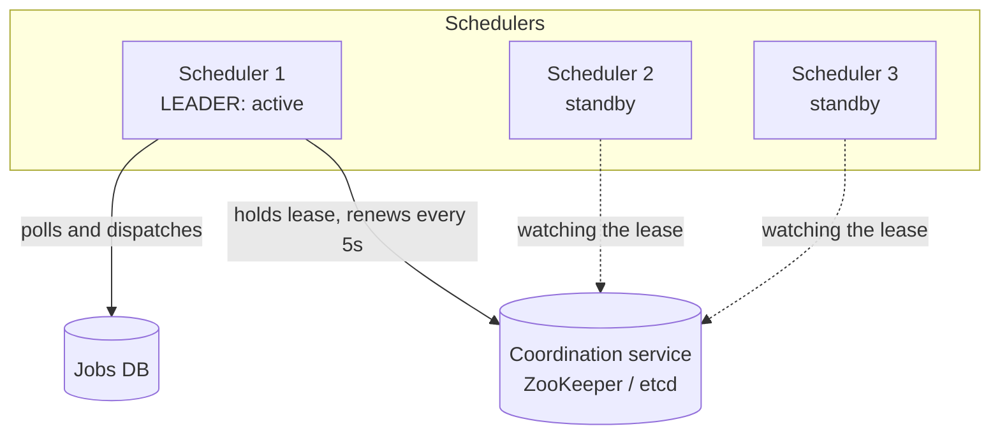

### How election works (with a lease)

1. All schedulers try to create a key `/chronos/leader` in etcd/ZooKeeper with a **TTL (lease) of 15s**. Only one succeeds. That one is the leader.
2. The leader **renews** the lease every 5s (a heartbeat).
3. If the leader crashes, it stops renewing, the lease **expires** after 15s, and the key disappears. The standbys see this and race to create the key again. One wins.

So failover takes about 15s. Missed jobs during that window are picked up afterwards, because `next_run_time <= now` still matches them (a big advantage of storing `next_run_time` in the DB: **overdue jobs aren't lost**, they're just late).

### The dangerous flaw: split brain

Suppose the leader isn't dead, just **stuck in a long GC pause** (or a network blip) for 20 seconds.

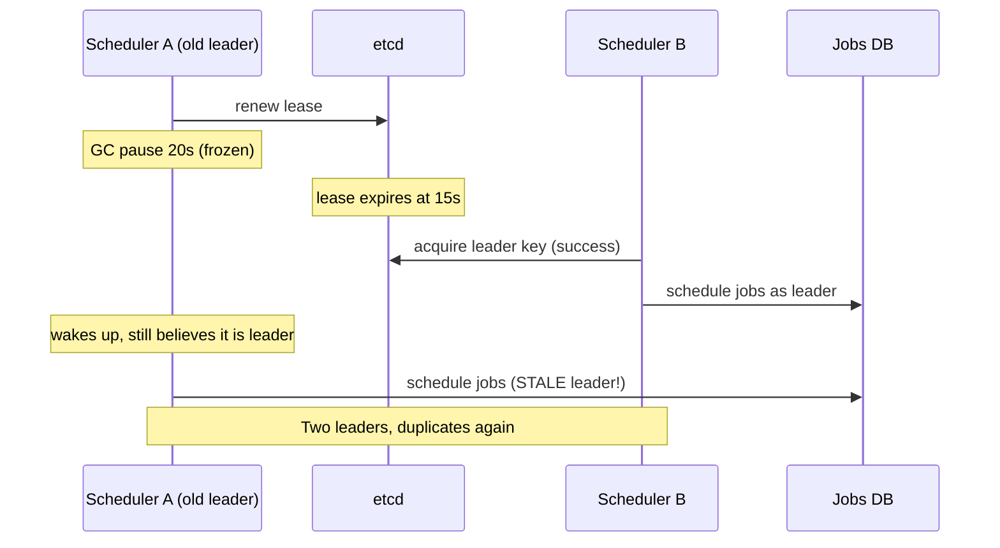

A doesn't know it lost leadership. This is the infamous **split-brain** problem, and it's a favorite interview topic.

### Fix: fencing tokens

Every time leadership changes, the coordination service hands out a **monotonically increasing number** (epoch).

- Leader A got token **41**
- Leader B got token **42**

Every write to the DB carries the token, and the DB **rejects anything lower than the highest it has seen**.

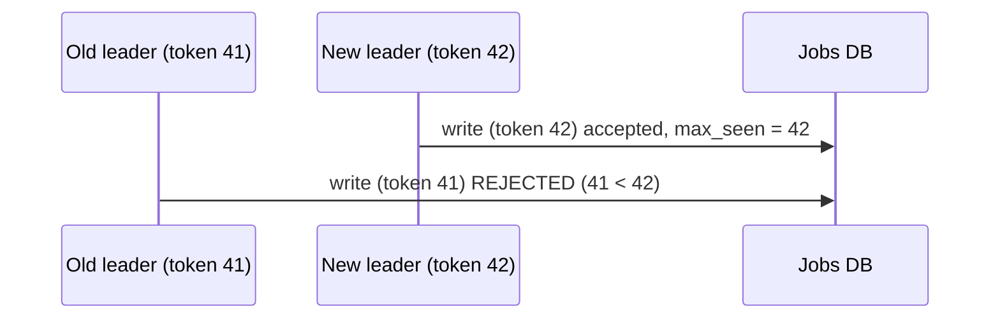

The zombie leader can no longer corrupt anything. Fencing tokens are the standard answer to "what if the old leader is still alive?"

### The remaining problem with leader election

Only **one machine does all scheduling work**. If we need to dispatch 35,000 jobs/sec at peak, a single leader becomes a **throughput bottleneck**. Failover is also not instant. We got availability, but not scalability.

---

## Attempt 2: All schedulers active, coordinate through the DB

**Idea:** Let every scheduler work in parallel, but make sure each job is **claimed by exactly one** of them. The database can enforce this for us.

### Step 1: Naive locking, `SELECT ... FOR UPDATE`

```sql
BEGIN;
SELECT * FROM jobs
WHERE status='ACTIVE' AND next_run_time <= NOW()
LIMIT 100
FOR UPDATE;       -- lock these rows
-- ... process, update next_run_time ...
COMMIT;
```

Scheduler 1 locks 100 rows. Scheduler 2 runs the same query and **blocks, waiting** for those locks. Result: schedulers are serialized, so there's no real parallelism. We're back to one effective worker.

### Step 2: `FOR UPDATE SKIP LOCKED`

Modern databases (Postgres 9.5+, MySQL 8+) let you say: *"lock what you can, skip rows someone else already locked."*

```sql
BEGIN;
SELECT * FROM jobs
WHERE status='ACTIVE' AND next_run_time <= NOW()
ORDER BY next_run_time
LIMIT 100
FOR UPDATE SKIP LOCKED;
```

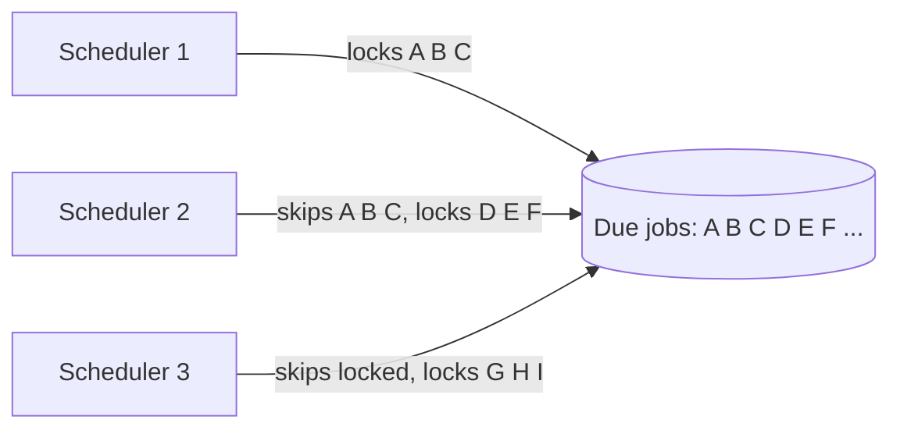

Now three schedulers each take a **different batch**, with no waiting and no duplicates. This is cheap, simple, and widely used (many "Postgres as a queue" systems rely on it).

**Why it works:** the DB's row lock is a trusted referee. We're using the DB's concurrency control instead of writing our own.

### Step 3: Make the claim atomic, fixing Incident 1

Inside the **same transaction** that holds the row locks, do both:
1. Insert an `executions` row with status `PENDING` (a durable record that this run must happen)
2. Update `next_run_time` to the next occurrence

```sql
-- inside the same transaction
INSERT INTO executions(job_id, scheduled_time, status) VALUES (...,'PENDING');
UPDATE jobs SET next_run_time = <next> WHERE job_id = ...;
COMMIT;
```

Both succeed or both fail. A crash can't leave us with "updated time but no execution" or the reverse. We **no longer touch the queue inside the transaction**, so the dual-write is gone from the critical path.

### Step 4: Getting PENDING executions to the workers (Transactional Outbox)

A second small component, the **dispatcher** (sometimes called the relay), reads `PENDING` executions and pushes them to the queue.

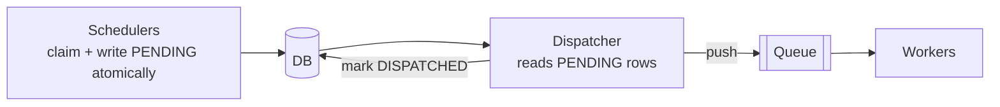

What if the dispatcher crashes after pushing but before marking `DISPATCHED`? On restart it pushes again, so the queue may get a **duplicate**. That's acceptable, because we've chosen **at-least-once** and workers dedupe using the unique `execution_id` (covered in the worker/idempotency chapter). What matters is that **nothing is ever lost**, since the PENDING row survives any crash.

This pattern is called the **transactional outbox**: the DB row is the source of truth, and the message is sent *after* from the durable record.

### The remaining problem with the polling-DB approach

Every scheduler hits the same DB table every second. With 10M jobs and a massive peak, **hot rows and lock contention** concentrate on rows with the smallest `next_run_time`. The DB is the shared choke point. We need a way to **split the work** so schedulers don't even look at each other's jobs.

---

## Attempt 3: Partitioned ownership (divide the jobs)

**Idea:** Give each scheduler **its own slice of jobs**, so there is no contention at all.

Assign every job a `partition_id = hash(job_id) % N` (say N = 64 partitions). Each scheduler **owns a set of partitions**.

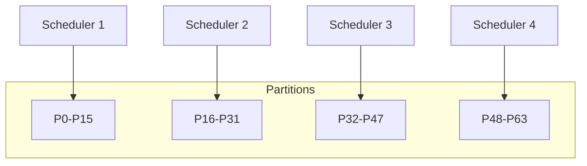

Each scheduler queries only its own slice:

```sql
SELECT * FROM jobs
WHERE partition_id IN (0..15) AND next_run_time <= NOW() ...
```

### Who decides which scheduler owns which partition?

A coordinator (etcd/ZooKeeper, or a consistent-hash ring) manages it:
- Schedulers **register** with heartbeats.
- Partitions are distributed evenly among live schedulers.
- When a scheduler **dies**, its partitions are **reassigned** to survivors. When a new one **joins**, partitions are rebalanced.

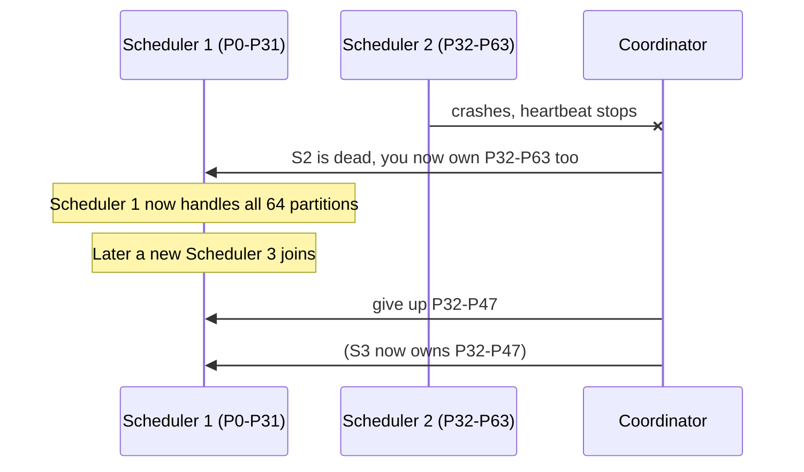

### Why many small partitions instead of N = number of schedulers?

If you have exactly 4 partitions for 4 schedulers, you can't rebalance smoothly: when one dies, one survivor takes **double the load**. With **64 partitions**, a dead scheduler's 16 partitions are spread across the survivors a few at a time, and it's easy to scale from 4 to 5 schedulers by moving a handful of partitions. This is the same reason Kafka and Cassandra use many more partitions (or virtual nodes) than machines.

### Dangers of partition ownership

1. **Rebalance overlap:** during handover, the old and new owner may briefly both schedule a partition. Combine with **fencing tokens or ownership leases per partition**: the partition owner holds a lease, and writes carry the partition epoch.
2. **Hot partitions:** if 30% of jobs happen to be "every minute at :00" and hash into similar partitions, load is uneven. Hashing `job_id` spreads them well, but extreme customers can still skew things.
3. **Safety net:** even with partitioning, we keep the **atomic claim** (`SKIP LOCKED` or a conditional update) from Attempt 2 as the last line of defense. Partitioning is for **efficiency**, the DB claim is for **correctness**. This "belt and suspenders" idea is a common pattern in the industry.

---

## Comparing the three approaches

| Approach | Availability | Throughput | Complexity | Duplicate risk |
|---|---|---|---|---|
| Leader election | Good (about 15s failover) | **Limited to one node** | Medium (needs fencing) | Split-brain without fencing |
| All active + `SKIP LOCKED` | Excellent | Good, until the DB is the bottleneck | **Low** | Very low (DB arbitrates) |
| Partitioned ownership | Excellent | **Highest** (no contention) | High (rebalancing, coordination) | Low (with leases + DB claim) |

**What real systems do:**
- **Quartz** (Java): DB row locks across a cluster, which is Attempt 2.
- **Kubernetes CronJob controller:** a single leader controller (Attempt 1).
- **Large-scale internal schedulers (Google, Meta, Uber Cadence/Temporal-style):** partitioned ownership plus leases (Attempt 3).

In the interview, a strong answer starts at Attempt 2 for simplicity, then moves to Attempt 3 when the numbers (35k/sec) demand it.

---

## Where Chronos stands now

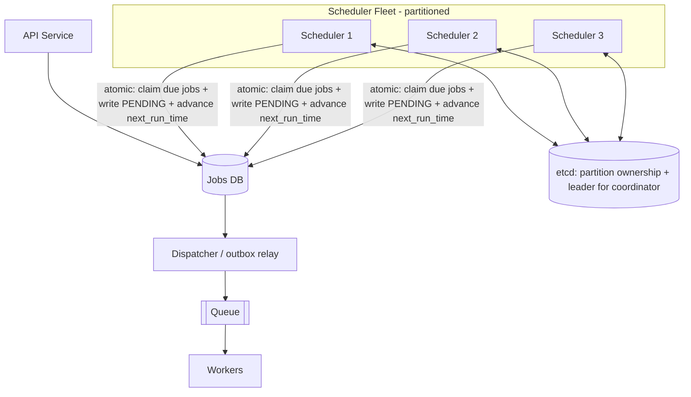

**Solved:** scheduler SPOF, duplicate pickup, dual-write loss, and scheduler throughput.
**Still open:** the single DB, how workers behave when they crash, how the queue is structured, hot polling.

---

## Interview-ready summary of Chapter 3

1. Naive multi-scheduler leads to **duplicate execution**.
2. **Leader election** (lease via etcd/ZooKeeper) gives HA, but one node does all the work. Beware **split-brain**, and fix it with **fencing tokens**.
3. **`SELECT ... FOR UPDATE SKIP LOCKED`** lets many schedulers safely claim different job batches in parallel.
4. Make claim, execution row (PENDING), and `next_run_time` update **one atomic transaction**, then dispatch via the **transactional outbox** pattern. This removes the dual-write problem.
5. For massive scale, use **partitioned ownership** (many small partitions, rebalanced on membership change, protected by leases). Keep the DB claim as the correctness backstop.
6. Overdue jobs aren't lost on failover, because `next_run_time` is durable: they run late, not never.

---

## Quick check before we move on

1. Why does `SKIP LOCKED` give parallelism while plain `FOR UPDATE` doesn't?
2. What is split-brain, and how does a fencing token stop the old leader from causing damage?
3. Why use 64 partitions for 4 schedulers instead of exactly 4?
4. What does the transactional outbox protect us from, and why is a duplicate message in the queue acceptable?

Tell me your answers or what's unclear. When you're ready, **Chapter 4** covers the **worker side**: how workers pick up tasks from the queue, heartbeats and leases for crashed workers, retries with exponential backoff, idempotency, and the "exactly-once" illusion.


-----------------------------------------------------------------------------------------------------------------------
-----------------------------------------------------------------------------------------------------------------------
-----------------------------------------------------------------------------------------------------------------------
-----------------------------------------------------------------------------------------------------------------------


# Chapter 4: The Worker Side (Execution, Failures, Retries, Idempotency)

**Story so far:** Chronos now schedules reliably. Jobs are claimed atomically, a `PENDING` execution row is written, and the dispatcher pushes tasks into a queue. But scheduling a job is only half the promise. The other half is **making sure it actually runs, even when machines die**. This chapter follows how Chronos's workers evolved.

---

## Version 1: Simple workers pulling from the queue

Workers pull a task, run it, and mark it done.

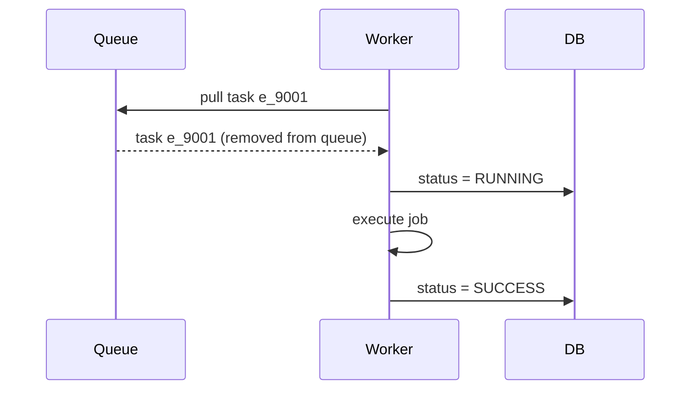

### Why pull instead of push?

- **Push** (queue or scheduler assigns tasks to workers): the sender must know each worker's load, and it can overload a slow worker.
- **Pull** (worker asks when ready): workers take work **at their own pace**. A slow worker pulls less, a fast one pulls more. Load balances itself. This is called **natural backpressure**.

### Incident 1: Worker crashes after pulling the task

The queue handed e_9001 to Worker 7 and **deleted it**. Worker 7's machine dies mid-job. The task is **gone forever**, and the DB shows `RUNNING` indefinitely. This is **at-most-once** delivery, the thing we wanted to avoid.

---

## Version 2: Acknowledgements and visibility timeout

The fix, borrowed from queues like SQS and RabbitMQ: **don't delete the task on pull, only hide it temporarily**.

1. Worker pulls the task. The queue marks it **invisible** for, say, 60 seconds (the **visibility timeout**).
2. Worker finishes and sends an **ACK**. The queue deletes the task.
3. If no ACK arrives within 60s (worker crashed), the task becomes **visible again** and another worker picks it up.

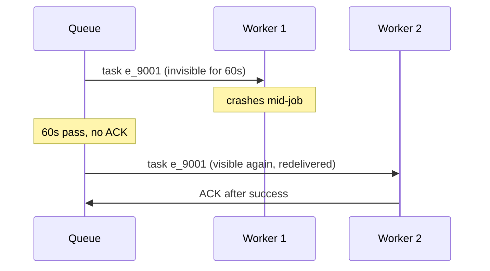

No task is lost anymore. We've achieved **at-least-once** delivery.

### The new problem: how long should the visibility timeout be?

| Timeout too short | Timeout too long |
|---|---|
| A slow but healthy job (e.g. a 10-minute report) becomes visible again while still running, so a **second worker runs it too (duplicate)** | A crashed worker's task stays hidden for ages, so **recovery is slow** |

Jobs vary wildly: some take 2 seconds, some take 2 hours. No single timeout fits all.

---

## Version 3: Heartbeats and leases

Instead of guessing a timeout, the worker **continuously proves it's alive**.

1. When a worker starts a job, it takes a **lease** on that execution: "I own e_9001 until time T (e.g. 30s from now)".
2. While running, the worker **extends the lease every 10 seconds** (a heartbeat).
3. If heartbeats stop, the lease expires after 30s. A **reaper** process sees the expired lease and makes the job eligible again.

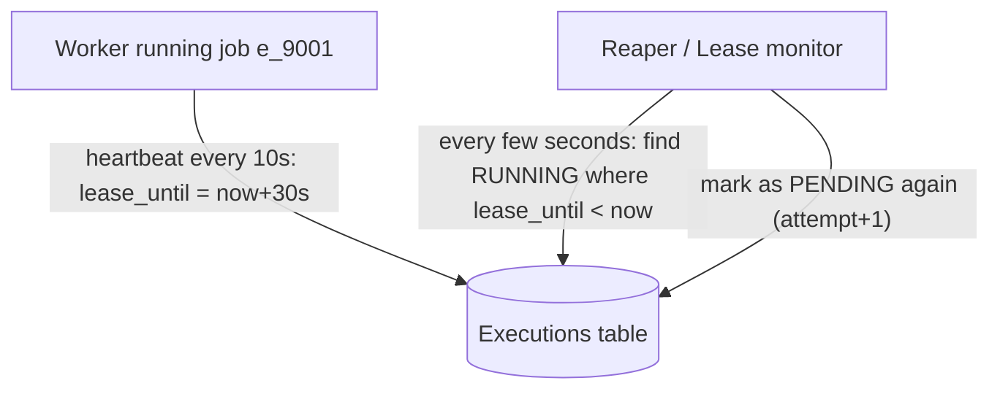

Now a 2-hour job is fine, as long as the worker keeps heartbeating. A dead worker is detected in **about 30 seconds**, regardless of job length.

### Executions table gains two columns

| Column | Purpose |
|---|---|
| `lease_until` | Worker's ownership expires at this time |
| `attempt` | Increments on every (re)try |

### Worker claiming a task safely

Even with a queue, the DB is the source of truth. The worker does a **conditional update** to claim the execution:

```sql
UPDATE executions
SET status='RUNNING', worker_id='w_7', lease_until = NOW() + INTERVAL 30 SECOND
WHERE execution_id='e_9001' AND status='PENDING';
-- rows affected = 1 -> I own it
-- rows affected = 0 -> someone else took it; skip
```

This is **compare-and-set (CAS)**: only one worker can flip `PENDING` to `RUNNING`. If the queue delivered the task twice, only one worker wins.

### The same zombie problem again (a worker version of split-brain)

Worker 1 freezes for 40s (GC pause). Its lease expires. The reaper reassigns the job to Worker 2. Worker 1 wakes up and **continues running**, because it doesn't know it lost the lease. Now two workers execute the same job.

Same cure as in Chapter 3: **fencing**. Each attempt has an increasing `attempt` number. When Worker 1 tries to report SUCCESS with `attempt=1`, but the DB now says `attempt=2`, the update is **rejected**. Worker 1 should also check its own lease before committing side effects, and abort if it expired.

But note: fencing protects **our database**, not the **outside world**. If the job already sent an email or charged a card, we can't un-send it. That leads to the most important concept in this chapter.

---

## Idempotency: the real answer to exactly-once

### Why true exactly-once is impossible

Imagine Worker 1 calls a payment API to charge $100. The API charges the card, but the **network drops before the response arrives**. Worker 1 can't know: did the charge happen or not?

- If it **retries**: possible double charge.
- If it **doesn't retry**: possible missed charge.

This is a fundamental limit (it's related to the **Two Generals Problem**). **No system can guarantee exactly-once execution of side effects across an unreliable network.**

### What we do instead

> **at-least-once delivery + idempotent processing = effectively exactly-once**

An operation is **idempotent** if doing it many times has the same effect as doing it once.

| Idempotent | Not idempotent |
|---|---|
| `SET balance = 100` | `balance = balance + 100` |
| `INSERT ... ON CONFLICT DO NOTHING` | plain `INSERT` of a new row each time |
| "Mark order 55 as shipped" | "Send an email" (naively) |

### Making any job idempotent: the idempotency key

Chronos passes a **stable key** to every job, such as `execution_id` or `job_id + scheduled_time`. Crucially, the key is the **same across retries** of the same run.

The job (or the downstream service) records keys it has processed:

```mermaid
sequenceDiagram
    participant W as Worker
    participant P as Payment API
    participant DB as Payment DB

    W->>P: charge $100, idempotency_key=e_9001
    P->>DB: key e_9001 already processed?
    DB-->>P: no
    P->>DB: charge + store key e_9001
    P--xW: response lost (network)
    Note over W: retries
    W->>P: charge $100, idempotency_key=e_9001
    P->>DB: key e_9001 already processed?
    DB-->>P: yes, return stored result
    P-->>W: success (no second charge)
```

This is exactly how **Stripe's** API works. In an interview, say: *"Chronos guarantees at-least-once and passes a stable idempotency key; job owners must make their handlers idempotent."* That is the honest, correct answer.

---

## Retries: failures that are not crashes

A job can also **fail on its own**: the downstream service returns 500, a timeout occurs, or a bug throws an exception.

### Naive retry: immediately, forever

If the payment service is down, 10,000 failed jobs retry instantly, again and again. This creates a **retry storm** that hammers the already-struggling service and prevents recovery. Retries made things worse.

### Better: exponential backoff

Wait longer after each failure: 30s, 60s, 120s, 240s...

```
delay = initialDelay * 2^(attempt - 1)
attempt 1 fails -> wait 30s
attempt 2 fails -> wait 60s
attempt 3 fails -> wait 120s
```

### Better still: add jitter

If 10,000 jobs failed at the same moment, exponential backoff alone makes them **all retry at the same moment again** (a synchronized herd). **Jitter** adds randomness:

```
delay = random(0, initialDelay * 2^(attempt-1))
```

Now retries spread out smoothly. This "exponential backoff with jitter" is something interviewers expect you to name.

### Implementing retries inside Chronos

A retry is just **a new scheduled run for the same job**: set the execution status back to `PENDING` with a `next_attempt_time`. The same scheduler machinery (due-time lookup, claim, dispatch) handles it. No separate retry system is needed, which keeps the design simple.

### Max attempts and the Dead Letter Queue (DLQ)

After `maxAttempts` (say 3) the execution is marked `FAILED` permanently and moved to a **Dead Letter Queue**, a holding area where:
- humans or tooling can inspect the failure,
- an alert fires to the job owner,
- the team can fix the bug and **replay** the message manually.

Without a DLQ, one **poison task** (one that always crashes the worker) would loop forever and block capacity.

```mermaid
flowchart LR
    Q[[Main Queue]] --> W[Worker]
    W -->|success| OK[SUCCESS]
    W -->|"fail (attempt < max)"| RETRY[Re-schedule with backoff + jitter]
    RETRY --> Q
    W -->|"fail (attempt = max)"| DLQ[[Dead Letter Queue]]
    DLQ --> ALERT[Alert owner + manual replay]
```

### Timeouts

Each job has a `timeoutSec`. If it runs past that, the worker kills it and treats it as a failure. Without timeouts, a hung job holds a worker slot forever (and heartbeats would keep its lease alive indefinitely).

---

## Failure classification

Not every failure deserves a retry:

| Failure type | Example | Action |
|---|---|---|
| **Transient** | timeout, 503, connection reset | Retry with backoff |
| **Permanent** | 400 bad request, validation error | **Don't retry**, send to DLQ immediately |
| **Worker crash** | machine dies | Lease expiry leads to automatic reassignment |
| **Poison task** | always crashes the worker | After max attempts, quarantine in the DLQ |

---

## Worker isolation (noisy neighbours, revisited)

Recall cron's Problem 4: a heavy job starved the website. Chronos fixes this with:

- **Dedicated worker pools** per team or job class (e.g. `critical`, `batch`, `ml-training`)
- **Separate queues per pool**, so a flood of batch jobs can't delay critical ones
- **Per-job resource limits** (CPU/memory via containers or cgroups)
- **Per-tenant concurrency limits and rate limits**, so one team can't use 100% of the fleet
- **Priority queues** (high / normal / low) so urgent jobs jump ahead

```mermaid
flowchart TB
    D[Dispatcher] -->|critical| Q1[[Queue: critical]]
    D -->|normal| Q2[[Queue: normal]]
    D -->|batch| Q3[[Queue: batch]]
    Q1 --> P1[Worker pool A: reserved capacity]
    Q2 --> P2[Worker pool B]
    Q3 --> P3[Worker pool C: autoscaled, preemptible]
```

---

## Execution state machine

Every execution moves through well-defined states, and only certain transitions are legal. Enforcing this in code (with conditional DB updates) prevents corruption.

```mermaid
stateDiagram-v2
    [*] --> PENDING: scheduler claims job
    PENDING --> RUNNING: worker claims (CAS)
    RUNNING --> SUCCESS: job finishes
    RUNNING --> PENDING: lease expired / retryable failure (attempt+1)
    RUNNING --> FAILED: max attempts or permanent error
    PENDING --> CANCELLED: user cancels
    FAILED --> [*]
    SUCCESS --> [*]
    CANCELLED --> [*]
```

---

## Chronos after Chapter 4

```mermaid
flowchart TB
    API[API Service] --> DB[(Jobs + Executions DB)]
    SCH[Partitioned Schedulers] --> DB
    DB --> DISP[Dispatcher / Outbox relay]
    DISP --> Q[[Priority Queues per pool]]
    Q --> W[Workers: pull, CAS-claim, heartbeat lease]
    W -->|heartbeat + status| DB
    REAP[Reaper: expired leases] --> DB
    W -->|max retries| DLQ[[Dead Letter Queue]]
    DLQ --> ALERT[Alerts + replay tooling]
```

**Solved:** crashed workers, stuck RUNNING jobs, duplicate execution handling, retry storms, poison tasks, noisy neighbours.
**Still open:** the database is still one big shared thing doing too much (the next chapter's story), plus time-handling subtleties, the thundering herd at midnight, and observability.

---

## Interview-ready summary of Chapter 4

1. Workers **pull** from queues (natural backpressure).
2. Deleting on pull gives at-most-once. Use **ACK + visibility timeout** for at-least-once.
3. Fixed timeouts don't fit variable-length jobs, so use **leases with heartbeats** and a **reaper** for expired ones.
4. Claim work with **compare-and-set** (`WHERE status='PENDING'`). Use **attempt numbers as fencing** against zombie workers.
5. **Exactly-once is impossible** across a network. Deliver **at-least-once** and require **idempotent** jobs, with a stable **idempotency key** across retries.
6. Retry with **exponential backoff + jitter**, a **max attempts** limit, and a **DLQ** for poison tasks. Distinguish transient from permanent failures.
7. Enforce **timeouts**, separate **worker pools and queues** by priority/tenant, and apply **resource limits and rate limits** for isolation.
8. Model execution as a **state machine** with guarded transitions.

---

## Quick check before we move on

1. Why does deleting a task from the queue on pull lead to lost jobs?
2. What is wrong with a fixed visibility timeout, and how do heartbeats and leases fix it?
3. Why is exactly-once impossible, and what do we do instead?
4. Why is jitter needed on top of exponential backoff?
5. A worker freezes for 40s, its lease expires, and the job is reassigned. How do we stop the original worker from corrupting state when it wakes up?

Answer these, or tell me what's unclear. In **Chapter 5** we'll attack the **database**: storage choices (SQL vs NoSQL), **sharding** the jobs and executions tables, **replication**, hot partitions, and how to split the hot "due jobs" path from the cold "history" path.


-----------------------------------------------------------------------------------------------------------------------
-----------------------------------------------------------------------------------------------------------------------
-----------------------------------------------------------------------------------------------------------------------
-----------------------------------------------------------------------------------------------------------------------


# Chapter 5: The Database Strain (Storage, Sharding, Replication)

**Story so far:** Chronos schedules reliably and workers handle failures. But look at who is hammering the database now:

- **API servers** write job definitions
- **Schedulers** poll for due jobs every second
- **Dispatcher** reads PENDING executions
- **Workers** write RUNNING, heartbeats (every 10s per running job!), SUCCESS
- **Reaper** scans for expired leases
- **Dashboards** read run history

At 35,000 executions/sec peak, that's easily **100k+ writes/sec** from heartbeats and status updates alone. One Postgres/MySQL box cannot take this, and it's again a SPOF. This chapter follows how the team fixes it.

---

## Step 1: Admit there are two different workloads

Recall our estimation from Chapter 2:

| Data | Size | Access pattern | Nature |
|---|---|---|---|
| **Jobs** (definitions + `next_run_time`) | ~10 GB | Read-heavy, point lookups, range scans on due time | Small, **hot** |
| **Executions in flight** (PENDING/RUNNING) | Small (only active runs) | Very write-heavy (CAS, heartbeats) | Small, **hot, churny** |
| **Execution history** (SUCCESS/FAILED) | 50 GB/day, TBs total | Append-only, rarely read, queried by `job_id` | Huge, **cold** |

Mixing them in one table is the root mistake. The history rows bloat the indexes and slow down the hot queries (`WHERE next_run_time <= now`). So the first fix isn't sharding, it's **separation**:

```mermaid
flowchart LR
    subgraph Hot path
    J[(Jobs table)]
    A[(Active executions)]
    end
    subgraph Cold path
    H[(Execution history)]
    end
    A -->|on completion: move + delete| H
```

- When an execution finishes, its row is **moved** to the history store and removed from the active table.
- The active table stays tiny (only running/pending work), so its indexes stay in memory and queries stay fast.

---

## Step 2: Choosing the storage technology

### Option A: Stay relational (MySQL/Postgres)

| Pros | Cons |
|---|---|
| ACID transactions (we rely on the atomic claim + insert + update from Chapter 3) | Vertical scaling limit, sharding is manual |
| `SKIP LOCKED`, rich indexes, easy to reason about | Write throughput caps out |
| Mature tooling | |

### Option B: NoSQL (Cassandra / DynamoDB)

| Pros | Cons |
|---|---|
| Horizontal scaling and sharding built in | Weak or no multi-row transactions (Cassandra), or limited ones (DynamoDB transactions are costly) |
| Massive write throughput (great for history) | No `SKIP LOCKED`-style claiming, need to redesign with conditional writes / lightweight transactions |
| | Range queries on non-key columns are hard |

### What real systems end up with (a hybrid)

| Data | Store | Why |
|---|---|---|
| Jobs + active executions | **Sharded relational DB** (or a NewSQL DB like Spanner/CockroachDB/Vitess-managed MySQL) | Needs transactions, due-time range queries |
| Execution history | **Wide-column / NoSQL (Cassandra, DynamoDB) or object storage + index** | Append-only, huge, key-based access |

**Interview line:** *"Use the right store per access pattern: transactional relational for the hot scheduling path, a write-optimized NoSQL store for the immutable history."* This is called **polyglot persistence**.

---

## Step 3: Replication (availability and read scaling)

Before sharding, make the single DB **not a SPOF**.

### Primary-replica (leader-follower) replication

```mermaid
flowchart TB
    APP[Schedulers / Workers / API] -->|writes| P[(Primary)]
    P -->|replicate WAL/binlog| R1[(Replica 1)]
    P -->|replicate| R2[(Replica 2)]
    DASH[Dashboards, history queries] -->|reads| R1
    DASH --> R2
```

- All **writes go to the primary**. Changes stream to replicas.
- **Reads** that tolerate slight staleness (dashboards, run history) go to replicas, offloading the primary.
- If the primary dies, a replica is **promoted** (automatic failover via an orchestrator like Patroni, or a managed service).

### Synchronous vs asynchronous replication (a classic interview question)

| | Asynchronous | Synchronous |
|---|---|---|
| Primary waits for replica ack? | No | Yes |
| Write latency | Low | Higher |
| If primary crashes | **Recent writes may be lost** (replica was behind) | No data loss |
| Typical use | History, dashboards | **Critical scheduling state** |

For us, losing "job created" or "execution claimed" writes on failover is dangerous (a lost write can mean a **missed job**). So the common compromise is **semi-synchronous**: the primary waits for **at least one** replica to acknowledge before confirming the commit. We get durability without waiting for every replica.

### Replication lag: a real bug waiting to happen

Imagine a scheduler reads "due jobs" from a **replica** that is 3 seconds behind. It might see a job as still due when the primary has already advanced `next_run_time`. Result: **duplicate dispatch**.

**Rule:** anything that makes a *decision and writes* (scheduler claims, worker CAS, reaper) must read from the **primary**. Only passive reads (dashboards, history) use replicas. (This is the "read-your-writes" and stale-read problem.)

### Failover risk: split brain at the DB level

If the old primary is merely slow and a replica is promoted, two primaries may accept writes. Defenses: a **fencing/epoch** mechanism, STONITH (shoot the old node), or quorum-based consensus (Raft/Paxos in Spanner, CockroachDB, etcd). Same idea as Chapter 3, now applied to the database.

---

## Step 4: Sharding (write scalability)

Replication solves availability and reads. But **all writes still hit one primary**. When one machine can't handle 100k writes/sec, we split the data across machines: **sharding**.

### What should the shard key be?

This is the key design decision. Let's reason through the options like the engineers did.

**Option 1: Shard by `next_run_time` (time range)**

```mermaid
flowchart LR
    S1[Shard 1: 00:00-06:00]
    S2[Shard 2: 06:00-12:00]
    S3[Shard 3: 12:00-18:00]
    S4[Shard 4: 18:00-24:00]
```

Looks natural, since the scheduler only cares about "due now". But it's a trap: **at any moment, ALL the activity is on the one shard that covers "now"**. That shard is a **hot shard**, while the others idle. Also, rows must **move between shards** every time `next_run_time` changes. Bad.

**Option 2: Shard by `owner/team_id`**

Good for tenant isolation, but a giant tenant (say the "ads" team with 40% of all jobs) creates a **hot shard**. Uneven distribution.

**Option 3: Shard by hash of `job_id` ✅**

```
shard = hash(job_id) % number_of_shards
```

- Jobs are spread **uniformly**, regardless of time or tenant.
- A job's definition, its active executions, and its `next_run_time` all live on the **same shard**, so the atomic transaction (claim + insert execution + update `next_run_time`) stays **single-shard**. We avoid expensive distributed transactions.
- Every shard has a similar mix of due and not-due jobs, so load is balanced.

The partition IDs from Chapter 3 map neatly onto this: **scheduler owns partitions, partitions map to shards**, so each scheduler talks to a limited set of shards.

```mermaid
flowchart TB
    API[API Service] -->|"route by hash(job_id)"| ROUTER[Shard router / mapping]
    ROUTER --> SH1[(Shard 1<br/>primary + replicas)]
    ROUTER --> SH2[(Shard 2<br/>primary + replicas)]
    ROUTER --> SH3[(Shard 3<br/>primary + replicas)]
    S1[Scheduler A<br/>owns partitions 0-21] --> SH1
    S2[Scheduler B<br/>owns partitions 22-42] --> SH2
    S3[Scheduler C<br/>owns partitions 43-63] --> SH3
```

### Problem: resharding with plain modulo

If you go from 3 shards to 4 with `hash % N`, almost **every key moves** to a different shard (`hash % 3` vs `hash % 4`). A massive data migration.

### Fix: consistent hashing or fixed logical partitions

**Best practice (and what we already set up in Chapter 3):**

1. Create many **logical partitions** upfront (e.g. 1024): `partition = hash(job_id) % 1024`.
2. Keep a **mapping table** (partition to physical shard), stored in a config service.
3. To add capacity, **move a few whole partitions** to a new shard and update the mapping. Only those partitions' data moves.

```mermaid
flowchart LR
    K[job_id] -->|"hash % 1024"| P[Logical partition]
    P -->|"lookup map"| SH[Physical shard]
```

Before: shards S1, S2, S3 hold ~341 partitions each. After adding S4, move ~85 partitions from each of the others to S4. Same idea as **Cassandra virtual nodes** and **Redis hash slots (16384)**.

### Cross-shard queries

| Query | Shard-aware? |
|---|---|
| Get job by `job_id` | Yes, routes to one shard |
| Run history of a job | Yes, if history is keyed by `job_id` |
| "List all jobs of team X" | **No**, hits all shards. Fix with a **secondary index** (separate table or search store like Elasticsearch keyed by `owner_id`) |
| Global dashboards ("jobs failing right now") | Aggregate from metrics pipeline, not from live DBs |

**Honest tradeoff to state in interviews:** sharding by `job_id` optimizes the hot path (scheduling) but makes owner-wide queries expensive, so we serve those from a secondary index or analytics store.

---

## Step 5: The hot "due jobs" index problem

Even with sharding, each shard runs `WHERE next_run_time <= NOW()` constantly. Problems:

1. **Write amplification:** every run updates `next_run_time`, which means updating the **index** too. Millions of index updates per minute.
2. **Hot index range:** all activity is at the "left edge" of the index (earliest times). Lots of contention on the same B-tree pages.
3. **Midnight stampede:** 1M jobs due at `00:00:00` all sit in one narrow range. One scheduler batch query faces a huge result.

### Mitigations

- **Batching with `LIMIT` and ordering:** claim 500 at a time, repeatedly.
- **Time bucketing:** store `time_bucket = floor(next_run_time / 10s)` and index `(partition_id, time_bucket)`. Schedulers fetch **one bucket at a time**, which spreads the work, and lets us **prefetch the next bucket into memory ahead of time** (a lookahead window). We'll push this further in a later chapter with in-memory timing wheels.
- **Spread out the stampede:** add small random **jitter** to jobs scheduled at identical timestamps if the job tolerates it (e.g. "every hour" jobs fire within a 0-30s window). Users with strict requirements opt out.
- **Partial indexes:** index only `status='ACTIVE'` rows.

---

## Step 6: Handling history (the 50 GB/day firehose)

```mermaid
flowchart LR
    W[Worker finishes] -->|1. update final status| ACT[(Active executions - sharded SQL)]
    ACT -->|2. emit completion event| K[[Event stream / Kafka]]
    K --> HIST[(History store: Cassandra / DynamoDB)]
    K --> ANALYTICS[(Analytics: ClickHouse / data lake)]
    K --> ALERTS[Alerting + metrics]
    HIST -->|TTL 90 days| EXP[Auto-expire]
    HIST -->|older: archive| S3[(Object storage: S3 / Parquet)]
```

Key ideas:
- Use an **event stream** so the hot path isn't slowed by writing history synchronously. The same stream also feeds metrics, alerts, and analytics (one write, many consumers).
- History key: `(job_id, execution_time DESC)`. Query: "last 20 runs of job X" is one cheap partition read.
- **TTL / retention:** keep detailed history for 30 to 90 days, then archive compressed summaries to cheap object storage (S3). Without retention the table grows without bound.
- **Time-based table partitioning** (monthly) makes dropping old data a quick metadata operation instead of a slow `DELETE`.

---

## Step 7: Caching (first appearance)

What is read often and changes rarely? **Job definitions** (the payload, retry policy, task URL). When a worker starts execution `e_9001`, it needs the job's config.

- Put a **cache** (Redis/Memcached, or a local in-process cache) in front of the Jobs table for **job definition lookups by `job_id`**.
- Pattern: **cache-aside**. On a miss, read the DB and populate the cache. On job update or delete, **invalidate** the key.
- **TTL** (e.g. 5 minutes) as a safety net against stale entries.

**What NOT to cache:** `next_run_time`, execution status, and lease info. These change constantly and drive correctness. A stale cache here would cause missed or duplicate runs.

**Staleness risk:** a user pauses a job but the cache still says ACTIVE for a few seconds. The authoritative check (status in DB, done during the atomic claim) protects us. Cache is for speed, DB is the truth.

(Notice we did **not** mention a CDN. A CDN caches static content near users, and a job scheduler is a backend system with no heavy static assets. Only the **dashboard UI** (JS/CSS) would sit behind a CDN. In an interview, it's good to say explicitly *when a technique doesn't apply* rather than forcing it.)

---

## Chronos after Chapter 5

```mermaid
flowchart TB
    U[Users / Services] --> LB[Load balancer]
    LB --> API[API Service - stateless, autoscaled]
    API --> CACHE[(Redis cache: job definitions)]
    API --> ROUTER[Shard router + partition map]
    ROUTER --> SH1[(Shard 1: primary + semi-sync replica)]
    ROUTER --> SH2[(Shard 2)]
    ROUTER --> SH3[(Shard N)]
    SCH[Partitioned schedulers] --> SH1 & SH2 & SH3
    SH1 & SH2 & SH3 --> DISP[Dispatcher / outbox]
    DISP --> Q[[Queues]]
    Q --> W[Workers]
    W --> SH1 & SH2 & SH3
    W -->|completion events| K[[Event stream]]
    K --> HIST[(History store NoSQL, TTL)]
    K --> MET[Metrics and alerts]
```

**Solved:** DB as SPOF (replication + failover), write throughput (sharding), index/history bloat (hot/cold separation), history growth (TTL, archive), repeated job config reads (cache).
**Still open:** exact time-handling (timezones, DST, clock skew), the precision of firing at the right second, scaling workers/queues (autoscaling), observability, deployments/migrations, multi-region.

---

## Interview-ready summary of Chapter 5

1. Split **hot** (jobs, active executions) from **cold** (history) data. Different access patterns, different stores (**polyglot persistence**).
2. **Replication** for HA and read scaling: semi-synchronous for critical state, async for the rest. Decision-making reads go to the **primary** (avoid replication-lag duplicates). Guard failover against **split brain**.
3. **Shard by `hash(job_id)`**, not by time (hot shard) or tenant (skew). It keeps the atomic claim transaction **single-shard**.
4. Use **many logical partitions mapped to physical shards** so resharding moves only some partitions (like consistent hashing or Redis hash slots). Avoid plain `% N`.
5. Cross-shard queries (by owner) need **secondary indexes** or an analytics store.
6. Tame the hot "due" index with **time bucketing, lookahead, batching, partial indexes, jitter**.
7. Stream completions via an **event log**, store history in **NoSQL with TTL**, and archive to object storage.
8. **Cache-aside** for job definitions only. Never cache correctness-critical, fast-changing state. A CDN isn't relevant beyond the dashboard's static assets.

---

## Quick check before we move on

1. Why is sharding by `next_run_time` a bad idea, even though the scheduler only cares about "due now"?
2. Why must the scheduler's "find due jobs" query read from the primary and not a replica?
3. What's the problem with `hash(job_id) % N` when you add a shard, and how do logical partitions fix it?
4. Why do we keep a job's definition and its active executions on the same shard?
5. Why separate execution history from the active executions table?

Answer these, or tell me what to re-explain. **Chapter 6** is next: **time itself**, covering timezones and DST, clock skew between machines, how precisely we can fire at the right second, in-memory timing wheels and lookahead for low latency, and handling the midnight stampede.


-----------------------------------------------------------------------------------------------------------------------
-----------------------------------------------------------------------------------------------------------------------
-----------------------------------------------------------------------------------------------------------------------
-----------------------------------------------------------------------------------------------------------------------


# Chapter 6: Time Itself (Timezones, Clock Skew, Precision, Timing Wheels, Stampedes)

**Story so far:** Chronos is sharded, replicated, and fault tolerant. Then the incident reports start arriving, and none of them are about crashes. They are about **time**:

- "My 2:30 AM job didn't run on the day clocks changed."
- "My job ran twice when the clocks went back."
- "It's scheduled for 10:00:00 but started at 10:00:07."
- "Our 12:00 jobs all start late, and the system looks overloaded around noon."

Time is the one thing a scheduler cannot get wrong, and it is full of traps.

---

## Problem 1: Timezones and Daylight Saving Time (DST)

### Story: the 2:30 AM job

A US team schedules a job with cron `30 2 * * *` in `America/New_York` (every day at 2:30 AM local time).

- **Spring forward (March):** at 2:00 AM the clock jumps to 3:00 AM. **2:30 AM never exists that day.** The job is skipped.
- **Fall back (November):** at 2:00 AM the clock returns to 1:00 AM. **1:30 AM happens twice**, so a `30 1 * * *` job can run twice.

```mermaid
flowchart LR
    A["01:59 EDT"] --> B["03:00 EDT (spring forward)"]
    B --> C["2:00-2:59 does NOT exist"]
    D["01:59 EDT"] --> E["01:00 EST (fall back)"]
    E --> F["1:00-1:59 happens TWICE"]
```

### Wrong solution: store the schedule as UTC

If we convert "2:30 AM New York" to a fixed UTC time (07:30 UTC) when the job is created, then after DST changes the job runs at 3:30 AM or 1:30 AM local time. The user said "2:30 local", not "07:30 UTC", and **intent is local time**.

### Correct design

1. **Store the schedule in local terms plus an IANA timezone name** (`America/New_York`), never a fixed offset like `-05:00`. Offsets change, zone names carry the rule history.
2. **Compute `next_run_time` in UTC**, using a proper timezone library (tzdata), each time a run completes. Store `next_run_time` in UTC so the scheduler's comparison `next_run_time <= now_utc` is trivial and unambiguous.
3. **Define explicit DST policies** and document them:

| Situation | Common policy |
|---|---|
| Local time doesn't exist (spring forward) | Run at the **next valid moment** (3:00 AM) or skip, as a configurable option |
| Local time occurs twice (fall back) | Run **once**, at the first occurrence |

4. Always keep **internal timestamps in UTC**, and convert only at the edges (API input, UI display).

**Interview line:** *"Store the schedule as local rule + IANA zone, store `next_run_time` as UTC, recompute the next occurrence after every run, and define DST behavior explicitly."*

### Computing the next run for a cron expression

Never loop minute by minute. Use a cron parser that jumps to the next matching field combination. For `0 0 1 * *` (1st of every month), the next run is computed directly (month arithmetic), not by scanning 43,200 minutes. Also **compute from the scheduled time, not from the actual run time**:

```
Scheduled 10:00, actually ran at 10:00:07.
Next = next occurrence AFTER 10:00 (scheduled) = 11:00.
If we computed from 10:00:07 for "every 5 seconds", drift accumulates forever.
```

This avoids **schedule drift**.

---

## Problem 2: Clock skew between machines

### Story: the job that fired early (or late)

Scheduler A's clock is 3 seconds **ahead** of Scheduler B. A thinks a 10:00:00 job is due at real time 09:59:57. Another scheduler on a clock 5 seconds **behind** fires the same job 5 seconds late. Worse, with leases, a worker with a fast clock may think its lease expired when it hasn't.

Clocks drift naturally (crystal oscillators vary by tens of ppm, which is seconds per day).

### Mitigations

| Technique | Idea |
|---|---|
| **NTP / chrony** | Sync all machines to time servers. Typical skew: a few milliseconds, but can be worse during network trouble |
| **Cloud time services** (AWS Time Sync, Google's leap-smeared NTP) | Tight, reliable sync |
| **Google TrueTime** (Spanner) | GPS + atomic clocks, exposes an **uncertainty interval** `[earliest, latest]`; writes wait out the uncertainty |
| **Use the database's clock as the single source of truth** | Run `WHERE next_run_time <= NOW()` using the **DB server's `NOW()`**, not the scheduler's local clock |
| **Leases measured in durations, not absolute timestamps** | "I own this for 30 seconds from when I last heard from the server" (a local monotonic timer) rather than "until 10:00:30 on my wall clock" |

The last two are the most practical. In a sharded setup each shard's DB has its own clock, but all schedulers asking *that shard* see one consistent notion of "now" for *that shard's* jobs.

**Wall clock vs monotonic clock:** wall-clock time can jump (NTP corrections, manual changes, leap seconds). For measuring **durations** (timeouts, heartbeat intervals), use a **monotonic clock**, which only moves forward.

**Leap seconds:** the occasional extra second can confuse systems. Cloud providers "smear" it over a day. Mention it briefly in interviews to show awareness, but don't dwell on it.

---

## Problem 3: Precision, how accurate can we be?

Requirement from Chapter 2: start a job **within about 1 second** of its time. Our scheduler polls the DB every second, so on average we're ~500 ms late and at worst ~1 s late, **plus** the dispatch and queue time. Fine for most jobs, but two issues appear:

1. **Polling a DB every second per partition** puts constant load on it.
2. Some teams want **sub-second** precision.

### Evolution: from polling to lookahead + in-memory timers

**Idea:** don't ask the DB "what's due right now?" every second. Ask **less often, but further ahead**.

Every ~10 seconds, each scheduler loads *all jobs due in the next 30 seconds* from the DB into **memory**. Then it fires them from memory with precise timers.

```mermaid
flowchart TB
    DB[(Shard DB)] -->|"every 10s: load jobs due in next 30s<br/>(claim them atomically)"| MEM[In-memory timer structure]
    MEM -->|"exactly at due time"| DISP[Dispatch to queue]
```

Benefits:
- DB queries drop from 1/sec to 1 per 10 s, and each query is a **batched range scan**.
- Firing precision is limited by in-memory timers (milliseconds), not by the polling interval.
- A short DB blip doesn't delay jobs already loaded in memory.

**The catch:** loaded jobs must be **claimed** so other schedulers don't load them too (use the same atomic claim from Chapter 3, e.g. mark them `status=CLAIMED` with `claimed_by` and `claim_expiry`). If the scheduler dies after claiming, the **claim expiry** lets another scheduler reclaim them. No job is lost, just possibly late by up to the claim TTL.

---

## Problem 4: Efficient in-memory timers: the timing wheel

A scheduler might hold **millions** of jobs in memory, each with a due time. How do we find "what fires now?" efficiently?

### Option A: A sorted list / binary heap (priority queue)

- Insert: O(log n). Pop next: O(log n).
- For 1M timers, that's about 20 operations per insert. Acceptable, but at very high insertion rates the log factor adds up.

### Option B: Timing wheel (what Kafka, Netty, and the Linux kernel use)

Imagine a **clock face** with slots. Each slot holds a list of tasks due in that tick. A pointer advances one slot per tick.

```mermaid
flowchart LR
    subgraph Wheel[Timing wheel: 60 slots, 1 second per slot]
    S0[slot 0]
    S1[slot 1: job A, B]
    S2[slot 2]
    S3[slot 3: job C]
    S4[slot ...]
    end
    PTR((pointer: current second)) --> S1
```

- **Insert a timer due in 3 seconds:** compute `slot = (current + 3) % 60` and append to that list. **O(1).**
- **Each tick:** advance the pointer and fire everything in that slot. **O(tasks in slot).**

### What about timers further out than the wheel's range?

Use a **hierarchical timing wheel**, like a mechanical clock with second, minute, and hour hands:

```mermaid
flowchart TB
    W1[Wheel 1: seconds, 60 slots] 
    W2[Wheel 2: minutes, 60 slots]
    W3[Wheel 3: hours, 24 slots]
    W3 -->|"when the hour arrives, cascade tasks down"| W2
    W2 -->|"when the minute arrives, cascade down"| W1
    W1 -->|fire| OUT[Dispatch]
```

A job due in 2 hours 15 minutes 10 seconds sits in the hour wheel. When its hour arrives, it **cascades** into the minute wheel, then into the second wheel, then fires.

| Structure | Insert | Next-expiry | Good for |
|---|---|---|---|
| Heap | O(log n) | O(log n) | General, moderate volume |
| Timing wheel | **O(1)** | O(1) per tick | **Huge volume** of timers, coarse granularity |
| DB polling | N/A | DB query | Durable but expensive |

**Important:** the in-memory wheel is a **cache of intent**, not the source of truth. The DB still holds the durable job and claim. If the scheduler crashes, the wheel is lost and rebuilt from the DB (claims expire, other schedulers reload the jobs). This is the same "DB is truth, memory is speed" principle as before.

---

## Problem 5: The midnight stampede (thundering herd)

### Story

Humans love round times. Millions of jobs are set to `0 0 * * *`, `0 * * * *`, `*/5 * * * *`. At 00:00:00 sharp, **hundreds of thousands** of jobs become due at once. The system sees a **spike 30x to 100x above average**.

```mermaid
flowchart LR
    A["Load over a day"] --> B["flat baseline: 1,200/sec"]
    A --> C["spike at 00:00:00: 35,000+/sec"]
```

Consequences: queue depth explodes, workers saturate, downstream services (databases the jobs query) get hit simultaneously, and latency for everything rises.

### Defenses, layered

1. **Absorb with the queue.** The queue is the buffer (Chapter 2). The scheduler dumps tasks fast, and workers drain at their own rate. Size the queue for burst depth.
2. **Pre-warm and pre-scale workers.** Because the spike is **predictable**, scale up **before** midnight (scheduled autoscaling) instead of reacting to CPU load, which lags by minutes. Also **pre-warm** connection pools, JVM caches, and container images, so the first tasks aren't slow. (This is the "pre-warmup" topic interviewers ask about.)
3. **Spread the load with jitter / "splay".** Offer a jitter window: *"run between 00:00:00 and 00:00:30"*. Many jobs don't care about the exact second. A job opting for `jitter=30s` fires at `scheduled + hash(job_id) % 30s`, which is deterministic per job, so it's stable day to day yet spreads the herd.
4. **Priorities.** Critical jobs (payments) dispatch first, and batch jobs (reports) go to a lower-priority queue and wait.
5. **Rate limits and concurrency caps per tenant**, protecting both the system and the downstream services.
6. **Backpressure on schedulers.** If queues are deep, schedulers slow the dispatch of low-priority jobs instead of making things worse.

---

## Problem 6: Misfires (what if a job was due while the system was down?)

Scheduler outage from 09:58 to 10:03. A job due at 10:00 and one due every minute are both overdue when it recovers. What should happen?

Chronos exposes a **misfire policy** per job (the same concept exists in Quartz and Kubernetes CronJob):

| Policy | Behavior | Good for |
|---|---|---|
| **Fire once now** | Run one catch-up execution, then resume the normal schedule | Daily report |
| **Skip** | Ignore missed runs, wait for the next | "Refresh cache every minute": old runs are pointless |
| **Fire all missed** | Run every missed occurrence (5 runs for a per-minute job) | Data pipelines where each interval's data must be processed |
| **Grace period** | Run only if lateness is under X (e.g. 5 min), else skip and alert | Time-sensitive notifications |

Why this matters: a naive "catch up everything" after a 6-hour outage on a `* * * * *` job generates **360 runs at once**, a self-inflicted stampede. The default is usually **fire once** with a grace period.

---

## Problem 7: Long-running jobs overlapping their next run

A job runs every 5 minutes but sometimes takes 12 minutes. At minute 5, the next run is due while the first is still running. Allow overlap? Chronos offers a **concurrency policy**:

| Policy | Meaning |
|---|---|
| **Allow** | Run concurrently (jobs must be safe for that) |
| **Forbid (skip)** | If the previous run is still active, skip this one |
| **Replace** | Cancel the running one and start the new one |
| **Queue** | Wait until the previous run finishes (can pile up) |

Kubernetes CronJobs have this same `concurrencyPolicy` (`Allow` / `Forbid` / `Replace`). Enforcing "Forbid" requires a **check on active executions for that `job_id`**, done inside the same atomic claim transaction (single-shard, because we sharded by `job_id`, which is another payoff of that choice).

---

## Chronos after Chapter 6: the scheduler internals

```mermaid
flowchart TB
    subgraph Scheduler instance
    LOAD[Lookahead loader<br/>every 10s: claim jobs due in next 30s]
    WHEEL[Hierarchical timing wheel in memory]
    FIRE[Fire at due time + jitter]
    LOAD --> WHEEL --> FIRE
    end
    DB[(Shard DB: UTC next_run_time, tz rules, claim + expiry)] --> LOAD
    FIRE -->|"atomic: PENDING execution + next_run_time recompute (local tz rules)"| DB
    DB --> DISP[Dispatcher] --> Q[[Priority queues]]
    AUTOSCALE[Scheduled pre-scaler] -.->|"scale up before known spikes"| W[Workers]
    Q --> W
```

---

## Interview-ready summary of Chapter 6

1. **Store schedule as local rule + IANA timezone, `next_run_time` in UTC.** Define DST behavior (nonexistent time: run at next valid moment or skip, repeated time: run once).
2. Compute next run **from the scheduled time**, not the actual run time, to avoid drift.
3. **Clock skew:** NTP/cloud time sync, use the **DB's `NOW()`** as the reference for due-checks, and use **monotonic clocks** and **duration-based leases** for timeouts.
4. Replace per-second DB polling with **lookahead loading** (claim jobs due in the next N seconds) plus **in-memory timers**, for lower DB load and higher precision.
5. **Timing wheels** (hierarchical) give O(1) insert and tick for huge timer counts. Heaps are the simpler O(log n) alternative. Memory is a cache, the DB stays the truth, and claims expire so a crashed scheduler's jobs get reclaimed.
6. **Stampede defense:** queue buffering, **predictive pre-scaling and pre-warming**, **jitter/splay**, priorities, per-tenant rate limits, backpressure.
7. **Misfire policies** (fire once, skip, fire all, grace period) and **concurrency policies** (allow, forbid, replace, queue) are part of the job's contract.

---

## Quick check before we move on

1. Why is storing a job's schedule as a fixed UTC time wrong for "every day at 2:30 AM New York"? What exactly goes wrong in March and November?
2. Why do we compute the next run from the *scheduled* time instead of the actual start time?
3. How does using the DB's `NOW()` help with clock skew between schedulers?
4. Explain how a timing wheel gives O(1) insertion, and how a hierarchical wheel handles a timer due in 2 hours.
5. A scheduler loads jobs 30 seconds ahead and then crashes. How do we make sure those jobs still run?
6. Why is "fire all missed runs" dangerous as a default misfire policy?

Reply with your answers or doubts. **Chapter 7** is next: **scaling and operating the whole fleet**, covering autoscaling workers and queues, queue choice (Kafka vs SQS/RabbitMQ), job dependencies and DAGs (workflow orchestration), multi-tenancy and quotas, and rate-limiting downstream calls.


-----------------------------------------------------------------------------------------------------------------------
-----------------------------------------------------------------------------------------------------------------------
-----------------------------------------------------------------------------------------------------------------------
-----------------------------------------------------------------------------------------------------------------------


# Chapter 7: Scaling the Fleet (Queues, Autoscaling, DAGs, Multi-Tenancy, Rate Limits)

**Story so far:** Chronos now schedules accurately, handles failures, and its storage is sharded. As more teams onboard, new problems appear:

- "The queue is 4 million messages deep, and workers are idle in the wrong pool."
- "Team Ads launched 2 million jobs and my payroll job waited 40 minutes."
- "My job B must run after job A finishes. Why is it running before?"
- "Your workers DDoS'd our internal API."

This chapter covers how Chronos grows from a scheduler into a shared platform.

---

## Part 1: Which queue sits between dispatcher and workers?

The queue is the buffer that absorbs the midnight stampede. Choosing it is a classic interview question.

### Option A: Use the database as the queue

We already store PENDING executions in the DB with `SKIP LOCKED`. Workers could poll it directly.

| Pros | Cons |
|---|---|
| No extra system, transactional | Workers polling a DB at 35k/sec hammers the shard we are trying to protect |
| Simple correctness | Polling adds latency, and lock churn grows with worker count |

Fine at small scale, but it re-couples the hot DB to execution load. So we put a real queue in front.

### Option B: Message broker with per-message acks (SQS, RabbitMQ)

- Each message is delivered to **one** consumer, with ACK and visibility timeout (as in Chapter 4).
- Built-in **retries, delay queues, DLQ**.
- Messages can be consumed **out of order** and processed independently, which suits job execution.

### Option C: Log-based (Kafka)

- Messages are appended to **partitioned logs**. Consumers track an offset.
- Very high throughput, replayable, ordered **within a partition**.
- But a consumer processes a partition **sequentially**: one slow job at the head **blocks every job behind it** (**head-of-line blocking**). There is no per-message ack or per-message retry delay.

```mermaid
flowchart LR
    subgraph Kafka partition
    M1[job 1: 2s] --> M2[job 2: 2 HOURS] --> M3[job 3: 1s] --> M4[job 4: 1s]
    end
    C[Single consumer per partition] --> M2
    M3 -.->|blocked behind job 2| C
```

### What real systems choose

| Need | Better fit |
|---|---|
| Independent, variable-length tasks, per-task retry/delay, DLQ | **SQS / RabbitMQ style** broker |
| Event streams: completion events, history, metrics, analytics | **Kafka** |

**Interview answer:** *"Task dispatch uses a broker with per-message ack and delay semantics, because jobs have wildly varying durations and need individual retries. Kafka is used downstream for the completion-event stream, where ordering, throughput, and replay matter."*

Also note the **delay problem**: brokers like SQS limit delays to 15 minutes. This is another reason our scheduler (not the queue) owns long-horizon timing, and the queue only receives jobs that are due now.

---

## Part 2: Queue topology (avoiding the noisy neighbour in the queue)

One shared queue fails the moment a big tenant floods it:

```mermaid
flowchart LR
    ADS[Ads: 2M jobs] --> Q[[One shared queue]]
    PAY[Payroll: 50 jobs] --> Q
    Q --> W[Workers]
    Note1[Payroll waits behind 2M ads jobs]
```

Options:

| Design | Idea | Tradeoff |
|---|---|---|
| **Queue per priority** (critical / normal / batch) | Workers drain high priority first | Doesn't stop one tenant flooding within a tier |
| **Queue per tenant** | Hard isolation | 10,000 tenants means 10,000 queues to manage and workers to assign, wasteful |
| **Hybrid + fair scheduling** ✅ | A few priority queues, but dispatch and consumption use **fair sharing across tenants** | More logic, best behaviour |

### Fair sharing in practice

- **Weighted round-robin** across tenants when the dispatcher fills queues: take N tasks from tenant A, N from B, and so on, instead of draining A fully.
- **Per-tenant concurrency cap:** "Ads may have at most 2,000 jobs running at once". Excess waits in a per-tenant backlog (a DB table or per-tenant sub-queue), not in the shared queue.
- **Sharded queues** (e.g. 64 queues, `hash(tenant_id)`), so a flood affects only a slice. Workers subscribe to all queues with weighted polling.

```mermaid
flowchart TB
    D[Dispatcher: weighted fair + per-tenant caps] --> QH[[High priority]]
    D --> QN[[Normal]]
    D --> QB[[Batch]]
    QH --> WP1[Reserved worker pool]
    QN --> WP2[Shared pool]
    QB --> WP3[Autoscaled preemptible pool]
    D -.->|over-cap tasks| BL[(Per-tenant backlog)]
```

---

## Part 3: Autoscaling workers

### Naive attempt: scale on CPU

Add workers when average CPU > 70%. Problem: jobs often wait on I/O (HTTP calls), so CPU stays low while the queue grows. Also CPU is a **lagging** signal: by the time it spikes, the stampede has already hurt.

### Better signal: queue-based scaling

Scale on **backlog relative to throughput**:

```
desired_workers = ceil( queue_depth / (jobs_per_worker_per_min * target_drain_time_min) )
```

Example: 120,000 queued, each worker finishes 30 jobs/min, we want the backlog drained in 5 minutes. Then `120000 / (30 * 5) = 800 workers`. Use **oldest-message age** as a second signal (more meaningful to users than depth: "jobs are waiting 3 minutes").

### Make it proactive

- **Predictive / scheduled scaling:** we know the future! The jobs table says exactly how many jobs are due at 00:00. Scale up at 23:55 based on **upcoming due counts** (the lookahead loader from Chapter 6 gives this for free). This is the scheduler's superpower versus a generic queue.
- **Warm pools:** keep pre-initialized idle workers (images pulled, connections open, caches warm) to avoid cold-start delay.
- **Scale down gracefully:** a worker told to terminate must **stop pulling new work, finish or checkpoint running jobs (draining), or release leases** so another worker can pick them up. Never kill mid-job without releasing its lease.
- **Cost controls:** run batch pools on **spot/preemptible instances**. Preemption is just a worker crash, which our lease and retry design already handles.

```mermaid
flowchart LR
    M[Metrics: queue depth, oldest age, upcoming due count] --> AS[Autoscaler]
    AS -->|scale out before spikes| POOL[Worker pool]
    AS -->|drain then scale in| POOL
```

### Scaling the other tiers

| Tier | Stateless? | How it scales |
|---|---|---|
| API servers | Yes | Behind a load balancer, add instances |
| Schedulers | Stateful (owns partitions) | Add instances, **rebalance partitions** (Chapter 3) |
| Dispatcher | Mostly | Partition by shard, add instances |
| Workers | Yes | Autoscale by queue signals |
| DB | Stateful | Add shards, move logical partitions (Chapter 5) |

---

## Part 4: Job dependencies and workflows (DAGs)

### The story: "run B after A"

Initially jobs are independent. Soon teams build **pipelines**: *extract → transform → load → send report*. They try to fake it:

- Schedule extract at 01:00, transform at 02:00, load at 03:00, hoping each finishes in time. Extract runs long one night, transform runs on **incomplete data**, and silent corruption follows.

The fix is to schedule **by dependency, not by clock guessing**.

### Model: a DAG (Directed Acyclic Graph)

```mermaid
flowchart LR
    E[Extract] --> T1[Transform A]
    E --> T2[Transform B]
    T1 --> L[Load]
    T2 --> L
    L --> R[Send report]
```

- Each node is a job (task), each edge is "must succeed before".
- The graph must have **no cycles** (validated at creation, e.g. with a topological sort). A cycle would deadlock.

### Execution

A **workflow run** is created at the DAG's schedule. Each task instance has state. A task becomes **ready** when all upstream tasks have `SUCCESS`.

Data model additions:

| Table | Key columns |
|---|---|
| `workflow_runs` | `run_id`, `workflow_id`, `status`, `scheduled_time` |
| `task_instances` | `run_id`, `task_id`, `status`, `upstream_pending_count` |
| `task_edges` | `workflow_id`, `from_task`, `to_task` |

**Efficient readiness check:** instead of re-scanning edges, keep a counter `upstream_pending_count` per task. When a task succeeds, **decrement the counter of each downstream task** (atomic update). When it reaches 0, the task is ready and is enqueued. This is the standard (Kahn's algorithm style) approach.

```mermaid
sequenceDiagram
    participant W as Worker
    participant DB as DB
    participant D as Dispatcher
    W->>DB: Extract SUCCESS
    DB->>DB: decrement pending_count of Transform A (1 to 0) and Transform B (1 to 0)
    DB->>D: Transform A, B now READY
    D->>D: enqueue both (parallel)
    W->>DB: Transform A SUCCESS, decrement Load (2 to 1)
    W->>DB: Transform B SUCCESS, decrement Load (1 to 0)
    DB->>D: Load READY
```

### Failure semantics in DAGs

| Situation | Policy options |
|---|---|
| A task fails after retries | Mark downstream as `UPSTREAM_FAILED` (skip), or allow `trigger_rule=all_done` for cleanup tasks |
| Re-run from the failed task | **Partial re-run**: keep successful tasks, restart the failed one and its descendants |
| Backfill | Create runs for past dates (e.g. last 30 days) at controlled concurrency |

This is the territory of **Airflow, Temporal, Cadence, AWS Step Functions**. In an interview, say: *"Dependencies are modelled as a DAG with counters for readiness. Orchestration state is persisted so it survives crashes, which is what workflow engines like Temporal formalize through durable execution."*

---

## Part 5: Multi-tenancy, quotas, and admission control

Chronos is now a shared platform, so it needs rules:

| Control | What it prevents | Where enforced |
|---|---|---|
| **API rate limit** per tenant (token bucket) | Someone creating a million jobs in a loop | API gateway |
| **Job count quota** | Unbounded metadata growth | API (on create) |
| **Max frequency** (e.g. no `* * * * * *` every second without approval) | Abusive schedules | Validation on create |
| **Concurrent executions cap** | One tenant using the whole fleet | Dispatcher |
| **Payload size limit** | Huge blobs in the DB | API |
| **Resource limits per job** (CPU, memory, timeout) | Runaway tasks | Worker container |
| **Isolation** (containers, separate pools for sensitive teams) | Security and blast radius | Worker runtime |

### Token bucket (name it, explain it)

A bucket holds up to `B` tokens and refills at `r` tokens/sec. Each request consumes one token. If empty, reject (HTTP 429) or delay. It allows **short bursts** (up to B) but enforces a long-run average rate `r`. Implemented in Redis with an atomic Lua script or counter so all API servers share state.

---

## Part 6: Protecting downstream services (rate limiting job execution)

The story: a team schedules 500,000 jobs, each calling an internal inventory API, all at 09:00. Workers happily comply and **knock the inventory service over**. Chronos is now the attacker.

Defenses:

1. **Per-job-type / per-target concurrency limits:** "Jobs of type `inventory-sync` run at most 200 at once", enforced by a shared counter (Redis semaphore or token bucket) before a worker starts the task.
2. **Rate limiting at dispatch time**, which is better than at execution time, because queued-but-not-started work costs nothing.
3. **Circuit breaker:** if a target keeps failing (say 50% errors over 30s), **stop sending** for a cool-off period, and let jobs wait or fail fast. This prevents retry storms from compounding an outage, and ties back to backoff + jitter from Chapter 4.
4. **Adaptive backoff / backpressure signals:** honour HTTP 429/503 and `Retry-After` headers by delaying subsequent attempts.

```mermaid
flowchart LR
    Q[[Queue]] --> GATE{Concurrency + rate gate<br/>per target service}
    GATE -->|allowed| W[Worker executes]
    GATE -->|"limit hit"| WAIT[Delay + re-enqueue]
    W --> CB{Circuit breaker}
    CB -->|closed| SVC[Downstream service]
    CB -->|open: failing| WAIT
```

---

## Part 7: Task types and how workers actually execute code

A scheduler must run *something*. Common models:

| Model | How it works | Pros / cons |
|---|---|---|
| **HTTP callback (webhook)** | Chronos calls `POST https://svc/run` with the payload | Simple, language-agnostic, but the service must respond fast or handle async |
| **Message to a topic** | Publish payload to Kafka/SQS owned by the team | Decoupled, but Chronos loses visibility into success |
| **Container / process** | Worker launches a container with the team's image | Strong isolation, any language, slower startup (mitigated by warm pools) |
| **Function (serverless)** | Invoke a Lambda-like function | Elastic, but cold starts and limits |

**Sync vs async completion:** for an HTTP task that takes 2 hours, the worker can't hold a connection. Pattern: Chronos calls the service, the service returns `202 Accepted`, and later **calls back** `POST /executions/{id}/complete`. Meanwhile, the **lease heartbeat** is maintained by the service (or a poller), and a timeout marks failure if no completion arrives.

---

## Chronos after Chapter 7

```mermaid
flowchart TB
    U[Tenants] --> GW[API gateway: auth, token-bucket rate limit, quotas]
    GW --> API[API service] --> DB[(Sharded Jobs / Workflow DB)]
    SCH[Partitioned schedulers + timing wheel] --> DB
    SCH --> DISP[Dispatcher: fair share, per-tenant caps, target rate gates]
    DISP --> QH[[Critical]]
    DISP --> QN[[Normal]]
    DISP --> QB[[Batch]]
    QH --> WP1[Reserved workers]
    QN --> WP2[Shared workers]
    QB --> WP3[Spot workers]
    WF[Workflow engine: DAG readiness counters] <--> DB
    WF --> DISP
    WP1 & WP2 & WP3 -->|heartbeat, status| DB
    WP1 & WP2 & WP3 -->|completion events| K[[Kafka]]
    K --> HIST[(History NoSQL)]
    K --> MET[Metrics] --> AS[Autoscaler + predictive pre-scaler]
    AS --> WP1 & WP2 & WP3
```

**Solved:** queue choice, head-of-line blocking, noisy tenants, autoscaling, dependencies, quotas, protecting downstream services, task execution models.
**Still open:** observability and alerting in depth, deployments and migrations (zero-downtime), multi-region and disaster recovery, security, and the final wrap-up and interview playbook.

---

## Interview-ready summary of Chapter 7

1. **Broker with per-message ack/delay** (SQS/RabbitMQ) for task dispatch, because of variable job duration and head-of-line blocking. **Kafka** for the completion/event stream.
2. Avoid the single shared queue: **priority tiers + fair sharing + per-tenant concurrency caps**, with sharded queues for flood isolation.
3. **Autoscale on queue depth and oldest-message age**, not CPU. Add **predictive scaling from the jobs table** (we know what's due). Drain workers gracefully, use spot instances for batch.
4. **DAG workflows:** validate acyclicity, track `upstream_pending_count`, decrement on success, enqueue at zero. Define failure, partial re-run, and backfill semantics.
5. **Multi-tenancy:** rate limits (**token bucket**), quotas, frequency limits, concurrency caps, resource limits, isolation.
6. **Protect downstreams:** per-target concurrency and rate gates at dispatch, **circuit breakers**, honour `Retry-After`.
7. Task execution models: webhook, topic, container, function. Long tasks use **async completion with callbacks and heartbeats**.

---

## Quick check before we move on

1. Why does Kafka suffer from head-of-line blocking for job execution, and why does a per-message-ack broker avoid it?
2. Why is CPU a poor autoscaling signal for a job workers fleet? What do we scale on instead, and how can the scheduler help predict load?
3. In a DAG, how does a task know it is ready without scanning all its upstream tasks every time?
4. How do per-tenant concurrency caps stop Team Ads from delaying Team Payroll?
5. What does a circuit breaker add on top of exponential backoff with jitter?
6. How does a 2-hour job fit into the lease and heartbeat model if the worker only fires an HTTP call?

Share your answers or doubts. **Chapter 8** will cover **operating Chronos in production**: observability (metrics, logs, tracing, alerts, SLOs), zero-downtime deployments and schema migrations, multi-region and disaster recovery, security, and then a final **end-to-end interview walkthrough** with how to structure your 45 minutes.


-----------------------------------------------------------------------------------------------------------------------
-----------------------------------------------------------------------------------------------------------------------
-----------------------------------------------------------------------------------------------------------------------
-----------------------------------------------------------------------------------------------------------------------


# Chapter 8: Running Chronos in Production (Observability, Deployments, Multi-Region, Security) and the Interview Playbook

**Story so far:** Chronos is correct, scalable, and fair. Now the team learns that **building a system and operating it are different jobs**. Three incidents set the scene:

- A scheduler bug silently stopped firing jobs for one shard for 40 minutes. **Nobody noticed until customers complained.**
- A deployment restarted all schedulers at once, so jobs misfired and partitions thrashed.
- A schema change locked the jobs table and the whole platform froze.

This chapter covers the "boring" topics that decide whether a system survives real life. Interviewers love them, especially for senior roles.

---

## Part 1: Observability (you can't fix what you can't see)

### The three pillars

| Pillar | Answers | Chronos example |
|---|---|---|
| **Metrics** | "Is something wrong, and how much?" | Jobs fired per sec, queue depth |
| **Logs** | "What exactly happened?" | `execution e_9001 attempt 2 failed: HTTP 503` |
| **Traces** | "Where did the time go across components?" | scheduler to dispatcher to queue to worker to downstream API |

### The key metric: scheduling lag

The single most important health number for a scheduler:

```
scheduling lag = actual_start_time - scheduled_time
```

If lag grows, something is wrong (overloaded scheduler, deep queue, starved workers). Track **p50, p95, p99, max**, per shard, per priority tier, and per tenant. Averages hide pain, so always percentiles.

### Other key metrics (the "golden signals" applied)

| Area | Metrics |
|---|---|
| **Latency** | Scheduling lag, dispatch latency, queue wait time, job runtime |
| **Traffic** | Jobs created/sec, executions/sec |
| **Errors** | Failure rate by tenant/job type, retry rate, DLQ size and growth |
| **Saturation** | Queue depth, **oldest message age**, worker utilization, DB CPU/connections, replication lag |
| **Correctness** | Expired leases, duplicate-execution detections, jobs overdue by more than X seconds |

### The "silent failure" problem and the heartbeat of the scheduler itself

The 40-minute incident happened because a stuck scheduler produces **no errors**. It simply does nothing. Absence of activity doesn't trigger error alerts.

Fix: alert on **missing good things**, not just bad things.

1. **Overdue-jobs watchdog:** an independent process runs `SELECT COUNT(*) FROM jobs WHERE next_run_time < NOW() - 60s AND status='ACTIVE'`. If it's non-zero for more than a minute, **page someone**. It is independent of the schedulers, so it works even if they're all broken.
2. **Canary jobs (synthetic monitoring):** a dummy job scheduled every minute that records "I ran". If the canary stops, the platform is broken. This is **black-box monitoring** and catches whole-system failures that white-box metrics miss.
3. **Dead man's switch:** each scheduler must emit a heartbeat metric. No heartbeat means an alert.

```mermaid
flowchart LR
    CAN[Canary job every minute] -->|"ran at T"| CHK[Checker]
    WD[Overdue-jobs watchdog<br/>independent of schedulers] --> CHK
    CHK -->|"stale or overdue"| PAGE[Page on-call]
```

### Tracing and correlation

Give every execution a **trace ID / execution ID** that flows through logs of the scheduler, dispatcher, worker, and even the downstream call (as a header). "Why did e_9001 run late?" becomes one query instead of a detective hunt across five systems. Use sampling for traces (e.g. 1%) but **always keep traces of failed executions**.

### SLOs and alerting

Define measurable promises, for example:

- **99.9%** of jobs start within **5 seconds** of scheduled time (critical tier)
- **99.99%** of created jobs are never lost
- API availability **99.95%**

Alert on **error budget burn rate** (fast burn: page, slow burn: ticket), not on every blip. Provide **tenant-facing dashboards** and alerts ("your job failed 3 times in a row"), so owners self-serve instead of calling the platform team.

---

## Part 2: Safe deployments (zero downtime)

### Stateless tiers (API, workers)

Standard techniques:

| Strategy | How | Notes |
|---|---|---|
| **Rolling deploy** | Replace instances in small batches | Simple, brief mixed-version period |
| **Blue/green** | New fleet beside old, flip traffic | Instant rollback, double the capacity cost |
| **Canary release** | Send 1% then 10% then 100% of traffic/work to the new version, watching metrics | Catches bugs with a small blast radius |

For **workers**, add **graceful draining**: stop pulling, finish running jobs (or release leases for fast reassignment), then exit. Never hard-kill a worker mid-job unless you accept the retry.

### The tricky tier: schedulers (stateful, own partitions)

Naive "restart all at once" means no schedulers for a while, partitions thrash, and jobs misfire. Better:

1. **Rolling, one at a time**, with **graceful handoff**: the old scheduler releases its partition leases (flushing in-memory timers and un-fired claims back to the DB), then a peer takes over immediately instead of waiting for lease expiry.
2. **Wait for rebalancing to settle** before restarting the next one.
3. **Avoid unnecessary rebalances** with *sticky assignment*: when a scheduler returns, it reclaims its previous partitions rather than reshuffling everything (Kafka's cooperative sticky assignor is the model).
4. **Version compatibility:** new and old schedulers will coexist for minutes, so they must read/write **compatible data**. This leads to the next topic.

### Backward-compatible changes: the "expand and contract" pattern

Rule: **never deploy code and a breaking schema change at the same instant.** Two versions of the code always overlap during a rollout.

Example: rename column `cron` to `schedule_expr`.

```mermaid
flowchart LR
    A["1. EXPAND<br/>add new column schedule_expr"] --> B["2. Deploy code that writes BOTH,<br/>reads new with fallback to old"]
    B --> C["3. BACKFILL<br/>copy old data to the new column in batches"]
    C --> D["4. Deploy code that uses only the new column"]
    D --> E["5. CONTRACT<br/>drop the old column"]
```

Each step is individually safe and **reversible**. A rollback at any step never breaks the running version.

---

## Part 3: Schema and data migrations at scale

### Problem: `ALTER TABLE` on a huge table

A plain `ALTER TABLE` on a 500 GB table can **lock it for hours**, which would freeze scheduling. Techniques:

| Technique | Idea |
|---|---|
| **Online schema change tools** (gh-ost, pt-online-schema-change, Postgres `CREATE INDEX CONCURRENTLY`) | Build a shadow table, copy rows in the background, replay ongoing writes, then swap atomically |
| **Batch backfills with throttling** | Update 1,000 rows at a time, sleep between batches, watch replication lag |
| **Feature flags** | Deploy code dark, then enable gradually |

### Migrating data between shards (resharding) with zero downtime

Recall Chapter 5: adding a shard means moving some logical partitions. The live-migration recipe:

```mermaid
sequenceDiagram
    participant R as Router / mapping
    participant Old as Old shard
    participant New as New shard

    Note over R: Phase 1: partition P7 lives on Old
    Old->>New: bulk copy P7 snapshot (background)
    Old->>New: stream ongoing changes (CDC / binlog)
    Note over New: caught up (lag near 0)
    R->>Old: brief write-pause on P7 (milliseconds)
    Old->>New: flush last changes
    R->>R: flip mapping: P7 now points to New
    Note over New: serve P7 traffic
    Note over Old: delete P7 data later (after a safety period)
```

Safety rules: **verify with checksums** before the flip, **keep the old copy** for a rollback window, and move **one partition at a time**. A fencing epoch on the partition (Chapter 3 idea) ensures the old shard can't accept stale writes after the flip.

---

## Part 4: Multi-region and disaster recovery

### Why go multi-region?

- **Disaster recovery:** an entire region can fail (power, network, bad deploy).
- **Latency/data locality:** tenants in Europe want data in the EU (GDPR-style residency).

### Key terms (interviewers expect these)

| Term | Meaning |
|---|---|
| **RPO** (Recovery Point Objective) | How much data we can afford to lose (e.g. 0 seconds, 5 minutes) |
| **RTO** (Recovery Time Objective) | How long recovery may take (e.g. 1 min, 1 hour) |

Lower RPO/RTO costs more.

### Strategy options

**1. Active-passive (warm standby)**

```mermaid
flowchart LR
    subgraph Region A: ACTIVE
    A1[Schedulers + workers + primary DB]
    end
    subgraph Region B: STANDBY
    B1[Replica DB + idle or small fleet]
    end
    A1 -->|"async replication"| B1
    DNS[Global traffic manager] --> A1
    DNS -.->|"on failure: promote B"| B1
```

- Simple and cheap. Only one region schedules at a time, so **no duplicate-firing risk**.
- With async replication, **RPO is greater than zero** (the last few seconds of writes may be lost). A job created in those seconds could vanish, or an execution marked done could run again after failover.

Which loss do we tolerate? Because we chose **at-least-once + idempotency**, "maybe runs again" is acceptable. "Job vanished" is the painful one, so use synchronous replication for job *creation* if RPO must be zero, accepting extra latency.

**2. Active-active (each region owns a slice)**

Both regions run schedulers, but each **job is owned by exactly one home region** (e.g. by tenant or by a consistent hash). If a region fails, another takes over its slices.

```mermaid
flowchart LR
    subgraph Region A
    SA[Schedulers own jobs 0-511]
    end
    subgraph Region B
    SB[Schedulers own jobs 512-1023]
    end
    SA <-->|"replicate data cross-region"| SB
    SA -.->|"if B dies, takes over 512-1023 using fencing epoch"| SB
```

- Better capacity use and faster failover, but **much harder**: cross-region latency, ownership handoff, and strong risk of **double-firing during failover** (both regions think they own a job). Needs a **globally consistent ownership/lease store** (Spanner-like consensus, or a carefully managed lease with fencing).

**Interview framing:** *"Start with active-passive for simplicity and safety (no double scheduling). Move to partitioned active-active if capacity or latency demands, using region-level ownership with fencing epochs."* Never claim active-active "just works" for a scheduler, because **jobs must fire once, which is a single-writer problem**.

### Backups and recovery drills

- **Point-in-time recovery** (continuous WAL archiving) for the job DB.
- **Regularly test restores** and run failover game days. "An untested backup is not a backup."
- **Replay safety:** after restore, `next_run_time` values in the past trigger **misfires**, so the misfire policies from Chapter 6 matter here (you don't want 6 hours of catch-up runs hammering everything).

### Cell-based architecture (limiting blast radius)

Divide the platform into independent **cells**, each a full stack (schedulers, DB shards, queues, workers) serving a subset of tenants. A bug or overload in one cell **can't affect others**. AWS and Slack use this idea. It also makes deployments safer: roll out to one cell first.

---

## Part 5: Security

| Concern | Control |
|---|---|
| **Authentication** | mTLS or OAuth/OIDC service identities for callers |
| **Authorization (RBAC)** | Only owners can modify or trigger their jobs; per-team namespaces |
| **Secrets in payloads** | Never store credentials in job payloads. Reference a **secrets manager** (Vault, KMS) and resolve at execution time |
| **Encryption** | TLS in transit, encryption at rest for DB and queues |
| **Tenant isolation** | Containers/sandboxes (gVisor, Firecracker) for untrusted code, separate network policies |
| **SSRF risk (webhook tasks)** | A user could schedule a "webhook" to `http://169.254.169.254/` (cloud metadata) or internal admin endpoints. Allow-list targets, block private/link-local ranges, run webhook callers from a restricted network |
| **Audit logging** | Who created, changed, paused, or triggered what, and when (immutable log) |
| **Abuse protection** | Quotas and frequency limits (Chapter 7) |

---

## Part 6: Runbooks and operational controls

Real platforms ship with **levers for humans**:

- **Global kill switch / pause all:** stop dispatching during an incident or migration.
- **Per-tenant pause and throttle.**
- **Manual trigger and replay** of an execution or DLQ messages.
- **Backfill tooling** with concurrency limits.
- **Admin UI** showing partition ownership, queue depths, and stuck executions.
- **Runbooks** linked from alerts ("Overdue jobs alert: check these five things").

---

## The final architecture

```mermaid
flowchart TB
    subgraph Clients
    T[Tenants / UI / CLI]
    end
    T --> GTM[Global traffic manager]
    GTM --> GW[API gateway: authN/Z, rate limits, quotas]
    GW --> API[API service] --> CACHE[(Redis cache)]
    API --> ROUTER[Shard router + partition map]
    ROUTER --> DB[(Sharded SQL: jobs, active executions, workflows<br/>primary + semi-sync replicas)]
    COORD[(etcd / ZooKeeper: leases, partition ownership)] <--> SCH
    SCH[Schedulers: lookahead + timing wheel] <--> DB
    SCH --> DISP[Dispatcher / outbox: fair share, caps, gates]
    DISP --> Q[[Priority queues]]
    Q --> W[Autoscaled worker pools<br/>pull, CAS claim, heartbeat lease]
    W --> DB
    W -->|completion events| K[[Kafka]]
    K --> HIST[(History: NoSQL + TTL)]
    K --> ARCH[(Object storage archive)]
    K --> OBS[Metrics, logs, traces]
    OBS --> ALERT[Alerting + SLO dashboards]
    CAN[Canary jobs + overdue watchdog] --> ALERT
    OBS --> AS[Autoscaler + predictive pre-scaler] --> W
    DB -.->|"async/semi-sync cross-region replication"| DR[(Standby region)]
```

---

# The Interview Playbook (45 minutes)

## Suggested time plan

| Minutes | Step | What to say |
|---|---|---|
| 0-5 | **Requirements** | Functional (create/pause/delete, cron + one-time, retries, history) and non-functional (HA, durability, scale, at-least-once). Ask about scale: jobs and executions/day |
| 5-8 | **Estimation** | ~10M jobs, 100M runs/day, ~1.2k/s avg, ~35k/s peak, small hot job table vs huge history |
| 8-12 | **API and data model** | REST endpoints, idempotency key, `next_run_time` (UTC) + tz, executions table |
| 12-20 | **High-level design** | API, DB, schedulers, dispatcher, queue, workers. Explain separating "when" from "where" |
| 20-35 | **Deep dives** | Pick based on interviewer interest (below) |
| 35-42 | **Failure and scale** | Crash scenarios, hot spots, stampede, multi-region |
| 42-45 | **Wrap up** | Monitoring, tradeoffs, future work |

## Deep-dive menu (be ready to go 2 levels deep on each)

1. **Avoiding duplicate firing:** `SKIP LOCKED`, atomic claim, partitions with leases, fencing tokens (Ch. 3)
2. **Worker failure:** ack/visibility, heartbeats and leases, CAS claim, zombie fencing (Ch. 4)
3. **Exactly-once myth:** at-least-once + idempotency keys (Ch. 4)
4. **Retries:** exponential backoff + jitter, DLQ, transient vs permanent (Ch. 4)
5. **Storage:** hot/cold split, sharding by `hash(job_id)`, logical partitions, replication tradeoffs (Ch. 5)
6. **Time:** tz + DST, UTC `next_run_time`, drift, clock skew, DB `NOW()` (Ch. 6)
7. **Precision and performance:** lookahead loading, timing wheel (Ch. 6)
8. **Stampede:** queue buffering, pre-scaling and pre-warming, jitter, priorities (Ch. 6-7)
9. **Fairness and isolation:** priority queues, tenant caps, token bucket, circuit breakers (Ch. 7)
10. **Workflows:** DAGs with pending counters (Ch. 7)
11. **Operations:** SLOs, canary, watchdog, expand-contract migrations, rolling deploys, multi-region RPO/RTO (this chapter)

## Cheat sheet of "if they ask X, say Y"

| Question | Short strong answer |
|---|---|
| "Exactly-once?" | Impossible over a network. At-least-once plus idempotent handlers with a stable idempotency key |
| "Two schedulers pick the same job?" | Atomic claim in the DB (`SKIP LOCKED` or CAS), partitioned ownership with leases, fencing tokens as backstop |
| "Scheduler dies?" | Jobs are durable with `next_run_time`, partitions rebalanced, overdue jobs run late (misfire policy), not lost |
| "Worker dies mid-job?" | Lease expires with no heartbeat, reaper requeues with `attempt+1`, fencing rejects zombie |
| "How do you scale writes?" | Shard by `hash(job_id)` via logical partitions, hot/cold separation, history in NoSQL |
| "Midnight spike?" | Queue buffer, predictive pre-scaling and pre-warming, jitter, priorities, per-tenant caps |
| "Why not Kafka for tasks?" | Head-of-line blocking, no per-message retry delay. Use it for the event stream |
| "Caching?" | Cache-aside for job definitions only. Never for status, `next_run_time`, or leases |
| "CDN?" | Not relevant except for dashboard static assets. Say so explicitly |
| "DST?" | Local rule + IANA zone, UTC `next_run_time`, explicit nonexistent/duplicate-hour policy |
| "Zero-downtime deploy?" | Rolling or canary, graceful scheduler handoff, expand-and-contract schema changes |
| "Region failure?" | Active-passive with replicated DB first. Active-active only with ownership leases and fencing. State RPO/RTO |

## Common mistakes to avoid

1. Jumping straight to Kafka and microservices **without** explaining why cron failed.
2. Claiming exactly-once delivery.
3. Sharding by time (hot shard) or reading scheduling decisions from replicas.
4. Ignoring the thundering herd at round timestamps.
5. Forgetting timezones and DST.
6. No observability story, especially silent failure detection.
7. Over-engineering from minute one. **Start simple (Ch. 2 design), then evolve as the numbers demand.** That story-telling approach is itself what impresses interviewers.

---

## Final recap: the whole story in one breath

*Cron on one box is simple but a SPOF (Ch. 1). We centralize jobs in a DB and separate scheduling from execution (Ch. 2). Multiple schedulers cause duplicates, so we add atomic claims, partitions, leases, and fencing (Ch. 3). Workers crash, so we add acks, heartbeats, retries, DLQs, and idempotency (Ch. 4). The DB buckles, so we split hot from cold, replicate, shard by job ID, and cache definitions (Ch. 5). Time itself bites us, so we handle timezones, skew, lookahead, timing wheels, stampedes, and misfires (Ch. 6). Growth demands fair queues, autoscaling, DAGs, quotas, and downstream protection (Ch. 7). Finally we observe, deploy safely, migrate online, survive region loss, and secure it (Ch. 8).*

---

## Last check (self-test)

1. Why is **scheduling lag** the headline metric, and how do canary jobs catch failures that error alerts miss?
2. Walk through the **expand and contract** steps to rename a column without downtime.
3. Describe how you'd migrate a logical partition between shards live, with minimal write pause.
4. What are RPO and RTO, and why does active-passive avoid double-firing while active-active makes it risky?
5. Why must webhook-type jobs be protected against SSRF?
6. Pick any deep dive from the menu and explain it in 2 minutes out loud, as if to an interviewer.

That completes the Distributed Job Scheduler. If you'd like, I can next **run a mock interview** (I ask the questions and give feedback on your answers), do a **rapid-fire revision quiz** across all 8 chapters, or **revisit any chapter** you found fuzzy.


-----------------------------------------------------------------------------------------------------------------------
-----------------------------------------------------------------------------------------------------------------------
-----------------------------------------------------------------------------------------------------------------------
-----------------------------------------------------------------------------------------------------------------------


Understood. From here on, each chapter covers one focused topic. Chapter 8 in the last reply was too packed, so we'll redo it as separate chapters:

| Chapter | Topic |
|---|---|
| **8** (now) | Observability and alerting |
| 9 | Deployments and zero-downtime releases |
| 10 | Schema and data migrations (online DDL, live resharding) |
| 11 | Multi-region and disaster recovery |
| 12 | Security |
| 13 | Interview playbook (the walkthrough and cheat sheet) |

---

# Chapter 8: Observability (Seeing Inside Chronos)

**The story:** One Tuesday, a bug put one scheduler shard into a silent stall. Its process was alive, its CPU was calm, and it threw **zero errors**. It simply stopped firing jobs. For 40 minutes nobody knew, until a customer asked, "Where is my 9:00 AM report?"

The lesson: **a scheduler's worst failures are failures of omission.** Dashboards full of green lights can hide a dead system. This chapter is about building eyes for Chronos, and the first lesson is that the obvious approach (alert on errors) is not enough.

---

## 1. The first attempt: "just look at the logs"

The team's first approach was to grep logs after complaints.

| Problem | Why it hurts |
|---|---|
| Logs are scattered over hundreds of machines | An execution touches the API, scheduler, dispatcher, worker, and downstream service |
| Reactive | You learn about problems from customers, not from the system |
| Logs show events, not trends | "Is lag getting worse?" can't be answered by reading lines |
| Silent failures leave no log line at all | Nothing happened, so nothing was written |

So the team built a proper observability stack, in layers.

---

## 2. The three pillars

```mermaid
flowchart LR
    SYS[Chronos components] --> M[Metrics<br/>numbers over time]
    SYS --> L[Logs<br/>discrete events]
    SYS --> T[Traces<br/>one request's journey]
    M --> Q1["Is something wrong? How bad?"]
    L --> Q2["What exactly happened?"]
    T --> Q3["Where did the time go?"]
```

| Pillar | Best for | Chronos example | Typical tooling |
|---|---|---|---|
| **Metrics** | Alerting, dashboards, trends (cheap to store, aggregated) | `scheduling_lag_seconds{shard=7,tier=critical}` | Prometheus, Datadog, CloudWatch |
| **Logs** | Debugging one specific event (expensive at volume) | `exec=e_9001 attempt=2 status=FAILED err="HTTP 503 from inventory-svc"` | ELK/OpenSearch, Loki, Splunk |
| **Traces** | Latency breakdown across services | scheduler → dispatcher → queue → worker → downstream API | OpenTelemetry, Jaeger, Zipkin |

Use them in order: **metrics tell you something is wrong, traces tell you where, logs tell you why.**

---

## 3. Metrics: what to measure

### The headline metric: scheduling lag

```
scheduling_lag = actual_start_time - scheduled_time
```

This is the one number that summarizes whether Chronos is keeping its promise. It can be decomposed to find the culprit:

```mermaid
flowchart LR
    A["scheduled_time<br/>10:00:00.000"] -->|"claim delay"| B["claimed by scheduler<br/>10:00:00.400"]
    B -->|"dispatch delay"| C["pushed to queue<br/>10:00:00.600"]
    C -->|"queue wait"| D["pulled by worker<br/>10:00:03.100"]
    D -->|"startup"| E["job code starts<br/>10:00:03.500"]
```

| Segment | If it grows, suspect |
|---|---|
| scheduled → claimed | Scheduler overloaded, DB slow, partition not owned by anyone |
| claimed → in queue | Dispatcher/outbox backlog |
| in queue → pulled | **Not enough workers**, wrong pool, tenant caps |
| pulled → started | Cold starts, image pulls, connection setup |

Always break lag into these segments. "Lag is high" is a symptom, and the segment points to the cause.

### Why percentiles, not averages

Suppose 99 jobs start in 1 second and 1 job starts after 10 minutes. The **average** is about 7 seconds, which looks fine. The **p99/max** reveals the stuck job. Track **p50, p95, p99, and max**, and slice by dimension: shard, tenant, priority tier, job type.

**Cardinality warning:** labelling every metric with `job_id` (10M values) would explode your metrics database. Label by **bounded** dimensions (shard, tier, tenant). Per-job detail belongs in logs and traces.

### The golden signals applied to Chronos

| Signal | Metrics |
|---|---|
| **Latency** | Scheduling lag (p50/p95/p99), queue wait, job runtime, API latency |
| **Traffic** | Jobs created/sec, executions started/sec, completions/sec |
| **Errors** | Execution failure rate by tenant and job type, retry rate, DLQ size and **growth rate**, API 5xx |
| **Saturation** | Queue depth, **oldest message age**, worker utilization, DB CPU/connections/IOPS, replication lag, lease table size |

### Correctness metrics (specific to schedulers)

These catch bugs that performance metrics miss:

| Metric | What it reveals |
|---|---|
| `leases_expired_total` | Workers dying or freezing; a spike means instability |
| `duplicate_claim_attempts_total` | How often the CAS claim lost a race (a healthy sign when low, a design smell when high) |
| `fencing_rejections_total` | Zombie leaders/workers being blocked |
| `misfires_total` by policy | Outages and catch-up behaviour |
| `jobs_overdue_gauge` | Jobs past `next_run_time` and not yet claimed (the key silent-failure detector) |
| `partition_rebalances_total` | Thrash during deploys or flaky membership |
| `dlq_depth` | Poison tasks accumulating |

---

## 4. Solving the silent failure (the heart of this chapter)

Back to the Tuesday incident. Why did nothing alert? Because every alert was written as **"if bad thing happens, page"**. A stalled scheduler produces **no bad events**. We need alerts of the form **"if the expected good thing does NOT happen, page."**

### Defense 1: The overdue-jobs watchdog

A tiny, **independent** process (not part of the scheduler, with its own code path) runs:

```sql
SELECT shard, COUNT(*), MIN(next_run_time)
FROM jobs
WHERE status = 'ACTIVE' AND next_run_time < NOW() - INTERVAL 60 SECOND
GROUP BY shard;
```

If any count stays above zero for more than a minute, page on-call. Because it reads the **ground truth** (the DB) and doesn't trust the schedulers' self-reports, it catches the stall even when every scheduler thinks it is healthy.

### Defense 2: Canary jobs (synthetic monitoring)

Register a **dummy job per shard and per priority tier** that fires every minute and writes "I ran at T" to a status store. A separate checker verifies the freshness of each canary.

```mermaid
flowchart LR
    CJ[Canary job per shard/tier<br/>fires every 60s] -->|"records last_ran_at"| ST[(Canary status)]
    CH[Checker: now - last_ran_at > 3 min?] --> ST
    CH -->|stale| PAGE[Page on-call]
```

This is **black-box monitoring**: it tests the whole path (scheduler → queue → worker → completion) exactly as a customer would experience it. It catches problems no internal metric anticipated, such as a misconfigured queue binding, a bad deploy, or an expired certificate.

### Defense 3: Dead man's switch

Each component emits a periodic **heartbeat metric**. The alert is on **absence of the heartbeat** (`absent(scheduler_heartbeat{shard="7"})` in Prometheus terms). If a process wedges, the heartbeat stops and the alert fires.

| Monitoring style | Detects | Misses |
|---|---|---|
| White-box (internal metrics) | Known failure modes, with detail | Failures nobody instrumented |
| Black-box (canaries) | Anything customer-visible | Doesn't say why |
| Watchdog on ground truth | Silent stalls | Only what the query checks |

You want **all three**, because each covers the others' blind spots.

---

## 5. Logs: structured and correlated

### Structured logging

Instead of free text, emit **JSON** with consistent fields, so logs are queryable:

```json
{
  "ts": "2026-11-03T00:00:01.482Z",
  "level": "WARN",
  "service": "worker",
  "execution_id": "e_9001",
  "job_id": "j_123",
  "tenant": "payments",
  "attempt": 2,
  "shard": 7,
  "event": "execution_failed",
  "error_class": "TRANSIENT",
  "error": "HTTP 503 from inventory-svc",
  "trace_id": "4bf92f3577b34da6"
}
```

Now "show all transient failures for tenant payments in the last hour, grouped by error" is a single query.

### Correlation ID

Every execution carries `execution_id` and `trace_id`, propagated across **every** component and passed to the downstream service as an HTTP header (`X-Trace-Id`). One ID ties together the whole journey. This also doubles as the **idempotency key** link from Chapter 4.

### Log hygiene

| Practice | Reason |
|---|---|
| Log **state transitions** (PENDING→RUNNING→SUCCESS), not every loop iteration | Volume control |
| **Never log secrets or full payloads** | Security and PII |
| Sample noisy success logs, **keep all failures** | Cost vs usefulness |
| Retention tiers (7 days hot, 30 warm, longer archived) | Cost |

---

## 6. Distributed tracing

A trace is a tree of **spans**, each timing one step.

```mermaid
gantt
    title Trace of execution e_9001 (milliseconds)
    dateFormat X
    axisFormat %L
    section Scheduler
    claim from DB          :0, 40
    section Dispatcher
    outbox to queue        :40, 120
    section Queue
    waiting in queue       :120, 2600
    section Worker
    lease + startup        :2600, 3000
    section Downstream
    call inventory-svc     :3000, 3900
```

From this picture, the answer to "why was this job 3 seconds late?" is immediate: **2.5 seconds spent waiting in the queue**, meaning a worker-capacity problem and not a scheduler problem.

**Sampling:** tracing every execution at 35k/sec is expensive. Use **head sampling** (e.g. 1%) plus **tail sampling** (always keep traces that failed or were slow), decided after the trace completes. The interesting traces are exactly the ones you keep.

**Standard:** OpenTelemetry for instrumentation, so you aren't locked to a vendor.

---

## 7. SLIs, SLOs, and error budgets

### Definitions

| Term | Meaning | Chronos example |
|---|---|---|
| **SLI** (indicator) | A measured quantity | % of critical jobs started within 5s of schedule |
| **SLO** (objective) | The target for the SLI | 99.9% over 30 days |
| **SLA** (agreement) | A contract with penalties | Refund if below 99.5% |
| **Error budget** | Allowed failure = 100% - SLO | 0.1% of runs per month may be late |

### Example SLOs for Chronos

| Area | SLO |
|---|---|
| Timeliness (critical tier) | 99.9% of executions start within 5s of scheduled time |
| Timeliness (batch tier) | 99% start within 5 minutes |
| Durability | 99.999% of acknowledged job creations never lost |
| API availability | 99.95% successful requests |
| Completion integrity | Zero executions stuck in RUNNING beyond lease + 5 min |

### Why error budgets matter

If you've burned 80% of the month's budget in a week, the team **freezes risky launches** and focuses on reliability. If you have lots of budget left, ship faster. It turns "reliability vs speed" into a measurable negotiation instead of an argument.

### Burn-rate alerting

Don't alert on every blip. Alert on **how fast the budget is being consumed**:

| Burn rate | Meaning | Action |
|---|---|---|
| Fast (e.g. consuming 2% of the monthly budget in 1 hour) | Serious incident now | **Page** |
| Slow (consuming budget steadily over days) | Chronic degradation | **Ticket**, fix in business hours |

This cuts alert fatigue, which is itself a reliability risk (people ignore noisy pagers).

---

## 8. Alerting design

Good alerts are **actionable, urgent, and tied to user impact.**

| Bad alert | Better alert |
|---|---|
| "CPU > 80% on worker-17" (may be fine) | "p99 scheduling lag > 30s for 5 min on the critical tier" |
| "Queue depth > 10,000" (depends on drain rate) | "Oldest message age > 2 min" |
| "1 job failed" | "Failure rate > 5% for tenant payments over 10 min" |

Every alert links to a **runbook**: what it means, how to check, how to mitigate. Route by ownership: platform alerts go to the Chronos on-call, and *tenant job failures go to the tenant owners*, so the platform team isn't paged for someone else's bug.

---

## 9. Dashboards: who needs what

```mermaid
flowchart TB
    subgraph Platform on-call
    D1["Fleet health: lag by shard/tier,<br/>queue age, DB, lease expiries, canaries"]
    end
    subgraph Tenant owners
    D2["My jobs: recent runs, success rate,<br/>next run time, failure reasons"]
    end
    subgraph Leadership / capacity planning
    D3["Growth, cost, SLO compliance,<br/>error budget"]
    end
```

**Tenant self-service observability** is a platform multiplier: if owners can see "my job failed 3 times, here is the error and a link to retry", they never file a ticket with the platform team.

---

## 10. Cost of observability itself

Observability can cost as much as the system. Controls: metric **cardinality limits**, log **sampling and retention tiers**, trace **tail sampling**, and aggregating high-volume events through the existing Kafka completion stream (Chapter 5) instead of writing them separately to every tool. Mentioning this tradeoff in an interview shows production maturity.

---

## Chronos observability architecture

```mermaid
flowchart TB
    subgraph Chronos components
    SCH[Schedulers]
    DSP[Dispatcher]
    WRK[Workers]
    DB[(Shards)]
    end
    SCH & DSP & WRK -->|"OpenTelemetry: metrics, logs, traces"| COL[Collector / agents]
    COL --> MS[(Metrics store)]
    COL --> LS[(Log store)]
    COL --> TS[(Trace store)]
    K[[Kafka completion events]] --> MS
    WD[Overdue-jobs watchdog] -->|reads ground truth| DB
    CAN[Canary jobs] --> SCH
    CAN --> CHK[Canary checker]
    MS --> AL[Alert manager: burn-rate + absence alerts]
    WD --> AL
    CHK --> AL
    AL --> PG[Pager / on-call]
    MS & LS & TS --> DASH[Dashboards: platform, tenant, leadership]
```

---

## Interview-ready summary of Chapter 8

1. Scheduler failures are often **silent**, so alert on the **absence of expected good events**, not only on errors.
2. Three pillars: **metrics** (is it wrong?), **traces** (where?), **logs** (why?), tied together by **execution/trace IDs**.
3. Headline metric is **scheduling lag**, broken into segments (claim, dispatch, queue wait, startup) so you can localize the cause. Use **percentiles**, and bounded label cardinality.
4. Three layers of defense: **overdue-jobs watchdog** (ground truth, independent), **canary jobs** (black-box end to end), **heartbeats / dead man's switch**.
5. Define **SLIs/SLOs and error budgets**, and alert on **burn rate** (page for fast, ticket for slow) to avoid alert fatigue.
6. Alerts must be **actionable and user-impact based** (oldest message age, not CPU), with runbooks, and routed to the right owner.
7. Give tenants **self-service dashboards**, and control observability **cost** with sampling and retention.

---

## Quick check before we move on

1. Why did the "silent scheduler stall" produce no alert in the original setup, and which three mechanisms would have caught it?
2. Why is average lag a misleading metric, and why must we avoid `job_id` as a metric label?
3. A job started 3 seconds late. Using the lag segments, how would you tell whether the cause was the scheduler, the dispatcher, or too few workers?
4. What is the difference between an SLI, an SLO, and an error budget? What does burn-rate alerting add?
5. Why is "oldest message age > 2 min" a better alert than "queue depth > 10,000"?

Answer these or tell me what to re-explain. When you're ready, say **next** for **Chapter 9: Deployments and zero-downtime releases**, covering rolling, blue/green, and canary strategies, how to restart stateful schedulers without thrashing partitions, graceful worker draining, feature flags, and safe rollbacks.


-----------------------------------------------------------------------------------------------------------------------
-----------------------------------------------------------------------------------------------------------------------
-----------------------------------------------------------------------------------------------------------------------
-----------------------------------------------------------------------------------------------------------------------


# Chapter 9: Deployments and Zero-Downtime Releases

**The story:** After the observability work, Chronos could finally see its problems. Then came the next incident. The team shipped a scheduler bug fix on a Wednesday afternoon, using the simplest method they knew: **stop everything, deploy, start everything.**

What happened:
- All schedulers restarted at once, so **no job fired for 4 minutes**.
- Every partition had to be reassigned from scratch, and the rebalance **thrashed** for another 2 minutes.
- In-memory timing wheels were lost, so 80,000 claimed jobs sat stuck until their **claim expiry** passed.
- The new version had a bug, and since it was already everywhere, **rolling back meant another full outage**.

The lesson: for a system whose entire job is to be on time, **a deployment is the most dangerous routine event.** This chapter follows how the team made releases boring.

---

## 1. Why deploying a scheduler is harder than deploying a web app

For a stateless web server, you swap instances and the load balancer hides it. Chronos has three kinds of components, each with different difficulty:

| Component | State | Deployment difficulty |
|---|---|---|
| **API servers** | Stateless | Easy |
| **Workers** | Hold running jobs (leases) | Medium: must not lose or duplicate in-flight work |
| **Schedulers** | Own partitions, in-memory timers, claimed jobs | **Hard** |
| **Dispatcher** | Mostly stateless, reads outbox | Easy to medium |
| **DB / queues** | Durable state | Hardest (Chapter 10) |

Another constraint appears in every deployment: **during a rollout, two versions of the code run at the same time.** Everything that follows must tolerate mixed versions.

---

## 2. The deployment strategies (generic toolkit)

### Strategy 1: Big-bang (what failed)

Stop old, start new. Simple, with guaranteed downtime and an all-or-nothing blast radius.

### Strategy 2: Rolling deployment

Replace instances in small batches (say 10% at a time). Capacity stays mostly intact.

```mermaid
flowchart LR
    subgraph Step 1
    A1[v1] --- A2[v1] --- A3[v1] --- A4[v1]
    end
    subgraph Step 2
    B1[v2] --- B2[v1] --- B3[v1] --- B4[v1]
    end
    subgraph Step 3
    C1[v2] --- C2[v2] --- C3[v1] --- C4[v1]
    end
    subgraph Step 4
    D1[v2] --- D2[v2] --- D3[v2] --- D4[v2]
    end
```

| Pros | Cons |
|---|---|
| No extra capacity needed | Mixed versions for the whole rollout window |
| Naturally gradual | Rollback is another rolling deploy (slow) |

### Strategy 3: Blue/green

Run a complete new fleet (**green**) beside the old (**blue**), then switch traffic at once.

```mermaid
flowchart LR
    LB[Load balancer] -->|"100% before switch"| BLUE[Blue fleet: v1]
    LB -.->|"100% after switch"| GREEN[Green fleet: v2]
```

| Pros | Cons |
|---|---|
| **Instant rollback** (flip back) | Double the capacity during the switch |
| New fleet can be tested before taking traffic | Hard for stateful tiers (two schedulers must not both own partitions) |

### Strategy 4: Canary release

Send a **small slice** of traffic or work to the new version, watch metrics, and expand gradually.

```mermaid
flowchart LR
    S1["1%"] --> S2["5%"] --> S3["25%"] --> S4["100%"]
    S1 -.->|"metrics bad: auto-rollback"| RB[Rollback]
    S2 -.-> RB
    S3 -.-> RB
```

The key idea: **limit the blast radius while learning.** If the canary shows higher scheduling lag, failure rate, or lease expiries (all metrics from Chapter 8), the rollout halts and reverts automatically.

| Strategy | Downtime | Rollback speed | Extra cost | Blast radius |
|---|---|---|---|---|
| Big-bang | Yes | Slow | None | 100% |
| Rolling | No | Slow-medium | Low | Grows during rollout |
| Blue/green | No | **Instant** | High (2x) | 100% at switch |
| Canary | No | Fast | Low-medium | **Smallest** |

**What real teams do:** canary first on a small cell, then rolling through the rest, with **automated analysis** gating each step. Blue/green is common for stateless tiers like the API.

---

## 3. Deploying the API tier (the easy case)

1. Remove an instance from the load balancer (**connection draining**: stop new requests, let in-flight ones finish, typically 30 seconds).
2. Update it, run **health checks** (readiness probe).
3. Add it back, then move to the next batch.

Two details interviewers like:

- **Liveness vs readiness probes:** *liveness* says "the process is alive, restart me if not". *Readiness* says "I'm ready for traffic". An instance still warming caches should be alive but **not ready**.
- **Idempotent API writes** (from Chapter 2's idempotency key) mean a client retry during a deploy hiccup can't create duplicate jobs.

---

## 4. Deploying workers: graceful draining

A worker may be halfway through a 40-minute job. How do we replace it?

### The wrong way

Kill it. The lease expires after 30 seconds, the reaper requeues the job, and another worker restarts it from scratch. Correct (at-least-once, idempotent), but **wasteful**, and risky for non-idempotent work.

### The graceful way

```mermaid
sequenceDiagram
    participant D as Deploy system
    participant W as Worker (old version)
    participant Q as Queue
    participant DB as DB

    D->>W: SIGTERM (please shut down)
    W->>Q: stop pulling new tasks
    Note over W: keep heartbeating, finish running jobs
    alt jobs finish within grace period
        W->>DB: mark SUCCESS
        W->>D: exit cleanly
    else grace period expires (e.g. 10 min)
        W->>DB: release leases (status back to PENDING, attempt+1)
        W->>D: exit
        Note over DB: another worker picks up the jobs immediately
    end
```

Key points:
- **Stop pulling first**, then wait for in-flight work.
- Set a **termination grace period** (e.g. 10 minutes), not infinite. Long jobs must tolerate being interrupted.
- On timeout, **actively release leases** so recovery is instant, instead of waiting for lease expiry.
- Long-running jobs should support **checkpointing** (periodically saving progress), so a restart resumes instead of restarting.

### Separate worker pools by version during canary

Run a small "v2" worker pool pulling from the **same queue**. The new version processes real tasks at low volume, and you compare failure rate and runtime against v1 workers.

---

## 5. Deploying schedulers (the hard case)

Recall: each scheduler owns partitions (Chapter 3), holds claimed jobs in an in-memory timing wheel (Chapter 6), and keeps leases in etcd. A naive restart causes missed firing, partition thrash, and stuck claims.

### Goal: graceful handoff, one scheduler at a time

```mermaid
sequenceDiagram
    participant D as Deploy system
    participant S1 as Scheduler 1 (v1, owns P0-P21)
    participant C as Coordinator (etcd)
    participant S2 as Scheduler 2 (v1)

    D->>S1: shutdown requested
    S1->>S1: stop claiming new jobs
    S1->>S1: fire everything due in the next few seconds
    S1->>DB: release remaining claims (jobs return to unclaimed)
    S1->>C: release partition leases P0-P21
    C->>S2: you now also own P0-P21 (temporarily)
    S1->>D: exit
    D->>S1: start v2
    S1->>C: register, request partitions
    C->>S1: here are P0-P21 back (sticky assignment)
```

Step by step:

1. **Stop claiming** new jobs, so nothing new enters the timing wheel.
2. **Flush**: fire jobs that are due imminently, and **release the remaining claims back to the DB** so peers can load them. This avoids waiting for claim expiry.
3. **Release partition leases** explicitly, so a peer takes over in milliseconds instead of waiting for the 15-second lease TTL.
4. Start the new version, which re-registers and gets partitions back.

### Avoiding rebalance thrash

Every membership change triggers a rebalance. With naive assignment, a rolling restart of 10 schedulers causes **10 full reshuffles**.

Fixes:

| Technique | How it helps |
|---|---|
| **Sticky assignment** | A returning scheduler gets its previous partitions back, so only the minimum moves |
| **Cooperative rebalancing** | Only the partitions that must move are revoked, and everyone else keeps working (instead of "stop the world, reassign everything") |
| **Rebalance delay** (e.g. wait 30s before treating a missing member as gone) | A quick restart doesn't trigger any rebalance at all |
| **Deploy one at a time, wait until stable** | Next restart begins only when partitions are settled and lag metrics are normal |

### Safety net: overlapping ownership is still safe

During handoff, two schedulers might briefly believe they own a partition. This is exactly why Chapter 3 kept the **atomic DB claim and fencing epochs** as the correctness backstop. Even if the deployment orchestration has a bug, duplicates are blocked at the database. Deployments should depend on correctness being enforced **below** them.

### Why not blue/green for schedulers?

If a full "green" scheduler fleet came up and took traffic, the "blue" fleet must stop scheduling **at the same instant**, or both would fire. That needs a global, atomic switchover, which is the hardest version of the leader-election problem. A rolling, partition-by-partition handoff is far safer. Blue/green works for schedulers only if you add a coordinated "scheduling epoch" that flips globally, which is rarely worth the risk.

---

## 6. Mixed-version compatibility (the invisible requirement)

During any rollout, v1 and v2 components exchange data. If v2 writes something v1 can't parse, the old instances crash or, worse, silently misbehave.

### Rules for safe mixed versions

1. **Backward compatible reads:** new code can read data written by old code.
2. **Forward compatible reads:** old code can **ignore** unknown fields written by new code (use formats like Protobuf/JSON where unknown fields are skipped).
3. **Never change the meaning of an existing field.** Add a new one instead.
4. **Version your messages:** queue messages carry a `schema_version`. Workers handle both versions during the transition.
5. **Deploy order matters:** typically **consumers first, then producers**. Example: make workers able to read `schema_version 2` messages, finish that rollout, then let the dispatcher start producing them.

```mermaid
flowchart LR
    A["1. Deploy workers that understand v1 AND v2 messages"] --> B["2. Verify fully rolled out"]
    B --> C["3. Deploy dispatcher that emits v2 messages"]
    C --> D["4. Later: remove v1 support"]
```

(Database schema changes follow the same philosophy, and get their own chapter next.)

---

## 7. Feature flags: decouple deploy from release

**Deploy** = new code is running. **Release** = users experience new behavior. Separating them is one of the most powerful safety tools.

```
if feature_enabled("lookahead_loader_v2", shard=7):
    use_new_loader()
else:
    use_old_loader()
```

Benefits:
- Ship code **dark** (disabled), then enable for one shard, then a few tenants, then everyone.
- **Instant rollback** without redeploying: flip the flag off.
- Run **shadow mode**: the new scheduling logic computes what it *would* fire and compares to the old logic's actual output, without acting. Mismatches reveal bugs before real jobs are affected.

Cautions: flags need an owner and an **expiry date** (stale flags become tech debt and a source of untested code paths), and flag evaluation must be fast and fail safe (if the flag service is down, use the last known value, not a crash).

---

## 8. Safe rollouts: gates, bake time, and automatic rollback

A good pipeline is not just "deploy in stages". Each stage has **automated gates**:

```mermaid
flowchart TB
    A[Merge to main] --> B[CI: unit + integration tests]
    B --> C[Deploy to staging: replay recorded workloads]
    C --> D[Canary cell: 1% of tenants]
    D --> E{Gates pass?<br/>lag, errors, lease expiries,<br/>duplicate claims, canary jobs}
    E -->|no| RB[Auto rollback + alert]
    E -->|yes| F["Bake time (e.g. 30-60 min, spans a hour-boundary spike)"]
    F --> G[Next cells / regions in waves]
    G --> H[100%]
```

Important details:

| Practice | Why |
|---|---|
| **Bake time** | Some bugs only appear under certain conditions. A canary that runs 5 minutes may never see the midnight stampede, so include a **peak-time** window or replayed traffic |
| **Gates use Chapter 8's metrics** | Scheduling lag p99, failure rate, lease expiries, fencing rejections, canary job freshness |
| **Wave-based rollout across cells/regions** | A bad release hits one cell, not the planet (ties to cell-based architecture in the multi-region chapter) |
| **Avoid peak deploy windows** | Don't deploy at 23:50 when the midnight spike is coming. Keep a **deploy freeze** around known busy times |
| **Automatic rollback** | Humans are slow at 3 AM. Pre-agreed thresholds trigger reverts |

### Rollback strategy

- **Code rollback** is easy if versions are mixed-version safe (the previous version can still read everything the new one wrote).
- The danger is **irreversible changes**: a destructive schema change or a one-way data transformation. This is why the expand-and-contract pattern (next chapter) exists. **Make every step reversible, and do the irreversible step last, long after the release is proven.**

---

## 9. Cold starts and pre-warming after a deploy

A freshly started instance is **slow**: empty caches, unwarmed JIT, no connection pools, unloaded timing wheel. Sending it full load immediately causes latency spikes. Mitigations:

| Technique | Detail |
|---|---|
| **Readiness gating** | Pod isn't "ready" until it loaded config, opened DB/queue connections, and warmed caches |
| **Warm-up traffic ramp** | Gradually increase share of requests/tasks to a new instance (slow-start load balancing) |
| **Pre-load the lookahead window** | A new scheduler loads its next 30 seconds of jobs **before** declaring itself ready for its partitions |
| **Warm worker pools / pre-pulled images** | Container images already on the node, runtime initialized |
| **Avoid synchronized restarts** | If every instance restarts together, caches are all cold at once, so a thundering herd hits the DB. Stagger them |

(This is the "pre-warmup/bootup" topic interviewers like to probe.)

---

## 10. Operational safety: the kill switch

Even with great pipelines, keep human levers:
- **Pause deployments globally** during incidents.
- **Pause dispatch** (drain scheduling) while performing risky operations.
- **Pin versions per cell** to hold a known-good state.
- **Deployment audit log** correlated with metrics ("lag spiked 2 minutes after release 4.17"). Overlay deploy markers on dashboards, which makes root-causing fast.

---

## Chronos deployment architecture

```mermaid
flowchart TB
    DEV[Developer merges] --> CI[CI tests]
    CI --> ART[(Versioned artifacts / images)]
    ART --> CD[CD pipeline: waves, gates, bake time, auto-rollback]
    FF[(Feature flag service)] -.-> CD
    CD --> CELL1[Canary cell]
    CELL1 -->|gates pass| CELL2[Cell group 2]
    CELL2 -->|gates pass| CELLN[Remaining cells]
    subgraph Inside one cell
    API2[API: rolling + connection draining]
    SCH2[Schedulers: one at a time, graceful handoff, sticky partitions]
    WRK2[Workers: drain, release leases, canary pool]
    end
    CELL1 --- API2
    OBS[Observability gates from Chapter 8] -.->|metrics decide go/no-go| CD
```

---

## Interview-ready summary of Chapter 9

1. For a scheduler, a deployment is a **risk event**. Big-bang restarts cause missed jobs, partition thrash, and no safe rollback.
2. Strategies: **rolling** (cheap, slow rollback), **blue/green** (instant rollback, 2x cost), **canary** (smallest blast radius). Use canary plus rolling with **automated metric gates**.
3. **API tier:** connection draining, readiness vs liveness probes, idempotent writes.
4. **Workers:** stop pulling, finish in-flight, then **release leases** on grace-period expiry. Use checkpointing for long jobs. Run a canary worker pool on the same queue.
5. **Schedulers:** one at a time. Stop claiming, flush due jobs, **release claims and partition leases explicitly**, use **sticky assignment** and **cooperative rebalancing** to avoid thrash. DB-level atomic claims and fencing remain the safety net. Avoid blue/green for them.
6. **Mixed-version safety:** backward and forward compatible messages, versioned schemas, deploy **consumers before producers**.
7. **Feature flags** decouple deploy from release (dark launches, shadow mode, instant rollback), with expiry dates.
8. Pipelines need **gates, bake time that includes peak load, wave-based cell rollout, deploy freezes near known spikes, and auto-rollback.**
9. Handle **cold starts** with readiness gating, traffic ramps, pre-loading the lookahead window, and staggered restarts.

---

## Quick check before we move on

1. Why did the "stop everything, deploy, start everything" release cause a 4-minute outage, plus a further rebalance storm?
2. Explain the graceful worker shutdown sequence. Why release leases actively instead of waiting for expiry?
3. How does sticky assignment plus cooperative rebalancing reduce thrash during a rolling scheduler restart?
4. Why is blue/green a poor fit for schedulers but a good fit for the API tier?
5. In a rollout where the dispatcher starts emitting a new message format, which component do you deploy first, and why?
6. How does a feature flag with shadow mode let you test a new scheduling algorithm on real data without firing a single extra job?

Share your answers or doubts. When you're ready, say **next** for **Chapter 10: Schema and data migrations**: expand-and-contract in depth, online schema changes on huge tables, throttled backfills, and live resharding of a partition between shards with zero downtime.


-----------------------------------------------------------------------------------------------------------------------
-----------------------------------------------------------------------------------------------------------------------
-----------------------------------------------------------------------------------------------------------------------
-----------------------------------------------------------------------------------------------------------------------


# Chapter 10: Schema and Data Migrations

**The story:** The deployment pipeline is now smooth. Then a product request arrives: *"Support second-level cron schedules and a new `misfire_policy` field."* An engineer writes a one-line migration:

```sql
ALTER TABLE jobs ADD COLUMN misfire_policy VARCHAR(20) NOT NULL DEFAULT 'FIRE_ONCE';
```

It runs on the 500 GB `jobs` table at 2 PM. What happened:

- The table was **locked**, so no job could be claimed, created, or updated.
- Schedulers timed out, workers couldn't write status, and lag shot up.
- Killing the migration meant a long **rollback**, which kept the lock even longer.
- 22 minutes later the platform recovered, and a pile of overdue jobs hit the stampede and misfire logic all at once.

The lesson: **on a live, huge, sharded database, every schema or data change is a mini-deployment with its own failure modes.** This chapter covers three problems the team had to solve: (1) changing a table's structure without locking, (2) changing the data itself safely, and (3) moving data between shards live.

---

## 1. Why migrations are dangerous

| Danger | Why it happens |
|---|---|
| **Table locks** | Many `ALTER TABLE` operations rewrite the table or hold a metadata lock that blocks reads and writes |
| **Mixed code versions** | During a deploy, old and new code run together (Chapter 9), and both must work with the schema |
| **Long transactions** | A giant `UPDATE` holds locks and bloats logs, and replicas fall behind |
| **Replication lag** | Heavy writes on the primary can leave replicas minutes behind, breaking replica reads |
| **Irreversibility** | `DROP COLUMN` or a destructive transform can't be undone without a backup |
| **Sharding** | The change must be applied to every shard, and shards will be out of sync at some point |

---

## 2. The golden rule: expand and contract

**Never make a breaking change in one step.** Split it into steps where every step is safe by itself, and reversible until the last one.

### Example: rename `cron` to `schedule_expr`

A direct `RENAME COLUMN` breaks every running instance still using `cron`.

```mermaid
flowchart TB
    A["Step 1: EXPAND<br/>add nullable column schedule_expr"] --> B["Step 2: Deploy code that<br/>WRITES both columns, READS new with fallback to old"]
    B --> C["Step 3: BACKFILL<br/>copy old values into the new column in small throttled batches"]
    C --> D["Step 4: VERIFY<br/>compare old vs new column, zero mismatches"]
    D --> E["Step 5: Deploy code that<br/>READS and WRITES only the new column"]
    E --> F["Step 6: CONTRACT<br/>stop writing the old column, later drop it"]
```

Why each step is safe:

| Step | If something goes wrong |
|---|---|
| 1. Add nullable column | Old code ignores it, so nothing breaks |
| 2. Dual-write | Roll back to the old code, with no data lost (old column is still complete) |
| 3. Backfill | Pause or resume at any time, since it's a background job |
| 4. Verify | Catches bugs *before* depending on the new column |
| 5. Switch reads | Roll back to dual-write code easily |
| 6. Drop | The **only irreversible step**, done weeks later, after the old column has been unused for a long time (and after a backup) |

> **Principle:** make the irreversible step last, and delay it as long as it is cheap to keep the old thing.

### Common change types and their safe recipes

| Change | Safe approach |
|---|---|
| **Add a column** | Add as nullable (or with a cheap default). Modern engines (Postgres 11+, MySQL 8 `INSTANT`) add columns with constant defaults without rewriting. Avoid adding `NOT NULL` without a default in one step |
| **Add a NOT NULL constraint** | Add column nullable, backfill, add a `CHECK ... NOT VALID` then `VALIDATE` (Postgres), and only then enforce NOT NULL |
| **Rename a column/table** | Expand-and-contract (above) |
| **Change a column type** | Add a new column of the new type, dual-write, backfill with conversion, switch reads, drop the old |
| **Drop a column** | First **stop all code from reading it**, wait, then drop |
| **Add an index** | Build **concurrently** (see next section) |
| **Split a table** | Create the new table, dual-write to both, backfill, switch reads, stop writing the old |

---

## 3. Online schema changes (no long locks)

### The problem with a plain ALTER

Depending on the operation and engine, `ALTER TABLE` might copy the whole table under a lock. For 500 GB, that is hours of blocked writes.

### Technique 1: Native online DDL

Many operations are already non-blocking in modern engines:

| Engine | Examples |
|---|---|
| **Postgres** | `CREATE INDEX CONCURRENTLY` (doesn't block writes, but takes longer and can fail, leaving an invalid index to clean up) |
| **MySQL 8** | `ALGORITHM=INPLACE` or `INSTANT` for many changes |

Always check the engine docs for whether a specific operation rewrites the table or needs an exclusive lock. Also set a **`lock_timeout`** so a migration that can't get its lock gives up quickly, instead of queueing behind a long query and blocking everything behind it.

### Technique 2: Shadow-table tools (gh-ost, pt-online-schema-change)

For changes the engine can't do online, copy the table in the background:

```mermaid
sequenceDiagram
    participant App as Application
    participant Old as jobs (live)
    participant New as _jobs_new (shadow, new schema)
    participant Tool as Migration tool

    Tool->>New: create shadow table with new schema
    Tool->>Old: copy rows in small chunks (throttled)
    App->>Old: keeps reading/writing normally
    Old-->>Tool: capture ongoing changes (binlog / triggers)
    Tool->>New: replay those changes
    Note over New: caught up (lag near zero)
    Tool->>Old: very brief lock, atomic rename swap
    Note over Old,New: jobs now points at the new table
```

Key properties:
- The live table keeps serving traffic throughout.
- The tool **throttles itself** when replication lag or DB load rises (check lag between chunks, pause if above a threshold).
- The final swap is a **sub-second metadata operation**.
- It can be **aborted** at any point, leaving the original untouched.

### Big-table tip: partitioning helps

If `executions` is partitioned monthly (Chapter 5), dropping or archiving a month is a quick **metadata operation** instead of a `DELETE` of millions of rows, which would bloat logs and lag replicas.

---

## 4. Safe data backfills

A backfill updates existing rows to fill in new columns or transform old data. Done naively (`UPDATE jobs SET schedule_expr = cron`) it is one giant transaction. Problems: long locks, massive WAL/binlog, replica lag, and an all-or-nothing rollback.

### The batched, throttled, resumable pattern

```
last_id = checkpoint (starts at 0)
loop:
    rows = SELECT job_id FROM jobs
           WHERE job_id > last_id AND schedule_expr IS NULL
           ORDER BY job_id LIMIT 1000
    if none: done
    UPDATE jobs SET schedule_expr = cron WHERE job_id IN (rows)   -- small transaction
    last_id = max(rows)
    save checkpoint
    if replica_lag > 5s or db_cpu > 70%:  sleep longer
    else: sleep 100ms
```

Properties to name in an interview:

| Property | Meaning |
|---|---|
| **Batched** | Small transactions, short locks |
| **Keyset pagination** (`job_id > last_id`) | Efficient, unlike `OFFSET` which gets slower the deeper you go |
| **Throttled / adaptive** | Backs off when replicas lag or the DB is busy |
| **Idempotent and resumable** | Re-running is harmless (the `IS NULL` filter and checkpoint), so a crash just resumes |
| **Off-peak scheduling** | Avoid the midnight stampede window |
| **Verified** | Count and checksum comparisons before moving on |

**Backfill per shard:** run the loop on each shard independently, in parallel at low concurrency, with per-shard progress tracked in a control table. This also limits the blast radius.

### Don't forget the in-flight rows

While backfilling, new rows arrive. That is why step 2 (dual-write) comes **before** the backfill: all new rows are already correct, and the backfill only handles the old ones. Reverse the order and you'd chase a moving target.

---

## 5. Migrating across a sharded fleet

Applying a schema change to 64 shards raises new questions.

| Concern | Approach |
|---|---|
| **Order** | Apply to a **canary shard first**, watch metrics (Chapter 8 gates), then roll out in waves |
| **Partial completion** | Some shards migrated and some not is a *normal* intermediate state, so code must tolerate **both schemas** during the whole rollout |
| **Tracking** | A migration **control table** records version per shard, and tooling shows "shard 12 stuck at step 3" |
| **Failure on one shard** | Halt the wave, fix, resume. Never assume uniform state |
| **Versioned schema** | Each shard stores its `schema_version`, and the app can check it |

```mermaid
flowchart LR
    T[Migration tool] --> S1[(Shard 1: v7)]
    T --> S2[(Shard 2: v7)]
    T --> S3[(Shard 3: v6, in progress)]
    T --> S4[(Shard 4: v6, waiting)]
    CT[(Control table: shard to schema version)] --- T
```

---

## 6. Live resharding: moving a partition between shards

This is the highest-stakes migration: **moving live, changing data**, where a mistake can mean lost or duplicated job firings.

**The story:** Shard 3 is at 85% disk and CPU. Capacity must be added by moving some logical partitions (Chapter 5: 1024 logical partitions mapped to physical shards) to a new shard 9, with zero downtime and zero lost jobs.

### The recipe

```mermaid
sequenceDiagram
    participant R as Router / partition map
    participant Old as Shard 3 (source)
    participant New as Shard 9 (target)
    participant V as Verifier

    Note over R,Old: Phase 0: partition P7 is served by Shard 3
    Old->>New: Phase 1: bulk copy a consistent snapshot of P7
    Old-->>New: Phase 2: stream ongoing changes (CDC / binlog)
    New->>V: Phase 3: verify counts and checksums while still streaming
    V-->>R: lag near zero, data matches
    R->>Old: Phase 4: short write-freeze on P7 (milliseconds)
    Old->>New: flush the last changes
    R->>R: Phase 5: flip mapping P7 to Shard 9 and bump the partition epoch
    Note over New: Shard 9 now serves P7
    R->>Old: Phase 6: reject any stale writes (old epoch)
    Note over Old: keep old copy for a rollback window, delete later
```

Let's unpack the hard parts.

**Phase 1-2: copy while live.** Take a consistent snapshot (record the binlog position at that moment), copy it, then **replay changes from that position** so nothing written during the copy is lost. This is **change data capture (CDC)**: the same pattern used in database replication.

**Phase 3: verify before switching.** Compare row counts and per-range checksums. An optional **shadow-read** step reads from both shards and compares results for a while before the cutover.

**Phase 4: the write freeze.** To avoid losing in-flight writes, briefly **pause writes for that one partition** (not the whole shard, and only for milliseconds), let CDC drain to zero lag, then switch.

**Phase 5: the flip and the epoch.** The partition map change is made through the coordinator (etcd), with a **bumped partition epoch** (fencing token, Chapters 3 and 4). Every write carries the epoch, and the old shard **rejects** writes with a stale epoch. Without this, a scheduler with a cached old map could keep writing to Shard 3, and those writes would be silently lost.

**Phase 6: keep the old data for a while.** If a bug appears, flip the mapping back. Only delete after a safe period.

### Scheduler interplay (a Chronos-specific detail)

Schedulers own partitions (Chapter 3), and jobs are claimed in memory (Chapter 6). During the cutover:

1. The owning scheduler **stops loading new jobs for P7** and releases its claims.
2. After the flip, the scheduler (or its successor) loads P7's jobs **from the new shard**.
3. A job due during the ~milliseconds freeze simply fires a moment late. It is **not lost**, because it is durable in the DB. That is the benefit of `next_run_time` being data and not memory.

### What can go wrong, and the guard

| Risk | Guard |
|---|---|
| Lost writes during copy | CDC from a recorded position |
| Duplicate firing (both shards schedule P7) | Epoch fencing plus atomic claim on whichever shard is authoritative |
| Stale router cache | Epoch check on every write, short TTL on map caches |
| Silent data mismatch | Checksums and shadow reads before the flip |
| Target shard overloaded by the copy | Throttled copy, off-peak |
| Needing to undo | Keep the source copy, make flip reversible |

---

## 7. Moving to a different database technology

Sometimes the change is bigger: migrating execution history from MySQL to Cassandra. The standard playbook (a variation of expand-and-contract):

```mermaid
flowchart LR
    A["1. Dual-write<br/>old DB and new DB"] --> B["2. Backfill history<br/>into the new DB"]
    B --> C["3. Shadow reads<br/>compare results from both"]
    C --> D["4. Gradually shift reads<br/>1% 10% 50% 100%"]
    D --> E["5. Stop writing old DB"]
    E --> F["6. Decommission old DB<br/>after a long safety period"]
```

Dual-write is not atomic (the same dual-write problem from Chapter 2). Make the **old DB the source of truth** until verification passes, and treat the new DB as a replica to be reconciled (via a transactional outbox or CDC). Run a **reconciliation job** that reports differences.

---

## 8. Backups: the safety net under everything

- Take a **fresh backup or snapshot** before any risky step.
- Know the **point-in-time recovery** window (continuous WAL archiving).
- Practice restores. A migration plan without a tested rollback is a hope, not a plan.
- For `DROP`: **rename to `_deprecated_X` first**, wait weeks, then actually drop. A rename is instantly reversible and a drop is not.

---

## 9. Migration runbook checklist (great to mention in interviews)

1. Is the change backward and forward compatible with the running code?
2. Does the operation lock the table? Can it run online? Is `lock_timeout` set?
3. Is the backfill batched, throttled, idempotent, and resumable?
4. Is it applied canary shard first, then in waves?
5. Are replication lag and DB load monitored with auto-pause?
6. What is the rollback at every step, and which step is irreversible?
7. Was it verified (counts, checksums, shadow reads) before depending on it?
8. Is it scheduled away from peak (not 23:50)?
9. Is there a recent backup?

---

## Interview-ready summary of Chapter 10

1. A naive `ALTER TABLE` can lock a huge table. Use **expand and contract**: expand, dual-write, backfill, verify, switch reads, contract, with the **irreversible drop last and delayed**.
2. Use **native online DDL** where possible (`CREATE INDEX CONCURRENTLY`, MySQL `INSTANT`), set **`lock_timeout`**, or use **shadow-table tools** (gh-ost, pt-osc) that copy in the background, replay changes, and swap atomically.
3. Backfills must be **batched, keyset-paginated, throttled on replica lag/DB load, idempotent, resumable, verified, and off-peak.** Do **dual-write before backfill**.
4. On a sharded fleet, migrate **canary shard first**, expect shards at **different schema versions**, and track state in a control table.
5. **Live resharding:** snapshot + CDC, verify with checksums, **brief per-partition write freeze**, flip the map with a **bumped epoch** (fencing), keep the old copy for rollback. Jobs due during the freeze run slightly late, not lost.
6. **Technology migrations:** dual-write, backfill, shadow reads, gradual read shift, old DB as source of truth until verified, then decommission.
7. Always have backups, a **tested rollback**, and prefer **rename-then-drop**.

---

## Quick check before we move on

1. Why was the single `ALTER TABLE` on `jobs` so damaging, and which two defenses (online DDL and what setting) reduce that risk?
2. Walk through expand and contract for changing a column's type from `INT` to `BIGINT`. Which step is irreversible?
3. Why must dual-write be deployed **before** the backfill starts?
4. What makes a backfill safe to stop and restart at any moment?
5. In live resharding, what problem does the partition **epoch** solve? What would break without it?
6. A job is due at the exact moment partition P7 is frozen for cutover. What happens to it, and why isn't it lost?

Reply with your answers or doubts. When you're ready, say **next** for **Chapter 11: Multi-region and disaster recovery**, covering RPO/RTO, active-passive vs active-active, cross-region replication tradeoffs, avoiding double-firing during failover, cell-based architecture, backups and DR drills.


-----------------------------------------------------------------------------------------------------------------------
-----------------------------------------------------------------------------------------------------------------------
-----------------------------------------------------------------------------------------------------------------------
-----------------------------------------------------------------------------------------------------------------------


# Chapter 11: Multi-Region and Disaster Recovery

**The story:** Chronos now runs smoothly in one region (say `ap-south-1`). Then, on a calm afternoon, the cloud provider has a regional networking failure. For 3 hours:

- The API is unreachable, so nobody can create or pause jobs.
- Schedulers can't reach the database, so **nothing fires**.
- Customers' billing runs, notifications, and pipelines **all stop**.
- When the region returns, 3 hours of overdue jobs hit at once.

Leadership asks the question that starts this chapter: **"What happens if an entire region disappears, and why did we depend on a single one?"**

Everything so far protected us from *machine* failures. This chapter is about *site* failures: a whole data center, a whole region, a bad network, or a bad deploy that takes out everything at once.

---

## 1. What are we protecting against?

| Failure scale | Example | Protected by |
|---|---|---|
| Process / machine | Crash, OOM | Leases, retries, replicas (Ch. 3-5) |
| Rack / availability zone (AZ) | Power or network loss in one data center | **Multi-AZ deployment** |
| **Region** | Cloud region outage, natural disaster, regional network failure | **Multi-region** (this chapter) |
| Logical disaster | Bad deploy, bug that corrupts data, accidental `DELETE` | Backups, point-in-time recovery, cells, rollback |
| Provider-wide | Entire cloud provider problem | Multi-cloud (rare, expensive) |

**Replication is not backup.** If someone runs a wrong `DELETE`, replication faithfully copies the deletion to every replica within seconds. Replicas protect against hardware loss. **Backups with point-in-time recovery** protect against mistakes. You need both.

---

## 2. Step 1: Multi-AZ (the cheap, essential first step)

Before going multi-region, spread across **availability zones** inside the region. AZs are separate data centers in one region with low latency (about 1-2 ms) between them.

```mermaid
flowchart TB
    subgraph Region ap-south-1
    subgraph AZ-a
    S1[Scheduler] --- DBP[(DB primary)]
    end
    subgraph AZ-b
    S2[Scheduler] --- DBR1[(DB replica, semi-sync)]
    end
    subgraph AZ-c
    S3[Scheduler] --- DBR2[(DB replica)]
    ETCD[(etcd member)]
    end
    end
    DBP -->|"semi-sync replication, low latency"| DBR1
    DBP --> DBR2
```

- Because inter-AZ latency is tiny, **synchronous or semi-synchronous replication is affordable**: zero data loss when an AZ dies.
- Run the coordination service (etcd/ZooKeeper) with **3 or 5 members spread over 3 AZs**, so it keeps quorum if one AZ is lost.
- Spread worker pools and queue brokers across AZs.

This handles most real outages. Multi-region is the next, harder step, for when a whole region can fail or tenants demand locality.

---

## 3. Two key terms: RPO and RTO

Every DR conversation starts here, and interviewers expect these.

```mermaid
flowchart LR
    A["Last good state<br/>(time T0)"] -->|"data written here<br/>may be lost = RPO window"| B["DISASTER<br/>(time T1)"]
    B -->|"time to restore service = RTO window"| C["Service restored<br/>(time T2)"]
```

| Term | Question it answers | Example target |
|---|---|---|
| **RPO** (Recovery Point Objective) | How much data can we afford to lose? | 0 seconds for job creation, 5 seconds for history |
| **RTO** (Recovery Time Objective) | How long may we be down? | 5 minutes |

**Lower RPO and RTO cost more.** Zero RPO needs synchronous cross-region replication (slower writes). Low RTO needs always-running capacity in the second region. The right targets depend on the business, so ask the interviewer (or state your assumption).

For Chronos, there's a pleasant twist: because we promised **at-least-once with idempotency**, losing a few seconds of *completion status* (RPO > 0) usually just means a job **might run again**, which we already tolerate. The worst loss is **a job definition or a pending execution vanishing**, which means a **silent missed job**. So we treat these differently:

| Data | RPO need | Why |
|---|---|---|
| Job definitions (create/update/delete) | Near zero | Losing "job created" means silent never-runs |
| Active execution state | Seconds acceptable | Lost status means a retry or duplicate, handled by idempotency |
| History | Minutes acceptable | Analytics, not correctness |

---

## 4. Strategy 1: Backup and restore (cheapest, slowest)

Take regular backups and keep them in another region. After a disaster, rebuild everything there.

| RPO | RTO | Cost |
|---|---|---|
| Minutes to hours (backup interval; reduced by continuous log shipping) | **Hours** (provision infra, restore terabytes) | Lowest |

Fine for non-critical systems. Chronos runs other teams' critical work, so we want faster.

---

## 5. Strategy 2: Active-passive (warm standby)

One region (**primary**) does everything. A second region (**standby**) holds replicated data and a small ready fleet.

```mermaid
flowchart TB
    DNS[Global traffic manager / DNS health checks]
    subgraph Region A: ACTIVE
    A1[API + schedulers + workers]
    A2[(DB primary)]
    end
    subgraph Region B: STANDBY
    B1[API ready, schedulers OFF, small worker pool]
    B2[(DB replica)]
    end
    DNS -->|"all traffic"| A1
    A2 -->|"async cross-region replication"| B2
    DNS -.->|"on failure: switch"| B1
```

### Why asynchronous replication across regions?

Cross-region latency is large (for example Mumbai to Frankfurt is about 120 ms). Synchronous replication would add that delay to **every write**, which is unacceptable for the API and for status updates. So replication is usually **asynchronous**, and RPO is greater than zero: the last few seconds of writes may be lost at failover.

### The failover procedure (what actually happens)

```mermaid
sequenceDiagram
    participant Mon as Health monitoring
    participant Ops as Failover controller (human or automated)
    participant B as Region B
    participant DNS as Traffic manager

    Mon->>Ops: Region A unhealthy for N minutes
    Ops->>Ops: confirm it is a real regional failure (avoid false alarms)
    Ops->>B: 1. fence Region A (revoke its leases / epoch bump)
    Ops->>B: 2. promote DB replica to primary
    Ops->>B: 3. start schedulers, scale up workers
    B->>B: 4. schedulers load overdue jobs, apply misfire policies
    Ops->>DNS: 5. point traffic to Region B
    Note over B: serving, RTO is minutes
```

### Critical details to name

**1. Fencing the old region first (prevents double-firing).** If Region A is not dead but only *partitioned* (can't reach the outside world, yet still running and still talking to its own workers), and Region B starts scheduling too, **both regions fire the same jobs**. This is split-brain at region scale, and it is the central danger. Defenses:
- A **global epoch/token** stored in a consistent system. Region B bumps the epoch when taking over, and any write or claim carrying the old epoch is rejected (fencing, as in Chapters 3 and 4).
- Region A's schedulers must **stop scheduling if they can't renew their regional lease**, like a leader that steps down when it can't prove leadership.
- Make takeover a **deliberate, controlled action** (or require strong quorum), never an automatic flip on a flaky health check.

**2. Overdue jobs after failover.** Replication lag means Region B's data lags slightly, and the outage may have lasted minutes. On start, B sees overdue jobs. The **misfire policies** from Chapter 6 decide what happens (fire once, skip, grace period), which prevents a catch-up stampede.

**3. Possible re-runs of recently completed jobs.** If Region A finished job X at 10:00:03 but the "SUCCESS" status hadn't replicated, Region B thinks X is still pending and may run it again. **Idempotent jobs** make this harmless, which is exactly why Chapter 4 insisted on them.

**4. Lost writes are reconcilable.** When Region A returns, its un-replicated tail of writes can be **inspected** and reconciled manually or by tooling. Don't blindly merge, since conflicts are possible.

**5. Failback.** Returning to Region A later is another controlled migration (re-sync data, then switch back), not an instant undo. Many teams just treat B as the new primary and rebuild A as the new standby.

### Pros and cons

| Pros | Cons |
|---|---|
| Simple mental model, **single writer, no double-firing in normal operation** | Standby capacity sits mostly idle (cost) |
| Replication is easy (one direction) | RPO > 0 with async replication |
| Easier to reason about and test | Failover takes minutes and needs careful runbooks |

**Warm vs cold standby:** *warm* means services are running at low capacity, so failover is quick. *Cold* means the infra is provisioned only when needed, which is cheaper but gives a longer RTO.

---

## 6. Strategy 3: Active-active (both regions serve traffic)

Both regions run schedulers and workers at the same time. The problem is **jobs must fire exactly once (effectively)**, which is a single-writer problem, so both regions can't blindly schedule the same jobs.

### Approach A: Partition ownership by region (recommended)

Every job has exactly one **home region**. A region schedules only the jobs it owns. API requests can arrive at any region and are routed (or forwarded) to the job's home.

```mermaid
flowchart TB
    U[Users worldwide] --> GTM[Global traffic manager: latency-based routing]
    GTM --> RA
    GTM --> RB
    subgraph Region A
    RA[API] --> SA[Schedulers own partitions 0-511]
    SA --> DBA[(Shards for 0-511 primary)]
    end
    subgraph Region B
    RB[API] --> SB[Schedulers own partitions 512-1023]
    SB --> DBB[(Shards for 512-1023 primary)]
    end
    DBA <-->|"async replication of each other's data"| DBB
```

- Region A holds the **primary** for partitions 0-511 and a **replica** of 512-1023. Region B holds the opposite.
- **Normal operation:** each region schedules only its own partitions, so there is no double-firing.
- **Region A fails:** Region B takes ownership of 0-511 using the **partition lease with an epoch bump** (Chapter 3 and Chapter 10's resharding ideas), promotes its replica to primary, and starts firing. Neither region is idle in normal operation.
- Ownership assignment can be by **tenant location** (EU tenants homed in the EU, giving data residency) or by hash.

### Approach B: Globally consistent database (Spanner / CockroachDB style)

A database using **consensus across regions** (Paxos/Raft) gives strongly consistent writes and automatic leader failover, with RPO = 0, at the cost of **higher write latency** (a quorum round-trip across regions, tens to hundreds of milliseconds) and cost. A scheduler built on it can use the same atomic-claim logic from Chapter 3, now cross-region safe.

| Approach | Consistency | Write latency | Complexity |
|---|---|---|---|
| Regional ownership + async replication | RPO > 0 on failover | Low (local writes) | Medium-high (ownership, fencing) |
| Globally consistent DB | RPO = 0 | Higher (cross-region quorum) | Lower app logic, higher cost and DB dependency |

### Why active-active is hard (say this out loud)

1. **Double-firing during failover** if ownership transfer isn't fenced.
2. **Conflicting writes**: a user in Europe pauses a job at the same moment one in Asia updates it. With a single owning region per job there is one writer, which avoids write conflicts. (Multi-leader systems need conflict resolution such as last-write-wins or CRDTs, risky for scheduling state.)
3. **Replication lag** means cross-region reads may be stale. Reads that decide anything must hit the owning region.
4. **Operational complexity**: capacity planning must ensure each region can absorb the other's load (**N+1 capacity**: if two regions each run at 70%, a failure pushes the survivor to 140%).
5. **Testing**: failover paths are rarely exercised, so they rot unless you practice.

> **Interview framing:** *"I would start with active-passive for safety and simplicity, with a single writer and no double-firing risk. If we need better capacity use, lower latency, or data residency, I'd move to active-active with regional ownership of job partitions, protected by lease epochs, rather than letting two regions schedule the same job."*

---

## 7. The consistent control plane

All regional failover relies on a **small, strongly consistent source of truth** for "who owns what":

- Partition ownership map and epochs
- Global leader/lease information
- Routing configuration

This control plane lives in a consensus store (etcd/ZooKeeper/Spanner) spread over **three or more regions** (or three failure domains), so it survives the loss of any one. It must be **tiny and low-write** (so cross-region consensus latency is fine), and the data plane (hot scheduling path) depends on it only for ownership changes, **not for every job**. This separation of **control plane vs data plane** is a major design principle: a slow control plane must never stop the data plane that is already running.

---

## 8. Cell-based architecture (limiting blast radius)

Regions protect against *infrastructure* failure. But what about a **software bug**, such as a scheduler change that corrupts partitions? That would replicate to every region.

**Cells** divide the platform into independent, identical, self-contained stacks (own schedulers, DB shards, queues, workers), each serving a subset of tenants.

```mermaid
flowchart TB
    R[Cell router: tenant to cell mapping]
    R --> C1[Cell 1: tenants A-F]
    R --> C2[Cell 2: tenants G-M]
    R --> C3[Cell 3: tenants N-S]
    R --> C4[Cell 4: tenants T-Z]
    subgraph Each cell
    X[Schedulers + DB shards + queues + workers, fully independent]
    end
```

| Benefit | Detail |
|---|---|
| **Blast radius** | A bug or overload hits maybe 5% of tenants, not 100% |
| **Safer deployments** | Roll out cell by cell (Chapter 9's waves) |
| **Predictable scale** | Scale out by adding cells of a known size, instead of one ever-larger system |
| **Noisy-neighbour isolation** | A giant tenant lives in its own cell |

Cells combine with regions: each cell has a primary region and a failover region.

---

## 9. Backups and logical-disaster recovery

Regions don't help if bad data replicates everywhere. Layers of protection:

| Layer | Protects against | Notes |
|---|---|---|
| **Continuous log archiving (PITR)** | "Someone ran a bad UPDATE at 14:03" | Restore to 14:02:59 on a **separate** instance |
| **Periodic full snapshots**, copied to another region and (ideally) another account | Region loss, corruption, ransomware | Make backups **immutable** and access-controlled |
| **Soft deletes** and retention in the app | Accidental `DELETE job` | Mark deleted, purge later |
| **Audit log** | Forensics | Know who changed what |
| **Reconciliation jobs** | Silent divergence between replicas or stores | Compare and report differences |

### Restore drills: "untested backups don't exist"

Regularly restore from backup into a scratch environment and **measure the real RTO**. Teams are often shocked that restoring 5 TB takes 9 hours, not the 1 hour assumed.

### Restore consequences specific to a scheduler

After restoring data from an earlier point in time, **`next_run_time` values in the past** mean a flood of overdue jobs. The system should start in a **safe mode**: pause dispatch, apply misfire policies, verify state, then release gradually. Also, executions that *did* run after the restore point but whose records were lost may run again, which is idempotency's job again.

---

## 10. Disaster recovery drills (game days)

| Practice | What it proves |
|---|---|
| **Fail an AZ** in production on purpose | Multi-AZ really works |
| **Region failover drill** (planned, with traffic) | Runbooks, fencing, and RTO are real |
| **Chaos testing** (kill schedulers, partition the network, add latency) | Leases, fencing, and retries behave as designed |
| **Backup restore test** | Backups are usable and RTO is known |
| **Measure and publish** actual RTO and RPO | Honest targets |

---

## 11. Putting numbers on it

| Strategy | RPO | RTO | Cost | Double-fire risk |
|---|---|---|---|---|
| Backup and restore | Minutes to hours | Hours | $ | None |
| Multi-AZ only | ~0 for AZ loss | Seconds to minutes | $$ | Low |
| Active-passive (async) | Seconds | Minutes | $$$ | Low (single writer, needs fencing at failover) |
| Active-active (regional ownership) | Seconds | Seconds to minutes | $$$$ | **Medium** (needs lease epochs) |
| Active-active (global consensus DB) | **0** | Seconds | $$$$$ | Low, but higher write latency |

---

## Final shape of Chronos across regions

```mermaid
flowchart TB
    GTM[Global traffic manager] --> CR[Cell router]
    CR --> CELLA[Cell 1]
    CR --> CELLB[Cell 2]
    CTRL[(Global control plane: etcd across 3+ regions<br/>ownership, epochs, routing)]
    subgraph Region A
    CELLA --> SA[Schedulers, workers, DB primaries for owned partitions]
    end
    subgraph Region B
    CELLB --> SB[Schedulers, workers, DB primaries for owned partitions]
    end
    SA <-->|"async replication"| SB
    SA -.->|"leases, epochs"| CTRL
    SB -.-> CTRL
    SA --> BK[(Immutable backups + PITR in a third location)]
    SB --> BK
```

---

## Interview-ready summary of Chapter 11

1. **Replication is not backup.** Multi-AZ handles zone loss with cheap sync replication, while multi-region handles regional loss, and PITR backups handle human and logical errors.
2. Define **RPO and RTO**. For Chronos, losing a **job definition** is the worst case (silent miss), while losing a completion status just means a possible re-run, which idempotency tolerates.
3. **Active-passive:** single writer, async replication, promote the standby. Key risks are **split-brain across regions** (fence the old region with an epoch before promoting), overdue jobs (use **misfire policies**), and re-runs (idempotency). Failback is a controlled migration.
4. **Active-active:** safest as **regional ownership of job partitions** with lease epochs, or on a **globally consistent DB** (RPO 0, higher write latency). Mention double-firing, conflicting writes, lag, N+1 capacity, and drill burden.
5. Separate the **control plane** (small, consensus, multi-region) from the **data plane** (fast, local), and make sure running jobs don't depend on the control plane for each firing.
6. **Cells** limit the blast radius of bugs and overloads, and make deployments safer.
7. Backups: **PITR, immutable cross-region snapshots, soft deletes, reconciliation**, and **restore drills** to know the true RTO. After restore, start in safe mode to avoid a catch-up stampede.
8. Practice with **game days and chaos tests**. Untested failover doesn't work.

---

## Quick check before we move on

1. Why is replication alone not a disaster-recovery plan? Give an example where replication makes things worse.
2. Why is cross-region replication usually asynchronous, and what does that do to RPO? Which Chronos data needs near-zero RPO, and which can tolerate loss?
3. In an active-passive failover, why must we fence Region A before starting schedulers in Region B? What goes wrong if we don't?
4. After failover, Region B sees jobs that were overdue and some that Region A had actually completed. How do misfire policies and idempotency make that safe?
5. Explain regional ownership active-active. How does it avoid write conflicts and double-firing?
6. What does a cell-based architecture protect against that regions do not?

Share your answers or doubts. When you're ready, say **next** for **Chapter 12: Security**, covering authentication and authorization, secrets handling, tenant isolation and sandboxing, SSRF in webhook jobs, encryption, auditing, and abuse prevention.


-----------------------------------------------------------------------------------------------------------------------
-----------------------------------------------------------------------------------------------------------------------
-----------------------------------------------------------------------------------------------------------------------
-----------------------------------------------------------------------------------------------------------------------


# Chapter 12: Security

**The story:** Chronos is now global, observable, and safely deployable. It runs thousands of jobs for hundreds of teams, so it holds three things attackers love:

1. **Power**: it can call internal services at any time, with the platform's network access.
2. **Secrets**: jobs need credentials to do their work.
3. **Trust**: every team assumes Chronos won't let other teams touch their jobs.

Then three incidents in one quarter teach the team that a scheduler is a **remote code execution service with a calendar**:

- A tenant scheduled a webhook job to `http://169.254.169.254/latest/meta-data/` and read the **cloud instance credentials** from the response, which was stored in the execution history.
- An engineer on Team A edited a job owned by Team B, because the API only checked "is the caller logged in?"
- A payload contained a production database password in plain text, and it appeared in logs, dashboards, and a Slack alert.

The lesson: **a scheduler concentrates privilege, so a single flaw becomes a platform-wide breach.** This chapter follows how the team hardened Chronos, layer by layer.

---

## 1. Threat modelling: who are we defending against?

Start every security discussion by naming the attackers and assets. In an interview this alone shows maturity.

| Actor | Example | What they want |
|---|---|---|
| **Malicious tenant** | A user abusing the platform | Reach internal systems, read other tenants' data, exhaust resources |
| **Careless tenant** | Pasting secrets into payloads | Not an attacker, but causes leaks |
| **Compromised credentials** | Stolen API token | Create jobs, exfiltrate data |
| **Malicious insider** | A platform engineer | Read secrets, tamper with jobs |
| **External attacker** | Internet-facing API probing | Get a foothold in the network |

| Asset | Why it matters |
|---|---|
| Job definitions and payloads | May contain business data and endpoints |
| Credentials used by jobs | Keys to other systems |
| Execution results and history | May contain sensitive output |
| The workers' network position | Can reach internal services |
| Platform control plane | Controls everything |

A common framework is **STRIDE**: Spoofing, Tampering, Repudiation, Information disclosure, Denial of service, Elevation of privilege. You can walk through each against Chronos's components.

```mermaid
flowchart LR
    A[Attacker / tenant] -->|"1. API abuse"| API[API]
    A -->|"2. malicious job payload"| W[Workers]
    W -->|"3. internal network access"| INT[Internal services, cloud metadata]
    A -->|"4. read other tenants' data"| DB[(Storage)]
    A -->|"5. steal secrets from payloads/logs"| LOG[Logs and dashboards]
```

---

## 2. Authentication (who are you?)

### Problems and fixes

| Caller type | Mechanism |
|---|---|
| **Humans** (UI, CLI) | SSO via OIDC/SAML, short-lived tokens, MFA |
| **Services** (other microservices creating jobs) | **mTLS** or short-lived OAuth2 tokens tied to a service identity (for example SPIFFE/SPIRE identities), not shared static API keys |
| **Chronos workers calling Chronos** (heartbeats, status) | mTLS with per-worker identity, so a stolen worker credential can't impersonate everything |
| **Chronos calling tenants' services** | Signed requests (for example HMAC signature header, or an OIDC identity token the target verifies), so the target knows the call truly came from Chronos |

### Why long-lived static API keys are a trap

They get committed to repos, never rotated, and can't be traced to one caller. Prefer **short-lived, automatically rotated, identity-bound credentials**.

### The signed-callback detail (often missed)

When Chronos fires a webhook job, how does the target service know the request is really from Chronos and not an attacker forging it?

```mermaid
sequenceDiagram
    participant C as Chronos worker
    participant T as Tenant service
    C->>C: signature = HMAC(secret, timestamp + execution_id + body)
    C->>T: POST /run + headers: X-Chronos-Signature, X-Chronos-Timestamp, X-Execution-Id
    T->>T: recompute HMAC, compare (constant time)
    T->>T: reject if timestamp older than 5 minutes (replay protection)
    T-->>C: 200 OK
```

The **timestamp** blocks replay of captured requests, and the `execution_id` doubles as the **idempotency key** from Chapter 4. Stripe and GitHub webhooks work exactly this way.

---

## 3. Authorization (what may you do?)

Incident 2 happened because "authenticated" was treated as "allowed". Authorization must be checked on **every operation**, against **the specific resource**.

### Model: tenancy plus RBAC

```
Tenant / Team (namespace)
  └── Jobs belong to a namespace
Roles per namespace:
  viewer   : read jobs and history
  operator : pause / resume / trigger / retry
  editor   : create / update / delete jobs
  admin    : manage members, quotas, secrets
```

- Every job has an `owner_namespace`. The API checks **"does this caller hold a role in the job's namespace that permits this action?"** before anything else.
- Every query is **scoped by tenant** (`WHERE namespace = :caller_namespace`). A very common bug is an **IDOR** (insecure direct object reference): `GET /jobs/j_123` returns any job to anyone who guesses the ID. Never rely on ID unguessability, always check ownership.
- **Least privilege:** a service account that only needs to create jobs doesn't get delete permission.
- **Platform admin access** is separate, audited, and time-limited (just-in-time elevation).

### Enforce at multiple layers

```mermaid
flowchart LR
    REQ[Request] --> GW[Gateway: authN, coarse checks]
    GW --> API[API: RBAC + tenant scoping]
    API --> DB[(DB: row-level tenant column, optional row-level security)]
```

Defense in depth: even if the API has a bug, row-level security or per-tenant partition keys limit the damage.

---

## 4. Secrets: never in the payload

Incident 3: a database password sat in a job payload. Payloads are stored in the DB, copied into queue messages, appear in logs, and show up in the UI. **Every copy is a leak surface.**

### The right pattern: reference, don't embed

```json
{
  "task": {
    "type": "HTTP",
    "url": "https://reports.internal/generate",
    "headers": { "Authorization": "{{secret:payments/report-api-token}}" }
  }
}
```

Only the **reference** is stored. At execution time, the worker resolves it:

```mermaid
sequenceDiagram
    participant W as Worker
    participant SM as Secrets manager (Vault / KMS-backed)
    participant T as Target service
    W->>SM: fetch payments/report-api-token (worker identity + execution context)
    SM->>SM: check policy: may this tenant's job read this secret?
    SM-->>W: secret value (short TTL)
    W->>T: call with the secret in the header
    Note over W: secret kept in memory only, never logged, wiped after use
```

Details worth stating:

| Practice | Why |
|---|---|
| **Per-tenant secret policies** | Team A's job can never resolve Team B's secret |
| **Short-lived / dynamic secrets** (Vault can mint a DB credential valid for 10 minutes) | A leaked secret expires quickly |
| **Redaction in logs and UI** | Mask `Authorization` headers and anything matching secret patterns, and never log full payloads |
| **Secret scanning** at job creation | Reject payloads that look like keys or passwords, and tell the user to use a reference |
| **Rotation without redeploying jobs** | The reference stays the same, only the stored value changes |
| **Audit every secret read** | Who resolved what, and when |

---

## 5. SSRF: the webhook job as an attack tool

Incident 1 is **Server-Side Request Forgery**. Workers sit **inside** the network with privileged access. A tenant gives Chronos a URL, and Chronos obligingly calls it **from inside**.

```mermaid
flowchart LR
    ATT[Malicious tenant] -->|"job: GET http://169.254.169.254/..."| CH[Chronos worker<br/>inside the network]
    CH -->|"request"| META[Cloud metadata service<br/>returns instance credentials]
    CH -->|"stores response in history"| ATT
```

Other targets: `http://localhost:8500` (Consul), `http://10.0.0.5/admin`, internal databases, Kubernetes API, and `file://` or `gopher://` schemes.

### Layered defenses

1. **Allow-list, not block-list.** The best defense is requiring that target hosts be **registered and approved per tenant**. Block-lists are bypassed with tricks.
2. **Block private and special ranges** at resolution time: loopback (`127.0.0.0/8`), private (`10/8`, `172.16/12`, `192.168/16`), link-local (`169.254.0.0/16`, which includes the cloud metadata IP), and IPv6 equivalents.
3. **Resolve DNS once, validate the IP, and connect to that IP.** This defeats **DNS rebinding**, where a hostname resolves to a public IP at validation time and an internal IP at request time.
4. **Disable or re-validate redirects.** A public URL can respond `302` to an internal one.
5. **Restrict schemes** to `http`/`https` only.
6. **Network isolation:** run webhook-calling workers in a **restricted network segment** with an egress proxy and firewall rules, so even a bypass can't reach sensitive internal systems. Network-level control is the backstop when application-level checks fail.
7. **Require metadata service v2** (session-token based) or disable instance metadata access from worker pods.
8. **Don't return raw response bodies** to the user indiscriminately. Store a size-limited, redacted version.

---

## 6. Isolation: running other people's code

Some Chronos task types run **tenant-supplied code or containers**. That is arbitrary code execution by design, so isolation is essential.

| Layer | Control |
|---|---|
| **Container per execution** | No shared filesystem, a fresh sandbox each time |
| **Stronger sandboxes** | gVisor or Firecracker microVMs, because plain containers share the host kernel, so a kernel exploit escapes |
| **Resource limits** (cgroups) | CPU, memory, disk, process count, so a fork bomb or memory hog can't hurt neighbours |
| **Non-root, read-only filesystem, dropped capabilities, seccomp profile** | Reduce the attack surface |
| **Network policy** | Default deny egress, allow only declared destinations |
| **Dedicated worker pools** for sensitive tenants | Don't co-locate a high-security tenant with arbitrary code from others |
| **Short-lived workers** | Replace workers regularly so compromises don't persist |
| **No access to Chronos's own credentials** | A job's process must not be able to read the worker's service identity |

Mention the **confused deputy** problem: Chronos has more privilege than any tenant. If a job can trick Chronos into using *Chronos's* authority on the tenant's behalf (for example fetching a file only Chronos may read), the tenant gains power it shouldn't have. The cure is to **execute each job with the tenant's own identity and permissions** (scoped credentials), not Chronos's.

---

## 7. Data protection

### In transit

- **TLS everywhere**, including **internal** service-to-service traffic (mTLS). "Inside the network" is not a trust boundary.
- Between regions, always encrypted.

### At rest

- Encrypt databases, queues, backups, and object storage with **KMS-managed keys**.
- **Envelope encryption:** data is encrypted with a data key, and the data key is encrypted by a master key in KMS. Rotating the master key doesn't require re-encrypting all data.
- For highly sensitive tenants: **per-tenant keys**, so revoking a key (crypto-shredding) renders that tenant's data unreadable, which also supports deletion requests.

### Sensitive fields

- **Payload encryption at the field level** for sensitive tenants (the platform stores ciphertext and can't read it in the DB or logs).
- **Data classification and retention:** execution output can contain personal data, so apply TTLs (Chapter 5) and deletion guarantees. Honor privacy rules such as GDPR "right to erasure" and **data residency**, which ties to regional ownership in Chapter 11.

### Backups and replicas

Backups contain everything. Apply the **same encryption and access controls**, immutability, and restricted restore permissions.

---

## 8. Abuse prevention and denial of service

Security includes availability. A malicious or buggy tenant can attack by volume:

| Abuse | Defense (builds on Chapter 7) |
|---|---|
| Flood the API with job creation | Token-bucket rate limits per tenant and per IP at the gateway |
| Millions of jobs to bloat the DB | **Job count and payload size quotas** |
| `* * * * * *` every-second schedules | **Minimum interval** unless approved |
| Many jobs hammering one target (using Chronos as a DDoS tool) | Per-target concurrency and rate gates, circuit breakers |
| Cron expressions designed to be expensive to compute | Validate and bound the parsing cost |
| Fork bombs / crypto miners in job containers | Resource limits, CPU-time quotas, anomaly detection on resource profiles |
| Replaying captured API requests | Request signing with timestamps and nonces |

---

## 9. Auditing and non-repudiation

Questions an auditor or incident responder will ask: *Who created this job? Who paused it? Who read this secret? Who triggered this run manually?*

- Write an **append-only audit log** for every mutating action and sensitive read: `who, what, which resource, when, from where, result`.
- Ship it to **tamper-resistant storage** (write-once, separate account), so even a compromised platform admin can't erase their traces.
- **Alert** on suspicious patterns: a spike in secret reads, jobs targeting new internal hosts, an admin accessing many tenants, job creation from a new location.
- Audit logs are separate from operational logs, with longer retention and stricter access.

```mermaid
flowchart LR
    ACT[API / Admin action / Secret read] --> AUD[Audit event]
    AUD --> IMM[(Immutable store, separate account)]
    IMM --> SIEM[SIEM: detection rules and alerts]
```

---

## 10. Supply chain and platform hardening

| Area | Practice |
|---|---|
| **Dependencies** | Pin versions, scan for known vulnerabilities, use signed artifacts |
| **Build pipeline** | Protected CI, signed images, provenance (the CD pipeline from Chapter 9 should only deploy signed, verified artifacts) |
| **Infrastructure** | Least-privilege IAM roles per component, no shared admin credentials, network segmentation (the API tier can't talk straight to the worker tier except via the queue) |
| **Patching** | Regular OS and image refresh (short-lived workers make this easy) |
| **Break-glass access** | Emergency admin access that is time-limited, approved, and fully logged |
| **Security testing** | Pen tests, fuzzing the cron and payload parsers, threat model reviews for new task types |

---

## 11. Putting it together: the secured architecture

```mermaid
flowchart TB
    U[Users / Services] -->|"TLS, OIDC / mTLS"| GW[API gateway: authN, rate limits, WAF]
    GW --> API[API service: RBAC + tenant scoping, input validation, secret-pattern scan]
    API --> DB[(Encrypted DB: per-tenant scoping, KMS keys)]
    API --> AUD[(Immutable audit log)]
    SCH[Schedulers] --> DB
    SCH --> Q[[Encrypted queues]]
    Q --> W[Sandboxed workers: gVisor/microVM, cgroup limits, non-root]
    W -->|"resolve at runtime"| SEC[Secrets manager: per-tenant policy, short TTL, audited]
    W -->|"egress only via"| PRX[Egress proxy: allow-list, block private/metadata IPs, no redirects]
    PRX -->|"signed requests with timestamp + execution_id"| TGT[Tenant services]
    W --> LOGS[Logs and traces: secrets redacted]
    AUD & LOGS --> SIEM[Detection and alerting]
```

---

## Interview-ready summary of Chapter 12

1. Start with a **threat model**: actors (malicious tenant, compromised credentials, insider) and assets (payloads, secrets, workers' network access, control plane). A scheduler concentrates privilege.
2. **AuthN:** SSO and short-lived tokens for humans, **mTLS / workload identities** for services, and **signed callbacks** (HMAC with timestamp and `execution_id`) so targets can trust Chronos and block replay.
3. **AuthZ:** per-namespace **RBAC**, tenant scoping on every query (avoid **IDOR**), least privilege, audited admin access, defense in depth with row-level controls.
4. **Secrets:** store **references**, resolve at execution time from a secrets manager with per-tenant policy, short TTLs, **log redaction**, and secret scanning on create.
5. **SSRF:** **allow-list targets**, block private/loopback/link-local (cloud metadata) IPs, resolve-then-connect to defeat DNS rebinding, control redirects and schemes, and add an **egress proxy and network isolation** as a backstop.
6. **Isolation:** sandboxed per-execution containers or microVMs, cgroup limits, non-root, default-deny egress, dedicated pools for sensitive tenants, and run jobs with the **tenant's** identity to avoid the **confused deputy** problem.
7. **Data protection:** TLS/mTLS everywhere, encryption at rest with **KMS and envelope encryption**, optional per-tenant keys (crypto-shredding), retention and residency, protected backups.
8. **Abuse and DoS:** rate limits, quotas, minimum schedule intervals, per-target gates, resource limits.
9. **Audit:** append-only, tamper-resistant logs plus anomaly alerting. Also **supply-chain** hygiene and least-privilege IAM.

---

## Quick check before we move on

1. Explain the SSRF incident. Why isn't a block-list of bad hostnames enough, and what layers would you stack?
2. What is an IDOR bug, and how does tenant scoping prevent it even if IDs are guessable?
3. Why should secrets be stored as references instead of embedded in payloads? Trace every place an embedded secret would leak.
4. What is the confused deputy problem in a scheduler, and how does running jobs under the tenant's identity address it?
5. How does a signed webhook (timestamp plus HMAC plus `execution_id`) protect the tenant's service, and how does it connect to idempotency?
6. Why are plain containers not always enough to run untrusted code, and what stronger options exist?

Answer these or tell me what to re-explain. When you're ready, say **next** for **Chapter 13: the interview playbook**: a 45-minute walkthrough, how to structure the conversation, deep-dive answers in the order interviewers ask, tradeoff tables, common follow-up questions with model answers, and mistakes to avoid. After that I can run a mock interview if you want one.


-----------------------------------------------------------------------------------------------------------------------
-----------------------------------------------------------------------------------------------------------------------
-----------------------------------------------------------------------------------------------------------------------
-----------------------------------------------------------------------------------------------------------------------


# Chapter 10: The Interview Playbook (Distributed Job Scheduler)

You now know the whole system. This chapter is about **delivering it** in 45 minutes: what to say, in what order, and how to handle follow-ups. In the reordered structure, multi-region comes before the operational topics, so the story you tell in the interview follows that same order.

---

## 1. The story arc to tell (your spine)

Interviewers remember a clear narrative. Your whole answer is one story of **problem → fix → new problem → fix**:

```mermaid
flowchart TB
    A["Cron on one box"] -->|"SPOF, no visibility, can't scale"| B["Central scheduler + DB + workers<br/>(separate WHEN from WHERE)"]
    B -->|"scheduler is a SPOF, duplicates"| C["Multiple schedulers:<br/>atomic claims, partitions, leases, fencing"]
    C -->|"workers crash, retries storm"| D["Acks, heartbeat leases, backoff + jitter,<br/>DLQ, idempotency"]
    D -->|"DB is the bottleneck"| E["Hot/cold split, replication,<br/>shard by hash(job_id), cache definitions"]
    E -->|"time bites: DST, skew, spikes"| F["UTC next_run_time, lookahead + timing wheel,<br/>pre-scaling, jitter, misfire policies"]
    F -->|"many tenants, workflows"| G["Fair queues, autoscaling, DAGs,<br/>quotas, downstream protection"]
    G -->|"region failure"| H["Multi-AZ, multi-region DR,<br/>fencing, cells"]
    H -->|"running it for real"| I["Observability, safe deploys + migrations, security"]
```

**Say this early:** *"I'll start simple and evolve the design as the numbers and failure modes demand it."* It tells the interviewer you won't over-engineer.

---

## 2. The 45-minute plan

| Min | Phase | Goal | Checklist |
|---|---|---|---|
| 0-5 | **Clarify** | Pin scope and scale | Job types (one-time, cron), execution model, scale, latency, guarantees |
| 5-8 | **Estimate** | Show the numbers drive design | ~10M jobs, 100M runs/day, ~1.2k/s avg, ~35k/s peak |
| 8-12 | **API + data model** | Concrete contracts | Create/pause/delete/history, idempotency key, `next_run_time` UTC, tz |
| 12-22 | **High-level design** | Draw the core | API, DB, schedulers, dispatcher/outbox, queue, workers |
| 22-38 | **Deep dives** | Show depth where they push | Pick 3-4 from section 5 |
| 38-43 | **Failure, scale, ops** | Show production thinking | Multi-region, observability, deploys, security (brief) |
| 43-45 | **Wrap up** | Tradeoffs and next steps | Summarize and name what you'd do next |

**Rule:** if the interviewer interrupts with a deep question, follow them. Their interest is your agenda. Park the rest and come back.

---

## 3. Phase 1: Clarifying questions (ask these)

| Question | Why it matters |
|---|---|
| One-time jobs, recurring cron, or both? | Changes `next_run_time` logic |
| Scale: number of jobs, executions per day, peak? | Drives sharding and queueing |
| How precise must start times be (1 s? 1 min)? | Polling vs lookahead and timing wheels |
| Is job execution inside our system, or do we call other services? | Executor model, isolation |
| Required guarantee: at-least-once? Can jobs be made idempotent? | The exactly-once conversation |
| Multi-tenant? Priorities? | Fairness, quotas |
| Job dependencies (DAGs)? | Scope control |
| Single region or global? | DR strategy |

**Then state your assumptions out loud**, for example: *"I'll assume 10M jobs, 100M executions a day, at-least-once with idempotent jobs, 1-second precision for critical jobs, multi-tenant, single region first with a DR plan."*

---

## 4. Phase 2: The architecture you draw

Draw this progressively, not all at once.

```mermaid
flowchart TB
    U[Clients] --> GW[API gateway: authN, rate limits]
    GW --> API[API service]
    API --> DB[(Sharded SQL: jobs, active executions<br/>shard = hash(job_id), replicas)]
    SCH[Schedulers: own partitions via leases,<br/>lookahead loader + timing wheel] <--> DB
    COORD[(etcd/ZooKeeper: leases, partition ownership)] <--> SCH
    SCH -->|"atomic: claim + PENDING row + next_run_time"| DB
    DB --> DISP[Dispatcher: outbox relay,<br/>fair share, tenant caps]
    DISP --> Q[[Priority queues]]
    Q --> W[Worker pools: pull, CAS claim,<br/>heartbeat lease, autoscaled]
    W --> DB
    W -->|events| K[[Kafka]]
    K --> HIST[(History: NoSQL + TTL)]
    K --> OBS[Metrics, alerts, dashboards]
```

### The 60-second walkthrough (practice saying this)

> "Clients create jobs through the API, which stores the definition in a sharded relational DB, including a precomputed UTC `next_run_time`. A fleet of schedulers, each owning a set of logical partitions via leases, loads jobs due in the next few seconds, claims them atomically in the DB, and writes a PENDING execution in the same transaction. A dispatcher reads those rows with the outbox pattern and pushes them into priority queues. Workers pull tasks, claim them with a compare-and-set, heartbeat a lease while running, and report results. Failures retry with exponential backoff and jitter, and poison tasks go to a dead letter queue. Completion events flow through Kafka into a history store and our metrics."

---

## 5. The deep-dive question bank, with model answers

Each answer is written the way you'd say it. Practice them aloud.

### Q1. "How do you ensure a job isn't run twice?"

> "Two layers. First, **don't double-schedule**: schedulers claim due jobs with `SELECT ... FOR UPDATE SKIP LOCKED`, or each scheduler owns specific partitions through leases, and the claim, the PENDING execution row, and the `next_run_time` update happen in one transaction. Zombie schedulers are blocked by **fencing tokens**. Second, **assume duplicates will still happen** and make execution safe: we deliver **at-least-once**, and pass a stable idempotency key (the execution ID) so the job or downstream service can dedupe. True exactly-once across a network is impossible, so we get effectively-once through idempotency."

**Follow-up: "What's the failure case where fencing matters?"** A scheduler pauses for GC, its lease expires, a new owner takes over, and the old one wakes up and writes. The DB rejects the old one's lower epoch.

### Q2. "What if a worker crashes mid-job?"

> "Workers hold a **lease** on the execution and heartbeat every ~10 seconds. If heartbeats stop, a reaper sees the expired lease, bumps the attempt number, and returns the execution to PENDING for another worker. The `attempt` number also **fences zombies**: if the original worker wakes up and tries to report success with an old attempt, the DB rejects it. We use leases instead of a fixed visibility timeout because job durations vary from seconds to hours."

### Q3. "Why not just poll the DB every second?"

> "It works at small scale, and I'd start there. At our scale, polling is constant load on the hottest index, and precision is limited by the poll interval. So schedulers **load jobs due in the next 30 seconds every 10 seconds**, claim them, and fire them from an in-memory structure, a **timing wheel** with O(1) insert and tick, or a heap. Memory is only a cache of intent. The DB stays the source of truth, and claims expire so a crashed scheduler's jobs get reloaded by someone else."

### Q4. "How do you shard, and what key?"

> "By **`hash(job_id)` into many logical partitions** (say 1024), mapped to physical shards through a mapping table. Not by time, because all activity sits on the shard covering 'now'. Not by tenant, because big tenants skew. Hashing keeps a job's definition and active executions on the same shard, so the atomic claim stays a single-shard transaction. Many logical partitions mean adding a shard moves a few partitions instead of reshuffling everything. The tradeoff is that cross-shard queries, like 'all jobs of team X', need a secondary index."

### Q5. "Walk me through replication choices."

> "Primary with replicas per shard, spread across AZs. For critical state like job creation and claims I'd use **semi-synchronous** replication, so a committed write exists on at least one other node, and failover doesn't lose a job definition. History and dashboards can use async replicas. Any decision-making read, like the scheduler's 'what's due' query, goes to the primary, because replica lag could cause a duplicate dispatch."

### Q6. "How do you handle the midnight spike?"

> "It's predictable, so I'd layer defenses. The **queue absorbs the burst** so schedulers and workers are decoupled. **Pre-scale and pre-warm** workers before round timestamps, using the upcoming due-count from the jobs table. Offer **jitter** for jobs that don't need exact-second precision. Use **priority tiers**, so critical jobs go first, and **per-tenant concurrency caps**, so nobody starves others. Downstream, per-target rate limits and circuit breakers prevent us from crushing the services our jobs call."

### Q7. "Timezones and DST?"

> "Store the schedule as a local rule plus an **IANA timezone**, and store `next_run_time` in **UTC**, recomputed after each run using a tz library. Define DST behavior explicitly: a nonexistent local time runs at the next valid moment or is skipped, and a repeated time runs once. Compute the next run from the **scheduled** time, not the actual start, so the schedule doesn't drift."

### Q8. "Retries?"

> "Distinguish **transient** failures (timeouts, 503) from **permanent** ones (400, validation). Retry transient ones with **exponential backoff plus jitter**, so a burst of failures doesn't retry in lockstep, up to a max attempts limit. After that the task goes to a **dead letter queue** with an alert and replay tooling. A retry is just another scheduled execution, so the same machinery handles it. Add timeouts to every job and circuit breakers per target."

### Q9. "Why a queue? Which one?"

> "The queue decouples firing from execution and absorbs bursts. I'd use a broker with **per-message ack and delay** semantics (SQS or RabbitMQ style), because job durations vary wildly, and a log like Kafka suffers **head-of-line blocking** when one slow job sits ahead of others in a partition. Kafka is a great fit for the **completion-event stream**, history, and metrics."

### Q10. "What would you cache?"

> "Job **definitions** for worker startup, cache-aside with invalidation on update plus a TTL. I would never cache `next_run_time`, execution status, or leases, since correctness depends on them. A CDN isn't relevant except for the dashboard's static assets."

### Q11. "How do you handle a region failure?" (multi-region)

> "First multi-AZ, which handles most failures cheaply with synchronous replication. For regional failure I'd start with **active-passive**: async cross-region replication, a warm standby, a single writer so there is no double-firing in normal operation. On failover I **fence the old region** with an epoch before promoting, then rely on **misfire policies** for overdue jobs and on **idempotency** for recently completed jobs whose status didn't replicate. If we need better utilization or data residency, I'd move to **active-active with regional ownership of job partitions**, protected by lease epochs, and run a tiny consensus-based control plane across three regions. I'd state RPO and RTO per data type: near-zero RPO for job definitions, seconds are fine for execution status."

### Q12. "How do you know it's healthy?" (observability)

> "The headline metric is **scheduling lag**, actual start minus scheduled time, at p50/p95/p99, broken down into claim, dispatch, queue wait, and startup. Since a stalled scheduler produces no errors, I'd add an **independent overdue-jobs watchdog** querying the DB, **canary jobs** per shard and tier, and heartbeat absence alerts. Alerts are SLO burn-rate based, like 'oldest message age', not raw CPU. Tenants get their own dashboards."

### Q13. "How do you deploy and migrate safely?"

> "Canary then rolling, with automatic gates on those same metrics. Workers drain gracefully and release leases. Schedulers restart one at a time with graceful handoff and sticky partition assignment, with DB-level claims and fencing as the safety net. Schema changes use **expand and contract**, with online DDL, throttled idempotent backfills, and the irreversible drop last. Live resharding uses snapshot plus change capture, a brief per-partition write freeze, and an epoch bump."

### Q14. "Security?"

> "Per-namespace RBAC with tenant scoping on every query, mTLS workload identities, **signed webhook calls** with timestamp and execution ID, secrets as **references** resolved at runtime, **SSRF** defenses (allow-listed targets, blocking private and metadata IPs, an egress proxy), sandboxed execution with resource limits, encryption in transit and at rest, and immutable audit logs."

---

## 6. Curveball questions (and the shape of a good answer)

| Curveball | Good answer shape |
|---|---|
| "What if the DB goes down entirely?" | Schedulers can't claim, but jobs already loaded can still fire if we cache them. Fail over via semi-sync replica, overdue jobs run late with misfire policies, and workers keep draining queues |
| "Can you guarantee exactly-once?" | No, impossible over an unreliable network (Two Generals). At-least-once plus idempotency |
| "A million jobs at 9:00:00 exactly?" | Queue buffer, pre-scaling from known due counts, jitter, priority, per-tenant caps, backpressure |
| "A job takes 3 hours" | Lease heartbeats, checkpointing, async callback pattern, timeout policy |
| "How do you cancel a running job?" | Set a cancel flag, workers see it on heartbeat response and stop cooperatively, then a hard kill after a grace period |
| "Support 'run exactly every 5 seconds'?" | Possible with lookahead and timing wheel, but at high count it's costly, so enforce minimum intervals or use a streaming approach for sub-minute schedules |
| "Two jobs must never run at the same time (mutual exclusion)?" | Concurrency policy (forbid/replace), checked in the same atomic claim, or a per-key lock with a lease |
| "How do you test this?" | Unit and integration tests, deterministic clock injection, chaos tests killing schedulers and workers, partition tests, replay of recorded workloads, canary jobs in production |
| "What if clocks disagree?" | NTP, use the DB's `NOW()` as reference, monotonic clocks for durations, duration-based leases |
| "How would this differ for 1,000 jobs instead of 100M?" | One Postgres, one or two schedulers using `SKIP LOCKED`, no sharding, a simple queue. Say this, because knowing when not to scale is a strength |

---

## 7. Tradeoff cheat sheet

| Decision | Option A | Option B | Our choice and why |
|---|---|---|---|
| Multi-scheduler coordination | Leader election (simple, one node works) | Partitioned ownership (scales) | Start `SKIP LOCKED`, move to partitions at scale, keep DB claim as backstop |
| Storage | Relational (transactions) | NoSQL (scale) | **Hybrid**: SQL for hot scheduling state, NoSQL for history |
| Shard key | Time (hot shard) | Tenant (skew) | **`hash(job_id)`** with logical partitions |
| Replication | Async (fast, may lose data) | Sync (safe, slower) | Semi-sync for critical state, async for the rest |
| Queue | Log-based (throughput, replay) | Per-message ack broker | Broker for tasks, Kafka for events |
| Timers | DB polling | In-memory wheel with lookahead | Lookahead + wheel, DB is truth |
| Delivery guarantee | At-most-once | At-least-once + idempotent | **At-least-once + idempotency** |
| Region strategy | Active-passive (simple) | Active-active (efficient) | Start active-passive, evolve to regional ownership |
| Autoscale signal | CPU | Queue age and depth + predicted due counts | The latter |

---

## 8. What changes by seniority level

| Level | What the interviewer expects |
|---|---|
| **Mid-level** | A working core design: DB, scheduler, queue, workers, retries, basic scaling, and knowing the duplicate-execution problem |
| **Senior** | All of the above plus leases, fencing, sharding rationale, idempotency, hot spots, stampede handling, and clear tradeoffs |
| **Staff+** | Also: multi-region and failure domains, control vs data plane, blast radius (cells), safe migrations, SLOs, and cost. You *drive* the conversation, and name risks before being asked |

---

## 9. Common mistakes (and the fix)

| Mistake | Fix |
|---|---|
| Starting with Kafka and microservices | Start from cron's failure, and justify each component |
| Claiming exactly-once | State at-least-once plus idempotency |
| Reading "what's due" from a replica | Decisions read the primary |
| Sharding by time | Hash of `job_id`, explain the hot shard |
| Ignoring timezones, DST, and clock skew | One clear sentence on each |
| Forgetting the stampede at round times | Always mention buffering, pre-scaling, jitter |
| Designing everything for 35k/s at the start | Show the simple version first, then evolve |
| No failure walkthrough | Narrate crashes of scheduler, worker, DB, and region |
| Only happy-path monitoring | Mention silent-failure detection (watchdog, canaries) |
| Silence while thinking | Think aloud, structure your answer ("there are three options...") |

---

## 10. Communication techniques

1. **Signpost**: *"I'll cover the data model, then scheduling, then failures."*
2. **Name tradeoffs explicitly**: *"Option A gives X but costs Y, I'll pick A because..."*
3. **Quantify**: attach numbers (35k/s peak, 15 s lease TTL, 30 s lookahead) to show reasoning.
4. **Check in**: *"Should I go deeper on scheduling or move to failure handling?"*
5. **Admit limits honestly**: *"I'm less sure about X, but my approach would be..."* beats bluffing.
6. **Summarize** at the end in three sentences: guarantees, scaling strategy, operational story.

---

## 11. Rapid-fire revision (30-second answers)

| Prompt | One-liner |
|---|---|
| Why not cron? | SPOF, no missed-run recovery, no visibility, can't scale or isolate |
| Core separation | Scheduler decides **when**, workers decide **where/how** |
| `next_run_time` | Precomputed UTC timestamp so "due" is an indexed range query |
| Avoid duplicate claims | `SKIP LOCKED` or partition leases, atomic transaction, fencing |
| Dual-write problem | Outbox pattern: write PENDING in the DB, relay to the queue |
| Worker failure | Heartbeat lease, reaper, attempt-number fencing |
| Exactly-once | Impossible, so at-least-once plus idempotency keys |
| Retry design | Backoff plus jitter, max attempts, DLQ, transient vs permanent |
| Sharding | `hash(job_id)` into logical partitions, mapped to shards |
| Hot/cold | Active state in SQL, history in NoSQL with TTL |
| Timers | Lookahead load, hierarchical timing wheel |
| Misfire policies | Fire once, skip, fire all, grace period |
| Fair scheduling | Priority queues, tenant caps, token buckets |
| Autoscaling | Queue age/depth plus predicted due counts |
| DR | RPO/RTO, multi-AZ, active-passive with fencing, regional ownership |
| Observability | Scheduling lag, watchdog, canary jobs, burn-rate alerts |
| Safe change | Canary and graceful drain, expand and contract, epoch-fenced resharding |
| Security | RBAC, secrets as references, SSRF controls, sandboxing, audit logs |

---

## 12. Final self-test

Try answering these **out loud, in under 90 seconds each**, without notes:

1. Why can't we just run cron on two servers, and what's the first thing you'd build instead?
2. Explain how two schedulers avoid firing the same job, then explain what happens if one pauses for 30 seconds and wakes up.
3. A worker dies halfway through a payment job. Walk through exactly what happens and why the customer isn't charged twice.
4. Why shard by `hash(job_id)` and not by time?
5. How do you keep midnight from taking the platform down?
6. A whole region is lost. Walk through the first 10 minutes.
7. How would you detect that one shard silently stopped scheduling?
8. Describe how you'd change a column type on a 500 GB table without downtime.

---

## What's next?

The best way to lock this in is practice, so I suggest one of these:

1. **Mock interview**: I play the interviewer, ask you the opening question, push on your answers with follow-ups, and give feedback and a score on each phase.
2. **Rapid-fire quiz**: 20 questions across all chapters, answers revealed after each one.
3. **Revisit any chapter** you found fuzzy, explained from a different angle.

Which one would you like?


-----------------------------------------------------------------------------------------------------------------------
-----------------------------------------------------------------------------------------------------------------------
-----------------------------------------------------------------------------------------------------------------------
-----------------------------------------------------------------------------------------------------------------------


# Bonus Chapter: Implementing "Run Now" (Manual Trigger)

I'm treating this as a feature design for Chronos, built the way we've done everything so far: story first, then the design, then the core logic. If you meant runnable code, I'll turn this into that at the end.

---

## 1. The story

It's 10:40 AM. The daily sales report job (`0 0 * * *`) failed at midnight because the downstream API was down. The API is healthy again, and the finance team needs the report **now**. The engineer's options:

1. Wait until tomorrow midnight. Unacceptable.
2. Create a duplicate job scheduled for "one minute from now". Clutter, and it loses the original job's config history.
3. Edit the job's schedule to fire in a minute, then change it back. Risky.
4. Hit a **Run Now** button.

Let's see why option 3 (the tempting hack) fails, because it teaches the design.

---

## 2. Attempt 1: just set `next_run_time = NOW()`

```sql
UPDATE jobs SET next_run_time = NOW() WHERE job_id = 'j_123';
```

The scheduler picks it up on its next lookahead and fires it. Simple. Then the problems appear:

| Problem | What happens |
|---|---|
| **Lost schedule** | After the run, the scheduler computes the next time from the (overwritten) scheduled time, so the true next midnight run may be skipped or shifted |
| **Race with the scheduler** | The job may already be claimed in a timing wheel for 00:00 tomorrow. The update fights the claim, so you get a duplicate or a lost trigger |
| **Wrong semantics** | A manual run is not "the scheduled occurrence". History, retries, and misfire logic all think it was |
| **Not idempotent** | A double-click on the button runs it twice |
| **Latency and ownership** | The API now writes into the scheduler's hot path and fights partition ownership |
| **No audit** | Nothing records who triggered it |

**Insight:** a manual run is **not a change to the schedule**. It is an **additional, independent execution** of the same job definition. The schedule stays untouched.

---

## 3. The design: a manual execution, injected downstream of the scheduler

Recall the pipeline: `Scheduler → (atomic) PENDING execution row → Dispatcher/outbox → Queue → Worker`. The scheduler's only job is **creating PENDING execution rows at the right time**. Run Now simply creates one **itself**, through the API, and then everything downstream is identical and unchanged.

```mermaid
flowchart LR
    SCHED[Scheduler<br/>time-triggered] -->|"INSERT execution PENDING<br/>trigger=SCHEDULE"| DB[(Shard DB)]
    API[Run Now API<br/>human-triggered] -->|"INSERT execution PENDING<br/>trigger=MANUAL"| DB
    DB --> DISP[Dispatcher / outbox] --> Q[[Queue]] --> W[Worker]
```

The scheduler isn't involved, `next_run_time` is never touched, and retries, leases, DLQ, and history all work with no changes. That is the payoff of having separated "when" from "how".

### API

```
POST /v1/jobs/{jobId}/runs
Headers:  Idempotency-Key: <client-generated uuid>
Body (optional):
{
  "reason": "Retry after inventory API outage",
  "payloadOverrides": { "region": "IN" },
  "ignoreConcurrencyPolicy": false,
  "allowWhenPaused": true
}
Response 202 Accepted:
{ "executionId": "e_77310", "status": "PENDING", "triggerType": "MANUAL" }
```

Use `202 Accepted`, not `200`: the run is queued, not finished. The client then polls `GET /v1/jobs/{jobId}/executions/{executionId}` or subscribes to events.

### Data model additions

| Column (executions) | Purpose |
|---|---|
| `trigger_type` | `SCHEDULE`, `MANUAL`, `RETRY`, `API_EVENT` |
| `triggered_by` | Caller identity (for audit) |
| `trigger_reason` | Free text from the user |
| `idempotency_key` | Dedupes double-clicks and client retries |
| `payload_override` | Per-run parameter overrides, stored with the execution, never written back to the job definition |

Add a **unique index** on `(job_id, idempotency_key)`. That single constraint is what makes the endpoint safely retryable.

---

## 4. The core flow

```mermaid
sequenceDiagram
    participant U as User / UI
    participant API as API service
    participant DB as Job's shard (primary)
    participant D as Dispatcher
    participant Q as Queue
    participant W as Worker

    U->>API: POST /jobs/j_123/runs (Idempotency-Key: K)
    API->>API: authN, RBAC (operator+), rate limit
    API->>DB: BEGIN
    API->>DB: SELECT job FOR UPDATE (validate status, concurrency policy)
    API->>DB: INSERT execution (PENDING, MANUAL, key K)
    API->>DB: INSERT audit event
    API->>DB: COMMIT
    API-->>U: 202 Accepted (e_77310)
    D->>DB: read PENDING executions (outbox)
    D->>Q: enqueue e_77310
    Q->>W: deliver
    W->>DB: CAS PENDING to RUNNING, heartbeat, finish
```

### The transaction (core logic)

```sql
BEGIN;

-- 1. Lock the job row on its own shard (single-shard because shard = hash(job_id))
SELECT status, concurrency_policy, owner_namespace
FROM jobs WHERE job_id = :job_id FOR UPDATE;

-- 2. Idempotency: has this key already created a run?
SELECT execution_id FROM executions
WHERE job_id = :job_id AND idempotency_key = :key;
--   found -> COMMIT and return the SAME execution (no new run)

-- 3. Concurrency policy check (see section 5)
SELECT COUNT(*) FROM executions
WHERE job_id = :job_id AND status IN ('PENDING','RUNNING');

-- 4. Create the manual execution
INSERT INTO executions
  (execution_id, job_id, status, trigger_type, triggered_by, trigger_reason,
   idempotency_key, scheduled_time, attempt, payload_override)
VALUES (:new_id, :job_id, 'PENDING', 'MANUAL', :caller, :reason,
        :key, NOW(), 1, :overrides);

-- 5. Audit
INSERT INTO audit_log (...) VALUES (...);

COMMIT;
```

Pseudo-code for the handler around it:

```
function runNow(jobId, caller, key, opts):
    authorize(caller, jobId, role >= OPERATOR)          # tenant-scoped, avoids IDOR
    rateLimit(caller, jobId)                            # token bucket
    validate(opts.payloadOverrides)                     # size, schema, no secrets

    return withTransaction(shardOf(jobId)):             # always the PRIMARY
        job = lockJob(jobId)
        if job.status == DELETED:                       raise NotFound
        if job.status == PAUSED and not opts.allowWhenPaused:  raise Conflict("paused")
        existing = findByIdempotencyKey(jobId, key)
        if existing:                                    return existing   # replay-safe
        if hasActiveRun(jobId) and not opts.ignoreConcurrencyPolicy:
            applyConcurrencyPolicy(job)                 # FORBID -> 409, REPLACE -> cancel, QUEUE -> wait
        exec = insertExecution(MANUAL, key, caller, opts)
        audit(caller, "RUN_NOW", jobId, exec.id)
        return exec
```

Why this is correct:
- **Atomic**: the execution row and audit record commit together or not at all (the same outbox idea as Chapter 3, no dual-write with the queue).
- **Idempotent**: the unique `(job_id, idempotency_key)` index blocks double-clicks even if two requests race. One wins, the other hits the constraint and returns the existing run.
- **Single shard**: the job and its executions live together, so no distributed transaction.
- **Primary only**: validations like "is there an active run?" must read the primary, never a replica (replication lag would give a wrong answer).

---

## 5. Interactions and edge cases (what interviewers probe)

| Scenario | Decision |
|---|---|
| **Scheduled run already RUNNING** | Respect the job's **concurrency policy**: `FORBID` returns `409 Conflict` ("a run is in progress"), `REPLACE` cancels the old and starts the new, `QUEUE` waits, `ALLOW` runs in parallel. Provide an explicit `ignoreConcurrencyPolicy` override for admins, audited |
| **Job is PAUSED** | Pause means "don't fire on schedule", not "never run". Allow manual runs with an explicit flag, so nobody triggers a paused job by accident |
| **Job is DELETED** | Reject (`404/410`) |
| **Scheduled time arrives right after Run Now** | Independent runs. Run Now does not consume or skip the next schedule. If overlap matters, the concurrency policy decides |
| **Double-click / client retry** | Same idempotency key leads to the same execution, 202 both times |
| **User clicks it 100 times with different keys** | Per-user and per-job **rate limit** plus a short **cooldown**, and a cap on manual runs per hour |
| **Payload overrides** | Stored on the execution only, never mutating the job definition. Validate size and structure, scan for secrets, and require elevated permission if overriding sensitive fields |
| **Priority** | Manual runs often deserve a **higher priority queue** (a human is waiting), but still count against **tenant concurrency caps** so Run Now can't be used to bypass fairness |
| **Worker and downstream idempotency** | Pass the new `execution_id` as the idempotency key. A manual run is a *different* run from the failed scheduled one, so a payment job may intentionally charge again. Warn users, and let job owners mark jobs as `manualRunAllowed` |
| **Retry semantics** | A failed manual run retries by the same policy (backoff, DLQ), tagged `trigger_type=MANUAL` in history |
| **Sharding / multi-region** | Route by `hash(job_id)` to the owning shard, and by home region to the owning region (Chapter 8 regional ownership). Don't let a non-owning region create the row |
| **Run Now during a deploy or incident** | The global pause/kill switch also blocks dispatch of manual runs |

### "Run Now" vs "Retry" vs "Backfill"

| Operation | Meaning |
|---|---|
| **Run Now** | New extra execution of the job, now |
| **Retry** | Re-run a **specific failed execution** (same scheduled time, `attempt+1`), keeps lineage |
| **Backfill** | Many runs for past scheduled times, at controlled concurrency |

Offering both "Run Now" and "Retry failed run" in the UI avoids users using Run Now to approximate retries and losing the lineage.

---

## 6. Making it feel instant

The dispatcher normally scans for PENDING rows on an interval, say every second. For a human who just clicked a button, that's fine. If you want it snappier:

- After commit, the API sends a lightweight **"nudge"** (a message on a wake-up channel) so the dispatcher scans that shard immediately.
- The outbox row remains the source of truth, so if the nudge is lost, the normal scan still picks the run up within a second. **Optimization on top of correctness, never instead of it.**

---

## 7. Security, audit, and observability

- **Authorization:** role `operator` or higher in the job's namespace, enforced server-side and scoped to the tenant (no IDOR). Overrides and `ignoreConcurrencyPolicy` need `editor`/`admin`.
- **Secrets:** payload overrides can't carry credentials. Secret references still resolve at runtime under the **job's tenant identity**, never the caller's or the platform's.
- **Audit:** an immutable record of who, when, why, and what overrides were used.
- **Metrics:** `manual_runs_total{tenant}`, rejection reasons (409, 429), and **exclude manual runs from scheduling-lag SLOs** or track them separately, since "scheduled time = now" makes lag meaningless there. Alert on abnormal spikes, which could mean abuse or a stuck retry loop.
- **UI:** show the badge "Manual run by alice@, reason: ...", and display the previous run's outcome and the current active run before confirming.

---

## 8. What stays the same (the elegant part)

```mermaid
flowchart TB
    NEW["New: Run Now API<br/>+ trigger_type, idempotency_key columns"] --> REUSE
    subgraph REUSE["Unchanged, reused as is"]
    D1[Outbox dispatcher]
    D2[Queues and priority tiers]
    D3[Worker CAS claim, heartbeat leases]
    D4[Retries, backoff, DLQ]
    D5[History, metrics, audit]
    D6[Sharding, replication, multi-region ownership]
    end
```

Because we split scheduling from execution, Run Now needed **one API, two columns, and one unique index**. This is a nice interview point: *good architecture makes new features cheap.*

---

## 9. Interview-ready summary

1. **Don't** implement Run Now by editing `next_run_time`. It corrupts the schedule, races with scheduler claims, and breaks semantics.
2. Treat a manual run as an **independent execution** created by the API, injected downstream of the scheduler: insert a PENDING execution (`trigger_type=MANUAL`) in the job's shard, and let the normal outbox, queue, and worker path run it.
3. Make the endpoint **idempotent** with an `Idempotency-Key` and a unique `(job_id, idempotency_key)` index. Return `202 Accepted`.
4. Do validation and creation in **one transaction on the primary** (lock job row, check status and concurrency policy, insert execution and audit), single-shard thanks to `hash(job_id)` sharding.
5. Handle edge cases: **concurrency policy**, **paused** jobs, **rate limits**, **payload overrides** stored per-run only, **priority vs fairness**, **regional ownership**.
6. Secure it with **RBAC**, **audit logs**, and secrets resolved under the **tenant's** identity. Keep manual runs out of the scheduling-lag SLO.

---

## Quick check

1. Why is `UPDATE jobs SET next_run_time = NOW()` a bad way to implement Run Now? Name three concrete failures.
2. How does the unique `(job_id, idempotency_key)` index make a double-click safe, even if both requests hit different API servers at the same instant?
3. Why must the "is a run already active?" check read from the primary and happen inside the same transaction as the insert?
4. A job's concurrency policy is `FORBID` and it is currently running. What should Run Now return, and what override exists?
5. How is "Run Now" different from "Retry a failed execution"?

Would you like this as **runnable code**? If so, tell me the language and stack (for example Java/Spring + Postgres, Python/FastAPI + Postgres, or Node/Express + MySQL), and I'll build a working reference implementation with the API, the transaction, tests for the idempotency and concurrency cases, and a README.


-----------------------------------------------------------------------------------------------------------------------
-----------------------------------------------------------------------------------------------------------------------
-----------------------------------------------------------------------------------------------------------------------
-----------------------------------------------------------------------------------------------------------------------


# Bonus Chapter: Pause, Resume, and Cancel (Job Lifecycle Control)

I'm reading your request as three operations. If you meant something different by "Run", tell me.

| Operation | Meaning |
|---|---|
| **Pause** | Stop a job from firing on its schedule (job-level) |
| **Run** (Resume) | Re-enable the schedule. The separate "Run Now" extra execution was covered in the last chapter |
| **Cancel** | Stop a specific execution, including one that is currently running |

The first two change the **job**. Cancel changes an **execution**. Keeping those two levels apart is the main idea of this chapter.

---

## 1. The story

At 02:10 AM, a bug in the "bulk email" job starts sending customers the wrong template. Two things must happen at once:

1. **Stop it from firing again.** The next run is in 5 minutes, so the job must be paused.
2. **Stop the run that is happening right now**, which is halfway through 4 million emails.

The on-call engineer tries the obvious approaches first, and each one fails.

| Attempt | What goes wrong |
|---|---|
| **Delete the job** | Loses the config and history, and the running execution keeps going |
| **Set `next_run_time` to year 2099** | Corrupts the schedule. Nobody remembers the real time. Resuming means guessing |
| **Kill the worker machine** | Lease expires, the reaper requeues the job, and **it starts again** on another worker |
| **Pause by editing the cron expression** | Racy and lossy, with no audit trail |

The last one is the instructive failure. In Chapter 4 we built the system so that a dead worker means the job is **retried**. A cancel that looks like a crash gets undone by our own reliability machinery. So cancel must be an **explicit state** that retry logic respects.

---

## 2. Two state machines, not one

```mermaid
stateDiagram-v2
    direction LR
    [*] --> ACTIVE: create
    ACTIVE --> PAUSED: pause
    PAUSED --> ACTIVE: resume
    ACTIVE --> DELETED: delete
    PAUSED --> DELETED: delete
    DELETED --> [*]
```

The job state says only whether the **scheduler may create new executions**. It says nothing about executions already created.

```mermaid
stateDiagram-v2
    [*] --> PENDING
    PENDING --> RUNNING: worker CAS claim
    PENDING --> CANCELLED: cancel (not started)
    RUNNING --> SUCCESS
    RUNNING --> FAILED
    RUNNING --> PENDING: lease expired or retryable failure
    RUNNING --> CANCEL_REQUESTED: cancel
    PENDING --> CANCEL_REQUESTED: cancel (already dispatched)
    CANCEL_REQUESTED --> CANCELLED: worker stopped it
    CANCEL_REQUESTED --> CANCELLED: lease expired (reaper)
    SUCCESS --> [*]
    FAILED --> [*]
    CANCELLED --> [*]
```

The new state is **`CANCEL_REQUESTED`**. It records the user's intent durably in the DB before the worker has acted on it. Everything below depends on that.

---

## 3. Pause and Resume

### Data model additions (jobs table)

| Column | Purpose |
|---|---|
| `status` | `ACTIVE`, `PAUSED`, `DELETED` |
| `paused_by`, `paused_at`, `pause_reason` | Audit and UI |
| `pause_until` (optional) | Auto-resume at a time ("pause for 2 hours") |
| `version` | Optimistic concurrency: increments on every change |

### The pause transaction

```sql
UPDATE jobs
SET status='PAUSED', paused_by=:caller, paused_at=NOW(),
    pause_reason=:reason, version=version+1
WHERE job_id=:id AND status='ACTIVE';
-- rows affected = 1 -> paused now
-- rows affected = 0 -> already paused (return 200, idempotent) or deleted (404)
```

Pause is **naturally idempotent**: pausing a paused job is a no-op success. No idempotency key is needed. We leave `next_run_time` untouched, which is the whole point.

### The hard part: the scheduler already loaded this job

Recall Chapter 6: schedulers **load jobs due in the next 30 seconds into an in-memory timing wheel**. If someone pauses the job 10 seconds before it is due, the scheduler still holds it in memory and will fire it. That is exactly the incident we wanted to prevent.

```mermaid
sequenceDiagram
    participant S as Scheduler (timing wheel)
    participant DB as Shard DB
    participant U as User / API

    S->>DB: lookahead: load job j_9 due at 02:15:00
    Note over S: j_9 sits in the wheel
    U->>DB: PAUSE j_9 at 02:14:50
    Note over S: 02:15:00 timer fires
    S->>DB: fire transaction: status must still be ACTIVE
    DB-->>S: 0 rows (job is PAUSED), do not fire
    Note over S: drop j_9 from the wheel
```

The rule: **memory is a cache of intent, the DB is the truth.** The fire transaction re-checks job state:

```sql
BEGIN;
UPDATE jobs
SET next_run_time = :next_after_this_occurrence
WHERE job_id = :id
  AND status = 'ACTIVE'              -- pause wins here
  AND next_run_time = :expected;     -- guards against schedule edits and double fire
-- rows affected = 0 -> skip, someone changed the job
INSERT INTO executions (...) VALUES (... 'PENDING', 'SCHEDULE' ...);
COMMIT;
```

This is correct even if the pause arrives **one millisecond** before the fire transaction, because the row lock serializes them. Whichever commits first wins, and the other behaves correctly.

**Optimization on top of correctness:** the pause API also sends a best-effort **invalidation** to the scheduler that owns the partition, so it drops the job from its wheel early. If that message is lost, the DB check still protects us.

### What does pause do to executions that already exist?

| Execution state at pause time | Default behavior | Optional |
|---|---|---|
| `RUNNING` | **Keeps running.** Pause means "no new runs" | `cancelRunning: true` also cancels it |
| `PENDING` (queued, not started) | Still runs (it was already scheduled) | `cancelPending: true` cancels queued ones |

Pausing and cancelling are separate decisions, so the API exposes both and the UI asks. In the 02:10 story the engineer uses `pause + cancelRunning + cancelPending`.

### Resume: what happens to the missed time?

A job paused at 02:14 and resumed at 09:00 missed several occurrences. This is the misfire problem from Chapter 6 again. Resume must **not** blindly leave `next_run_time` in the past, or the scheduler would fire a catch-up stampede.

```
function resume(jobId, caller, opts):
    in transaction on the job's shard:
        job = lock(jobId)
        if job.status != PAUSED:  return job            # idempotent
        next = computeNextOccurrence(job.schedule, job.timezone, from = NOW())
        # catch-up is opt-in, default is NONE
        if opts.catchUp == FIRE_ONCE:
            insert one SCHEDULE execution for the missed window
        job.status = ACTIVE
        job.next_run_time = next            # in the future, so no stampede
        job.version += 1
        audit(...)
```

| Resume option | Behavior |
|---|---|
| `catchUp: NONE` (default) | Next run is the next future occurrence. Missed ones are skipped |
| `catchUp: FIRE_ONCE` | One catch-up run now, then the normal schedule |
| `catchUp: FIRE_ALL` | Admin-only. One run per missed occurrence, with concurrency limits |

A **one-time** job whose time passed during the pause follows its misfire policy (fire once or mark as `EXPIRED`).

**Auto-resume:** a `pause_until` timestamp is picked up by a small sweeper (or by the same lookahead scan) that resumes the job when it passes. Humans forget to resume, so this is a worthwhile feature.

### Pause scopes

| Scope | Use | Implementation |
|---|---|---|
| One job | Normal case | The status column above |
| A whole **workflow (DAG)** | Pause a pipeline | Pause the workflow definition. Running task instances finish or cancel per the options, and no new downstream tasks become ready |
| A **tenant** | Incident for one team | A tenant-level flag checked in the fire path and the dispatcher |
| **Everything** | Platform incident or maintenance | A global kill switch checked by schedulers and the dispatcher (Chapter 8) |

---

## 4. Cancel

Cancel is the harder feature, because **you cannot reach into a remote machine and stop code**. A running job is code executing on a worker, possibly calling a third-party service. We can only *ask* it to stop, and then escalate.

### The principle: record intent first, then act

```mermaid
flowchart LR
    A["1. User clicks Cancel"] --> B["2. Durable intent in DB:<br/>status = CANCEL_REQUESTED"]
    B --> C["3. Tell the worker<br/>(heartbeat reply + push nudge)"]
    C --> D["4. Worker stops the job<br/>(cooperative, then forced)"]
    D --> E["5. Final state: CANCELLED"]
```

Step 2 comes before anything else. If the API crashes, or the worker is unreachable, the intent **is not lost**. Someone will carry it out.

### Step 1: the cancel API

```
POST /v1/jobs/{jobId}/executions/{executionId}/cancel
Body (optional): { "reason": "wrong template", "force": false }
Response 202 Accepted: { "executionId": "e_9001", "status": "CANCEL_REQUESTED" }
```

It returns `202`, not `200`, because cancelling a running job is **asynchronous**. The client polls or subscribes for the final state.

### Step 2: the state transition (compare-and-set)

```sql
-- Cancel a RUNNING or dispatched execution
UPDATE executions
SET status='CANCEL_REQUESTED', cancel_requested_by=:caller,
    cancel_requested_at=NOW(), cancel_reason=:reason
WHERE execution_id=:id AND job_id=:job_id
  AND status IN ('RUNNING','PENDING');

-- rows affected = 1 -> accepted
-- rows affected = 0 -> read the current state and answer accordingly:
--     SUCCESS/FAILED/CANCELLED  -> 200 with the terminal state ("already finished")
--     CANCEL_REQUESTED          -> 202 again (idempotent)
--     not found / not yours     -> 404
```

For a `PENDING` execution that **no worker has claimed yet**, there is a cleaner fast path, a direct CAS to the terminal state:

```sql
UPDATE executions SET status='CANCELLED', ...
WHERE execution_id=:id AND status='PENDING';
```

If that updates a row, the execution is cancelled **before** it ever started. When the dispatcher or a worker later sees this task, their claim CAS (`WHERE status='PENDING'`) simply fails, and they drop it. The queue message becomes a harmless no-op, so we **never need to delete messages from the queue**, which most brokers can't do anyway.

### Step 3: how does the worker find out?

Workers already **heartbeat every ~10 seconds** to extend their lease (Chapter 4). We reuse that channel.

```mermaid
sequenceDiagram
    participant API as Cancel API
    participant DB as DB
    participant W as Worker (running e_9001)
    participant J as Job process / downstream

    API->>DB: status = CANCEL_REQUESTED
    API-->>API: best-effort nudge to the worker (pub/sub)
    W->>DB: heartbeat: extend lease
    DB-->>W: lease extended + cancel_requested = true
    W->>J: graceful stop (SIGTERM / HTTP cancel callback / context cancellation)
    alt stops within grace period (e.g. 30s)
        J-->>W: stopped
    else grace period expires
        W->>J: forced stop (SIGKILL / container kill)
    end
    W->>DB: status = CANCELLED (CAS from CANCEL_REQUESTED, attempt matches)
```

Two delivery paths, deliberately redundant:

| Path | Latency | Reliability |
|---|---|---|
| **Heartbeat reply** | Up to ~10 s | Reliable, because the DB state is the truth |
| **Push nudge** (Redis pub/sub or a per-worker channel) | Sub-second | Best effort, may be lost |

A fast path on top of a reliable path is the same pattern as the "nudge" in the Run Now chapter: **optimization on top of correctness, never instead of it.**

### Step 4: how the worker actually stops the job

| Task type | Stop mechanism |
|---|---|
| **Process / container** | `SIGTERM`, wait for a grace period, then `SIGKILL` (or kill the container) |
| **In-process code** | Cooperative cancellation token / context checked in loops (cancellation must be *designed in*) |
| **HTTP task (we are waiting on a response)** | Abort our request. If the target supports it, call its cancel endpoint (`DELETE /runs/{id}`) with the idempotency key |
| **Async task (`202` + callback)** | Call the target's cancel API, then mark `CANCELLED`. Late completion callbacks are ignored because the state is already terminal |
| **DAG task** | Cancel the task, then mark downstream tasks `UPSTREAM_CANCELLED` (skipped) |

### Step 5: the worker is dead, so who finishes the cancel?

This is the case that bit us in the story. The worker for `e_9001` had crashed, and nobody is heartbeating. Normally the reaper sees the expired lease and **requeues** the job (Chapter 4). We change the reaper's rule:

```sql
-- Reaper, for each expired lease:
UPDATE executions
SET status = CASE WHEN status='CANCEL_REQUESTED' THEN 'CANCELLED' ELSE 'PENDING' END,
    attempt = attempt + (status <> 'CANCEL_REQUESTED')
WHERE execution_id=:id AND lease_until < NOW()
  AND status IN ('RUNNING','CANCEL_REQUESTED');
```

A cancel request on an execution whose worker died resolves to **CANCELLED**, never to a retry. The **retry logic must check for `CANCEL_REQUESTED` before re-enqueueing**, including retry-after-failure and the dispatcher. That single check is what prevents the "cancelled job comes back to life" bug.

### Race: cancel vs. natural completion

The job finishes at the same instant the user cancels. Both are CAS updates on the same row:

```mermaid
flowchart TB
    A["Worker: RUNNING to SUCCESS<br/>WHERE status='RUNNING' AND attempt=1"] --> R{Row lock decides order}
    B["API: RUNNING to CANCEL_REQUESTED<br/>WHERE status IN (RUNNING, PENDING)"] --> R
    R -->|"worker first"| X["Execution is SUCCESS.<br/>Cancel finds 0 rows, returns 'already finished: SUCCESS'"]
    R -->|"cancel first"| Y["CANCEL_REQUESTED.<br/>Worker's SUCCESS update finds 0 rows.<br/>Worker must respect it and mark CANCELLED<br/>(or SUCCESS_AFTER_CANCEL, see below)"]
```

Only one terminal outcome wins, and the loser gets a clear answer. For the "cancel first, but the job actually completed its work" case, be **honest in the data model**: record the truth. Some teams add a terminal state or a flag such as `completed_before_cancel_took_effect`, so humans know the side effects happened.

### The uncomfortable truth: side effects can't be undone

Cancelling stops *future* work. It cannot unsend 1.2 million emails already delivered. To be honest in an interview:

1. **Cancel is best effort.** Say "cancelled" only once the worker confirms the process stopped, and show **partial progress** (processed 1.2M of 4M).
2. Jobs that do irreversible work should be designed in **idempotent chunks with checkpoints**, so a stop leaves a clean boundary and a resume continues from it.
3. Offer an optional **`onCancel` compensation hook** (a callback task that cleans up or rolls back), which the owning team defines.
4. For genuinely dangerous jobs, support a **"stop dispatching new chunks" cancel** (drain) versus a **"kill now" cancel** (`force: true`), which can leave partial state.

### Fencing, again

If the worker froze and its lease expired, another worker may have taken over with `attempt=2`. The old worker's final write (`CANCELLED` or `SUCCESS`) carries `attempt=1` and is **rejected**, the same fencing as Chapter 4. Cancel works on the *execution*, so it applies to whichever attempt is current.

---

## 5. Cancel interacts with other features

| Feature | Interaction |
|---|---|
| **Retries** | A `CANCEL_REQUESTED` or `CANCELLED` execution is **never retried**. Retry paths check the state first |
| **Concurrency policy `REPLACE`** | The scheduler cancels the old execution through this exact path, then starts the new one |
| **Timeouts** | A timeout is a system-initiated cancel with reason `TIMEOUT`, ending in `TIMED_OUT` (a distinct terminal state, since it may be retryable and a user cancel is not) |
| **DAG workflows** | Cancelling a task marks downstream tasks skipped. Cancelling a **workflow run** cancels all its non-terminal task instances |
| **Misfire / catch-up** | Cancelled runs are not "missed". Resume doesn't replay them |
| **Run Now** | Manual executions are cancelled the same way |
| **Metrics and SLOs** | Exclude `CANCELLED` from failure rates, and track `cancel_latency` (request to terminal state) |
| **Autoscaler** | Workers freed by cancels immediately return capacity, and cancelled `PENDING` tasks leave a stale message count, so use **oldest message age** (Chapter 7), not raw depth |

---

## 6. Authorization, audit, and abuse control

| Operation | Minimum role | Notes |
|---|---|---|
| View state | `viewer` | |
| Pause / Resume | `operator` | `catchUp: FIRE_ALL` needs `admin` |
| Cancel an execution | `operator` | `force: true` needs `editor`+ |
| Cancel **all** running executions of a tenant | `admin` | Bulk action, needs confirmation and rate limits |

- Check the caller's role **in the job's namespace**, server-side (no IDOR).
- Every pause, resume, and cancel writes an **audit event**: who, when, why, resulting state.
- Rate limit these endpoints. A buggy automation that pauses and resumes in a loop is also an incident.
- **Optimistic concurrency** on the job: the UI sends `If-Match: version`. If two people edit at once, the second gets `409` and reloads, so nobody silently overwrites someone else's pause.

---

## 7. API summary

```
POST /v1/jobs/{jobId}/pause
     body: { "reason": "...", "until": "2026-11-02T12:00:00Z",
             "cancelRunning": false, "cancelPending": false }
POST /v1/jobs/{jobId}/resume
     body: { "catchUp": "NONE" | "FIRE_ONCE" | "FIRE_ALL" }
POST /v1/jobs/{jobId}/executions/{executionId}/cancel
     body: { "reason": "...", "force": false }
GET  /v1/jobs/{jobId}                          -> status, paused_by, pause_reason, version
GET  /v1/jobs/{jobId}/executions/{executionId} -> status incl. CANCEL_REQUESTED, progress
```

All state-changing calls return the **new state** and are **idempotent by construction**: repeating them lands in the same state.

---

## 8. The whole picture

```mermaid
flowchart TB
    U[User / UI / API] -->|"pause, resume"| API
    U -->|"cancel"| API
    API -->|"CAS on job: ACTIVE to PAUSED"| JDB[(Jobs table)]
    API -->|"CAS on execution: to CANCEL_REQUESTED or CANCELLED"| EDB[(Executions table)]
    SCH[Scheduler: fire transaction re-checks status = ACTIVE] --> JDB
    API -.->|"nudge: drop from timing wheel"| SCH
    API -.->|"nudge: cancel now"| W
    W[Worker: heartbeat gets cancel flag, stops job, CAS to CANCELLED] <--> EDB
    REAP[Reaper: expired lease + CANCEL_REQUESTED leads to CANCELLED, not requeue] --> EDB
    DISP[Dispatcher and retry path: skip cancelled executions] --> EDB
    API --> AUD[(Audit log)]
```

Notice how little new infrastructure this needs. It is **one new state, a few CAS updates, one extra field in the heartbeat reply, and one changed reaper rule**. That follows from the earlier decisions: state lives in the DB, workers heartbeat, and every transition is a guarded CAS.

---

## Interview-ready summary

1. Separate **job state** (`ACTIVE/PAUSED/DELETED`, controls whether new executions get created) from **execution state** (`PENDING/RUNNING/.../CANCELLED`).
2. **Pause** is an idempotent CAS on the job. Never hack `next_run_time`. The scheduler's **fire transaction re-checks `status='ACTIVE'`**, so a job already loaded into the timing wheel is still blocked (memory is a cache, the DB is the truth). A best-effort nudge just drops it early.
3. Pause defaults to "no *new* runs". Cancelling already queued or running executions is an explicit option.
4. **Resume** recomputes `next_run_time` from now, so there is no stampede. Catch-up (`NONE`, `FIRE_ONCE`, `FIRE_ALL`) is opt-in and follows misfire policies.
5. **Cancel** records intent durably first (`CANCEL_REQUESTED`), then delivers it via the **heartbeat reply** (reliable) plus a **push nudge** (fast). The worker stops cooperatively (SIGTERM, cancellation token, target's cancel API), then force-kills after a grace period.
6. A **cancelled-but-worker-dead** execution must end as `CANCELLED`, not be retried. The reaper and retry paths check for `CANCEL_REQUESTED`.
7. **Cancel vs. completion** is a CAS race, so exactly one terminal state wins and the loser gets a truthful answer. **Fencing by attempt** blocks zombie workers.
8. Be honest: **side effects can't be undone**. Use chunked, checkpointed, idempotent jobs, partial-progress reporting, and optional compensation hooks.
9. Secure with RBAC, optimistic concurrency (`version` / `If-Match`), rate limits, and audit logs.

---

## Quick check

1. Why is "set `next_run_time` far in the future" a bad way to pause, and why is a plain `UPDATE ... SET status='PAUSED'` still not enough on its own to stop a job that the scheduler has already loaded in memory?
2. A worker crashes after a user clicks Cancel. Without a special rule, what would the reaper do, and what is the fix?
3. Why do we record `CANCEL_REQUESTED` in the DB before telling the worker anything? What goes wrong if we only send a message?
4. Cancel and normal completion happen at the same instant. Walk through how the CAS updates produce exactly one outcome.
5. Why does resume recompute `next_run_time` from now by default, instead of leaving the old value?
6. What can cancel *not* do, and how would you design a job so that cancelling it midway is safe?

If you'd like, I can turn this and the Run Now chapter into a **runnable reference implementation** (API, the SQL transactions, a fake worker with heartbeats, and tests for the pause race, cancel race, and dead-worker cases). Tell me the language and database you'd like, for example Python + FastAPI + Postgres, or Java + Spring + MySQL.


-----------------------------------------------------------------------------------------------------------------------
-----------------------------------------------------------------------------------------------------------------------
-----------------------------------------------------------------------------------------------------------------------
-----------------------------------------------------------------------------------------------------------------------


-----------------------------------------------------------------------------------------------------------------------
-----------------------------------------------------------------------------------------------------------------------
-----------------------------------------------------------------------------------------------------------------------
-----------------------------------------------------------------------------------------------------------------------


-----------------------------------------------------------------------------------------------------------------------
-----------------------------------------------------------------------------------------------------------------------
-----------------------------------------------------------------------------------------------------------------------
-----------------------------------------------------------------------------------------------------------------------


-----------------------------------------------------------------------------------------------------------------------
-----------------------------------------------------------------------------------------------------------------------
-----------------------------------------------------------------------------------------------------------------------
-----------------------------------------------------------------------------------------------------------------------


-----------------------------------------------------------------------------------------------------------------------
-----------------------------------------------------------------------------------------------------------------------
-----------------------------------------------------------------------------------------------------------------------
-----------------------------------------------------------------------------------------------------------------------


-----------------------------------------------------------------------------------------------------------------------
-----------------------------------------------------------------------------------------------------------------------
-----------------------------------------------------------------------------------------------------------------------
-----------------------------------------------------------------------------------------------------------------------


-----------------------------------------------------------------------------------------------------------------------
-----------------------------------------------------------------------------------------------------------------------
-----------------------------------------------------------------------------------------------------------------------
-----------------------------------------------------------------------------------------------------------------------


-----------------------------------------------------------------------------------------------------------------------
-----------------------------------------------------------------------------------------------------------------------
-----------------------------------------------------------------------------------------------------------------------
-----------------------------------------------------------------------------------------------------------------------


