# E-commerce Checkout and Order Management

## 1. Opening hook

In the early days of online shopping, a customer clicked "Pay" and the page froze. She clicked again. The bank charged her twice, and the last unit in stock got sold to two different people.

Checkout is the one place in e-commerce where a mistake costs real money or a real angry customer. Browsing can be sloppy. Checkout has to be exact, and it spans three systems that don't share a database: inventory, payments, and orders.

## 2. Clarifying questions

1. **Single seller or marketplace?**
   - Single seller keeps one order, one payment, one warehouse.
   - A marketplace forces order splitting into per-seller sub-orders, split payments, and payouts, which is a much bigger design.

2. **When does stock get reserved: add-to-cart, start of checkout, or after payment succeeds?**
   - Reserving early gives a soft hold with a TTL and a cleanup job, but abandoned carts lock stock.
   - Reserving late avoids that, but you risk charging someone for an item that just sold out.

3. **Is overselling ever acceptable (backorders, "ships in 3 weeks")?**
   - If yes, you can accept orders optimistically and fix shortages later.
   - If no, inventory becomes a strict, contended resource and the hard part of the design.

4. **Do we have flash-sale or hot-SKU traffic, or is demand spread across a long tail?**
   - Spread-out demand lets plain row-level locking work.
   - A hot SKU means thousands of requests fighting over one counter, which pushes toward sharded counters or queue-based serialization.

5. **Do we call an external payment provider, or run our own payment processing?**
   - An external provider means async webhooks, redirects, and reconciliation of "we think it failed, they think it succeeded."
   - In-house means we own the ledger, which is a different system entirely.

6. **How far does order management go after purchase: cancel, refund, returns, shipment tracking?**
   - Cancel and refund make the order a real state machine with compensating actions.
   - Returns and shipments add more services and more states.

7. **Do prices, promos, and taxes need to be locked at checkout?**
   - If yes, we snapshot price into the order, so the order never reads the live catalog.
   - If no, a price change mid-checkout can silently change the total.

8. **Guest checkout and persistent carts, or logged-in only?**
   - Guest carts need anonymous IDs and merge-on-login.
   - Logged-in only lets the cart key directly on the user.

9. **Single region, or global from day one?**
   - Single region keeps one inventory source of truth.
   - Multi-region forces a decision on who owns the stock count. I'd defer this to a late version either way.

## 3. Scope (proposed, assuming these defaults unless you say otherwise)

**Assumed defaults:** single seller, no overselling, external payment provider (Stripe-style, with webhooks), reserve stock at checkout start with a TTL, price snapshot at checkout, logged-in users plus a simple guest cart, mixed traffic with occasional hot SKUs, single region first.

**P0**
- Place an order exactly once, even with double-clicks, retries, and timeouts (idempotent checkout).
- Never oversell: stock reservation that holds under concurrent buyers.
- Order lifecycle as an explicit state machine (created, reserved, paid, confirmed, cancelled, refunded) that stays correct across payment success, failure, and unknown outcomes.

**P1**
- Persistent cart and price snapshot at checkout.
- Cancel and refund, with stock released back.

**P2, cut**
- Catalog, search, and recommendations: a separate read-heavy system, not part of checkout.
- Shipping carrier integration and returns: they add states but no new distributed-systems ideas.
- Tax engine, fraud scoring, multi-currency: important in real life, but they plug in as service calls.
- Marketplace splitting and payouts: it deserves its own design.

**The crux:** completing one checkout across inventory, payment, and order services without a distributed transaction, and without double-charging or overselling. This covers idempotency, reservation with TTL, and saga-style compensation when a step fails halfway. Most of our time goes here, and the naive attempts will be walked in order.

Reply with answers or changes to the defaults, or just say "go" and I'll start V0 with the defaults above.


-----------------------------------------------------------------------------------------------------------------------
-----------------------------------------------------------------------------------------------------------------------
-----------------------------------------------------------------------------------------------------------------------
-----------------------------------------------------------------------------------------------------------------------


# V0: One database, one transaction

## The dumbest thing that works

Priya adds a keyboard to her cart and clicks "Pay". One app server handles the click. One Postgres database holds everything.

The whole checkout runs inside a single database transaction. Stock decrement, order creation and the payment call either all happen or none do.

**The guarantee V0 has:** atomicity across inventory and orders for free. We can't oversell, and we can't leave an order without a stock decrement, because Postgres enforces both.

**What later versions will deliberately trade away:** that single transaction. Once payment, inventory and orders live in separate services, we lose it.

One number: 50 checkouts per second at peak is trivial for one Postgres. Scale isn't the problem yet.

**Why relational?** Checkout needs multi-row atomic writes (inventory plus order plus items) and row-level locks. Postgres gives both natively. A key-value store would force us to build them ourselves.

## Data model (first appearance, full schema)

```sql
CREATE TABLE products (
  sku_id        BIGINT PRIMARY KEY,
  name          TEXT NOT NULL,
  price_cents   INT  NOT NULL
);

CREATE TABLE inventory (
  sku_id        BIGINT PRIMARY KEY REFERENCES products(sku_id),
  qty_available INT NOT NULL CHECK (qty_available >= 0)
);

CREATE TABLE carts (
  cart_id  BIGSERIAL PRIMARY KEY,
  user_id  BIGINT NOT NULL UNIQUE
);

CREATE TABLE cart_items (
  cart_id BIGINT REFERENCES carts(cart_id),
  sku_id  BIGINT REFERENCES products(sku_id),
  qty     INT NOT NULL CHECK (qty > 0),
  PRIMARY KEY (cart_id, sku_id)
);

CREATE TABLE orders (
  order_id     BIGSERIAL PRIMARY KEY,
  user_id      BIGINT NOT NULL,
  status       TEXT NOT NULL,          -- PENDING | PAID
  total_cents  INT NOT NULL,
  payment_ref  TEXT,
  created_at   TIMESTAMPTZ NOT NULL DEFAULT now()
);

CREATE TABLE order_items (
  order_id          BIGINT REFERENCES orders(order_id),
  sku_id            BIGINT NOT NULL,
  qty               INT NOT NULL,
  unit_price_cents  INT NOT NULL,      -- price snapshot, copied at checkout
  PRIMARY KEY (order_id, sku_id)
);
```

The `CHECK (qty_available >= 0)` is a second safety net. Even a buggy query can't push stock negative.

**Who writes and reads what:**

| Table | Who writes | When | Who reads | When |
|---|---|---|---|---|
| `cart_items` | App server (cart handler) | Add/remove item | App server (checkout handler) | At checkout |
| `inventory` | App server (checkout handler) | Inside the checkout transaction | App server (product page, checkout) | Page view, checkout |
| `orders`, `order_items` | App server (checkout handler) | Inside the checkout transaction | App server (order history handler) | "My orders" page |

All of it lives in the one Postgres instance.

## Implement it

**API call**

```http
POST /checkout
Authorization: Bearer <jwt>
{ "payment_method_id": "pm_card_visa" }
```

The cart is read server-side from the user's cart, so the client never sends prices.

**Steps, all in the checkout handler on the app server**

1. Load the user's cart items.
2. `BEGIN` a transaction.
3. For each cart item, ordered by `sku_id`, try to take the stock:
   ```sql
   UPDATE inventory
   SET qty_available = qty_available - :qty
   WHERE sku_id = :sku AND qty_available >= :qty;
   ```
4. If the row count is 0 for any item, `ROLLBACK` and return `409 OUT_OF_STOCK`.
5. Insert the order and snapshot prices from `products`:
   ```sql
   INSERT INTO orders (user_id, status, total_cents)
   VALUES (:uid, 'PENDING', :total) RETURNING order_id;

   INSERT INTO order_items (order_id, sku_id, qty, unit_price_cents)
   SELECT :oid, ci.sku_id, ci.qty, p.price_cents
   FROM cart_items ci JOIN products p USING (sku_id)
   WHERE ci.cart_id = :cart;
   ```
6. Call the payment provider synchronously: `POST https://api.stripe.com/v1/payment_intents` with `amount`, `currency`, `payment_method`, `confirm=true`.
7. Branch on the result:
   - **Success:** `UPDATE orders SET status='PAID', payment_ref=:pi WHERE order_id=:oid`, then `DELETE FROM cart_items WHERE cart_id=:cart`, then `COMMIT`. Return `201`.
   - **Decline:** `ROLLBACK`. The stock decrement and order insert vanish. Return `402`.

**Why the `ORDER BY sku_id`?** Two buyers with overlapping carts would otherwise lock rows in different orders and deadlock. A consistent order prevents that.

**Why the conditional `UPDATE` and not `SELECT` then `UPDATE`?** The check and the decrement become one atomic statement. A select-then-update has a gap between the two steps where another buyer slips in.

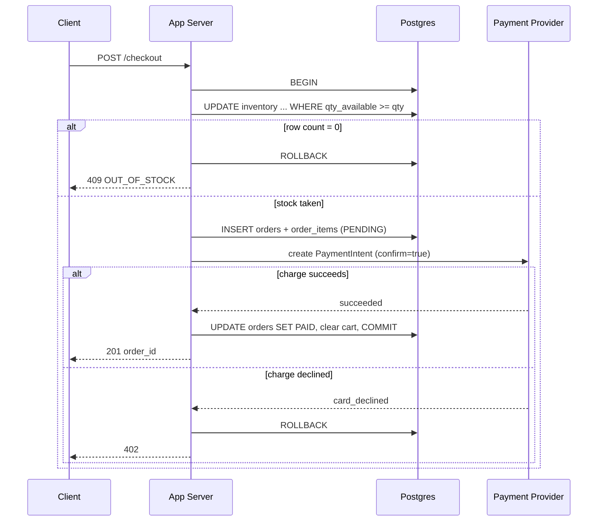

## Solve it (why this shape)

- ✅ **Gained:** one transaction covers inventory and orders, so no oversell and no orphan orders. Zero coordination code.
- ⚠️ **Given up:** the transaction stays open during a network call to the payment provider. Stock rows stay locked for that whole time. Also, a client retry is indistinguishable from a new purchase.
- ❌ **Rejected, check-then-update in app code:** two buyers both read `qty=1`, both pass the check, both decrement. Classic race.
- ❌ **Rejected, in-memory mutex on the app server:** it works with one server and silently breaks the moment we add a second.
- ❌ **Rejected, charge first, reserve after:** Priya pays, then discovers the keyboard is gone. Refunding is worse than rejecting up front.

## Current state (V0)

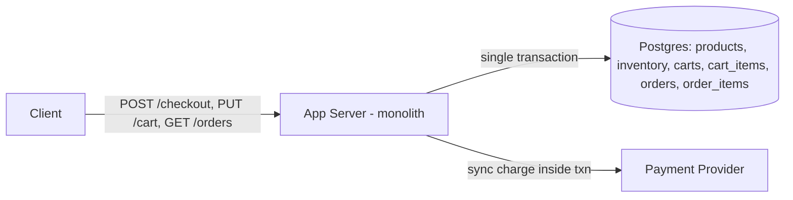

**Every current flow**

1. **Cart write:** `PUT /cart/items` upserts a row into `cart_items` in Postgres. No stock check yet.
2. **Checkout (write path):** load cart, then in one transaction decrement `inventory`, insert `orders` and `order_items`, charge the provider, mark the order `PAID`, clear the cart, commit. On out-of-stock or decline, roll back everything.
3. **Order read path:** `GET /orders` runs `SELECT ... FROM orders WHERE user_id = :uid` on Postgres.
4. **Product read path:** `GET /products/:id` joins `products` and `inventory` in Postgres.

## Interview follow-ups

**"Why not just hold the inventory lock for the whole checkout, payment included?"**
That is exactly what V0 does, and I'd call it out as the weak point. The lock lives as long as the payment call, which can take seconds. Every other buyer of that SKU queues behind it. We keep it in V0 only because correctness is trivial. We'll break it on purpose.

**"What if the payment provider times out?"**
V0 has no good answer. We don't know if Priya was charged. If we roll back, we may have charged her for nothing. If we commit, we may have shipped for free. That unknown outcome is why this design can't survive.

## Recap

| Concept | The Insight |
|---|---|
| Single-DB checkout | One ACID transaction gives atomicity across stock and orders for free. |
| Conditional UPDATE | `WHERE qty_available >= :qty` makes check-and-decrement one atomic step. |
| Lock ordering | Taking rows in `sku_id` order prevents deadlocks between overlapping carts. |
| Price snapshot | Copying `unit_price_cents` into `order_items` freezes the price at purchase. |
| The open-transaction flaw | A network call inside a transaction holds locks and hides unknown outcomes. |

**Interview arc:** *"Check-then-decrement races under concurrent buyers, so a conditional UPDATE inside one transaction makes overselling structurally impossible, at the cost of holding locks across a payment call."*

**Next up (V1):** Priya double-clicks "Pay" on a slow connection. Two requests hit two servers, and she gets charged twice. Say "next" and we'll break it.


-----------------------------------------------------------------------------------------------------------------------
-----------------------------------------------------------------------------------------------------------------------
-----------------------------------------------------------------------------------------------------------------------
-----------------------------------------------------------------------------------------------------------------------


# V1: Idempotent checkout

## Break it

Priya is on a train with weak signal. She taps "Pay" and nothing happens for two seconds, so she taps again.

The load balancer sends the two POSTs to two different app servers. Both read her cart, because neither has cleared it yet. Both open a transaction. Both decrement stock. Both call Stripe.

She is charged $80 twice and gets two orders. The keyboard had 5 units in stock, so the `CHECK` constraint never fires.

The numbers: say 1M checkouts a day and 0.5% hit a retry or double-tap. That is 5,000 double charges a day. Each one is a support ticket or a chargeback.

The same thing happens without a double-tap. The client times out at 10 seconds and its HTTP library retries. The first request is still running on the server.

**This version fixes only duplicates.** A payment timeout where we don't know if the charge happened is a different problem. It comes later.

## Walk the naive attempts

**Attempt 1: disable the Pay button after the first click.**

> **Meera:** Just grey out the button on click. Problem gone.
> **Arjun:** Priya's phone drops signal and the app auto-retries the POST. The button never knew.

It looked reasonable because most double-taps are literally double-taps. It breaks on auto-retries, page refreshes, a second tab, and any non-browser client. The server can't trust the client to behave.

**Attempt 2: dedupe on cart contents.** "If this user placed an order with the same items in the last 60 seconds, reject."

It looked reasonable because it needs no client changes. It breaks in two ways:
- It is check-then-insert. Both requests run the check before either inserts, so the race is back.
- It blocks legitimate behavior. Priya buys two identical gifts for two friends.

**Attempt 3: a Redis lock per user** (`SET lock:user:42 1 NX EX 30`).

It looked reasonable because it serializes concurrent requests. It breaks in three ways:
- A Stripe call that takes 35 seconds outlives the TTL, and the lock vanishes mid-charge.
- Once the first request finishes and the lock is released, a late retry runs the whole checkout again.
- Even when the lock works, the retry gets an error instead of the original answer.

The lock prevents overlap. We need to prevent repetition.

| Approach | Stops concurrent duplicates | Stops late retries | Returns original response |
|---|---|---|---|
| Disable button | No | No | No |
| Dedupe by cart contents | Racy | Blocks real repeat buys | No |
| Redis lock | Until TTL | No | No |
| Idempotency key (below) | Yes | Yes | Yes |

## Solve it

The client generates a unique key per payment attempt. It sends the key with every try of that attempt. The server records the key and its outcome. A repeat of the same key returns the recorded outcome instead of running again.

This is like a restaurant order slip with a number on it. The kitchen sees slip #91 twice and cooks one meal.

- ✅ **Gained:** duplicates are impossible. A retry gets the exact original response, even if the first response was lost on the network.
- ⚠️ **Given up:**
  - Two small extra writes per checkout.
  - The table grows and needs a cleanup job.
  - A client that hits an in-progress key must wait and retry.
  - The payment timeout problem is still unsolved.
- ❌ **Rejected, key in Redis:** the key's completion can't commit atomically with the order. A crash between the two leaves them disagreeing. Postgres keeps both in one transaction.
- ❌ **Rejected, server-generated key:** if the first response is lost, the client never learned the key and can't retry safely.
- ❌ **Rejected, only a `UNIQUE` constraint on orders:** it stops a second order row, but it doesn't stop the second Stripe charge and it can't replay the response.

## Schema (first appearance, full)

```sql
CREATE TABLE idempotency_keys (
  user_id        BIGINT      NOT NULL,
  idem_key       UUID        NOT NULL,
  request_hash   TEXT        NOT NULL,   -- sha256 of the request body
  status         TEXT        NOT NULL,   -- IN_PROGRESS | COMPLETED
  response_code  INT,
  response_body  JSONB,
  order_id       BIGINT,
  locked_at      TIMESTAMPTZ NOT NULL DEFAULT now(),
  created_at     TIMESTAMPTZ NOT NULL DEFAULT now(),
  PRIMARY KEY (user_id, idem_key)
);
```

Scoping the key by `user_id` means one user can never collide with another user's key.

| | Who | When |
|---|---|---|
| Writes | App server (checkout handler) | Claim at request start. Complete at commit or decline. |
| Writes | Cleanup job (cron on one app server) | Hourly `DELETE ... WHERE created_at < now() - interval '24 hours'` |
| Reads | App server (checkout handler) | On every `POST /checkout`, when the claim finds an existing row |

It lives in the same Postgres instance as `orders`. That is what lets "order committed" and "key completed" happen in one transaction.

## Implement it

**API call**

```http
POST /checkout
Authorization: Bearer <jwt>
Idempotency-Key: 6f1c2b9e-3a47-4d0e-9b55-8c1e7a2d4f10
{ "payment_method_id": "pm_card_visa" }
```

The client generates the UUID when the payment form loads or when the user changes the card. All retries of one attempt reuse that key. A new card means a new key.

**Steps, all in the checkout handler**

1. Hash the request body.
2. Claim the key in its own short autocommit statement. It commits immediately, so concurrent requests see it:
   ```sql
   INSERT INTO idempotency_keys (user_id, idem_key, request_hash, status)
   VALUES (:uid, :key, :hash, 'IN_PROGRESS')
   ON CONFLICT (user_id, idem_key) DO NOTHING;
   ```
3. Branch on the row count:
   - **1 row inserted:** we own this attempt. Go to step 4.
   - **0 rows:** `SELECT status, request_hash, response_code, response_body, locked_at FROM idempotency_keys WHERE user_id=:uid AND idem_key=:key`, then:
     - 3a. Hash differs: return `422` (same key, different request).
     - 3b. `COMPLETED`: return the stored code and body, with header `Idempotent-Replayed: true`.
     - 3c. `IN_PROGRESS` and `locked_at` under 60s old: return `409` with `Retry-After: 2`.
     - 3d. `IN_PROGRESS` and stale (the owner probably crashed): try to take over.
       ```sql
       UPDATE idempotency_keys SET locked_at = now()
       WHERE user_id=:uid AND idem_key=:key
         AND status='IN_PROGRESS' AND locked_at < now() - interval '60 seconds';
       ```
       One row updated means we proceed to step 4. Zero rows means someone else took it, so return `409`.
4. Run the V0 checkout transaction unchanged. Add one header to the Stripe call: `Idempotency-Key: {uid}:{key}`.
5. Branch on the payment result:
   - **Success:** inside the same transaction, before `COMMIT`:
     ```sql
     UPDATE idempotency_keys
     SET status='COMPLETED', response_code=201,
         response_body=:json, order_id=:oid
     WHERE user_id=:uid AND idem_key=:key;
     ```
     The order and the completed key commit together or not at all.
   - **Decline:** `ROLLBACK` the main transaction. Then, as a separate statement, `UPDATE idempotency_keys SET status='COMPLETED', response_code=402, response_body=:json ...`. A retry of the same attempt replays the decline. A new card means a new key.

**Why pass the key to Stripe too?** Step 3d can take over a request whose first owner actually reached Stripe before crashing. The same key sent to Stripe returns the original PaymentIntent. Our key guards our database. Stripe's key guards the charge.

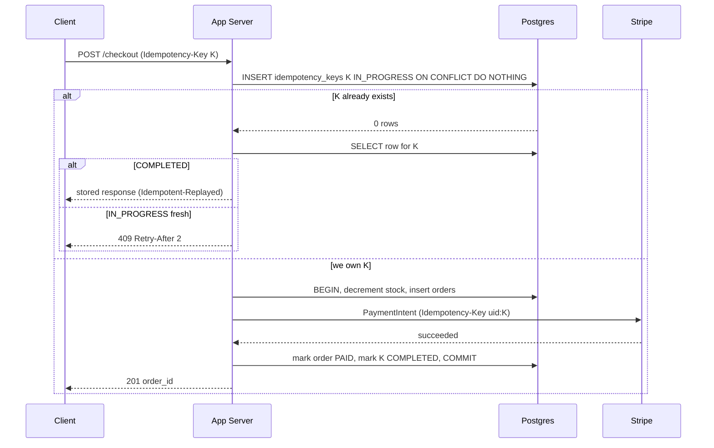

## Current state (V1)

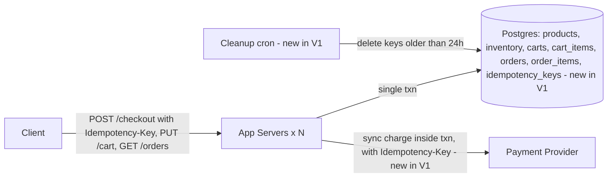

**Every current flow**

1. **Cart write:** unchanged from V0. `PUT /cart/items` upserts into `cart_items`.
2. **Checkout, first attempt:**
   1. Claim the key in `idempotency_keys` as `IN_PROGRESS`.
   2. Run the V0 transaction: decrement `inventory`, insert `orders` and `order_items`, charge Stripe with the key.
   3. On success, mark the order `PAID`, mark the key `COMPLETED` with the stored response, clear the cart, and commit.
   4. On decline, roll back, then record `COMPLETED` with `402`.
3. **Checkout, repeat of the same key:** the claim finds a row. `COMPLETED` replays the stored response. A fresh `IN_PROGRESS` returns `409`. A stale `IN_PROGRESS` is taken over.
4. **Order read path:** unchanged. `GET /orders` reads `orders` from Postgres.
5. **Product read path:** unchanged. `GET /products/:id` joins `products` and `inventory`.
6. **Key cleanup:** the cron deletes `idempotency_keys` rows older than 24 hours.

## Interview follow-ups

**"Why not just use a distributed lock on the user?"**
A lock stops overlap, not repetition. After the first request releases it, the retry runs the whole checkout again. The lock TTL can also expire mid-charge. The idempotency record survives past the request and carries the result.

**"What if the same key arrives with a different cart?"**
The `request_hash` doesn't match, so we return `422`. Silently replaying the old order for a different request would be worse than failing loudly.

## Recap

| Concept | The Insight |
|---|---|
| Idempotency key | The client names the attempt, so the server can tell a retry from a new purchase. |
| Claim before work | An `INSERT ... ON CONFLICT DO NOTHING` committed up front makes concurrent duplicates see `IN_PROGRESS`. |
| Store the response | Replaying the saved result makes a lost response harmless. |
| Same-transaction completion | The key's `COMPLETED` and the order's commit succeed or fail together. |
| Key forwarded to Stripe | Our key protects our database. Stripe's key protects the charge on crash takeover. |

**Interview arc:** *"Disabling the button, deduping by cart, and a Redis lock all fail on late retries or races, so a client-generated idempotency key claimed with a unique insert and completed in the same transaction as the order makes a retry replay the original result instead of repeating it."*

**Next up (V2):** it's a hot-sale morning and Stripe is slow today. Every checkout holds its stock row lock for 8 seconds while waiting on the charge. Fifty buyers of one popular SKU queue behind each other. Say "next" and we'll break it.


-----------------------------------------------------------------------------------------------------------------------
-----------------------------------------------------------------------------------------------------------------------
-----------------------------------------------------------------------------------------------------------------------
-----------------------------------------------------------------------------------------------------------------------


# V2: Reserve stock, then pay outside the transaction

## Break it

It's 9:00 a.m. on a flash-sale morning. Stripe is slow today, and each charge takes 8 seconds instead of the usual 800 ms.

In V0 and V1, the checkout transaction decrements `inventory` first and calls Stripe second. The row lock on that SKU stays held until commit, so it is held for the whole 8 seconds.

Fifty buyers want the same keyboard. Buyer 2 can't even start until buyer 1 commits. The last one waits about 400 seconds.

- One SKU can complete at most 1 checkout per 8 seconds, which is 0.125 per second.
- Each waiting buyer also holds a Postgres connection inside an open transaction.
- With a pool of 100 connections, 50 stuck buyers take half of it.
- A second hot SKU takes the rest, and then every request on the site stalls, including browsing.

**This version fixes only lock duration.** It doesn't fix the "did Stripe charge us or not" timeout problem. That is next.

## Walk the naive attempts

This is the crux: finishing one checkout across inventory, payment and orders without one big transaction. We'll walk three attempts.

**Attempt 1: shorten the payment timeout to 2 seconds.**

It looked reasonable because a shorter call means a shorter lock.

It breaks in two ways:
- A charge that was actually going to succeed in 3 seconds gets abandoned. We now don't know whether Priya was charged.
- Stripe is slow for everyone today. Most checkouts would time out, which turns a slow day into an outage.

**Attempt 2: charge first, decrement stock after.**

It looked reasonable because no lock is held during the slow call.

It breaks on the last unit. Two buyers both pay for the last keyboard, and only one can have it. The loser has to be refunded, which costs a refund fee and an angry customer. We rejected this in V0 for the same reason.

**Attempt 3: optimistic version check.**

> **Meera:** Don't lock at all. Read `qty` and a `version`, call Stripe, then `UPDATE ... WHERE version = :v`.
> **Arjun:** And when the version moved during the 8-second charge? The money is already taken.

It looked reasonable because there is no lock to hold. It breaks because the conflict is discovered after the charge. We'd then have to refund every loser, and on a hot SKU almost everyone loses.

All three attempts fail for one reason. They order the steps badly. The fix is to take the stock first, durably and briefly. Then charge with no lock held. Then finalize.

| Approach | Lock held during charge | Oversell possible | Needs refund for losers |
|---|---|---|---|
| V1 (one big txn) | Yes, seconds | No | No |
| Short timeout | Yes, 2s | No | Unknown outcomes |
| Charge first | No | Yes | Yes |
| Optimistic version | No | Caught too late | Yes |
| Reserve, then pay (below) | No | No | No |

## Solve it

Think of a hotel front desk. The desk holds your room under your name for 10 minutes while you fetch your card. Other guests see that room as taken. If you don't return, the hold lapses and the room goes back on the market.

We do the same with stock. A short transaction takes the stock and records a reservation with an expiry. Then we call Stripe with no locks held. A second short transaction finalizes the order.

- ✅ **What we gained:**
  - Each stock lock is held for milliseconds, not seconds.
  - Slow Stripe no longer stalls other buyers or drains the connection pool.
  - Overselling is still impossible, because the stock was taken before any charge.
- ⚠️ **What we gave up:**
  - The one-transaction atomicity between inventory and payment is gone.
  - A decline now needs an explicit release step instead of a free rollback.
  - Abandoned checkouts hold stock until the TTL expires.
  - New failure windows open: a crash after reserve but before charge, and a charge that succeeds after the reservation expired. The second one is V3's problem.
- ❌ **What we considered and rejected:**
  - **Reserve at add-to-cart:** abandoned carts would lock stock for hours.
  - **Reservations in Redis:** the stock take can no longer commit atomically with the order row. A crash between the two leaves them disagreeing.
  - **Two-phase commit with Stripe:** Stripe doesn't offer a prepare and commit interface.

## Schema (delta only)

New table `reservations`, living in the same Postgres:

```sql
CREATE TABLE reservations (
  reservation_id BIGSERIAL PRIMARY KEY,
  order_id       BIGINT NOT NULL REFERENCES orders(order_id),
  sku_id         BIGINT NOT NULL,
  qty            INT    NOT NULL CHECK (qty > 0),
  status         TEXT   NOT NULL,        -- ACTIVE | CONSUMED | RELEASED
  expires_at     TIMESTAMPTZ NOT NULL
);

CREATE INDEX idx_res_expiry ON reservations (expires_at) WHERE status = 'ACTIVE';
```

Changes to existing tables:
- `inventory.qty_available` now means unreserved stock. A reservation decrements it immediately.
- `orders.status` is now `RESERVED | PAID | CANCELLED`. `PENDING` is gone.
- `idempotency_keys.order_id` is now set in the reserve transaction, not only at completion.

**The order state machine:**

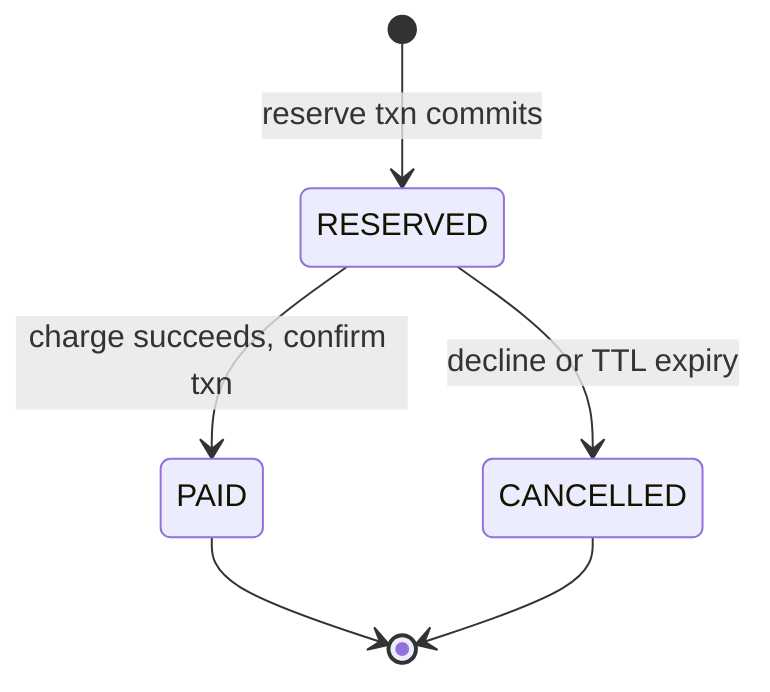

**Who writes and reads what:**

| Structure | Who writes | When | Who reads | When |
|---|---|---|---|---|
| `reservations` (insert, ACTIVE) | Checkout handler | Reserve txn | Sweeper, checkout handler | Expiry scan, confirm/release |
| `reservations` (to CONSUMED) | Checkout handler | Confirm txn | Nobody operationally | Audit |
| `reservations` (to RELEASED) | Checkout handler (decline path), Sweeper (expiry) | Decline, or `expires_at` passed | Nobody operationally | Audit |
| `inventory.qty_available` | Checkout handler (decrement at reserve), Checkout handler and Sweeper (add back on release) | Reserve, release | Product page handler, checkout handler | Page view, checkout |

## Implement it

The API is unchanged. Same `POST /checkout` with the same `Idempotency-Key`. The reservation TTL is 10 minutes, config `RESERVATION_TTL=600s`. The Stripe client timeout is 15 seconds.

**Steps in the checkout handler**

1. Claim the idempotency key exactly as in V1. Branches 3a to 3c are unchanged.
2. **Reserve transaction (short):**
   ```sql
   BEGIN;
   -- per cart item, ORDER BY sku_id (same deadlock rule as V0)
   UPDATE inventory SET qty_available = qty_available - :qty
   WHERE sku_id = :sku AND qty_available >= :qty;
   -- 0 rows for any item: ROLLBACK, 409 OUT_OF_STOCK, key marked COMPLETED with 409

   INSERT INTO orders (user_id, status, total_cents)
   VALUES (:uid, 'RESERVED', :total) RETURNING order_id;

   INSERT INTO order_items (order_id, sku_id, qty, unit_price_cents)
   SELECT :oid, ci.sku_id, ci.qty, p.price_cents
   FROM cart_items ci JOIN products p USING (sku_id) WHERE ci.cart_id = :cart;

   INSERT INTO reservations (order_id, sku_id, qty, status, expires_at)
   SELECT :oid, sku_id, qty, 'ACTIVE', now() + interval '600 seconds'
   FROM order_items WHERE order_id = :oid;

   UPDATE idempotency_keys SET order_id = :oid
   WHERE user_id = :uid AND idem_key = :key;
   COMMIT;
   ```
   Locks are released here. This transaction takes a few milliseconds.
3. **Charge, with no transaction open:** `POST /v1/payment_intents` with `confirm=true` and header `Idempotency-Key: {uid}:{key}`, 15-second timeout.
4. **Success branch, confirm transaction:**
   ```sql
   BEGIN;
   UPDATE reservations SET status = 'CONSUMED'
   WHERE order_id = :oid AND status = 'ACTIVE';
   UPDATE orders SET status = 'PAID', payment_ref = :pi
   WHERE order_id = :oid AND status = 'RESERVED';
   DELETE FROM cart_items WHERE cart_id = :cart;
   UPDATE idempotency_keys SET status='COMPLETED', response_code=201, response_body=:json
   WHERE user_id = :uid AND idem_key = :key;
   COMMIT;
   ```
   If the reservation `UPDATE` touches 0 rows, the sweeper already released it before our charge finished. That means we charged for stock we no longer hold. We log it loudly and leave it for V3.
5. **Decline branch, release transaction:**
   ```sql
   BEGIN;
   UPDATE reservations SET status = 'RELEASED'
   WHERE order_id = :oid AND status = 'ACTIVE'
   RETURNING sku_id, qty;
   -- per returned row, ORDER BY sku_id:
   UPDATE inventory SET qty_available = qty_available + :qty WHERE sku_id = :sku;
   UPDATE orders SET status = 'CANCELLED' WHERE order_id = :oid AND status = 'RESERVED';
   UPDATE idempotency_keys SET status='COMPLETED', response_code=402, response_body=:json
   WHERE user_id = :uid AND idem_key = :key;
   COMMIT;
   ```
   The `status = 'ACTIVE'` guard makes the release run exactly once. A double release can't add stock back twice.
6. **Crash takeover (V1 step 3d, now with a resume):** the new owner reads `order_id` from the key row.
   - No `order_id`: the crash happened before the reserve commit. Start at step 2.
   - `order_id` set, order `RESERVED`: skip to step 3. The same Stripe key returns the original PaymentIntent if the first owner already reached Stripe.

**The expiry sweeper.** It is a cron on one app server, every 30 seconds. It handles checkouts abandoned between reserve and charge.

```sql
WITH expired AS (
  UPDATE reservations SET status = 'RELEASED'
  WHERE reservation_id IN (
    SELECT reservation_id FROM reservations
    WHERE status = 'ACTIVE' AND expires_at < now()
    LIMIT 500 FOR UPDATE SKIP LOCKED)
  RETURNING order_id, sku_id, qty),
restock AS (
  UPDATE inventory i SET qty_available = i.qty_available + s.q
  FROM (SELECT sku_id, SUM(qty) AS q FROM expired GROUP BY sku_id) s
  WHERE i.sku_id = s.sku_id)
UPDATE orders SET status = 'CANCELLED'
WHERE order_id IN (SELECT order_id FROM expired) AND status = 'RESERVED';
```

Two details matter here:
- The `SUM ... GROUP BY sku_id` is required. An `UPDATE ... FROM` applies only one matching row per target row, so two expired reservations for one SKU would restock only one of them.
- `SKIP LOCKED` lets two sweeper instances run without blocking each other.

**Why TTL 600s against a 15s Stripe timeout?** A live checkout finishes or times out in 15 seconds. The sweeper only touches reservations that are 40 times older, so it never races a healthy request. Only a stuck or dead one gets swept.

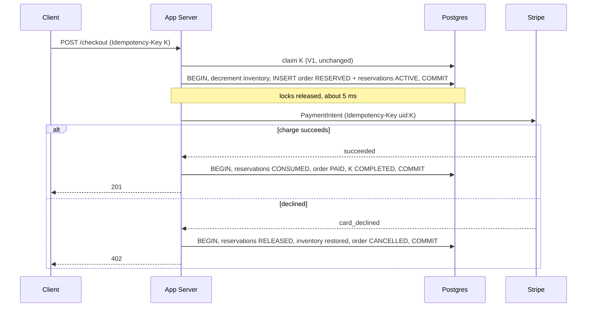

## Current state (V2)

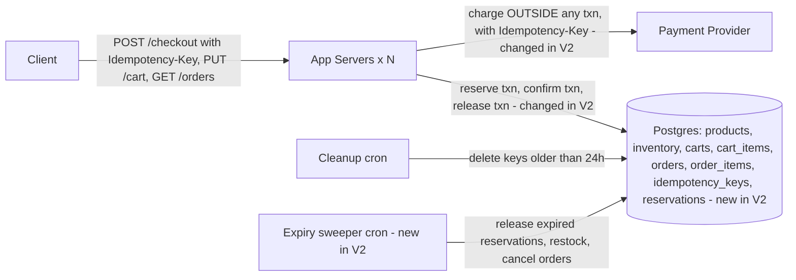

**Every current flow**

1. **Cart write:** unchanged. `PUT /cart/items` upserts into `cart_items`.
2. **Checkout, first attempt:**
   1. Claim the key in `idempotency_keys` as `IN_PROGRESS`.
   2. Reserve transaction: decrement `inventory`, insert `orders` (`RESERVED`), `order_items` and `reservations` (`ACTIVE`), set `order_id` on the key, commit.
   3. Call Stripe with no transaction open.
   4. On success, run the confirm transaction: reservations `CONSUMED`, order `PAID`, cart cleared, key `COMPLETED`.
   5. On decline, run the release transaction: reservations `RELEASED`, stock added back, order `CANCELLED`, key `COMPLETED` with `402`.
3. **Checkout, repeat of the same key:** unchanged for `COMPLETED` and fresh `IN_PROGRESS`. A stale `IN_PROGRESS` takeover now resumes from the order's state: reserve if none exists, charge if `RESERVED`.
4. **Reservation expiry:** every 30 seconds the sweeper releases expired `ACTIVE` reservations, restocks `inventory`, and cancels the orders.
5. **Order read path:** unchanged. `GET /orders` reads `orders` from Postgres.
6. **Product read path:** unchanged in shape. `qty_available` now means unreserved stock.
7. **Key cleanup:** unchanged. The cron deletes keys older than 24 hours.

## Interview follow-ups

**"Why not keep one transaction and just add a statement timeout?"**
A timeout limits the damage but keeps the root problem. A network call to a third party sits inside a lock. We would trade slow checkouts for aborted checkouts with unknown payment outcomes. Taking the stock first and charging outside the lock removes the dependency between lock time and Stripe latency.

**"What if the app crashes right after the reserve commit?"**
The stock is held but nobody is charging. Two things recover it. If the client retries with the same key, the stale-takeover path resumes at the charge step. If the client never returns, the sweeper releases the reservation after 10 minutes. Either way, stock is never lost forever.

## Recap

| Concept | The Insight |
|---|---|
| Reserve then pay | Take stock in a short transaction, then charge with no lock held. |
| Reservation with TTL | A hold that expires on its own means a crash can never strand stock permanently. |
| Status-guarded release | `WHERE status = 'ACTIVE'` makes release run exactly once, even with racing sweeper and handler. |
| TTL far above call timeout | 600s against a 15s Stripe timeout keeps the sweeper away from live requests. |
| Cost of splitting | Losing the single transaction creates new failure windows, which later versions must close. |

**Interview arc:** *"Holding a stock lock across a slow payment call serializes every buyer of a hot SKU, and shortening the timeout or charging first just moves the harm, so we reserve stock in a short transaction with a TTL, charge with no lock held, and finalize in a second transaction, with a sweeper reclaiming abandoned holds."*

**Next up (V3):** Stripe takes 15 seconds, we time out, and Priya's card was actually charged. Our order says `RESERVED` and Stripe says `succeeded`. Say "next" and we'll break it.


-----------------------------------------------------------------------------------------------------------------------
-----------------------------------------------------------------------------------------------------------------------
-----------------------------------------------------------------------------------------------------------------------
-----------------------------------------------------------------------------------------------------------------------


# V3: Unknown payment outcome

## Break it

Priya taps "Pay" on the 9:00 a.m. flash sale. Our app calls Stripe with a 15-second timeout. Stripe takes 18 seconds, and the charge succeeds at second 17.

Our handler gives up at second 15. It sees only a timeout. It has no idea what happened.

In V2, a timeout falls into the decline branch. We run the release transaction, so stock goes back and the order becomes `CANCELLED`. Stripe says `succeeded`.

- Priya is charged $80 and has no order.
- The released keyboard is bought by Rahul.
- She retries with the same key and gets the replayed `402`. She retries with a new key and is charged twice.

Numbers: at 1M checkouts a day, even 0.1% timing out is about 1,000 unknown outcomes a day. On a slow-Stripe day it is 10 times that.

**This version fixes only the unknown outcome.** Cancel and refund by choice come later.

## Walk the naive attempts

**Attempt 1: treat a timeout as a failure and release the stock.**

> **Meera:** A timeout means it didn't work. Release and tell her to retry.
> **Arjun:** Stripe said it timed out on our side, not on theirs. The charge can land after we give up.

It looked reasonable because most timeouts really are failures. It breaks on the ones that aren't. Money is taken, stock is gone, and no order exists.

**Attempt 2: treat a timeout as a success.** Keep the order, mark it `PAID`, and ship.

It looked reasonable because it never loses a charged customer. It breaks when the charge actually failed. We ship a keyboard for free. On a slow day, that is thousands of free keyboards.

**Attempt 3: refund anything we're unsure about.** On timeout, cancel the order and issue a refund.

It looked reasonable because it fixes the charged-but-no-order case. It breaks in three ways:
- A refund of a charge that never happened returns an error, so we are still guessing.
- Customers who really did pay see a charge and then a refund. Some banks keep that hold for days.
- We lose a sale we had already won.

All three attempts pretend we know. We don't. The honest answer is a third state: "we don't know yet." Then we go find out.

| Approach | Charged, no order | Shipped, not charged | Customer sees charge and refund | Resolves the doubt |
|---|---|---|---|---|
| Timeout = fail | Yes | No | No | No |
| Timeout = success | No | Yes | No | No |
| Refund on doubt | No | No | Yes | No |
| Unknown state + reconcile (below) | No | No | No | Yes |

## Solve it

It is like a courier handing you a parcel slip that says "delivery attempted." You don't assume it arrived and you don't assume it didn't. You hold your plans until the tracking page says which.

On timeout we move the order to `PAYMENT_PENDING` and keep the stock held. We then ask Stripe for the truth in two ways:
- **Push:** Stripe sends a webhook when the payment reaches a final state.
- **Pull:** a reconciler cron asks Stripe about every payment that is still open.

Webhooks can be lost, delayed, or duplicated. Polling is slower but never silent. Having both means one covers the other's gap.

- ✅ **What we gained:**
  - No charged-without-order and no shipped-without-charge.
  - Every payment ends in a known state, even after crashes.
  - The client gets an honest "processing" answer instead of a wrong one.
- ⚠️ **What we gave up:**
  - A new non-final order state, `PAYMENT_PENDING`, and a new `202` response the client must handle.
  - Stock stays held while we wait, for up to about 25 minutes.
  - Two resolvers can race, so every transition must be guarded.
  - Webhooks are at-least-once and can arrive out of order, so we need dedupe.
- ❌ **What we considered and rejected:**
  - **Webhooks only:** a dropped webhook leaves an order pending forever.
  - **Polling only:** it works, but customers wait up to a full poll interval for a confirmation that Stripe already sent.
  - **Stripe's search API for lookup:** it is eventually consistent and can miss a payment created seconds ago. Replaying the idempotent create call is exact.
  - **Longer synchronous timeout:** it only shifts the threshold. Some call will always exceed it.

## Schema (delta only)

Two new tables, in the same Postgres:

```sql
CREATE TABLE payments (
  payment_id      BIGSERIAL PRIMARY KEY,
  order_id        BIGINT NOT NULL UNIQUE REFERENCES orders(order_id),
  idem_key        UUID   NOT NULL,        -- same key we send to Stripe
  user_id         BIGINT NOT NULL,
  provider_ref    TEXT,                   -- Stripe PaymentIntent id, NULL until we learn it
  status          TEXT NOT NULL,          -- INITIATED | UNKNOWN | SUCCEEDED | FAILED
  last_checked_at TIMESTAMPTZ NOT NULL DEFAULT now(),
  created_at      TIMESTAMPTZ NOT NULL DEFAULT now()
);
CREATE INDEX idx_pay_open ON payments (last_checked_at)
  WHERE status IN ('INITIATED','UNKNOWN');

CREATE TABLE webhook_events (
  event_id     TEXT PRIMARY KEY,          -- Stripe's evt_...
  type         TEXT NOT NULL,
  received_at  TIMESTAMPTZ NOT NULL DEFAULT now()
);
```

Changes to existing structures:
- `orders.status` becomes `RESERVED | PAYMENT_PENDING | PAID | CANCELLED`.
- The reserve transaction now also inserts the `payments` row as `INITIATED`.

**The new order state machine:**

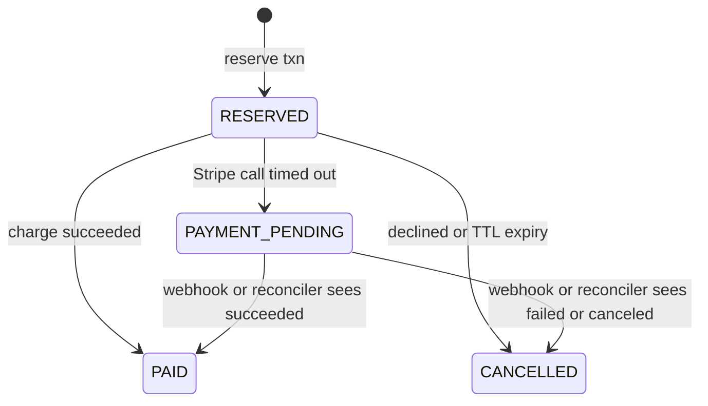

**Who writes and reads what:**

| Structure | Who writes | When | Who reads | When |
|---|---|---|---|---|
| `payments` insert (`INITIATED`) | Checkout handler | Reserve txn | Reconciler | Every 30s |
| `payments` to `UNKNOWN` | Checkout handler | On Stripe timeout | Reconciler | Every 30s |
| `payments` to `SUCCEEDED` or `FAILED` | Checkout handler, webhook handler, reconciler | When the outcome is learned | Order read handler | `GET /orders/:id` |
| `webhook_events` | Webhook handler | On each delivery | Webhook handler | The conflict check on insert |
| `orders` and `reservations` finalization | Checkout handler, webhook handler, reconciler, all through one `resolve` function | On final outcome | Order read handler | Order status page |

The `webhook_events` rows are deleted after 7 days by the existing cleanup cron.

## Implement it

**Change to the V2 checkout, steps 2 to 3**

1. In the reserve transaction, add one statement before `COMMIT`:
   ```sql
   INSERT INTO payments (order_id, idem_key, user_id, status)
   VALUES (:oid, :key, :uid, 'INITIATED');
   ```
2. Call Stripe with the order id in metadata, so webhooks can find the order:
   ```http
   POST https://api.stripe.com/v1/payment_intents
   Idempotency-Key: {uid}:{key}
   amount=8000&currency=usd&payment_method=pm_card_visa&confirm=true&metadata[order_id]=9021
   ```
3. Branch on the result:
   - **Success or decline:** the same as V2. The confirm and release transactions now call the shared `resolve` functions below.
   - **Timeout or network error:** run the pending transaction.
     ```sql
     BEGIN;
     UPDATE orders SET status='PAYMENT_PENDING'
       WHERE order_id=:oid AND status='RESERVED';
     UPDATE reservations SET expires_at = now() + interval '30 minutes'
       WHERE order_id=:oid AND status='ACTIVE';
     UPDATE payments SET status='UNKNOWN', last_checked_at = now()
       WHERE order_id=:oid AND status='INITIATED';
     UPDATE idempotency_keys SET status='COMPLETED', response_code=202,
       response_body='{"order_id":9021,"status":"PAYMENT_PENDING"}'
       WHERE user_id=:uid AND idem_key=:key;
     COMMIT;
     ```
     Return `202 {"order_id": 9021, "status": "PAYMENT_PENDING"}`. A retry with the same key replays this `202`.
4. The client polls `GET /orders/9021` every 2 seconds and shows "confirming your payment".

**The shared resolver functions.** Three callers use them: the checkout handler, the webhook handler and the reconciler. The status guard makes each run once, no matter who gets there first.

```sql
-- resolveSucceeded(order_id, pi)
BEGIN;
UPDATE orders SET status='PAID', payment_ref=:pi
 WHERE order_id=:oid AND status IN ('RESERVED','PAYMENT_PENDING');
-- 0 rows: already resolved by someone else, COMMIT and stop
UPDATE reservations SET status='CONSUMED' WHERE order_id=:oid AND status='ACTIVE';
UPDATE payments SET status='SUCCEEDED', provider_ref=:pi WHERE order_id=:oid;
COMMIT;

-- resolveFailed(order_id): the V2 release transaction, guarded the same way
BEGIN;
UPDATE orders SET status='CANCELLED'
 WHERE order_id=:oid AND status IN ('RESERVED','PAYMENT_PENDING');
-- 0 rows: stop
UPDATE reservations SET status='RELEASED' WHERE order_id=:oid AND status='ACTIVE'
 RETURNING sku_id, qty;
-- per returned row, ORDER BY sku_id:
UPDATE inventory SET qty_available = qty_available + :qty WHERE sku_id=:sku;
UPDATE payments SET status='FAILED' WHERE order_id=:oid;
COMMIT;
```

**Stripe says success but we already cancelled.** This is the rare case where the order is `CANCELLED` and the payment succeeded, for example after a crash. `resolveSucceeded` updates 0 rows. We detect that the order is `CANCELLED` and issue an automatic refund:

```http
POST https://api.stripe.com/v1/refunds
Idempotency-Key: refund:9021
payment_intent=pi_3Nx...
```

The refund key is derived from the order id, so a double trigger refunds once.

**The webhook endpoint (push path)**

1. Stripe calls `POST /webhooks/stripe` with header `Stripe-Signature` and an event such as `payment_intent.succeeded`.
2. The handler verifies the signature with the endpoint secret. A bad signature returns `400`.
3. In one transaction:
   ```sql
   BEGIN;
   INSERT INTO webhook_events (event_id, type) VALUES (:evt, :type)
   ON CONFLICT (event_id) DO NOTHING;
   -- 0 rows: duplicate delivery, COMMIT and return 200
   -- 1 row: read order_id from metadata, call resolveSucceeded or resolveFailed
   COMMIT;
   ```
4. Return `200`. Dedupe and resolve share one transaction. If we crash midway, nothing commits and Stripe redelivers.
5. Out-of-order delivery is safe. The status guard means a late `payment_intent.processing` can never move an order backward from `PAID`.

**The reconciler (pull path).** It is a cron on one app server, every 30 seconds.

```sql
SELECT p.order_id, p.provider_ref, p.idem_key, p.user_id
FROM payments p
WHERE p.status IN ('INITIATED','UNKNOWN')
  AND p.last_checked_at < now() - interval '30 seconds'
  AND p.created_at      < now() - interval '60 seconds'
ORDER BY p.last_checked_at
LIMIT 100 FOR UPDATE SKIP LOCKED;
```

For each row:

1. If `provider_ref` is set, call `GET /v1/payment_intents/{provider_ref}`.
2. If `provider_ref` is NULL (we never saw the response), replay the original create call with the same `Idempotency-Key: {uid}:{key}` and the same body. Stripe returns the original result instead of charging again.
   - A `409` means the first request is still in flight, so leave it for the next run.
3. Map the Stripe status:
   - `succeeded`: `resolveSucceeded`.
   - `requires_payment_method` or `canceled`: `resolveFailed`.
   - `processing` or `requires_action`: leave open and set `last_checked_at = now()`.
4. **Hard deadline at 25 minutes.** If the payment is still unresolved, call `POST /v1/payment_intents/{id}/cancel`.
   - Cancel succeeds: `resolveFailed`.
   - Cancel is rejected because the intent has already succeeded: `resolveSucceeded`.
   - Cancelling is the safe closing move, because it can never leave us guessing.

**Why 25 minutes against a 30-minute reservation?** The reconciler always decides before the sweeper could ever touch the hold. The `INITIATED` rows also cover a handler crash between reserve and the pending transaction, because the reconciler checks them after 60 seconds, well before the original 10-minute TTL.

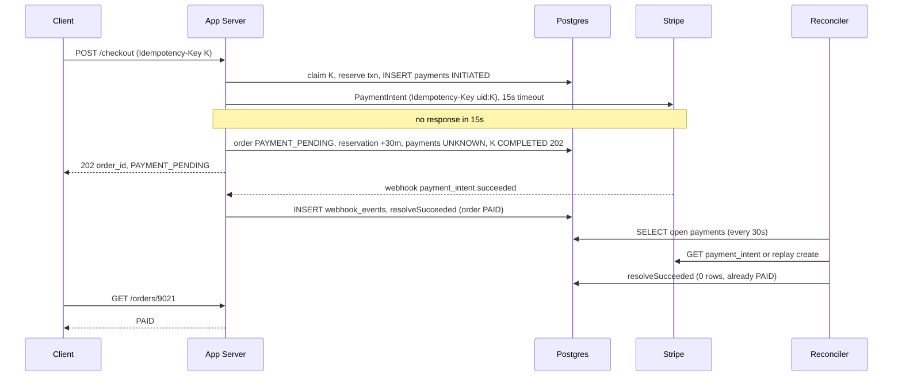

## Current state (V3)

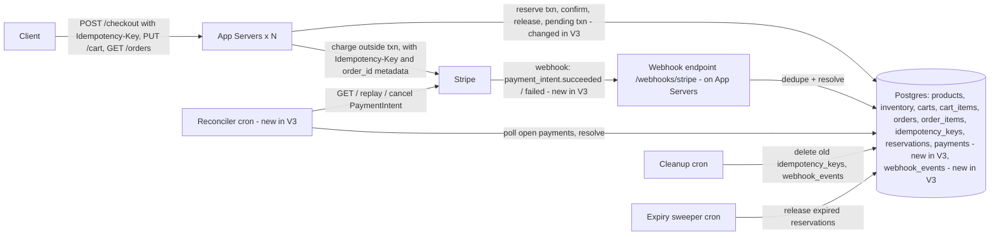

**Every current flow**

1. **Cart write:** unchanged. `PUT /cart/items` upserts into `cart_items`.
2. **Checkout, fast path:**
   1. Claim the key.
   2. Reserve transaction: decrement `inventory`, insert `orders` (`RESERVED`), `order_items`, `reservations` (`ACTIVE`) and `payments` (`INITIATED`).
   3. Charge Stripe with no transaction open.
   4. On success, `resolveSucceeded`. On decline, `resolveFailed`. Return `201` or `402`.
3. **Checkout, timeout path (new):**
   1. The Stripe call times out.
   2. The pending transaction sets the order to `PAYMENT_PENDING`, extends the reservation to 30 minutes, marks `payments` as `UNKNOWN`, and completes the key with `202`.
   3. The client polls `GET /orders/:id`.
4. **Webhook resolution (new):**
   1. Stripe sends an event.
   2. We verify the signature and insert into `webhook_events`.
   3. On a new event, we call `resolveSucceeded` or `resolveFailed` in the same transaction.
5. **Reconciliation (new):** every 30 seconds the reconciler finds open payments, asks Stripe (or replays the idempotent create), and resolves them. After 25 minutes it cancels the intent and resolves.
6. **Checkout, repeat of the same key:** unchanged. `COMPLETED` replays the stored response, which may now be the `202`.
7. **Reservation expiry:** unchanged. The sweeper releases expired `ACTIVE` reservations. Pending orders sit 30 minutes out, so they are never swept first.
8. **Order read and product read:** unchanged in shape. `GET /orders/:id` can now return `PAYMENT_PENDING`.
9. **Cleanup:** the cron now also deletes `webhook_events` older than 7 days.

## Interview follow-ups

**"Why do you need the reconciler if you already have webhooks?"**
Webhooks are at-least-once delivery from a system we don't control. They can be dropped during an outage on either side. Without a pull path, one lost event leaves an order pending and stock held forever. The webhook gives speed. The reconciler gives certainty.

**"What if the webhook and the reconciler both fire at the same moment?"**
Both call the same `resolve` function. The first one flips the order with `WHERE status IN ('RESERVED','PAYMENT_PENDING')` and gets 1 row. The second gets 0 rows and stops. The transition guard is the dedupe, not a lock.

## Recap

| Concept | The Insight |
|---|---|
| Unknown is a real state | A timeout tells you about your call, not about the charge, so model it as `PAYMENT_PENDING` instead of guessing. |
| Hold stock while unknown | Releasing early risks selling charged stock to someone else. |
| Push and pull | Webhooks give speed, the reconciler gives a guarantee, and either alone has a gap. |
| Replay the idempotent call | Re-sending the same create request with the same key reads the original result without a second charge. |
| Guarded transitions | `WHERE status IN (...)` makes every resolver safe to run twice or in parallel. |
| Cancel as the closing move | A cancel at the deadline either succeeds or reveals the payment already succeeded, and it never leaves a guess. |

**Interview arc:** *"Treating a payment timeout as a failure charges customers without orders, and treating it as success ships unpaid goods, so we record the outcome as unknown, keep the stock held, and resolve it through both Stripe webhooks and a reconciler that replays the idempotent call, with status-guarded transitions making every resolver safe to run twice."*

**Next up (V4):** Priya's keyboard is `PAID`, and the next morning she cancels it. A refund is itself a Stripe call that can time out, and the stock has to come back exactly once. Say "next" and we'll break it.


-----------------------------------------------------------------------------------------------------------------------
-----------------------------------------------------------------------------------------------------------------------
-----------------------------------------------------------------------------------------------------------------------
-----------------------------------------------------------------------------------------------------------------------


# V4: Cancel and refund

## Break it

The next morning, Priya's keyboard order 9021 is `PAID`. She changes her mind and taps "Cancel order" in the app.

A natural first build is one request that does everything. It marks the order cancelled, adds the stock back, and calls Stripe's refund API. Two things go wrong.

**First, she double-taps.** Both requests read `PAID`. Both add 1 unit back.
- `inventory.qty_available` now says 7, but the shelf holds 6.
- The `CHECK (qty_available >= 0)` only guards the floor. Nothing guards an inflated count.
- Two buyers later get orders for units that don't exist. This is overselling, which we promised never to allow.

**Second, the refund call times out at 15 seconds.** This is V3's problem again, but now the stock is already back and the order already `CANCELLED`. Did Priya get her $80 back? We don't know.

The numbers: say 3% of 1M daily orders get cancelled. That is 30K cancels a day, or about 0.35 per second. Volume is tiny. Correctness is the whole problem.

**This version fixes only cancel and refund.** Hot-SKU contention comes later.

## Walk the naive attempts

This is a saga step: undoing a completed purchase across inventory and payment without one transaction. A lighter walk this time.

**Attempt 1: do it all in one request.** Restock, mark cancelled, and call Stripe inline.
- It looked reasonable because it mirrors V0's simplicity.
- It breaks on refund timeouts. The caller has no answer. A retry re-runs the restock unless something guards it.

**Attempt 2: restock only after Stripe confirms the refund.**
- It looked reasonable because stock returns only when money does.
- It breaks when a refund fails for hours. The keyboard sits on the shelf, unsold, while the system says it is gone. The goods are physically back. The refund is a separate matter.

**Attempt 3: a `cancel_requested` flag the client polls.** A background job sees it and does both steps.
- It looked reasonable because it is async.
- It breaks if the job does two writes (restock, then refund) with no single owner of "done". A crash between them leaves one half applied and nothing remembers which.

The pattern that works: one short transaction does all the local state changes and writes a durable to-do row. A worker then performs the external call, retrying until it succeeds.

| Approach | Restock exactly once | Refund timeout handled | Crash-safe |
|---|---|---|---|
| Inline in one request | No (double-tap) | No | No |
| Restock after refund | Yes | Yes | Stock stuck on failure |
| Flag plus job, two writes | Racy | Yes | No |
| Guarded txn plus refund work item (below) | Yes | Yes | Yes |

## Solve it

Think of a store return desk. The clerk stamps your receipt "RETURN ACCEPTED", puts the item back on the shelf, and drops a refund slip in the accounts tray. Accounts processes slips until each one is paid. Stamping the receipt twice does nothing, because it is already stamped.

- ✅ **What we gained:**
  - Restock happens exactly once, enforced by the order's status transition.
  - The refund timeout needs no new "unknown" state. We retry the same idempotent call until it answers.
  - The cancel API returns fast and survives crashes.
- ⚠️ **What we gave up:**
  - Cancel is now asynchronous. The user sees `REFUND_PENDING`, not "refunded".
  - A new table and a new worker.
  - Refunds that fail permanently need a human. That path is `FAILED_MANUAL`.
- ❌ **What we considered and rejected:**
  - **Kafka for refund jobs:** 0.35 per second is far below the point where a broker earns its operational cost. A Postgres row commits atomically with the order change. A broker publish would be a second, separate write that can be lost.
  - **A second idempotency-key row for cancel:** the order's status transition already makes the endpoint idempotent.
  - **Cancel while `PAYMENT_PENDING`:** we reject this with `409`. The payment outcome isn't known yet, so there is nothing safe to refund.

## Schema (delta only)

New table `refunds`, in the same Postgres. This is a durable work queue, not a new storage class.

```sql
CREATE TABLE refunds (
  refund_id        BIGSERIAL PRIMARY KEY,
  order_id         BIGINT NOT NULL UNIQUE REFERENCES orders(order_id),
  payment_ref      TEXT   NOT NULL,        -- Stripe pi_...
  amount_cents     INT    NOT NULL,
  reason           TEXT   NOT NULL,        -- USER_CANCEL | LATE_CAPTURE
  status           TEXT   NOT NULL,        -- PENDING | SUCCEEDED | FAILED_MANUAL
  attempts         INT    NOT NULL DEFAULT 0,
  next_attempt_at  TIMESTAMPTZ NOT NULL DEFAULT now(),
  provider_ref     TEXT,                   -- Stripe re_...
  created_at       TIMESTAMPTZ NOT NULL DEFAULT now()
);
CREATE INDEX idx_refund_due ON refunds (next_attempt_at) WHERE status = 'PENDING';
```

`UNIQUE (order_id)` means one full refund per order. Partial refunds are out of scope.

Changes to existing structures:
- `orders.status` gains `REFUND_PENDING` and `REFUNDED`. `CANCELLED` keeps its V2/V3 meaning: never paid.

**Order state machine, updated:**

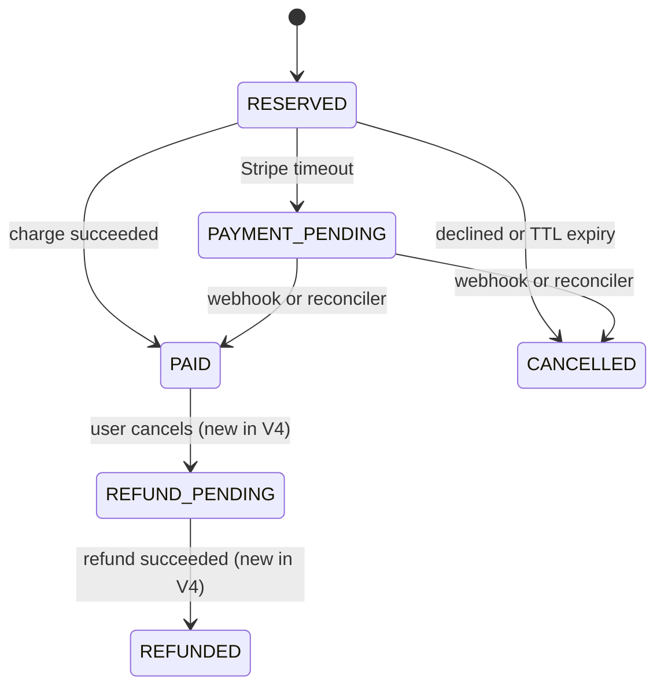

**Who writes and reads what:**

| Structure | Who writes | When | Who reads | When |
|---|---|---|---|---|
| `refunds` insert (`PENDING`) | Cancel handler; `resolveSucceeded` (late-capture case) | Cancel accepted; charge found on a cancelled order | Refund worker | Every 10s |
| `refunds` lease and attempts | Refund worker | Each claim | Refund worker | Next claim |
| `refunds` to `SUCCEEDED` or `FAILED_MANUAL` | Refund worker, webhook handler | Final outcome | Order read handler, ops dashboard | Status page, alert |
| `orders` to `REFUND_PENDING` | Cancel handler | Cancel txn | Order read handler | `GET /orders/:id` |
| `orders` to `REFUNDED` | Refund worker, webhook handler | Refund final | Order read handler | `GET /orders/:id` |
| `inventory` restock | Cancel handler only | Cancel txn | Product page, checkout | Page view, checkout |

## Implement it

**API call**

```http
POST /orders/9021/cancel
Authorization: Bearer <jwt>
{ "reason": "changed_mind" }
```

**Step 1: cancel transaction (cancel handler, short, no network calls)**

```sql
BEGIN;
UPDATE orders SET status = 'REFUND_PENDING'
WHERE order_id = 9021 AND user_id = :uid AND status = 'PAID'
RETURNING total_cents, payment_ref;
-- 0 rows: SELECT status FROM orders WHERE order_id = 9021 AND user_id = :uid
--   REFUND_PENDING or REFUNDED -> COMMIT, return 200 with current status (replay)
--   PAYMENT_PENDING or RESERVED -> 409 "payment still confirming"
--   no row (wrong user) -> 404

-- per item, ORDER BY sku_id (same deadlock rule as V0):
UPDATE inventory SET qty_available = qty_available + :qty WHERE sku_id = :sku;

INSERT INTO refunds (order_id, payment_ref, amount_cents, reason, status)
VALUES (9021, :pi, :total, 'USER_CANCEL', 'PENDING')
ON CONFLICT (order_id) DO NOTHING;
COMMIT;
```

Return `202 {"order_id": 9021, "status": "REFUND_PENDING"}`.

The `status = 'PAID'` guard is the whole dedupe. Of two racing cancels, one gets a row and restocks. The other gets 0 rows, restocks nothing, and returns the current state.

The `items` come from `order_items`, because the V2 reservation rows are already `CONSUMED`.

**Step 2: the refund worker.** It is a cron on one app server, every 10 seconds. It claims work with a lease, so no lock is held across the Stripe call:

```sql
UPDATE refunds SET attempts = attempts + 1,
                   next_attempt_at = now() + interval '2 minutes'
WHERE refund_id IN (
  SELECT refund_id FROM refunds
  WHERE status = 'PENDING' AND next_attempt_at <= now()
  ORDER BY next_attempt_at LIMIT 50 FOR UPDATE SKIP LOCKED)
RETURNING refund_id, order_id, payment_ref, amount_cents, attempts;
```

This commits immediately. If the worker dies mid-call, the lease simply expires and the row becomes due again.

*A correction for V3:* the reconciler's `FOR UPDATE SKIP LOCKED` select should use this same lease pattern. Otherwise it holds row locks across Stripe calls, the exact mistake V2 removed.

**Step 3: call Stripe, no transaction open**

```http
POST https://api.stripe.com/v1/refunds
Idempotency-Key: refund:9021
payment_intent=pi_3Nx...&amount=8000
```

The key is derived from the order id. Every retry sends the same key, so Stripe returns the original refund and never creates a second.

**Step 4: branch on the result**

- **Success** (refund object returned):
  ```sql
  BEGIN;
  UPDATE refunds SET status='SUCCEEDED', provider_ref=:re
    WHERE refund_id=:rid AND status='PENDING';
  UPDATE orders SET status='REFUNDED'
    WHERE order_id=9021 AND status='REFUND_PENDING';
  COMMIT;
  ```
- **Timeout or network error:** do nothing. The lease expires, the worker retries with the same key, and Stripe returns the original result. No unknown state is needed. The idempotency key is the resolver.
- **Transient error (5xx, 429):** set `next_attempt_at = now() + least(10s * 2^attempts, 1h) + random(0..5s)`. This is exponential backoff with jitter.
- **Permanent error:** `charge_already_refunded` counts as success. Anything else, or `attempts >= 10`, sets `status='FAILED_MANUAL'` and fires an alert. A human decides.

**Step 5: webhook for late failures.** Stripe can accept a refund and fail it later (for example, a closed card account). The existing `/webhooks/stripe` endpoint now also handles `refund.failed`. It dedupes through `webhook_events` as in V3, then sets the refund to `FAILED_MANUAL`.

**Change to V3's late-capture case.** When `resolveSucceeded` updates 0 rows because the order is `CANCELLED`, it no longer calls Stripe inline. It inserts a `refunds` row with reason `LATE_CAPTURE` and key `refund:{order_id}`. There is now one refund path for the whole system.

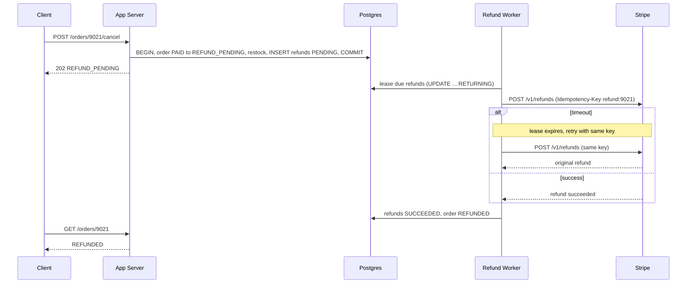

## Current state (V4)

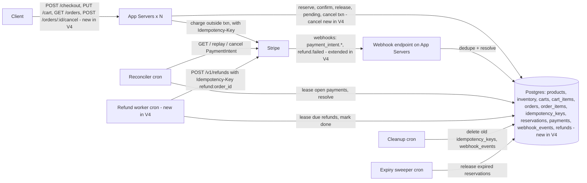

**Every current flow**

1. **Cart write:** unchanged. `PUT /cart/items` upserts into `cart_items`.
2. **Checkout, fast path:** unchanged. Claim key, reserve transaction (including `payments` `INITIATED`), charge Stripe outside any transaction, then `resolveSucceeded` or `resolveFailed`.
3. **Checkout, timeout path:** unchanged. Order `PAYMENT_PENDING`, reservation extended to 30 minutes, `payments` `UNKNOWN`, `202` returned.
4. **Webhook resolution:** unchanged for `payment_intent.*`. New: `refund.failed` sets the refund to `FAILED_MANUAL`.
5. **Reconciliation:** unchanged, except it now leases rows instead of holding locks.
6. **Cancel and refund (new):**
   1. `POST /orders/:id/cancel` runs the cancel transaction: order `PAID` to `REFUND_PENDING`, restock, insert `refunds` `PENDING`.
   2. The refund worker leases the row and calls Stripe with `Idempotency-Key: refund:{order_id}`.
   3. On success the refund is `SUCCEEDED` and the order is `REFUNDED`. On timeout the lease expires and the same call is retried.
7. **Late-capture refund:** when a charge succeeds on an already `CANCELLED` order, `resolveSucceeded` inserts a `refunds` row (`LATE_CAPTURE`). Flow 6 steps 2 and 3 take over.
8. **Checkout, repeat of the same key:** unchanged.
9. **Reservation expiry:** unchanged.
10. **Order read and product read:** `GET /orders/:id` can now return `REFUND_PENDING` and `REFUNDED`. Product reads are unchanged.
11. **Cleanup:** unchanged.

## Interview follow-ups

**"Why restock before the refund succeeds?"**
The goods never left the warehouse, so the stock is real the moment the cancel is accepted. The refund is a money problem, and money problems shouldn't hold inventory hostage. If we waited, a refund stuck for hours would hide a sellable keyboard. The restock is safe because the `PAID` to `REFUND_PENDING` transition happens exactly once.

**"What if the refund call times out?"**
We do nothing special. The lease expires and the worker sends the same request with the same `refund:9021` key. Stripe returns the original refund. The idempotency key resolves the doubt, so no `UNKNOWN` state is needed here, unlike a charge, where we had to ask Stripe the status.

## Recap

| Concept | The Insight |
|---|---|
| Guarded transition as dedupe | `WHERE status = 'PAID'` lets exactly one of two racing cancels restock. |
| Durable work row | Writing the refund to-do in the same transaction as the state change avoids a lost or double publish. |
| Deterministic idempotency key | `refund:{order_id}` makes every retry safe and gives one refund per order. |
| Lease, not lock | Claiming work with a timed lease keeps locks out of network calls and heals worker crashes. |
| Restock is local, refund is remote | Local facts commit now. Remote calls are retried until they land. |

**Interview arc:** *"Doing cancel as one inline request double-restocks on a double-tap and loses track of a timed-out refund, so one short transaction flips the order status, restocks once, and writes a refund work row, while a worker retries Stripe with a deterministic idempotency key until it lands."*

**Next up (V5):** a hot-sale drop opens at 9:00. Twenty thousand buyers want 500 units of one keyboard, and every reserve transaction fights over one `inventory` row. That single row can only be updated a few hundred times a second. Say "next" and we'll break it.


-----------------------------------------------------------------------------------------------------------------------
-----------------------------------------------------------------------------------------------------------------------
-----------------------------------------------------------------------------------------------------------------------
-----------------------------------------------------------------------------------------------------------------------


# V5: Hot SKU contention

## Break it

It's 9:00 a.m. on a drop day. A limited keyboard (sku 77) goes on sale: 500 units, 20,000 buyers, all clicking within about 10 seconds. That is roughly 2,000 reserve transactions per second against one row.

Every reserve transaction starts with `UPDATE inventory ... WHERE sku_id = 77`. That row lock is held until the transaction commits, about 5 ms.

- One row can complete at most 1 / 5 ms = **200 updates per second**.
- Requests arrive at 2,000 per second. About 1,800 per second pile up.
- Each waiting request holds a Postgres connection. A pool of 100 is full within 50 ms.
- Then every other query stalls, including browsing and other SKUs.

The cruel part is that 19,500 of these buyers will be rejected anyway. We are spending our scarcest resource, a row lock, on requests that can never succeed.

**This version fixes only contention on one hot row.** The 20K buyers refreshing the product page is a read problem. That is a later version.

## Walk the naive attempts

Hot-spot mitigation has several established fixes. We'll look at each one, with a sketch.

**Attempt 1: shorten the lock.** Move the `UPDATE inventory` to the last statement of the reserve transaction.
- It looked reasonable because the lock is only taken just before commit, about 1 ms.
- It gives 1,000 per second at best. That is still below 2,000, and it still sends doomed requests to Postgres.

**Attempt 2: sharded counters in Postgres.** Split sku 77 into 10 bucket rows of 50 units each.

```sql
CREATE TABLE inventory_buckets (
  sku_id BIGINT, bucket INT, qty INT CHECK (qty >= 0),
  PRIMARY KEY (sku_id, bucket));
-- reserve: pick a random bucket, try the next if 0 rows
UPDATE inventory_buckets SET qty = qty - 1
WHERE sku_id = 77 AND bucket = :random AND qty >= 1;
```

It looked reasonable because it spreads the lock 10 ways, so the ceiling is about 2,000 per second. It breaks in three ways:
- All 20,000 requests still hit Postgres and use connections.
- Buckets drain unevenly. A buyer finds their bucket empty and must probe up to 9 others.
- The product page now needs `SUM(qty)` across buckets.

**Attempt 3: a queue per SKU.** Put every buy request in a queue with one consumer for sku 77.

```
LPUSH queue:sku:77 {order request}   -- one worker, one request at a time
```

It looked reasonable because one consumer means zero lock contention. It breaks on user experience and moving parts:
- Checkout becomes asynchronous. Every buyer waits in line, including the 19,500 who will lose.
- It needs a broker, a consumer per hot SKU, and a status channel back to the client.
- The single consumer is its own bottleneck and its own failure point.

The common thread: the fixes either spread the load on Postgres or serialize it. None of them stops doomed requests from reaching Postgres.

| Approach | Ceiling on the hot row | Doomed requests reach Postgres | Extra moving parts |
|---|---|---|---|
| Shorter lock | about 1,000 per second | Yes | None |
| Sharded buckets | about 2,000 per second | Yes | Bucket logic, SUM reads |
| Queue per SKU | One consumer | Yes, they wait | Broker, workers, async UX |
| Redis admission gate (below) | Postgres sees about 500 | No | One Redis key per hot SKU |

## Solve it

Think of a stadium gate. There are 500 seats, so the gate hands out 500 wristbands. Once they are gone, the attendant says "sold out" to everyone else, in one second, without letting them into the box office. Only wristband holders reach the box office.

We put a counter in Redis in front of Postgres. It holds the number of units still available. A buyer must atomically take from the counter before the reserve transaction. If the counter says zero, we answer `409 SOLD_OUT` and never touch Postgres.

**The key rule: Redis is a gate, not the source of truth.** Postgres still runs the conditional `UPDATE`. So if Redis is wrong, it can only be wrong in two ways:
- **It admits too many.** Postgres rejects the extras. No oversell.
- **It admits too few.** We lose a sale for a short while, and a resync heals it.

- ✅ **What we gained:**
  - Postgres sees about 500 requests, not 20,000.
  - A loser gets an answer in about 1 ms.
  - Other SKUs and browsing stay healthy.
  - If Redis dies, we fail open to V4 behavior. That is slower, not wrong.
- ⚠️ **What we gave up:**
  - A second store whose count can drift from Postgres.
  - Every place that releases stock must also give a token back.
  - A buyer told "sold out" may see stock return a minute later when someone's card declines. That is normal retail behavior.
  - Hot SKUs must be flagged, because gating every SKU is wasteful.
- ❌ **What we considered and rejected:**
  - **Redis as the source of truth:** we rejected this in V2. The stock take could not commit atomically with the order row. The gate avoids that by never being authoritative.
  - **Sharded buckets or a queue:** see the walk above. Both keep doomed traffic on the hot path.
  - **Gating every SKU:** a long-tail SKU has no contention. The gate would only add a network hop.

**Why a key-value store here?** The access pattern is one atomic check-and-decrement on a single integer, thousands of times per second. Redis does this in memory in microseconds, and a Lua script makes the check and the decrement one atomic step. Postgres would be doing the same job we are trying to take off it.

## Schema (delta only)

One Postgres column and one Redis key shape.

```sql
ALTER TABLE products ADD COLUMN gate_enabled BOOLEAN NOT NULL DEFAULT false;
```

```
Redis key:  gate:sku:{sku_id}     value: integer, units still admissible
Example:    gate:sku:77  ->  500
```

It lives on one Redis primary with a replica, in the same region as the app servers.

**Who writes and reads what:**

| Structure | Who writes | When | Who reads | When |
|---|---|---|---|---|
| `products.gate_enabled` | Ops, via an admin script | Before a planned drop | Checkout handler (cached 60s) | Each checkout |
| `gate:sku:{id}` (initial value) | Ops script, then the gate-sync cron | At enable time, then every 5s | Checkout handler | Each checkout |
| `gate:sku:{id}` (decrement) | Checkout handler, through the Lua script | Admission | Same Lua script | Same call |
| `gate:sku:{id}` (increment) | Checkout handler (failure paths), `resolveFailed`, cancel handler, expiry sweeper | After the DB commit that frees stock | Lua script | Next checkout |

## Implement it

The API is unchanged: `POST /checkout` with an `Idempotency-Key`. The new step sits between the key claim and the reserve transaction.

**The gate script** (Redis, atomic):

```lua
-- KEYS[1] = gate:sku:77   ARGV[1] = qty wanted
local cur = redis.call('GET', KEYS[1])
if not cur then return -1 end          -- gate not initialised: fail open
if tonumber(cur) >= tonumber(ARGV[1]) then
  redis.call('DECRBY', KEYS[1], ARGV[1])
  return 1                             -- admitted
end
return 0                               -- sold out
```

**Steps in the checkout handler**

1. Claim the idempotency key (V1, unchanged).
2. Take the gate. For each cart item with `gate_enabled`, in `sku_id` order:
   ```
   EVALSHA <gate_script> 1 gate:sku:77 1
   ```
   - **Returns 1:** admitted. Remember this item.
   - **Returns -1:** the key is missing or Redis is down. Skip the gate and go to Postgres.
   - **Returns 0:** run `INCRBY` for each item admitted so far. Mark the key `COMPLETED` with `409 SOLD_OUT`. Return `409`. Postgres was never touched.
3. Run the V2 reserve transaction unchanged. If Postgres returns 0 rows for an item, it rolls back and returns `409 OUT_OF_STOCK`. The other admitted items were not taken, so give their tokens back with `INCRBY`. Do not return the token for the item Postgres rejected. Postgres is the truth, and Redis was over-admitting.
4. Charge Stripe and finalize as in V2 and V3. `resolveSucceeded` needs no gate change. The token was already spent.
5. **Release hooks.** After the Postgres commit that frees stock, give tokens back:
   ```
   INCRBY gate:sku:77 1
   ```
   This is called from `resolveFailed` (decline or webhook failure), from the cancel handler (V4), and from the expiry sweeper, which batches by `sku_id`. It runs after commit, so a crash in between loses a token, never invents one.
6. **Gate-sync cron**, every 5 seconds, for each SKU with `gate_enabled`:
   ```sql
   SELECT qty_available FROM inventory WHERE sku_id = 77;
   ```
   ```
   SET gate:sku:77 <qty_available>
   ```
   This heals lost tokens and Redis failovers. It can briefly over-admit by the number of requests in flight. Over-admission is safe, because Postgres rejects the extras.
7. **Enable for a drop.** The ops script runs `UPDATE products SET gate_enabled = true WHERE sku_id = 77`, then sets `gate:sku:77` to the current `qty_available`.

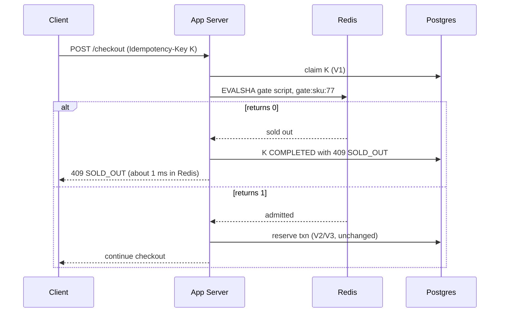

## Current state (V5)

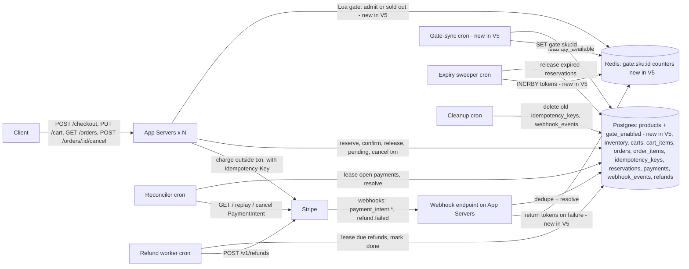

**Every current flow**

1. **Cart write:** unchanged. `PUT /cart/items` upserts into `cart_items`.
2. **Checkout, gated SKU (new):**
   1. Claim the key.
   2. Run the Lua gate in Redis for each gated item. A `0` returns `409 SOLD_OUT` without touching Postgres.
   3. Run the reserve transaction. If Postgres rejects, give back tokens for the other items.
   4. Charge Stripe and finalize as before.
3. **Checkout, ungated SKU:** unchanged. No Redis call.
4. **Checkout, Redis down:** the gate fails open, and checkout runs as in V4.
5. **Checkout, timeout path:** unchanged. Order `PAYMENT_PENDING`, `202`, resolved by webhook or reconciler.
6. **Webhook resolution:** unchanged, except `resolveFailed` now returns tokens after commit.
7. **Reconciliation:** unchanged.
8. **Cancel and refund:** unchanged, except the cancel transaction is followed by a token return after commit.
9. **Late-capture refund:** unchanged.
10. **Reservation expiry:** unchanged, plus token returns batched by SKU.
11. **Gate sync (new):** every 5 seconds the cron overwrites each gated counter with Postgres `qty_available`.
12. **Order read and product read:** unchanged. The product page still reads Postgres.
13. **Cleanup:** unchanged.

## Interview follow-ups

**"What if Redis loses the counter or fails over?"**
The Lua script returns -1 for a missing key, so checkout fails open to Postgres. That is slower on a hot SKU but never wrong. The 5-second sync cron rebuilds the counter from Postgres. The worst case is a few seconds of heavy load on one row.

**"Why not just use Redis for the whole reservation?"**
The reservation has to commit atomically with the order row, the idempotency key and the payment row. Redis cannot join that transaction. A crash between a Redis decrement and a Postgres insert leaves two stores disagreeing, with no way to tell which is right. As a gate, Redis can be wrong safely. As the authority, it can't.

## Recap

| Concept | The Insight |
|---|---|
| Hot row ceiling | A row lock held for 5 ms caps one SKU at about 200 updates per second, however big the database is. |
| Doomed traffic | On a drop, 97% of requests lose, so don't spend a lock on them. |
| Gate, not authority | Redis may be wrong, but Postgres's conditional `UPDATE` stays the final check, so wrong means slow or briefly sold-out, never oversold. |
| Fail open | A missing or dead gate falls back to Postgres instead of blocking sales. |
| Over-admit is safe | The sync cron may let a few extra requests through, and Postgres rejects them. |
| Return tokens after commit | A crash loses a token but never invents one, and the sync heals it. |

**Interview arc:** *"A hot SKU serializes every buyer on one row lock and sends 19,500 doomed requests to Postgres, and shorter locks, sharded buckets or a queue still send them all there, so a Redis counter with an atomic Lua check rejects the losers in a millisecond while Postgres's conditional UPDATE stays the authority, which makes any Redis error cost speed instead of correctness."*

**Next up (V6):** the drop is live and the 20,000 buyers are refreshing the product page to see if stock is back. Every refresh runs a join on Postgres. Say "next" and we'll break it.


-----------------------------------------------------------------------------------------------------------------------
-----------------------------------------------------------------------------------------------------------------------
-----------------------------------------------------------------------------------------------------------------------
-----------------------------------------------------------------------------------------------------------------------


# V6: Caching the product page

## Break it

It's 9:00 a.m. on the same drop. The 20,000 buyers for sku 77 each refresh the product page about every 2 seconds, hoping stock comes back. That is roughly 10,000 page loads per second for one product.

Each `GET /products/77` runs a join of `products` and `inventory` on Postgres. The data barely changes between refreshes. The name, description and price haven't changed in weeks.

- Each page load costs about 3 ms of database time, including the connection round trip.
- 10,000 per second is about 30 busy connections, out of a pool of 100, doing the same work over and over.
- Browsing of other products on drop day adds more. The checkout writes then compete with page reads for connections and CPU on the same primary.

Postgres reads don't wait on row locks, so this isn't a lock problem. It's capacity. We burn the same database that guards correctness on answering the same question 10,000 times a second.

**This version fixes only the read load on product pages.** Surviving the primary dying is a different mechanism. It comes next.

## Walk the naive attempts

This is a lighter walk. The crux was in V2 and V3.

**Attempt 1: cache the whole page, stock included, for 60 seconds.**
- It looked reasonable because one number covers everything.
- It breaks on stock. At 9:00:05 the last unit sells. For 55 more seconds the page says "In stock" and thousands of buyers click Buy.
- It breaks worse on price. If checkout ever read the cached price, an old price could be charged.

**Attempt 2: an in-process cache on each app server.**
- It looked reasonable because it needs no new infrastructure and has zero network hops.
- It breaks in two ways. With 20 servers, each has its own copy, so a price change reaches them at 20 different moments. Each server also misses once per TTL, so Postgres still sees 20 identical queries.

**Attempt 3: add read replicas and send page reads to them.**
- It looked reasonable because it keeps the data fresh.
- It's a real option, but it is a different mechanism with its own lag and failover story. It gets its own version. The cache is also cheaper per read, and it is needed anyway because Postgres replicas would still be answering identical queries.

The thing to see is that the page has two kinds of data. Name, description and price change rarely. Stock changes every second. They need different treatment.

| Approach | Postgres load | Stock freshness | Consistent across servers | Extra parts |
|---|---|---|---|---|
| Whole-page cache, 60s | Low | Bad, up to 60s | Yes | One cache |
| In-process cache | Medium, N misses | OK | No | None |
| Read replicas | Same queries, spread | Good | Yes | Replica lag, routing |
| Shared Redis cache, split by mutability (below) | Near zero | Good, 3-5s | Yes | Separate Redis |

## Solve it

Think of a notice board outside a shop. The opening hours and the price list are printed once and updated when they change. The "last 12 in stock" card is a whiteboard someone rewrites every few seconds. Nobody phones the warehouse for each passer-by.

We use cache-aside on a shared Redis, with separate keys and separate lifetimes:
- **Product details** (name, description, price): cached for about 60 seconds, and deleted explicitly when an admin changes them.
- **Stock status:** cached for 3 to 5 seconds with no invalidation. It self-heals fast.
- **Gated hot SKUs:** the page reads the V5 gate counter directly. It already exists and is already fresh.

**The layer decision.** We cache at the app layer, in a shared Redis. We reject a CDN for the product API in this version. Redis handles 100K+ simple reads per second, which is ten times our peak. A CDN would add a second copy, with its own purge delay, for a number we can already serve. The images and static assets are already on a CDN and are out of scope. A CDN for API responses becomes worth revisiting when we go multi-region.

**The rule that protects money:** checkout never reads this cache. Prices come from Postgres at reserve time, as in V0. A stale cache can mislead a page. It can never change what is charged.

- ✅ **What we gained:**
  - Postgres sees about one page-load query per key per minute, not 10,000 per second.
  - A page load drops from about 3 ms of database time to about 1 ms of Redis time.
  - A stale "In stock" is harmless. The V5 gate and the V2 reserve transaction still reject the extra buyer.
- ⚠️ **What we gave up:**
  - Prices on the page can be stale for up to about 60 seconds after a race between the admin's commit and the cache delete.
  - Stock on the page can lag by up to 5 seconds.
  - A new failure mode: a popular key expires and thousands of requests miss together. That is a cache stampede, covered below.
  - Another store to run and monitor.
- ❌ **What we considered and rejected:**
  - **Write-through cache of stock:** every cancel, release and sweep would have to update it. Stock is write-hot, and a short TTL does the job with no write path.
  - **Cache invalidation on every stock change:** it turns 500 writes into 500 cache writes for a number nobody needs to the unit.
  - **Reusing the gate Redis for the cache:** the cache needs an eviction policy (`allkeys-lru`). Evicting a gate counter would silently break V5. They live on separate instances.

## The known sub-problem: cache stampede

A hot key expires. In the next millisecond, thousands of requests all miss and all query Postgres. The cache we added to protect the database causes the spike we wanted to avoid.

There are three established fixes:

**Fix 1: single-flight lock.** On a miss, one request takes a lock and loads. The rest wait or retry.
```python
if redis.set("lock:"+key, 1, nx=True, ex=5):   # winner loads
    ...
else:
    sleep(50ms); retry cache read               # losers wait
```

**Fix 2: serve stale while one request refreshes.** Store a soft expiry inside the value. After soft expiry, one caller refreshes and everyone else keeps serving the old value.
```python
if entry.soft_exp < now() and redis.set(lock, 1, nx=True, ex=5):
    refresh()                                   # one refresher
return entry.value                              # everyone gets something
```

**Fix 3: probabilistic early refresh.** Each reader may refresh early, with a probability that rises as expiry nears.
```python
if now() - delta * beta * log(random()) >= expires_at:
    refresh()                                   # a few refresh early
```
It needs no lock, but it is probabilistic, so a burst can still slip through.

**Which fits here:** Fix 2, soft TTL plus a single refresher. A page that is 10 seconds stale is fine, and Fix 2 means no buyer ever waits on a miss. A cold miss, when the key has been evicted entirely, uses Fix 1, with a bounded wait. We also add random jitter to hard TTLs, so a thousand product keys don't all expire together.

## Schema (delta only)

No Postgres changes. Two key shapes on a new Redis instance, separate from the V5 gate Redis:

```
prod:{sku_id}   -> {"v": {"name": "...", "desc": "...", "price_cents": 8000},
                    "soft_exp": 1767430860}          hard TTL 300s + random(0..30s)
stk:{sku_id}    -> {"v": 12, "soft_exp": 1767430803} hard TTL 30s + random(0..5s)
lock:{key}      -> 1                                 TTL 5s
```

Soft expiry is 60s for `prod:` and 3s for `stk:`.

It lives on its own Redis primary with a replica, with `maxmemory-policy allkeys-lru`.

**Who writes and reads what:**

| Structure | Who writes | When | Who reads | When |
|---|---|---|---|---|
| `prod:{id}` | Product read handler (refresh) | Cold miss or soft expiry | Product read handler | Every page load |
| `prod:{id}` (delete) | Admin product-update handler | After the Postgres commit of a price or name change | Nobody | Next load takes the cold-miss path |
| `stk:{id}` | Product read handler (refresh) | Cold miss or soft expiry | Product read handler | Every page load, for ungated SKUs |
| `gate:sku:{id}` (read only) | Not written here, see V5 | n/a | Product read handler | Every page load, for gated SKUs |
| `lock:{key}` | Product read handler | Before a refresh | Product read handler | Before a refresh |

Postgres is the source of truth for every cached value.

## Implement it

**API call**

```http
GET /products/77
```
```json
{ "sku_id": 77, "name": "Keychron Q1", "price_cents": 8000,
  "stock": { "status": "LOW", "remaining": 12 } }
```

**The shared helper, `cached_get`, in the product read handler**

```python
def cached_get(key, soft_s, hard_s, loader):
    raw = redis_cache.get(key)
    if raw:
        e = json.loads(raw)
        if e["soft_exp"] > now():
            return e["v"]                                   # fresh hit
        if redis_cache.set("lock:"+key, 1, nx=True, ex=5):  # soft-expired: one refresher
            try: _store(key, loader(), soft_s, hard_s)
            finally: redis_cache.delete("lock:"+key)
        return e["v"]                                       # others serve stale
    # cold miss
    for _ in range(3):
        if redis_cache.set("lock:"+key, 1, nx=True, ex=5):
            try:
                v = loader(); _store(key, v, soft_s, hard_s); return v
            finally: redis_cache.delete("lock:"+key)
        sleep(0.05)
        raw = redis_cache.get(key)
        if raw: return json.loads(raw)["v"]
    return loader()                                         # bounded wait, then go direct

def _store(key, v, soft_s, hard_s):
    redis_cache.set(key, json.dumps({"v": v, "soft_exp": now()+soft_s}),
                    ex=hard_s + random.randint(0, 30))
```

**Steps in `GET /products/77`**

1. Load the product details: `cached_get("prod:77", 60, 300, load_product)`.
   - `load_product` runs `SELECT sku_id, name, description, price_cents FROM products WHERE sku_id = 77, gate_enabled`.
2. Load stock, branching on the gate flag from step 1:
   - **Gated SKU:** `GET gate:sku:77` on the gate Redis, with no cache entry. If the key is missing (V5 returns -1 in that case), fall through to the ungated path.
   - **Ungated SKU:** `cached_get("stk:77", 3, 30, load_stock)`.
   - `load_stock` runs `SELECT qty_available FROM inventory WHERE sku_id = 77`.
3. Turn the number into a display status: `0` is `SOLD_OUT`, `1 to 10` is `LOW` with the exact count, `above 10` is `IN_STOCK` with no count.
4. Return the JSON.
5. **Redis cache down:** `cached_get` catches the connection error and calls the loader directly. Pages get slower and Postgres load rises. Nothing breaks.

**Invalidation on a price or name change**

1. The admin handler runs `UPDATE products SET price_cents = 7500 WHERE sku_id = 77` and commits.
2. After the commit, it runs `DEL prod:77`.
3. The next page load takes the cold-miss path and refills.
4. If a reader refilled the old value between the commit and the `DEL`, it lives at most 60 seconds. That is the price staleness we accepted, and checkout never reads it.

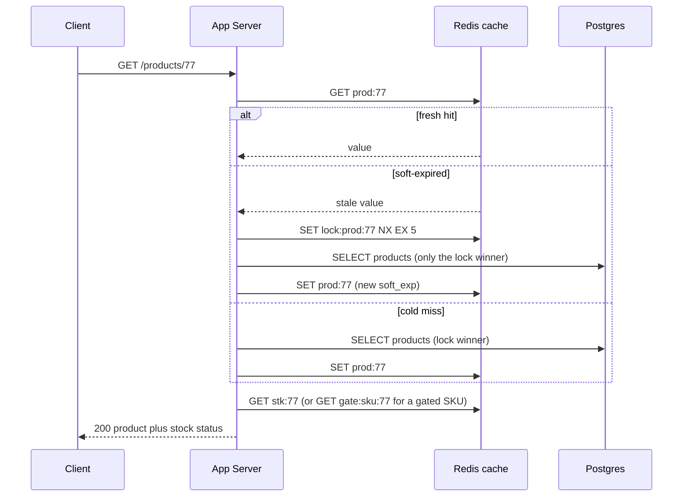

## Current state (V6)

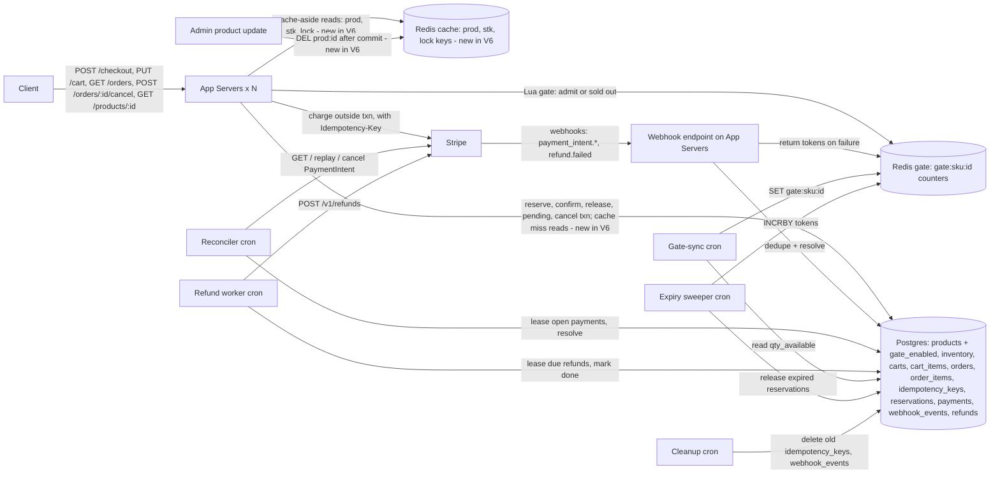

**Every current flow**

1. **Cart write:** unchanged. `PUT /cart/items` upserts into `cart_items`.
2. **Checkout, gated SKU:** unchanged. Claim key, Lua gate on the gate Redis, reserve transaction, charge Stripe outside any transaction, finalize. Checkout reads prices from Postgres, never from the cache.
3. **Checkout, ungated SKU:** unchanged. No Redis call.
4. **Checkout, Redis gate down:** unchanged. The gate fails open to Postgres.
5. **Checkout, timeout path:** unchanged. Order `PAYMENT_PENDING`, `202`, resolved by webhook or reconciler.
6. **Webhook resolution:** unchanged.
7. **Reconciliation:** unchanged.
8. **Cancel and refund:** unchanged.
9. **Late-capture refund:** unchanged.
10. **Reservation expiry:** unchanged.
11. **Gate sync:** unchanged.
12. **Product read path (changed in V6):**
    1. Read `prod:{id}` from the cache Redis. Refill from Postgres on a miss, with one refresher per key.
    2. Read stock from `gate:sku:{id}` if the SKU is gated, otherwise from `stk:{id}` with the same refill rule.
    3. Return details plus a stock status.
13. **Price or name change (new):** the admin handler commits to Postgres, then deletes `prod:{id}`.
14. **Order read path:** unchanged. `GET /orders` reads Postgres.
15. **Cleanup:** unchanged.

## Interview follow-ups

**"Why not invalidate the stock cache whenever stock changes?"**
Stock is the most write-hot field in the system. Updating the cache on every reserve, release, cancel and sweep would add a second write to each, and a failure between the two would leave them disagreeing. A 3-second TTL costs nothing on the write path and the error is bounded. A stale "In stock" only sends one buyer to a gate that correctly says no.

**"What if the cache serves a stale price?"**
It can mislead a page for up to about 60 seconds after a race. It can't change what we charge. Checkout reads the price from Postgres inside the reserve transaction and snapshots it into `order_items`. That is why the cache is safe to be loose.

## Recap

| Concept | The Insight |
|---|---|
| Split by mutability | Name and price barely change, stock changes constantly, so they get different TTLs and different invalidation. |
| Cache-aside with fallback | If Redis dies, readers go to Postgres. We lose speed, not correctness. |
| Checkout bypasses the cache | A stale page can mislead. It can never change a charge. |
| Stampede fix | Soft TTL plus one refresher serves stale to everyone else, so no buyer waits on a miss. |
| Separate cache Redis | The cache needs LRU eviction. The gate counters must never be evicted. |
| No CDN yet | Redis already absorbs 10x the peak. A CDN for the API adds a purge delay and no capacity we need. |

**Interview arc:** *"Ten thousand identical product-page queries a second waste the database that guards correctness, and caching the whole page or each server's memory either shows stale stock for a minute or multiplies misses, so a shared cache-aside Redis holds price data for a minute and stock for seconds with a soft TTL and one refresher against stampedes, while checkout keeps reading Postgres so a stale page can mislead but never mis-charge."*

**Next up (V7):** at 9:05 a.m., mid-drop, the single Postgres primary crashes. Every checkout in flight fails, and nothing can be written until someone restores it. Say "next" and we'll break it.


-----------------------------------------------------------------------------------------------------------------------
-----------------------------------------------------------------------------------------------------------------------
-----------------------------------------------------------------------------------------------------------------------
-----------------------------------------------------------------------------------------------------------------------


# V7: Surviving the primary dying

## Break it

It's 9:05 a.m., five minutes into the drop. The host running our single Postgres primary dies. The disk is fine, but the machine is gone.

Every checkout in flight fails, and nothing can write until someone restores the database.

- **Restore time:** the last full backup plus WAL replay takes about 45 minutes. We sell nothing for that whole time, including the rest of the drop.
- **Lost data:** WAL (Postgres's write-ahead log) is archived in 5-minute chunks, so the last 5 minutes of commits are gone. At peak, about 50 orders per second, that is up to 15,000 orders.
- **The money problem:** Priya's order 9021 was committed at 9:04, and Stripe charged her. After the restore, our database has no record of it.
  - The V3 reconciler finds payments through our `payments` table, so it can't find charges whose rows vanished.
  - Those customers paid and have no order.

Two numbers frame this:
- **RTO** (how long we're down): about 45 minutes.
- **RPO** (how much committed data we lose): up to 5 minutes.

We want about 30 seconds and zero.

**This version fixes only primary survival inside one region.** A whole-region outage is a later version.

## Walk the naive attempts

First, the mechanism. **Replication** keeps a second machine, a standby, continuously applying the primary's WAL stream. If the primary dies, the standby already has the data, and we promote it to be the new primary.

**Attempt 1: nightly backups plus WAL archiving.** This is what we have.
- It looked reasonable because it is cheap and well understood.
- It breaks because RPO is minutes and RTO is most of an hour. A restore also doesn't help the orders Stripe has already charged.

**Attempt 2: one async standby, promoted by hand.**

> **Meera:** Add a standby that streams WAL. If the primary dies, someone promotes it.
> **Arjun:** Async means the primary acknowledged commits the standby hasn't received yet. Those are gone. And who's awake at 9:05?

- It looked reasonable because RTO drops to minutes.
- It breaks in two ways. Async lag means the last few hundred milliseconds of commits are lost, and those are paid orders. A human also has to notice, decide and promote.

**Attempt 3: one synchronous standby with automatic failover.** Commits wait for the standby, and a script promotes it when the primary stops answering.
- It looked reasonable because RPO is zero and nobody has to be awake.
- It breaks in two ways:
  - If the standby dies, the primary blocks every commit. We have doubled the ways to be down.
  - A network blip makes the primary look dead. The script promotes the standby while the old primary is alive. Now two primaries accept writes, which is **split-brain**.

| Approach | RPO | RTO | Standby failure blocks writes | Split-brain risk |
|---|---|---|---|---|
| Backup plus WAL archive | minutes | about 45 min | n/a | None |
| Async standby, manual promote | sub-second to seconds | minutes | No | Low, human decides |
| Single sync standby, scripted failover | 0 | seconds | Yes | High |
| 3 nodes, one sync, consensus leader (below) | 0 | about 30s | No | Fenced |

## Solve it

Think of a relay baton. Only the runner holding the baton may run. The baton has a timer, and a runner must keep re-gripping it. If they stop, the timer lapses and the baton goes to the teammate who is furthest ahead. A runner who lost their grip stops, even if they haven't noticed yet.

The design:
- **Three Postgres nodes in three availability zones:** one primary, two standbys.
- **Synchronous replication to one standby:** a commit isn't acknowledged until one standby has flushed the WAL. The second standby is async.
- **A leader lease in etcd:** only the node holding the lease may be primary. A 3-node etcd cluster provides the consensus.
- **Patroni on each node:** it renews the lease, promotes standbys and demotes a primary that lost the lease.

**Read replicas are not justified here.** Reads are 99% of the traffic by count, but V6 already absorbs them in Redis. Postgres sees about one product query per key per minute. Order-history reads are small. The standbys exist for durability and failover, not for read scaling, and they serve no application reads.

**Consistency:** because no application reads hit a standby, staleness is a non-issue. If we later add replica reads, the flow that would break is `GET /orders/:id` right after checkout, where the user must see their own order.

- ✅ **What we gained:**
  - RPO of 0. Every acknowledged commit exists on two machines before we answer the client.
  - RTO of about 30 to 40 seconds, with no human.
  - Losing one standby doesn't block writes, because the other takes over as sync standby.
- ⚠️ **What we gave up:**
  - Commit latency rises by the cross-AZ round trip, about 1 to 2 ms. The reserve transaction goes from about 5 ms to about 7 ms. The hot-row ceiling falls from 200 to about 140 updates per second. The V5 gate sends only about 500 requests to Postgres, so we absorb it.
  - Two more Postgres nodes and a 3-node etcd cluster to run.
  - Every connection dies at failover, so the app needs retry logic.
  - With `synchronous_mode_strict` off, if both standbys are down, Patroni lets the primary continue asynchronously. We keep selling and accept temporary RPO above 0. Strict mode would block sales instead. We alert on this state.
- ❌ **What we considered and rejected:**
  - **Fully quorum-sync across both standbys:** commit latency would follow the slower standby. One sync standby with an async spare gives the same zero-loss guarantee for any single failure.
  - **A 2-node cluster:** with two nodes, nobody can tell a dead primary from a partition. Three etcd members give a majority.
  - **Sharding for availability:** it addresses write throughput, not a node dying. Each shard would still need its own standbys.

## The known sub-problem: failover and split-brain

When the primary goes silent, how do we avoid two primaries? There are three established fixes.

**Fix 1: manual promotion plus STONITH ("shoot the other node in the head").** A human or script powers off the old primary before promoting.
```
stop_instance(old_primary)      # must succeed first
pg_promote(standby)
```
It's safe, but it is slow and depends on a reachable cloud API.

**Fix 2: consensus lease plus watchdog self-demotion.** The primary must renew a lease in etcd. If it can't, it demotes itself.
```
loop every 10s:
  if renew_lease(ttl=30) fails for > retry_timeout(10s):
      stop_postgres()          # self-fence, before the lease expires
```
The lease expires only after the old primary has already stopped.

**Fix 3: managed multi-AZ database.** RDS or Aurora replicates at the storage layer and flips a DNS endpoint. Failover typically takes 1 to 2 minutes. You inherit the mechanism and tune nothing.

**Which fits here:** Fix 2. It gives about 30-second failover and needs no human. It also has a second fence: with synchronous commit, a zombie old primary can't acknowledge writes, because its sync standby now follows the new leader. In an interview, mention Fix 3 as the pragmatic production choice, then explain Fix 2 as what it does underneath.

## Schema (delta only)

No application table changes. New infrastructure shapes:

```
etcd key:  /service/orders-db/leader   value: "pg1"   TTL 30s   (the lease)
WAL stream: primary -> pg2 (sync), primary -> pg3 (async)
```

**Who writes and reads what:**

| Structure | Who writes | When | Who reads | When |
|---|---|---|---|---|
| WAL stream | Primary | Every commit | Standbys pg2 and pg3 | Continuously, applied as received |
| etcd leader key | Patroni on the current primary | Every 10s renewal | Patroni on pg2 and pg3 | Every 10s, to detect expiry |
| `synchronous_standby_names` | Patroni (leader) | When the sync standby changes | Postgres | Each commit |
| Application tables | App servers, on the primary only | As in V0 to V6 | App servers, primary only | As in V0 to V6 |

The etcd cluster lives on three small nodes in the same three AZs.

## Implement it

**Patroni config (shared through etcd)**

```yaml
scope: orders-db
bootstrap:
  dcs:
    ttl: 30
    loop_wait: 10
    retry_timeout: 10
    maximum_lag_on_failover: 1048576        # 1 MB: never promote a node further behind
    synchronous_mode: true
    synchronous_mode_strict: false          # keep selling if both standbys are down; alert
    synchronous_node_count: 1
    postgresql:
      use_pg_rewind: true
      parameters:
        wal_level: replica
        max_wal_senders: 10
        synchronous_commit: "on"
watchdog:
  mode: required
```

Patroni writes `synchronous_standby_names = 'pg2'` itself and only promotes a node that is in sync. That is what makes the zero-loss guarantee hold.

**App connection string.** Every app server uses a multi-host DSN:
```
postgresql://pg1:5432,pg2:5432,pg3:5432/shop?target_session_attrs=read-write&connect_timeout=3
```
The driver tries each host and skips any that is a read-only standby. After a failover, new connections find the new primary on their own.

**Failover timeline**

1. **T+0:** the pg1 host dies. Its lease stops being renewed.
2. **T+0 to T+30s:** in-flight connections error out. Each handler retries per the rules below.
3. **T+30s:** the lease expires. pg2 is the sync standby, so it holds every acknowledged commit. It acquires the leader key and runs `pg_promote()`.
4. **T+about 35s:** the timeline ID increments. New connections reach pg2 through the DSN. Writes resume.
5. **Patroni sets pg3** to follow pg2 and become the new sync standby.
6. **When pg1 returns:** `pg_rewind` discards any WAL pg2 never saw, and pg1 rejoins as a standby.

**Retry rules in the checkout handler.** Each transaction needs its own rule, and V1 and V2 make them safe:

1. **Claim key fails (connection error):** return `503 Retry-After: 5`. Nothing was written.
2. **Reserve transaction, connection lost mid-way:** we may not know whether the commit landed. Reconnect and check:
   ```sql
   SELECT order_id FROM idempotency_keys WHERE user_id = :uid AND idem_key = :key;
   ```
   - `order_id` set: the reserve committed, because V2 sets it inside that transaction. Skip to the charge.
   - `order_id` NULL: it did not commit. Re-run the reserve.
   Retry up to 3 times with backoff `0.5s * 2^n + random(0..0.5s)`.
3. **Confirm or release transaction, connection lost:** re-run it. The `WHERE status IN (...)` guards from V3 make it safe to run twice.
4. **Stripe charge already in flight:** unaffected. The same idempotency key protects it. If the confirm can't be written, the order stays `RESERVED` with `payments` as `INITIATED`. After failover the reconciler finds it, replays the create call, and resolves it.
5. **Webhooks during failover:** the endpoint returns 5xx. Stripe redelivers, and `webhook_events` dedupes.
6. **Reservation TTL (10 min) against a 40s failover:** the sweeper can't release a live checkout's stock.

**Alerts:** `pg_is_in_recovery()` flips, leader changes, and Patroni reporting "no sync standby".

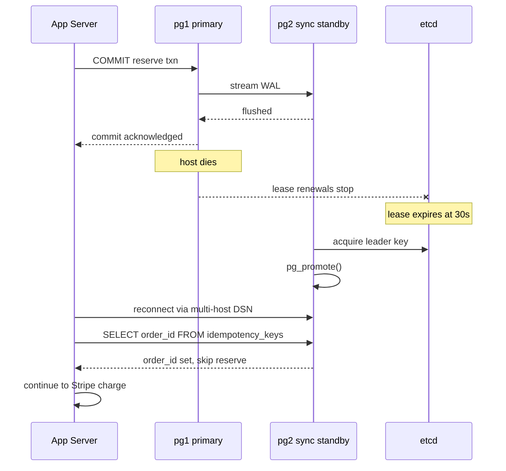

## Current state (V7)

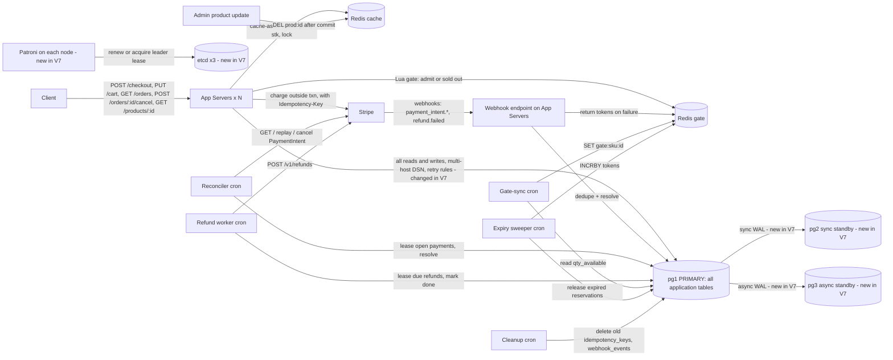

After a failover, `PG1` in this diagram means "whichever node currently holds the lease". The app never needs to know which one that is.

**Every current flow**

1. **Cart write:** unchanged. `PUT /cart/items` upserts into `cart_items` on the primary.
2. **Checkout, gated SKU:** unchanged in logic. Claim key, Lua gate, reserve transaction, charge Stripe outside any transaction, finalize. Each commit now waits about 1 to 2 ms for pg2 to flush the WAL.
3. **Checkout, ungated SKU:** unchanged, with the same commit wait.
4. **Checkout, Redis gate down:** unchanged. The gate fails open to Postgres.
5. **Checkout, timeout path:** unchanged. Order `PAYMENT_PENDING`, `202`, resolved by webhook or reconciler.
6. **Checkout during a failover (new):** connection errors trigger the retry rules above. A lost-commit reserve is resolved by reading `idempotency_keys.order_id`. A client retry with the same key is safe.
7. **Failover (new):** the lease lapses, the sync standby promotes, new connections find it through the multi-host DSN, and the old primary rejoins through `pg_rewind`.
8. **Webhook resolution:** unchanged. 5xx during failover, Stripe redelivers.
9. **Reconciliation:** unchanged. It now also repairs charges whose confirm transaction was lost to a failover.
10. **Cancel and refund:** unchanged.
11. **Late-capture refund:** unchanged.
12. **Reservation expiry:** unchanged.
13. **Gate sync:** unchanged.
14. **Product read path:** unchanged. Postgres sees only cache misses.
15. **Price or name change:** unchanged.
16. **Order read path:** unchanged, served by the primary.
17. **Cleanup:** unchanged.

## Interview follow-ups

**"Why not add read replicas while you're at it?"**
They're justified by a read problem, and we don't have one. V6 already serves product reads from Redis, so Postgres sees about one query per key per minute. Order-history reads are tiny. Replica reads would add lag and a read-your-writes problem after checkout, for no capacity we need. The standbys earn their cost purely through durability and failover.

**"Why synchronous replication? It makes every commit slower."**
Async means a primary crash loses acknowledged commits, and here that means paid orders with no record. Stripe has the money, and we have no row for the reconciler to find. About 2 ms per commit buys zero data loss for any single node failure. At 50 orders per second, that is cheap insurance.

## Recap

| Concept | The Insight |
|---|---|
| RPO and RTO | Backups give minutes of data loss and an hour of downtime, and the loss includes charged orders. |
| Sync standby | A commit isn't acknowledged until a second machine has the WAL, so a failover can never lose a paid order. |
| Three nodes, one sync | A single sync standby with an async spare survives any one failure without blocking writes. |
| Leader lease plus self-demotion | An old primary stops itself before the lease expires, so two primaries can't both accept writes. |
| Sync commit as a second fence | A zombie primary can't acknowledge commits, because its sync standby follows the new leader. |
| Earlier versions pay off | `order_id` set inside the reserve transaction and guarded status transitions make retries after failover safe. |
| No read replicas | Reads are already absorbed by the cache, so the standbys are for survival, not scale. |

**Interview arc:** *"One Postgres primary means a host failure costs an hour of downtime and minutes of paid orders, and async standbys or scripted failover either lose commits or risk two primaries, so we run three nodes with one synchronous standby and a consensus leader lease that fences the old primary, which gives zero data loss and about 30 seconds of downtime, with idempotency keys making in-flight retries safe."*

**Next up (V8):** the orders table grows by 1M rows a day, about 365M a year, and someone says "we should shard." We'll test that with numbers before deciding, because the honest answer may be that we shouldn't yet. Say "next" and we'll break it.


-----------------------------------------------------------------------------------------------------------------------
-----------------------------------------------------------------------------------------------------------------------
-----------------------------------------------------------------------------------------------------------------------
-----------------------------------------------------------------------------------------------------------------------


# V8: Partitioning, and the decision not to shard yet

## Break it

It's year 3. The permanent tables (`orders`, `order_items`, `payments`) hold about 1.1B orders and 3B item rows. At about 1 KB per order including indexes, that is roughly 1.1 TB, and it grows by about 365 GB a year.

At 9:05 a.m. on a drop day, pg2 (the sync standby) dies. Per V7, pg3 takes over as sync standby, so no writes block. Patroni starts building a replacement from a base backup.

- Copying 1.1 TB at about 250 MB/s takes **about 73 minutes**.
- For that whole window we have exactly two copies. One more failure means real data loss.
- A frozen-row vacuum of the 3B-row `order_items` table reads about 300 GB. On a busy disk that is hours of I/O competing with checkout commits.

Someone says "just shard." First, check the numbers that decide it:

- Peak is 50 orders per second at about 10 write statements each, so **about 500 writes per second**.
- A tuned Postgres primary handles 5,000 to 10,000 simple writes per second. We have 10x headroom.
- The hot data is the last 30 days, about 30M orders or **30 GB**. That fits in 128 GB of RAM many times over.

So write throughput is fine and the hot set is small. The problem is **cold data sitting in hot tables**. That is a size problem, not a throughput problem.

**This version fixes only table growth.** Surviving a whole-region outage comes later.

## Walk the naive attempts

First, the vocabulary. **Partitioning** splits one big table into pieces inside one database. **Sharding** splits the data across several databases. Partitioning is local and cheap. Sharding is distributed and expensive.

**Attempt 1: shard by `user_id`.**

> **Meera:** Hash `user_id` across shards. Priya's whole history lives on one shard.
> **Arjun:** And the reserve transaction that decrements inventory and inserts her order? Those are on different shards now.

- It looked reasonable because order history, cart and cancel are all per-user, so reads stay on one shard.
- It breaks V2. Inventory is keyed by SKU, so the reserve transaction spans two databases. We'd need another saga step to rebuild an atomicity we already have.

**Attempt 2: shard by `sku_id`.**

- It looked reasonable because inventory contention would spread across shards.
- It breaks in three ways:
  - Sku 77 lives on exactly one shard, so the drop makes that shard hot. V5's gate already fixed that, and sharding wouldn't.
  - A multi-SKU cart spans shards.
  - Order history becomes a scatter-gather across every shard.

**Attempt 3: shard by hash of `order_id`.**

- It looked reasonable because spread is perfectly even.
- It breaks because every "my orders" query hits every shard, and inventory is still separate.

**Attempt 4: a bigger machine.**

- It buys time but doesn't fix it. The data keeps growing, and the rebuild window and the vacuum both scale with size.

| Approach | Fixes size | Keeps V2 atomic reserve | Hotspot | New parts |
|---|---|---|---|---|
| Shard by `user_id` | Yes | No | None | Router, cross-shard saga |
| Shard by `sku_id` | Yes | No | Drop SKU's shard | Router, scatter-gather reads |
| Shard by hash `order_id` | Yes | No | None | Router, scatter-gather reads |
| Bigger machine | No | Yes | None | None |
| Partition plus archive (below) | Yes | Yes | Newest partition only | A maintenance job |

## Solve it

Think of a filing room. The last month's files stay on the desk. Older months go in labeled boxes on a shelf. After 13 months, a box goes to off-site storage and the shelf space is freed. Nobody ever searches through ten years of paper to find today's file.

We range-partition the big tables by `order_id`. Because `order_id` is a growing sequence, each partition is effectively a slice of time, about 30M ids or one month.

- **Only the newest partition is written and vacuumed.** Old partitions are frozen once, and vacuum skips frozen pages.
- **Old partitions detach in a blink.** We then archive them. We never `DELETE` them row by row.
- **The data in Postgres plateaus** at about 13 months, roughly 400 GB, instead of growing forever. A standby rebuild drops from about 73 minutes to about 27.

**Why `order_id` and not `created_at`?** Postgres requires the partition key inside every primary key and unique constraint. Our constraints are `PRIMARY KEY (order_id)`, `UNIQUE (order_id)` on `payments`, and foreign keys from other tables to `orders(order_id)`. With `order_id` as the key, **none of them change**.

**Which tables?** We partition `orders`, `order_items` and `payments`, the big permanent ones. We leave out:
- **`idempotency_keys` and `webhook_events`:** their uniqueness must be global. If `idempotency_keys` were partitioned by day, its primary key would need the date. A retry arriving after midnight would then insert into the new day's partition without conflicting, and V1's duplicate protection would be gone. Daily `DELETE` of 1M short-lived rows is cheap.
- **`refunds`:** only about 3% of orders. It is small enough to leave alone.
- **`reservations`:** purged by the existing cleanup cron (see below), so it stays small.

**Archive storage class.** Detached partitions go to S3 as Parquet files. This data is immutable, cold and read only by support or finance. Object storage costs a small fraction of NVMe per GB, and it is queryable in place with Athena.

- ✅ **What we gained:**
  - Postgres data plateaus at about 400 GB instead of growing without bound.
  - The standby rebuild window drops from about 73 to about 27 minutes.
  - Vacuum and index maintenance touch only the newest partition or two.
  - The V2 atomic reserve transaction stays intact, because there is still one database.
- ⚠️ **What we gave up:**
  - A maintenance job with a new failure mode. If partitions aren't created ahead of the sequence, inserts into `orders` fail and checkout is down.
  - Order history probes about 13 partitions instead of one index.
  - Orders older than 13 months leave Postgres. They are served only through the support tool. This is an assumed retention policy, and we should confirm it with the interviewer.
  - We have not removed the single-primary write ceiling. We have only moved it out of view.
- ❌ **What we considered and rejected:**
  - **Partition by `created_at`:** it forces the date into every key and foreign key, as above.
  - **Hash partition by `user_id`:** it spreads the data but ages nothing out. Every partition grows forever, and nothing can be detached.
  - **Archive with `DELETE`:** it leaves bloat and a long vacuum. `DETACH` is a metadata change.
  - **Sharding now:** see the table. It costs us V2's atomicity to solve a problem partitioning solves for free.

## If we ever do shard

We shard when sustained writes pass about 40% of a primary's capacity, which is roughly 2,500 per second against 500 today. We'd also shard if the hot set stopped fitting in RAM.

- **Key:** `user_id`, with inventory kept as its own small database. That means paying for the V2 saga split then, not now.
- **Resharding:** hash to 256 fixed logical shards, then map shards to machines. Adding a machine moves whole logical shards. With plain `hash mod N`, changing N rehashes almost every row.
- **Hotspots:** `user_id` has none worth planning for. The drop's hot SKU is solved by the V5 gate, not by sharding.

## Schema (delta only)

```sql
CREATE TABLE orders (
  order_id     BIGINT NOT NULL DEFAULT nextval('orders_order_id_seq'),
  user_id      BIGINT NOT NULL,
  status       TEXT   NOT NULL,
  total_cents  INT    NOT NULL,
  payment_ref  TEXT,
  created_at   TIMESTAMPTZ NOT NULL DEFAULT now(),
  PRIMARY KEY (order_id)
) PARTITION BY RANGE (order_id);

CREATE TABLE orders_p0014 PARTITION OF orders FOR VALUES FROM (390000000) TO (420000000);
CREATE INDEX ON orders (user_id, order_id DESC);   -- on the parent: every partition gets one
```

`order_items` and `payments` get the same treatment, with the same ranges and unchanged keys. Their columns are as before, so only the partitioning clause is new.

- **Partition size:** 30M ids each.
- **Where it lives:** the same Postgres cluster as before. The archive is in S3.

**Who writes and reads what:**

| Structure | Who writes | When | Who reads | When |
|---|---|---|---|---|
| Newest `orders`, `order_items`, `payments` partition | Checkout handler (reserve txn) | Each checkout, routed automatically | Reconciler, order read handler | Every 30s, page view |
| Older partitions | Cancel handler, resolve functions, refund worker | Status updates, pruned to one partition by `order_id` | Order read handler | History pages |
| New partitions | Partition maintenance cron | Daily, keeps 3 ahead | Nobody directly | n/a |
| S3 archive | Partition maintenance cron | When a partition is 13 months old | Support tool | Rare, via Athena |
| `reservations` purge | Cleanup cron | Daily | Nobody | n/a |

## Implement it

**Order history API**

```http
GET /orders?limit=20&before=9021
```

`before` is optional. Without it, the query returns the newest 20 orders. The query changes from `ORDER BY created_at` to `ORDER BY order_id`, because ids grow with time:

```sql
SELECT order_id, status, total_cents, created_at
FROM orders
WHERE user_id = :uid AND order_id < :before
ORDER BY order_id DESC LIMIT 20;
```

Each partition has its own `(user_id, order_id DESC)` index. Postgres merge-appends across them and stops after 20 rows. For a user with few orders it probes about 13 partitions at roughly 0.05 ms each, so about 1 ms in total.

**Writes need no code change.**
- `INSERT INTO orders` routes to the newest partition.
- `UPDATE orders ... WHERE order_id = 9021` prunes to the one partition that holds 9021. The cancel handler (V4), the resolve functions (V3) and the webhook handler all filter by `order_id`, so all of them prune.

**The partition maintenance cron** runs daily on the same cron host as the other jobs:

1. **Keep partitions ahead of the sequence.**
   ```sql
   SELECT last_value FROM orders_order_id_seq;
   ```
   If fewer than 3 empty partitions lie ahead, run `CREATE TABLE IF NOT EXISTS orders_pNNNN PARTITION OF orders FOR VALUES FROM (...) TO (...)`, and the same for `order_items` and `payments`. It is idempotent, so a rerun is harmless.
2. **Alert** when fewer than 1 partition lies ahead. That is the pager condition, because checkout stops when ids outrun partitions.
3. **Archive old partitions.** For the oldest partition, check:
   ```sql
   SELECT max(created_at) FROM orders_p0001;   -- older than 13 months?
   ```
   If yes:
   1. `ALTER TABLE orders DETACH PARTITION orders_p0001 CONCURRENTLY;` and the same for `order_items` and `payments`. This is a metadata change, and checkout isn't blocked.
   2. Export each detached table to S3 as Parquet and verify the row counts match.
   3. Only after verification, `DROP TABLE orders_p0001`.
4. **Purge reservations.** The cleanup cron deletes `CONSUMED` and `RELEASED` rows older than 30 days from `reservations`.

**One-time migration**

1. Rename the old `orders` table, then attach it as the first partition. First add `CHECK (order_id < 390000000)` as `NOT VALID`, then `VALIDATE` it, so `ATTACH` skips the full-table scan.
2. Recreate the foreign keys from `reservations`, `order_items` and `payments` against the new parent. Add them `NOT VALID`, then validate.
3. Do all of this in a low-traffic window.

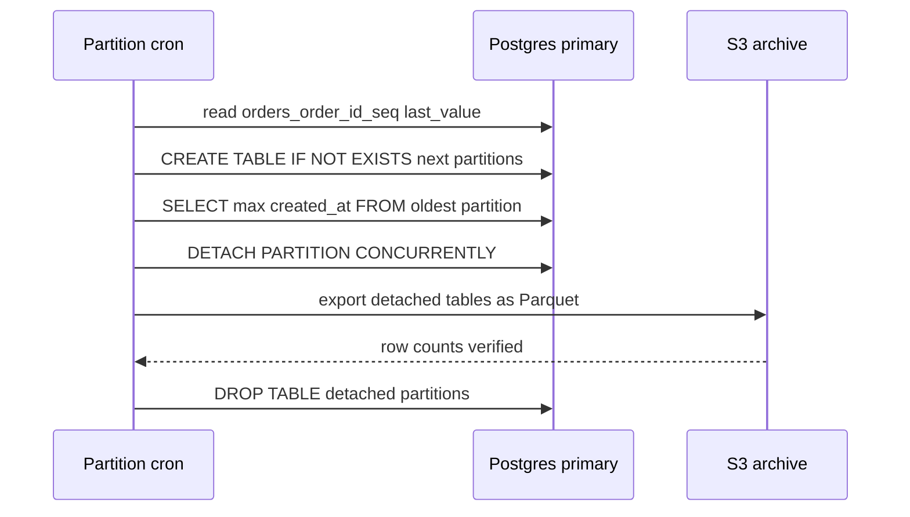

## Current state (V8)

```mermaid
graph LR
    C[Client] -->|POST /checkout, PUT /cart, GET /orders with cursor, POST /orders/:id/cancel, GET /products/:id| A[App Servers x N]
    A -->|cache-aside reads: prod, stk, lock| RCH[(Redis cache)]
    A -->|Lua gate: admit or sold out| R[(Redis gate)]
    A -->|all reads and writes, multi-host DSN, retry rules| PG1[(pg1 PRIMARY: products, inventory, carts, cart_items, reservations, refunds, idempotency_keys, webhook_events, plus orders, order_items, payments partitioned by order_id - new in V8)]
    PG1 -->|sync WAL| PG2[(pg2 sync standby)]
    PG1 -->|async WAL| PG3[(pg3 async standby)]
    PAT[Patroni on each node] -->|renew or acquire leader lease| ET[(etcd x3)]
    A -->|charge outside txn, with Idempotency-Key| P[Stripe]
    P -->|webhooks: payment_intent.*, refund.failed| W[Webhook endpoint on App Servers]
    W -->|dedupe + resolve| PG1
    W -->|return tokens on failure| R
    AD[Admin product update] -->|DEL prod:id after commit| RCH
    RC[Reconciler cron] -->|lease open payments, resolve| PG1
    RC -->|GET / replay / cancel PaymentIntent| P
    RW[Refund worker cron] -->|lease due refunds, mark done| PG1
    RW -->|POST /v1/refunds| P
    GS[Gate-sync cron] -->|read qty_available| PG1
    GS -->|SET gate:sku:id| R
    S[Expiry sweeper cron] -->|release expired reservations| PG1
    S -->|INCRBY tokens| R
    J[Cleanup cron] -->|delete old keys, events, reservations older than 30d - changed in V8| PG1
    M[Partition maintenance cron - new in V8] -->|create ahead, detach old partitions| PG1
    M -->|export Parquet - new in V8| AR[(S3 archive - new in V8)]
```

As in V7, `PG1` means whichever node currently holds the lease.

**Every current flow**

1. **Cart write:** unchanged. `PUT /cart/items` upserts into `cart_items` on the primary.
2. **Checkout, gated SKU:** unchanged in logic. The reserve transaction's `INSERT` into `orders`, `order_items` and `payments` now routes to the newest partition.
3. **Checkout, ungated SKU:** unchanged, with the same routing.
4. **Checkout, Redis gate down:** unchanged. The gate fails open to Postgres.
5. **Checkout, timeout path:** unchanged. Order `PAYMENT_PENDING`, `202`, resolved by webhook or reconciler.
6. **Checkout during a failover:** unchanged. Retry rules read `idempotency_keys.order_id`.
7. **Failover:** unchanged.
8. **Webhook resolution:** unchanged. Updates prune to one partition through the order id in metadata.
9. **Reconciliation:** unchanged. The partial `idx_pay_open` index has entries only in the newest partitions.
10. **Cancel and refund:** unchanged. The `PAID` to `REFUND_PENDING` update prunes by `order_id`.
11. **Late-capture refund:** unchanged.
12. **Reservation expiry:** unchanged.
13. **Gate sync:** unchanged.
14. **Product read path:** unchanged.
15. **Price or name change:** unchanged.
16. **Order read path (changed):** `GET /orders?before=` runs a cursor query ordered by `order_id`, merge-appended across partitions. Orders older than 13 months are not served from Postgres.
17. **Partition maintenance (new):** the daily cron keeps 3 partitions ahead, alerts if fewer than 1 remain, and detaches, archives and drops partitions older than 13 months.
18. **Cleanup (changed):** the cron also purges `CONSUMED` and `RELEASED` reservations older than 30 days, besides the old key and webhook deletes.

## Interview follow-ups

**"365M orders a year. Why not shard?"**
Because the numbers don't call for it. Peak is about 500 writes per second against a 5,000 to 10,000 ceiling, and the hot set is about 30 GB. What hurts is cold data in hot tables, and partitioning plus archival fixes that. Sharding would also split inventory from orders and break the V2 atomic reserve transaction, so we'd pay for a cross-database saga to solve a problem we don't have. I'd shard when sustained writes pass about 40% of capacity.

**"How would you shard when the time comes?"**
By `user_id`, hashed into 256 fixed logical shards mapped onto machines. Adding capacity moves whole logical shards, not a global rehash. Inventory stays in its own small database, and the reserve step becomes a saga step. The hot SKU isn't a sharding concern, because the V5 gate already absorbs it.

## Recap

| Concept | The Insight |
|---|---|
| Size is not throughput | 500 writes per second is far below a primary's ceiling. The pain was 1 TB of mostly cold data. |
| Partition before shard | Partitioning is local and cheap. Sharding splits databases, and here it would break V2's atomic reserve. |
| Partition key = existing key | `order_id` is already in every PK, UNIQUE and FK, so nothing else had to change. |
| Detach, don't delete | Dropping a partition is a metadata operation. Row-by-row `DELETE` leaves bloat. |
| Don't partition what needs global uniqueness | Partitioning `idempotency_keys` by day would break duplicate detection across midnight. |
| Maintenance job has a failure mode | If partitions don't exist ahead of the sequence, checkout stops, so alert before that. |

**Interview arc:** *"A terabyte of mostly cold orders makes standby rebuilds and vacuums take hours, but 500 writes per second doesn't need a second database, and sharding would break the atomic reserve transaction, so we range-partition by `order_id` so every key stays valid, detach and archive old partitions to S3, and keep the sharding plan, `user_id` over 256 logical shards, ready for when sustained writes pass about 40% of capacity."*

**Next up (V9):** we've said "cron on one app server" six times. On a Black Friday morning autoscaling removes exactly that server, and the sweeper, reconciler and refund worker all stop. We'll fix the app tier properly. Say "next" and we'll break it.


-----------------------------------------------------------------------------------------------------------------------
-----------------------------------------------------------------------------------------------------------------------
-----------------------------------------------------------------------------------------------------------------------
-----------------------------------------------------------------------------------------------------------------------


# V9: A stateless app tier and background workers

## Break it

It's Black Friday, 8:55 a.m. Traffic is climbing toward the drop. The autoscaler is running 6 app servers and wants 20.

For six versions we've said "a cron on one app server" for the sweeper, reconciler, refund worker, gate-sync, cleanup and partition jobs. That one server is also an autoscaled server.

At 9:20 the drop is over and traffic falls. The autoscaler scales in and picks the oldest server. It happens to be the one with the cron jobs. It stops, and no replacement ever runs them.

- **Sweeper stops:** abandoned reservations on sku 77 never release. Stock stays locked and the product shows sold out.
- **Reconciler stops:** about 1,000 `PAYMENT_PENDING` orders (the V3 estimate on a slow-Stripe day) never resolve. Paid customers see "confirming your payment" for hours.
- **Refund worker stops:** cancelled orders never get refunded.
- **Gate-sync stops:** the Redis counter drifts from Postgres with nothing to heal it.

Nothing errors and no checkout fails. The failures are silent and the damage is delayed.

Scale-in also kills the server mid-request. A buyer between the reserve transaction and the Stripe call loses her handler. V1 to V3 make that recoverable, but it still costs her a confirmation delay.

**This version fixes only the app tier and its background work.** Connection counts per server come up below, but we defer fixing them.

## Why we scale this way

**Vertical scaling** means a bigger machine. It has a cost ceiling, needs downtime to resize, and is one failure away from an outage.

**Horizontal scaling** means more identical machines behind a load balancer. It has no hard ceiling, but it only works if any server can handle any request. So first, name what state each server holds locally:

| Local state | Where it lives today | Verdict |
|---|---|---|
| User sessions | JWT in the `Authorization` header, verified with a public key | Stateless already |
| Product cache | Redis cache (V6) | Not local |
| Idempotency, reservations, payments | Postgres | Not local |
| In-flight request | The handler's memory | Must drain on shutdown |
| DB connection pool | Per server, about 10 connections | Fine now. At 20 servers it is 200 connections |
| **Background jobs** | **One server's cron table** | **The problem** |

Everything is already shared except the jobs and the in-flight work. That is why scaling needs no redesign.

## Walk the naive attempts

This is a lighter walk. The crux was earlier.

**Attempt 1: run the crons on every server.**
- It looked reasonable because it has no single point of failure.
- It is half right. The sweeper (`SKIP LOCKED`), reconciler and refund worker (leases) were built to run in parallel. It breaks for the others. Two gate-sync runs can write different snapshots to Redis. Two partition jobs can race on `DETACH` and `DROP`.

**Attempt 2: pin the cron to a protected server.**
- It looked reasonable because it is simple.
- It breaks because that server is still a single point of failure. If it dies, the jobs stop until someone notices.

**Attempt 3: an external scheduler (EventBridge or a Kubernetes CronJob) that triggers each job.**
- It looked reasonable because it is managed.
- It is a real option. Schedulers deliver at-least-once, and a slow run overlaps the next trigger. So the job still needs its own mutual exclusion. The scheduler solves "who triggers it," not "only one at a time."

Two things are needed: jobs that run apart from the autoscaled API, and a rule that keeps singleton jobs singleton.

## The known sub-problem: running a job on exactly one node

There are three established fixes.

**Fix 1: Postgres advisory lock.**
```sql
SELECT pg_try_advisory_lock(42);   -- true: I run it. false: someone else is
```
It needs no new table. But the lock belongs to a session, so a held connection stays pinned. It also gets lost silently if a connection pooler is added later.

**Fix 2: lease row with a TTL.** A job takes a row for N seconds and renews it. If the holder dies, the lease lapses and another worker takes over.
```sql
-- holder renews; others can take it only after lease_until passes
```

**Fix 3: external scheduler plus a concurrency policy.** The trigger is outside the app, with `concurrencyPolicy: Forbid`. It is simple, but a policy can't see a hung run, so it still needs a lease.

**Which fits here:** Fix 2. We already use leases in V4, it survives failover because it lives in Postgres, and it expires on its own if a worker dies. We use the database's `now()` and not each worker's clock, so clock skew between workers doesn't matter.

## Solve it

Think of a restaurant. The waiters scale up and down with the crowd. The kitchen manager does the end-of-night count, and it doesn't matter who it is. A sign on the office door says "I'm counting, back by 11:30". If the manager walks out and the sign expires, a deputy takes it over.

We split the app into two deployments from one codebase:
- **`api`:** stateless, autoscaled, behind the load balancer. Serves requests only.
- **`worker`:** a fixed 2 replicas in 2 AZs, with scale-in protection. Runs all jobs.

Each job declares how it runs:

| Job | Parallel-safe? | Runs as |
|---|---|---|
| Expiry sweeper | Yes (`SKIP LOCKED`, V2) | On every worker |
| Reconciler | Yes (lease claim, V4 correction) | On every worker |
| Refund worker | Yes (lease claim, V4) | On every worker |
| Gate-sync | No (two writers can flip the counter) | Singleton lease |
| Cleanup | Safe but wasteful | Singleton lease |
| Partition maintenance | No (`DETACH`, export, `DROP`) | Singleton lease |

- ✅ **What we gained:**
  - The API scales in and out freely. No job lives on it.
  - Losing a worker costs nothing. The other keeps the parallel jobs going, and singleton leases move in at most the TTL.
  - Graceful shutdown means scale-in rarely cuts a checkout.
- ⚠️ **What we gave up:**
  - A new `worker` deployment and a lease table to operate.
  - A singleton job pauses for up to its lease TTL during a handover (15 seconds for gate-sync).
  - A job can still hang while holding a live lease, so we alert on missed runs.
- ❌ **What we considered and rejected:**
  - **Advisory locks:** see Fix 1. They bind a job to one connection, and they'd break if we add a pooler.
  - **Kafka or SQS to distribute job work:** peak job rate is a few per second, and leases already give exclusive claims.
  - **Autoscaling the workers:** the work isn't throughput-bound. Two replicas are for availability, not speed.

## Load balancing

The load balancer runs **least outstanding requests**, not round robin. Checkout request time varies from about 800 ms to 15 seconds because of Stripe. Round robin keeps feeding a server that already holds several slow requests, while an idle neighbour waits.

The health check is **shallow**: `GET /healthz` returns `200` if the process is up. It does not check Postgres. If it did, a V7 failover would mark every server unhealthy at once and turn a 30-second blip into a full outage. Dependencies are handled by retries (V7), not health checks.

## Schema (delta only)

```sql
CREATE TABLE job_leases (
  job_name    TEXT PRIMARY KEY,
  holder      TEXT        NOT NULL,   -- worker instance id, e.g. 'worker-b-7f3'
  lease_until TIMESTAMPTZ NOT NULL
);
```

It lives in the same Postgres. Three rows exist: `gate-sync`, `cleanup`, `partition-maintenance`.

| Structure | Who writes | When | Who reads |
|---|---|---|---|
| `job_leases` | Worker (the current holder, or one taking over) | Each job tick | Worker (the same statement, through `RETURNING`) |

## Implement it

**Singleton lease acquire or renew** (one statement, run each tick):

```sql
INSERT INTO job_leases (job_name, holder, lease_until)
VALUES (:job, :me, now() + (:ttl * interval '1 second'))
ON CONFLICT (job_name) DO UPDATE
  SET holder = :me, lease_until = now() + (:ttl * interval '1 second')
  WHERE job_leases.holder = :me OR job_leases.lease_until < now()
RETURNING holder;
```

One row back means we hold the lease. Zero rows means someone else does, so skip this tick.

**The worker loop**

```python
def run_singleton(job, interval_s, ttl_s, fn):
    while not shutting_down:
        if acquire(job, WORKER_ID, ttl_s):     # statement above
            fn()
        sleep(interval_s + random.uniform(0, 1))   # jitter spreads takeover
```

| Job | Interval | Lease TTL |
|---|---|---|
| `gate-sync` | 5s | 15s |
| `cleanup` | 1h | 10 min |
| `partition-maintenance` | 1 day | 15 min, renewed during export |

The parallel jobs (`sweeper`, `reconciler`, `refund`) skip the lease. They run their own claim queries (V2, V4).

**Safety for the long job.** Before the destructive step, the partition job re-checks its lease:

```sql
SELECT 1 FROM job_leases
WHERE job_name='partition-maintenance' AND holder=:me AND lease_until > now();
```

If that returns nothing, it aborts before `DROP TABLE`. Every other step in that job is idempotent (`CREATE ... IF NOT EXISTS`, `DETACH ... CONCURRENTLY`), so an abandoned run is harmless.

**Graceful shutdown of the `api` deployment**

1. The orchestrator sends `SIGTERM`.
2. The server fails its readiness check, so the load balancer stops sending new requests.
3. In-flight requests finish. The drain window is **45 seconds**: the 15 s Stripe timeout plus the reserve and confirm transactions, with margin.
4. The server exits. If it is killed at the deadline, V1 to V3 recovery applies (key takeover, reconciler).

The load balancer's deregistration delay is set to the same 45 seconds.

**Autoscaling**
- Metric: average in-flight requests per server, target 100, plus CPU as a backstop.
- Scale-out is fast. Scale-in is slow, one server per 5 minutes, so we don't shed capacity before the next wave.

**The connection count, deferred.** 20 API servers times a pool of 10 gives 200 connections against Postgres. That is within the 500 limit for now. A pooler like PgBouncer is the next step if it grows, and we'd handle it as its own version.

```mermaid
sequenceDiagram
    participant WA as worker-a
    participant WB as worker-b
    participant DB as Postgres
    WA->>DB: acquire gate-sync lease (ttl 15s)
    DB-->>WA: 1 row, held
    WB->>DB: acquire gate-sync lease
    DB-->>WB: 0 rows, skip
    Note over WA: worker-a dies
    Note over DB: lease_until passes
    WB->>DB: acquire gate-sync lease
    DB-->>WB: 1 row, takes over
    WB->>DB: read qty_available
    WB->>WB: SET gate:sku:id on Redis gate
```

## Current state (V9)

```mermaid
graph LR
    C[Client] --> LB[Load balancer: least outstanding requests, shallow health check - new in V9]
    LB -->|POST /checkout, PUT /cart, GET /orders, POST /orders/:id/cancel, GET /products/:id, POST /webhooks/stripe| A[API servers: autoscaled, stateless, drain 45s - changed in V9]
    A -->|cache-aside reads: prod, stk, lock| RCH[(Redis cache)]
    A -->|Lua gate: admit or sold out| R[(Redis gate)]
    A -->|reads and writes, multi-host DSN, retry rules| PG1[(pg1 PRIMARY: products, inventory, carts, cart_items, reservations, refunds, idempotency_keys, webhook_events, job_leases - new in V9, plus orders, order_items, payments partitioned by order_id)]
    PG1 -->|sync WAL| PG2[(pg2 sync standby)]
    PG1 -->|async WAL| PG3[(pg3 async standby)]
    PAT[Patroni on each node] -->|renew or acquire leader lease| ET[(etcd x3)]
    A -->|charge outside txn, with Idempotency-Key| P[Stripe]
    P -->|webhooks| LB
    A -->|return tokens on failure| R
    AD[Admin product update] -->|DEL prod:id after commit| RCH
    subgraph WK[Worker deployment: 2 replicas, 2 AZs, scale-in protected - new in V9]
      SW[Expiry sweeper: parallel]
      RC[Reconciler: parallel]
      RW[Refund worker: parallel]
      GS[Gate-sync: singleton lease]
      J[Cleanup: singleton lease]
      M[Partition maintenance: singleton lease]
    end
    WK -->|claims, leases, resolve| PG1
    RC -->|GET / replay / cancel PaymentIntent| P
    RW -->|POST /v1/refunds| P
    GS -->|SET gate:sku:id| R
    SW -->|INCRBY tokens| R
    M -->|export Parquet| AR[(S3 archive)]
```

As before, `PG1` means whichever node holds the Patroni lease.

**Every current flow**

1. **Cart write:** unchanged. `PUT /cart/items` upserts into `cart_items`. It now reaches any API server through the load balancer.
2. **Checkout, gated and ungated:** unchanged in logic. Claim key, Lua gate if gated, reserve transaction, charge Stripe outside any transaction, finalize.
3. **Checkout, Redis gate down:** unchanged. It fails open to Postgres.
4. **Checkout, timeout path:** unchanged. `PAYMENT_PENDING`, `202`, resolved by webhook or reconciler.
5. **Checkout during a DB failover:** unchanged. Retry rules from V7.
6. **Checkout during an API scale-in (new):** the server stops taking new requests, finishes in-flight ones within 45 seconds, then exits. A forced kill falls back to V1 to V3 recovery.
7. **Webhook resolution:** unchanged. Webhooks arrive through the same load balancer.
8. **Reconciliation:** unchanged, now run by any worker.
9. **Cancel and refund:** unchanged, with the refund worker now running on any worker.
10. **Late-capture refund:** unchanged.
11. **Reservation expiry:** unchanged, run by any worker.
12. **Gate sync (changed):** runs on whichever worker holds the `gate-sync` lease.
13. **Product read path, price change, order read path:** unchanged.
14. **Partition maintenance (changed):** runs under the `partition-maintenance` lease, with a lease re-check before `DROP`.
15. **Cleanup (changed):** runs under the `cleanup` lease.
16. **Worker failure (new):** parallel jobs keep running on the other worker. Singleton leases lapse and are taken within their TTL.

## Interview follow-ups

**"Why not just use Kubernetes CronJobs?"**
They're a fine trigger, but they deliver at-least-once and a slow run can overlap the next trigger. So each job still needs its own exclusion. Leases in Postgres give us that, and they move with the database during a failover. A CronJob with `Forbid` is reasonable where I only need "start it", but I still want a lease for the jobs that mutate state.

**"What if a worker holds a lease but the job hangs?"**
The lease is renewed by the loop, not by the job. A hung job blocks the loop, so the lease expires and another worker takes over. Alerting watches for a job whose last success is older than 3 intervals. For the one long job, the lease re-check before `DROP` stops a zombie from finishing a destructive step it no longer owns.

## Recap

| Concept | The Insight |
|---|---|
| Name the local state | Horizontal scaling works only when servers hold nothing local. Here, the cron table was the one thing that did. |
| Split API and workers | Request-serving scales with traffic. Background jobs run as a small fixed deployment. |
| Classify each job | Jobs built with `SKIP LOCKED` or leases run on every worker. Jobs that mutate shared state get a singleton lease. |
| Lease with DB time | `now()` from Postgres means worker clocks can't disagree about who owns a job. |
| Drain above the longest call | A 45 s drain window covers the 15 s Stripe timeout, so scale-in rarely cuts a checkout. |
| Shallow health check | A check that touches Postgres would mark every server dead during a failover. |
| Least outstanding requests | Request times vary 20x, so round robin overloads whichever server holds the slow ones. |

**Interview arc:** *"Pinning background jobs to one autoscaled server means scale-in silently stops the sweeper, reconciler and refunds, and pinning them to a protected server just moves the single point of failure, so we split a stateless autoscaled API from a small worker deployment where parallel-safe jobs run everywhere and singleton jobs hold a Postgres lease, with the API draining longer than the Stripe timeout."*

**Next up (V10):** an entire cloud region goes dark at 9:10 a.m. All three Postgres nodes, Redis and every server are unreachable together. V7's failover only covered one node dying inside a region. Say "next" and we'll break it.


-----------------------------------------------------------------------------------------------------------------------
-----------------------------------------------------------------------------------------------------------------------
-----------------------------------------------------------------------------------------------------------------------
-----------------------------------------------------------------------------------------------------------------------


# V10: Surviving a region outage

## Break it

It's 9:10 a.m. on the drop. A cloud region loses power. All three Postgres nodes, both Redis clusters, etcd, and every API and worker server go dark together.

V7 handled one node dying inside a region. It assumed the other two nodes and etcd survive. Here they all go together.

- **Our WAL archive was in the same region.** If it was only there, the data is gone. Say we fixed that and copy it cross-region to S3.
- **Restore time:** provision a new cluster, restore about 400 GB, replay WAL. That is **about 2 to 3 hours** of selling nothing.
- **Lost data:** archive chunks are 5 minutes. At 50 orders per second, that is **up to 15,000 paid orders** with no record. Stripe holds the money.
- **Priya's order 9021** was committed at 9:09 and charged. After the restore, there is no `orders` row and no `payments` row. The V3 reconciler can't find a charge it has no row for.

Two numbers frame this:
- **RTO** is about 3 hours. We want about 10 to 15 minutes.
- **RPO** is up to 5 minutes. We want a few seconds, plus a way to find the orders in that gap.

**This version fixes only losing a whole region.** Observability comes next.

## Walk the naive attempts

First, the crux of multi-region: **who is allowed to write?** Two regions that both accept writes can disagree. That is a conflict, and conflicts are the real cost of going multi-region. Our hardest rule is that stock is never oversold. That rule needs exactly one place that decides who gets the last unit.

**Attempt 1: backups copied to another region.**
- It looked reasonable because it is cheap and needs no new moving parts.
- It breaks on RTO and RPO. Three hours down, and 5 minutes of paid orders gone.

**Attempt 2: synchronous replication across regions.**

> **Meera:** We already run sync replication in V7. Do it to the other region and RPO is zero.
> **Arjun:** The other region is 80 ms away. Our reserve commit is 7 ms today.

The number that decides it: the hot-row ceiling is 1 divided by the commit time.
- Now: 1 / 7 ms is about 140 updates per second.
- With an 80 ms round trip: 1 / 87 ms is about **11 updates per second**.

It looked reasonable because RPO is zero. It breaks because every checkout, everywhere, pays 80 ms, and the hot SKU's ceiling collapses. It also blocks writes whenever the link between regions is down.

**Attempt 3: active-active, both regions accept writes.**
- It looked reasonable because users write to the nearest region and nobody sits idle.
- It breaks on stock. Both regions see `qty_available = 1`. Both sell it. The conflict is found minutes later, after both buyers are charged.

All three fail on the same tension: we want zero loss, fast commits and no conflicts, and we can't have all three at once.

## The known sub-problem: cross-region write ownership

There are three established fixes.

**Fix 1: single writer region, async standby region (active-passive).** One region owns all writes. The other follows and takes over on disaster.
```
write -> region A primary (sync within A)
region B standby <- async WAL stream
```
There are no conflicts, because there is one writer. The cost is a few seconds of RPO.

**Fix 2: home-region ownership with stock allocation.** Each user belongs to a home region and owns their orders there. Stock is carved into per-region quotas, with a rebalancer moving units between them.
```
sku 77: region A quota 300, region B quota 200
reserve in A: UPDATE ... WHERE qty_available_A >= 1
rebalancer: moves units when one quota runs dry
```
Both regions serve writes with local latency. The cost is a rebalancer, and a buyer in a dry region can be told "sold out" while the other region still has stock.

**Fix 3: multi-master with conflict resolution.** Both regions accept every write, and we merge later.
```
last-writer-wins on updated_at, or a CRDT counter for stock
```
A stock counter that merges can go negative. That is overselling, so this is out for inventory, whatever it does for carts.

| Approach | RPO | RTO | Oversell possible | Write latency | Moving parts |
|---|---|---|---|---|---|
| Backups copied cross-region | 5 min | about 3 h | No | Local | None |
| Sync cross-region | 0 | minutes | No | +80 ms | Low |
| Active-passive, async (below) | seconds | 10 to 15 min | No | Local, far users +RTT | Standby region, runbook |
| Home region plus stock quotas | seconds | minutes | No | Local | Rebalancer, quota logic |
| Multi-master | seconds | 0 | Yes | Local | Conflict resolution |

## Solve it

Think of a bank with a backup vault in another city. All deposits go to the main branch. Every few hundred milliseconds, a courier copies the ledger to the vault. If the main branch burns down, a manager declares it, the vault becomes the branch, and an auditor compares the courier's last ledger to the bank statements to find any transactions the vault never heard about.

We choose **Fix 1: active-passive**.

- The decision comes from the stock rule. Only a single writer can guarantee that two buyers never get the last unit.
- Traffic is 500 writes per second. One region's primary has 10x headroom, so nothing forces us to spread writes.
- We keep Fix 2 as the future path, for when users far from the primary region complain about checkout latency.

**Failover is human-approved, not automatic.** Declaring a region dead is high stakes. A false alarm promotes a standby that is a few hundred milliseconds behind, which loses orders on purpose. A person confirms, and a runbook script does the steps.

**Standby shape: pilot light.** Region B keeps its Postgres standby running at all times, because replication has to be continuous. Everything else is scaled to minimum: 2 API servers, 0 workers. On failover we scale up, which costs about 3 to 5 minutes.

**CDN decision:** still no CDN for API responses. Redis already absorbs the product reads. The only change is that after a failover, the new region's cache starts cold. The V6 stampede guard (soft TTL plus one refresher) covers that.

- ✅ **What we gained:**
  - RTO drops from about 3 hours to about 10 to 15 minutes.
  - RPO drops from 5 minutes to about 1 second, or about 50 orders at peak.
  - Those 50 orders are found and refunded by an audit, not silently lost.
  - Commits stay local. No checkout pays an 80 ms tax.
- ⚠️ **What we gave up:**
  - Commits in the last second before the outage are lost, so some paid orders vanish and need the orphan audit below.
  - Users far from the primary region pay the round trip on checkout.
  - A standby region costs money to run and must be rehearsed. An untested failover usually fails.
  - A human is in the loop, so RTO includes decision time.
  - After failover, the old region must be fenced, or two regions might both write.
- ❌ **What we considered and rejected:**
  - **Automatic regional failover:** a false positive loses data on purpose, and a network partition could produce two writers.
  - **Active-active with LWW or CRDTs for stock:** a mergeable counter can go negative, which breaks our hardest rule.
  - **A third region for quorum:** it fits a consensus store, not a Postgres standby, and it costs a third deployment for a rare event.
  - **Streaming through Kafka cross-region:** Postgres WAL shipping already gives ordered, exact replication with no extra system.

## Schema (delta only)

One column change and one control flag.

```sql
ALTER TABLE refunds ADD COLUMN idem_ref TEXT;
UPDATE refunds SET idem_ref = 'refund:' || order_id;
ALTER TABLE refunds ALTER COLUMN idem_ref SET NOT NULL;
ALTER TABLE refunds ADD CONSTRAINT refunds_idem_ref_key UNIQUE (idem_ref);
ALTER TABLE refunds ALTER COLUMN order_id DROP NOT NULL;   -- orphan charges have no order
ALTER TABLE refunds ADD COLUMN stripe_pi TEXT;             -- set for ORPHAN_CHARGE rows
```

`refunds.reason` gains a third value, `ORPHAN_CHARGE`. The V4 refund worker now sends `Idempotency-Key: {idem_ref}`, which equals `refund:{order_id}` for every old row, so existing behaviour is unchanged. For orphans, `payment_ref` carries the Stripe `pi_` id and the key is `refund:orphan:{pi}`.

New control flag: `active_region`, held in a store that survives a region loss (a Route 53 ARC routing control, or any global control plane).

**Where things live:**
- Region A: everything today.
- Region B: a Patroni standby cluster (pg4 leader of the standby cluster, pg5 follower), a WAL archive in a second S3 bucket, a cold Redis cache and gate, and a minimal app tier.

**Who writes and reads what:**

| Structure | Who writes | When | Who reads | When |
|---|---|---|---|---|
| Cross-region WAL stream | Region A primary | Every commit, async | Region B standby leader pg4 | Continuously |
| `active_region` flag | On-call engineer, via the runbook | On declare and on failback | API servers, workers, Route 53 | Every 10s and at DNS resolution |
| Sequences (`orders_order_id_seq`, others) | Runbook step, once, after promote | At failover | Checkout handler | Every `INSERT` |
| `refunds` `ORPHAN_CHARGE` rows | Orphan-charge audit job | During audit | Refund worker | Every 10s |
| Stripe webhook endpoint | Points at the global hostname | Fixed | Stripe | Always |

## Implement it

**Steady state: replication**

Region B's Patroni runs as a standby cluster that streams from region A's primary:

```yaml
# region B Patroni dynamic config
standby_cluster:
  host: pg-primary.region-a.internal
  port: 5432
  create_replica_methods: [basebackup]
```

Cross-region replication is **async** by design. Normal lag is 200 to 500 ms. We alert when `pg_stat_replication` lag in region A exceeds 5 seconds, because that is the RPO we would suffer if a disaster hit right then.

**Failover runbook** (a script, run after a human confirms)

1. **Declare.** The on-call confirms region A is down for more than 5 minutes and two independent signals agree (the provider status page and our synthetic checkout probe).
2. **Fence region A.** Set `active_region = B`. API servers poll this every 10 seconds and refuse writes when they aren't the active region, so a zombie region A can't accept a checkout.
3. **Promote region B.** Remove `standby_cluster` from the Patroni config. pg4 becomes a normal primary, and pg5 follows it. The timeline ID increments.
4. **Bump every sequence.** This step matters. The new primary's `orders_order_id_seq` is behind the lost orders:
   ```sql
   SELECT setval('orders_order_id_seq', last_value + 1000000) FROM orders_order_id_seq;
   -- same for the payments, reservations and refunds sequences
   ```
   Without it, the new primary reissues order id 9021. Stripe still has a charge with `metadata[order_id]=9021` from the old order, and a late webhook for it would mark the new, different order 9021 as paid. The 1M gap is well inside one 30M partition, and the V8 maintenance job keeps partitions ahead.
5. **Scale up region B.** API servers to the autoscaler's target, workers to 2. Flip DNS or the ARC routing control to region B. The Stripe webhook URL is the global hostname, so it follows.
6. **Caches rebuild by themselves.**
   - The gate Redis returns -1 for a missing counter, so V5 fails open to Postgres.
   - The gate-sync job (V9, singleton lease) rewrites the counters from `qty_available` within 5 seconds.
   - The cache Redis refills on read under the V6 stampede guard.
7. **Run the orphan-charge audit** (below).

**The lost-orders problem: the orphan-charge audit.** It runs once after a failover, as a singleton job under a lease (V9 pattern).

1. Compute the window: from `failover_ts - 15 minutes` to now. The margin is much larger than the replication lag, so it covers all lost commits.
2. List Stripe payments in that window, with auto-pagination:
   ```http
   GET https://api.stripe.com/v1/payment_intents?created[gte]=1767431100&limit=100
   ```
3. For each intent with `status = succeeded`, check whether we know it:
   ```sql
   SELECT 1 FROM payments WHERE provider_ref = :pi;
   ```
   We match on `provider_ref`, not on `metadata[order_id]`, because order ids could have been reused (see step 4). A row means it is a normal order. Nothing to do.
4. No row means **an orphan**: the customer was charged, and the order row vanished. Insert a refund work row:
   ```sql
   INSERT INTO refunds (order_id, payment_ref, stripe_pi, amount_cents, reason,
                        status, idem_ref)
   VALUES (NULL, :pi, :pi, :amount, 'ORPHAN_CHARGE', 'PENDING', 'refund:orphan:' || :pi)
   ON CONFLICT (idem_ref) DO NOTHING;
   ```
   The V4 refund worker picks it up and refunds with the key `refund:orphan:{pi}`.
5. Email the customer from `metadata[user_id]`: "your order didn't complete, you've been refunded, please reorder." The stock for those lost orders was also lost in the replication gap, so `qty_available` is already correct and nothing needs restoring.
6. **Customers who retry with the same idempotency key.** If a client retries the lost order with the same `Idempotency-Key`, our `idempotency_keys` row is missing, so the checkout runs again. The V1 rule of forwarding the key to Stripe pays off. Stripe returns the **original** PaymentIntent, with no second charge. The new order's `payments.provider_ref` is that same `pi_`, so the audit sees it as known and doesn't refund it.

**Failback** is a planned, low-traffic event, never automatic. Rebuild region A as a standby cluster that follows region B (fresh base backup, or `pg_rewind` if the timelines diverged cleanly). Wait for lag near zero. Then run the same runbook in reverse, with the 1M sequence bump again.

**Rehearsal.** We run the whole runbook in a game day every quarter, against production-sized data. An untested standby is a hope, not a plan.

```mermaid
sequenceDiagram
    participant OC as On-call
    participant G as Global flag
    participant B as Region B Patroni
    participant S as Stripe
    participant AU as Orphan audit
    participant R as Refund worker
    Note over OC: Region A dark, 5 min confirmed
    OC->>G: active_region = B (fences region A)
    OC->>B: remove standby_cluster, promote pg4
    OC->>B: setval sequences + 1000000
    OC->>B: scale up API and workers, flip DNS
    AU->>S: GET payment_intents created since failover minus 15 min
    S-->>AU: succeeded intents
    AU->>B: SELECT 1 FROM payments WHERE provider_ref = pi
    B-->>AU: no row (orphan)
    AU->>B: INSERT refunds ORPHAN_CHARGE PENDING
    R->>B: lease due refunds
    R->>S: POST /v1/refunds (Idempotency-Key refund:orphan:pi)
```

## Current state (V10)

```mermaid
graph LR
    C[Client] --> GLB[Global DNS or ARC routing control: active_region flag - new in V10]
    GLB --> LBA[Region A load balancer]
    GLB -.->|after failover| LBB[Region B load balancer - new in V10]
    LBA --> A[Region A API servers: autoscaled]
    A -->|cache-aside reads| RCH[(Redis cache A)]
    A -->|Lua gate| R[(Redis gate A)]
    A -->|reads and writes, multi-host DSN, retry rules| PG1[(Region A PRIMARY: all application tables, job_leases)]
    PG1 -->|sync WAL| PG2[(pg2 sync standby)]
    PG1 -->|async WAL| PG3[(pg3 async standby)]
    PAT[Patroni and etcd x3, region A] -->|leader lease| PG1
    PG1 ==>|async cross-region WAL - new in V10| PG4[(Region B pg4: standby cluster leader - new in V10)]
    PG4 --> PG5[(pg5 follower - new in V10)]
    PG1 -->|WAL archive, copied cross-region - changed in V10| AR2[(S3 archive in region B - new in V10)]
    WKA[Region A workers x2: sweeper, reconciler, refund, gate-sync, cleanup, partition] --> PG1
    LBB -.-> AB[Region B pilot-light API servers - new in V10]
    AB -.-> PG4
    A -->|charge outside txn, with Idempotency-Key| P[Stripe]
    P -->|webhooks to global hostname| GLB
    WKA -->|reconcile, refund| P
    OAD[Orphan-charge audit: runs once after failover - new in V10] -.->|list payment_intents, insert ORPHAN_CHARGE refunds| P
    OAD -.-> PG4
    WKA -->|export Parquet| AR[(S3 archive)]
```

Dashed lines are the standby path, active only after a failover. As before, "PRIMARY" means whichever node holds its region's Patroni lease.

**Every current flow**

1. **Cart write:** unchanged. It goes to the active region's primary.
2. **Checkout (gated or ungated), timeout path, Redis-down path:** unchanged in logic. Users far from the active region pay the extra round trip.
3. **Checkout during a node failover:** unchanged. The V7 retry rules still apply inside a region.
4. **Checkout during an API scale-in:** unchanged. It drains for 45 seconds.
5. **Webhook resolution:** unchanged. Webhooks arrive at the global hostname and follow the active region.
6. **Reconciliation, cancel and refund, late-capture refund, reservation expiry, gate sync, cleanup, partition maintenance:** unchanged, run by the workers in the active region.
7. **Product read path and price change:** unchanged in the active region. After a failover the cache starts cold and refills under the stampede guard.
8. **Order read path:** unchanged.
9. **Steady-state replication (new):** every commit streams async to region B, about 200 to 500 ms behind. Lag over 5 seconds raises an alert.
10. **Regional failover (new):** a human confirms, then the runbook runs the seven steps above: fence, promote, bump sequences, scale up, flip DNS, let caches rebuild, run the audit.
11. **Orphan-charge audit (new):** list Stripe payments from the window, find those with no `payments` row, refund them with a deterministic key, and notify the customers.
12. **Failback (new):** a planned switchover using the same runbook, never automatic.

## Interview follow-ups

**"Why not active-active? Wouldn't you want both regions serving writes?"**
Not for this system. The hard rule is that two buyers can never get the last unit. That needs one place that decides, and active-active gives you two. Mergeable counters can go negative, which is overselling found after both buyers were charged. At 500 writes per second, a single region's primary has 10x headroom, so nothing forces us to pay for that complexity. The path I'd take if users far from the writer region complain about latency is home-region ownership with per-region stock quotas, which keeps the no-oversell rule.

**"Async replication loses data. How do you live with that?"**
We don't hide it. We bound it, alert on it, and recover from it. Lag is about half a second, so at 50 orders per second that is at most about 50 orders. The only external side effect with a permanent cost is the Stripe charge, so we audit Stripe against our `payments` table after failover and refund anything we can't find. Making it sync costs 80 ms per commit and drops the hot-row ceiling from about 140 to about 11 updates per second. Fifty orders found and refunded is cheaper than that.

## Recap

| Concept | The Insight |
|---|---|
| Write ownership is the real question | Multi-region is mostly about who may write. Our no-oversell rule needs exactly one writer. |
| Sync cross-region kills the hot row | An 80 ms round trip drops the ceiling from about 140 to about 11 updates per second. |
| Async plus an audit | Bounded RPO is acceptable if we can find the orders in the gap through the one external system that remembers them. |
| Human declares, script executes | Regional failover is rare and high stakes, and a false positive loses data on purpose. |
| Bump the sequences | A promoted standby is behind, so it would reissue ids that Stripe metadata still points at. |
| Match on provider ref, not order id | After ids may have been reused, only the Stripe `pi_` is a safe join key. |
| Earlier versions pay off | Forwarding the idempotency key to Stripe (V1) makes a client retry safe after the keys table was rolled back. |

**Interview arc:** *"Backups copied cross-region cost hours and minutes of paid orders, sync replication across regions collapses the hot row from about 140 to about 11 updates per second, and active-active lets two regions sell the last unit, so we keep one writer region with an async standby region, fail over by human-approved runbook that fences the old region and bumps sequences, and audit Stripe against our payments table to refund the orders lost in the replication gap."*

**Next up (V11):** a quiet Tuesday, and checkouts are failing for 2% of users. Nobody got paged. The design has a dozen moving parts and we don't yet know how to see inside them. We'll add the observability basics, then do the final wrap-up. Say "next" and we'll break it.


-----------------------------------------------------------------------------------------------------------------------
-----------------------------------------------------------------------------------------------------------------------
-----------------------------------------------------------------------------------------------------------------------
-----------------------------------------------------------------------------------------------------------------------


# V11: Observability

## Break it

It's a quiet Tuesday at 2:00 p.m. A config rollout leaves one of 50 API servers, `api-c-31`, with an expired Stripe key. Every checkout that lands on it fails at the charge step.

Nothing pages anyone:

- **Host metrics are green.** CPU is 12%, memory is flat, and the process is up.
- **The V9 health check is green.** It is deliberately shallow, so `/healthz` returns `200`.
- **Fast failure attracts traffic.** The V9 load balancer sends requests to the server with the fewest outstanding requests. A server that fails in 200 ms always looks idle, so it gets more than its share. The fleet failure rate drifts up to about 2%.

Support notices at 5:00 p.m. through customer tickets.

- At 1M checkouts a day, about 42K per hour, 2% is roughly 830 failed checkouts an hour.
- Over 3 hours that is about 2,500 lost orders, or about $200K of intent.

The same blind spot hides the quieter failures from earlier versions. Examples:

- A dead reconciler.
- Replication lag drifting past 5 seconds.
- A partition maintenance job that stopped, so inserts will fail in nine days.
- A gate counter that drifted.

None of these raise an error. They just stop something from happening.

**This version fixes only visibility.** The final wrap-up comes after it.

## Walk the naive attempts

A lighter walk this time.

**Attempt 1: alert on host metrics (CPU, memory, disk).**
- It looked reasonable because it is the default every cloud ships.
- It breaks because the broken server was healthy by every host measure. Host metrics describe machines. The failure was in the customer's outcome.

**Attempt 2: alert when overall HTTP 5xx exceeds 5%.**
- It looked reasonable because it is a simple symptom.
- It breaks in two ways:
  - 2% is under the threshold, so it never fires.
  - A fleet-wide average hides one server failing 100% of the time.

**Attempt 3: collect logs and grep when someone complains.**
- It looked reasonable because logs hold every detail.
- It breaks because nothing watches them. We would search only after a human reports the problem, which is the 3-hour delay we started with.

| Approach | Catches one bad server | Catches silent job death | Time to detect | Noise |
|---|---|---|---|---|
| Host metrics | No | No | Never | Low |
| Fleet 5xx over 5% | No | No | Never at 2% | Low |
| Logs plus grep | Only if someone looks | No | Hours | None |
| Outcome SLOs, per-instance rules and invariants (below) | Yes | Yes | Minutes | Controlled |

## Solve it

Think of a hospital. Nurses don't wait for a patient to complain. They watch pulse and temperature, which are symptoms. Separate alarms fire when a machine stops reporting at all, because silence is also an emergency.

We watch three kinds of signal:

- **Symptoms:** a business-level success measure for checkout, alerted by how fast we are spending our error budget.
- **Causes that should never happen:** a Stripe authentication error, or an expired reservation that was never swept.
- **Silence:** a background job that hasn't succeeded in 3 intervals, and a monitoring system that stopped reporting.

We also add the three standard data types:

- **Metrics** are numbers over time, for alerting and dashboards.
- **Logs** are one structured line per event, for detail.
- **Traces** follow one checkout across every hop.

**Storage classes.**
- **Time-series store (Prometheus):** it holds append-only numeric samples with labels, queried over time windows.
- **Log store (Loki):** it is cheap, searchable text indexed by labels.
- **Trace store (Tempo):** it holds span trees looked up by trace id.

Postgres suits none of these, and it is already the scarcest resource we have.

**Where monitoring lives matters.** V10 taught us a region can vanish. If Prometheus and the pager live only in region A, a regional outage kills the alarm along with the system. So the alert path and the dead-man's switch live outside region A.

- ✅ **What we gained:**
  - One bad server is caught in about 5 minutes. A fleet-wide 2% failure is caught in about 45 minutes. Before, both took 3 hours.
  - Silent failures from V3, V7, V8 and V9 become visible and page-able.
  - A checkout can be followed across the Stripe call, the webhook and the reconciler with one id.
- ⚠️ **What we gave up:**
  - Three more stores and a collector tier to run.
  - Alert fatigue is a real risk, so every page must be actionable and have a runbook.
  - About 20 GB a day of logs. We keep 14 days hot.
  - The monitoring system can itself fail, which is why the dead-man's switch exists.
  - The synthetic probe in dry-run mode doesn't prove the card network works.
- ❌ **What we considered and rejected:**
  - **Paging on every error:** most `409 SOLD_OUT` and `402` responses are the system working correctly.
  - **A deep health check that touches Postgres:** V9 rejected this. A failover would mark every server dead at once.
  - **Tracing 100% of requests:** most are boring and identical. We keep every error and slow trace, plus a 1% sample of the rest.
  - **Labeling metrics by `user_id` or `order_id`:** that creates millions of series and crashes the time-series store. Those ids go in logs and traces.
  - **Storing metrics in Postgres:** it would add write load to the primary we are protecting.

## Schema (delta only)

No Postgres schema change. The new shapes are metrics, a log line, and a few invariant queries.

**Metric families** (emitted by the API and workers, scraped every 15 seconds):

```
checkout_requests_total{outcome, instance, synthetic}
   outcome = created | declined | sold_out | pending | error
checkout_duration_seconds{instance}                      (histogram)
stripe_call_duration_seconds{op, result}                 (histogram)
stripe_errors_total{code, instance}
job_last_success_timestamp{job}                          (gauge)
```

**Log line** (one JSON object per request and per state transition):

```json
{"ts":"2026-11-03T14:07:11.482Z","level":"error","instance":"api-c-31",
 "route":"POST /checkout","trace_id":"4bf92f3577b34da6","idem_key":"6f1c2b9e-3a47",
 "user_id":42,"order_id":9021,"stage":"stripe_call","outcome":"error",
 "stripe_code":"authentication_error","stripe_request_id":"req_8h2Kx","dur_ms":212}
```

Redaction rule: never log card data, `payment_method` tokens or JWTs.

**Who writes and reads what:**

| Structure | Who writes | When | Who reads | When |
|---|---|---|---|---|
| Metrics (Prometheus) | API and worker processes expose `/metrics`, Prometheus scrapes | Every 15s | Alert rules, Grafana | Every 30s to 1m, and on-call |
| Invariant gauges | Invariant-checker job in the worker deployment (singleton lease, V9) | Every 60s | Prometheus | Every 15s scrape |
| Logs (Loki) | Log shipper on each host | Continuous | On-call | Search by `trace_id` or `order_id` |
| Traces (Tempo) | OTel gateway collector after tail sampling | Per kept trace | On-call | From a log line or alert |
| Probe results | External probe runner | Every 60s | Prometheus via remote write, alert rules | Every rule evaluation |
| Dead-man heartbeat | Alertmanager sends a constant `Watchdog` alert | Every minute | External dead-man service | Pages if silent for 5 min |

**Where they live:** Prometheus runs as an HA pair in region A and writes remotely to region B. Alertmanager runs clustered across both regions. The probe runner and dead-man service run outside region A, on a separate provider or a managed service. Loki and Tempo store to S3.

## Implement it

**1. Emit outcomes in the checkout handler (API).**

Classify each request exactly once at the end. `error` means we failed to give a correct answer: a `5xx`, a Stripe error other than a decline, or an exhausted retry. A decline (`402`), a sold-out (`409`) and a pending (`202`) are correct answers, so none of them counts as `error`.

```python
CHECKOUT.labels(outcome=outcome, instance=HOSTNAME, synthetic=is_synth).inc()
```

**2. Page on error-budget burn.**

The SLO is 99.9% of checkouts get a correct answer over 30 days. That leaves a 0.1% error budget. Burning it at 14.4x means the error ratio is 1.44%.

```yaml
- alert: CheckoutFastBurn           # page
  expr: |
    (sum(rate(checkout_requests_total{outcome="error",synthetic="false"}[1h]))
     / sum(rate(checkout_requests_total{synthetic="false"}[1h]))) > 0.0144
    and
    (sum(rate(checkout_requests_total{outcome="error",synthetic="false"}[5m]))
     / sum(rate(checkout_requests_total{synthetic="false"}[5m]))) > 0.0144
- alert: CheckoutSlowBurn           # page
  expr: <same, 6x = 0.006 over [6h] and [30m]>
```

The long window proves the burn is real. The short window makes the alert clear quickly after the fix. At a steady 2% error ratio the fast rule fires after about 43 minutes, as the 1-hour average crosses 1.44%.

**3. Page on one bad server.**

```yaml
- alert: InstanceCheckoutFailing    # page
  expr: |
    (sum by (instance)(rate(checkout_requests_total{outcome="error",synthetic="false"}[5m]))
     / sum by (instance)(rate(checkout_requests_total{synthetic="false"}[5m]))) > 0.2
    and sum by (instance)(rate(checkout_requests_total{synthetic="false"}[5m])) > 0.05
  for: 3m
```

`api-c-31` fails 100% of its requests, so this fires in about 5 minutes. The traffic floor stops a nearly idle server from paging on one failed request.

**4. Page on "should never happen" counters.**

```yaml
- alert: StripeAuthError            # page immediately
  expr: increase(stripe_errors_total{code="authentication_error"}[5m]) > 0
```

An authentication error is never part of normal operation, so it pages without waiting for a ratio.

**5. Invariant checker.** A new job in the worker deployment, singleton lease `invariant-checker`, runs every 60 seconds on the primary. Each query uses an existing partial index. The job writes the results as gauges.

| Gauge | Query or source | Page when |
|---|---|---|
| `payments_unknown_oldest_age_seconds` | `SELECT extract(epoch FROM now() - min(created_at)) FROM payments WHERE status IN ('INITIATED','UNKNOWN')` | Above 20 min (V3 hard deadline is 25) |
| `reservations_overdue_count` | `SELECT count(*) FROM reservations WHERE status='ACTIVE' AND expires_at < now() - interval '2 minutes'` | Above 0 for 5 min (sweeper dead) |
| `refunds_pending_oldest_age_seconds` | Oldest `created_at` among `refunds` where `status='PENDING'` | Above 15 min |
| `partitions_ahead` | `orders_order_id_seq` against the highest partition bound | Below 2 ticket, below 1 page (V8) |
| `gate_drift{sku}` | `abs(qty_available - GET gate:sku:id)` for gated SKUs | Above expected in-flight for 2 min |
| `pg_replication_lag_seconds` | `pg_stat_replication` | Above 5s on region B (V10 RPO) |
| `patroni_sync_standby_count` | Patroni REST API | Equals 0 (V7) |

**6. Catch silent job death.** Each job sets `job_last_success_timestamp{job}` at the end of a successful run.

```yaml
- alert: JobStalled                 # page
  expr: time() - job_last_success_timestamp{job=~"sweeper|reconciler|refund|gate-sync"} > 3 * on(job) job_interval_seconds
```

This is the V9 failure, where scale-in killed the jobs and nothing noticed. It now pages in minutes.

**7. Correlate a checkout across the async hops.**

- The client sends a W3C `traceparent` header, and the load balancer forwards it.
- The handler creates spans named `claim_key`, `redis_gate`, `reserve_txn`, `stripe_call` and `confirm_txn`.
- It adds the id to the charge: `metadata[trace_id]=4bf92f3577b34da6`.
- The webhook handler and the reconciler read that metadata and continue the same trace. A timeout path (V3) that resolves 8 minutes later still shows up as one story.
- Sampling is tail-based at the OTel gateway: keep 100% of errors, anything over 3 seconds and every `202`. Keep 1% of the rest. Traces are routed by `trace_id` so all spans of one trace reach the same collector.

**8. Synthetic probe.** An external runner calls `POST /checkout` once a minute against a dedicated test SKU, with a header marking the request synthetic.

- The handler runs the real path: claim, gate, reserve, and `POST /v1/payment_intents` with `confirm=false`. That call authenticates to Stripe, so an expired key fails it.
- It then releases the reservation, so no money moves.
- The probe covers the case where the whole site, or monitoring itself, is down.
- It does not catch one bad server in 50, because the load balancer routes one probe per minute to a random server. That case is what rules 2 and 3 are for.
- Synthetic requests carry `synthetic="true"`, so they never enter the SLO.

**9. Dead-man's switch.** A rule that is always true, the `Watchdog` alert, is sent through Alertmanager every minute to an external service. If the service sees no heartbeat for 5 minutes, it pages through its own channel. This catches a dead Prometheus, a dead Alertmanager or a dead region A.

**10. Alert hygiene.**

- Pages are only for symptoms, "should never happen" counters and money-at-risk invariants. Everything else is a ticket.
- Every alert links to a runbook.

**Result for the opening incident.** `api-c-31` produces `stripe_errors_total{code="authentication_error"}`. `StripeAuthError` pages within a minute. `InstanceCheckoutFailing` pages in about 5 minutes. The on-call opens the trace and sees `stage=stripe_call` with `req_8h2Kx`, and rolls back the config.

```mermaid
sequenceDiagram
    participant API as api-c-31
    participant PR as Prometheus
    participant AM as Alertmanager
    participant PG as Pager
    participant DM as External dead-man service
    API->>PR: scrape: checkout_requests_total error, stripe_errors_total authentication_error
    PR->>PR: evaluate InstanceCheckoutFailing and StripeAuthError
    PR->>AM: StripeAuthError firing
    AM->>PG: page on-call with runbook link
    PR->>AM: Watchdog alert every minute
    AM->>DM: heartbeat
    Note over DM: no heartbeat for 5 min means page via separate channel
```

## Current state (V11)

```mermaid
graph LR
    C[Client] --> GLB[Global DNS or ARC routing control: active_region flag]
    GLB --> LBA[Region A load balancer: least outstanding requests, shallow health check]
    GLB -.->|after failover| LBB[Region B load balancer]
    LBA --> A[Region A API servers: autoscaled, stateless, drain 45s, metrics logs traces - changed in V11]
    A -->|cache-aside reads| RCH[(Redis cache A)]
    A -->|Lua gate| R[(Redis gate A)]
    A -->|reads and writes, multi-host DSN, retry rules| PG1[(Region A PRIMARY: all application tables, job_leases, orders and order_items and payments partitioned by order_id)]
    PG1 -->|sync WAL| PG2[(pg2 sync standby)]
    PG1 -->|async WAL| PG3[(pg3 async standby)]
    PAT[Patroni and etcd x3, region A] -->|leader lease| PG1
    PG1 ==>|async cross-region WAL| PG4[(Region B pg4: standby cluster leader)]
    PG4 --> PG5[(pg5 follower)]
    PG1 -->|WAL archive, copied cross-region| AR2[(S3 archive in region B)]
    subgraph WKA[Region A workers x2, scale-in protected]
      SW[Sweeper: parallel]
      RC[Reconciler: parallel]
      RW[Refund worker: parallel]
      GS[Gate-sync: singleton lease]
      J[Cleanup: singleton lease]
      M[Partition maintenance: singleton lease]
      IC[Invariant checker: singleton lease - new in V11]
    end
    WKA --> PG1
    GS -->|SET gate counters| R
    SW -->|INCRBY tokens| R
    M -->|export Parquet| AR[(S3 archive)]
    LBB -.-> AB[Region B pilot-light API servers]
    AB -.-> PG4
    A -->|charge outside txn, with Idempotency-Key and trace_id metadata - changed in V11| P[Stripe]
    P -->|webhooks to global hostname| GLB
    RC -->|reconcile| P
    RW -->|refund| P
    AD[Admin product update] -->|DEL prod:id after commit| RCH
    OAD[Orphan-charge audit: runs once after failover] -.-> P
    OAD -.-> PG4
    A -->|/metrics| PRM[(Prometheus HA pair, remote write to region B - new in V11)]
    WKA -->|/metrics| PRM
    IC -->|invariant gauges| PRM
    A -->|JSON logs| LOKI[(Loki on S3 - new in V11)]
    A -->|spans via OTel gateway, tail sampling - new in V11| TEMPO[(Tempo on S3 - new in V11)]
    PRM -->|rules: SLO burn, per-instance, invariants, stalled jobs| AMG[Alertmanager cluster across regions A and B - new in V11]
    AMG -->|page with runbook link| PAGER[Pager - new in V11]
    AMG -->|Watchdog heartbeat every minute| DMS[External dead-man service - new in V11]
    DMS -->|no heartbeat 5 min| PAGER
    PROBE[External synthetic probe, dry-run checkout every minute - new in V11] -->|POST /checkout synthetic| GLB
    PROBE -->|results| PRM
```

Dashed lines are the standby path, active only after a failover. As before, "PRIMARY" means whichever node holds its region's Patroni lease.

**Every current flow**

1. **Cart write:** unchanged. It goes to the active region's primary.
2. **Checkout, gated or ungated:** unchanged in logic. It now also emits a `checkout_requests_total` outcome, spans for each stage, and one structured log line. The charge carries `metadata[trace_id]`.
3. **Checkout, timeout path:** unchanged. `PAYMENT_PENDING`, `202`, resolved by webhook or reconciler. The resolution continues the original trace.
4. **Checkout during a node failover, an API scale-in, or a Redis gate outage:** unchanged.
5. **Webhook resolution, reconciliation, cancel and refund, late-capture refund, reservation expiry, gate sync, cleanup, partition maintenance:** unchanged. Each worker job now also records `job_last_success_timestamp`.
6. **Product read, price change, order read:** unchanged.
7. **Steady-state replication, regional failover, orphan-charge audit, failback:** unchanged from V10. Prometheus, Alertmanager and the probe keep working after a failover. The standby region runs its own scrape targets.
8. **Telemetry on every request (new):** the API emits metrics, logs and sampled traces. Errors and slow traces are always kept.
9. **Alerting (new):** Prometheus evaluates the SLO burn, per-instance, "should never happen", invariant and stalled-job rules, and Alertmanager pages the on-call with a runbook link.
10. **Invariant checking (new):** every 60 seconds the invariant checker, under a lease, queries Postgres and exports gauges for stuck payments, overdue reservations, stuck refunds, partitions ahead, gate drift, replication lag and sync-standby count.
11. **Synthetic probe (new):** every minute an external runner performs a dry-run checkout and records the result, labeled synthetic.
12. **Monitoring watching itself (new):** Alertmanager sends a `Watchdog` heartbeat to an external service. Silence for 5 minutes pages through a separate channel.

## Interview follow-ups

**"Why alert on error-budget burn instead of a simple error-rate threshold?"**
A single threshold has two bad settings. Set high, it misses slow leaks like our 2%. Set low, it pages on every blip. Burn rate ties the alert to what we promised: 99.9% over 30 days. A 2% error ratio burns that budget 20x too fast, so it pages. A 0.05% blip for 10 minutes does not. The two-window form (1 hour and 5 minutes) makes it both real and quick to clear.

**"Why not just eject the bad server automatically?"**
We should do both, but I'd page first. Passive outlier ejection in the load balancer, for example after 5 consecutive 5xx within 30 seconds, is safe if capped at about 10% of the fleet. Without the cap, a dependency failure like a Stripe outage would eject every server at once. That is the same failure mode V9 avoided by keeping the health check shallow. Ejection hides the cause, so the page still has to fire.

## Recap

| Concept | The Insight |
|---|---|
| Measure outcomes, not machines | Every host metric was green while 2% of customers failed. The SLI is "did checkout give a correct answer". |
| Declines are not errors | `402` and `409` are the system working, so counting them would drown real failures. |
| Burn rate, two windows | Paging on how fast we spend the error budget catches slow leaks, and the short window clears alerts quickly. |
| Per-instance rules | A fleet average hides one server at 100% failure, and least-outstanding-requests routing sends it extra traffic. |
| Alert on silence | A stalled job or dead monitor raises no error, so we alert on a missing success. |
| Money-at-risk invariants | Cheap queries over existing partial indexes surface stuck payments, overdue reservations and missing partitions. |
| Monitoring outside the blast radius | The alert path and heartbeat live outside region A, or a regional outage silences the alarm. |

**Interview arc:** *"Host metrics, a fleet-wide 5xx threshold and grepping logs all missed one server failing every Stripe call while the shallow health check stayed green, so we measure checkout outcomes against an error-budget SLO, add per-instance and should-never-happen alerts and invariant queries for silent job death, and keep the heartbeat and probe outside region A so monitoring survives the failures it exists to catch."*

**Next up:** the design is feature-complete, so the next message is the final wrap-up: the full architecture, every end-to-end path, the "why not X" arsenal and the stitched recap. Say "next" and we'll assemble it.


-----------------------------------------------------------------------------------------------------------------------
-----------------------------------------------------------------------------------------------------------------------
-----------------------------------------------------------------------------------------------------------------------
-----------------------------------------------------------------------------------------------------------------------


# Final wrap-up: E-commerce checkout and order management

## 1. The full architecture

```mermaid
graph LR
    C[Client] --> GLB[Global DNS / routing control: active_region flag]
    GLB --> LBA[Region A load balancer: least outstanding requests, shallow health check]
    GLB -.->|after failover| LBB[Region B load balancer]
    LBA --> A[API servers: stateless, autoscaled, drain 45s]
    A -->|cache-aside: prod, stk, lock keys| RCH[(Redis cache, LRU)]
    A -->|Lua gate: gate:sku:id| R[(Redis gate)]
    A -->|reads and writes, multi-host DSN, retry rules| PG1[(Postgres PRIMARY: products, inventory, carts, cart_items, reservations, refunds, idempotency_keys, webhook_events, job_leases, plus orders, order_items, payments partitioned by order_id)]
    PG1 -->|sync WAL| PG2[(pg2 sync standby)]
    PG1 -->|async WAL| PG3[(pg3 async standby)]
    PAT[Patroni + etcd x3] -->|leader lease| PG1
    PG1 ==>|async cross-region WAL| PG4[(Region B standby cluster: pg4, pg5)]
    PG1 -->|WAL archive| AR2[(S3 archive, region B)]
    A -->|charge outside txn, Idempotency-Key, trace_id metadata| P[Stripe]
    P -->|webhooks| GLB
    subgraph WK[Workers x2, scale-in protected]
      SW[Sweeper: parallel]
      RC[Reconciler: parallel]
      RW[Refund worker: parallel]
      GS[Gate-sync: singleton lease]
      J[Cleanup: singleton lease]
      M[Partition maintenance: singleton lease]
      IC[Invariant checker: singleton lease]
    end
    WK --> PG1
    GS -->|SET counters| R
    SW -->|INCRBY tokens| R
    RC -->|GET / replay / cancel PaymentIntent| P
    RW -->|POST /v1/refunds| P
    M -->|export Parquet| AR[(S3 order archive)]
    AD[Admin product update] -->|DEL prod:id after commit| RCH
    LBB -.-> AB[Region B pilot-light API] -.-> PG4
    OAD[Orphan-charge audit, once after failover] -.-> P
    A & WK -->|/metrics, logs, traces| OBS[Prometheus HA, Loki, Tempo]
    OBS --> AMG[Alertmanager across regions] --> PAGER[Pager]
    AMG -->|Watchdog heartbeat| DMS[External dead-man service]
    PROBE[External synthetic probe] --> GLB
```

Dashed lines are the standby path, used only after a regional failover. "PRIMARY" means whichever node holds the Patroni lease.

## 2. Every end-to-end path

### Path A: Checkout, happy path

1. `POST /checkout` with `Idempotency-Key: K` reaches any API server through the load balancer.
2. **Claim key:** `INSERT INTO idempotency_keys ... ON CONFLICT DO NOTHING`. A conflict replays or returns `409`.
3. **Gate (hot SKUs only):** Lua `GET`, check, `DECRBY` on `gate:sku:{id}`. A `0` returns `409 SOLD_OUT` without touching Postgres.
4. **Reserve transaction (about 7 ms):**
   1. Conditional `UPDATE inventory ... WHERE qty_available >= :qty`, in `sku_id` order.
   2. Insert `orders` (`RESERVED`), `order_items` with the price snapshot, `reservations` (`ACTIVE`, 10 min TTL) and `payments` (`INITIATED`).
   3. Set `order_id` on the key row, then commit.
5. **Charge Stripe** with no transaction open, using `Idempotency-Key: {uid}:{K}`.
6. **Confirm transaction:** reservations `CONSUMED`, order `PAID`, payment `SUCCEEDED`, cart cleared, key `COMPLETED`.
7. Return `201`.

```mermaid
sequenceDiagram
    participant C as Client
    participant A as API server
    participant R as Redis gate
    participant DB as Postgres
    participant S as Stripe
    C->>A: POST /checkout (K)
    A->>DB: claim K
    A->>R: Lua gate
    R-->>A: admitted
    A->>DB: reserve txn (inventory, order, reservation, payment), commit
    A->>S: PaymentIntent (uid:K)
    S-->>A: succeeded
    A->>DB: confirm txn (PAID, CONSUMED, K COMPLETED)
    A-->>C: 201
```

### Path B: Checkout, decline or sold out

1. **Sold out at the gate:** `409` in about 1 ms. The key is marked `COMPLETED`.
2. **Sold out at Postgres:** the reserve transaction rolls back, and tokens are returned for the other items.
3. **Declined:** `resolveFailed` flips the order to `CANCELLED` and releases the reservations. It adds stock back once, guarded by the status, then returns the gate tokens after commit. The key is `COMPLETED` with `402`.

### Path C: Checkout, unknown payment outcome

1. The Stripe call times out at 15 s.
2. The pending transaction sets the order `PAYMENT_PENDING`, extends the reservation to 30 min and sets the payment `UNKNOWN`. The key is `COMPLETED` with `202`.
3. The client polls `GET /orders/:id`.
4. **Push:** the Stripe webhook is signature-checked and deduped in `webhook_events`, then calls `resolveSucceeded` or `resolveFailed` in the same transaction.
5. **Pull:** the reconciler leases open payments every 30 s. It reads the intent, or replays the idempotent create call. At 25 min it cancels the intent and resolves.
6. If a charge lands on an already `CANCELLED` order, a `LATE_CAPTURE` refund row is inserted.

```mermaid
sequenceDiagram
    participant A as API server
    participant S as Stripe
    participant DB as Postgres
    participant W as Webhook endpoint
    participant R as Reconciler
    A->>S: PaymentIntent (15s timeout)
    Note over A,S: no response
    A->>DB: order PAYMENT_PENDING, reservation +30m, payment UNKNOWN, K 202
    S-->>W: payment_intent.succeeded
    W->>DB: INSERT webhook_events, resolveSucceeded (PAID)
    R->>DB: lease open payments
    R->>S: GET intent or replay create
    R->>DB: resolveSucceeded (0 rows, already PAID)
```

### Path D: Retry or double-tap

1. The same key finds an existing row.
2. `COMPLETED` replays the stored response with `Idempotent-Replayed: true`.
3. A fresh `IN_PROGRESS` returns `409` with `Retry-After`.
4. A stale `IN_PROGRESS` is taken over by a guarded `UPDATE` and resumed from the order state: reserve if no order exists, charge if `RESERVED`.
5. A different body under the same key returns `422`.

### Path E: Cancel and refund

1. `POST /orders/:id/cancel` runs one short transaction: order `PAID` to `REFUND_PENDING`, restock in `sku_id` order, and insert `refunds` (`PENDING`). Return `202`.
2. Gate tokens are returned after commit.
3. The refund worker leases due rows and calls `POST /v1/refunds` with `Idempotency-Key: refund:{order_id}`.
4. A timeout means the lease expires and the same call is retried. Transient errors back off with jitter.
5. Success sets the refund `SUCCEEDED` and the order `REFUNDED`. A permanent error or 10 attempts sets `FAILED_MANUAL` and alerts.
6. A `refund.failed` webhook also sets `FAILED_MANUAL`.

```mermaid
sequenceDiagram
    participant C as Client
    participant A as API server
    participant DB as Postgres
    participant W as Refund worker
    participant S as Stripe
    C->>A: POST /orders/9021/cancel
    A->>DB: order REFUND_PENDING, restock, INSERT refunds PENDING
    A-->>C: 202
    W->>DB: lease due refunds
    W->>S: POST /v1/refunds (refund:9021)
    S-->>W: refund
    W->>DB: refund SUCCEEDED, order REFUNDED
```

### Path F: Reservation expiry

1. Every 30 s the sweeper selects `ACTIVE` reservations past `expires_at` with `FOR UPDATE SKIP LOCKED`.
2. It marks them `RELEASED`, restocks `inventory` summed per SKU, and cancels the `RESERVED` orders.
3. Gate tokens are returned, batched by SKU.

### Path G: Product page read

1. `GET /products/:id` reads `prod:{id}` from the cache Redis. A soft-expired value is served stale while one lock winner refreshes it. A cold miss uses a bounded wait.
2. Stock comes from `gate:sku:{id}` for gated SKUs, otherwise from `stk:{id}` with a 3 s soft TTL.
3. If the cache is down, the handler reads Postgres directly.
4. Checkout never reads this cache.
5. A price change commits to Postgres, then runs `DEL prod:{id}`.

### Path H: Order history

1. `GET /orders?limit=20&before=:id` runs a cursor query ordered by `order_id` on the primary.
2. It merge-appends across partitions and stops at 20 rows.
3. Orders older than 13 months are served by the support tool through Athena.

### Path I: Background maintenance

1. **Gate-sync:** every 5 s, under a lease, it copies `qty_available` into the gate counters.
2. **Partition maintenance:** daily, under a lease. It keeps 3 partitions ahead, then detaches, exports and drops partitions older than 13 months. It re-checks the lease before `DROP`.
3. **Cleanup:** hourly, under a lease. It deletes old keys, webhook events and reservations.
4. **Invariant checker:** every 60 s, under a lease. It exports gauges for stuck payments, overdue reservations, stuck refunds, partitions ahead, gate drift and replication lag.

### Path J: Failures

1. **Node failure:**
   1. The lease lapses after 30 s.
   2. The sync standby is promoted.
   3. The multi-host DSN finds the new primary.
   4. Handlers retry, using `idempotency_keys.order_id` to learn whether the reserve committed.
2. **API scale-in:** readiness fails, in-flight work drains for 45 s, then the server exits.
3. **Worker loss:** the parallel jobs continue on the other worker. Singleton leases move within their TTL.
4. **Region loss:**
   1. A human confirms and sets `active_region = B`, which fences region A.
   2. Promote pg4, then bump every sequence by 1M.
   3. Scale up region B and flip DNS.
   4. Run the orphan-charge audit, which refunds Stripe charges that have no `payments` row.

```mermaid
sequenceDiagram
    participant OC as On-call
    participant G as Global flag
    participant B as Region B
    participant AU as Orphan audit
    participant S as Stripe
    OC->>G: active_region = B
    OC->>B: promote pg4, setval sequences + 1M
    OC->>B: scale up, flip DNS
    AU->>S: list intents since failover minus 15 min
    AU->>B: match provider_ref against payments
    AU->>B: INSERT refunds ORPHAN_CHARGE for unmatched
```

### Path K: Observability

1. The API and workers emit outcome metrics, structured logs and tail-sampled traces. The `trace_id` rides in Stripe metadata, so webhooks and the reconciler continue the same trace.
2. Prometheus evaluates error-budget burn, per-instance failure, `StripeAuthError`, invariant gauges and `JobStalled`.
3. Alertmanager pages with a runbook link.
4. The external probe and dead-man heartbeat sit outside region A.

## 3. "Why not X" arsenal

| Question | Defensible one-line answer |
|---|---|
| Why not one big transaction across inventory, payment and order? | It holds a stock lock across a third-party call, which serializes hot SKUs and hides unknown payment outcomes. |
| Why not a distributed lock or Redis lock for duplicates? | A lock stops overlap, not repetition. An idempotency key stores the result and survives past the request. |
| Why not charge first and reserve after? | The loser of the last unit has already paid and needs a refund. Reserve-then-pay never charges someone we can't serve. |
| Why not treat a timeout as failure (or success)? | A timeout describes our call, not the charge. We model "unknown" and resolve it by webhook and reconciler. |
| Why not Redis as the inventory source of truth? | The take can't commit atomically with the order row. As a gate it can be wrong safely, because Postgres stays the final check. |
| Why not shard the database? | Peak is about 500 writes per second against a 5,000 to 10,000 ceiling. Sharding would break the atomic reserve, so we partition and archive instead. |
| Why not active-active across regions? | One place must decide who gets the last unit. Mergeable counters can go negative. We use one writer and an async standby with an orphan audit. |
| Why not Kafka for refunds and jobs? | Job rates are a few per second. A Postgres work row commits atomically with the state change, and a broker publish would be a separate write that can be lost. |

## 4. Master recap (all versions, in order)

| Ver | Concept | The Insight |
|---|---|---|
| V0 | Single-DB checkout | One ACID transaction gives atomicity across stock and orders for free. |
| V0 | Conditional UPDATE | `WHERE qty_available >= :qty` makes check-and-decrement one atomic step. |
| V0 | Lock ordering | Taking rows in `sku_id` order prevents deadlocks between overlapping carts. |
| V0 | Price snapshot | Copying `unit_price_cents` into `order_items` freezes the price at purchase. |
| V0 | The open-transaction flaw | A network call inside a transaction holds locks and hides unknown outcomes. |
| V1 | Idempotency key | The client names the attempt, so the server can tell a retry from a new purchase. |
| V1 | Claim before work | A committed `INSERT ... ON CONFLICT DO NOTHING` makes concurrent duplicates see `IN_PROGRESS`. |
| V1 | Store the response | Replaying the saved result makes a lost response harmless. |
| V1 | Same-transaction completion | The key's `COMPLETED` and the order's commit succeed or fail together. |
| V1 | Key forwarded to Stripe | Our key protects our database. Stripe's key protects the charge on crash takeover. |
| V2 | Reserve then pay | Take stock in a short transaction, then charge with no lock held. |
| V2 | Reservation with TTL | A hold that expires on its own means a crash can never strand stock permanently. |
| V2 | Status-guarded release | `WHERE status = 'ACTIVE'` makes release run once, even with a racing sweeper and handler. |
| V2 | TTL far above call timeout | 600 s against a 15 s Stripe timeout keeps the sweeper away from live requests. |
| V2 | Cost of splitting | Losing the single transaction creates failure windows that later versions must close. |
| V3 | Unknown is a real state | A timeout tells you about your call, not the charge, so model `PAYMENT_PENDING`. |
| V3 | Hold stock while unknown | Releasing early risks selling charged stock to someone else. |
| V3 | Push and pull | Webhooks give speed, the reconciler gives a guarantee, and either alone has a gap. |
| V3 | Replay the idempotent call | Re-sending the create request with the same key reads the original result without a second charge. |
| V3 | Guarded transitions | `WHERE status IN (...)` makes every resolver safe to run twice or in parallel. |
| V3 | Cancel as the closing move | A cancel at the deadline either succeeds or reveals the payment already succeeded. |
| V4 | Guarded transition as dedupe | `WHERE status = 'PAID'` lets exactly one of two racing cancels restock. |
| V4 | Durable work row | Writing the refund to-do in the same transaction as the state change avoids a lost or double publish. |
| V4 | Deterministic idempotency key | `refund:{order_id}` makes every retry safe and gives one refund per order. |
| V4 | Lease, not lock | A timed lease keeps locks out of network calls and heals worker crashes. |
| V4 | Restock is local, refund is remote | Local facts commit now. Remote calls are retried until they land. |
| V5 | Hot row ceiling | A 5 ms lock caps one SKU at about 200 updates per second, however big the database is. |
| V5 | Doomed traffic | On a drop, 97% of requests lose, so don't spend a lock on them. |
| V5 | Gate, not authority | Redis may be wrong, but Postgres's conditional `UPDATE` stays final, so errors cost speed, not correctness. |
| V5 | Fail open | A missing or dead gate falls back to Postgres instead of blocking sales. |
| V5 | Over-admit is safe | The sync cron may let extra requests through, and Postgres rejects them. |
| V5 | Return tokens after commit | A crash loses a token but never invents one, and the sync heals it. |
| V6 | Split by mutability | Name and price barely change and stock changes constantly, so they get different TTLs. |
| V6 | Cache-aside with fallback | If Redis dies, readers go to Postgres. We lose speed, not correctness. |
| V6 | Checkout bypasses the cache | A stale page can mislead. It can never change a charge. |
| V6 | Stampede fix | Soft TTL plus one refresher serves stale to everyone else. |
| V6 | Separate cache Redis | The cache needs LRU eviction. The gate counters must never be evicted. |
| V6 | No CDN yet | Redis absorbs 10x the peak, and a CDN would add purge delay for no needed capacity. |
| V7 | RPO and RTO | Backups mean minutes of loss and an hour of downtime, and the loss includes charged orders. |
| V7 | Sync standby | A commit isn't acknowledged until a second machine has the WAL, so failover can't lose a paid order. |
| V7 | Three nodes, one sync | One sync standby plus an async spare survives any one failure without blocking writes. |
| V7 | Lease plus self-demotion | An old primary stops itself before the lease expires, so two primaries can't both write. |
| V7 | Sync commit as second fence | A zombie primary can't acknowledge commits, because its sync standby follows the new leader. |
| V7 | Earlier versions pay off | `order_id` set in the reserve transaction and guarded transitions make post-failover retries safe. |
| V7 | No read replicas | Reads are absorbed by the cache, so the standbys are for survival, not scale. |
| V8 | Size is not throughput | 500 writes per second is far below the ceiling. The pain was a terabyte of cold data. |
| V8 | Partition before shard | Partitioning is local and cheap. Sharding here would break the atomic reserve. |
| V8 | Partition key = existing key | `order_id` is already in every PK, UNIQUE and FK, so nothing else changed. |
| V8 | Detach, don't delete | Dropping a partition is metadata. Row-by-row `DELETE` leaves bloat. |
| V8 | Global uniqueness stays unpartitioned | Partitioning `idempotency_keys` by day would break duplicate detection across midnight. |
| V8 | Maintenance has a failure mode | If partitions don't exist ahead of the sequence, checkout stops, so alert early. |
| V9 | Name the local state | Horizontal scaling works only when servers hold nothing local. Here, the cron table was the exception. |
| V9 | Split API and workers | Request-serving scales with traffic. Jobs run as a small fixed deployment. |
| V9 | Classify each job | `SKIP LOCKED` and lease jobs run everywhere. Shared-state mutators get a singleton lease. |
| V9 | Lease with DB time | Postgres `now()` means worker clocks can't disagree about ownership. |
| V9 | Drain above the longest call | 45 s covers the 15 s Stripe timeout, so scale-in rarely cuts a checkout. |
| V9 | Shallow health check | A check that touches Postgres would mark every server dead during a failover. |
| V9 | Least outstanding requests | Request times vary 20x, so round robin overloads whichever server holds the slow ones. |
| V10 | Write ownership is the question | Multi-region is mostly about who may write, and no-oversell needs one writer. |
| V10 | Sync cross-region kills the hot row | An 80 ms round trip drops the ceiling from about 140 to about 11 updates per second. |
| V10 | Async plus an audit | Bounded RPO is acceptable if the orders in the gap can be found through Stripe. |
| V10 | Human declares, script executes | A false regional failover loses data on purpose, so a person confirms. |
| V10 | Bump the sequences | A promoted standby would reissue ids that Stripe metadata still points at. |
| V10 | Match on provider ref | After id reuse, only the Stripe `pi_` is a safe join key. |
| V10 | Idempotency key pays off again | Forwarding the key to Stripe makes a client retry safe after the keys table was rolled back. |
| V11 | Measure outcomes, not machines | Every host metric was green while 2% of customers failed. |
| V11 | Declines are not errors | `402` and `409` are the system working, so counting them drowns real failures. |
| V11 | Burn rate, two windows | Paging on budget spend catches slow leaks, and the short window clears quickly. |
| V11 | Per-instance rules | A fleet average hides one server at 100% failure. |
| V11 | Alert on silence | A stalled job or dead monitor raises no error, so alert on a missing success. |
| V11 | Money-at-risk invariants | Cheap queries over existing partial indexes surface stuck payments and missing partitions. |
| V11 | Monitoring outside the blast radius | The alert path and heartbeat must live outside region A. |

## 5. What next?

**(a) Drill deeper** into one piece. Good candidates are the Postgres failover and split-brain mechanics, the idempotency and recovery edge cases, or what changes if this becomes a marketplace.

**(b) Mock Q&A**, where I play interviewer and pressure-test the whole design with follow-ups that escalate.

Which would you like?


-----------------------------------------------------------------------------------------------------------------------
-----------------------------------------------------------------------------------------------------------------------
-----------------------------------------------------------------------------------------------------------------------
-----------------------------------------------------------------------------------------------------------------------


-----------------------------------------------------------------------------------------------------------------------
-----------------------------------------------------------------------------------------------------------------------
-----------------------------------------------------------------------------------------------------------------------
-----------------------------------------------------------------------------------------------------------------------


-----------------------------------------------------------------------------------------------------------------------
-----------------------------------------------------------------------------------------------------------------------
-----------------------------------------------------------------------------------------------------------------------
-----------------------------------------------------------------------------------------------------------------------


-----------------------------------------------------------------------------------------------------------------------
-----------------------------------------------------------------------------------------------------------------------
-----------------------------------------------------------------------------------------------------------------------
-----------------------------------------------------------------------------------------------------------------------


-----------------------------------------------------------------------------------------------------------------------
-----------------------------------------------------------------------------------------------------------------------
-----------------------------------------------------------------------------------------------------------------------
-----------------------------------------------------------------------------------------------------------------------


-----------------------------------------------------------------------------------------------------------------------
-----------------------------------------------------------------------------------------------------------------------
-----------------------------------------------------------------------------------------------------------------------
-----------------------------------------------------------------------------------------------------------------------


-----------------------------------------------------------------------------------------------------------------------
-----------------------------------------------------------------------------------------------------------------------
-----------------------------------------------------------------------------------------------------------------------
-----------------------------------------------------------------------------------------------------------------------


-----------------------------------------------------------------------------------------------------------------------
-----------------------------------------------------------------------------------------------------------------------
-----------------------------------------------------------------------------------------------------------------------
-----------------------------------------------------------------------------------------------------------------------


-----------------------------------------------------------------------------------------------------------------------
-----------------------------------------------------------------------------------------------------------------------
-----------------------------------------------------------------------------------------------------------------------
-----------------------------------------------------------------------------------------------------------------------


-----------------------------------------------------------------------------------------------------------------------
-----------------------------------------------------------------------------------------------------------------------
-----------------------------------------------------------------------------------------------------------------------
-----------------------------------------------------------------------------------------------------------------------


