# Chapter 1: Requirements, Scale and the Shape of the Problem

## The Story Begins

Imagine you and two friends start **"KartKing"**, an online store selling phones, books and clothes. You have no system yet, only an idea. Before anyone writes code, a good engineer asks what we are building, for whom, how big it gets, and what must never go wrong.

In an interview this is your first 5 to 8 minutes, and it shapes everything after. Candidates who skip it and start drawing boxes usually design the wrong system.

---

## Step 1: Clarify the Scope

The prompt is broad: "checkout and order management". So you ask questions and narrow it down.

**What is in scope (our core):**
1. **Cart**: add, remove and update items.
2. **Checkout**: review the order, apply a coupon, choose a payment method.
3. **Payment**: card, UPI, net banking, wallet, COD (cash on delivery).
4. **Order creation**: a durable record of what was bought.
5. **Inventory check and reservation**: don't sell what we don't have.
6. **Order confirmation**: email, SMS, push notification.
7. **Order tracking**: status such as Placed → Packed → Shipped → Delivered, and cancellation.

**What is out of scope** (say this explicitly in an interview):
- Product search and recommendations
- Warehouse and delivery logistics internals
- Returns and refunds in full detail (we'll touch refunds when we cover payments)
- Seller onboarding

> **Interview tip:** Saying "I'll assume search and catalog exist as separate services, and I'll focus on cart → checkout → payment → order" shows you can control scope. Interviewers like that.

---

## Step 2: Functional Requirements

| # | Requirement | Example |
|---|---|---|
| F1 | Add and manage cart items | Riya adds 1 phone and 2 books |
| F2 | Apply a coupon | `DIWALI20`: 20% off, max ₹500 |
| F3 | Pay by multiple methods | UPI, card, wallet, COD, or a split like ₹500 wallet + rest card |
| F4 | Place an order exactly once | Double-clicking "Pay" must not create two orders |
| F5 | Order confirmation | Email and SMS with the order ID |
| F6 | View and track orders | "My Orders" page |
| F7 | Cancel an order | Allowed before shipping |

---

## Step 3: Non-Functional Requirements (the part that matters most)

This is where the design decisions come from. Different parts of the system need different guarantees.

| Quality | What it means here | Why it's hard |
|---|---|---|
| **Correctness / consistency** | Never oversell stock. Never charge twice. Never lose a paid order. | Distributed systems fail in partial ways |
| **Availability** | Checkout should be up even when a dependency is down | Money is lost every minute of downtime |
| **Low latency** | Cart ops under 100 ms, checkout page under 1 s | Slow checkout means abandoned carts |
| **Durability** | Once we say "order placed", it can never vanish | Losing an order is unacceptable |
| **Scalability** | Handle flash-sale spikes of 10x to 50x | Big Billion Days, Black Friday |
| **Idempotency** | Retries are safe | Networks time out and users double-click |
| **Auditability** | Full history of what happened to an order | Disputes, finance, compliance |

### The key insight of this whole design

Not every part of the system needs the same guarantees:

- **Browsing and cart** is read-heavy and tolerant of slight staleness. We optimise for **speed and availability**.
- **Payment and order placement** is write-critical, so we optimise for **correctness**. We would rather be slow than wrong.

Keep this idea in mind. It will justify almost every later choice, such as why the cart can live in Redis while orders live in a transactional SQL database.

---

## Step 4: Back-of-the-Envelope Estimation

Assume a mid-large platform (Flipkart/Amazon India scale, simplified):

- 100M monthly users, **20M daily active users (DAU)**
- **2M orders/day** on a normal day
- Average **2.5 items** per order
- Flash sale peak: **10x** normal traffic

**Orders per second (QPS)**
- Average: 2,000,000 / 86,400 ≈ **~23 orders/sec**
- Traffic isn't spread evenly. Say 70% of orders land in 4 busy hours: 1.4M / 14,400 ≈ **~100 orders/sec**
- Sale peak (10x): **~1,000 orders/sec**

**Cart operations (much higher)**
- Suppose each of 20M DAU does ~10 cart operations a day: 200M ops/day ≈ **~2,300/sec** average, **~10,000 to 25,000/sec** at peak.

**Storage for orders**
- One order with items, payment and address snapshot ≈ **5 KB**
- 2M × 5 KB = **10 GB/day** ≈ **3.6 TB/year**
- Keeping 5 years online: **~18 TB**, plus indexes. That is too much for one machine's comfort, which is **why sharding comes up later**.

**What do these numbers tell us?**

| Observation | Design consequence |
|---|---|
| Cart ops are ~10x more frequent than orders | Cart needs a fast, scalable store (cache or key-value) |
| Order writes are about 1,000/sec at peak | A sharded or well-provisioned SQL DB can handle this, but we must protect it from spikes |
| 18 TB of orders and growing | Sharding and archival strategy needed |
| Spikes of 10x | Queues, rate limiting, autoscaling and a waiting room |

> **Interview tip:** Don't aim for exact numbers. State your assumptions out loud, do quick arithmetic, and **end each calculation with "so this means we need X"**. Numbers without conclusions are wasted time.

---

## Step 5: Core Entities

Here are the nouns of the system. Each will become a table, a document or a service later.

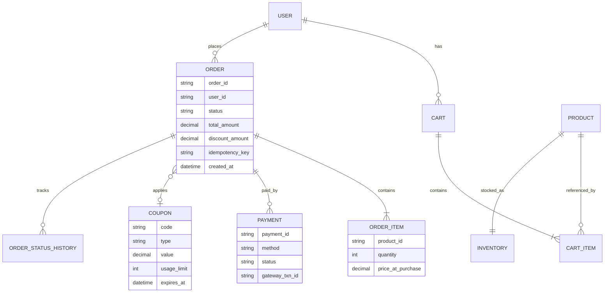

A subtle point worth remembering: `price_at_purchase` is stored **on the order item**, not looked up from the product later. Prices change, but a customer who paid ₹999 must always see ₹999 on that order. We **snapshot** price, address and coupon details into the order. Interviewers love this detail.

---

## Step 6: The Core APIs

```
POST   /cart/items                 body: {productId, qty}
PUT    /cart/items/{productId}     body: {qty}
DELETE /cart/items/{productId}
GET    /cart

POST   /checkout/initiate          → validates cart, locks prices, returns checkoutId
POST   /checkout/{id}/apply-coupon body: {code}
POST   /orders                     headers: Idempotency-Key: <uuid>
                                   body: {checkoutId, addressId, paymentMethod}
GET    /orders/{orderId}
GET    /orders?userId=...&page=...
POST   /orders/{orderId}/cancel
```

Notice the `Idempotency-Key` header on order creation. It's a small detail now, and in the payments chapter you'll see it is **the single most important defence** against double charging.

---

## Step 7: The User Journey (the flow we must make reliable)

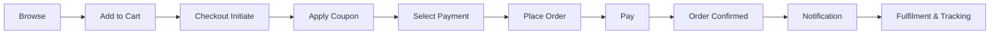

Every arrow in this diagram is a place where something can fail. The rest of this course follows the story of **how each failure was discovered and fixed**:

- Two people buy the last phone at the same moment.
- The payment succeeds but our server crashes before saving the order.
- The user double-clicks "Pay".
- A coupon with 100 uses gets used 400 times in a flash sale.
- The database melts at 8:00 PM when the sale opens.

---

## Roadmap of the Story

| Ch | Topic |
|---|---|
| 1 | Requirements, scale, entities, APIs (you are here) |
| 2 | Day-1 monolith and its first cracks |
| 3 | Cart design (Redis vs DB, guest vs logged-in, merge) |
| 4 | Inventory: overselling, locking, reservations |
| 5 | Pricing and coupon engine |
| 6 | Payments: gateways, idempotency, webhooks, failures |
| 7 | Order state machine and the Saga pattern |
| 8 | Async messaging: Kafka, the outbox pattern, notifications |
| 9 | Data layer: sharding, replication, indexing |
| 10 | Caching and CDN |
| 11 | Flash-sale scaling: rate limiting, waiting room, warm-up |
| 12 | Multi-region and disaster recovery |
| 13 | Observability, deployments and security |
| 14 | Migrations (monolith → services, schema changes) and final interview recap |

---

## Quick Self-Check Before We Move On

Try answering these in your own words:

1. Why do we treat the **cart** and the **order/payment** path with different consistency and availability goals?
2. At 2M orders/day, why is the average of ~23 orders/sec misleading, and what number should we design for?
3. Why do we store `price_at_purchase` on the order item instead of reading the product's current price?
4. Why does `POST /orders` need an `Idempotency-Key`? (A guess is fine. We'll go deep later.)

Reply with your answers or doubts. If anything above is unclear, such as the estimation or the entity choices, ask and I'll go deeper. Once you're comfortable, say **"next"** and we'll move to **Chapter 2: the Day-1 monolith and where it first breaks**.


-----------------------------------------------------------------------------------------------------------------------
-----------------------------------------------------------------------------------------------------------------------
-----------------------------------------------------------------------------------------------------------------------
-----------------------------------------------------------------------------------------------------------------------


# Chapter 2: The Day-1 Monolith and Where It First Cracks

## The Story Continues

KartKing launches. Three engineers, two months, one goal: **ship**. They do the sensible thing and build a **monolith**, with one codebase, one app server and one relational database.

This is the right decision for day one. In an interview, say so: *"I'd start with a simple monolith because it's fast to build and gives us ACID transactions for free. Then I'd evolve it as specific problems appear."* Jumping to 20 microservices in the first five minutes is a red flag, because it shows you can't justify complexity.

---

## Version 1: The Architecture

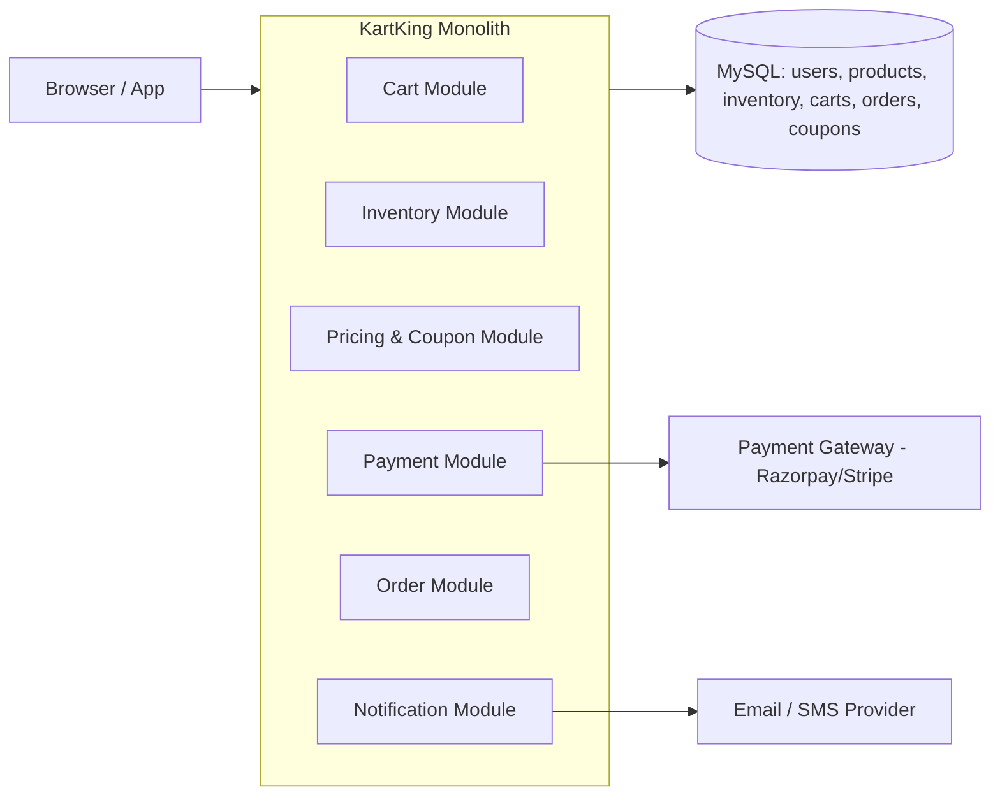

Everything is in one process and one database. Its biggest advantage is that **one local DB transaction can make several changes atomic**.

### The Checkout Code (simplified)

```python
def place_order(user_id, cart_id, coupon_code, payment_details):
    db.begin()                                    # ← one big transaction

    cart = db.query("SELECT * FROM cart_items WHERE cart_id = ?", cart_id)

    # 1. check stock
    for item in cart:
        stock = db.query("SELECT stock FROM inventory WHERE product_id = ?", item.product_id)
        if stock < item.qty:
            db.rollback(); raise OutOfStock()

    # 2. apply coupon
    coupon = db.query("SELECT * FROM coupons WHERE code = ?", coupon_code)
    if coupon.used_count >= coupon.usage_limit:
        db.rollback(); raise CouponExhausted()
    total = compute_total(cart, coupon)

    # 3. reduce stock
    for item in cart:
        db.execute("UPDATE inventory SET stock = ? WHERE product_id = ?",
                   stock - item.qty, item.product_id)
    db.execute("UPDATE coupons SET used_count = ? WHERE code = ?", coupon.used_count + 1, coupon_code)

    # 4. charge the customer
    result = payment_gateway.charge(payment_details, total)     # ← HTTP call to outside world
    if not result.success:
        db.rollback(); raise PaymentFailed()

    # 5. create order
    order_id = db.insert("INSERT INTO orders ...", user_id, total, ...)
    db.insert("INSERT INTO order_items ...", ...)

    db.commit()

    # 6. notify
    send_email(user_id, order_id)
    return order_id
```

It reads cleanly, and for the first 500 orders a day it works. Then the cracks appear, **one by one**. Each one is a classic interview topic.

---

## Crack #1: Two People, One Last iPhone (Race Condition / Overselling)

It's launch week. KartKing has **1 iPhone left** (`stock = 1`). Riya and Arjun both click "Place Order" within the same millisecond.

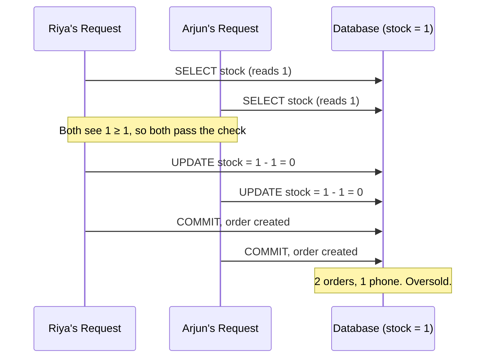

**Why didn't the transaction protect us?** Because the transaction only guarantees each request is atomic. It doesn't stop two transactions from *reading the same old value*. This is the classic **read-check-write race** (a lost update). In the default isolation levels of MySQL (REPEATABLE READ) and Postgres (READ COMMITTED), plain `SELECT`s don't block each other.

**Impact:** One customer gets an apology email, "sorry, cancelled". Do that to 5,000 people in a flash sale and you get a social-media disaster.

*(Preview: we fix this in Chapter 4 using atomic conditional updates, row locks, optimistic locking and reservations. For now, just feel the pain.)*

---

## Crack #2: The Payment Call Inside the Transaction (Long Transactions)

Look at step 4 again. We call the payment gateway **while holding the database transaction open**, and with it the row locks on those inventory rows.

Payment gateways are slow: usually 2 to 3 seconds (OTP, bank redirects), sometimes 30 seconds on timeout.

**Little's Law** makes the damage clear:

> Concurrent in-flight = arrival rate × time in system

- Checkout arrival rate at a busy hour: **100 orders/sec**
- Each holds a DB connection for ~**3 sec**
- Connections needed: 100 × 3 = **300 simultaneous**
- Our DB connection pool size: **50**

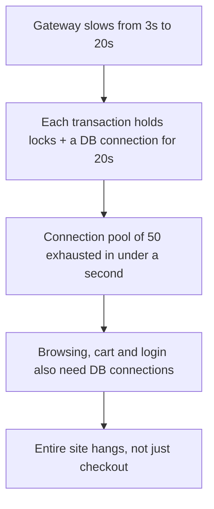

**The lesson:** *Never hold database locks across a call to an external system you don't control.* One slow third party took down the whole site. This is called **cascading failure**, and you'll see the same pattern in nearly every HLD problem.

Also, popular products become **hot rows**. If 500 people are waiting on the lock for the same iPhone's inventory row, they queue up while holding connections.

---

## Crack #3: Money and Data Can't Be Atomic (The Dual-Write Problem)

Look at step 4 → step 5. Our DB and the payment gateway are **two different systems**. No transaction spans both.

Consider the failure windows:

| What happened | Result |
|---|---|
| Gateway charges ₹60,000, then our server crashes before `db.commit()` | **Customer paid, we have no order.** Money taken, nothing delivered. |
| We reorder the code: commit the order first, then charge, and the charge fails | **Order exists, unpaid.** We'd ship free goods unless we clean up. |
| Gateway times out and we don't know if the charge went through | **Unknown state.** Retry and we may charge twice, give up and we may lose a payment. |

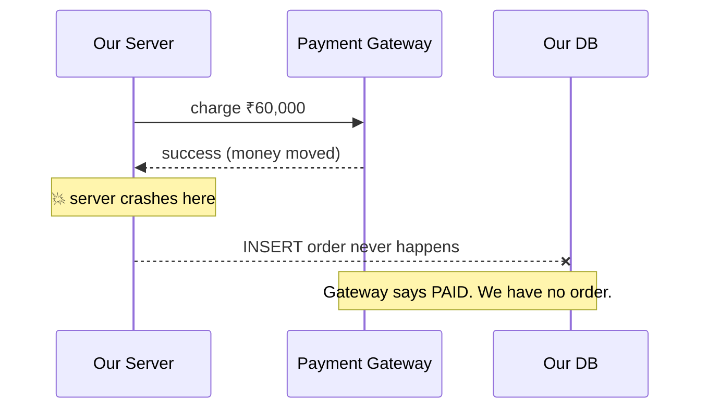

This is the heart of distributed systems: **you cannot make two independent systems commit atomically with a simple local transaction**. Almost everything in Chapters 6 to 8 (idempotency, webhooks, the Saga pattern, the outbox pattern, reconciliation) exists to handle this one problem.

---

## Crack #4: The Double Click (No Idempotency)

Riya's network is slow. The "Pay" button seems stuck, so she taps it three times. The mobile app also auto-retries on timeout.

Our server sees **three separate `place_order` requests**. Each one creates an order and charges her card. She is billed ₹1,80,000 for one phone.

**Why this is subtle:** each request is individually valid. The server has no way to tell "a retry of the same intent" from "a genuinely new order". That is why Chapter 1 had `Idempotency-Key` on the API.

---

## Crack #5: The Coupon That Wasn't Limited

Marketing launches `FIRST100`: a 50% discount, **for the first 100 users only**. Look at the code:

```python
if coupon.used_count >= coupon.usage_limit: ...
...
UPDATE coupons SET used_count = coupon.used_count + 1
```

It is the **same read-check-write race as the iPhone**. When 800 users hit the coupon in the first minute, many read `used_count = 99` simultaneously. **The coupon is redeemed 400 times** and the finance team is furious.

Same disease, different organ. Spotting that **inventory, coupons, wallet balances and seat bookings all share one pattern** (a limited counter under concurrency) is a very strong interview insight.

---

## Crack #6: Everything Is Coupled

A few more problems appear as the team and traffic grow.

1. **Notification failure blocks the order.** The email provider is slow, `send_email` takes 8 seconds, and Riya's "Order Placed" screen spins. Or worse, the provider throws an exception *after* commit and the user sees an error even though the order exists, so she orders again.
2. **Browsing starves checkout.** A viral product page sends 50,000 reads/sec to the same DB that checkout writes to. Checkout slows down because of *unrelated* traffic.
3. **Single point of failure.** One server and one DB. If either dies, KartKing is down.
4. **Deployments are scary.** Deploying a bug fix to the coupon module restarts the whole process and **kills in-flight checkouts**, perhaps right after a charge.
5. **Scaling is all-or-nothing.** The cart module needs 20x more capacity than the order module, but you can only scale the entire monolith.

---

## Summary: What the Cracks Teach Us

| Crack | Root cause | Concept we'll learn | Chapter |
|---|---|---|---|
| Overselling | Read-check-write race | Atomic updates, locking, reservations | 4 |
| Coupon overuse | Same race on a counter | Atomic counters, Redis, per-user limits | 5 |
| Site hangs on slow gateway | Locks held across an external call | Short transactions, async flows, timeouts | 6, 7 |
| Paid but no order | Two systems, no shared transaction | Saga, idempotency, webhooks, reconciliation | 6, 7 |
| Double charge | No idempotency | Idempotency keys | 6 |
| Email failure breaks orders | Tight coupling | Async messaging, outbox pattern | 8 |
| DB overload, SPOF | One DB for everything | Sharding, replication, caching | 9, 10 |
| Flash-sale meltdown | Unprotected spikes | Rate limiting, queues, waiting room | 11 |
| Scary deploys, region outage | Single deploy unit and region | Rolling/canary deploys, multi-region | 12, 13 |

> **Interview tip:** This "start simple, find cracks, evolve" structure is exactly how a strong HLD answer sounds. When you say *"the naive version has a race condition here, so we introduce X"*, it proves you understand why each component exists, not just that it exists.

---

## What the Evolution Looks Like (a Teaser)

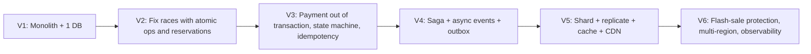

---

## Quick Self-Check

1. In the iPhone race, why did a normal database transaction **not** prevent overselling?
2. Using Little's Law, explain why a 20-second gateway delay can take down the *whole* site, not just checkout.
3. Why can't we simply "wrap the gateway call and the DB insert in one transaction"?
4. Name three different resources (besides inventory) that suffer from the same read-check-write race.

Answer or ask doubts. If any of these (Little's Law, isolation levels, the dual-write problem) feel shaky, tell me and I'll explain them with more examples. When ready, say **"next"** and we'll begin fixing things properly with **Chapter 3: Cart Design**, our first step toward separating concerns.


-----------------------------------------------------------------------------------------------------------------------
-----------------------------------------------------------------------------------------------------------------------
-----------------------------------------------------------------------------------------------------------------------
-----------------------------------------------------------------------------------------------------------------------


# Chapter 3: Cart Design

## The Story Continues

KartKing survived launch week, but the dashboards show something odd. The database CPU is high, yet **very few of those queries are orders**. Most are `INSERT/UPDATE/DELETE` on the `cart_items` table.

Let's see why.

---

## Version 1: Cart in the Main MySQL Database

The monolith stored carts next to everything else:

```sql
cart_items(cart_id, user_id, product_id, qty, added_at)
```

Four problems showed up.

**Problem 1: Carts are the busiest and least valuable data.**
Remember our numbers: cart operations are ~10x more frequent than orders (**~10,000 to 25,000 ops/sec at peak**). Industry-wide, about **70% of carts are never converted** into orders. We were spending expensive, ACID-guaranteed disk writes on data that is mostly thrown away.

**Problem 2: Cart traffic competes with checkout traffic.**
The same DB serves both. A cart-heavy sale hour slows down order placement. This is the "browsing starves checkout" crack from Chapter 2.

**Problem 3: Guests.**
Half of KartKing's visitors aren't logged in. `cart_items.user_id` can't be null, so the team hacked in fake users. Messy.

**Problem 4: No natural expiry.**
Stale carts from 2 years ago sit forever. Someone has to write cleanup jobs that delete millions of rows without hurting production.

> **Insight:** Pick the storage by looking at the *access pattern and value of the data*. Cart data is high-frequency, small, per-user, and low-value-per-record, so it needs a **fast key-value store**, not a relational DB.

---

## What Does a Cart Actually Need?

| Need | Implication |
|---|---|
| Very fast reads and writes (<10 ms) | In-memory or low-latency KV store |
| Always available (a broken cart means lost sales) | Favour availability over strict consistency |
| Always accessed **by user**, never "all carts containing product X" | Key-value lookup, no joins or complex queries |
| Auto-expiry | TTL support |
| Survives a server restart (mostly) | Some durability |
| Guest and logged-in support | Flexible identity key |

---

## Choosing a Store: The Options

| Option | Pros | Cons |
|---|---|---|
| **Relational DB (status quo)** | ACID, simple | Too heavy for this traffic, hard to scale writes, no TTL |
| **Redis only** | Extremely fast, TTL, hashes are perfect for carts | Memory is expensive, durability is weaker |
| **DynamoDB / Cassandra** | Durable, scales horizontally, TTL, low-latency | Slightly slower than memory, cost per request |
| **Redis (cache) + durable KV (source of truth)** | Speed and durability | Two systems to run, consistency between them |

### The Evolution (what really happens in companies)

**Step A, Redis only.** The team moves carts to Redis. Latency drops from 40 ms to 2 ms. Everyone is happy.

**Step B, the incident.** A Redis node crashes during a sale, and the replica that takes over is slightly behind. A few thousand customers open their carts and find them **empty or missing recent items**. Support tickets flood in.

*Why?* Redis replication is asynchronous. The primary acknowledges a write *before* the replica has it. If the primary dies in that gap, those writes are lost.

**Step C, add a durable store.** Carts are written to a durable store (DynamoDB or Cassandra) as the **source of truth**. Redis becomes a **cache** in front of it.

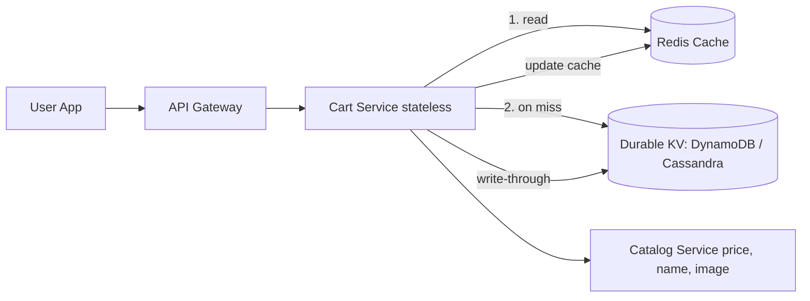

**Write path:** write to the durable store first, then update the cache. If the cache update fails, we delete the key (the next read repopulates it).
**Read path:** check Redis. On a miss, read the durable store and fill the cache with a TTL.

> **Interview note:** Many candidates also accept "Redis with AOF persistence and replicas" for the cart, arguing that losing a few seconds of cart edits is tolerable. Both answers are fine **if you state the trade-off**: *"A lost cart item costs a re-click, not money. So I'd accept eventual durability if I wanted to keep it simple."* What interviewers reject is choosing a store without reasons.

---

## The Data Model

**Key:** `cart:{userId}` for logged-in users, `cart:guest:{guestId}` for guests (random UUID in a cookie or local storage).

**Value (a hash):**

```
cart:u_8841
 ├── prod_iphone15  → {"qty":1, "variant":"256GB-Black", "addedAt":1730620000}
 ├── prod_book_ddia → {"qty":2, "addedAt":1730620500}
 └── _meta          → {"updatedAt":..., "version":7}
```

### Why a hash and not one JSON blob?

Imagine Riya has the cart open in two tabs. Tab 1 changes the iPhone quantity, and Tab 2 adds a book at almost the same time.

- **JSON blob approach:** each tab reads the whole cart, modifies it, and writes the whole thing back. The second write overwrites the first, so **one change is lost** (the same read-modify-write race from Chapter 2).
- **Hash approach:** each operation touches only **one field** (`HSET cart:u_8841 prod_book_ddia ...`). Operations on different products never collide. For the same product, **last write wins**, which is acceptable for a cart.

### What we deliberately do NOT store in the cart

**Price.** The cart stores only `productId`, `qty` and `variant`.

*Why?* Imagine a ₹70,000 phone sits in a cart for 3 weeks. If we stored the price, we'd show stale data, or worse, honour an old price by accident. Instead, when the cart is **displayed**, the Cart Service fetches current prices from the Catalog Service (heavily cached) and shows a banner if something changed: *"Price dropped by ₹2,000"* or *"Price increased since you added this"*.

The price becomes **binding only at checkout** (Chapter 5), and then it is snapshotted into the order.

---

## Guest vs Logged-in: The Merge Problem

Arjun browses as a guest, adds 2 items, and then logs in. He had an older cart from last week with 1 different item and 1 overlapping item. What should he see?

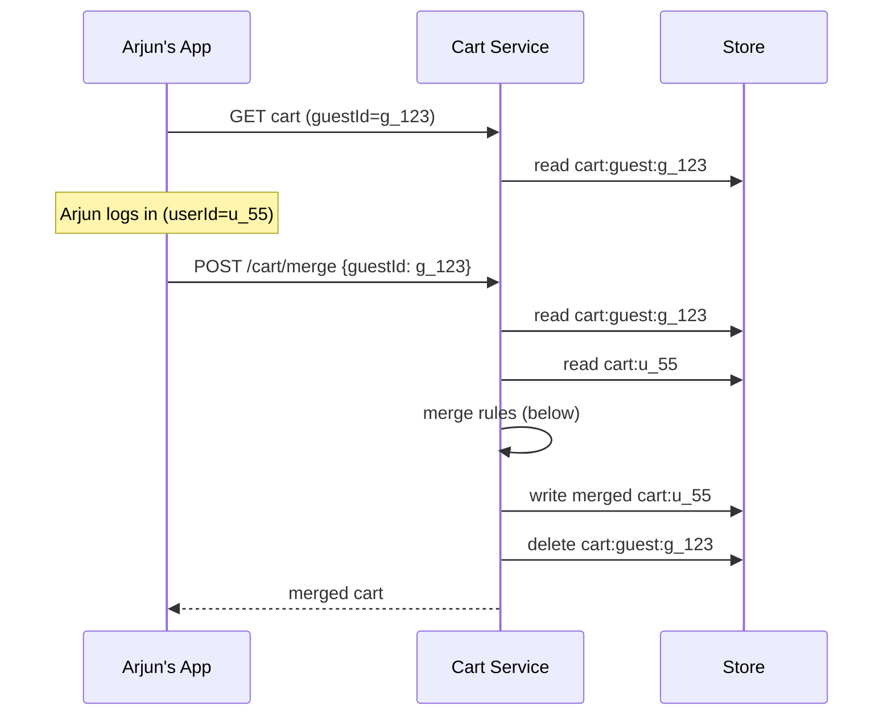

**Merge rules (a product decision, so state it in the interview):**
- Items in only one cart → keep them.
- Same product in both → take `max(qty)` or `sum(qty)` capped at the limit. Amazon-style systems usually **sum**, with a cap.
- Variant conflicts → keep the guest cart's choice (most recent intent).

**Make the merge idempotent.** If the login request is retried, the merge shouldn't double the quantities. Solution: after a successful merge, delete the guest cart. A retry then finds nothing to merge. Better still, record `mergedFrom: g_123` so a replay is a no-op.

---

## Should Adding to Cart Reserve Inventory?

A natural but dangerous idea: "When someone adds the last iPhone to their cart, reserve it so nobody else can buy it."

**Why this fails:**
- **70% of carts are abandoned.** Stock would sit locked for people who will never buy.
- **Hoarding attack:** a malicious user or competitor adds the whole inventory to their cart and blocks every real buyer.
- It would massively increase write contention on inventory rows.

**What we do instead:**
- The cart does only a **soft check**: show "Only 2 left!" or "Out of stock", using a cached, slightly stale view of inventory.
- **Hard reservation happens at checkout**, for a short time (e.g. 10 minutes). That is Chapter 4.

> **Exception to mention:** Ticketing and flight systems (BookMyShow, airlines) *do* hold seats during selection, because the item is unique and the user is already committed to a seat map. For e-commerce with deep stock, soft check in the cart works better.

---

## Limits and Abuse Protection

- Max **50 distinct items** per cart, max **10 units** per item (configurable per product).
- **TTL:** 30 days of inactivity for guests, 90 days for logged-in users. Each write refreshes the TTL.
- **Rate limit** cart APIs per user and IP, because bots will hammer them.

---

## Scaling the Cart

**Capacity check:**
- 1 cart ≈ 10 items × ~100 bytes ≈ **1 KB**
- 50M live carts × 1 KB = **~50 GB** in total, which is small enough to fit in memory on a modest Redis cluster.
- Peak 25,000 ops/sec: a single Redis node handles ~100,000 ops/sec. But we want redundancy and headroom, so we use a cluster.

**Sharding:** shard by `userId` (or `guestId`). Redis Cluster does this with **16,384 hash slots**: `slot = CRC16(key) mod 16384`, and each node owns a range of slots.

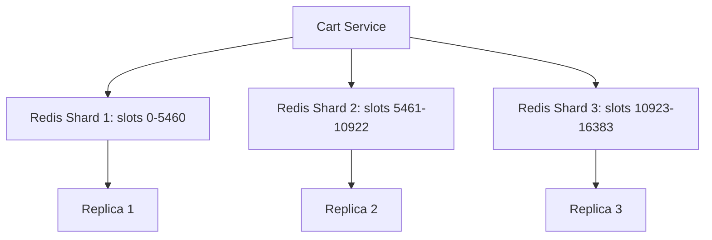

**Why `userId` is a great shard key:** every cart operation involves **exactly one user**, so each request goes to exactly one shard. There are no cross-shard queries, and load spreads evenly because there are millions of users and no single "celebrity" cart. Compare this with inventory later, where a single hot product *is* a hotspot.

**Replication:** each shard has a primary and at least one replica in a different availability zone. Reads of one's own cart go to the **primary** (to get *read-your-writes* consistency: you add an item and it must appear immediately). Reads for less critical views (e.g. the mini-cart count in the header) can go to replicas.

---

## Failure Handling

| Failure | Behaviour |
|---|---|
| **Redis shard down** | Circuit breaker opens, and the Cart Service reads and writes the durable store directly (slower but working). The replica gets promoted. |
| **Durable store slow** | Return the cart from cache if available. Reject writes with a friendly retry message and keep timeouts tight. |
| **Catalog service down** | Show the cart with cached prices and a "prices will be confirmed at checkout" note. The cart still renders. |
| **Duplicate add-to-cart (double tap)** | Use `HSET` with the absolute qty from the client (not `+1`) so retries are idempotent. Or accept a client-generated request ID. |

**CAP framing (a great interview line):**
> *"The cart is an AP system. If there's a partition, I'd rather let the user keep shopping with a slightly stale cart than show an error. Correctness gets enforced later, at checkout, where it matters."*

This also shows the principle from Chapter 1 in practice: **be relaxed where mistakes are cheap, strict where they cost money.**

---

## Handing Off to Checkout

When the user clicks **Checkout**, the cart must be *validated*, not trusted:

1. Re-fetch current prices from Catalog.
2. Re-check product availability.
3. Check per-user quantity limits.
4. Create an immutable **checkout session** (`checkoutId`) with a frozen price snapshot.

From here on, the cart is just the *input* to the checkout session. This clean boundary is what lets Cart Service and Order Service be separate services owned by separate teams.

We also quietly emit an event `CartUpdated` (we'll use it in Chapter 8 for abandoned-cart emails and analytics, where it doesn't slow down the user).

---

## Where We Are Now

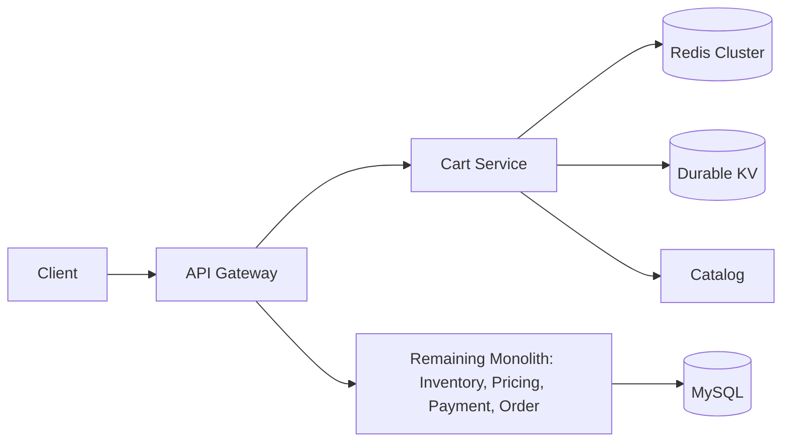

Cart traffic is now isolated from the DB that handles money. Checkout no longer competes with "add to cart" clicks.

---

## Quick Self-Check

1. Why is a relational DB a poor fit for carts, while it's a good fit for orders?
2. Why did "Redis only" cause empty carts during the failover, and how does the durable store fix it?
3. Why store the cart as a hash with per-product fields rather than one JSON blob?
4. Why don't we store price in the cart, and where does the price become binding?
5. Why is `userId` an excellent shard key for carts? What would be a bad shard key?
6. Why don't we reserve inventory on add-to-cart?

Tell me your answers or any doubts. For example, I can go deeper into Redis replication and failover, consistent hashing vs hash slots, or write-through vs write-behind caching. When you're comfortable, say **"next"** and we'll tackle **Chapter 4: Inventory, where we fix the overselling problem** with locking, atomic updates and reservations.


-----------------------------------------------------------------------------------------------------------------------
-----------------------------------------------------------------------------------------------------------------------
-----------------------------------------------------------------------------------------------------------------------
-----------------------------------------------------------------------------------------------------------------------


# Chapter 4: Inventory, Fixing Overselling

## The Story Continues

Remember Riya and Arjun fighting over the last iPhone? After the customer-support apology storm, the team gets a mandate: **never sell stock we don't have.** Let's see how the fix evolves. Every attempt looks reasonable, and every one hides a trap.

---

## Attempt 1: "Just Check Again"

A junior engineer suggests: *"Check the stock twice, right before the update."*

It doesn't help. Between the second check and the update, another request can still slip in. The gap shrinks, but it never closes. **You cannot fix a race condition by making the window smaller.** You fix it by making check-and-update **one atomic operation**.

---

## Fix 1: Atomic Conditional Update

Move the check **into the UPDATE statement itself**:

```sql
UPDATE inventory
SET    stock = stock - 1
WHERE  product_id = 'iphone15'
  AND  stock >= 1;
-- then check: rows_affected == 1 ? success : out of stock
```

**Why does this work?**
1. The database takes an **exclusive row lock** on the `iphone15` row while executing the UPDATE.
2. The `WHERE stock >= 1` is evaluated **after the lock is acquired**, against the latest committed value.
3. Riya's UPDATE runs first and stock goes 1 → 0. Arjun's UPDATE waits for the lock, then re-evaluates `stock >= 1`, which is now false, so **0 rows are affected** and he gets "out of stock".

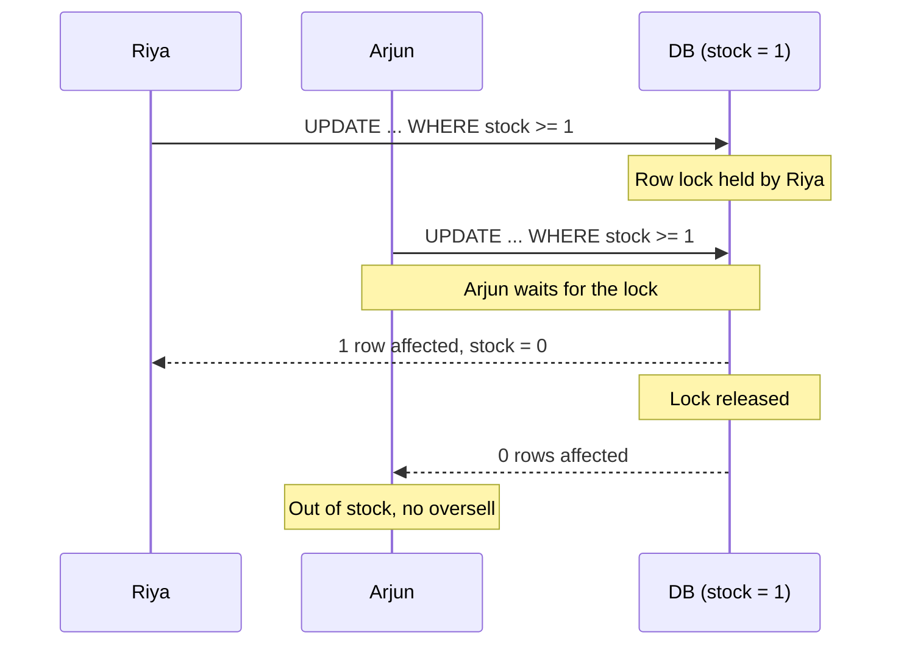

The key habit: **never read a value into app memory, compute, and write back. Push the logic into the DB so the operation is atomic.** This is why we wrote `stock = stock - 1` and not `SET stock = 0`.

### The Multi-Item Trap: Deadlocks

An order has several items. Riya's order has {iPhone, Charger}. Arjun's order has {Charger, iPhone}. Each transaction updates its items in the order listed:

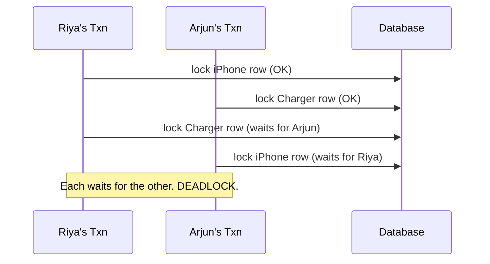

The DB detects the cycle and kills one transaction (a random victim). **Fix: always lock rows in a consistent global order**, e.g. sort items by `product_id` before updating. If everyone locks in the same order, a cycle can't form. This is a classic interview point.

Also keep the transaction **short**: just the stock updates, with no payment call inside. We learned that in Chapter 2.

---

## Fix 2: Pessimistic Locking (`SELECT ... FOR UPDATE`)

An alternative style is to lock first, then think:

```sql
BEGIN;
SELECT stock FROM inventory WHERE product_id='iphone15' FOR UPDATE;  -- lock acquired
-- app logic: if stock >= qty ...
UPDATE inventory SET stock = stock - 1 WHERE product_id='iphone15';
COMMIT;
```

The row is locked from the `SELECT`, so nobody else can read-for-update or write it until we commit. It is correct and flexible when you need complex logic between the read and the write.

**Downside:** the lock is held for the whole duration of your app logic, including network hops to the app server. That reduces throughput. For a simple decrement, Fix 1 is better.

## Fix 3: Optimistic Locking (version column)

```sql
-- read: stock=1, version=7
UPDATE inventory
SET stock = stock - 1, version = version + 1
WHERE product_id='iphone15' AND version = 7;
-- 0 rows affected → someone changed it → retry from the read
```

No lock is held while thinking. A conflict is detected at write time and the caller retries.

| Approach | Best when | Problem |
|---|---|---|
| **Atomic conditional UPDATE** | Simple counters (our case) | Hot row contention (more below) |
| **Pessimistic (FOR UPDATE)** | High conflict plus complex logic | Longer lock holds, deadlock risk |
| **Optimistic (version)** | **Low** contention, long-ish logic | **Retry storms** when contention is high (100 people retrying on one hot item) |

**For inventory we choose the atomic conditional UPDATE.** Optimistic locking is a bad fit for a hot item, because 1,000 buyers means 999 failures and retries per success.

---

## New Problem: When Do We Decrement?

Now we ask the business question. Stock must go down at some point. When?

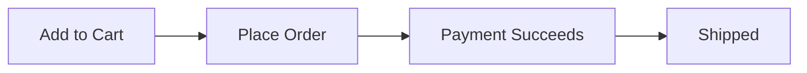

**Option A: Decrement at "Place Order", before payment.**
Riya clicks Pay, and the stock drops. But she abandons the payment page (OTP never entered, UPI app never opened), and the stock stays gone. With ~20 to 30% payment failures or abandonment, a flash sale can show "Sold Out" while **30% of the stock is held by ghosts**. Real buyers are turned away.

**Option B: Decrement after payment succeeds.**
Money is collected first, and then we discover someone else got the last unit. Now we must **refund**, and the customer feels cheated: *"You took my money and cancelled!"* It also wastes gateway fees and creates a support load.

**Option C: Decrement at add-to-cart.** Already rejected in Chapter 3 (hoarding and 70% abandonment).

Each option fails differently. We need something in between.

---

## Fix 4: Reservation (Soft Hold with Expiry)

This is how real systems (Amazon, BookMyShow, airlines) do it. Split stock into two numbers:

```
available = total_stock - reserved
```

- **Reserve** at checkout start: `reserved += qty`. This is a temporary hold.
- **Confirm** when payment succeeds: `total_stock -= qty; reserved -= qty`. The sale is final.
- **Release** if payment fails, the user abandons, or the hold **expires**: `reserved -= qty`.

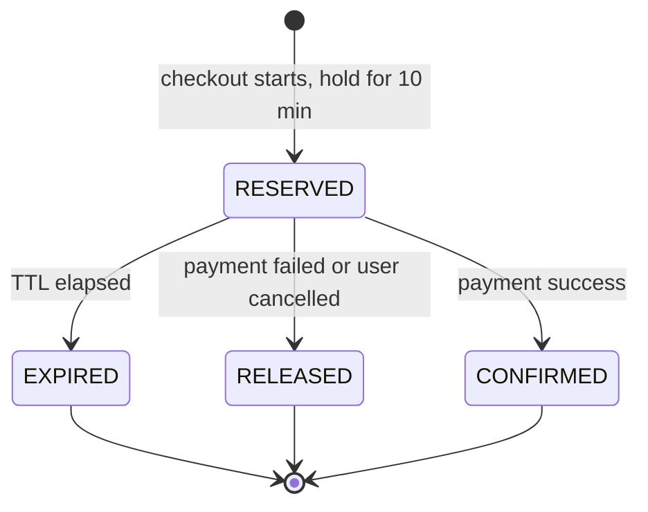

### Data model

```sql
inventory(product_id, total_stock, reserved, version)

reservations(
  reservation_id,
  checkout_id,        -- unique, gives idempotency
  product_id, qty,
  status,             -- RESERVED / CONFIRMED / RELEASED / EXPIRED
  expires_at,
  created_at
)
UNIQUE(checkout_id, product_id)
```

### Reserve operation (atomic)

```sql
BEGIN;
UPDATE inventory
SET    reserved = reserved + :qty
WHERE  product_id = :pid
  AND  total_stock - reserved >= :qty;      -- available >= qty
-- rows_affected == 0 → OUT_OF_STOCK, rollback

INSERT INTO reservations (...) VALUES (..., 'RESERVED', now() + interval 10 minute);
COMMIT;
```

The inventory change and the reservation record are written in the **same local DB transaction**, so they can never disagree. The transaction is short and has no external calls.

### Idempotency of reserve

The mobile app retries `reserve` after a timeout. Without protection we would reserve twice. The `UNIQUE(checkout_id, product_id)` constraint guarantees the second insert fails, and we then return the **existing** reservation. **Retries become safe because the identity of the request (checkoutId) is stored.**

### Expiry: How Do Holds Come Back?

If the user walks away, a hold must release itself. Options:

| Mechanism | How | Trade-off |
|---|---|---|
| **Reaper job** | A cron runs every 30 s: `SELECT ... WHERE status='RESERVED' AND expires_at < now()` and releases them | Simple. Needs a good index on `(status, expires_at)`. Release is delayed by up to the job interval. |
| **Delayed queue** | On reserve, publish a delayed message (SQS delay, RabbitMQ TTL+DLX, Kafka + scheduler) that fires at `expires_at` | Precise, and scales better, but more moving parts |
| **Redis key expiry** | A key with TTL plus keyspace notifications | Notifications are best-effort, so they **can be lost**. Never use as the only mechanism. |

Common production answer: **a delayed message as the primary trigger, and a reaper job as a safety net** (belt and braces). Also make release **idempotent**: releasing an already-released reservation is a no-op (`UPDATE ... WHERE status='RESERVED'` and check rows affected).

### The Nasty Edge Case: Payment Succeeds *After* Expiry

Riya's UPI approval takes 12 minutes. The hold expired at minute 10, and someone else reserved the last phone. Then her payment webhook arrives.

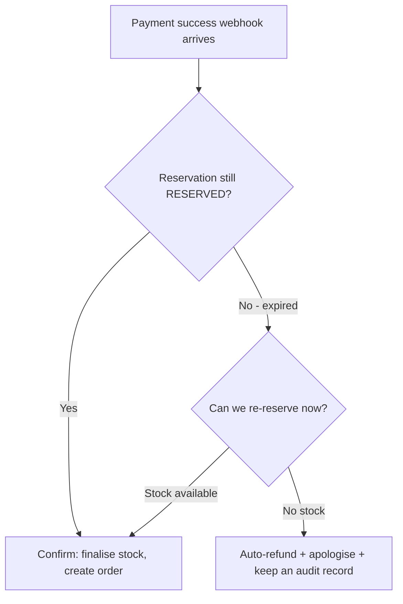

This is exactly the situation that separates average answers from strong ones. **Reservation TTL must be longer than the payment timeout window.** If the gateway session lasts 15 minutes, hold for 15 to 20. And you **always need a refund path** for the leftover edge cases. We'll build that in the Saga chapter.

---

## New Problem: The Hot Row (Flash Sale)

Big Billion Day: **1,00,000 users** try to buy **500 units** of a ₹9,999 phone in the first 5 seconds.

All those `UPDATE inventory ... WHERE product_id='phone'` statements target the **same row**. Row locks serialise them: each update must wait for the previous one to commit.

- One update holds the lock for ~2 to 5 ms (including commit/fsync)
- That caps one hot row at roughly **200 to 500 updates/sec**
- With 20,000 requests/sec arriving, thousands queue up, **each holding a DB connection**
- Connection pool exhausted → the whole site stalls (the Chapter 2 cascade again)

**Sharding the table doesn't help.** All requests are for one product, so they all land on one shard. This is the **hot key / hot partition problem**, one of the most common HLD themes.

### Fix 4a: Put an Atomic Counter in Redis in Front (the Gatekeeper)

Redis is single-threaded and does atomic operations in memory at ~100K ops/sec per node.

```lua
-- Lua script, executed atomically in Redis
local available = tonumber(redis.call('GET', KEYS[1]))
if available >= tonumber(ARGV[1]) then
    redis.call('DECRBY', KEYS[1], ARGV[1])
    return 1      -- success
else
    return 0      -- sold out
end
```

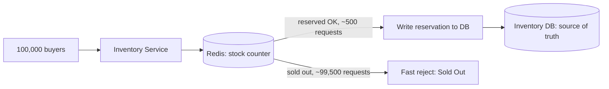

**The beauty:** of 1,00,000 requests, **~99,500 are rejected instantly in memory** and never touch the database. Only ~500 successful reservations reach the DB, which handles that easily.

**Pre-warming:** before the sale, load the counter: `SET stock:phone 500`. If you don't warm it, the first requests miss the cache and stampede the DB. (We'll revisit warm-up in Chapter 11.)

**Why the DB is still the source of truth:** Redis can lose data on failover. So we treat Redis as an **admission filter**, not as the record of truth:
- The DB's conditional UPDATE remains the **final guard**. Even if Redis wrongly admits someone, the DB rejects them.
- If Redis restarts, **rebuild counters from the DB** (`total_stock - reserved`) before reopening the sale.
- Small drift between Redis and DB is repaired by a periodic **reconciliation job**.

**What if Redis wrongly rejects people (counter too low)?** Say a failed DB write isn't "un-decremented" in Redis. Result: under-selling slightly. We prefer that mistake to over-selling. On any failure after a Redis decrement, run **compensation** (`INCRBY` back). Plus the reconciliation job.

### Fix 4b: Split the Counter into Buckets (Sharded Counter)

Instead of one row with `stock = 500`, make **10 rows** with 50 each: `phone#0 ... phone#9`. A request picks a random bucket (and tries another if empty). Contention drops 10x, since 10 locks are now in play.

**Trade-off:** "Is the item sold out?" now needs a sum or a probe across buckets, and the last few units are awkward (bucket 3 has 2 left, bucket 7 has 1, and the customer wants 3). Use it for very large stock and tolerate a small tail inefficiency, or combine with a final "sweep" step.

### Fix 4c: Serialise Through a Queue

Route all requests for a product through a **single partition** (Kafka partitioned by `productId`) processed by one consumer. Order is preserved and there are no lock fights. The cost is asynchronous results (the user gets "we're processing your request"), which is fine for flash sales. We'll see this in Chapter 11.

| Technique | Throughput on a hot item | Complexity | Notes |
|---|---|---|---|
| Plain DB atomic UPDATE | ~hundreds/sec | Low | Fine for normal products |
| Redis gatekeeper + DB | Tens of thousands/sec | Medium | **Most common answer** |
| Bucketed counters | Scales with bucket count | Medium | Tail-stock awkwardness |
| Queue per product | Smooth, async | Higher | Great when UX allows waiting |

---

## Inventory as Its Own Service

Following the same pattern as the cart, Inventory becomes a **separate service owning its own database**. Reasons:
- It has special scaling needs (hot keys, Redis gatekeeper).
- Other services must not write to its tables directly. They call its API: `reserve`, `confirm`, `release`, `getAvailability`.
- It can be deployed and tuned independently.

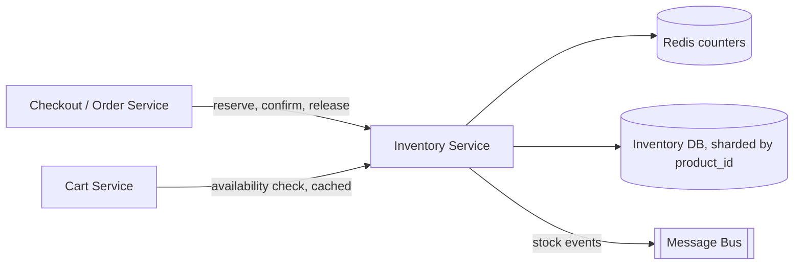

**API (all idempotent via checkoutId/orderId):**
```
POST /inventory/reserve   {checkoutId, items:[{sku, qty}], ttlSeconds}
POST /inventory/confirm   {checkoutId}
POST /inventory/release   {checkoutId}
GET  /inventory/availability?sku=...
```

**Multi-item reservations are all-or-nothing:** if item 2 of 3 is out of stock, release the first and return a clear error. Do this inside one DB transaction if all items live on one shard. If they span shards, use a small Saga (compensating release), which we'll learn in Chapter 7.

**Sharding:** shard by `product_id` (or SKU). A normal product's data is spread evenly. A hot product still lands on one shard, which is why Redis and bucketing exist.

**Multi-warehouse:** real inventory is `(sku, warehouse_id) → stock`. Checkout picks the warehouse closest to the delivery pincode, falling back to others. The same reserve logic applies per `(sku, warehouse)`.

---

## Failure Scenarios

| Failure | Handling |
|---|---|
| Inventory service crashes after reserving but before replying | The caller retries with the same `checkoutId`, the unique constraint returns the existing reservation. No double hold. |
| Checkout crashes after reserve | The reservation expires by TTL, and the stock returns automatically. |
| Redis counter lost | Block new sales briefly, rebuild from the DB, resume. The DB's conditional UPDATE keeps correctness meanwhile. |
| DB write fails after Redis decrement | Compensating `INCRBY` plus reconciliation. |
| Reaper job down | The delayed-queue path still releases holds, and monitoring alerts on "holds past expiry". |
| Reconciliation finds drift | Alert, and auto-correct if within a threshold. |

---

## Where We Are Now

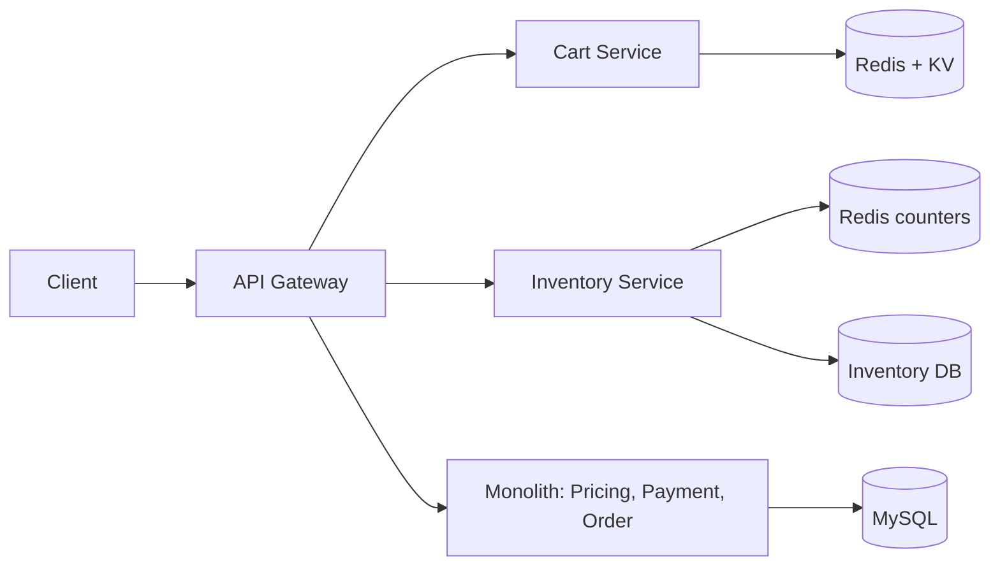

Overselling is solved, the iPhone can only be sold once, and hot items are protected from melting the database.

---

## Quick Self-Check

1. Why does `UPDATE ... SET stock = stock - 1 WHERE stock >= 1` prevent overselling when read-then-write didn't?
2. How do you avoid deadlocks when an order has multiple items?
3. Why is optimistic locking a poor choice for a hot flash-sale item?
4. Why is reserving at "Place Order" and confirming after payment better than decrementing at either extreme? What are the three reservation outcomes?
5. What happens if the payment succeeds after the reservation expired, and how would you design the TTL to make it rare?
6. Explain how the Redis gatekeeper protects the DB. Why is the DB *still* the source of truth?
7. Sharding by `product_id` doesn't fix a hot product. What does?

Share your answers or doubts. I can go deeper into **isolation levels**, **how row locks work internally**, or **Lua scripts and Redis atomicity**. When you're ready, say **"next"** and we'll go to **Chapter 5: Pricing and the Coupon Engine**, where the same race condition returns wearing a different costume (and new problems like stacking rules and price snapshots appear).


-----------------------------------------------------------------------------------------------------------------------
-----------------------------------------------------------------------------------------------------------------------
-----------------------------------------------------------------------------------------------------------------------
-----------------------------------------------------------------------------------------------------------------------


# Chapter 5: Pricing and the Coupon Engine

## The Story Continues

Overselling is fixed. Now the marketing team arrives with a wish list:

- "Diwali sale: **20% off, max ₹500**, code `DIWALI20`!"
- "**₹200 off** your first order!"
- "**10% off with HDFC cards**!"
- "**Free shipping** above ₹499!"
- "Can customers **stack** a coupon with the bank offer?"

Within a week the team learns that **pricing is deceptively hard**, because it touches real money in many small ways. Let's walk through the problems as they appeared.

---

## Problem 1: What Is "The Price"?

In V1 the total was `sum(price × qty) - coupon`. Real checkout totals have layers:

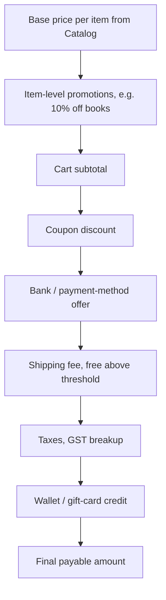

**Worked example (all amounts in ₹):**

| Line | Amount |
|---|---|
| iPhone × 1 | 70,000 |
| Book × 2 (500 each) | 1,000 |
| **Subtotal** | **71,000** |
| `DIWALI20` (20% = 14,200, **capped at 500**) | −500 |
| Shipping (above ₹499, so free) | 0 |
| **Payable** | **70,500** |

Notice the **order of operations matters**. If the bank offer is "10% off" and applies after the coupon, it is 10% of 70,500. Applied before, it is 10% of 71,000. The order must be an explicit, documented rule. Pricing bugs usually come from implicit ordering.

### Never use floating point for money

```python
>>> 0.1 + 0.2
0.30000000000000004
```

Store all amounts as **integers in the smallest unit** (paise): ₹499.99 → `49999`. Store the currency alongside it (`amount_minor`, `currency`). Interviewers notice this immediately.

### The rounding trap: allocating a discount across items

The ₹500 coupon discount must be **split across line items**. Why? Later Riya returns just the books, and we must know exactly how much discount to claw back from the refund. Splitting proportionally with simple division loses paise.

Example: ₹10.00 discount (1000 paise) across 3 items of ₹100 each. 1000 / 3 = 333.33, so we give 333 + 333 + 333 = **999**, and 1 paisa has vanished. The **largest remainder method** fixes it: give each item the floor (333), then hand out the leftover paise one at a time (to the largest fractional remainders), so the parts **always sum exactly to the total**. Invoices and refunds must reconcile to the paisa, or finance will find the gap during an audit.

---

## Problem 2: The Price Changed Mid-Checkout

Arjun starts checkout at 11:58 PM. At midnight, a sale ends and the phone's price rises ₹3,000. He pays at 12:01 AM. What price does he get?

Three options:

| Policy | Result |
|---|---|
| Always charge the current price | Customer angry: "the page said 67,000!" |
| Always honour the displayed price forever | The business loses money, and it is exploitable (keep the tab open all week) |
| **Freeze the price for a short window** | Fair to both sides |

**Solution: the Checkout Session.**
When the user clicks "Checkout", we build an **immutable price snapshot** with a TTL (matching the inventory hold, say 15 minutes):

```json
checkout_session {
  "checkoutId": "co_9f31",
  "userId": "u_55",
  "items": [{"sku":"iphone15","qty":1,"unitPrice":7000000, "tax": ...}],
  "pricingVersion": 3,
  "appliedCoupons": [...],
  "totals": {"subtotal":7100000, "discount":50000, "payable":7050000},
  "expiresAt": "..."
}
```

If the session expires and the price has changed, we **re-price and show the difference explicitly**: *"The price changed from ₹67,000 to ₹70,000. Continue?"* **Never silently charge more than what the user was shown.**

Even the frozen price is **never trusted from the client**. The server recomputes or re-verifies everything at order placement, because the client can be tampered with (a modified request saying `"total": 1`). This is a common interview point: *"The client sends only intent (checkoutId, payment method). The server owns the money math."*

---

## Problem 3: Coupons Are a Rules Engine, Not a Percentage Column

V1 had `coupons(code, percent)`. Marketing wanted:

- **Types:** flat amount, percentage with max cap, free shipping, buy-one-get-one
- **Eligibility:** minimum cart value, specific categories or brands, **first order only**, specific users (a win-back campaign), specific cities
- **Payment conditions:** only for HDFC credit cards (card BIN), only UPI
- **Time:** valid between dates, or only 8 to 10 PM (happy hour)
- **Limits:** total redemptions (first 1,000 users), **per-user limit**, once per device
- **Stacking:** can combine with other offers or not

Hard-coding these `if` statements turns the code into spaghetti. So the design evolves toward **data-driven rules**.

### Coupon definition (stored as config)

```json
{
  "code": "DIWALI20",
  "type": "PERCENT",
  "value": 20,
  "maxDiscount": 50000,
  "conditions": {
    "minCartValue": 100000,
    "categories": ["electronics", "books"],
    "paymentMethods": ["ANY"],
    "userSegment": "ALL"
  },
  "limits": { "totalUses": 100000, "perUser": 1 },
  "validFrom": "2026-11-01T00:00:00+05:30",
  "validTo":   "2026-11-10T23:59:59+05:30",
  "stacking": { "group": "CART_COUPON", "exclusive": false, "priority": 10 }
}
```

A **Rule Evaluator** loads the definition, checks each condition against the checkout session, and computes the discount. Adding a new campaign becomes a config change, not a code deployment.

### Stacking Rules

Product decisions (state them out loud in an interview):
- Each coupon belongs to a **group** (CART_COUPON, BANK_OFFER, SHIPPING). Only **one per group** can apply.
- Some are **exclusive** (cannot combine with anything).
- **Priority** defines the evaluation order, so results are deterministic.
- A global safety rule: **total discount can never exceed X% of the subtotal**, or go below zero. A misconfigured coupon should not be able to give away free iPhones.

---

## Problem 4: The Coupon That Wasn't Limited (Race Condition Returns)

`FIRST100` was meant for the first 100 users but was redeemed ~400 times. It's the same read-check-write race as the iPhone, and by now you know the cure.

### First, Separate Two Operations

| Operation | When | Binding? |
|---|---|---|
| **Validate / Apply** | User types the code at checkout | **No.** Just checks eligibility and shows the discounted price. |
| **Redeem** | Order placement and payment | **Yes.** Consumes one use from the limits. |

If we consumed a use at "apply", people who test five codes would burn limits for nothing (and we'd have the same abandonment problem as with inventory).

### Redemption Uses the Same Reservation Pattern as Inventory

```mermaid
stateDiagram-v2
    [*] --> RESERVED: order placement starts
    RESERVED --> REDEEMED: payment success
    RESERVED --> RELEASED: payment failed or cancelled
    RESERVED --> EXPIRED: TTL passed
```

This is a valuable observation: **inventory, coupon usage, wallet balance and seats all follow "reserve → confirm / release (with expiry)".** Learn it once, reuse it everywhere.

### Global Limit: Atomic Conditional Update

```sql
UPDATE coupons
SET    used_count = used_count + 1
WHERE  code = 'FIRST100'
  AND  used_count < usage_limit;
-- rows_affected = 0 → coupon exhausted
```

### Per-User Limit: A Uniqueness Constraint Does the Work

```sql
coupon_redemptions(
  redemption_id,
  coupon_code, user_id, order_id,
  status,                       -- RESERVED / REDEEMED / RELEASED
  created_at
)
UNIQUE (coupon_code, user_id)   -- when perUser = 1
```

With `perUser = 1`, a second concurrent attempt by the same user **violates the unique constraint** and fails. For limits greater than 1, keep a counter row `(coupon_code, user_id, count)` and use `UPDATE ... SET count = count + 1 WHERE count < perUserLimit` (upsert for the first use).

The database enforces the rule, not application logic that can race. **The strongest correctness guarantees come from constraints and atomic operations, not from "check first" code.**

### Idempotency

The redemption row carries `order_id`. If the same order's redemption is retried, `UNIQUE(coupon_code, order_id)` makes it a no-op. A retry never consumes two uses.

### Both Updates Must Land Together

Reserve the coupon use and write the redemption record in **one local transaction** inside the Coupon Service's own DB, exactly like the inventory reservation.

---

## Problem 5: The Viral Coupon (Hot Key, Again)

Marketing sends `FLASH50` to 5 million users at 8:00 PM. Within seconds, tens of thousands of requests validate and redeem **one coupon row**. This is the hot-row problem from Chapter 4, so the same toolkit applies:

1. **Coupon config is read-heavy and rarely changes** → cache it. Use a **local in-process cache** (TTL of seconds) backed by Redis. Invalidate or refresh when marketing edits a coupon. Validation of eligibility then never touches the DB.
2. **Redemption counters** → a **Redis atomic counter** as the gatekeeper (`DECR` via Lua with per-user check, e.g. a Redis `SET` of user IDs or `SETNX user:coupon`), with the DB as the final source of truth. When the counter hits zero, **~99% of requests are rejected in memory**.
3. **Pre-warm** the counters and config before the campaign goes live.
4. For extreme cases, **shard the counter into buckets**, as in Chapter 4.

```mermaid
flowchart LR
    CS[Checkout Service] --> CP[Coupon Service]
    CP --> LC[Local cache: coupon config]
    CP --> RD[(Redis: usage counters + per-user keys)]
    RD -->|admitted| DBW[Write redemption + increment]
    DBW --> CDB[(Coupon DB: source of truth)]
    RD -->|exhausted| REJ[Fast reject]
```

---

## Problem 6: Coupon Abuse and Fraud

As soon as a coupon has value, people attack it:

| Attack | Defence |
|---|---|
| Create 50 fake accounts to reuse a "first order" coupon | Tie eligibility to verified phone, device fingerprint, payment instrument and address, not only the account |
| Brute-force guessing codes (`SAVE10`, `SAVE11`, ...) | **Rate-limit** the apply-coupon endpoint per user and IP, add CAPTCHA after repeated failures, and use **long random codes** for private campaigns |
| Sharing single-use codes on public forums | **Pre-generate unique single-use codes** per user (stored as `code → status`) or bind the code to a `userId`. Codes can also be signed (HMAC) so forgery is impossible. |
| Redeem, then cancel and refund to keep the benefit | A cancelled order **releases the coupon use** (or flags the user) according to policy |
| Bots grabbing limited coupons | Same protections as a flash sale: waiting room, rate limits, bot detection (Chapter 11) |

---

## The Full Flow

```mermaid
sequenceDiagram
    participant C as Client
    participant CO as Checkout Service
    participant PR as Pricing Service
    participant CP as Coupon Service
    participant INV as Inventory Service

    C->>CO: POST /checkout/initiate
    CO->>PR: price items (catalog + taxes + shipping)
    PR-->>CO: price snapshot
    CO->>INV: availability check (soft)
    CO-->>C: checkoutId + totals

    C->>CO: apply-coupon DIWALI20
    CO->>CP: validate(code, user, cart snapshot)
    CP-->>CO: eligible, discount = 500
    CO->>CO: re-price session, update snapshot
    CO-->>C: new totals

    C->>CO: POST /orders (Idempotency-Key)
    CO->>INV: reserve stock (TTL)
    CO->>CP: reserve coupon use (TTL)
    Note over CO: next chapter: payment begins
```

At order placement the server **re-validates the coupon** (it may have expired or been exhausted since "apply") and **re-prices from trusted data**. If it fails, the user is told clearly: *"This coupon is no longer valid, here's your updated total."*

---

## Service Boundaries

```mermaid
flowchart LR
    GW[API Gateway] --> CO[Checkout Service orchestrator]
    CO --> PR[Pricing Service]
    CO --> CP[Coupon Service]
    CO --> INV[Inventory Service]
    PR --> CAT[Catalog / Price DB]
    PR --> TAX[Tax Rules]
    CP --> CDB[(Coupon DB)]
    CP --> RD[(Redis counters)]
```

- **Pricing Service:** stateless and pure. Given a cart snapshot, it returns the price breakdown. It is easy to cache, test and scale horizontally.
- **Coupon Service:** owns rules and redemption state.
- **Checkout Service:** the **orchestrator**. It coordinates the calls but owns no business rules itself. (Chapter 7 expands this into the Saga.)

**Scaling notes:**
- Pricing is read-heavy and stateless → scale horizontally behind a load balancer. Cache catalog prices in Redis with short TTLs, and invalidate on price-change events.
- Product-page prices may be served from CDN or cache (fast and slightly stale), but **checkout always re-fetches authoritative prices**.
- Coupon redemption tables grow forever. Shard by `coupon_code` or `user_id` (per-user queries dominate) and **archive** expired campaigns.

---

## Failure Handling

| Failure | Behaviour |
|---|---|
| **Coupon Service down** | **Degrade gracefully:** let checkout proceed **without** the coupon and tell the user, or honour coupons already validated in the checkout session. Never block the whole purchase for an optional discount. |
| **Pricing Service down** | This one is critical, since we can't charge without a price. Use **retries with timeouts**, fall back to the last cached price snapshot only if it's still within the session window, otherwise fail the checkout with a clear error. |
| **Coupon reserved, order fails** | The compensating **release** runs, plus the TTL as a safety net. |
| **Config change mid-session** (marketing disables a coupon) | Re-validated at placement. The user sees an updated total. |
| **Redis counter drift** | Reconciliation against `coupon_redemptions` in the DB. |

**Fail-open or fail-closed?** A good interview line: *"For discounts, I'd fail closed on correctness (never give a discount we can't verify when money is at risk), but fail open on availability (still let the user buy at full price). The customer can still complete a purchase."*

---

## Where We Are Now

```mermaid
flowchart LR
    U[Client] --> GW[API Gateway]
    GW --> CART[Cart Service]
    GW --> CO[Checkout Service]
    CO --> PR[Pricing Service]
    CO --> CP[Coupon Service]
    CO --> INV[Inventory Service]
    GW --> MONO[Remaining Monolith: Payment + Order]
```

We now have a frozen price, a validated coupon, a reserved item and a reserved coupon use, all with TTLs. The next question is the scariest one: **actually collecting the money**.

---

## Quick Self-Check

1. Why do we store money as integer paise, and why use the largest remainder method when splitting a discount across items?
2. Why should "apply coupon" **not** consume a use, while order placement does?
3. How does a unique constraint enforce `perUser = 1` even under concurrent requests?
4. Explain the "reserve → confirm / release" pattern and name four resources where it applies.
5. A coupon goes viral: what three techniques keep the DB from melting?
6. What is the difference between the price shown on the product page and the price used at checkout, and why does the client never send the total?
7. When the Coupon Service is down, do we fail open or closed, and why?

Tell me your answers or doubts. I can go deeper into **rule-engine design**, **cache invalidation for coupon config**, or **tax and invoice handling**. When ready, say **"next"** and we'll enter **Chapter 6: Payments**, covering gateways, idempotency keys, webhooks, timeouts, the "paid but no order" nightmare, and reconciliation.


-----------------------------------------------------------------------------------------------------------------------
-----------------------------------------------------------------------------------------------------------------------
-----------------------------------------------------------------------------------------------------------------------
-----------------------------------------------------------------------------------------------------------------------


# Chapter 6: Payments

## The Story Continues

We now hold a frozen price, a reserved item and a reserved coupon use, all with TTLs. Now KartKing has to do the scariest thing in the whole flow: **take real money from a real bank account.**

The first payment integration was a few lines of code. It also contained about five different ways to lose money. Let's meet them one at a time.

---

## Problem 1: Who Touches the Card Number?

**First attempt:** the checkout page has a form. The customer types their card number, our server receives it, and our server forwards it to the gateway.

**What went wrong:** the moment card numbers pass through our servers, logs or database, we fall under **PCI-DSS**, the card industry's security standard. It means audits, network isolation, encryption rules and heavy liability. One leaked log line with a card number is a breach.

**Fix: never let raw card data reach our servers.**

```mermaid
sequenceDiagram
    participant B as Browser
    participant GW as Gateway (Razorpay / Stripe)
    participant S as Our Server

    B->>GW: card details typed into gateway's hosted fields or iframe
    GW-->>B: token (e.g. tok_8f3a...), useless without our merchant key
    B->>S: POST /orders {checkoutId, paymentToken}
    S->>GW: charge using token
```

- **Hosted fields / iframe / SDK:** the card inputs belong to the gateway. Our JavaScript never sees the number.
- **Tokenization:** we only handle an opaque token (and the last 4 digits and card brand for display). For "saved cards", the gateway stores the card and gives us a **token** tied to our merchant account, so a stolen token is worthless elsewhere.

> **Interview tip:** Say "we never store or see PAN (card numbers) or CVV. We use gateway tokenization, so our PCI scope stays minimal." That one sentence covers a whole security topic.

---

## Problem 2: Payment Is Not a Function Call. It's a Process.

The first code was:

```python
result = gateway.charge(card, amount)   # blocks, returns success or failure
```

Real payments don't behave like this:

- **Cards** may trigger **3D Secure**: the customer is redirected to the bank page, enters an OTP, and is redirected back. That can take minutes.
- **UPI** is a collect request or an intent: the customer must approve in another app. It can take up to several minutes, or never happen.
- **Net banking** redirects to the bank's website.
- **Wallets** may need a separate login.
- **COD** involves no money now, only a promise.

So a payment takes **a long and unpredictable time and involves a human in another app**. We can't hold a thread, a DB connection or a lock for that (Chapter 2's lesson). The design must be **asynchronous**.

### The Payment Intent Model

Instead of "charge now", we create a **Payment record** that moves through states, and we let events drive it forward.

```mermaid
stateDiagram-v2
    [*] --> CREATED: payment attempt created
    CREATED --> PENDING: sent to gateway, awaiting customer action
    PENDING --> SUCCESS: gateway confirms
    PENDING --> FAILED: declined or bank error
    PENDING --> EXPIRED: customer never completed
    PENDING --> UNKNOWN: timeout, we don't know the outcome
    UNKNOWN --> SUCCESS: status check or reconciliation resolves
    UNKNOWN --> FAILED: status check or reconciliation resolves
    SUCCESS --> REFUND_PENDING: refund requested
    REFUND_PENDING --> REFUNDED
    FAILED --> [*]
    EXPIRED --> [*]
    REFUNDED --> [*]
```

Notice the `UNKNOWN` state. Most beginners forget it exists, and most production incidents live inside it.

### A Dedicated Payment Service

Payment moves out of the monolith into its own service. It owns payment state and all gateway communication, and nothing else talks to gateways.

```mermaid
flowchart LR
    CO[Checkout / Order Service] -->|create payment| PS[Payment Service]
    PS --> PDB[(Payment DB)]
    PS -->|adapter| G1[Gateway A]
    PS -->|adapter| G2[Gateway B]
    G1 -.->|webhook| WH[Webhook Receiver]
    G2 -.->|webhook| WH
    WH --> PS
    PS -->|events| MQ[[Message Bus]]
```

---

## Problem 3: The Double Charge (Idempotency, in Depth)

Riya's network is slow, and she taps Pay three times. The app also retries on timeout. Idempotency was planted in Chapter 1, and here it pays off.

> **Idempotent operation:** doing it once or ten times has the same effect as once.

### Layer 1: Client → Order/Checkout Service

The client generates a UUID when the checkout page opens, e.g. `Idempotency-Key: 7c9e...`, and sends the same key on every retry of the same intent.

### Layer 2: Our Service → Payment Service

We pass a deterministic key, e.g. `orderId + attemptNumber`.

### Layer 3: Payment Service → Gateway

Most gateways accept an idempotency key or a unique merchant reference (`receipt` / `merchant_txn_id`). We send our `paymentId`, so the gateway also de-duplicates.

### How the server implements it

```sql
idempotency_keys(
  key            VARCHAR PRIMARY KEY,   -- unique
  request_hash   CHAR(64),              -- hash of request body
  status         VARCHAR,               -- IN_PROGRESS / COMPLETED
  response_code  INT,
  response_body  JSON,
  created_at, expires_at
)
```

```mermaid
flowchart TD
    A[Request with Idempotency-Key K] --> B{INSERT K as IN_PROGRESS succeeds?}
    B -->|Yes, first time| C[Process the request]
    C --> D[Store response, mark COMPLETED]
    D --> E[Return response]
    B -->|No, K exists| F{Status?}
    F -->|COMPLETED| G[Return the stored response]
    F -->|IN_PROGRESS| H[Return 409 Conflict, retry shortly]
    F -->|Same K, different request_hash| I[Return 422, key reuse with different payload]
```

**Why the unique primary key is the hero:** two simultaneous requests with the same key both try to `INSERT`. The database lets exactly one win. The other gets a constraint violation and takes the "already exists" branch. **We never use "check if exists, then insert", because that has the race condition we've been fighting since Chapter 2.**

Keep keys for 24 to 48 hours, then clean them up with a TTL.

### Defence in depth: Business-level uniqueness

Idempotency keys depend on clients behaving well. Add a second net: **one active payment attempt per order**.

```sql
UNIQUE (order_id) WHERE status IN ('CREATED','PENDING')   -- partial unique index
```

If Riya opens the checkout in two browser tabs, the second attempt is rejected or returns the existing attempt.

---

## Problem 4: The Timeout. Did It Charge or Not?

This is the **hardest problem in payments**. We call the gateway, wait 30 seconds, and the connection times out. What happened?

| Possibility | Reality |
|---|---|
| The request never reached the gateway | No charge |
| The gateway received it but crashed before charging | No charge |
| The gateway charged the card, but its reply got lost | **Charged!** |

From our side, **all three look identical**: silence. This is the classic **"two generals" problem**. You cannot know.

### What NOT to do

- **Assume failure and let the customer retry** → they may be charged twice.
- **Assume success** → we may ship an unpaid order.

### What to do: Mark UNKNOWN and Resolve It

1. Mark the payment `UNKNOWN`. Do **not** release the inventory yet. Keep the order `PAYMENT_PENDING`.
2. **Ask the gateway** using its **status API**: `GET /payments?receipt=<our paymentId>`. This works because we sent a unique reference. Retry this with backoff.
3. In parallel, wait for the **webhook** (below).
4. If still unresolved after a long window, the **reconciliation job** settles it from the gateway's settlement reports.

```mermaid
sequenceDiagram
    participant PS as Payment Service
    participant G as Gateway

    PS->>G: create payment (paymentId=P1)
    Note over PS,G: timeout, no response
    PS->>PS: mark UNKNOWN
    loop retry with exponential backoff
        PS->>G: GET status for P1
        G-->>PS: SUCCESS / FAILED / NOT_FOUND
    end
    Note over PS: resolved to a final state
```

The golden rule: **every external call that can time out needs a way to later ask "what actually happened?"** That is why we always send our own unique reference.

---

## Problem 5: Webhooks (The Gateway Tells Us)

For async methods like UPI and 3DS, the gateway **calls our server** when the payment finishes: `POST /webhooks/payments`.

### Why not trust the browser redirect?

After the bank page, the customer's browser is redirected to `kartking.com/payment/return?status=success`. Don't trust it:

- The user can **edit the URL** (`status=success`) and skip paying.
- The user may **close the tab** right after paying, and the redirect never happens, so we'd never learn the payment succeeded.

**The redirect is only a UI hint. The webhook (or a server-side status call) is the source of truth.**

### Handling webhooks correctly, a checklist (very common interview question)

```mermaid
flowchart TD
    W[Webhook arrives] --> S{Signature valid? HMAC with shared secret}
    S -->|No| X[Reject 401, log, alert]
    S -->|Yes| D{Event ID already processed?}
    D -->|Yes| OK[Return 200, ignore duplicate]
    D -->|No| P[Persist raw event, then return 200 quickly]
    P --> Q[Process asynchronously via queue]
    Q --> T{Valid state transition?}
    T -->|Yes| U[Update payment state, emit event]
    T -->|No, stale or out of order| IG[Ignore or park for review]
```

1. **Verify the signature.** The gateway signs the body with an HMAC using a shared secret. Without this, anyone could POST a fake "payment success" to our endpoint and get free goods.
2. **Be idempotent.** Gateways **retry** webhooks if we don't answer 200, and sometimes send duplicates. Store the `event_id` with a unique constraint.
3. **Respond fast.** Store the event, return `200` immediately, and process it asynchronously. Slow handlers cause the gateway to retry, which creates duplicate storms.
4. **Handle out-of-order delivery.** `payment.failed` might arrive *after* `payment.captured`. Use **state machine rules** (only allowed transitions) and event timestamps or version numbers, never "last event wins".
5. **Don't trust the payload alone for money decisions.** For high-value orders, after receiving the webhook, **call the gateway's status API** to confirm. This also protects against replayed or forged payloads.
6. **Expect webhooks to be lost.** If our endpoint was down for 10 minutes, some are gone. That is why we have the status polling and reconciliation described below. Webhooks are an *optimisation*, not a guarantee.

---

## Problem 6: Reconciliation (The Safety Net Under Everything)

Despite idempotency, webhooks and polling, there will still be mismatches. A webhook was lost during a deploy, a bug ate an event, or a gateway reported something late. Reconciliation is how a payments system finds out the truth.

**Every day** (or hourly), the gateway provides a **settlement report** of all transactions it processed. Our job compares it against our own records.

```mermaid
flowchart LR
    GR[Gateway settlement file] --> R[Reconciliation job]
    OD[(Our Payment DB)] --> R
    R --> M1[Matched: nothing to do]
    R --> M2[Gateway says SUCCESS, we say PENDING / FAILED]
    R --> M3[We say SUCCESS, gateway has no record]
    R --> M4[Amount mismatch]
```

| Mismatch | Meaning | Action |
|---|---|---|
| Gateway SUCCESS, ours PENDING/UNKNOWN | We missed the webhook | Mark SUCCESS, continue the order. If it was already cancelled or expired, **auto-refund**. |
| Gateway SUCCESS, our order cancelled | Customer paid for an order we released | **Auto-refund** and notify the customer. |
| Ours SUCCESS, gateway has no record | Serious bug or fraud | Alert finance and engineering immediately. |
| Amount differs | Currency, fee or partial capture issue | Manual review queue. |
| Duplicate gateway charges for one order | Double charge slipped through | Refund the extra one automatically. |

> **Interview line:** *"Real-time flow gives speed, reconciliation gives correctness. I'd never design a payment system without a reconciliation loop."*

---

## Problem 7: Many Payment Methods

Marketing wants UPI, cards, net banking, wallets, EMI, gift cards and COD. If the order code is full of `if method == 'card' ... elif method == 'upi' ...`, every new method means touching core logic.

### Fix: The Adapter (Strategy) Pattern

```mermaid
classDiagram
    class PaymentProvider {
        <<interface>>
        +createPayment(request) PaymentResult
        +getStatus(paymentId) PaymentStatus
        +refund(paymentId, amount) RefundResult
        +verifyWebhook(headers, body) Event
    }
    PaymentProvider <|.. CardProviderAdapter
    PaymentProvider <|.. UpiProviderAdapter
    PaymentProvider <|.. WalletProviderAdapter
    PaymentProvider <|.. CodProviderAdapter
    PaymentProvider <|.. GiftCardAdapter
```

The Payment Service picks the adapter by method (and by gateway config). The orchestration code never knows which gateway is behind the interface. Adding "Buy Now Pay Later" means one new adapter.

### Special cases to know

- **Wallet / gift card (internal money):** that's **our own ledger**, not a gateway. Use a **double-entry ledger** with atomic debits (`UPDATE balance = balance - x WHERE balance >= x`, the same trick as Chapter 4). Every movement is an immutable row, and balance is derived or verified from it.
- **Split payments** (₹500 wallet + ₹69,500 card): create **two payment legs** under one order. Debit the wallet first (instant and cheap to reverse), then charge the card. If the card leg fails, **reverse the wallet leg** (compensation). The order is paid only when **all legs succeed**. This is a mini-Saga, which we generalise in Chapter 7.
- **COD:** no payment now. The order is created as `CONFIRMED_COD`, and the payment record is `PENDING_ON_DELIVERY`. Risks: fake orders and refusals at the door. Mitigate with a COD limit per user, OTP or phone verification, and a risk score for new accounts. It's cheaper to avoid an outright rejection than to pay for a failed delivery.
- **Auth vs capture (cards):** "authorise" puts a hold on funds, and "capture" actually takes the money. Many e-commerce systems **authorise at checkout and capture at shipment**. If the item can't ship, we void the authorisation (no refund fee and no waiting days for the customer). Mention this to show depth.

---

## Problem 8: The Gateway Goes Down

On sale night, Gateway A has a 20-minute outage. 100% of card payments fail, and the business loses lakhs per minute.

### Multi-gateway routing

Integrate **two or more gateways** behind the Payment Service.

- **Health-based routing:** a **circuit breaker** per gateway watches the failure rate. Above a threshold (say 30% failures in 1 minute), it **opens**, and traffic goes to Gateway B. After a cool-down it lets a few test requests through (**half-open**) and closes again if healthy.
- **Smart routing:** route by cost, success rate for a given bank (HDFC cards work better on A today), or by method.

```mermaid
stateDiagram-v2
    [*] --> CLOSED
    CLOSED --> OPEN: failure rate above threshold
    OPEN --> HALF_OPEN: after cool-down
    HALF_OPEN --> CLOSED: test calls succeed
    HALF_OPEN --> OPEN: test calls fail
```

### The dangerous trap: failover can double charge

Gateway A **times out** (UNKNOWN), we retry the same payment on Gateway B, and now the customer is charged by **both**.

**Rule:** you may fail over **only when you are sure the first gateway did not accept the request** (a connection refused, a definite error response, a circuit already open). If the outcome is **UNKNOWN**, resolve it first (status check) or require the user to start a **new attempt** and cancel or void the first. Also reconciliation catches residual double charges and refunds them.

---

## Refunds

Refunds are payments in reverse, with their own state machine and failure modes.

- **Idempotent:** a refund request carries a unique `refundId`, so a retry never refunds twice.
- **Partial refunds** (return one item out of three) use the **per-item discount allocation** from Chapter 5, so the amounts reconcile exactly.
- **Async:** gateways process refunds in hours or days, and a webhook reports completion.
- Track **total refunded ≤ total captured** as a hard invariant, enforced with the conditional-update trick: `UPDATE payments SET refunded = refunded + x WHERE refunded + x <= captured`.

---

## Data Model

```sql
payments(
  payment_id PK, order_id, user_id,
  method, provider, status,
  amount_minor, currency,
  provider_ref,                 -- gateway's transaction id
  idempotency_key UNIQUE,
  failure_code, version,
  created_at, updated_at
)

payment_events(                 -- append-only audit log
  event_id PK, payment_id, type, payload, source, received_at
)  -- UNIQUE(provider, provider_event_id) for webhook dedupe

refunds(refund_id PK, payment_id, amount_minor, status, ...)
```

The **append-only event log** is valuable. For disputes, audits and debugging, we can replay exactly what the gateway told us and when. Never update a payment's history in place without recording it.

---

## End-to-End Happy Path

```mermaid
sequenceDiagram
    participant C as Client
    participant CO as Checkout / Order Svc
    participant PS as Payment Service
    participant G as Gateway
    participant WH as Webhook Receiver

    C->>CO: POST /orders (Idempotency-Key)
    CO->>CO: reserve stock + coupon, create order PENDING_PAYMENT
    CO->>PS: create payment (paymentId, amount)
    PS->>G: create (reference = paymentId)
    G-->>PS: redirect URL / UPI intent
    PS-->>C: next action (redirect to bank)
    C->>G: customer approves (OTP / UPI app)
    G-->>WH: webhook payment.captured (signed)
    WH->>PS: verify, dedupe, persist, enqueue
    PS->>PS: PENDING → SUCCESS
    PS-->>CO: event PaymentSucceeded
    CO->>CO: confirm stock, order → CONFIRMED
```

Notice the HTTP request from the client **returns quickly** with "continue to the bank". No thread or DB lock waits on the customer, which fixes the Chapter 2 meltdown for good.

---

## Failure Handling Summary

| Failure | What we do |
|---|---|
| Customer double-clicks Pay | Idempotency key plus one active attempt per order |
| Gateway timeout | Mark UNKNOWN, query status with backoff, wait for webhook, reconcile |
| Webhook lost | Status polling and reconciliation |
| Webhook duplicated or out of order | Event-ID dedupe and state-machine transition rules |
| Forged webhook | HMAC signature verification, plus status API confirm |
| Payment succeeds after our order expired | Auto-refund (or re-reserve if stock allows) |
| Gateway down | Circuit breaker and failover **only if the first attempt is definitely not accepted** |
| Our payment service crashes mid-call | The unique gateway reference lets us find the outcome later |
| Split payment, one leg fails | Compensate (reverse) the successful leg |

---

## Where We Are Now

```mermaid
flowchart LR
    GW[API Gateway] --> CART[Cart]
    GW --> CO[Checkout Service]
    CO --> PR[Pricing]
    CO --> CP[Coupon]
    CO --> INV[Inventory]
    CO --> PS[Payment Service]
    PS --> G1[Gateway A]
    PS --> G2[Gateway B]
    G1 -.-> WH[Webhooks]
    GW --> MONO[Remaining Monolith: Orders]
```

Payments are safe, idempotent and recoverable. But a new problem has appeared: **reservations, coupon uses, payments and orders now live in different services with different databases.** If step 4 fails after steps 1 to 3 succeeded, who cleans up? There's no single transaction to roll back.

That is the subject of the next chapter.

---

## Quick Self-Check

1. Why must card numbers never reach our servers, and what does tokenization give us?
2. Why is payment modelled as a state machine with an `UNKNOWN` state instead of a blocking `charge()` call?
3. Explain idempotency at three layers. Why is a **unique constraint insert** better than "check then insert"?
4. The gateway call timed out. List the three possibilities and the three mechanisms we use to find the truth.
5. Why is the browser redirect not trusted, and what are the six webhook-handling rules?
6. What does reconciliation catch that real-time processing can't? Give two mismatch types and the action for each.
7. Why can failover to a second gateway cause a double charge, and when is it safe?
8. For a split payment (wallet + card), what happens if the card leg fails?

Share your answers or doubts. I can go deeper into **HMAC signature verification**, **circuit breaker tuning**, **double-entry ledgers for wallets**, or **auth vs capture**. When you're ready, say **"next"** and we'll go to **Chapter 7: The Order State Machine and the Saga Pattern**, where we learn how to keep many services consistent without a distributed transaction.


-----------------------------------------------------------------------------------------------------------------------
-----------------------------------------------------------------------------------------------------------------------
-----------------------------------------------------------------------------------------------------------------------
-----------------------------------------------------------------------------------------------------------------------


# Chapter 7: The Order State Machine and the Saga Pattern

## The Story Continues

At the end of Chapter 6 we had a nagging problem. Placing one order now touches **five services, each with its own database**:

| Service | Its own DB | Action |
|---|---|---|
| Inventory | Inventory DB | Reserve stock |
| Coupon | Coupon DB | Reserve a coupon use |
| Order | Order DB | Create the order |
| Payment | Payment DB | Charge the customer |
| Notification / Shipping | their own | Confirm, ship |

In the monolith, one `db.rollback()` undid everything. Now there is **no single transaction** spanning these databases. Let's see what that costs.

---

## Problem 1: The Half-Finished Order

A Tuesday-night incident, reconstructed:

```mermaid
sequenceDiagram
    participant CO as Checkout Service
    participant INV as Inventory
    participant CP as Coupon
    participant PS as Payment

    CO->>INV: reserve iPhone
    INV-->>CO: OK (stock held)
    CO->>CP: reserve coupon use
    CP-->>CO: OK
    CO->>PS: charge ₹70,500
    PS-->>CO: DECLINED (insufficient funds)
    Note over CO: 💥 What now?
    Note over INV: iPhone still held (until TTL)
    Note over CP: coupon use still burned
```

Stock and a coupon use are stuck until TTLs expire. If the service had also crashed at this point, nobody would even remember to clean up. The TTLs from Chapters 4 and 5 are a safety net, but a safety net is not a design. We need a **systematic way to undo completed steps when a later step fails.**

---

## Attempt 1: Two-Phase Commit (2PC)

The textbook answer for atomicity across databases:

```mermaid
sequenceDiagram
    participant TC as Transaction Coordinator
    participant A as Inventory DB
    participant B as Coupon DB
    participant C as Order DB

    TC->>A: PREPARE
    TC->>B: PREPARE
    TC->>C: PREPARE
    A-->>TC: YES (locks held)
    B-->>TC: YES (locks held)
    C-->>TC: YES (locks held)
    TC->>A: COMMIT
    TC->>B: COMMIT
    TC->>C: COMMIT
```

Everyone votes first. If all vote yes, the coordinator tells all to commit. Otherwise all abort. It gives true atomicity. Why don't e-commerce systems use it?

| Problem | Why it hurts here |
|---|---|
| **Locks held across the network** | After PREPARE, each participant holds locks until the coordinator decides. That brings back Chapter 2's "locks held during slow calls". |
| **Blocking on coordinator failure** | If the coordinator crashes after PREPARE, participants are stuck holding locks, **not knowing whether to commit or abort**. |
| **Payment gateways can't participate** | Razorpay, Stripe and banks don't implement PREPARE. 2PC is impossible across third parties. |
| **Availability** | The system is only as available as the *least* available participant, so product availability multiplies down. |
| **Scale** | Throughput collapses at 1,000 orders/sec with hot rows. |

> **Interview line:** *"2PC gives atomicity but sacrifices availability and needs participants that support it. External payment gateways don't, so I'd use a Saga with compensations."*

---

## Attempt 2: The Saga Pattern

An old idea (from a 1987 database paper) that fits microservices perfectly:

> A **Saga** is a sequence of **local transactions**. Each step commits on its own. If a step fails, we run **compensating actions** that semantically undo the previous steps.

Each step has a forward action and a compensation:

| Step | Forward action | Compensation |
|---|---|---|
| 1 | Create order (`PENDING`) | Mark order `CANCELLED` |
| 2 | Reserve inventory | Release inventory |
| 3 | Reserve coupon use | Release coupon use |
| 4 | Charge payment | Refund / void payment |
| 5 | Confirm inventory (finalise stock) | *(none: past the point of no return)* |
| 6 | Mark order `CONFIRMED` | *(none)* |

```mermaid
flowchart LR
    subgraph Forward
        T1[Create Order] --> T2[Reserve Stock] --> T3[Reserve Coupon] --> T4[Charge Payment] --> T5[Confirm Stock] --> T6[Order CONFIRMED]
    end
    T4 -. fails .-> C3[Release Coupon] --> C2[Release Stock] --> C1[Cancel Order]
```

If the charge in step 4 fails, we run compensations in **reverse order**: release the coupon, release the stock, cancel the order. The customer sees "Payment failed" and everything is clean.

### Compensation is not rollback

A rollback makes it as if the step **never happened**. A compensation is a **new business action that offsets** the old one. Between the step and its compensation, other people could see the intermediate state. Examples:

- A refund is not "un-charging". It's a new transaction, and the customer's bank statement shows both.
- A notification email already sent can't be unsent. We send a "cancelled" email instead.

Design consequences:

1. **Compensations must be idempotent.** "Release stock" run twice must not release twice (we handled this with `UPDATE ... WHERE status='RESERVED'` in Chapter 4).
2. **Compensations must be retryable until they succeed.** A compensation that fails is a serious problem, so we retry with backoff, and alert if it keeps failing.
3. **Compensations can't be allowed to "fail" logically.** Releasing stock can't be rejected with "sorry, can't release". Design them to always be possible.
4. **Order the steps to minimise the need to compensate.** Do steps that are **most likely to fail or hardest to reverse last**. Charging money is hard to reverse (refunds take days, cost fees, annoy people), but we also need to know that stock exists before taking money. So: check cheap, reversible things first (stock, coupon), then charge, then do irreversible things (ship) last.

### The pivot (point of no return)

```mermaid
flowchart LR
    A[Reversible steps: reserve stock, reserve coupon] --> P[PIVOT: payment succeeds]
    P --> B[Retryable steps, must eventually succeed: confirm stock, notify, create shipment]
```

- **Before the pivot**, failures lead to compensations (cancel).
- **After the pivot**, we **never cancel automatically**. We **retry forward** until the step succeeds, because the customer has already paid. If "confirm stock" fails, we retry it, or escalate to a human or auto-refund path. We don't leave a customer charged for nothing.

This pivot concept is a mark of a strong Saga answer.

---

## Two Ways to Run a Saga

### Style A: Choreography (services react to each other's events)

No central brain. Each service publishes events, and other services react.

```mermaid
sequenceDiagram
    participant O as Order Svc
    participant I as Inventory Svc
    participant C as Coupon Svc
    participant P as Payment Svc

    O->>I: OrderCreated (event)
    I->>C: StockReserved (event)
    C->>P: CouponReserved (event)
    P->>O: PaymentSucceeded (event)
    Note over O,P: On failure, each service listens for failure events and compensates itself
```

**Good:** no single point of failure, loosely coupled, simple for 2 to 3 steps.

**Bad (what teams discover as it grows):**
- The flow is scattered across services. "What happens when an order is placed?" requires reading five codebases.
- **Cyclic dependencies** creep in as services listen to each other's events.
- Adding a step means editing several services.
- Debugging stuck orders is painful. No one place shows the state.

### Style B: Orchestration (a central coordinator drives the flow)

```mermaid
flowchart TD
    ORCH[Order Saga Orchestrator]
    ORCH -->|1. reserve| INV[Inventory]
    ORCH -->|2. reserve| CP[Coupon]
    ORCH -->|3. pay| PS[Payment]
    ORCH -->|4. confirm| INV
    ORCH -->|5. notify| NS[Notification]
    INV -.->|reply| ORCH
    CP -.->|reply| ORCH
    PS -.->|reply / event| ORCH
```

The orchestrator holds the **saga state** and sends commands. Services are simple: they do their local job and reply.

**Good:** the whole workflow is in one place and is easy to read, test and monitor. Compensation logic is centralised, and adding steps is easy.
**Bad:** the orchestrator must itself be highly available and scalable (it's stateless apart from its persisted state, so this is manageable), and there's a risk of it becoming a "god service" if business logic leaks into it. Keep it to **sequencing only**.

| | Choreography | Orchestration |
|---|---|---|
| Coupling | Very loose | Services coupled to the orchestrator's commands |
| Visibility | Poor | Excellent |
| Complexity growth | Explodes with steps | Linear |
| Best for | Few steps, simple flows | Money-critical, many steps |

**For checkout we choose orchestration.** The business wants to see exactly where each order is, and money-moving flows need auditability. Many companies use **orchestration for the core purchase and choreography for side effects** (analytics, recommendations, emails), which is a good thing to say in the interview. Tools: **Temporal, Cadence, AWS Step Functions, Netflix Conductor**, or a hand-built state machine on a DB.

---

## The Order State Machine

The Saga needs a precise definition of what states an **order** can be in and which moves are legal. The order status is the saga's visible face.

```mermaid
stateDiagram-v2
    [*] --> CREATED
    CREATED --> INVENTORY_RESERVED: stock reserved
    CREATED --> FAILED: out of stock
    INVENTORY_RESERVED --> PAYMENT_PENDING: coupon reserved, payment started
    PAYMENT_PENDING --> PAID: payment success
    PAYMENT_PENDING --> CANCELLED: payment failed / expired
    PAID --> CONFIRMED: stock confirmed, notified
    CONFIRMED --> PACKED
    PACKED --> SHIPPED
    SHIPPED --> DELIVERED
    CONFIRMED --> CANCELLATION_REQUESTED: user cancels
    PACKED --> CANCELLATION_REQUESTED
    CANCELLATION_REQUESTED --> CANCELLED: refund + stock release
    DELIVERED --> RETURN_REQUESTED
    RETURN_REQUESTED --> REFUNDED
    FAILED --> [*]
    CANCELLED --> [*]
    REFUNDED --> [*]
```

### Rules that make it safe

1. **Only legal transitions are allowed.** The code has a transition table, and anything else is rejected. This stops stale or out-of-order events from corrupting state (e.g. a late `payment.failed` arriving after `PAID`).
2. **Transitions are conditional updates** (the same trick again):
   ```sql
   UPDATE orders
   SET status = 'PAID', version = version + 1
   WHERE order_id = :id AND status = 'PAYMENT_PENDING';
   -- 0 rows affected → someone else already moved it
   ```
   If a duplicate event tries the same transition, it affects 0 rows and becomes a harmless no-op. **Idempotency comes for free from the guard in the WHERE clause.**
3. **Every transition is recorded** in an append-only `order_status_history` (who, when, why). This is the audit trail for support and finance.
4. **Terminal states are final.** Nothing leaves `CANCELLED` or `REFUNDED`.

### Cancellation is a race with fulfilment

Riya clicks "Cancel" while the warehouse is packing. Both actions try to change the order. The state machine and conditional updates decide the winner:

- If `PACKED → SHIPPED` commits first, the cancel request now fails (`status != CONFIRMED/PACKED`). The user is told "already shipped, you can return it".
- If cancel commits first, the warehouse's `PACKED → SHIPPED` update affects 0 rows, and the shipment is halted.

No locks across services are needed, just **atomic guarded transitions on one source of truth**.

---

## Making the Orchestrator Reliable

The orchestrator is the new critical component. Here are the points that matter.

### 1. Persist saga state after every step

```sql
saga_instances(
  saga_id PK,  order_id UNIQUE,
  current_step, status,           -- RUNNING / COMPENSATING / COMPLETED / FAILED
  step_results JSON,
  retry_count, next_retry_at,
  version, updated_at
)
```

If the orchestrator crashes mid-flow, another instance **loads the saga row and resumes** from `current_step`. Without persisted state, a crash would strand the order. (This is exactly what Temporal and Step Functions do for you: durable execution.)

### 2. Every step is idempotent and carries a stable ID

The orchestrator might send "reserve stock" twice (a crash after sending but before saving progress). So every command carries a deterministic key like `orderId:step`, and services dedupe on it. We built this in Chapters 4, 5 and 6 with `checkoutId` and `paymentId`. It all connects now.

### 3. Timeouts and retries per step

| Step | Timeout | Retry | If still failing |
|---|---|---|---|
| Reserve stock | 2 s | 2 retries, quick | Fail the saga → compensate |
| Payment | up to ~15 min (async, user-driven) | status polling, backoff | UNKNOWN handling from Chapter 6 |
| Confirm stock (post-pivot) | 5 s | **retry forever** with backoff | Alert on-call, never abandon |
| Notification | 10 s | retry, then dead-letter | Order is still valid, no rollback for email failure |

Use **exponential backoff with jitter** (e.g. 1 s, 2 s, 4 s, 8 s with random offsets) so a thousand failed sagas don't all retry at the same instant and re-crash the recovering service (the **retry storm** / thundering herd).

### 4. Dead-letter queue and a stuck-saga sweeper

- Messages that fail permanently go to a **dead-letter queue (DLQ)**, where they are inspected and replayed by humans or tools.
- A **sweeper job** finds sagas that haven't progressed (`status = RUNNING AND updated_at < now() - 10 min`) and pushes them (retry, or move to compensation). It's the Saga equivalent of the reaper job in Chapter 4.

### 5. Observability for sagas

Each saga carries a **correlation ID** (the `orderId`) through every log and trace. Dashboards show the count of orders per state, the age of the oldest `PAYMENT_PENDING`, and compensation rates. A sudden spike in "compensating" sagas is the earliest warning of a downstream outage. (More in Chapter 13.)

---

## Walking Through Failures

### Scenario A: Payment declined

```mermaid
sequenceDiagram
    participant O as Orchestrator
    participant I as Inventory
    participant C as Coupon
    participant P as Payment

    O->>I: reserve (key: o1:inv)
    I-->>O: ok
    O->>C: reserve (key: o1:cpn)
    C-->>O: ok
    O->>P: pay
    P-->>O: DECLINED
    O->>C: release (key: o1:cpn:undo)
    O->>I: release (key: o1:inv:undo)
    O->>O: order → CANCELLED
```

### Scenario B: Orchestrator crashes after payment succeeded

1. Payment webhook says `PaymentSucceeded`, and the event is durably in the queue.
2. The orchestrator instance dies before processing it.
3. The message is **not acknowledged**, so the queue redelivers it to another instance.
4. That instance loads saga state, sees `PAYMENT_PENDING`, applies the guarded transition `PAYMENT_PENDING → PAID`, and continues.

Nothing was lost because **the event stayed in the queue until processed and the saga state was durable**. If the same event arrives twice, the guarded update turns the duplicate into a no-op.

### Scenario C: Payment succeeds *after* the saga already compensated (the late-success race)

The payment TTL ran out and we cancelled the order and released stock. Then a late `payment.captured` webhook arrives. The state machine says `CANCELLED` is terminal, so we don't resurrect the order. The orchestrator instead takes the **`CANCELLED` + money received** path:

```mermaid
flowchart TD
    E[PaymentSucceeded arrives for CANCELLED order] --> Q{Can we re-reserve stock quickly?}
    Q -->|Yes, and the customer opts in or the policy allows| R[Re-open as new order attempt]
    Q -->|No| F[Auto-refund + email apology + audit log]
```

Most companies choose the **auto-refund** path for simplicity.

### Scenario D: A compensation itself fails

"Release stock" gets a 500 from Inventory. We **retry with backoff**. If it still fails after N attempts, the saga goes to `COMPENSATION_FAILED`, an alert pages on-call, and the item is on a manual queue. The stock TTL (Chapter 4) is the last-resort backstop, because it will auto-release eventually. **Defence in depth: compensation plus TTL plus reaper plus reconciliation.**

---

## Saga Isolation: The Weakness You Should Mention

Sagas give **atomicity through compensation, but not isolation**. Intermediate states are visible to others.

Examples:
- While Riya's order is `INVENTORY_RESERVED`, another user sees "Only 1 left" or "Out of stock", but Riya's payment may fail a minute later and the stock returns. This is a **dirty read** in business terms.
- Reports could temporarily count an order that later cancels.

**Countermeasures (name these in interviews):**
- **Semantic locks:** a status flag like `PENDING` that says "this record is mid-saga", so other flows treat it carefully (our `RESERVED` state is exactly that).
- **Commutative updates:** design operations so order doesn't matter (increments and decrements).
- **Pessimistic ordering:** do hard-to-reverse steps last.
- **Reread values** before acting (re-validate price and stock at placement).
- Accept the visibility and communicate it in the UI ("held for you for 10:00 minutes").

The honest summary: **Sagas trade isolation for availability and scalability.** For e-commerce that's the right trade, because a briefly stale "out of stock" is far cheaper than a locked, slow system.

---

## Where Does the Order Service Fit?

Orders become the **system of record**. Cart, Inventory, Coupon and Payment each own their own facts, but the Order Service owns the story of the purchase.

```mermaid
flowchart LR
    CO[Checkout API] --> ORCH[Order Saga Orchestrator]
    ORCH --> OS[Order Service]
    OS --> ODB[(Order DB)]
    ORCH --> INV[Inventory]
    ORCH --> CP[Coupon]
    ORCH --> PS[Payment]
    ORCH --> NS[Notification]
    PS -.->|PaymentSucceeded / Failed| ORCH
```

**Order DB** is relational with ACID, because an order's header, line items and status history must commit together, and queries like "my orders, newest first" and joins with items are natural. We'll shard it in Chapter 9.

---

## A Gap We Haven't Fixed Yet (Preview of Chapter 8)

Look closely at one orchestrator step:

1. Update the saga row in the DB: `status = PAYMENT_PENDING`.
2. **Send a message** to the Payment Service via the queue.

What if the service crashes **between 1 and 2**? The DB says "payment started", but no message was ever sent. The order sits stuck. Swap the order (send first, update later) and a crash causes a message with no DB record, which gives a duplicate or ghost command.

That is the **dual-write problem** again (a DB and a message broker can't share one transaction). It deserves its own chapter: **the Transactional Outbox pattern**, with Kafka, delivery guarantees and exactly-once semantics.

---

## Quick Self-Check

1. Why is 2PC a bad fit for checkout? Give at least three reasons, including one about payment gateways.
2. What's the difference between a compensation and a rollback? Why must compensations be idempotent and retryable?
3. What is the pivot of the checkout saga, and what changes in our behaviour before vs after it?
4. Compare choreography and orchestration. Which would you pick for the core purchase flow, and what do you keep choreographed?
5. How does `UPDATE ... WHERE status = 'PAYMENT_PENDING'` make duplicate and out-of-order events harmless?
6. The orchestrator crashes after payment succeeded. Walk through how the order still completes.
7. A late payment webhook arrives for a cancelled order. What happens?
8. What isolation anomaly do Sagas have, and name two techniques to reduce its impact.

Share your answers or doubts. I can go deeper into **Temporal / durable execution**, **designing the compensation for a shipped item**, or **2PC vs 3PC vs Saga** comparisons. When ready, say **"next"** and we'll go to **Chapter 8: Asynchronous Messaging**, covering Kafka, the Transactional Outbox, delivery guarantees, idempotent consumers, and notifications.


-----------------------------------------------------------------------------------------------------------------------
-----------------------------------------------------------------------------------------------------------------------
-----------------------------------------------------------------------------------------------------------------------
-----------------------------------------------------------------------------------------------------------------------


# Chapter 8: Asynchronous Messaging, Kafka and the Outbox Pattern

## The Story Continues

Two loose threads were left hanging:

1. **Chapter 2:** a slow email provider made Riya's "Order Placed" screen spin. Sending email was inside the request path.
2. **Chapter 7:** the orchestrator updates its DB and then sends a message. A crash between the two leaves the order stuck. This is the **dual-write problem**.

Both are solved by putting a **message broker** in the middle and using it correctly.

---

## Why Asynchronous Messaging?

Look at what happens when an order is confirmed. Many things must follow:

- Send the confirmation email, SMS and push notification
- Tell the warehouse to pick and pack
- Update analytics and dashboards
- Update recommendations
- Start the invoice generation
- Update loyalty points
- Trigger fraud checks

**Synchronous approach:** the Order Service calls all seven, one after another.

| Problem | Effect |
|---|---|
| Latency adds up | Customer waits 8 seconds for the confirmation page |
| One failure breaks the rest | The loyalty service is down, so the order call fails |
| Tight coupling | Adding an eighth consumer means editing Order Service and redeploying |
| Spikes propagate | A traffic burst hits all seven downstream systems at once |

**Asynchronous approach:** the Order Service says "OrderConfirmed happened" **once**, and anyone who cares reacts in their own time.

```mermaid
flowchart LR
    OS[Order Service] -->|publishes OrderConfirmed| K[[Kafka topic: order-events]]
    K --> N[Notification Service]
    K --> W[Warehouse / Fulfilment]
    K --> A[Analytics]
    K --> L[Loyalty]
    K --> F[Fraud]
    K --> I[Invoice]
```

Benefits to name in an interview: **decoupling** (the producer doesn't know consumers), **fan-out** (many consumers, one publish), **buffering** (a spike is absorbed by the queue and consumers catch up), **isolation** (a slow consumer can't slow checkout), **extensibility** (a new consumer needs no change to the producer).

---

## Two Kinds of Brokers

| | Traditional queue (SQS, RabbitMQ) | Log-based (Kafka, Pulsar) |
|---|---|---|
| Model | Message is **removed** after one consumer acks it | Messages stay in an **append-only log** for a retention period |
| Multiple independent consumers | Need one queue per consumer | Each consumer group tracks its **own offset** |
| Replay old events | Not possible | **Yes**, just reset the offset |
| Ordering | Limited (FIFO queues are slower) | **Per partition** |
| Throughput | Moderate | Very high (millions of msgs/sec) |
| Best for | Task distribution, delayed jobs | Event streams, many consumers, audit, replay |

For order events, **Kafka** is the common choice: many consumers, ordering per order, replay when a consumer has a bug. We might still use SQS-style queues for task-like work (sending individual emails, with delay and retry semantics).

---

## Kafka in 5 Minutes (just what interviews need)

```mermaid
flowchart LR
    P[Producer] --> T
    subgraph T[Topic: order-events, 6 partitions]
        P0[Partition 0]
        P1[Partition 1]
        P2[Partition 2]
        P3[Partition 3]
        P4[Partition 4]
        P5[Partition 5]
    end
    subgraph CG[Consumer Group: notification-svc]
        C1[Consumer 1]
        C2[Consumer 2]
        C3[Consumer 3]
    end
    P0 --> C1
    P1 --> C1
    P2 --> C2
    P3 --> C2
    P4 --> C3
    P5 --> C3
```

- **Topic:** a named stream of events (`order-events`).
- **Partition:** a topic is split into partitions. Each is an ordered, append-only log. Partitions are how Kafka scales: different partitions live on different brokers and are consumed in parallel.
- **Key:** the producer sets a key (we use `orderId`). `hash(key) % numPartitions` picks the partition. **All events with the same key go to the same partition, so they keep their order.** `OrderCreated → PaymentSucceeded → OrderConfirmed` for one order always stay in sequence.
- **Offset:** each message's position in a partition. Consumers track "I've processed up to offset N".
- **Consumer group:** a set of consumer instances sharing the work. Each partition is read by **exactly one** consumer in the group. Different groups (notification vs analytics) each get **all** the messages independently. Max parallelism of a group = number of partitions.
- **Replication:** each partition has a leader and followers on other brokers (replication factor 3). With `acks=all` and `min.insync.replicas=2`, a write is acknowledged only after at least 2 replicas have it, so losing one broker loses nothing.
- **Retention:** events stay for a configured time (e.g. 7 days) or size, regardless of consumption.

**Ordering guarantee, stated precisely:** Kafka guarantees order **within a partition only**, not across the topic. That's why choosing the right key matters. With `orderId` as key, per-order ordering holds. We don't need a global order across all orders.

**Capacity check (a quick estimate):**
- 1,000 orders/sec at peak × ~10 events per order = ~10,000 events/sec
- ~1 KB each = ~10 MB/sec. Easy for a small Kafka cluster.
- Partitions: pick based on the **target consumer parallelism** (say 32 or 64), since you can add consumers only up to the partition count. Partition counts are hard to change later without disturbing key→partition mapping, so over-provision a little at the start.

---

## Delivery Guarantees: What Can Go Wrong Between Producer, Broker and Consumer

| Guarantee | Meaning | How it fails |
|---|---|---|
| **At-most-once** | A message is delivered 0 or 1 times | **Loss** possible. Consumer commits the offset *before* processing and then crashes. |
| **At-least-once** | Delivered 1 or more times | **Duplicates** possible. Consumer processes, then crashes *before* committing the offset, so it reprocesses. |
| **Exactly-once** | Delivered and processed exactly once | Extremely hard across system boundaries |

**The practical truth (a must-know sentence):**

> *"True exactly-once delivery across independent systems isn't achievable. We design for **at-least-once delivery plus idempotent consumers**, which gives **exactly-once effect**."*

Kafka does offer "exactly-once semantics" (idempotent producer and transactions), but it only covers **Kafka-to-Kafka** pipelines (read, process, write to another topic). The moment a consumer writes to a database or calls an email API, you are outside Kafka's transaction and need idempotency yourself.

For money flows, **never accept at-most-once**. A lost `PaymentSucceeded` event is a customer who paid and got nothing. Duplicates are fine because we can dedupe them. Losses can't be recovered.

---

## The Dual-Write Problem (Now Properly)

The Order Service must do two things when an order becomes CONFIRMED:
1. Update the order row in its database.
2. Publish `OrderConfirmed` to Kafka.

These are **two systems with no shared transaction**. Let's try the obvious fixes.

### Attempt 1: Write DB, then publish

```python
db.commit()                      # order is CONFIRMED
kafka.publish(OrderConfirmed)    # 💥 crash before this line
```
Order is confirmed, but **no event was ever sent**. No email, no warehouse pick, nothing. A silent loss.

### Attempt 2: Publish, then write DB

```python
kafka.publish(OrderConfirmed)
db.commit()                      # 💥 fails
```
The event says "confirmed", the warehouse starts packing, and **the DB has no such confirmation**. A ghost event.

### Attempt 3: Publish inside the DB transaction

```python
db.begin()
update_order()
kafka.publish(...)    # succeeds
db.commit()           # 💥 commit fails → ghost event again
```
It looks better but still fails. The publish can't be rolled back.

### Attempt 4: 2PC between DB and Kafka

Not supported by most brokers, and it brings back all the Chapter 7 problems. Rejected.

---

## The Solution: The Transactional Outbox Pattern

**Key idea:** don't write to two systems. Write to **one** (the database), atomically, and let a separate process move the event to Kafka afterwards.

Inside the Order Service's own DB:

```sql
-- same local transaction
BEGIN;
UPDATE orders SET status = 'CONFIRMED' WHERE order_id = 'o1' AND status = 'PAID';
INSERT INTO outbox (event_id, aggregate_id, type, payload, created_at, published)
VALUES (uuid(), 'o1', 'OrderConfirmed', '{...}', now(), false);
COMMIT;
```

Both rows commit together or neither does, because it's an **ordinary local ACID transaction**. Then a **relay** reads the outbox table and publishes to Kafka.

```mermaid
flowchart LR
    subgraph OSDB[Order Service + its DB]
        APP[Order Service] -->|one local transaction| T1[(orders table)]
        APP --> T2[(outbox table)]
    end
    T2 --> RELAY[Outbox Relay]
    RELAY -->|publish| K[[Kafka]]
    RELAY -->|mark published / delete| T2
```

What happens on a crash:
- **Crash before commit:** neither the order change nor the event exists, which is consistent.
- **Crash after commit:** both exist. The relay will publish the event whenever it runs, even after a restart.
- **Relay crashes after publishing but before marking published:** it republishes on restart. A **duplicate**, which is acceptable because consumers are idempotent.

So the outbox gives **at-least-once publishing with no loss**.

### How the Relay Works: Two Approaches

**Option A: Polling publisher**

```sql
SELECT * FROM outbox WHERE published = false ORDER BY id LIMIT 100;
-- publish each, then
UPDATE outbox SET published = true WHERE id IN (...);
```
- Simple to build and understand.
- Costs: polling load on the DB, latency equal to the poll interval (e.g. 100 ms to 1 s), and careful handling when running multiple relay instances (use `FOR UPDATE SKIP LOCKED` or partition the outbox by shard so two relays don't send the same row).

**Option B: Change Data Capture (CDC), e.g. Debezium**
- Reads the database's **transaction log** (MySQL binlog / Postgres WAL) and streams new outbox rows to Kafka.
- No polling. Latency is typically tens of milliseconds, with low DB overhead, and the log order is preserved.
- Costs: more infrastructure (Kafka Connect and Debezium to operate), and schema changes need care.

| | Polling | CDC |
|---|---|---|
| Complexity | Low | Higher |
| Latency | Poll interval | Near real time |
| DB load | Constant polling queries | Very low |
| Ordering | Needs care | Natural log order |

**Interview answer:** "I'd start with polling for simplicity, and move to CDC when scale or latency demands it."

### Outbox Housekeeping

- The outbox grows fast. **Delete (or archive) published rows** after a retention window, or use time-partitioned tables and drop old partitions.
- Add an index on `(published, id)` so polling stays cheap.
- Monitor **outbox lag** (the age of the oldest unpublished row). It's a key health metric. A growing lag means the relay or Kafka is in trouble.

**Where else the outbox applies:** the Saga orchestrator (update saga state and send command in one transaction), Payment Service (payment status change and the `PaymentSucceeded` event), Inventory (stock change and `StockReserved`). **Any service that changes its state and must tell others uses it.** That fixes the Chapter 7 gap.

---

## The Consumer Side: Idempotency (the Inbox Pattern)

Because producers and Kafka are at-least-once, a consumer **will** see duplicates (the relay resent, or the consumer crashed before committing its offset, or a rebalance happened).

### The Wrong Way

```python
msg = poll()
send_email(msg.orderId)     # 💥 crash here
commit_offset(msg)          # never reached → message redelivered → second email
```

### The Right Way: Record Processed IDs and Make Side Effects Idempotent

```sql
processed_events(event_id PRIMARY KEY, processed_at)
```

```mermaid
flowchart TD
    M[Message arrives] --> B[BEGIN transaction]
    B --> I{INSERT event_id into processed_events succeeds?}
    I -->|No, duplicate key| S[Skip: already processed]
    I -->|Yes| P[Apply business change in the same transaction]
    P --> C[COMMIT]
    C --> O[Commit Kafka offset]
    S --> O
```

The dedupe insert and the business change commit in **the same local transaction**, so they can't disagree. This is the **inbox pattern**, the mirror image of the outbox.

Other idempotency styles:
- **Naturally idempotent operations:** "set status to CONFIRMED" is safe to repeat (unlike "add 1 to a counter").
- **State-machine guards:** `UPDATE ... WHERE status = 'PAID'` (Chapter 7).
- **Conditional external calls:** pass a deduplication key to the external API (e.g. the email provider call carries `orderId:order-confirmed`).

**Commit the offset after processing**, never before. That gives at-least-once, and the dedupe above handles the duplicates.

---

## Failure Handling in Consumers

What if a message just **can't be processed**? Two very different causes need different handling.

| Cause | Example | Right response |
|---|---|---|
| **Transient** | Email provider timeout, DB briefly down | **Retry** with backoff |
| **Permanent / poison message** | Malformed payload, a bug on a specific record, unknown schema version | Retrying forever won't help. **Park it.** |

If a consumer retries a poison message in place, it **blocks the partition**. Everything behind it (other orders) is stuck. This is **head-of-line blocking**.

### Retry Topics and Dead-Letter Queue

```mermaid
flowchart LR
    M[order-events] --> C[Consumer]
    C -->|success| OK[Done]
    C -->|transient failure| R1[retry-1m topic]
    R1 --> C2[Retry consumer, waits 1 min]
    C2 -->|fails again| R2[retry-10m topic]
    R2 --> C3[Retry consumer, waits 10 min]
    C3 -->|still failing| DLQ[Dead Letter Queue]
    C -->|poison / permanent failure| DLQ
    DLQ --> OPS[Alerts + inspect + fix + replay]
```

- Non-blocking retry: send the failed message to a **retry topic with a delay**, and let the main partition move on.
- After N attempts, move to the **DLQ** with the error attached.
- Alert on DLQ depth. Provide tooling to **inspect and replay** DLQ messages after the bug is fixed. For payments and orders, DLQ items are **never silently dropped**.

### Ordering Problems While Retrying

If message A (`OrderPaid`) fails and goes to a retry topic while message B (`OrderConfirmed`) for the same order is processed immediately, B runs before A. Our defences:
- **State machine guards** reject illegal transitions (B before A is rejected or parked).
- **Version numbers / sequence** in events: each event for an order carries `version`. The consumer ignores an event with a version lower than what it has applied, and parks one that jumps ahead until the gap is filled.

---

## Event Design

A well-designed event envelope:

```json
{
  "eventId": "9c1d...",            // unique, used for dedupe
  "type": "OrderConfirmed",
  "version": 3,                    // per-aggregate sequence
  "schemaVersion": 2,              // payload format version
  "occurredAt": "2026-11-03T05:40:00Z",
  "aggregateId": "o_1001",         // also the Kafka key
  "correlationId": "req_77ab",     // tracing across services
  "payload": { "orderId": "o_1001", "userId": "u_55", "totalMinor": 7050000, "items": [...] }
}
```

**Two styles of payload (a classic trade-off):**

| Style | Content | Pros | Cons |
|---|---|---|---|
| **Thin event** (notification only) | Just IDs (`orderId`) | Small, always fresh when the consumer fetches | Consumers must call back (extra load, coupling, availability dependency) |
| **Fat event** (state transfer) | Full relevant data | Consumers are self-sufficient and decoupled | Larger, risk of leaking sensitive data, and schema changes ripple |

A balanced default: events carry the **data most consumers need** (not everything), and sensitive fields such as full card or address details are excluded.

**Schema evolution:** use a **schema registry** (Avro/Protobuf) with **backward-compatible** changes only (add optional fields, never rename or remove). Consumers must **ignore unknown fields**. Without this discipline, one producer deploy can break ten consumers.

---

## Notifications: The Original Pain Point

Now the first problem is solved properly. **Order Confirmed → email, SMS, push**, without ever touching the checkout request path.

```mermaid
flowchart LR
    K[[order-events]] --> NS[Notification Service]
    NS --> PREF[(User preferences / templates)]
    NS --> Q1[[email queue]]
    NS --> Q2[[sms queue]]
    NS --> Q3[[push queue]]
    Q1 --> E1[Email worker] --> EP1[Email provider A]
    E1 -.->|fallback| EP2[Email provider B]
    Q2 --> S1[SMS worker] --> SP[SMS provider]
    Q3 --> P1[Push worker] --> PP[FCM / APNs]
    EP1 -.->|delivery status webhook| NS
```

Design points that interviewers like:

1. **The request path is untouched.** The customer sees "Order placed" immediately. The email can arrive a few seconds later. Notification failure never fails an order.
2. **Idempotency / dedupe:** key `orderId:OrderConfirmed:email`. If the event is delivered twice, the second send is skipped. Nobody likes two identical confirmation emails or SMSes. (SMS also costs money per message.)
3. **Per-channel queues with separate worker pools.** A slow SMS provider mustn't delay emails.
4. **Priority separation:** transactional messages (order confirmation, OTP, delivery updates) go on a **high-priority queue**. Marketing blasts go on a low-priority one, so a 5-million-user campaign never delays a confirmation or an OTP.
5. **Provider failover:** if Email Provider A is failing, **circuit-break** to Provider B. Duplicate risk is tolerable for notifications. A late duplicate is far better than none.
6. **Rate limiting** towards providers (they throttle us) and **per-user limits** (don't send 20 pushes in a minute).
7. **User preferences and compliance:** opt-outs, quiet hours, regional rules (DND for SMS in India), language and template localisation.
8. **Delivery tracking:** providers send status webhooks (delivered, bounced, failed), stored for support ("I never got the email").
9. **Retry with backoff**, then DLQ. If every channel fails, the order is still valid and the customer can see it in "My Orders", because the **database is the source of truth, notifications are a convenience**.

---

## Backpressure and Spikes

At the start of a flash sale, events pile up faster than consumers handle them. Good news: **Kafka absorbs the burst** and consumers drain the backlog.

- Watch **consumer lag** (latest offset minus committed offset per partition). Autoscale consumers on lag, up to the partition count.
- **Hot partitions:** if one key is extremely popular (say a flash-sale SKU used as the key in an inventory topic), one partition gets all the load. For per-order topics keyed by `orderId`, distribution is naturally even.
- Prioritise by **separating topics** (e.g. `order-events` vs `marketing-events`) so low-value traffic can't starve critical traffic.

---

## Failure Scenarios

| Failure | What happens |
|---|---|
| Service crashes after DB commit, before publish | Outbox row exists, so the relay publishes it later. No loss. |
| Relay publishes but dies before marking published | Duplicate publish, deduped by consumers via `eventId`. |
| Kafka broker dies | Replication (RF=3, `acks=all`, `min.insync.replicas=2`) keeps data. A new leader is elected. The producer retries. |
| Kafka entirely unavailable | The outbox **keeps accumulating**, and checkout continues (it only needs its own DB). Events flow when Kafka returns. Outbox lag alerts fire. **The broker is not on the critical path of placing an order.** |
| Consumer crashes mid-processing | The offset wasn't committed, so the message is redelivered, and the inbox dedupe makes it safe. |
| Poison message | Moved to retry then DLQ, and the partition continues. |
| Consumer group rebalance | Some messages may be reprocessed, again harmless with idempotency. |
| Consumer far behind (lag) | Autoscale, check for slow downstream calls, and use separate low-priority paths. |
| Schema change breaks consumers | Schema registry compatibility check blocks the deploy. |

---

## Where We Are Now

```mermaid
flowchart LR
    GW[API Gateway] --> CART[Cart]
    GW --> CO[Checkout]
    CO --> ORCH[Saga Orchestrator]
    ORCH --> INV[Inventory]
    ORCH --> CP[Coupon]
    ORCH --> PS[Payment]
    ORCH --> OS[Order Service]
    INV --> OB1[(outbox)]
    PS --> OB2[(outbox)]
    OS --> OB3[(outbox)]
    OB1 --> K[[Kafka]]
    OB2 --> K
    OB3 --> K
    K --> NS[Notification]
    K --> WH[Warehouse]
    K --> AN[Analytics]
    K --> FR[Fraud]
```

The system is now **decoupled, reliable and recoverable**. But a new strain is visible: our single Order database is growing at **10 GB/day** and absorbing ~1,000 writes/sec at peak, and reads for "My Orders" pile up. A single database server, no matter how big, becomes both a capacity limit and a single point of failure.

That brings us to the data layer.

---

## Quick Self-Check

1. Name four problems of synchronous fan-out that async messaging fixes.
2. Why does Kafka guarantee ordering only within a partition? What key do we choose, and why?
3. Explain at-most-once vs at-least-once vs exactly-once. What's our practical design for money flows?
4. Why do all four "obvious" fixes to the dual-write problem fail, and how does the outbox fix it?
5. Compare polling relay and CDC for the outbox. When would you pick each?
6. How does the inbox pattern make a consumer idempotent? Why must the dedupe insert and the business update share a transaction?
7. What is head-of-line blocking, and how do retry topics and the DLQ solve it?
8. If Kafka is down for 20 minutes, can customers still place orders? Why?
9. Design the notification path so a 5-million-user marketing blast can't delay an order confirmation or an OTP.

Send your answers or doubts. I can go deeper into **Kafka internals (ISR, leader election, log compaction)**, **Debezium/CDC setup**, or **Kafka transactions (exactly-once within Kafka)**. When you're ready, say **"next"** and we'll go to **Chapter 9: The Data Layer**, covering database choices, indexing, replication and lag, sharding strategies (shard keys, resharding, hot shards, global secondary indexes), and archiving.


-----------------------------------------------------------------------------------------------------------------------
-----------------------------------------------------------------------------------------------------------------------
-----------------------------------------------------------------------------------------------------------------------
-----------------------------------------------------------------------------------------------------------------------


# Chapter 9: The Data Layer, Replication, Sharding and Storage

## The Story Continues

It's a few months after the big sale. The Order Service's MySQL server is a monster machine (64 cores, 512 GB RAM), and it is still struggling. The dashboards show three different kinds of pain:

| Symptom | Cause |
|---|---|
| "My Orders" page takes 3 s at peak | Thousands of read queries compete with order writes |
| The table has 4 billion rows, and `ALTER TABLE` takes hours | One giant table on one machine |
| Last month the DB host rebooted, and **checkout was down 12 minutes** | Single point of failure |

Remember the numbers from Chapter 1: **10 GB/day, ~18 TB over 5 years, ~1,000 writes/sec at peak**. Let's evolve the data layer one problem at a time.

---

## Step 0: Is SQL Still the Right Choice for Orders?

Before scaling, confirm the choice.

| Need | Why relational fits |
|---|---|
| Order header, items and status history must commit **together** | ACID transactions |
| Strong consistency (a paid order must never vanish) | Durable, consistent writes |
| Queries: "my orders, newest first", "orders by status", joins with items | Indexes and joins |
| Guarded state transitions (`WHERE status = ...`) | Conditional updates |
| Financial audit | Mature tooling, constraints |

**Verdict: keep a relational database (MySQL/Postgres) as the source of truth for orders and payments.** Use other stores where the access pattern differs:

| Data | Store | Why |
|---|---|---|
| Orders, payments, coupons, inventory | Relational (sharded) | Correctness and transactions |
| Cart | Redis + durable KV | Speed, TTL (Chapter 3) |
| Catalog / product pages | Document store or relational plus cache, search index | Read-heavy, flexible schema |
| Order search for support and admin ("all orders with coupon X in Delhi") | **Elasticsearch / OpenSearch** | Full-text and complex filters |
| Event history, analytics | Kafka → data warehouse (BigQuery, Redshift, Snowflake) | Heavy aggregations don't belong in the OLTP DB |
| Invoices, PDFs, images | Object storage (S3) | Cheap blobs, served via CDN |

> **Interview tip:** "Polyglot persistence" is a good phrase, but justify each choice by its **access pattern**. Never say "NoSQL because it scales", since sharded SQL scales too.

---

## Step 1: Indexing and Schema Basics (cheap wins first)

Before sharding, make sure we aren't solving an index problem.

```sql
orders(
  order_id      BIGINT PRIMARY KEY,        -- time-sortable unique ID
  user_id       BIGINT NOT NULL,
  status        TINYINT,
  total_minor   BIGINT,
  created_at    DATETIME,
  idempotency_key VARCHAR(64) UNIQUE,
  ...
)
INDEX idx_user_created (user_id, created_at DESC)   -- "My Orders"
INDEX idx_status_created (status, created_at)       -- ops queries, sweepers

order_items(order_id, line_no, product_id, qty, unit_price_minor, ...)
  PRIMARY KEY (order_id, line_no)                   -- items live next to their order
```

Points worth saying:
- **Composite index `(user_id, created_at DESC)`** serves "show my latest 20 orders" with an index range scan and no sort.
- **Pagination:** use **keyset (cursor) pagination** (`WHERE user_id=? AND created_at < ? ORDER BY created_at DESC LIMIT 20`), not `OFFSET 100000`, which scans and discards rows.
- **Don't over-index.** Every index slows writes and takes space. On a write-heavy orders table, each extra index costs.
- **Avoid long-running queries on the primary.** A 10-minute analytics query holds resources and blocks maintenance.

---

## Step 2: Replication (Reads Scale, Failures Survive)

The "My Orders" reads are starving the writes. Reads are ~90% of the load, so we add **read replicas**.

```mermaid
flowchart LR
    APP[Order Service] -->|writes| P[(Primary)]
    APP -->|reads| R1[(Replica 1)]
    APP -->|reads| R2[(Replica 2)]
    P -->|replication log| R1
    P -->|replication log| R2
    P -->|replication log| S[(Standby in another AZ)]
```

The primary records every change in a log (MySQL binlog / Postgres WAL), and replicas **replay** it.

### Synchronous vs Asynchronous Replication

| | Async | Sync (semi-sync) |
|---|---|---|
| Primary waits for replica? | No | Yes, for at least 1 replica |
| Write latency | Lowest | Higher (a network round trip) |
| If the primary dies | **Recent writes may be lost** (not yet replicated) | No loss of acknowledged writes |
| Replica availability affects writes? | No | Can stall writes if no replica responds |

**For orders and payments:** use **semi-synchronous** replication to at least one standby in another availability zone. A committed order must survive the loss of the primary (RPO ≈ 0). For read replicas used only for scaling reads, async is fine.

### The Problem: Replication Lag

Replicas are slightly behind (usually milliseconds, but seconds under load).

**The story:** Riya places an order. The page redirects to "My Orders", which is served by a **replica** that hasn't received her order yet. She sees an empty list and panics: *"Did my payment fail?"* She orders again. A duplicate order.

```mermaid
sequenceDiagram
    participant R as Riya
    participant P as Primary
    participant Rep as Replica (lagging)

    R->>P: place order (write)
    P-->>R: success
    R->>Rep: GET my orders
    Note over Rep: has not yet received the write
    Rep-->>R: empty list
```

**Fixes (know these by name):**

| Technique | How |
|---|---|
| **Read-your-writes consistency** | After a write, route that user's reads to the **primary** for N seconds (a short sticky window, tracked via a cookie or session flag) |
| **Version / LSN token** | The write returns its log position. The read is served only by a replica that has caught up to it |
| **Return the data from the write response** | The "order placed" page uses the response payload rather than re-querying |
| **Monotonic reads** | Pin a user's reads to the same replica so they never see time go backwards |
| **Route critical reads to the primary** | Payment status checks, order detail right after placing |

**Rule of thumb:** use replicas for *stale-tolerant* reads (order history of old orders, dashboards). Use the primary for *just-written* data and anything that makes decisions (stock checks inside a write path, state-machine guards).

### Failover

If the primary dies, a replica is promoted.

```mermaid
flowchart LR
    M[Monitor / orchestrator] -->|health checks fail| D{Primary down?}
    D -->|Yes, confirmed by quorum| PR[Promote most up-to-date replica]
    PR --> RP[Repoint writers via DNS / proxy]
    RP --> OLD[Fence the old primary so it can't accept writes]
```

Dangers to mention:
- **Split brain:** the old primary was only partitioned, not dead. Now two primaries accept writes and the data diverges. Prevent it with **quorum-based failure detection** and **fencing** (the old primary is forcibly shut off or rejects writes).
- **Lost writes** with async replication (the promoted replica lacked the last few transactions). Semi-sync reduces this.
- **Failover time** is typically 30 to 60 s. Clients need **retries with backoff** and the **idempotency keys** we built earlier, so a retried `POST /orders` doesn't duplicate.

Managed services (Aurora, RDS Multi-AZ, Cloud SQL) automate much of this. In an interview, say what you'd rely on and what you'd still handle in the application (retries, idempotency).

---

## Step 3: The Replicas Don't Solve Write Scale (or Storage)

Replication copies **all the data** to every node. It scales reads and gives high availability, but:

- **Writes** still go to **one primary**. 1,000 writes/sec at peak, rising to maybe 10,000 on a mega-sale, will hit that ceiling.
- **Storage:** every replica holds the full 18 TB.
- **Operational pain:** backups, schema changes and restores on a monster table.

To scale writes and storage, we must **split the data across machines**: **sharding** (horizontal partitioning).

---

## Step 4: Sharding

> **Sharding:** splitting one logical table into many smaller pieces (shards), each on its own database server, using a **shard key** to decide which shard holds which row.

```mermaid
flowchart TD
    APP[Order Service] --> RT[Shard Router / Library]
    RT --> S0[(Shard 0: users hash 0-3)]
    RT --> S1[(Shard 1: users hash 4-7)]
    RT --> S2[(Shard 2: users hash 8-11)]
    RT --> S3[(Shard 3: users hash 12-15)]
    S0 --> S0R[(replica)]
    S1 --> S1R[(replica)]
    S2 --> S2R[(replica)]
    S3 --> S3R[(replica)]
```

Each shard is itself a replicated group (primary plus replicas), so we get both write scale and availability.

### The Most Important Decision: The Shard Key

Candidates for the Order table:

| Shard key | Pros | Cons |
|---|---|---|
| **`order_id`** | Perfectly even distribution | "My Orders" (by user) must **query every shard** (scatter-gather), which is slow and doesn't scale |
| **`created_at` (date range)** | Easy archival | **Hot shard:** all today's writes hit the newest shard. Terrible for write scaling |
| **`seller_id` / `merchant_id`** | Great for seller dashboards | **Hot sellers:** a huge seller dominates one shard. Customers' views span shards |
| **`user_id`** | "My Orders", cart-to-order, and user-level queries hit **one shard** | Seller views and admin queries span shards |

**Our dominant access pattern is "a user's orders" and "place an order for a user"**, so we choose **`user_id`**. All of one customer's orders live on one shard, with no cross-shard transactions for the main flows. Users are numerous and fairly uniform, so load spreads well. (There is no "celebrity customer" problem like on social networks.)

The decision rule: **choose the shard key from your most frequent, most latency-critical queries, and check for even distribution (no hotspots) and high cardinality.**

### Co-location: items live with their order

`order_items` is sharded by the same `user_id`, so one order and its items are on the same shard. The "insert order plus items plus outbox row" write is **still a single-shard local transaction**, so we keep ACID where it matters.

### How Do We Map Key → Shard?

**Option 1: Modulo hashing**

`shard = hash(user_id) % N`

Simple, but when N changes from 4 to 5, **almost every key remaps** to a different shard, which means massive data movement. Terrible for growth.

**Option 2: Consistent hashing**

Keys and shards sit on a hash ring, and each key belongs to the next shard clockwise. Adding a shard moves only about 1/N of the keys (those between the new shard and its predecessor). Each physical shard gets many **virtual nodes** for smooth balance.

```mermaid
flowchart LR
    subgraph Ring[Hash ring, simplified]
        A((Shard A)) --- B((Shard B)) --- C((Shard C)) --- D((Shard D)) --- A
    end
    K1[user 1021] -.-> B
    K2[user 7788] -.-> D
```

**Option 3 (very common in practice): Many logical shards mapped to few physical servers**

Create, say, **1,024 logical shards** up front: `logical = hash(user_id) % 1024`. A **directory / mapping table** says which physical database hosts each logical shard:

| Logical shards | Physical server |
|---|---|
| 0 to 255 | db-1 |
| 256 to 511 | db-2 |
| 512 to 767 | db-3 |
| 768 to 1023 | db-4 |

To scale, **move whole logical shards** to a new server (e.g. 128 of them from db-1 to db-5), and update the mapping. Rows never get re-hashed, since the modulo is fixed at 1,024. This is the approach Instagram, Pinterest and others have used. **Over-provision logical shards early. It is the cheapest insurance you can buy.**

### Resharding Without Downtime (how a real migration works)

```mermaid
sequenceDiagram
    participant R as Router
    participant Old as Old Shard
    participant New as New Shard

    Note over R,Old: Phase 1: normal traffic to the old shard
    R->>New: Phase 2: bulk copy a snapshot of the logical shard
    Old->>New: Phase 3: stream ongoing changes (CDC / binlog)
    Note over Old,New: Phase 4: wait until lag ≈ 0
    R->>R: Phase 5: brief write pause, flip mapping to New (seconds)
    R->>New: Phase 6: traffic goes to New
    Note over Old: Phase 7: keep Old as fallback, verify, then delete
```

Key safety steps: **verify with checksums** (row counts and hashes), keep the old copy for rollback, and use a feature flag or mapping version so the cutover is instant and reversible. (This ties into Chapter 14 on migrations.)

### ID Generation Across Shards

Auto-increment IDs break with many shards (collisions, or revealing order counts). We need **globally unique, roughly time-sortable IDs** generated without a central bottleneck: a **Snowflake-style ID**.

```
| 41 bits timestamp (ms) | 10 bits machine/shard id | 12 bits sequence |
```

- Unique across machines (the machine bits differ).
- **Time-sortable**, so index inserts stay mostly sequential (good for B-tree performance), unlike random UUIDv4, which scatters inserts and fragments indexes.
- Up to 4,096 IDs per millisecond per machine.
- Embed the **shard ID** in the order ID, so that given an `order_id` (e.g. from a support ticket) we know which shard to query without a lookup.

**Clock issues:** Snowflake relies on clocks. If the clock goes backwards (NTP adjustment), the generator should refuse to issue IDs until time catches up. A good detail to mention.

---

## Step 5: Queries That Don't Fit the Shard Key

Sharding by `user_id` makes the main path fast, but other queries appear.

### Problem A: "Get order by `order_id`" (e.g. from a webhook or support ticket)

We only have an order ID, not the user.
- **Fix 1:** encode the shard in the ID (above), so the router goes straight to the shard.
- **Fix 2:** a lookup table `order_id → shard`, cached. Needed if IDs don't embed the shard.

### Problem B: Seller dashboard ("all orders containing my products")

The data is spread across all customer shards. Scatter-gather works, but it won't scale.

**Fix: a second copy of the data, optimised for that query**, fed asynchronously from Kafka (our events from Chapter 8):

```mermaid
flowchart LR
    S0[(Order Shards by user_id)] -->|events via outbox / CDC| K[[Kafka]]
    K --> SO[(Seller-orders store, sharded by seller_id)]
    K --> ES[(Elasticsearch: support / admin search)]
    K --> DW[(Data warehouse: analytics)]
```

This is a **global secondary index** built as a separate, **eventually consistent** read model (a lightweight form of **CQRS**: commands write to the primary store, queries read from purpose-built views). The trade-off is explicit: *seller dashboards may lag by a second or two, but they never slow down checkout.*

### Problem C: Cross-shard transactions

A pure per-user flow stays on one shard. But some operations span shards, such as a **gift order** to another user, or a **payout** across sellers. We don't use distributed transactions. We use **Sagas** (Chapter 7) with idempotent steps.

### Problem D: Joins and aggregations across shards

"Total revenue today" across all shards: don't run this on the OLTP shards. Use the analytics warehouse fed by events or CDC.

---

## Step 6: Hot Spots and Skew

Even with a good key, imbalances occur.

| Hot spot | Example | Mitigation |
|---|---|---|
| **Hot shard from skewed data** | A corporate buyer account placing 100K orders/day | Detect via per-shard metrics, **split that logical shard** or move it to its own server. For a single mega-key, consider a **compound key** (`user_id + order_bucket`) |
| **Time-based hotness** | A sale hits one region's users | Logical-shard indirection lets us move busy shards to bigger machines |
| **Hot inventory row** | One flash-sale SKU | Redis gatekeeper and bucketed counters (Chapter 4) |
| **Large partition scans** | Support runs a huge export | Route to a replica or warehouse, and set query timeouts |

**Monitor:** per-shard QPS, CPU, storage, replication lag and connection-pool saturation. Rebalance **before** a shard gets to 70 to 80% of capacity, not after.

---

## Step 7: Data Lifecycle: Hot, Warm, Cold

Orders are written once, read a lot for ~30 days, occasionally for a year, and rarely after that, but must be kept for years (tax and legal obligations).

```mermaid
flowchart LR
    H[Hot: 0-90 days, primary SSD shards] --> W[Warm: 3-18 months, cheaper replicas / compressed tables] --> C[Cold: 18+ months, object storage, Parquet/ORC, queryable via Athena/Presto]
```

- A **background archiver** moves old orders in small batches (avoid long locks and huge transactions) and verifies them before deleting.
- The "My Orders" screen shows recent orders from the hot store, and "older orders" triggers a lookup in the archive (a slower but acceptable path).
- Benefits: smaller indexes, faster backups, cheaper storage, and faster failovers and resharding.
- **Partitioning within a shard** (monthly partitions by `created_at`) makes archival a cheap `DROP PARTITION` instead of millions of `DELETE`s.

**Legal and privacy notes (a short mention goes a long way):** invoices and tax records must be retained for a fixed period. Personal data (addresses, phone) may need **deletion or anonymisation on request** (GDPR / DPDP Act). Design with a separate PII store or encryption keys per user, so "delete my data" is feasible without breaking financial records.

---

## Step 8: Backups and Recovery (preview of DR in Chapter 12)

- **Continuous backups with point-in-time recovery (PITR):** the base snapshot plus the log lets us restore to "10:42:13 AM, just before the bad deploy". This is what saves you from a human mistake such as an accidental `DELETE`. **Replication doesn't help there, because the bad delete replicates instantly to every replica.**
- **Test restores regularly.** An untested backup is just a hope.
- Targets to name: **RPO** (how much data we can lose) and **RTO** (how long we can be down). For orders and payments: RPO ≈ 0 and RTO in minutes.

---

## Putting the Order Data Layer Together

```mermaid
flowchart TD
    SVC[Order Service instances] --> RTR[Shard router: logical shard = hash user_id mod 1024]
    RTR --> DIR[(Shard directory, cached)]
    RTR --> G1
    RTR --> G2
    RTR --> G3
    subgraph G1[Shard group 1: logical 0-340]
        P1[(Primary)] --> RR1[(Sync standby, other AZ)]
        P1 --> RR1b[(Read replica)]
    end
    subgraph G2[Shard group 2: logical 341-681]
        P2[(Primary)] --> RR2[(Sync standby)]
        P2 --> RR2b[(Read replica)]
    end
    subgraph G3[Shard group 3: logical 682-1023]
        P3[(Primary)] --> RR3[(Sync standby)]
        P3 --> RR3b[(Read replica)]
    end
    G1 -->|CDC / outbox| K[[Kafka]]
    G2 --> K
    G3 --> K
    K --> ES[(Search index)]
    K --> SEL[(Seller view store)]
    K --> DW[(Warehouse)]
    G1 -->|archiver| COLD[(Object storage archive)]
```

**Capacity sanity check:** 18 TB over 5 years ÷ 6 shard groups ≈ 3 TB per shard, which is comfortable. 1,000 writes/sec ÷ 6 ≈ ~170/sec per shard, trivial. Even a 10x sale (10,000/sec) is only ~1,700/sec per shard. And with 1,024 logical shards we can scale to 20+ physical servers when needed without re-hashing anything.

---

## Other Services' Data Choices (brief)

| Service | Store | Shard key | Note |
|---|---|---|---|
| Inventory | Relational + Redis | `product_id` / `(sku, warehouse)` | Hot-key handling per Chapter 4 |
| Coupon | Relational + Redis counters | `coupon_code` for limits, `user_id` for redemptions | Config cached |
| Payment | Relational (strongest durability) | `user_id` or `order_id`, colocated with the order if possible | Append-only event log |
| Saga state | Relational | `order_id` | Colocated with the order if possible |
| Notification logs | Wide-column or document store (Cassandra / DynamoDB) | `user_id` | Write-heavy, TTL |

**Database-per-service** is a rule: no service reads another service's tables directly. They interact via APIs and events, which allows each to scale and change independently.

---

## Failure Scenarios

| Failure | Handling |
|---|---|
| Primary of one shard dies | Only that shard (~1/6 of users) is affected. Failover promotes the sync standby in ~30 to 60 s, clients retry with idempotency keys. Other shards are unaffected, a **smaller blast radius** than one big DB. |
| Replica lag grows | Route sticky reads to the primary, alert, and shed load. |
| Shard directory unavailable | Routers use a **cached copy** (mapping changes rarely). The directory itself is replicated. |
| Accidental bad write or delete | Point-in-time recovery to a new instance, then surgical repair. |
| Resharding goes wrong | Old shard retained, and the mapping flip is reversible. |
| Secondary view (search / seller) falls behind | It's a derived store. Rebuild or replay from Kafka and CDC. Checkout is unaffected. |
| Hot shard overloaded | Move logical shards to a new server, throttle noisy tenants. |

---

## Interview Trade-off Summary

| Decision | Choice | Why |
|---|---|---|
| Orders store | Sharded relational | ACID where money is involved |
| Replication | Semi-sync standby plus async read replicas | No loss on failover, and read scale |
| Shard key | `user_id` | Main queries stay single-shard |
| Shard mapping | 1,024 logical shards plus directory | Easy rebalancing |
| IDs | Snowflake-style, shard embedded | Unique, sortable, routable |
| Alternate access patterns | Event-fed secondary stores (search, seller) | No cross-shard scatter on hot paths |
| Old data | Hot / warm / cold tiers | Cost and performance |

---

## Quick Self-Check

1. Why does replication alone not solve the write and storage problem?
2. Explain replication lag with the "My Orders" story. Name three fixes for read-your-writes.
3. Sync vs async replication for orders: which do you choose and why? What is split brain and how is it prevented?
4. Compare four shard keys for the Order table. Why `user_id`? What is its downside?
5. Why is `hash % N` a poor way to map keys when you add shards? How do consistent hashing and logical shards fix this?
6. Walk through zero-downtime resharding of one logical shard.
7. Why a Snowflake-style ID rather than auto-increment or UUIDv4?
8. A seller needs "all orders for my products". Why not scatter-gather, and what do we build instead?
9. Why doesn't replication protect against an accidental `DELETE`, and what does?

Share your answers or doubts. I can go deeper into **MySQL vs Postgres replication internals**, **consistent hashing with virtual nodes**, **CQRS and read models**, or **Vitess / Citus style sharding middleware**. When ready, say **"next"** and we'll go to **Chapter 10: Caching and CDN**, covering what to cache and where, cache patterns, invalidation, stampedes, hot keys, and serving static assets and product pages at the edge.


-----------------------------------------------------------------------------------------------------------------------
-----------------------------------------------------------------------------------------------------------------------
-----------------------------------------------------------------------------------------------------------------------
-----------------------------------------------------------------------------------------------------------------------


# Chapter 10: Caching and CDN

## The Story Continues

The orders database is now sharded and healthy. Then the next bottleneck appears, and it isn't the order database at all.

During a weekend sale, the **Catalog DB** (product names, descriptions, prices, images) hits 95% CPU. Product pages take 4 seconds to load. Checkout also slows down, because the Pricing Service calls Catalog for every price lookup.

Let's do the arithmetic that exposes the problem:

- 20M DAU × ~30 product views per day = **600M product reads/day**
- Average: ~7,000 reads/sec. A sale peak of 10x gives **~70,000 reads/sec**
- Catalog data changes **rarely** (a price change or description edit now and then)

The data is read 100,000 times for every one time it's written. Hitting the database on every request for something that barely changes is wasteful, and that is the textbook case for **caching**.

---

## The Layers of Caching

A request can be answered at many points. The closer to the user, the faster and cheaper.

```mermaid
flowchart LR
    U[User] --> B[1. Browser cache]
    B --> CDN[2. CDN edge]
    CDN --> GW[3. API gateway cache]
    GW --> APP[4. App local in-memory cache]
    APP --> RD[5. Distributed cache: Redis]
    RD --> DB[(6. Database + its buffer pool)]
```

| Layer | What it holds | Typical latency |
|---|---|---|
| Browser | Static assets, images, conditional responses | 0 ms (no network) |
| CDN edge | Images, JS/CSS, cacheable pages and API responses | 5 to 30 ms |
| App local (in-process) | Tiny hot data such as coupon config, feature flags | microseconds |
| Redis | Product details, prices, sessions, computed results | 1 to 3 ms |
| DB | Source of truth | 10 to 100+ ms |

> **Interview habit:** when someone says "add a cache", ask yourself **which layer, caching what, with which invalidation, and what happens on a miss or an outage**. Those four questions turn a vague answer into a strong one.

---

## First Principle: What Should We Cache, and What Must We Never Cache?

This is the part many candidates skip, and in checkout it matters most. Caching trades **freshness for speed**. Where staleness costs nothing, cache aggressively. Where it costs money, don't.

| Data | Cache? | Reasoning |
|---|---|---|
| Product name, description, images, specs | **Yes, aggressively** (minutes to hours) | Rarely changes, and staleness is harmless |
| **Displayed** price on product and listing pages | **Yes, short TTL** (30 to 60 s) plus event-based invalidation | A few seconds of staleness is acceptable *because the price is re-verified at checkout* |
| Stock **display** ("Only 3 left") | **Yes, very short TTL** (a few seconds) | Approximate is fine for display |
| Coupon definitions and rules | Yes (local plus Redis), invalidated on edit | Read-heavy config (Chapter 5) |
| Shipping and tax rules | Yes | Slow-changing config |
| User session / auth tokens | Yes (Redis) | Needed on every request |
| Cart | Already Redis + durable store (Chapter 3) | |
| **Authoritative price at checkout** | **No (or only if provably fresh)** | Money. Read from the source or a version-checked snapshot |
| **Stock decision at reservation** | **No.** The atomic DB / Redis counter *is* the decision | Stale = overselling |
| **Payment status, order state transitions** | **No** | Guarded updates read the source of truth |
| Per-user personalised data | Only keyed per user | Never share one user's data across users |

**The rule:** *cache for display, never for decisions that move money or stock.* The product page can be slightly stale, and the checkout re-prices from authoritative data, which is exactly the "price shown vs price charged" separation from Chapter 5.

---

## Capacity Check

- Catalog: ~10M products × ~5 KB = **~50 GB**, which fits in a modest Redis cluster. No need to be clever about what to evict.
- Peak 70,000 reads/sec. A single Redis node does ~100K ops/sec, so we use a cluster of several nodes (for redundancy and headroom).
- With a **95% hit ratio**, the DB sees only 5% × 70,000 = **~3,500 reads/sec** instead of 70,000, a 20x reduction. At 99%, it's 700/sec. **Hit ratio is the most important cache metric**, and moving it from 95% to 99% cuts DB load 5x again.

---

## Caching Patterns

### 1. Cache-Aside (Lazy Loading), the default

```mermaid
sequenceDiagram
    participant S as Service
    participant C as Redis
    participant D as Database

    S->>C: GET product:123
    alt Cache hit
        C-->>S: data
    else Cache miss
        C-->>S: nil
        S->>D: SELECT product 123
        D-->>S: row
        S->>C: SET product:123 (TTL)
    end
```

- The application manages the cache explicitly.
- **Pros:** only requested data is cached, a cache outage doesn't break correctness (we just go to the DB), and it's simple.
- **Cons:** the first request after a miss is slow, and data can go stale (it needs a TTL or invalidation).

### 2. Read-Through
The cache library or service itself loads data on a miss. The application only talks to the cache. It's the same behaviour as cache-aside, with the loading logic moved out of the application code.

### 3. Write-Through
Every write goes to the cache **and** the DB synchronously. The cache is always fresh, but writes are slower, and data that is never read gets cached anyway.

### 4. Write-Behind (Write-Back)
Writes go to the cache and are flushed to the DB **asynchronously**. Very fast writes, but a cache crash can **lose data**. Fine for counters and analytics, and **never for orders or payments**.

### 5. Refresh-Ahead
The cache refreshes popular keys **before** they expire, so users never see the slow miss. Great for the very hottest items.

| Pattern | Reads | Writes | Risk | Use in checkout |
|---|---|---|---|---|
| Cache-aside | Fast after first | Direct to DB | Stale until TTL or invalidation | **Product catalog (default)** |
| Write-through | Always fresh | Slower | Cache holds unread data | Cart, session |
| Write-behind | Fast | Fastest | **Data loss** | Analytics counters only |
| Refresh-ahead | Fast, no cold miss | n/a | Wasted refreshes | Top sale items |

---

## The Hardest Problem: Cache Invalidation

> "There are only two hard things in computer science: cache invalidation and naming things."

When the price of an iPhone changes, the cached copy must change too. Three techniques:

1. **TTL (time-based expiry):** simple and always a safety net. Stale data lives at most TTL seconds.
2. **Explicit invalidation:** on a catalog update, delete or update the cached key. Best done **event-driven**: Catalog DB change → CDC/outbox → Kafka → a cache invalidator consumer deletes `product:123` (and tells the CDN to purge). This reuses the pipeline from Chapter 8.
3. **Versioned keys:** `product:123:v57`. A new version means a new key, and old ones simply age out. There's no invalidation race, and it's perfect for static assets and config bundles.

### The Classic Race: Why "Update the DB, Then Delete the Cache" Can Still Leave Stale Data

```mermaid
sequenceDiagram
    participant A as Reader A
    participant B as Writer B
    participant C as Cache
    participant D as DB

    A->>C: GET product (miss)
    A->>D: read price = 100 (old)
    B->>D: UPDATE price = 120
    B->>C: DELETE product
    A->>C: SET product = 100 (STALE!)
    Note over C: Cache now holds the old price indefinitely
```

Reader A read the old value *before* the write, but it populated the cache *after* the writer's delete. The stale value is now cached until the TTL expires.

**Mitigations:**
- **Always set a TTL** (so staleness is bounded). This is the universal safety net.
- **Delayed double delete:** delete, then delete again after a short delay (e.g. 500 ms), which clears a late stale write.
- **Versioned writes:** store `{value, version}`, and the cache `SET` only succeeds if the version is newer (a Lua compare-and-set).
- **Prefer delete over update-in-place.** Updating the cache with computed values races worse than deleting and letting the next read reload.

Accept the principle: **caches are eventually consistent with the source of truth, so design for bounded staleness, and never rely on cache as truth.**

---

## Cache Failure Modes (Very Common Interview Topic)

### 1. Cache Stampede (Thundering Herd)

A hugely popular key (the sale's flagship phone) expires. In the next millisecond, 20,000 requests all miss and **all hit the DB** for the same row. The DB collapses.

```mermaid
flowchart TD
    K[Hot key expires] --> R1[Request 1 miss]
    K --> R2[Request 2 miss]
    K --> R3[...20,000 misses]
    R1 --> DB[(Database overwhelmed)]
    R2 --> DB
    R3 --> DB
```

**Fixes:**
| Technique | How |
|---|---|
| **Request coalescing (single-flight)** | Within one app instance, the first miss fetches, and the others **wait for that same result** instead of each querying |
| **Distributed lock / lease** | `SET lock:product:123 NX EX 5`. Only the winner reloads, and the others briefly wait or serve stale |
| **Stale-while-revalidate** | Serve the slightly expired value while **one** background refresh happens |
| **Jittered TTLs** | TTL = 300 s ± random 10%, so keys don't all expire together |
| **Refresh-ahead / pre-warming** | Reload hot keys before they expire |

### 2. Cache Penetration

Requests for keys that **don't exist** (`product:999999999`, from a bug or a bot) always miss and always hit the DB.

**Fixes:** **negative caching** (cache "not found" for 30 to 60 s), a **Bloom filter** of valid IDs in front (a cheap "definitely not present" check), and input validation and rate limiting.

### 3. Cache Avalanche

Many keys expire at once, or the **whole cache cluster** restarts empty, and the DB receives all traffic.

**Fixes:** jittered TTLs, **never restart or flush all cache nodes at once** (rolling restarts), warm the cache before taking traffic, multi-tier caching (local L1 absorbs some load), **circuit breakers and load shedding** to protect the DB, and Redis replicas with automatic failover.

### 4. Hot Key

One key (the flagship product) gets an enormous share of traffic, and the single Redis node that owns it saturates, even though the cluster overall is idle. This is the cache version of the hot partition problem.

**Fixes:**
- **Local (in-process) cache** with a very short TTL (1 to 5 s) in each app instance. 500 app servers each fetch once per few seconds, so Redis sees ~100 requests/sec instead of 100,000.
- **Key replication / splitting:** store the value under `product:123#0 ... product:123#9` and have each reader pick a random suffix, so the load spreads across nodes.
- Detect hot keys by sampling (Redis `--hotkeys`, client-side counters) and promote them automatically.

### 5. Cache Down Entirely

If Redis is unreachable, requests fall through to the DB, which then falls over (a stampede at the scale of the whole system). The cache has become a **hidden critical dependency**.

**Defences:**
- **Circuit breaker around the cache:** after N timeouts, stop calling it for a bit, and fail fast.
- **Load shedding / rate limiting towards the DB:** when the cache is down, allow only a safe request rate through, and serve degraded content (cached copy from a local layer, or a simplified page) to the rest.
- **Tight timeouts on cache calls (e.g. 20 to 50 ms)** so a sick cache never slows the request.
- Keep multiple replicas and zones, and rehearse this failure in game days.

---

## Two-Level Caching (L1 + L2)

```mermaid
flowchart LR
    APP[App instance] --> L1[L1: in-process cache, 1-5 s TTL, tiny]
    L1 -->|miss| L2[(L2: Redis cluster, 1-10 min TTL)]
    L2 -->|miss| DB[(Catalog DB)]
    K[[Kafka: catalog-change events]] --> INV[Invalidator]
    INV --> L2
    INV -.->|pub/sub broadcast| L1
```

- L1 gives microsecond reads and shields Redis from hot keys.
- L2 is shared, so a value loaded by one instance is available to all.
- **Trade-off:** more layers mean more places for stale data. Keep L1 TTLs *very short*, and broadcast invalidations over pub/sub (best effort, TTL as the backstop).

---

## Eviction and Sizing

When memory fills up, which keys go?

| Policy | Evicts | Best for |
|---|---|---|
| **LRU** | Least recently used | General-purpose default |
| **LFU** | Least frequently used | Stable popularity patterns (a catalog with a hot head) |
| **TTL-based** | Soonest to expire | Time-bound data |
| **Random** | Random key | Rarely, when access is uniform |

For a product catalog (a few hot items, a long tail), **LFU or LRU** both work. Set `maxmemory` with headroom (~70 to 80% usage, since replication and fragmentation need space), and monitor **eviction rate**. If hot keys are being evicted, you're under-provisioned.

**Cache the *shape the reader needs*, not raw rows.** For a product page, the cache holds a pre-assembled JSON (product plus aggregated rating plus top variants), which saves a pile of queries and joins per request.

---

## CDN: Caching at the Edge

A CDN (Content Delivery Network) is a globally distributed set of servers (PoPs, "points of presence") that cache content **near the user**.

**The latency problem:** a user in Hyderabad hitting a server in the US: ~250 ms round trip, and every page needs dozens of requests (images, JS, CSS). Many round trips mean seconds of load time. A CDN edge in Hyderabad or Chennai answers in ~10 to 20 ms.

```mermaid
flowchart LR
    U1[User in Hyderabad] --> E1[Edge PoP: Hyderabad]
    U2[User in Delhi] --> E2[Edge PoP: Delhi]
    E1 -->|miss| OS[Origin shield: regional cache]
    E2 -->|miss| OS
    OS -->|miss| ORG[Origin: our servers / object storage]
```

- **Cache hit at the edge:** served in milliseconds, with the origin untouched.
- **Origin shield:** a middle tier, so that a miss from 200 edges becomes **one** request to the origin, not 200 (it prevents a stampede on origin).
- Requests are routed to the nearest edge by **anycast** or **DNS-based routing**.

### What We Put on the CDN

| Content | Strategy |
|---|---|
| **Static assets** (JS, CSS, fonts) | **Content-hashed filenames** (`app.8f3a1c.js`) with `Cache-Control: public, max-age=31536000, immutable`. A new deploy means a new filename, so there's never any purge, and nothing is ever stale. |
| **Product images** | Served from object storage (S3) via CDN. Use **on-the-fly resizing and WebP/AVIF** at the edge (`?w=400`), so a phone doesn't download a 4 MB original. Long TTL. |
| **Product listing / detail pages or API responses** | Short TTL (30 to 60 s) with **stale-while-revalidate**, plus **purge by tag** on update. Most visitors are anonymous, so the same response is shareable. |
| **Flash-sale landing page** | A static page built ahead of time, with only dynamic bits fetched via small API calls. It survives millions of visitors almost for free. |
| **Invoices and private files** | **Signed, time-limited URLs** (expiring in minutes). Never public, never shared. |

### What We Must NOT Cache at the CDN

- **Checkout, payment and order APIs**, with `Cache-Control: no-store` (they're personalised, write-based, or sensitive).
- Responses containing **`Set-Cookie` or user-specific data** under a shared key. One user's cart or address must never be served to another. This is a real class of data-leak incidents: a misconfigured CDN caches a personalised page and serves it to strangers. Use `Vary` correctly, or mark responses `private`.
- Anything where a stale response could cost money.

### Personalisation Without Losing Cacheability

A product page is 95% identical for everyone, but shows a "Hi Riya, 3 items in cart" banner and her delivery ETA.

**Pattern:** cache the **shell** (shared HTML/JSON) at the edge. The browser then makes **small, uncached or privately cached API calls** for the personalised pieces (cart count, ETA, user-specific price). Alternatively, **edge compute** (Cloudflare Workers, Lambda@Edge) can stitch in small personalised fragments.

### HTTP Caching Headers (know these)

| Header | Purpose |
|---|---|
| `Cache-Control: public, max-age=60, stale-while-revalidate=300` | Anyone may cache for 60 s, and may serve stale for 5 more minutes while refreshing in the background |
| `Cache-Control: private` | Only the user's browser, never shared caches |
| `Cache-Control: no-store` | Never store (checkout, payment) |
| `ETag` / `If-None-Match` | The browser asks "has it changed?", and the server replies `304 Not Modified` with no body, saving bandwidth |
| `Vary: Accept-Encoding` (or `Accept-Language`) | Cache separate variants |
| `Surrogate-Key` / cache tags | Group objects so one purge call clears "everything about product 123" |

### Invalidation at the CDN

- **Purge by URL or tag** when a price or title changes (triggered from the same Kafka event pipeline). Purges propagate globally in seconds, not instantly.
- Because purges aren't instant and can fail, keep **short TTLs on mutable content** as the backstop. Immutable, hash-named assets need no purge at all.

### Other Edge Benefits

- **DDoS absorption:** the edge soaks up volumetric attacks before they reach us.
- **WAF and bot protection:** block scrapers and credential-stuffing at the edge.
- **TLS termination near the user:** a faster handshake.
- **Rate limiting at the edge:** cheap, global protection (more in Chapter 11).

---

## Putting the Product-Read Path Together

```mermaid
sequenceDiagram
    participant U as User
    participant CDN as CDN Edge
    participant GW as API Gateway
    participant APP as Catalog Service
    participant L1 as Local cache
    participant R as Redis
    participant DB as Catalog DB

    U->>CDN: GET /product/123
    alt CDN hit (about 80-90%)
        CDN-->>U: response (10-20 ms)
    else CDN miss
        CDN->>GW: forward to origin
        GW->>APP: request
        APP->>L1: lookup
        alt L1 hit
            L1-->>APP: data
        else L1 miss
            APP->>R: GET product:123
            alt Redis hit
                R-->>APP: data
            else Redis miss
                APP->>DB: query (single-flight)
                DB-->>APP: row
                APP->>R: SET with jittered TTL
            end
        end
        APP-->>CDN: response + Cache-Control
        CDN-->>U: response
    end
```

**What each layer absorbs (illustrative, at 70,000 req/s peak):**

| Layer | Hit rate | Requests passing through |
|---|---|---|
| CDN | 85% | 10,500/s |
| Redis (plus local L1) | 95% of the remainder | ~525/s |
| DB | | **~525/s** (down from 70,000) |

That's a **~130x reduction** in DB load. Multi-layer caching is what makes read-heavy systems cheap.

---

## Where Caching Appears Elsewhere in Checkout

| Where | What's cached | Notes |
|---|---|---|
| Pricing Service | Catalog prices in Redis (short TTL, event-invalidated) | Final checkout totals still computed from a version-checked snapshot |
| Coupon Service | Coupon config in local cache and Redis | Redemption counters are **not** cache. They're atomic counters with the DB behind them |
| Inventory availability display | Short-TTL cached counts | Reservation uses the atomic path |
| Session / auth | Redis | TTL = session length |
| Idempotency keys | Redis fast path plus DB as the durable record | A cache miss falls back to the DB check |
| Rate-limit counters | Redis | Chapter 11 |

---

## Failure Scenarios

| Failure | Behaviour |
|---|---|
| Redis node dies | The replica is promoted. Meanwhile, misses fall through to the DB behind a circuit breaker and load shedding. |
| Entire Redis cluster down | L1 caches and the CDN carry much of the read load, the DB is protected by rate limiting, and the product pages degrade (e.g. hide reviews) rather than failing. **Checkout still works**, because it doesn't depend on the cache for decisions. |
| Flagship key expires during a sale | Single-flight plus lock plus stale-while-revalidate, so one DB read, not thousands. |
| Price updated, CDN still shows the old one | Bounded by short TTL and tag purge. Checkout re-prices anyway and shows "price changed" if needed. |
| Cache poisoned with a bad value | Purge the key or tag, and fix at the source. Versioned keys make rollback trivial. |
| Bot hammers non-existent product IDs | Negative caching, Bloom filter, WAF rate limits. |
| CDN provider outage | Multi-CDN with DNS failover for critical assets, and the origin has capacity to absorb a degraded mode. |

---

## Where We Are Now

```mermaid
flowchart LR
    U[Users] --> CDN[CDN / WAF]
    CDN --> GW[API Gateway]
    GW --> CAT[Catalog Service]
    CAT --> L1[Local cache]
    CAT --> RC[(Redis cluster)]
    CAT --> CDB[(Catalog DB)]
    GW --> CART[Cart]
    GW --> CO[Checkout + Saga]
    CO --> PR[Pricing]
    PR --> RC
    CO --> INV[Inventory]
    CO --> PS[Payment]
    CO --> OS[Order shards]
    CDBEV[[Kafka catalog events]] --> INVAL[Cache + CDN invalidator]
    INVAL --> RC
    INVAL --> CDN
```

Reads are cheap, fast and protected. But everything so far has assumed *normal* load. The real test is the moment 5 million people press **"Buy Now"** at exactly 8:00 PM on a limited-quantity flash sale. That's an entirely different problem: **managing a spike that no amount of caching alone can absorb**, because every one of those requests is a write.

---

## Quick Self-Check

1. Which checkout data can you cache aggressively, and which must you never cache? Why is displayed price cacheable while checkout price isn't?
2. Compare cache-aside, write-through and write-behind. Which is dangerous for orders?
3. Walk through the race where "update DB, then delete cache" still leaves a stale value. Name three mitigations.
4. Distinguish stampede, penetration and avalanche, and give one fix for each.
5. How do you protect Redis from a hot key? How do you protect the DB if Redis dies?
6. Why use content-hashed filenames for static assets? What is an origin shield?
7. Which endpoints must have `Cache-Control: no-store`, and what is the personalised-page-leak risk?
8. How can one product page be 95% cached yet still show "Hi Riya, 3 items in cart"?
9. Why are two cache tiers (L1 + L2) better than one? What does the extra tier cost?

Share your answers or doubts. I can go deeper into **Redis cluster internals and failover**, **Bloom filters**, **stale-while-revalidate behaviour**, or **edge compute**. When ready, say **"next"** and we'll go to **Chapter 11: Flash-Sale Scaling**, where we handle the 8:00 PM spike with rate limiting, a virtual waiting room, queue-based load levelling, autoscaling, bot protection, and pre-warming.


-----------------------------------------------------------------------------------------------------------------------
-----------------------------------------------------------------------------------------------------------------------
-----------------------------------------------------------------------------------------------------------------------
-----------------------------------------------------------------------------------------------------------------------


# Chapter 11: Flash-Sale Scaling

## The Story Continues

KartKing announces its biggest event yet: **"Midnight Mega Sale"**. A flagship phone is listed at ₹9,999 (normally ₹29,999), with only **1,000 units**. The sale opens at exactly 8:00:00 PM.

Marketing sends a push notification to 5 million users. Here is what the team's graphs show at 7:59:55 PM:

```mermaid
xychart-beta
    title "Requests per second to checkout-related APIs (illustrative)"
    x-axis ["7:55", "7:58", "7:59", "8:00:00", "8:00:05", "8:00:30", "8:02", "8:10"]
    y-axis "req/s (thousands)" 0 --> 600
    line [5, 8, 40, 500, 450, 200, 60, 15]
```

Traffic goes from **~5,000/sec to ~500,000/sec in a few seconds**, then falls just as fast. Everyone is after the same 1,000 phones. Let's see what breaks and how it evolves.

---

## Why This Is a Different Problem

Chapter 10's caching handles **reads**. A flash sale is a stampede of **writes** (reserve stock, place order) on a **tiny, shared resource**.

**The mismatch in numbers:**

- Requests: ~500,000/sec for the first seconds
- Units available: **1,000**
- Eventual successful buyers: **at most 1,000** (0.02% of the people trying)

So **99.8% of the traffic is guaranteed to end in "sorry, sold out"**. The key insight of the whole chapter:

> **Don't try to serve everyone. Decide quickly and cheaply who has no chance, and protect the expensive machinery for those who do.**

---

## Attempt 1: "Just Autoscale"

The first reaction: *"We're on the cloud, set the autoscaler."*

Why it fails:

| Reason | Detail |
|---|---|
| **Reaction time** | Autoscalers react to metrics averaged over 1 to 3 minutes, and new instances need 1 to 5 minutes to boot, warm up and pass health checks. The spike is **over by then**, or it has already crashed the system. |
| **Downstream limits** | App servers scale, but the **database, payment gateway, Redis and third-party APIs** don't scale in seconds. Adding 500 app servers just means 500 more clients hammering the same DB. |
| **Cost** | Provisioning for 500K req/s all the time is wasteful, because the spike lasts seconds. |
| **Hot rows** | Hot-row contention (Chapter 4) isn't solved by more servers. |
| **Cold instances** | New instances have cold caches, empty connection pools and unJIT'd code, so they are slow at first. |

Autoscaling is **necessary but never sufficient**. For predictable events like sales we also **pre-scale** (below). The real work is **limiting what reaches the core**.

---

## The Defence in Depth: Funnel the Traffic

```mermaid
flowchart TD
    A[500,000 req/s from the internet] --> B[CDN / Edge: static content, WAF, bot filtering]
    B --> C[Rate limiting: per user / IP / device]
    C --> D[Virtual waiting room: admit a controlled number]
    D --> E[Fast stock gate in Redis: sold out? reject instantly]
    E --> F[Queue: smooth the surviving requests]
    F --> G[Checkout / Order services at planned capacity]
    G --> H[(Databases, payment gateway)]
```

Each layer removes a large share of the load, **cheaply and early**, so by the time a request reaches the expensive part it's one of a few thousand, not millions. Let's build each layer.

---

## Layer 1: Edge, Static Content and Bot Defence

**Static content first.** The sale landing page is **pre-built HTML on the CDN** (Chapter 10). The countdown timer runs in the browser, using a *server-provided* start time (so that people can't cheat by editing their clock). It costs us almost nothing to serve millions of visitors.

**Bots are a huge share of flash-sale traffic.** Scalpers run scripts that click "Buy" within milliseconds, ahead of humans. In some sales, 50%+ of requests are automated.

| Defence | How it helps |
|---|---|
| **WAF + bot management** at the CDN | Challenge suspicious fingerprints (headless browsers, datacenter IPs, abnormal TLS signatures) |
| **CAPTCHA / proof-of-work** before the "Buy" action | Slows scripts, and costs a human only a second |
| **Require login and a verified phone/account age** for the sale | Raises the cost of mass fake accounts |
| **One purchase per user / per address / per payment instrument** | Stops one person buying all 1,000 units through many accounts |
| **Signed, short-lived sale tokens** | The "Buy" endpoint only accepts requests that carry a token issued after the countdown reached zero, so scripts can't hit the endpoint early |

**Fairness note:** the system should reward humans over bots, and be explainable ("lottery among all eligible users" or "first come, first served within the waiting room").

---

## Layer 2: Rate Limiting

**Why:** a single misbehaving client, bot or buggy retry loop can send 1,000 requests per second. Rate limiting protects the system from *any one source* consuming a disproportionate share.

### Algorithms (a common interview question)

**1. Fixed window counter**
Count requests per user per window (e.g. 10 per minute). Simple, but has the **boundary burst** problem: 10 requests at 11:59:59 and 10 more at 12:00:00 means 20 in two seconds.

**2. Sliding window (log or counter)**
Counts requests in the **last N seconds** continuously. More accurate, but costs memory (the log variant stores timestamps), and the sliding-window-counter variant approximates it cheaply by weighting the previous window.

**3. Token bucket** (the most popular)

```mermaid
flowchart LR
    R[Refill: r tokens per second] --> B((Bucket, capacity = burst size B))
    B --> Q{Token available?}
    Q -->|Yes: take one| OK[Allow request]
    Q -->|No| NO[Reject: HTTP 429 + Retry-After]
```

- The bucket refills at a steady rate, up to a maximum capacity.
- Each request takes one token. A burst up to the bucket size is allowed, and then the sustained rate is capped.
- **Pro:** allows natural bursts while enforcing the average rate, and it's cheap to implement (just store `tokens` and `last_refill_time`).

**4. Leaky bucket**
Requests enter a queue that drains at a **constant rate**. It smooths bursts into a steady output (good for protecting a fixed-rate downstream like a payment gateway), but it adds queueing delay.

| Algorithm | Burst handling | Memory | Accuracy | Typical use |
|---|---|---|---|---|
| Fixed window | Poor (boundary burst) | Tiny | Low | Quick and simple limits |
| Sliding window log | Exact | High | Highest | Low-volume, strict limits |
| Sliding window counter | Good | Low | Good | Public APIs |
| **Token bucket** | Allows controlled bursts | Tiny | Good | **API gateways, per-user limits** |
| Leaky bucket | Smooths to a constant rate | Small | Good | Protecting fixed-capacity downstreams |

### Where and What to Limit

```mermaid
flowchart LR
    U[Client] --> E[Edge: per-IP limits, coarse, cheap]
    E --> G[API Gateway: per-user / per-API-key limits]
    G --> S[Service-level: per-endpoint and global concurrency caps]
    S --> D[Downstream protection: per-dependency bulkheads]
```

- **Edge (per IP):** cheap and global. But many real users share an IP (office, mobile carrier NAT), so don't set it too tight.
- **Gateway (per user, device, token):** the more accurate limit. Different budgets per endpoint (e.g. `apply-coupon`: 5 per minute, `place-order`: 3 per minute, browse: 100 per minute).
- **Service-level (concurrency limits):** cap the **number of in-flight requests** per instance. If the payment adapter is saturated, reject quickly rather than letting threads pile up.
- **Distributed counters:** with 100 gateway instances, each can't count independently. Store counters in **Redis** (atomic `INCR` with expiry, or a Lua token bucket). To avoid a Redis round-trip per request, use **local token allocations** (each instance takes a batch of tokens and syncs periodically), accepting slightly looser limits for a lot less load.
- **Always return `429 Too Many Requests` with `Retry-After`**, and make clients use **exponential backoff with jitter**. Otherwise rejected clients retry instantly and *amplify* the storm (a **retry storm**).

**Fail-open or fail-closed?** If the rate-limiter Redis dies, fail **open with a conservative local default** (each instance keeps a local limit) rather than blocking all traffic.

---

## Layer 3: The Virtual Waiting Room

Rate limiting says no to individual abusers, but a legitimate 3 million people are also arriving at once. We can't let them all in, and rejecting them with errors is a terrible experience. Ticketing sites (Ticketmaster, IRCTC Tatkal alternatives, concert sales) solve this with a **virtual waiting room** (a queue in front of the site).

### The Idea

Only a **controlled number** of users are allowed into the checkout area at once. Everyone else waits on a lightweight page with their position or estimated time.

```mermaid
sequenceDiagram
    participant U as User
    participant WR as Waiting Room (edge / lightweight service)
    participant CHK as Checkout Area

    U->>WR: Click "Buy Now" at 8:00:00
    WR->>WR: assign queue position (random draw or FIFO)
    WR-->>U: "You're #48,213, est. wait 2 min"
    loop poll or push
        U->>WR: still waiting?
    end
    WR->>WR: admit N users per second based on backend health
    WR-->>U: signed admission token (valid 10 minutes)
    U->>CHK: checkout with token
    CHK->>CHK: verify token signature and expiry
```

### Key Design Points

1. **The waiting room itself must be nearly free to run.** It's served from the CDN or edge workers, with the queue state in a fast store. If the waiting room falls over, it gives no protection. Make it static-heavy: the page polls a tiny cacheable endpoint, or uses WebSocket/SSE push to avoid millions of polling calls.
2. **Admission rate adapts to backend health.** Admit users at a rate our checkout can sustain (e.g. 2,000 new users/sec). If error rates or latency rise, **slow admissions automatically** (a feedback loop, like TCP congestion control). If healthy, speed up.
3. **Signed admission tokens (JWT or HMAC)** with a short expiry. The checkout services verify them **statelessly** (no DB lookup), so they can't be forged or reused, and bots can't skip the queue. Bind them to the user/session/device.
4. **Fairness policy (a product decision to state):**
   - **FIFO:** simple, but rewards whoever has the fastest connection or script.
   - **Randomised draw:** everyone who arrives in the first ~60 seconds is shuffled, so there's no benefit from sub-millisecond speed. It's fairer, and it also removes the incentive to hammer the endpoint.
5. **Queue position storage:** a Redis sorted set (`ZADD` with a random or arrival score), or approximate positions computed from a counter. At millions of entries, sharding or approximate ranking is enough ("you're in the top 10%").
6. **Handle abandonment:** admitted users who don't act within the token's window **lose their slot** (and their stock reservation expires), and the next person is admitted. This keeps utilisation high.
7. **Graceful UX matters:** show honest status, don't auto-refresh aggressively (it re-enters the stampede), and keep a place in line across a page refresh by using a cookie-bound ticket.

---

## Layer 4: The Fast Stock Gate

Even among those admitted, only 1,000 can win. Using Chapter 4's design:

- The Redis counter `stock:phone = 1000` is **pre-warmed** before the sale.
- Each admitted "Buy" request runs the atomic Lua `DECR` script.
- **First 1,000 succeed**, and everyone after gets an instant "Sold Out" **without touching any database**.
- Winners proceed to write a reservation (and the Chapter 7 saga), which is only ~1,000 writes, easy for the DB.

```mermaid
flowchart LR
    A[Admitted users] --> R[(Redis atomic counter)]
    R -->|"first 1,000"| S[Reservation + Saga]
    R -->|"all others"| X["Sold out: static response"]
    S --> P[Payment: 10-15 min window]
    P -->|payment fails or times out| REL[Release stock]
    REL --> R2[Increment Redis counter back]
    R2 -.-> N[Next waiting users get a chance]
```

**An important twist: the "sold out" state is not final.** Of the 1,000 reservations, perhaps 15 to 25% will fail payment or abandon. Those units return to stock. The UX handles this: *"Sold out, but we'll notify you if units become available"* (a waitlist) rather than showing a hard "sold out" screen that sends people away forever. A waitlist fed by released stock is a nice feature to mention. The units get allocated to the next waitlisted user via the same reservation flow.

**Serving the "sold out" response cheaply:** once the counter hits zero, set a flag in Redis and push a **cached static "sold out" state** through the CDN/edge so that later requests are answered at the edge with no origin hit.

---

## Layer 5: Queue-Based Load Levelling

For flows where users don't need an immediate result, we can **absorb a burst in a queue** and let workers drain it at a steady rate. Instead of "place order and wait", the API replies quickly with `202 Accepted` and an order ticket, and the client polls (or is pushed) the outcome.

```mermaid
flowchart LR
    U[User] --> API[Order API: validate, idempotency check]
    API -->|202 Accepted + orderId| U
    API --> Q[[Kafka / SQS: order-requests]]
    Q --> W1[Order worker]
    Q --> W2[Order worker]
    Q --> W3[Order worker]
    W1 --> SAGA[Saga Orchestrator]
    W2 --> SAGA
    W3 --> SAGA
    U -.->|poll / SSE: status| ST[Order status API]
    ST --> DB[(Order DB)]
```

**Why this helps:**
- The queue **decouples arrival rate from processing rate**. A 20-second spike of 50,000/sec becomes a smooth 2,000/sec drain over a few minutes.
- Workers are sized for the *sustainable* throughput that our DB and gateways can handle (Little's Law again: concurrency = rate × latency).
- If workers lag, the queue grows (visible, measurable) rather than the system crashing.

**Trade-offs to state honestly:**
- **Added latency and a more complex UX** (order status is async: "processing your order...").
- **A bounded queue is needed.** An unbounded queue just converts a crash into "a 4-hour backlog of orders nobody wants any more". Set a **max queue depth and a max age**. If a request has waited longer than its useful life (e.g. the stock TTL), **drop it** and tell the user.
- Queue ordering for fairness: partition by `productId` or `userId` depending on what needs serialising.

> **When to use which:** the waiting room throttles *who may enter*, and the queue absorbs *what's already inside*. Big sales use both: waiting room at the front door, queue behind the stock gate.

---

## Backpressure, Load Shedding and Graceful Degradation

A healthy system under overload doesn't try to do everything. It **sheds the least valuable work first** to protect the most valuable.

### Priority tiers

| Priority | Traffic | Under overload |
|---|---|---|
| P0 | Payment callbacks and webhooks, order status transitions | **Never shed** |
| P1 | Checkout, place order, apply coupon | Protect, limit admission |
| P2 | Cart operations, order history | Serve, may degrade |
| P3 | Product browsing, recommendations, reviews | Shed or degrade first |
| P4 | Analytics, marketing and bulk jobs | Pause entirely |

### Degradation techniques

- **Disable non-essential features** with feature flags: recommendations, "recently viewed", live review counts, personalised banners.
- **Serve cached or static versions** of pages.
- **Shed excess load** with fast `503` responses *before* resources are consumed (a rejected request that costs 1 ms beats a timed-out request that holds a thread and a DB connection for 30 s).
- **Adaptive concurrency limits** per service. When latency rises, shrink the allowed in-flight requests automatically (the idea behind Netflix's adaptive concurrency limiter and TCP-style AIMD).
- **Bulkheads:** separate thread/connection pools per dependency (payment, inventory, coupon), so one slow dependency can't exhaust everything.
- **Timeouts everywhere** (budget them: if the overall budget is 2 s, no inner call may take 5 s), plus **circuit breakers** (Chapter 6).
- **Isolate the sale from the rest of the site:** a dedicated **sale stack** (separate deployment, separate queues, separate DB connection pools) so that a collapse in the sale doesn't take down regular shopping for the other 99% of products. This **blast-radius** idea is good to mention.

---

## Pre-Warming: Everything Done Before 8:00 PM

Predictable events allow preparation. This covers the "pre warmup/bootup" topic you asked about.

```mermaid
flowchart LR
    T1["T-7 days: load test at 1.5x expected peak"] --> T2["T-1 day: review runbooks, freeze deploys"]
    T2 --> T3["T-2 hours: pre-scale instances, DBs, caches"]
    T3 --> T4["T-30 min: warm caches, connection pools, JIT"]
    T4 --> T5["T-5 min: load Redis stock counters, verify"]
    T5 --> T6["T-0: open the waiting room, then the sale"]
```

| Item | What to pre-warm and why |
|---|---|
| **Compute capacity** | **Scheduled scaling**: scale to the expected peak (plus headroom) *before* the event, then scale down afterwards. Don't wait for reactive autoscaling. |
| **Instance warm-up** | New instances have a cold JIT (JVM), empty caches and no connections. Send **synthetic warm-up traffic** to each new instance, and only add it to the load balancer after health checks plus warm-up pass (readiness probes). Use slow-start in the LB so a fresh instance isn't flooded. |
| **Connection pools** | Pre-open DB, Redis and HTTP keep-alive connections. Cold connection setup (TCP and TLS handshakes) under a storm is slow and can look like an outage. |
| **Caches** | Pre-load the sale product's page, price, images and config into Redis, local caches and CDN. Pre-fetch images to the edge. |
| **Redis stock counters** | Load `stock:phone = 1000` from the DB, verify it equals the DB's `total - reserved`, and run a canary reservation test. |
| **Databases** | Pre-scale DB instance sizes or add replicas ahead of time (resizing a DB mid-event is dangerous), and check connection limits (`max_connections`) against the planned fleet size. Pre-warm the buffer pool where possible. |
| **Third parties** | **Tell the payment gateway and SMS/email providers** your expected volume. Providers often need advance notice to raise rate limits. Pre-agree on failover routing. |
| **Kafka** | Pre-create topics with enough partitions, check consumer capacity and lag alarms. |
| **DNS / CDN** | Lower the DNS TTL before the event in case a failover is needed, and verify CDN capacity and cache rules. |
| **Feature flags** | Have the degradation switches ready and tested (kill switches for non-essential features). |
| **Change freeze** | No deploys in the final hours before and during the event. |
| **War room** | On-call rota, dashboards, a clear incident commander, and pre-written runbooks for the top failure modes. |

### Load Testing

- Replay realistic traffic shapes: a **sudden step** (0 to 500K in seconds), not a gentle ramp, because the spike shape is what breaks things.
- Test the **downstream** services with realistic hot-key distribution, not uniform random users.
- Include **chaos**: kill a Redis node, add 500 ms latency to the payment gateway, drop a DB replica mid-test, and verify that degradation and failover behave.
- **Capacity numbers to derive:** peak admitted checkouts/sec × per-request DB work = DB load. Always verify the *slowest* component (usually DB or the payment gateway) against what we plan to let through. The admission rate of the waiting room is set from this number.

---

## Idempotency and Retry Hygiene Under Load

Overload makes clients time out and retry, which makes overload worse. Controls:

- **Idempotency keys** (Chapter 6) make retries safe, so a timed-out request can't create two orders.
- **Clients retry with exponential backoff and jitter**, and cap attempts.
- **Servers return `Retry-After`** and use `429`/`503` appropriately so clients and gateways know to back off.
- **Retry budgets** between services: retries may be at most ~10% of total traffic, so retries can't multiply load across layers (3 layers each retrying 3 times means 27x amplification).

---

## Cost and Capacity Reasoning (Worth Saying Out Loud)

- It's economical to **absorb the spike with cheap layers** (CDN, edge, Redis, waiting room) and to run the expensive core (DBs, payment) at **steady, planned capacity**.
- Compute for the spike is rented for hours, not months (scheduled scaling).
- A **smaller core** protected by admission control is cheaper than a huge core serving the stampede.

---

## Failure Scenarios

| Failure | Handling |
|---|---|
| **Waiting room overwhelmed** | It's designed to be mostly static and edge-served. Fall back to a static "high demand, please retry" page served from the CDN. |
| **Redis stock counter lost mid-sale** | Pause admissions briefly, rebuild from the DB (`total_stock - reserved`), and resume. The DB's conditional update remains the final guard against overselling. |
| **Payment gateway slows or fails** | Circuit breaker opens, failover to the second gateway (only when the first definitely didn't accept, Chapter 6), and slow the waiting-room admission rate. Reservation TTLs are sized so that users aren't penalised. |
| **DB shard hot or saturated** | The admission controller sees rising latency and **automatically reduces the admission rate**. Queue workers slow down, but nothing crashes. |
| **Autoscaler lags** | We pre-scaled, so we aren't depending on it for the first minutes. |
| **A bug in a non-critical service (reviews, recommendations)** | A circuit breaker and feature flag turn it off, and checkout is unaffected. |
| **Bots slip through** | Per-user, per-device and per-payment-instrument purchase limits, post-sale fraud review, and cancellation and reallocation of suspicious orders. |
| **Retry storm** | 429s with `Retry-After`, jittered backoff in the clients, and retry budgets. |
| **Poison message in the order queue** | Dead-letter queue (Chapter 8), so it doesn't block the partition. |
| **Notification system overloaded** | Priority queues. OTPs and order confirmations go first, marketing is paused during the sale. |

---

## The Whole Picture

```mermaid
flowchart TD
    U[Millions of users] --> CDN[CDN + WAF + bot management]
    CDN -->|static landing page, countdown| U
    CDN --> RL[Rate limiter: IP / user / device]
    RL --> WR[Virtual Waiting Room: adaptive admission]
    WR -->|signed admission token| GW[API Gateway: token verification]
    GW --> STK[Stock gate: Redis atomic counter]
    STK -->|sold out| SO[Edge-cached 'sold out' + waitlist]
    STK -->|admitted| CO[Checkout / Order API]
    CO --> Q[[Order queue: bounded, with max age]]
    Q --> ORCH[Saga Orchestrator, workers sized to downstream capacity]
    ORCH --> INV[Inventory]
    ORCH --> PS[Payment service: circuit breakers + 2 gateways]
    ORCH --> OS[(Order shards)]
    HEALTH[Health signals: latency, error rate, queue depth] -.-> WR
    HEALTH -.-> RL
```

The feedback loop from health signals to the admission controller is the heart of the design: **the system measures its own stress and decides how many people to let in.**

---

## Interview Summary: How to Present This

> *"For a flash sale, I don't try to scale the core to the peak. I **funnel** the traffic. Static content on a CDN, bot and rate limiting at the edge, a virtual waiting room that admits users at a rate the backend can sustain, an atomic Redis stock gate so that the 99.8% who can't win are rejected in memory, and a bounded queue in front of the saga workers. I pre-scale and pre-warm everything because autoscaling is too slow for a spike, and I prepare degradation switches and priority tiers so non-critical features are shed first."*

---

## Quick Self-Check

1. Why is "just autoscale" insufficient for a flash sale? Give at least four reasons.
2. In a sale of 1,000 units with 500K req/s, what fraction of requests are doomed, and how does that insight shape the design?
3. Compare fixed window, sliding window, token bucket and leaky bucket. Which for per-user API limits, and which to protect a fixed-rate downstream?
4. How do distributed rate limiters avoid a Redis call per request?
5. Explain the virtual waiting room: how is admission rate chosen, why signed tokens, and FIFO vs randomised draw?
6. Why is "sold out" not necessarily final, and how does a waitlist use released reservations?
7. What does queue-based load levelling buy us, and why must the queue be bounded with a max age?
8. List five things you pre-warm before the event, and why instance warm-up matters.
9. What is a retry storm, and what three controls stop it?
10. How would you isolate the sale so a failure doesn't take down the whole site?

Share your answers or doubts. I can go deeper into **token bucket implementation in Redis (Lua)**, **adaptive concurrency limits**, **waiting-room design at the edge**, or **load-test planning**. When ready, say **"next"** and we'll go to **Chapter 12: Multi-Region and Disaster Recovery**, covering active-passive vs active-active, data replication across regions, failover, RPO/RTO, global traffic routing, and what happens to payments and inventory when a whole region goes dark.


-----------------------------------------------------------------------------------------------------------------------
-----------------------------------------------------------------------------------------------------------------------
-----------------------------------------------------------------------------------------------------------------------
-----------------------------------------------------------------------------------------------------------------------


# Chapter 12: Multi-Region and Disaster Recovery

## The Story Continues

It's the evening of the Diwali sale. Everything from the previous chapters is working: sharded orders, a Redis stock gate, a waiting room. Then at 8:47 PM the on-call phone rings.

> **The cloud provider's Mumbai region has a networking failure.** Three availability zones are unreachable. KartKing is completely down.

The outage lasts **3 hours**. The postmortem shows:

- About **3 hours × ~₹2 crore/hour** of lost sales, plus ad spend burned on a site nobody could open
- Customers who paid just before the outage had no confirmation, and support tickets piled up
- There was no plan for "the whole region is gone", only "a server is gone" or "an AZ is gone"
- The CEO's question: *"Why does one cloud region failing take us offline?"*

So far our availability story stopped at the **availability zone (AZ)**. This chapter extends it to the **region**.

---

## Vocabulary You Must Use Precisely

```mermaid
flowchart TD
    subgraph Region1[Region: ap-south-1, Mumbai]
        subgraph AZa[AZ a: separate power / network / building]
            A1[servers]
        end
        subgraph AZb[AZ b]
            B1[servers]
        end
        subgraph AZc[AZ c]
            C1[servers]
        end
    end
    subgraph Region2[Region: ap-south-2, Hyderabad]
        D1[AZs...]
    end
    Region1 <-->|"WAN, 10-30 ms in-country, 100+ ms across continents"| Region2
```

| Term | Meaning |
|---|---|
| **AZ** | An isolated datacenter (or group) in a region. Latency between AZs is ~1 to 2 ms, so synchronous replication is practical. |
| **Region** | A geographic area with multiple AZs. Failures are rare but real (network, control-plane bugs, power, fire, flood, misconfiguration). |
| **RPO** (Recovery Point Objective) | How much **data** we can afford to lose, measured in time. "RPO = 5 s" means we may lose the last 5 seconds of writes. |
| **RTO** (Recovery Time Objective) | How long we can be **down** before service is restored. |
| **Availability SLO** | 99.9% means ~43 min of downtime per month. 99.99% means ~4.4 min per month. 99.999% means ~26 s per month. |

**What we want for orders and payments:** RPO of seconds (ideally ~0 for acknowledged payments) and RTO of minutes. Browsing can tolerate a looser target.

> **Interview tip:** The first thing to say when asked about DR is "What are the RPO and RTO for each tier of the system?" Different components get different targets, and money components cost more to protect.

### A caution on the "two regions means more nines" math

Two independent 99.9% regions give a theoretical 99.9999%. Reality is lower, because failures are **correlated**: a bad deploy pushed to both regions, a shared global control plane, a DNS provider outage, an expired certificate, the same buggy library. Multi-region protects against *regional infrastructure failure*, not against **our own bugs**.

---

## Do We Even Need Multi-Region? (Start with the Honest Question)

Multi-region is expensive and hard. Reasons companies do it:

| Driver | Detail |
|---|---|
| **Disaster recovery** | Survive the loss of a region |
| **Latency** | Users in Europe or the US shouldn't wait 250 ms per round trip |
| **Capacity / quotas** | A single region may not have enough capacity for the peak |
| **Data residency law** | Some countries require data to stay inside (e.g. India's payment-data localisation rules) |
| **Blast-radius control** | Roll out risky changes region by region |

If the target market is one country with a tolerance of a few hours of downtime per year, a good multi-AZ setup plus tested backups can be enough. Say so in the interview, then go further because **our business loses millions per hour**.

---

## The Spectrum of DR Strategies

From cheapest and slowest to most expensive and fastest:

| Strategy | What's in the second region | RTO | RPO | Cost |
|---|---|---|---|---|
| **1. Backup and restore** | Only backups (snapshots, logs in object storage, replicated cross-region) | Hours | Minutes to hours | Lowest |
| **2. Pilot light** | Core data (DB replicas) kept running, but app servers are **off or minimal** (images ready) | 30 to 60 min | Seconds to minutes | Low |
| **3. Warm standby** | A **scaled-down full copy** running, serving no or little traffic | ~5 to 15 min | Seconds | Medium |
| **4. Active-active** | Both regions serve live traffic | **~0 to a few minutes** | Near zero (design-dependent) | Highest, plus complexity |

For checkout, the natural evolution is **warm standby (active-passive)** first, then **active-active** where it's worth it. We'll walk through that story.

---

## Stage 1: Active-Passive (Warm Standby)

```mermaid
flowchart LR
    U[Users] --> DNS[Global DNS / traffic manager]
    DNS -->|100% traffic| R1
    DNS -.->|standby, 0% traffic| R2
    subgraph R1[Region 1: PRIMARY, Mumbai]
        LB1[Load balancer] --> APP1[App + services]
        APP1 --> DB1[(Primary DBs)]
        APP1 --> RD1[(Redis)]
        APP1 --> K1[[Kafka]]
    end
    subgraph R2[Region 2: STANDBY, Hyderabad]
        LB2[Load balancer] --> APP2[App + services scaled down]
        APP2 --> DB2[(Replica DBs)]
        APP2 --> RD2[(Redis)]
        APP2 --> K2[[Kafka mirror]]
    end
    DB1 -->|async cross-region replication| DB2
    K1 -->|MirrorMaker / cluster linking| K2
    OBJ1[(Object storage)] -->|cross-region replication| OBJ2[(Object storage)]
```

### What Gets Replicated, and How

| Data | Mechanism | Lag / RPO |
|---|---|---|
| Orders, payments, inventory, coupons (SQL) | **Asynchronous cross-region replication** (database-native, or managed global DB like Aurora Global) | ~1 to 5 s typically |
| Kafka events | **MirrorMaker 2 / Cluster Linking** to a mirror cluster | Seconds |
| Object storage (invoices, images) | Cross-region replication | Minutes |
| Cart (KV store) | Global tables or cross-region replication of the durable store | Seconds |
| Redis caches | **Not replicated**. Rebuilt/warmed in the standby region (caches are disposable) | n/a |
| Config, secrets, feature flags | Pushed to both regions by the deploy pipeline | |
| Infrastructure | **Infrastructure as Code** (Terraform) so the standby is reproducible | |

**Why asynchronous across regions?** Synchronous replication means every commit waits for a round trip to the other region (30 to 100+ ms, depending on distance). That would make every order write slower, and a link failure would **block all writes** (availability is hurt by the very mechanism meant to protect it). So we accept a small RPO. This is the **latency versus durability** trade-off, a direct application of **PACELC**: *even without partitions, you trade latency for consistency.*

### The Failover Process

```mermaid
sequenceDiagram
    participant MON as Monitoring / Decision makers
    participant DNS as Global traffic manager
    participant R1 as Region 1 (failed)
    participant R2 as Region 2 (standby)

    MON->>MON: detect: health checks failing from multiple vantage points
    MON->>MON: confirm region-level failure (not just a false alarm)
    MON->>R1: fence: stop any writes / revoke access if reachable
    MON->>R2: promote DB replicas to primaries
    MON->>R2: scale up app tier, warm caches
    MON->>R2: enable Kafka consumers, resume outbox relays
    MON->>R2: run smoke tests (place a test order)
    MON->>DNS: shift traffic to Region 2
    Note over DNS,R2: Users now served from Region 2
```

### The Dangers in This Process

**1. Data loss from async replication (RPO > 0).**
Riya paid at 8:46:58 PM. The order was committed in Region 1 but hadn't replicated by the time the region died. Region 2's database has **no record of her order**. Her money is taken. What now?

This is where **earlier chapters pay off**:
- The **payment gateway** (a third party, outside our region) knows about the payment. Our `paymentId` is the gateway's reference (Chapter 6).
- On failover, run **reconciliation immediately** (Chapter 6): any gateway-captured payment with no matching order in the new region is identified.
- We also store minimal **metadata (`orderId`, `checkoutId`) in the gateway's notes field** when creating the payment, so such orphan payments can be traced.
- Resolution options: **recreate the order** from the replicated checkout session or event stream if the data survived, otherwise **auto-refund and apologise** (with a goodwill coupon). The key point is that the money never silently vanishes.

**2. Idempotency state lost.**
Riya's app retried `POST /orders` after the timeout, and the retry reaches Region 2, which has no record of the idempotency key. Could we create **two orders**? The defence is layered: the gateway-level `paymentId` idempotency (a second charge with the same reference is rejected), unique constraints on `checkoutId`, and replicated checkout sessions.

**3. Split brain across regions.**
Region 1 isn't dead, just **partitioned**. Region 2 promotes itself, and now both regions accept writes and diverge. Prevention:
- **Fencing:** ensure the old primary can't accept writes (revoke credentials, shut down at the infrastructure level, STONITH, "shoot the other node in the head").
- **Quorum with a third location:** a failover decision requires agreement from monitors in at least three places (e.g. Region 1, Region 2 and an independent witness). One side's view of the other being "down" isn't enough.
- **Human in the loop for stateful failover:** *stateless* tiers can fail over automatically. Promoting a database across regions is a **one-way door**, since data can be lost and failback is painful, so many companies require an on-call decision (backed by automation and a one-click runbook) rather than a fully automatic flip.

**4. Failover is slow because nobody practised it.**
A runbook that has never been run will fail. DNS TTLs are too long, scripts have stale credentials, the standby capacity quota is too low. **The standby must be exercised regularly** (see game days below).

**5. Capacity.**
If the standby is scaled down to save money and the primary fails at peak, can it scale up fast enough? Pre-reserved capacity (and quota increases agreed in advance) are part of the design, because during a regional outage everyone else is also trying to scale up in the surviving regions.

### Traffic Switching

| Mechanism | How | Trade-off |
|---|---|---|
| **DNS failover** (health-checked records) | Update the record to point to Region 2 | Clients and resolvers cache for the TTL. Even with a 30 to 60 s TTL some stragglers persist for minutes. |
| **Anycast / global load balancer** | One IP is advertised from many places and routed to a healthy region | Much faster failover (seconds), and no DNS caching problem. Needs a provider that supports it. |
| **Client-side failover** | The mobile app has a list of regional endpoints and retries on another | Fast and under our control. Needs app support. |

Combine: global load balancer for fast switching, with a short DNS TTL as a fallback.

---

## Stage 2: Active-Active

Active-passive wastes the standby region, since 100% of the capacity is paid for and 0% is used. It also has a large and risky "switch", and a standby that hasn't served real traffic may hide bugs. Active-active runs **both regions live**.

```mermaid
flowchart TD
    U1[Users in North and West India] --> GLB[Global load balancer / GeoDNS / anycast]
    U2[Users in South and East India] --> GLB
    GLB --> R1
    GLB --> R2
    subgraph R1[Region 1: Mumbai]
        S1[Full service stack]
        D1[(Data: home region for users A)]
    end
    subgraph R2[Region 2: Hyderabad]
        S2[Full service stack]
        D2[(Data: home region for users B)]
    end
    D1 <-->|"async replication (each region holds a copy of the other's data for DR)"| D2
```

### The Core Challenge: Writes in Two Places

If both regions accept writes to the **same record**, we get **conflicts**. Example: Riya's cart is edited from her phone (routed to Region 1) and her laptop (routed to Region 2) at the same moment. Or two regions both decrement the same inventory row. Options:

| Approach | How | Fit for checkout |
|---|---|---|
| **Single writer per record (home region / partitioning)** | Each record has **one home region**. All writes for it are routed there, with other regions holding read-only or async copies. | **Best fit for orders, payments, and per-user data.** Our `user_id` sharding (Chapter 9) maps directly: each user is homed in one region. |
| **Multi-master with conflict resolution** | Both regions write, and conflicts are resolved by last-writer-wins (LWW), version vectors, or CRDTs | Acceptable for **carts and preferences**. Dangerous for money and stock. |
| **Globally consistent database** (Spanner, CockroachDB, YugabyteDB) | Consensus (Paxos/Raft) replicates synchronously across regions, giving a single global, strongly consistent view | Very powerful, but **every write pays a cross-region commit latency** (tens of ms). Fine for some data (inventory, orders) if the cost is acceptable. |

### Design Decision: Home Region per User

```mermaid
flowchart LR
    U[User u_55, home = Mumbai] --> GLB[Global LB]
    GLB -->|"nearest region: Hyderabad"| R2[Hyderabad stack]
    R2 -->|"is u_55's home Mumbai? yes: route write there"| R1[(Mumbai: order shard for u_55)]
    R1 -.->|async replica| R2DB[(Hyderabad replica copy)]
```

- A user's **home region** is assigned at signup (by location or by hash) and recorded in a global, small, highly replicated **directory** (or encoded into the user ID/shard ID, like the Snowflake approach in Chapter 9).
- The request can land in **either** region. The service checks the home region: *reads* can be served from the local replica when stale reads are acceptable, and *writes* are **forwarded to the home region**.
- Because the user's orders, cart ownership, payments and saga state share one home, **checkout for that user is a single-region operation** with no cross-region transactions on the hot path.
- If a region dies, its users are **re-homed** to the surviving region. This is a controlled failover of those partitions, using the replicated copies, with the same RPO and reconciliation story as above, but now **only the affected half of users** is impacted, and the other half doesn't notice.

**The benefits to state:** both regions serve real traffic (so they're continuously proven to work), failover affects a smaller blast radius, capacity is used efficiently, and users get lower latency.

### Handling the Data Types One by One

**Cart**
Multi-region replicated KV (DynamoDB global tables, Cassandra multi-DC) with **last-writer-wins** and per-field updates (Chapter 3's hash design reduces conflicts). A lost or merged cart edit costs a re-click, not money, so eventual consistency is right.

**Catalog and prices**
Read-mostly. One authoritative write region (or a global DB), **asynchronous replicas and caches in every region**, event-driven invalidation (Chapter 10). A few seconds of staleness is fine for display, and checkout re-verifies.

**Orders and Payments**
**Single-writer per user (home region)**, with async cross-region replication for DR. Strong consistency inside the home region (ACID), as in Chapter 9.

**Sessions / Auth**
Make them **stateless** (signed tokens such as JWT with short expiry and refresh tokens). Any region can verify a token with shared public keys, and there's no session store to replicate. Token revocation lists are small and replicated.

**Inventory: the hardest one**
Stock is a **shared, scarce resource**, so two regions decrementing the same counter creates exactly the race conditions of Chapter 4, now across a slow WAN. Options:

```mermaid
flowchart TD
    Q[How to share one stock pool across regions?] --> O1[Option 1: Partition stock by warehouse]
    Q --> O2[Option 2: Allocate quotas per region]
    Q --> O3[Option 3: One global authority]
    O1 --> D1["Each warehouse sits in one region; its stock has a single home. Checkout routes the reservation to the fulfilling warehouse's region."]
    O2 --> D2["Region A gets 600 units, Region B gets 400. Rebalance periodically or on demand."]
    O3 --> D3["Reservation always calls the stock's home region (cross-region RPC) or a globally consistent DB. Simple, but adds latency and a cross-region dependency."]
```

| Option | Pros | Cons |
|---|---|---|
| **Partition by warehouse (natural!)** | Real-world stock is already physically located. Each `(sku, warehouse)` has one home region. | A customer's order may need a cross-region call to reserve from a remote warehouse |
| **Per-region quotas** | Local, fast, no cross-region call on the hot path | **Stranded stock:** Region A sells out while Region B still has units. Needs a rebalancing process and "borrowing" |
| **Single global authority** | Exact | Latency and availability cost on every reservation. Risky during partitions |

For flash-sale stock, a common choice is **quotas per region with rebalancing** (each region's Redis gatekeeper holds its slice, Chapter 4's pattern), accepting a small amount of stranded stock for speed. For regular catalog items, **warehouse-homed stock** is natural. During a partition, a region may **only sell from its own quota**. We prefer slightly under-selling over overselling.

**Coupons**
The same trade-off: global limits (first 1,000 users) need a counter. Use **quotas per region** (500 each), or a **single home region for that coupon's counter** with remote calls (coupon redemption is infrequent compared with page views, so a cross-region call at redemption is acceptable). Per-user limits are naturally handled because a user has one home region.

**Kafka events**
Each region has its own Kafka cluster. Cross-region mirroring (MirrorMaker 2 / Cluster Linking) replicates topics to the other region for DR and for global consumers. Gotchas: consumer **offsets** differ between clusters (use offset translation, or let the failover consumer restart from a safe earlier point), **at-least-once** delivery means duplicates, which our idempotent consumers (Chapter 8) already tolerate, and mirroring adds seconds of lag. Avoid consuming the same topic in both regions for the same business action (double processing). Use **region-prefixed topics** or clear ownership.

**Payment gateway webhooks**
The gateway sends webhooks to a configured URL. Use a **global hostname** that resolves to a healthy region, or register **both regions' endpoints** (where the gateway supports it). Webhook handling is already idempotent and verifies signatures (Chapter 6). If a region is down, the gateway **retries**, and the status API and reconciliation fill the gaps.

---

## Global Traffic Routing

```mermaid
flowchart LR
    U[User] --> DNS[GeoDNS / latency-based routing + health checks]
    DNS -->|"nearest healthy"| REG[Regional edge / load balancer]
    REG --> GW[API gateway]
    GW --> SVC[Services]
    HC[Health checks from multiple vantage points] -.-> DNS
```

- **Latency-based or geo routing:** send users to the nearest healthy region.
- **Health checks must be meaningful:** a deep health check (the app can read and write its DB), not just "the load balancer responds". But beware **health check cascades**: if every instance fails the DB check because of a brief DB blip, the load balancer pulls them all, which converts a small problem into a total outage. Use thresholds and "fail-open when everything looks unhealthy" safeguards.
- **Weighted routing and traffic shifting** let us **drain** a region deliberately (5%, 25%, 100%) for maintenance or gradual failover.
- **Static assets and the waiting room** (Chapter 11) are served from the CDN, so they remain available even when an origin region is down.

---

## Data Residency and Compliance (a short but valuable point)

Some data **must stay in a specific country** (payment data under RBI rules, personal data under local laws). In a global design, this adds constraints:

- **Region pinning by data class:** card tokens and payment records pinned to the in-country regions only.
- DR pairs must be chosen **inside the same jurisdiction** (e.g. Mumbai and Hyderabad), not Mumbai and Singapore.
- Cross-border replication is restricted or anonymised. This can limit "failover anywhere" and influences the choice of home regions.

---

## Stateless Tiers Make This Easy, Stateful Tiers Make It Hard

| Tier | Failover difficulty | Why |
|---|---|---|
| API gateway, Cart/Pricing/Checkout services (stateless) | Easy | Just run more copies in the other region |
| CDN, static content | Already global | |
| Redis caches | Easy | Disposable, rebuild and warm |
| Kafka | Medium | Mirroring, offsets, duplicates |
| **Databases** | **Hard** | Replication lag, promotion, split-brain, failback |
| **Payments and money state** | **Hardest** | External systems, reconciliation, legal exactness |

Interview framing: *"Most of the work in multi-region is the data tier. I make everything else stateless so that it's trivially portable."*

---

## Resilience Practices That Make DR Real

### 1. Game days and chaos engineering
Regularly **simulate a regional failure** in production-like conditions: block the region at the network level, kill the primary databases, delay replication, and time the failover end to end. Measure the actual RTO and RPO, and compare them with the targets. Netflix's "Chaos Kong" famously evacuates an entire region to prove it works.

### 2. Region evacuation as a routine
If you shift 100% of traffic away from a region every quarter, evacuation becomes a boring, well-practised operation rather than a panic.

### 3. Regional deployments (cell-based architecture)
Never deploy to all regions at once. Roll out **region by region** with a bake time (Chapter 13 covers deployments in depth), so a bad build hits one region and doesn't take everything down. Related idea: **cells**, where each region is split into independent slices that each serve a subset of users, so any single failure affects only a small share (a smaller blast radius).

### 4. Backups are still required
Replication copies **mistakes** instantly. A bad migration or an accidental delete replicates everywhere. Keep **point-in-time-recovery backups in a separate region and a separate account/credential domain**, immutable (object-lock/WORM), and **test restores** (Chapter 9).

### 5. Dependency mapping
List what each critical path depends on: DNS provider, certificate authority, secrets manager, identity provider, CI/CD, payment gateways, observability stack. A DR plan fails if, say, the secrets manager exists only in the dead region. **Control-plane dependencies on a single region are a classic hidden failure.**

### 6. Failback
Returning to the original region is as risky as failing over. Sequence: restore the old region, **re-sync data from the new primary** (never the reverse, or you overwrite newer data), validate, then shift traffic back gradually. Often it's safer to keep running in the new region and treat the repaired one as the new standby.

---

## Failure Scenarios

| Failure | Handling |
|---|---|
| **One AZ fails** | Multi-AZ already handles it: load balancer drops that AZ, the DB fails over to a sync standby. No region switch. |
| **Entire region fails (active-passive)** | Runbook: fence, promote replicas, scale up, warm caches, resume Kafka consumers, shift traffic. **RTO ~10 to 20 min, RPO ~seconds.** Reconcile with payment gateway for orphan payments. |
| **Entire region fails (active-active, home-region)** | The surviving region **re-homes the failed region's users**, using replicated data. Only that half of the user base sees a brief disruption. |
| **Inter-region network partition** | Each region keeps serving its own home users. Cross-region calls (remote warehouse reservation, global coupon) degrade gracefully, and users see "this item can't ship to you right now" rather than a wrong sale. Replication catches up after healing. |
| **Replication lag spike** | Monitor lag as a first-class metric. If lag exceeds the RPO budget, alert, and consider throttling or stopping non-critical writes. |
| **Bad deploy pushed globally** | Regional rollouts and automated rollback bound the blast radius. Multi-region does **not** help with a bug present in all regions. |
| **DNS provider outage** | Multi-provider DNS, anycast, client-side failover endpoints. |
| **Payment gateway region/outage** | Multi-gateway routing (Chapter 6). Separate failure domain from our own regions. |
| **Split brain** | Quorum-based decisions with a third witness, fencing of the old primary, and human confirmation on stateful promotion. |
| **Standby doesn't scale fast enough** | Reserved capacity, pre-agreed quotas, and prioritised shedding (Chapter 11's priority tiers) while scaling. |

---

## Cost Reasoning (always worth a line in an interview)

| Strategy | Relative cost | When to choose |
|---|---|---|
| Backup and restore | 1x | Low-value internal systems |
| Pilot light | ~1.2x | Systems that tolerate an hour of downtime |
| Warm standby | ~1.5 to 1.8x | Checkout for a mid-size business |
| Active-active | ~2x or more, plus engineering complexity | Large scale where downtime costs millions per hour, or latency and data-residency demands it |

> *"I'd tier the system: **checkout, payment and order status** get active-active or warm standby with tight RPO/RTO. **Browsing, recommendations and search** get cheaper pilot-light or restore-from-backup strategies, since an hour of degraded browsing costs far less than an hour of lost orders."*

---

## Where We Are Now

```mermaid
flowchart TD
    U[Users] --> GLB[Global LB + CDN + WAF]
    GLB --> R1
    GLB --> R2
    subgraph R1[Region 1: Mumbai]
        A1[Services: cart, checkout, saga, pricing, inventory, payment]
        DB1[(Order shards: home users group A)]
        K1[[Kafka]]
        RD1[(Redis)]
    end
    subgraph R2[Region 2: Hyderabad]
        A2[Services: cart, checkout, saga, pricing, inventory, payment]
        DB2[(Order shards: home users group B)]
        K2[[Kafka]]
        RD2[(Redis)]
    end
    DB1 <-->|async replication| DB2
    K1 <-->|mirroring| K2
    A1 --> PG[Payment gateways, external]
    A2 --> PG
    PG -.->|webhooks| GLB
```

The system now survives the loss of a server, an AZ, a database primary, and a whole region. What remains is *operating* it: seeing problems early, deploying changes safely without causing outages ourselves, and protecting the whole thing from attackers. That is the next chapter.

---

## Quick Self-Check

1. Define RPO and RTO. What targets would you set for checkout versus product browsing?
2. Why do we replicate asynchronously across regions? What does that cost us, and what does PACELC say about it?
3. Riya's order was committed in the dead region but not yet replicated. Walk through how the system finds out and resolves it.
4. What is split brain across regions, and what three measures prevent it? Why is stateful failover often human-approved?
5. Why does a multi-region setup *not* protect you from a bad deploy?
6. Explain the "home region per user" design. How does it avoid write conflicts for orders, and how does it tie back to Chapter 9's shard key?
7. Compare three ways to share inventory across regions. Which would you choose for a flash-sale item, and why prefer under-selling over overselling?
8. Why is JWT-style stateless auth friendlier to multi-region than server-side sessions?
9. Why do we still need backups when we already have cross-region replication?
10. Why must a DR plan be rehearsed, and what does failback involve?

Share your answers or doubts. I can go deeper into **Spanner/CockroachDB-style global consensus**, **CRDTs**, **DNS and anycast failover mechanics**, or **cell-based architecture**. When ready, say **"next"** and we'll go to **Chapter 13: Observability, Deployments and Security**, covering metrics, logs and traces, SLOs and alerting, safe deployment strategies (rolling, blue-green, canary, feature flags), and security from the edge to the database (authN/Z, PCI, fraud, secrets, encryption).


-----------------------------------------------------------------------------------------------------------------------
-----------------------------------------------------------------------------------------------------------------------
-----------------------------------------------------------------------------------------------------------------------
-----------------------------------------------------------------------------------------------------------------------


# Chapter 13: Observability, Deployments and Security

## The Story Continues

KartKing survives the region outage and the team relaxes. Then three incidents happen in one month. They look unrelated, but each is a gap in how the system is **operated**.

| Incident | What happened | The gap |
|---|---|---|
| **The silent coupon bug** | A refactor of the Coupon Service accidentally dropped the `maxDiscount` cap. A "50% off, max ₹500" coupon gave 50% off ₹70,000 phones. **212 orders** went through before finance noticed the next morning, a loss of about **₹63 lakh**. | We could not *see* the problem. |
| **The 6 PM deploy** | A routine deploy restarted every Order Service pod at once during peak. In-flight requests died, and a database migration locked a table for 4 minutes. | We could not *change* the system safely. |
| **The carding attack** | Fraudsters used the checkout to test thousands of stolen card numbers with ₹1 orders. The gateway flagged KartKing, raised its fees and threatened to suspend the account. | We could not *protect* the system. |

This chapter covers all three: **observability** (see), **deployments** (change), **security** (protect). They are grouped because they are one discipline: running a money-moving system safely in production.

---

# Part A: Observability

## Monitoring vs Observability

- **Monitoring** answers questions you already thought to ask: "Is CPU above 80%?"
- **Observability** lets you answer questions you did **not** anticipate: "Why are UPI payments from one bank slow, but only for users on Android app version 7.3?"

A system is observable if you can understand its internal state from its outputs. The outputs are **metrics, logs and traces**.

```mermaid
flowchart LR
    subgraph Services
        S1[Checkout]
        S2[Payment]
        S3[Inventory]
    end
    S1 -->|metrics| M[(Metrics store: Prometheus / Mimir)]
    S1 -->|structured logs| L[(Log store: Loki / Elasticsearch)]
    S1 -->|spans| T[(Trace store: Jaeger / Tempo)]
    S2 --> M
    S2 --> L
    S2 --> T
    S3 --> M
    S3 --> L
    S3 --> T
    M --> D[Dashboards + alert rules]
    L --> D
    T --> D
    D --> P[Pager / chat / tickets]
    K[[Kafka business events]] --> BI[(Warehouse: business metrics)]
    BI --> D
```

## Pillar 1: Metrics

Numbers aggregated over time. Cheap to store, fast to query, ideal for alerting.

### What to measure: the standard frameworks

- **RED (for request-driven services):** **R**ate (requests/sec), **E**rrors (failed fraction), **D**uration (latency).
- **USE (for resources such as CPU, DB, queues):** **U**tilisation, **S**aturation, **E**rrors.
- **Google's four golden signals:** latency, traffic, errors, saturation.

### Use percentiles, never only averages

An average latency of 200 ms can hide that **1% of users wait 8 seconds**. At 1,000 orders/sec, 1% is 10 unhappy customers every second. Track **p50, p95, p99** (and p99.9 for critical paths), using **histograms**. Averages of percentiles are mathematically meaningless, so aggregate histogram buckets instead.

### Business metrics: what would have caught the coupon bug

Technical metrics (CPU, error rate) looked **perfectly healthy** during the coupon incident. The system worked, it was just wrong. Only business metrics reveal that.

| Metric | Why it matters |
|---|---|
| Orders per minute (vs the same time last week) | A sudden drop or spike |
| **Average discount per order, per coupon** | **The coupon bug would have spiked this within minutes** |
| Checkout funnel conversion (cart → checkout → pay → confirmed) | Shows where users drop |
| Payment success rate by method, gateway and bank | A single bank's UPI degrading |
| Order value distribution | Orders at ₹0 or negative |
| Coupon redemptions vs configured limits | Abuse and leaks |
| Inventory drift (Redis counter vs DB) | Reconciliation health |
| Refund rate | Product or fraud problems |

These business metrics are derived from the **Kafka event stream** (Chapter 8), which is a nice reuse. **Anomaly detection** (compare with the same hour last week plus a tolerance band) catches "weird but not failing" situations.

### Health metrics unique to our architecture

Every earlier chapter planted a metric that now pays off:

| From | Metric |
|---|---|
| Ch 4 | Reservations past their expiry; reservation-to-confirmation ratio |
| Ch 6 | Payments stuck in `UNKNOWN`/`PENDING`; webhook processing lag; reconciliation mismatches |
| Ch 7 | **Orders per saga state; age of the oldest `PAYMENT_PENDING`;** compensation rate |
| Ch 8 | **Outbox lag**, Kafka consumer lag, DLQ depth |
| Ch 9 | Replication lag, per-shard QPS and CPU, connection pool saturation |
| Ch 10 | Cache hit ratio, eviction rate, hot keys |
| Ch 11 | Waiting-room queue length, admission rate, 429 rate |
| Ch 12 | Cross-region replication lag (against the RPO budget) |

### The cardinality trap

Labels multiply the number of time series. `http_requests{endpoint, status}` has maybe 200 series. Add `user_id` as a label and you have **20 million series**, which crashes the metrics system. **High-cardinality identifiers (user, order, session IDs) belong in logs and traces, never in metric labels.**

## Pillar 2: Logs

Detailed records of individual events, for answering "what exactly happened to order o_1001?"

Good practice:

- **Structured logs (JSON)**, not free text. Searchable by field.
- **Correlation ID** (`orderId`, `requestId`, `traceId`) on every line in every service, so one search reconstructs a whole saga.
- **Log levels used with discipline:** DEBUG off in production (or sampled), ERROR means a human may care.
- **Never log secrets or sensitive data:** no card numbers, CVVs, passwords, full tokens. Mask phone and email. A leaked log is a breach. This ties to PCI (Part C).
- **Cost control:** logs are expensive at scale. Sample noisy success logs, keep errors at 100%, set retention tiers (hot 7 days, cold 90 days, archive for audit).
- **Business audit logs** (who changed what in an order, price, or refund) are separate from debug logs: append-only, tamper-evident, retained for years.

## Pillar 3: Distributed Tracing

A single `POST /orders` touches 8+ services. When it takes 4 seconds, **which hop is slow?** Metrics say "something is slow", logs are scattered across services, and a trace ties it all together.

A **trace** is the full journey of one request, made of **spans** (one per operation), each with a start time, duration and parent.

```mermaid
flowchart TD
    A["POST /orders: 1,840 ms total"] --> B["Gateway auth + rate limit: 12 ms"]
    A --> C["Checkout Service: 1,780 ms"]
    C --> D["Idempotency check (Redis): 3 ms"]
    C --> E["Reserve inventory: 38 ms"]
    C --> F["Reserve coupon: 22 ms"]
    C --> G["Create payment: 1,650 ms"]
    G --> H["Payment Service to Gateway API: 1,610 ms  <- the culprit"]
    C --> I["Write order + outbox (DB): 18 ms"]
```

At a glance: the delay is the external gateway, not our code. Without tracing, teams spend hours in finger-pointing.

Key mechanics:
- **Context propagation:** a `traceparent` header (W3C Trace Context) is passed on every HTTP/gRPC call **and in Kafka message headers**, so a trace follows the request across the asynchronous boundaries of Chapter 8.
- **Sampling:** tracing everything is too costly. **Head sampling** (decide at the start, e.g. 1%) is cheap but may miss rare failures. **Tail sampling** (decide after the trace is complete, keeping **all errors and slow traces** plus a small random share) is much better for finding problems. Always keep 100% of failed checkouts.
- **Standard:** OpenTelemetry for instrumentation, so the backend (Jaeger, Tempo, Datadog) can change without re-instrumenting code.

## SLIs, SLOs and Error Budgets

How do we decide what "healthy" means, and when to stop shipping features and fix reliability?

- **SLI (indicator):** a measured number. *"Fraction of place-order requests that succeed in under 2 s."*
- **SLO (objective):** the target. *"99.95% over 30 days."*
- **SLA (agreement):** a contractual promise to customers or partners, usually looser than the SLO, with penalties.

Example SLOs for KartKing:

| User journey | SLI | SLO |
|---|---|---|
| Place order | Successful (non-5xx) responses, excluding user errors | 99.95% |
| Place order latency | p99 of API time (excluding external redirects) | < 1.5 s |
| Payment to confirmation | Time from `PaymentSucceeded` to order `CONFIRMED` | 99.9% within 60 s |
| Order confirmation email | Delivered within 5 minutes | 99% |
| Cart operations | Success rate | 99.99% |

### The error budget

A 99.95% SLO over 30 days allows **0.05% failure**: 43,200 min × 0.0005 = **~21.6 minutes** of "bad" time. That is the **error budget**.

- Budget remaining: ship features, take reasonable risks.
- Budget exhausted: **freeze risky deploys** and spend engineering time on reliability.

This turns the endless "ship faster vs be stable" argument into an agreed, measurable rule.

## Alerting That Doesn't Burn Out the Team

**Alert on symptoms (user pain), not causes.** "CPU is 85%" may be fine. "Checkout success dropped to 97%" is always worth a look. Causes belong on dashboards for diagnosis.

**Burn-rate alerts:** instead of static thresholds, alert on how fast the error budget is being consumed.

| Alert | Burn rate | Window | Budget consumed | Action |
|---|---|---|---|---|
| Fast burn | 14.4x | 1 hour (and 5 min to confirm) | 2% of the monthly budget | **Page now** |
| Slow burn | 6x | 6 hours | 5% | Page (business hours) or ticket |
| Very slow burn | 1x | 3 days | 10% | Ticket |

Using **two windows** (long to be significant, short to confirm it's still happening) avoids both flapping and late alerts.

Practices that matter:
- **Every page needs a runbook** ("what does this mean, how do I check, how do I mitigate"), and every page must be actionable. If an alert fires and nobody acts, delete or tune it. **Alert fatigue kills on-call.**
- **Severity levels** (SEV1 = checkout down, SEV2 = degraded, SEV3 = minor) with clear response expectations.
- **Synthetic monitoring:** a robot **places a real test order every minute** (using a test SKU and a sandbox payment), from several regions. It catches failures even at 3 AM when real traffic is low, and verifies the *whole* path including third parties.
- **Real User Monitoring (RUM):** measure actual page loads and failed clicks from real browsers and apps (including crash rates per app version).
- **Dependency dashboards:** third-party health (gateway, SMS provider) shown next to our own. "Is it us or them?" must be answerable in 30 seconds.

## Incident Response

1. **Detect** (alerts and synthetics) → 2. **Triage** (severity, incident commander) → 3. **Mitigate first, diagnose later** (roll back, flip a flag, shift traffic, shed load) → 4. **Communicate** (status page, support team) → 5. **Resolve** → 6. **Blameless postmortem** (timeline, root causes, action items, with owners).

The goal in the first minutes is to **stop the bleeding**, not to find the root cause. Rollback and kill switches (Part B) exist for exactly that.

> **Don't host your observability only in the region you're monitoring.** If the region dies, so do the dashboards. Replicate or run monitoring out-of-band (Chapter 12's dependency-mapping lesson).

---

# Part B: Deployments

## Why Deployments Are Dangerous

A large share of production incidents come from **changes**: code, configuration, schema, feature flags, dependencies. The 6 PM deploy incident had three separate flaws:

1. All instances restarted **at once** (no rolling).
2. In-flight requests were **killed** (no graceful shutdown).
3. A schema change **locked a table** (an unsafe migration).

## Graceful Shutdown and Health Probes

When Kubernetes (or any orchestrator) stops an instance, it sends `SIGTERM`. A well-behaved service must:

```mermaid
sequenceDiagram
    participant O as Orchestrator
    participant LB as Load balancer
    participant P as Pod (old version)

    O->>P: SIGTERM
    P->>P: readiness probe now FAILS
    LB->>LB: stop sending new requests to the pod
    Note over P: connection draining, finish in-flight requests (up to 30 s)
    P->>P: stop consuming Kafka, finish current message, commit offset
    P->>P: flush outbox / logs, close DB connections
    P-->>O: exit 0
    Note over O: after the grace period, SIGKILL if still running
```

- **Readiness probe:** "Can I take traffic now?" (false during startup, warm-up, or shutdown). **Liveness probe:** "Am I stuck and need a restart?" Mixing them up is a classic mistake: a failing readiness check should *remove* the instance from rotation, not kill it.
- **Warm-up before ready:** new instances load config, open connection pools and warm caches *before* reporting ready (Chapter 11's pre-warming), and the load balancer uses **slow-start** to ramp traffic.
- **Safety net:** because orders run as **sagas with durable state and idempotent steps** (Chapters 7 and 8), even an instance killed mid-request doesn't strand an order. Another instance resumes it. Graceful shutdown reduces noise, and durability guarantees correctness.

## Deployment Strategies

| Strategy | How | Pros | Cons |
|---|---|---|---|
| **Recreate** | Stop all old, start all new | Simplest | **Downtime**. Never for checkout |
| **Rolling** | Replace instances gradually (e.g. 10% at a time) | No downtime, no extra capacity | Old and new versions **coexist** (compatibility required). Slow rollback |
| **Blue-green** | Full parallel environment ("green"), then switch traffic at once | Instant switch and instant rollback | **2x capacity**, a big-bang flip, DB must be compatible with both |
| **Canary** | Send a small % of traffic (1% → 5% → 25% → 100%) to the new version, and watch | **Limits blast radius**, uses real traffic | Needs good metrics and automation |
| **Shadow / dark launch** | New version receives a **copy** of traffic, but its responses are discarded | Tests with real load with zero user risk | Side effects must be disabled (no real charges or emails!), and it costs capacity |
| **Feature flags** | Ship code **turned off**, enable gradually | **Decouples deploy from release**, an instant kill switch | Flag debt and testing combinations |

### Canary with automated analysis (the default for critical services)

```mermaid
flowchart TD
    A[Build + tests pass] --> B[Deploy to canary: 1% of traffic]
    B --> C{Compare canary vs baseline for 10-15 min}
    C -->|"errors, latency, AND business metrics OK"| D[Increase to 5% → 25% → 50%]
    D --> C
    C -->|"all steps pass"| E[100% rollout, then retire the old version]
    C -->|"any metric regresses"| F[Automatic rollback + alert]
```

The decisive improvement after the coupon incident: **the canary analysis must include business metrics, not just error rates.** A canary showing *average discount per order jumped from ₹420 to ₹21,000* is stopped automatically at 1% traffic after a few orders, instead of running for 14 hours.

Additional rules:
- **Bake time:** hold each stage long enough to see slow problems (memory leaks, rare paths, hourly jobs).
- **Roll out region by region and cell by cell** (Chapter 12): the lowest-traffic region first, then the rest, never all regions simultaneously. A bad build then damages a small slice.
- **Avoid deploying during peaks and sales** (a change freeze), and have a faster path for emergency fixes.
- **Tools:** Argo Rollouts, Flagger, Spinnaker, Kubernetes native rollouts, or cloud-provider deployment services.

## Feature Flags

```mermaid
flowchart LR
    CODE[New coupon logic deployed, flag OFF] --> F{Flag service}
    F -->|"internal staff only"| A[Stage 1]
    F -->|"1% of users"| B[Stage 2]
    F -->|"50%"| C[Stage 3]
    F -->|"100%"| D[Fully released]
    F -->|"incident: flip OFF in seconds"| K[Kill switch → old behaviour]
```

- **Deploy ≠ release.** Code reaches production invisibly. Exposure is a separate, instant, reversible decision.
- **Kill switches** for risky or non-essential features are the fastest mitigation available (turn off recommendations during a sale, disable a new payment method, etc.).
- **Evaluate flags locally** from a cached config (pushed by the flag service), so the flag service being down never blocks checkout, with **safe defaults** when it can't be reached.
- **Hygiene:** flags have owners and expiry dates, and old flags get removed, because stale flags create untestable combinations.
- Treat **configuration changes like deployments** (review, staged rollout, rollback). Many famous outages come from a bad config push, not code.

## Compatibility: Because Versions Overlap

During a rolling or canary deploy, **old and new versions run simultaneously** against the same database, the same Kafka topics and the same callers. So **every change must be backward and forward compatible**.

| Boundary | Rule |
|---|---|
| **APIs** | Add optional fields, never remove or rename. Version breaking changes (`/v2`). Mobile apps stay on old versions for months, so keep old versions alive |
| **Events (Kafka)** | Backward-compatible schema evolution with a schema registry (Chapter 8). Consumers ignore unknown fields |
| **Database** | The **expand/contract** pattern (below) |
| **In-flight sagas** | A saga started by v1 may be finished by v2. Use versioned workflows (Temporal-style) or keep step contracts stable |
| **Cache entries** | Versioned keys, so v2 doesn't misread v1's serialised values |

## Database Migrations Without Downtime: Expand and Contract

Say we want to rename `orders.total` to `orders.total_minor` (money in paise). A naive `ALTER TABLE ... RENAME COLUMN` instantly breaks all running old-version instances. The safe approach spreads the change over several deploys:

```mermaid
flowchart TD
    E1["1. EXPAND: add new column total_minor (nullable). Old code unaffected."] --> E2["2. Deploy code that WRITES BOTH columns, still READS the old one"]
    E2 --> E3["3. BACKFILL old rows in small batches, throttled, off-peak"]
    E3 --> E4["4. Verify old = new for all rows"]
    E4 --> E5["5. Deploy code that READS the new column"]
    E5 --> E6["6. Deploy code that STOPS writing the old column"]
    E6 --> E7["7. CONTRACT: drop the old column, later, once safe"]
```

Each step is independently deployable **and independently reversible** up to the last one.

Operational rules:
- **Avoid long locks.** Some `ALTER TABLE` operations rewrite the entire table (hours on 3 TB) and block writes. Use **online schema change tools** (gh-ost, pt-online-schema-change for MySQL, `CREATE INDEX CONCURRENTLY` and careful nullable-column additions in Postgres) that copy the table in the background and swap atomically.
- **Backfills are throttled** (small batches, pauses, watch replication lag), because a huge backfill can look like a self-inflicted DDoS and lag all replicas.
- **Set lock timeouts** on migrations so they fail fast rather than queueing behind a long query and blocking everything behind them.
- Run migrations **per shard** (Chapter 9), starting with one canary shard.
- The data-migration side (moving from the monolith, resharding) is the focus of Chapter 14.

## Rollback vs Roll Forward

- **Code rollback** is easy if the previous version is still compatible with the data. That's the point of expand/contract.
- **Data changes don't roll back.** You can't un-process 212 orders. Therefore, design changes to be **reversible**, ship risky ones behind flags, and prefer **roll forward with a hotfix** when rollback would hit incompatible data.
- Keep the previous artifact ready and the rollback **one command, rehearsed**.

## The Delivery Pipeline

```mermaid
flowchart LR
    C[Commit] --> B[Build + unit tests]
    B --> S[Static analysis + dependency / secret scan]
    S --> I[Integration + contract tests]
    I --> A[Immutable image, signed and versioned]
    A --> ST[Staging: smoke + load tests]
    ST --> CAN[Canary in 1 region]
    CAN --> PR[Progressive rollout, region by region]
    PR --> MON[Post-deploy verification + synthetic checkout]
```

- **Tests that would have caught the coupon bug:** a **property-based/unit test** that "discount never exceeds `maxDiscount`" and "payable is never below zero", plus a **global safety invariant at runtime** (Chapter 5: total discount can never exceed X% of the subtotal), a defence-in-depth layer that blocks the order even when the code is wrong.
- **Contract tests** between services (consumer-driven) catch API/event incompatibility before deployment.
- **Immutable artifacts:** build once, promote the same image through environments. Never rebuild for production.
- **Infrastructure as Code + GitOps:** the desired state lives in Git, which gives review, history and rollback.
- **Kafka consumer deploys:** restarting a consumer group triggers **rebalances** that pause consumption. Use cooperative-sticky assignment and static group membership so that a rolling restart doesn't cause rebalance storms.

---

# Part C: Security

## Threat Model First

What are we protecting, and from whom?

| Asset | Threat actors | Typical attacks |
|---|---|---|
| **Money** (payments, refunds, wallets) | Fraudsters, insiders | Stolen cards, carding, refund abuse, price tampering |
| **Customer data** (PII, addresses, order history) | Hackers, insiders | Data breach, IDOR, SQL injection |
| **Accounts** | Credential-stuffing bots | Account takeover, then saved-card fraud |
| **Inventory / coupons** | Scalpers, bots, abusers | Hoarding, coupon farming (Chapter 5) |
| **Availability** | Extortionists, competitors | DDoS |
| **Integrity of the code and infra** | Supply chain attackers | Malicious dependencies, stolen secrets |

The principle: **defence in depth**. No single control is trusted, and every layer assumes the previous one can fail.

```mermaid
flowchart TD
    A["Edge: DDoS protection, WAF, bot management, TLS"] --> B["API Gateway: authentication, rate limits, schema validation"]
    B --> C["Service layer: authorization (ownership checks), business-rule invariants, idempotency"]
    C --> D["Service-to-service: mTLS, workload identity, least-privilege network policy"]
    D --> E["Data layer: encryption at rest, field-level encryption, tokenization, access auditing"]
    E --> F["Operations: secrets management, audit logs, access reviews, monitoring + fraud analytics"]
```

## Authentication (Who are you?)

- **OAuth2 / OIDC** with a dedicated identity service. Never roll your own crypto or password storage.
- **Passwords:** hashed with a slow, salted algorithm (**argon2id, bcrypt or scrypt**), never reversible encryption or fast hashes (MD5, SHA-1).
- **Short-lived access tokens (JWT, ~5 to 15 min)** plus **refresh tokens** (rotated, revocable, stored securely). Short lifetimes limit the damage of a stolen token. Stateless verification with public keys also helps multi-region (Chapter 12).
- **Step-up authentication:** require an OTP or re-authentication for **risky actions** (changing the delivery address, adding a card, a large COD order, a refund destination change).
- **Credential stuffing defence** (attackers replay leaked username/password lists): rate limits per IP/device/account, check passwords against known-breached lists, device fingerprinting, anomaly detection (login from a new country), optional MFA.
- **Session safety:** secure and `HttpOnly` cookies, `SameSite`, CSRF protection for cookie-based flows, rotation on login.

## Authorization (What are you allowed to do?)

The most common serious vulnerability in APIs is **broken object-level authorization (BOLA / IDOR)**:

```
GET /orders/1002    ← Riya's order is 1001. She tries 1002, and sees someone else's order.
```

Defences:
- **Always verify ownership server-side:** `order.user_id == authenticated_user_id` on **every** read and write, not only at the UI level.
- **Non-guessable IDs** (Snowflake IDs are sortable and somewhat predictable, so don't rely on obscurity. Use ownership checks as the real control).
- **RBAC/ABAC for staff** (support agent vs finance vs admin), **least privilege**, and **four-eyes approval** for sensitive operations (large manual refunds, price overrides).
- **Service-to-service authorization:** the Order Service may call Payment's `createPayment` but not `refund`. Each service has its own identity and **scoped permissions**.

## Checkout-Specific Attacks and Defences

| Attack | How it works | Defence |
|---|---|---|
| **Price / total tampering** | The client sends `"total": 1` | **Server owns the money math**; the client sends only intent (Chapter 5) |
| **Coupon / race exploitation** | Parallel requests to redeem a one-time coupon | Atomic counters and unique constraints (Chapters 4 and 5) |
| **Carding (card testing)** | Bots try thousands of stolen card numbers with tiny orders to find live ones | Rate-limit payment attempts per user, IP, device and **card BIN**; CAPTCHA after failures; require 3DS; velocity rules; block patterns of many declines; protect "add card" endpoints too |
| **Account takeover** | Stolen credentials used to buy with saved cards | MFA/step-up, new-device checks, delivery-address-change cooldowns, notify the user on sensitive changes |
| **Webhook forgery** | Fake "payment succeeded" calls | HMAC signature verification and status confirmation (Chapter 6) |
| **Replay attacks** | Re-sending a captured valid request | Idempotency keys, timestamps/nonces in signed requests, short-lived tokens |
| **Refund abuse** | Claim "not delivered", or return an empty box | Risk scoring per user, return verification, limits |
| **Gift-card brute force** | Guess codes | Long random codes, rate limits, lockouts |
| **Injection (SQL / NoSQL / command)** | Malicious input reaches the DB | Parameterised queries, input validation, ORM, least-privilege DB users |
| **XSS** (e.g. in product reviews) | Script injected into pages | Output encoding, CSP headers, sanitise user content |
| **SSRF** (e.g. in webhook or image-URL features) | Server tricked into calling internal addresses | Allow-lists, block internal IP ranges, egress controls |
| **Enumeration** | "Does this email exist?" via login/reset responses | Generic responses, rate limits |

## Fraud Detection

Payment fraud costs money directly (chargebacks plus fees) and threatens the **gateway relationship** (as in the carding story). A fraud layer sits in the checkout path.

```mermaid
flowchart LR
    CO[Checkout: place order] --> FR[Fraud / Risk service]
    FR --> R[Rules: velocity, blocklists, geo mismatch]
    FR --> ML[ML risk model: device, history, basket, address, time]
    R --> DEC{Score}
    ML --> DEC
    DEC -->|low risk| ALLOW[Allow]
    DEC -->|medium| CH["Challenge: 3DS / OTP / extra verification"]
    DEC -->|high| BLK[Block or manual review]
    ALLOW --> SAGA[Continue saga]
    CH --> SAGA
    CB[(Chargebacks + review outcomes)] -.->|"feedback to retrain"| ML
```

Design points:
- **Synchronous and fast:** a latency budget of ~50 to 100 ms in the checkout path, with timeouts.
- **Fail-safe policy when the fraud service is down:** not a blanket allow or block. Typical: **allow low-value orders, force 3DS/OTP or hold high-value ones** (tiered fail-open).
- **Signals:** device fingerprint, IP reputation, account age, shipping/billing mismatch, velocity (orders per card/device/address per hour), basket pattern (many high-resale items, such as phones to a new address), COD history.
- **Asynchronous deeper analysis** after the order (graph analysis of linked accounts), which can **cancel or hold shipments** before dispatch (our saga's cancel path, Chapter 7).
- **Feedback loop:** chargebacks and manual review outcomes are labels that improve the model. Monitor false positives, because every blocked good customer is lost revenue.

## Data Protection

### Encryption
- **In transit:** TLS 1.2+ at the edge, and **mTLS between services** (often via a service mesh) so that internal traffic is also authenticated and encrypted.
- **At rest:** disk/DB encryption, plus **envelope encryption** with keys in a KMS/HSM (data keys encrypted by master keys, with rotation and access auditing).
- **Field-level encryption** for the most sensitive columns (phone, address, identity numbers), so that even a DB dump or an over-privileged engineer sees ciphertext.

### PCI-DSS: minimise the scope
We never see or store card numbers (hosted fields and tokenization, Chapter 6). The fewer systems that touch card data, the smaller the audit scope. **Never** store the CVV after authorisation. Log scrubbing prevents leaks into logs and traces (Part A).

### Privacy and data lifecycle
- **Data minimisation:** collect only what is needed.
- **PII separated** from order and payment data (a separate store keyed by user ID), so "delete my data" (GDPR / India's DPDP Act) can be honoured **without destroying financial records** that must be retained for tax and audit.
- **Retention policies** and automated deletion/archival (Chapter 9's lifecycle tiers).
- **Anonymise** data used for analytics and ML where possible.
- **Data residency** constraints (Chapter 12) apply to where PII and payment data may live.

## Secrets and Infrastructure Security

- **No secrets in code, images or plain environment variables.** Use a secrets manager (Vault, cloud KMS/Secrets Manager) with **short-lived, automatically rotated credentials** and audited access.
- Rotate **gateway API keys and webhook secrets**, with a rotation procedure that supports two valid keys during the switch.
- **Network:** private subnets for databases and internal services, security groups with least privilege, **no direct internet access to data stores**, and egress allow-lists (outbound calls only to known payment and SMS providers).
- **Zero trust:** every call is authenticated and authorised, even inside the network.
- **Supply chain:** dependency and container scanning, pinned versions, signed images, SBOMs, and review of CI/CD permissions (a compromised pipeline can ship anything).
- **Insider risk:** least privilege, just-in-time/break-glass access that is logged and reviewed, separation of duties, and **immutable audit logs** of all admin actions (price changes, refunds, data exports).

## Security Operations

- **Rate limiting and WAF rules** shared with Chapter 11 (the same machinery defends against flash-sale abuse and attacks).
- **DDoS protection** at the CDN/edge, and the flash-sale waiting room doubles as an application-layer absorber.
- **Security monitoring:** alerts on unusual access (an admin exporting 100K orders), spikes in failed logins, many declines on one BIN, unexpected outbound traffic.
- **Penetration tests, bug bounties, and regular dependency patching**, plus incident-response playbooks for a breach (notification duties, key rotation, forensics).
- **Game-day security drills** alongside the DR drills of Chapter 12.

---

## Putting It All Together: Re-running the Three Incidents

| Incident | What would happen now |
|---|---|
| **Silent coupon bug** | Unit and property tests flag it before release. If it slips through, the **canary's business-metric analysis** (average discount per order) fails at 1% traffic and rolls back automatically, the **runtime invariant** (discount ≤ cap and ≤ X% of subtotal) rejects absurd orders, and an **anomaly alert on discount per order** pages within minutes. Loss: a handful of orders instead of 212. |
| **6 PM deploy** | Rolling or canary rollout, graceful shutdown with draining, readiness probes, **expand/contract migration** with online schema change and lock timeouts, and a deploy freeze during peak hours. |
| **Carding attack** | Edge bot management, per-card/BIN/device/IP velocity limits on payment attempts, CAPTCHA and 3DS on suspicious patterns, fraud-service scoring, and alerts on a spike in small declined payments. The gateway relationship is protected. |

---

## Where We Are Now

```mermaid
flowchart TD
    DEV[Developers] --> CI[CI/CD pipeline: tests, scans, signed images]
    CI --> CANARY[Progressive delivery: canary + automated analysis]
    CANARY --> PROD[Production: multi-region services]
    FLAGS[Feature flags + kill switches] --> PROD
    PROD --> OBS[Observability: metrics, logs, traces, business metrics, synthetics]
    OBS --> ALERT[SLO burn-rate alerts + dashboards]
    ALERT --> ONCALL[On-call + runbooks]
    OBS -->|"canary verdict"| CANARY
    SEC[Security layers: WAF, authN/Z, fraud, encryption, secrets] --> PROD
    PROD --> AUDIT[(Audit logs)]
```

The platform is now fast, correct, scalable, resilient, observable, safely deployable and defended. One thing is left, and it is the very thing the whole story started with: **KartKing is still partly a monolith**, and the data lives in the original MySQL database. How do you migrate a live, money-moving system from there to the architecture we've designed without ever stopping it? And then, how do you present all of this in 45 minutes?

---

## Quick Self-Check

1. Why did CPU and error-rate dashboards stay green during the coupon incident? Name three business metrics that would have caught it.
2. Why p99 instead of the average? Why must `user_id` never be a metric label?
3. How does a trace follow a request across Kafka? What is tail-based sampling and why is it better for finding failures?
4. A 99.95% SLO allows how many minutes of failure per 30 days? What does an error budget let a team decide?
5. Explain burn-rate alerting with two windows. Why alert on symptoms instead of causes?
6. List the steps of graceful shutdown. What's the difference between readiness and liveness probes?
7. Compare rolling, blue-green, canary, shadow and feature flags. Why should canary analysis include business metrics?
8. Walk through expand/contract to rename a column with zero downtime. Why are backfills throttled?
9. Why is BOLA/IDOR so common, and what's the real fix? How do you defend against carding?
10. Describe the fraud-check flow. What should happen if the fraud service itself is down?

Share your answers or doubts. I can go deeper into **OpenTelemetry pipelines**, **error-budget policies**, **Argo Rollouts-style analysis**, **JWT and OAuth flows**, or **PCI-DSS scope**. When ready, say **"next"** and we'll go to the final **Chapter 14: Migrations and the Final Interview Recap**, where we cover the strangler-fig migration from monolith to services, live data migration with dual writes and CDC, and then tie everything into a 45-minute interview answer structure with common follow-up questions.


-----------------------------------------------------------------------------------------------------------------------
-----------------------------------------------------------------------------------------------------------------------
-----------------------------------------------------------------------------------------------------------------------
-----------------------------------------------------------------------------------------------------------------------


# Chapter 14: Migrations and the Final Interview Recap

## The Story Continues

Look back at the architecture we built. It has a cart service, a pricing service, a coupon service, an inventory service, a payment service, sagas, Kafka, sharded order databases and two regions.

There is one embarrassing fact, though. **KartKing still runs the original monolith from Chapter 2.** Everything we designed was extracted, one idea at a time, from a live system that never stopped taking orders. Real systems don't get greenfield redesigns. They get migrated, and "how would you migrate this without downtime?" is a favourite senior-level follow-up.

---

# Part A: Migrating from Monolith to Services

## Attempt 1: The Big-Bang Rewrite (the classic failure)

Two years ago, someone proposed: *"Freeze the monolith, rebuild everything as microservices, switch over on a weekend."*

```mermaid
flowchart LR
    A["Month 0: Freeze features, start the rewrite"] --> B["Month 8: 'Almost done'"]
    B --> C["Month 14: Monolith has drifted; rewrite must chase it"]
    C --> D["Month 20: Cutover weekend"]
    D --> E["Day 1: unknown bugs, data mismatches, rollback impossible"]
```

| Why it fails | Detail |
|---|---|
| **No feedback for a year** | You learn whether the new design works only at the end |
| **The target keeps moving** | The business keeps changing the monolith, so the rewrite is always behind |
| **Hidden behaviour** | The old system contains years of undocumented rules (edge cases, tax quirks, special partners). Rewrites forget them |
| **All-or-nothing risk** | If the cutover fails, rollback means losing data written since the switch |
| **Second-system effect** | Teams over-engineer the replacement |

> **Interview line:** *"I'd avoid a big-bang rewrite. I'd migrate incrementally with the strangler fig pattern, so every step is small, reversible and delivers value."*

---

## The Strangler Fig Pattern

Named after a vine that grows around a tree and gradually replaces it. We put a **routing facade** in front of the monolith and move one capability at a time to a new service. Traffic shifts gradually, and the monolith shrinks until it can be switched off.

```mermaid
flowchart TD
    U[Clients] --> GW[API Gateway / routing facade]
    GW -->|"/cart/*  (migrated)"| CART[Cart Service]
    GW -->|"/pricing/*  (migrated)"| PR[Pricing Service]
    GW -->|"/inventory/*  (migrating: 10% of traffic)"| INV[Inventory Service]
    GW -->|"/inventory/*  (90%)"| MONO
    GW -->|"/orders/*  (not yet)"| MONO[Monolith]
    GW -->|"/payments/*  (not yet)"| MONO
    MONO --> MDB[(Monolith MySQL)]
    INV --> IDB[(Inventory DB)]
    CART --> CKV[(Cart store)]
```

Why this works:
- Each step is **small**, so a failure affects one capability and is easy to roll back by flipping a route.
- You get **production feedback early** and can show business value continuously.
- The monolith keeps running, so there is no feature freeze.
- Routing can be **per user cohort, percentage or region**, which is a canary at the architectural level (Chapter 13).

### Where to Cut: Choosing the Order of Extraction

Not all modules are equal. We choose by **coupling, risk and payoff**.

| Candidate | Coupling to the rest | Risk | Payoff | When |
|---|---|---|---|---|
| **Notifications** | Low (fire-and-forget) | Low | Removes slow email from the request path | **First** |
| **Catalog / product reads and cache** | Low (mostly reads) | Low | Big scaling win | Early |
| **Cart** | Low (own data) | Low-medium | Offloads the busiest traffic | Early |
| **Pricing and coupons** | Medium | Medium | Marketing agility | Middle |
| **Inventory** | Medium-high (hot rows) | High | Solves overselling and hot keys | Middle |
| **Payment** | High (money, external) | **Very high** | Isolation and gateway flexibility | Later |
| **Order core (the system of record)** | **Highest** (everything references it) | **Highest** | Sharding, scale | **Last** |

The pattern is to start with the **edges** (low coupling, low risk, and they build the team's migration muscle and tooling), and end with the **core**.

### Prepare the Monolith First

Before extracting anything, make the monolith **extractable**:

1. **Modular monolith:** enforce module boundaries inside the codebase (packages, separate schemas, no cross-module table access). If modules can't be separated inside one process, they won't survive being separated across a network.
2. **Stop shared-table access:** every other module that reads `inventory` tables directly must go through an interface. This is a prerequisite for moving the data, because while others read your tables you can't change their structure.
3. **Branch by abstraction:** put an interface in front of the old implementation (`InventoryPort`), add the new implementation (an HTTP client to the new service) behind the same interface, and switch with a flag.
4. **Add the outbox to the monolith early** (Chapter 8): it starts publishing domain events (`OrderPlaced`, `StockChanged`) without any new service existing yet. New services can then be built as consumers, and the event stream doubles as the CDC source for data migration.
5. **Anti-corruption layer (ACL):** the new service has a clean model, while the monolith's model is messy (e.g. a monolith order has 70 columns, and statuses like `STATUS_7`). A translation layer at the boundary stops the legacy model from leaking into the new design.

---

## Migrating the Data (the hard 80%)

Moving code is easy compared with moving **state**. Take two examples: Inventory (a service getting its own DB) and Orders (moving from one MySQL to the sharded design of Chapter 9).

### Why Dual Writes Are Dangerous

The tempting approach: have the application write to **both** the old and new database.

```python
old_db.update(stock)     # succeeds
new_db.update(stock)     # fails / times out → the two stores now disagree
```

This is the **dual-write problem** of Chapter 8 again. No shared transaction exists, so partial failures create permanent drift, and concurrent writers can apply the two updates in a **different order** in each store. Dual writes are acceptable only with a **reconciliation process** and a clear source of truth, and it is better to avoid them.

### The Safer Pattern: One Source of Truth + Change Data Capture

Keep a **single writer** (the old DB) during migration, and **stream its changes** to the new store with CDC (Debezium reading the binlog).

```mermaid
sequenceDiagram
    participant APP as Application
    participant OLD as Old DB (source of truth)
    participant CDC as CDC pipeline
    participant NEW as New store

    Note over OLD,NEW: Phase 1: Bulk backfill (snapshot) in chunks, from a replica
    OLD->>NEW: copy existing rows
    Note over OLD,NEW: Phase 2: Stream ongoing changes
    APP->>OLD: normal writes
    OLD-->>CDC: binlog events
    CDC->>NEW: apply changes (idempotent upserts)
    Note over OLD,NEW: Phase 3: lag reaches ~0, run verification
    Note over OLD,NEW: Phase 4: shadow reads and comparison
    Note over OLD,NEW: Phase 5: switch reads, then writes (cutover)
    Note over OLD,NEW: Phase 6: reverse sync for rollback, then decommission
```

### Phase by Phase

**Phase 1: Backfill**
- Read from a **replica** (never hammer the production primary), in **small throttled chunks** (by primary-key range or by user shard), and pause when replication lag or load rises.
- Writes land via **idempotent upserts**, so re-running a chunk is safe.
- Capture the **binlog position at the start of the snapshot**, so no change is missed between snapshot and streaming.

**Phase 2: Continuous replication**
- CDC applies ongoing changes, **ordered per key** (partition the stream by entity ID, like our Kafka key in Chapter 8).
- Handle **schema transformation** in the pipeline (old `total` decimal to `total_minor` integer paise, status code mapping, splitting one table into two).
- Keep a **mapping table for IDs**: old auto-increment IDs → new Snowflake IDs. Old IDs live in emails, invoices, support tickets and partner systems, so they must stay resolvable (`legacy_order_id` column plus an index).

**Phase 3: Verification (the step teams skip and then regret)**
- **Counts and checksums** per table, per day or per shard range.
- **Aggregates:** daily revenue, order count and refund totals per day must match to the paisa.
- **Sampled deep comparison:** random orders compared field by field, including child rows.
- **Continuous diff job** running until confidence is high, with alerts on any mismatch.
- Investigate **every** mismatch category. A 0.01% diff is usually a systematic bug (timezone conversion, rounding, NULL handling) that will bite later.

**Phase 4: Shadow reads (dark reads)**

```mermaid
flowchart LR
    R[Read request] --> A[Adapter]
    A -->|"serves response from"| OLD[(Old DB)]
    A -.->|"async: same query"| NEW[(New store)]
    NEW -.-> CMP[Comparator: log differences, never affect the user]
```

Serve users from the old system while quietly running the same read against the new one and comparing results. This tests the new system under **real traffic patterns and data**, with zero user risk.

**Phase 5: Cutover, reads first, then writes**
1. **Switch reads** to the new store gradually (internal staff → 1% → 10% → 50% → 100%), watching the same business and technical metrics as a canary (Chapter 13). Reads are easy to roll back.
2. **Switch writes**, which is the delicate step, because the source of truth changes. Options:
   - **Per-user (cohort) cutover:** each user's data has a migration state. Routing happens by `user_id`.
   - **Brief write pause:** for a short moment (seconds), writes for that user or shard are held. CDC drains to zero lag, the pointer flips, and writes resume against the new store. This is the Chapter 9 resharding pattern.

```mermaid
stateDiagram-v2
    [*] --> OLD: user data lives in the monolith
    OLD --> BACKFILLED: snapshot + CDC caught up, verified
    BACKFILLED --> FROZEN: short write freeze, drain CDC lag to zero
    FROZEN --> NEW: flip pointer, new store is now source of truth
    NEW --> OLD: rollback (only while reverse sync is on)
    NEW --> [*]: after bake time, old copy retired
```

**Phase 6: Reverse sync and the rollback window**
After the flip, **replicate new → old** (reverse CDC) for a while, so the old system stays warm and a rollback doesn't lose recent writes. Only after a bake period (weeks, spanning at least one full billing/finance cycle) do we stop reverse sync, make the old tables read-only, archive, and eventually drop them.

### Migrating a Live Order System: Special Hazards

| Hazard | What goes wrong | Handling |
|---|---|---|
| **In-flight sagas** | An order is mid-payment in the old system when its user is cut over | **Never migrate a user with in-flight orders.** The cohort job skips users with active orders and retries later. Or let old orders **finish where they started**: a system-origin marker in the order ID (or a lookup) routes follow-up events (webhooks, shipping updates, cancellations) to the system that owns that order |
| **Payment webhooks** | The gateway calls the old endpoint for a payment that now belongs to the new system | Keep the webhook entry point **stable and routing-aware**: look up `paymentId` → owning system, then forward. Idempotent handlers (Chapter 6) make duplicates harmless |
| **ID continuity** | Customers quote old order IDs | ID mapping and a lookup index |
| **Hidden consumers** | Finance's nightly script, BI dashboards and a partner export read old tables directly | **Discover them first**: query logs, DB user audits, grep for table names. Provide replacement feeds (events or a warehouse view) *before* cutover. This is the single most common cause of a migration "succeeding" and then breaking something unrelated |
| **Business logic in the DB** | Triggers, stored procedures and cron jobs that quietly compute totals or send emails | Inventory them early and re-implement or retire explicitly |
| **Semantics differences** | Time zones, rounding modes, collations, NULL vs empty string, case sensitivity | Caught by deep verification. Define canonical formats up front |
| **Performance surprises** | Queries that were fast in the old system (cross-table joins) become slow or impossible | Shadow reads reveal them. Build read models or denormalise |
| **Cache coherence** | Old and new systems both update cached entries | Version cache keys per system. Invalidate through events |
| **Foreign keys** | Old schema relies on FK constraints across modules | Replace with **event-based consistency and reconciliation** across service boundaries, keeping FKs inside each service |

### Migrating Other Stores (quick notes)

- **Cart:** easy, since it is low-value and TTL'd. **Dual-read** (new store first, fall back to old), write to new only, and let old carts expire.
- **Inventory:** the most delicate because of its race conditions. Use a short per-SKU or per-warehouse freeze at cutover, and never run two writers. Reconcile counters afterwards (Chapter 4's reconciliation).
- **Coupons:** migrate definitions first (read-mostly), then redemption counters with a freeze window. Limits must never be exceeded during the move, so the old system is read-only for counters at cutover.
- **Payments:** migrate **last** and most carefully. Keep gateway references (`provider_ref`) intact so reconciliation (Chapter 6) works across the boundary.

---

## Deploying and Migrating Without Downtime: How It All Connects

| Technique | Where we met it |
|---|---|
| Canary, per-cohort routing | Ch 13 |
| Feature flags as the cutover switch | Ch 13 |
| Expand/contract schema changes | Ch 13 |
| CDC and outbox | Ch 8 |
| Resharding with logical shards | Ch 9 |
| Idempotent handlers everywhere | Ch 6, 8 |
| Reconciliation | Ch 6 |
| Observability to *prove* each step | Ch 13 |

**Migration is operations, not a project.** The same machinery (flags, canaries, idempotency, reconciliation) that makes normal changes safe makes migrations safe.

## The Human Side (worth a sentence)

- **Conway's Law:** the architecture will mirror the org chart. Services get clear **owner teams** with on-call responsibility. If one team owns five services that change together, you've built a distributed monolith.
- **Don't over-split.** Premature microservices multiply operational cost (deployments, tracing, network failures). A well-structured **modular monolith** for the lowest-coupling parts is fine. State this nuance in the interview: *"Microservices solve organisational and scaling problems, and they cost operational complexity."*

---

# Part B: The Final Recap: Presenting This in an Interview

## The Whole Story in One Table

| Ch | The problem that surfaced | The fix | Concept to name |
|---|---|---|---|
| 1 | Unclear scope and scale | Requirements, estimation, entities, APIs | NFRs, back-of-envelope, snapshotting price in the order |
| 2 | Monolith cracks: oversell, long transactions, dual write, double charge, coupon race | (diagnosis) | Race conditions, Little's Law, cascading failure |
| 3 | Cart hammers the main DB | Redis + durable KV, hash model, merge | AP system, cart ≠ inventory, shard by user |
| 4 | Overselling, hot rows | Atomic conditional update, reservations with TTL, Redis gatekeeper | Reserve → confirm / release, hot key, deadlock ordering |
| 5 | Pricing rules, coupon abuse | Checkout session snapshot, rules engine, atomic redemption | Server owns money math, integer paise, per-user uniqueness |
| 6 | Payments: async, timeouts, double charge | Payment state machine, idempotency, webhooks, reconciliation | UNKNOWN state, HMAC, auth vs capture |
| 7 | Many DBs, no shared transaction | Saga with orchestration, order state machine | Compensation, pivot, guarded transitions |
| 8 | Sync coupling, dual-write | Kafka, outbox/inbox, DLQ | At-least-once + idempotency = exactly-once effect |
| 9 | One DB: write and storage limits | Replication, sharding by `user_id`, logical shards, CQRS views | Replication lag, consistent hashing, Snowflake IDs |
| 10 | Catalog reads melt DB | Multi-layer cache + CDN | Stampede, penetration, avalanche, hot key, invalidation |
| 11 | Flash-sale spike | Funnel: edge, rate limit, waiting room, stock gate, queue; pre-warm | Load shedding, token bucket, backpressure |
| 12 | Region outage | Warm standby → active-active with home regions | RPO/RTO, split brain, PACELC |
| 13 | Blind, risky changes, attacks | Observability, canary, flags, expand/contract, security | SLO/error budget, defence in depth |
| 14 | Still a monolith | Strangler fig, CDC migration | Shadow reads, per-user cutover, reverse sync |

## The Final Architecture (the whiteboard version)

```mermaid
flowchart TD
    U[Clients: web / app] --> EDGE["CDN + WAF + bot mgmt + rate limit + waiting room"]
    EDGE --> GW[API Gateway: authN, token checks, routing]
    GW --> CART[Cart Service]
    GW --> CAT[Catalog Service]
    GW --> CO[Checkout API]
    CART --> CKV[("Redis + durable KV")]
    CAT --> RC[("Redis / local cache")]
    CAT --> CDB[(Catalog DB)]
    CO --> ORCH[Order Saga Orchestrator]
    ORCH --> PR[Pricing Service]
    ORCH --> CP[Coupon Service]
    ORCH --> INV[Inventory Service]
    ORCH --> FR[Fraud Service]
    ORCH --> PS[Payment Service]
    ORCH --> OS[Order Service]
    INV --> RD[("Redis stock gate")]
    INV --> IDB[(Inventory DB)]
    CP --> CPDB[(Coupon DB + counters)]
    PS --> PDB[(Payment DB + event log)]
    PS --> GWAY["Payment gateways A / B"]
    GWAY -.->|"signed webhooks"| PS
    OS --> ODB[("Order DB: sharded by user_id, replicated")]
    OS --> OB[(Outbox)]
    PS --> OB
    INV --> OB
    OB --> K[["Kafka"]]
    K --> NS[Notification Service]
    K --> FUL[Fulfilment / Warehouse]
    K --> ES[("Search index, seller views")]
    K --> DW[("Warehouse / analytics")]
    K --> REC[Reconciliation + sweepers]
    OBS[Observability + SLO alerts] -.-> GW
    OBS -.-> ORCH
```

Don't draw all of this at once. **Build it in layers while telling the story** (below).

## A 45-Minute Interview Plan

| Time | What to do |
|---|---|
| **0 to 5 min** | Clarify scope. Functional and non-functional requirements. State assumptions: *"correctness over availability for payments, availability over consistency for cart."* |
| **5 to 8 min** | Estimation: orders/sec (avg and peak), storage, read/write ratio. End each number with "so this means...". |
| **8 to 12 min** | Entities and APIs. Mention the idempotency key and the price snapshot. |
| **12 to 15 min** | Draw the **simplest** version, name the **top 3 failure modes** (oversell, double charge, paid-but-no-order). |
| **15 to 35 min** | **Evolve the design** along those failures: inventory reservation → payment state machine and idempotency → saga + outbox → sharding/replication → cache/CDN. This is the heart of the interview. |
| **35 to 42 min** | Flash-sale handling, multi-region, observability (SLOs and the business metrics), deployments, security. Pick the ones the interviewer shows interest in, and offer to go deeper. |
| **42 to 45 min** | Summarise the trade-offs and what you'd do next (migration, cost, testing). |

**Adapt to the interviewer.** If they dig into payments, spend ten minutes there. Offering **"I can go deeper on X or Y, which would you prefer?"** shows control and awareness.

## The Reusable Patterns Cheat Sheet

1. **Reserve → confirm / release (with TTL):** inventory, coupons, wallets, seats.
2. **Atomic conditional update:** `UPDATE ... SET x = x - n WHERE x >= n`. Never read-then-write.
3. **Idempotency keys + unique constraints:** retries are safe at every layer.
4. **State machine + guarded transitions:** `UPDATE ... WHERE status = 'expected'` turns duplicates and out-of-order events into no-ops.
5. **Saga with compensations + a pivot:** consistency without distributed transactions.
6. **Outbox / inbox:** reliable events from a database, idempotent consumers.
7. **Reconciliation:** the safety net under every real-time flow with an external party.
8. **Funnel and shed load:** protect the expensive core, serve doomed requests cheaply.
9. **Cache for display, never for decisions that move money or stock.**
10. **Shard by the dominant access pattern; add derived read models for the rest.**
11. **Make stateless tiers portable, and treat the data tier as the hard part.**
12. **Defence in depth:** constraints, invariants, canaries and alerts all layered together.

## Likely Follow-Up Questions (with the crisp answers)

**1. How do you prevent overselling?**
Atomic conditional decrement in the DB (the DB is the final guard), reservations with TTL between checkout and payment, and for hot items a Redis atomic counter in front as an admission filter, with reconciliation between Redis and the DB.

**2. How do you guarantee a customer isn't charged twice?**
Idempotency keys end to end (client → order → payment → gateway reference), a unique constraint of one active payment attempt per order, an `UNKNOWN` state resolved through the gateway status API, webhooks and reconciliation, and failover to a second gateway only when the first definitely didn't accept.

**3. What if payment succeeds but the order isn't saved?**
It can't happen silently. The payment record and its event are in the Payment DB (with the outbox), the gateway has our `paymentId`, the saga resumes from durable state, and reconciliation catches whatever remains and either completes the order or auto-refunds.

**4. Why a Saga and not 2PC?**
Gateways can't participate in 2PC, it holds locks across the network, it blocks on coordinator failure, and it kills availability. A Saga uses local transactions with idempotent compensations and a pivot after which we only roll forward.

**5. Orchestration or choreography?**
Orchestration for the core purchase (visibility, auditability, linear complexity), and choreography for side effects like emails and analytics.

**6. How do you ensure exactly-once?**
We don't pretend to. It is at-least-once delivery plus idempotent consumers (inbox table, guarded transitions, dedupe keys), which gives an exactly-once *effect*.

**7. What's your shard key and why?**
`user_id`, because "place an order" and "my orders" are single-shard. Seller and admin views come from event-fed secondary stores. Logical shards (1,024) mapped to physical servers make rebalancing easy.

**8. How do you handle a hot product in a flash sale?**
Funnel: CDN static page, rate limits and bot defence, waiting room with adaptive admission, Redis atomic stock gate (99% rejected in memory), bounded queue behind it, pre-scaled and pre-warmed capacity.

**9. What if Redis goes down?**
Cart falls back to the durable store. Product reads fall through behind a circuit breaker with load shedding. The stock gate pauses admissions and rebuilds from the DB, and the DB's conditional update keeps correctness meanwhile.

**10. Replication lag shows an empty "My Orders"?**
Read-your-writes: route the user's reads to the primary for a short window after a write, or use a version token, or render from the write response.

**11. What if a whole region dies?**
Warm standby or active-active with home regions. Async replication means RPO of seconds, so reconcile against payment gateways for any orphan payments. Fence the old primary, use quorum for the failover decision, and rehearse it.

**12. How do you deploy safely?**
Canary with automated analysis including business metrics, region-by-region rollout, feature flags for decoupling deploy from release, graceful shutdown, and expand/contract migrations.

**13. How would you migrate from the monolith?**
Strangler fig with a routing facade, extract edge modules first, use the outbox and CDC, backfill then shadow reads, per-cohort cutover with reverse sync for rollback, and never migrate a user with in-flight orders.

**14. How do you handle coupons at scale?**
Rules as data (config), validation separated from redemption, atomic counters plus unique constraints for per-user limits, Redis gatekeeper for viral coupons, and fail open on availability (buy at full price) but closed on correctness.

**15. What would you monitor?**
RED metrics and p99s, plus business metrics (average discount per order, conversion funnel, payment success by method and bank), saga-state ages, outbox and consumer lag, replication lag and SLO burn rates.

## Common Mistakes to Avoid

| Mistake | Better |
|---|---|
| Jumping to microservices and Kafka in minute 2 | Start simple, find failures, evolve with reasons |
| "We'll use a distributed transaction" | Saga plus idempotency plus outbox |
| Ignoring payment failure modes | Draw the `UNKNOWN` state and reconciliation |
| Caching prices or stock for decisions | Cache for display only |
| "Exactly-once delivery" claims | At-least-once plus idempotent consumers |
| Picking a shard key without justification | Tie it to the dominant query |
| Forgetting the flash sale, multi-region and operations | Name them, and go deep where asked |
| Listing technologies without trade-offs | For each choice, say what it costs |
| Silent assumptions | Say them out loud and confirm |

## What Interviewers Look for at Different Levels

- **Mid-level:** a correct, working design with sensible components and basic scaling (cache, replicas, sharding, queues).
- **Senior:** failure modes and consistency, with idempotency, sagas, the outbox, concrete trade-offs and numbers.
- **Staff:** all of the above plus operational reality (SLOs, deployments, migration, multi-region), cost and org thinking, and the ability to **prioritise**: *"Here's what I'd build first, and here's what I'd deliberately postpone."*

---

## Final Mock Self-Check

Try answering these out loud, as if in the interview, in two to three minutes each:

1. Walk me through placing an order end to end, naming every place a failure can occur and how it's handled.
2. A customer says they paid but have no order. What's the investigation path, and how does the design prevent it?
3. Design the system for a limited-stock flash sale with 5 million users and 1,000 units.
4. Your Order DB is at 80% write capacity. What do you do, in what order?
5. Explain how you'd migrate the order data to the sharded design without downtime.
6. A bad coupon config gave away free phones for 14 hours. What failed, and what controls would have limited the damage?
7. Where would you accept eventual consistency in this system, and where never?

---

## Where We Are

We started with three founders and a single MySQL database, and followed the system through its failures: overselling, double charges, paid-but-no-order, hot rows, cascading outages, flash sales, a region loss, a coupon bug and a carding attack. Each fix created the next problem, which is exactly how real architectures evolve. You now have both the **solutions** and the **reasons they exist**, which is what lets you reconstruct an answer under interview pressure rather than recite one.

If you'd like to continue, I can:
- run a **mock interview** where I ask follow-ups and critique your answers,
- go deeper on **any chapter** (payments, sagas, Kafka internals, sharding or flash-sale design),
- or start a **new HLD problem** in the same story-driven style.


-----------------------------------------------------------------------------------------------------------------------
-----------------------------------------------------------------------------------------------------------------------
-----------------------------------------------------------------------------------------------------------------------
-----------------------------------------------------------------------------------------------------------------------


-----------------------------------------------------------------------------------------------------------------------
-----------------------------------------------------------------------------------------------------------------------
-----------------------------------------------------------------------------------------------------------------------
-----------------------------------------------------------------------------------------------------------------------


-----------------------------------------------------------------------------------------------------------------------
-----------------------------------------------------------------------------------------------------------------------
-----------------------------------------------------------------------------------------------------------------------
-----------------------------------------------------------------------------------------------------------------------


-----------------------------------------------------------------------------------------------------------------------
-----------------------------------------------------------------------------------------------------------------------
-----------------------------------------------------------------------------------------------------------------------
-----------------------------------------------------------------------------------------------------------------------


-----------------------------------------------------------------------------------------------------------------------
-----------------------------------------------------------------------------------------------------------------------
-----------------------------------------------------------------------------------------------------------------------
-----------------------------------------------------------------------------------------------------------------------


-----------------------------------------------------------------------------------------------------------------------
-----------------------------------------------------------------------------------------------------------------------
-----------------------------------------------------------------------------------------------------------------------
-----------------------------------------------------------------------------------------------------------------------


-----------------------------------------------------------------------------------------------------------------------
-----------------------------------------------------------------------------------------------------------------------
-----------------------------------------------------------------------------------------------------------------------
-----------------------------------------------------------------------------------------------------------------------


-----------------------------------------------------------------------------------------------------------------------
-----------------------------------------------------------------------------------------------------------------------
-----------------------------------------------------------------------------------------------------------------------
-----------------------------------------------------------------------------------------------------------------------


-----------------------------------------------------------------------------------------------------------------------
-----------------------------------------------------------------------------------------------------------------------
-----------------------------------------------------------------------------------------------------------------------
-----------------------------------------------------------------------------------------------------------------------


-----------------------------------------------------------------------------------------------------------------------
-----------------------------------------------------------------------------------------------------------------------
-----------------------------------------------------------------------------------------------------------------------
-----------------------------------------------------------------------------------------------------------------------


