# Live Sports Score System

## 1. Opening Hook

In the 1990s, fans carried pagers just to get a score. Later they called phone lines, or hit refresh on a website during the final over.

Then smartphones arrived and everyone watched the same match at the same moment. When a goal is scored, millions of people want that one fact within seconds. The hard part isn't storing a score. It's telling an enormous crowd, all at once, about one tiny change.

## 2. Clarifying Questions

Ask these before drawing anything.

1. **Where do scores come from?** Do we ingest from a third-party data provider (Sportradar, Stats Perform), or do our own scorers enter data?
   - Provider: we're a consumer of a push or poll feed, and we must handle duplicates, out-of-order events, and provider outages.
   - Own scorers: we own the write path and can enforce ordering ourselves.

2. **What does "live" mean in latency terms?** Is 1-2 seconds from real event to phone acceptable, or must we beat the TV broadcast?
   - Around 5 seconds: simple polling with short-lived caching works.
   - Under 2 seconds: we need persistent push connections.

3. **What is peak concurrency on a single match?** A few thousand viewers, or tens of millions on one final?
   - Thousands: one server handles it.
   - Tens of millions: fan-out becomes the whole design.

4. **Is it one sport or many?** Cricket ball-by-ball, football goals, and basketball possessions have very different event rates.
   - Many sports: we need a generic event model.
   - Basketball-style rates: updates are frequent and small, so batching matters.

5. **Do users need only the score, or full play-by-play and commentary?**
   - Score only: the payload is tiny and idempotent, so cache-friendly.
   - Play-by-play: we need an ordered event log and catch-up for late joiners.

6. **Can a score ever be corrected after it's shown?** Think of a goal ruled offside by VAR.
   - Yes: updates must be versioned and clients must accept "replace" semantics, not just "append".
   - No: a simple append-only feed is enough.

7. **Do users follow specific teams and expect push notifications when they're not in the app?**
   - Yes: we add a subscription store and a mobile push pipeline (APNs/FCM) with its own fan-out problem.
   - No: we only serve users with the app open.

8. **Are clients mostly mobile, web, or both?** On flaky mobile networks, long-lived connections drop constantly.
   - Mobile-heavy: reconnect and resume logic is mandatory.

9. **Is a stale or missed score acceptable, or must every event be delivered in order?**
   - Eventual correctness is fine: we can drop intermediate updates and send only the latest state.
   - Strict ordering: we need sequence numbers and gap detection.

10. **Is this global or one region?**
    - Global: edge delivery and multi-region come into play.
    - One region: we can skip that whole branch.

## 3. Scope

If you give me the go-ahead, I'll assume these defaults: provider-fed data, under 2 seconds latency, one match peaking at around 10 million concurrent viewers, multiple sports, score plus basic events, corrections possible, mobile and web, global audience.

**P0 (drives the design):**
- Ingest score events from a provider feed reliably, with no duplicates or lost events.
- Deliver score updates to viewers of a match within about 2 seconds.

**P1:**
- A user opens a match mid-game and immediately sees the correct current state, plus the recent event timeline.
- Handle corrections, such as a goal being disallowed.

**P2 (cutting, and why):**
- Follow-a-team push notifications. It is a second fan-out system with its own queue and platform limits. It deserves its own session.
- Rich commentary, video, and stats. These are content problems, not live-update problems.
- Fantasy and betting integration. These need much stricter consistency and a different design.
- Personalized feeds and ranking. They are a recommendation problem.

**The crux:** fan-out. One goal is a single write, but it must reach 10 million people within 2 seconds. Everything interesting lives here: connection management, the thundering herd on refresh, hot matches versus cold ones, and reconnect storms after a network blip.

Most of our time goes on that. Ingestion and storage are easy by comparison.

Tell me "go" to accept these defaults, or change any of them. I'll start V0 once you confirm.


-----------------------------------------------------------------------------------------------------------------------
-----------------------------------------------------------------------------------------------------------------------
-----------------------------------------------------------------------------------------------------------------------
-----------------------------------------------------------------------------------------------------------------------


# V0: The Dumbest Thing That Works

## The idea

Picture a stadium scoreboard with one operator.

The operator updates the board when something happens. Fans walk up and look at it whenever they like. Nobody tells them when the score changes. They just check.

That is V0.

- The provider pushes events to us.
- We store them in one Postgres database.
- Clients ask "what's the score?" every few seconds.

**The guarantee V0 has:** one source of truth and strong consistency. Every reader sees the latest committed score. Later versions will deliberately trade some of that away for speed and scale.

## Implement it

### The data model

We use a relational store (Postgres). The access pattern is "upsert one row per match, append events keyed by match and sequence." That needs transactions and a uniqueness constraint, which a relational database gives us directly.

```sql
CREATE TABLE matches (
  match_id    BIGINT PRIMARY KEY,
  sport       TEXT NOT NULL,
  home_team   TEXT NOT NULL,
  away_team   TEXT NOT NULL,
  status      TEXT NOT NULL,        -- scheduled | live | finished
  home_score  INT  NOT NULL DEFAULT 0,
  away_score  INT  NOT NULL DEFAULT 0,
  clock       TEXT,                 -- "89:12"
  last_seq    BIGINT NOT NULL DEFAULT 0,
  updated_at  TIMESTAMPTZ NOT NULL DEFAULT now()
);

CREATE TABLE match_events (
  match_id    BIGINT NOT NULL,
  seq         BIGINT NOT NULL,      -- provider's per-match sequence number
  type        TEXT NOT NULL,        -- goal | card | period_end ...
  payload     JSONB NOT NULL,
  received_at TIMESTAMPTZ NOT NULL DEFAULT now(),
  PRIMARY KEY (match_id, seq)
);
```

The primary key `(match_id, seq)` is the dedupe mechanism. The same event can never be stored twice.

### Who writes, who reads

| Store | Who writes | When | Who reads | When |
|---|---|---|---|---|
| `match_events` (Postgres primary) | Ingest Service | On each provider webhook | Score API | Timeline requests |
| `matches` (Postgres primary) | Ingest Service | Same transaction as the event insert | Score API | Every client poll |

### Write path: provider to database

**API call** (Sportradar to us):

```
POST /provider/webhook
{
  "match_id": 88213,
  "seq": 41,
  "type": "goal",
  "home_score": 2,
  "away_score": 1,
  "clock": "89:12",
  "payload": {"scorer": "Saka", "team": "home"}
}
```

**Steps, all owned by the Ingest Service:**

1. Verify the provider's HMAC signature on the request. Reject if invalid.
2. Open one Postgres transaction.
3. Insert the event:
   ```sql
   INSERT INTO match_events (match_id, seq, type, payload)
   VALUES (88213, 41, 'goal', '{"scorer":"Saka","team":"home"}')
   ON CONFLICT (match_id, seq) DO NOTHING;
   ```
4. **Branch: duplicate.** If 0 rows were inserted, we have seen this event. Commit and return `200` anyway, so the provider stops retrying.
5. **Branch: new event.** Update the current state, but only if this event is newer:
   ```sql
   UPDATE matches
   SET home_score = 2, away_score = 1, clock = '89:12',
       last_seq = 41, updated_at = now()
   WHERE match_id = 88213 AND last_seq < 41;
   ```
   The `last_seq < 41` guard means a late, out-of-order event (seq 39 arriving after 41) cannot overwrite newer state. It still lands in the event log.
6. Commit. Return `200`.

Each event carries the absolute score, not a "+1 goal" delta. That is why the guard is safe. We never have to replay events in order to compute the score.

### Read path: client polling

**API call:**

```
GET /matches/88213
→ 200 {"match_id":88213,"status":"live","home":"Arsenal","away":"Spurs",
       "home_score":2,"away_score":1,"clock":"89:12","seq":41}
```

**Steps, owned by the Score API:**

1. Run `SELECT * FROM matches WHERE match_id = 88213;` on the Postgres primary.
2. Return the row as JSON.
3. The client repeats this every 5 seconds.

**Late joiners come free.** A user who opens the app at minute 70 does the same GET and sees the right state immediately. The recent timeline is `SELECT ... FROM match_events WHERE match_id=88213 ORDER BY seq DESC LIMIT 20;` behind `GET /matches/88213/events`.

```mermaid
sequenceDiagram
    participant P as Provider
    participant I as Ingest Service
    participant DB as Postgres Primary
    participant C as Client
    participant A as Score API

    P->>I: POST /provider/webhook (seq 41, goal)
    I->>DB: BEGIN; INSERT event ON CONFLICT DO NOTHING
    I->>DB: UPDATE matches WHERE last_seq < 41
    I->>DB: COMMIT
    I-->>P: 200 OK

    loop every 5s
        C->>A: GET /matches/88213
        A->>DB: SELECT * FROM matches WHERE match_id=88213
        DB-->>A: row
        A-->>C: 200 JSON
    end
```

## Solve it

- ✅ **What we gained:** Dead simple. Duplicates are impossible by constraint. Out-of-order events can't corrupt state. Late joiners work for free. Every reader sees committed truth.
- ⚠️ **What we gave up:** Latency is up to 5 seconds, because polling is blind between checks. Every viewer hits the database every 5 seconds, whether or not anything changed. Fan-out is a pull, so load scales with viewers, not with events.
- ❌ **Rejected:** Having the provider write straight into our database. We'd lose the signature check, the dedupe, and the ordering guard, and we'd couple ourselves to their schema.

## Current State (V0)

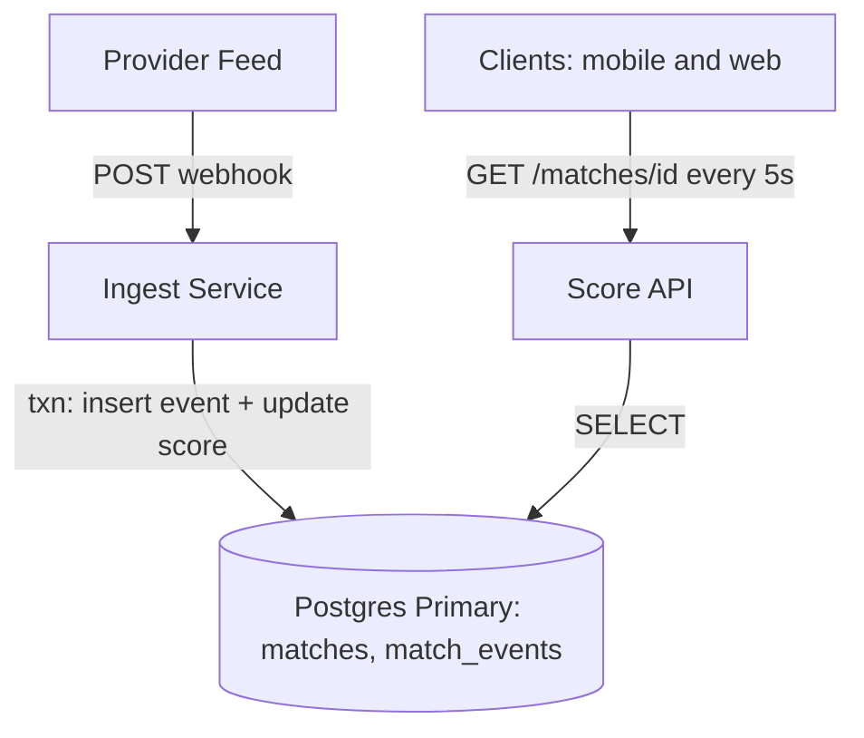

**Every current flow:**

1. **Write path:** Provider POSTs a webhook. The Ingest Service verifies the signature, then inserts the event (deduped by `(match_id, seq)`) and updates `matches` only if `last_seq` is older. All of that happens in one transaction on the Postgres primary.
2. **Read path (live score):** The client calls `GET /matches/{id}` every 5 seconds. The Score API reads one row from the Postgres primary.
3. **Read path (late join and timeline):** The client calls `GET /matches/{id}` plus `GET /matches/{id}/events`. Both read from the Postgres primary.

## Interview follow-ups

**Q: Why store the absolute score in each event instead of just "goal for home"?**
Absolute state makes every event idempotent and order-tolerant. A duplicate or late event can't double-count a goal. With deltas, you'd need strict ordering and exactly-once processing.

**Q: What if the provider's webhook fails or we're down?**
The provider retries, and the `(match_id, seq)` constraint makes retries safe. If we're down long enough, we'd need to pull missed events from the provider's API. That is a gap-detection concern we'll come back to.

## Recap

| Concept | The Insight |
|---|---|
| Idempotent ingest | A unique key on `(match_id, seq)` turns "provider retries" from a bug into a non-event. |
| Absolute state in events | Sending the full score instead of deltas makes duplicates and reordering harmless. |
| `last_seq < new_seq` guard | The write only applies if it is newer, so late events can't roll the score back. |
| Polling | Simple and stateless, but load scales with viewers and latency is bounded by the poll interval. |

**Interview-arc sentence:** *"For ingest, I'd key events on provider sequence so retries are idempotent and guard the state update with a sequence check, so duplicates and reordering can't corrupt the score."*

**Next up:** 10 million viewers each polling every 5 seconds is 2 million requests per second against one Postgres row-reader. V1 is where that falls over.

Say "next" when you're ready.


-----------------------------------------------------------------------------------------------------------------------
-----------------------------------------------------------------------------------------------------------------------
-----------------------------------------------------------------------------------------------------------------------
-----------------------------------------------------------------------------------------------------------------------


# V1: Scale the Score API Horizontally

## Break it

Meet Priya. It's the 89th minute of the final and she opens the app. So do 10 million other people.

Each client polls every 5 seconds, so that is 2 million requests per second. One Score API instance serving a tiny JSON row handles about 20K requests per second.

That single box covers 1% of the audience. The other 99% get timeouts. The box is also a single point of failure, so if it dies, scores go dark for everyone.

## Teaching it: vertical vs. horizontal

The first instinct is a bigger machine. That is **vertical scaling**.

A very large box might reach 100K requests per second. That is 5% of the audience. It also costs a fortune, needs downtime to resize, and is still one machine that can die.

The other option is more machines behind a traffic splitter. That is **horizontal scaling**. There is no hard ceiling. It only works if any machine can answer any request, which means no machine may hold state the others lack.

| Option | Ceiling | Failure impact | Catch |
|---|---|---|---|
| Vertical (bigger box) | ~100K QPS | Total outage | Cost curve, resize downtime |
| Horizontal (many boxes) | Effectively none | Lose 1/N of capacity | Servers must be stateless |

## Solve it

We go horizontal.

**State check.** What would a Score API instance hold locally if left unmanaged?
- Nothing today. It reads a row and returns it.
- The temptation is an in-process cache of recent scores. We forbid that, because instance A and instance B would disagree about the score.
- Any state we need later (caches, connections) goes into a shared store, not into process memory.

**Load balancing algorithm.** We use **least-outstanding-requests**.
- Round robin assumes every request costs the same.
- Requests here are uniform, but one instance can briefly slow down (GC pause, noisy neighbor).
- Least-outstanding-requests routes away from the slow one automatically.

- ✅ **What we gained:** Capacity grows linearly with instances. Losing one instance costs about 1% of capacity. No downtime to scale.
- ⚠️ **What we gave up:** We moved the bottleneck, we didn't remove it. 150 instances now hammer one Postgres primary with 2M reads per second. A single Postgres node serves maybe 30-50K simple reads per second. Also, 150 instances each opening a connection pool will exhaust Postgres connections.
- ❌ **Rejected:** Vertical scaling alone (5% ceiling, outage risk). Sticky sessions (they would let state creep in, and they buy us nothing for a stateless read).

## Implement it

**Sizing.** 2M QPS at 20K per instance is 100 instances. We add 50% headroom, so about 150.

**Load balancer config (Envoy or ALB-style):**

```yaml
cluster: score-api
lb_policy: LEAST_REQUEST
health_check:
  path: /healthz
  interval: 2s
  unhealthy_threshold: 2     # eject after 4s of failures
outlier_detection:
  consecutive_5xx: 3
  base_ejection_time: 10s
```

**Autoscaling policy (Kubernetes HPA style):**

```yaml
minReplicas: 6          # baseline for ordinary days
maxReplicas: 250
metrics:
  - type: Resource
    resource: { name: cpu, target: { averageUtilization: 55 } }
scaleUp:   { stabilizationWindowSeconds: 0 }    # react instantly
scaleDown: { stabilizationWindowSeconds: 300 }  # shrink slowly
```

Big matches are known in advance, so we also **pre-scale** from the fixtures calendar 30 minutes before kickoff. Autoscaling reacts in minutes. A kickoff spike arrives in seconds.

**Connection pooling.** Each Postgres connection costs roughly 10 MB of memory, and practical limits are a few hundred. 150 instances with 20 connections each is 3,000. That kills the primary.

We put **PgBouncer** between the API and Postgres, in transaction-pooling mode:

```ini
[pgbouncer]
pool_mode = transaction
max_client_conn = 10000     ; all API instances connect here
default_pool_size = 100     ; actual connections to Postgres
```

3,000 app-side connections now share 100 real ones. PgBouncer runs as a sidecar or small fleet in front of the primary.

**Request flow, with the new routing:**

1. Client sends `GET /matches/88213` to the public hostname.
2. The load balancer picks the instance with the fewest in-flight requests.
3. That Score API instance runs `SELECT * FROM matches WHERE match_id = 88213` through PgBouncer.
4. PgBouncer borrows one of its 100 real connections for the duration of that query.
5. The row returns to the client.

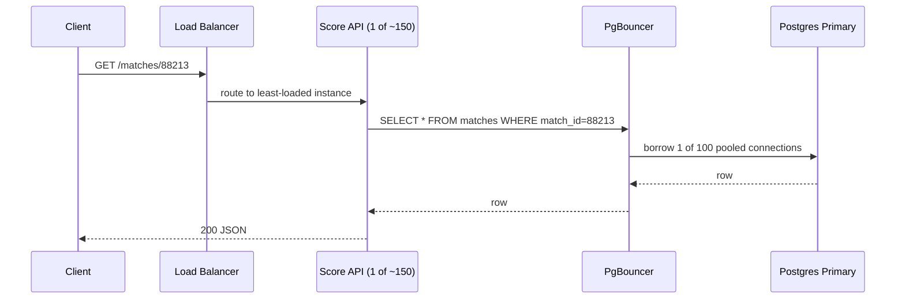

**Ingest Service.** Its load is tiny: a few events per second across all matches. We run 2 instances for availability only, not capacity. The webhook path is otherwise unchanged.

## Current State (V1)

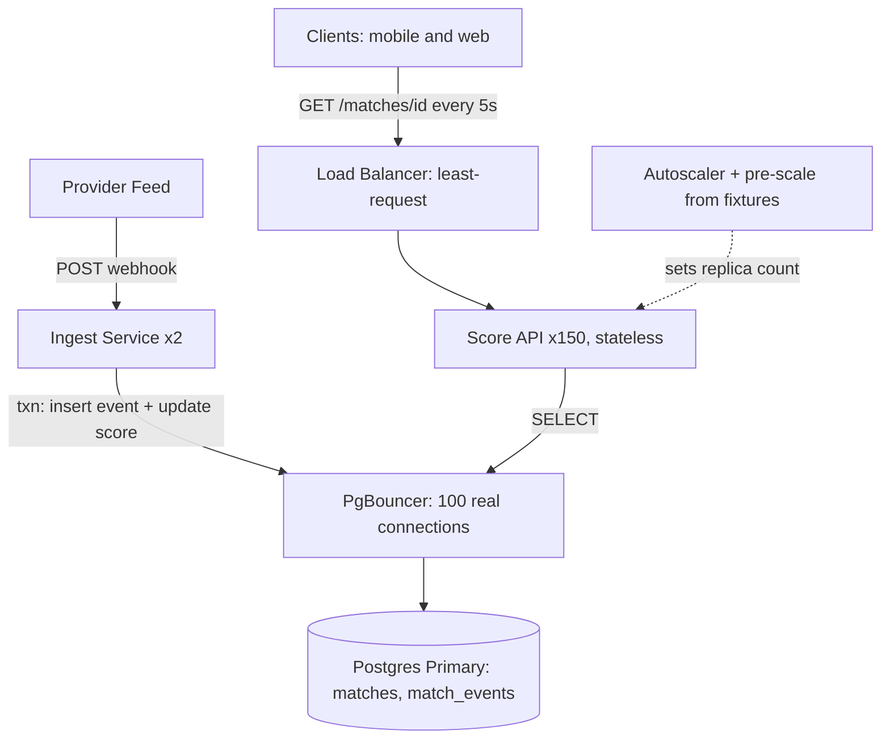

New in V1: the load balancer, the scaled-out Score API tier, PgBouncer, and the autoscaler.

**Every current flow:**

1. **Write path:** Unchanged in behavior. The provider POSTs, the Ingest Service verifies and dedupes, then writes to the Postgres primary in one transaction. It now connects through PgBouncer.
2. **Read path (live score):** The client calls `GET /matches/{id}`. The load balancer routes it to the least-loaded Score API instance. That instance reads one row from the primary via PgBouncer.
3. **Read path (late join and timeline):** Same routing as above. `GET /matches/{id}` and `GET /matches/{id}/events` both read from the primary via PgBouncer.

## Interview follow-ups

**Q: Why not just add read replicas right now?**
Replicas would help, but the real problem is that 2M requests per second are asking the same one-row question. Ten million people want one of a handful of rows. Spreading identical reads across replicas wastes machines on a problem a cache removes entirely. We'll weigh replication properly later, once we've seen what caching leaves behind.

**Q: What breaks if an engineer adds an in-memory cache inside each Score API instance?**
The instances would serve different scores for up to the cache lifetime. Priya sees 2-1 and her friend on the same match sees 1-1. Horizontal scaling requires that state lives in a shared place, not in the process.

## Recap

| Concept | The Insight |
|---|---|
| Horizontal scaling | It only works because the API holds no local state. Any instance can answer any request. |
| Least-outstanding-requests | Routes around a slow instance automatically, which round robin can't do. |
| Pre-scaling | Autoscaling reacts in minutes, but kickoff spikes arrive in seconds. Use the fixtures calendar. |
| Connection pooling | Many app instances multiplied by pool size exhausts Postgres. PgBouncer shares a few real connections among thousands of clients. |
| Moving the bottleneck | Scaling the API tier just relocated the wall to the database. |

**Interview-arc sentence:** *"If asked how you serve 2 million reads per second: one box serves 1% of that and vertical scaling caps at 5%, so I make the API stateless and scale it horizontally behind a least-request load balancer, with PgBouncer protecting the database's connection limit."*

**Next up:** 150 healthy API servers now send 2 million queries per second to one Postgres primary that tops out near 40K. V2 asks why we're answering the same question 2 million times when the answer changes once every few minutes.

Say "next" when you're ready.


-----------------------------------------------------------------------------------------------------------------------
-----------------------------------------------------------------------------------------------------------------------
-----------------------------------------------------------------------------------------------------------------------
-----------------------------------------------------------------------------------------------------------------------


# V2: Cache the Score

## Break it

Back to the 89th minute. Priya refreshes, and so do 10 million others.

150 healthy API servers now send 2 million queries per second to Postgres. One primary tops out near 40K simple reads per second. PgBouncer queues the overflow, queries time out, and the retries make it worse.

Look at what those 2 million queries ask. Almost all of them are `SELECT * FROM matches WHERE match_id = 88213`. It's the same question with the same answer, repeated millions of times.

That answer changed once in the last 4 minutes, when Saka scored.

## Teaching it: why a cache fits here

Think of a hotel front desk. A thousand guests ask "what time is checkout?" The clerk doesn't walk to the back office each time. They write it on a card and point at the card.

A cache is that card. It only works when the question repeats and the answer rarely changes.

Our read pattern fits perfectly:

- **Reads vs. writes:** about 2M reads per second against about 1 write per second across all matches.
- **Popularity:** a few hot matches get nearly all the reads.
- **Data size:** one match row is under 1 KB.

Next question: where does the card live? There are four layers, each a different decision.

| Layer | What it removes | Catch |
|---|---|---|
| Client | Requests that never leave the phone | We can't force-expire it, so the poll interval is the floor |
| CDN / edge | Load on our whole origin | Another system to run and invalidate |
| App-local memory | Calls to any shared store | Instances disagree (V1 banned this) |
| Shared cache (Redis) | Load on the database | Still one network hop per read |

**Decision for V2:** a shared Redis cache in front of Postgres. It fixes the actual wall, which is the database, and it keeps one copy of the truth. We are deliberately **not** adding a CDN or app-local cache yet. Each has its own trade-offs and gets its own version if we need it.

## Solve it

**What's cached:** the current match state and the last 20 events. Both are small and read constantly.

**Invalidation strategy:** write-through from the Ingest Service. When a new event commits, Ingest updates the cache in the same flow. We don't wait for entries to expire.

- Why this fits: score data has exactly one writer path, the Ingest Service.
- A TTL-only cache would serve a stale score for up to the TTL after every goal. That defeats a 2-second latency goal.
- We still set a TTL of 30 seconds as a safety net, in case a cache write fails.

- ✅ **What we gained:** Database read load drops from 2M per second to nearly zero. Postgres is only hit on a cold miss. Updates appear in cache within milliseconds of commit.
- ⚠️ **What we gave up:**
  - Two stores can now disagree. If Ingest commits to Postgres and then fails before updating Redis, the cache is stale until the 30s TTL.
  - Redis is a new component that can fail.
  - A cold or expired key creates a stampede risk (see below).
  - We have not solved the real fan-out problem. All 2M reads now hit Redis, and a single hot key lives on a single shard. We'll hit that wall in V3.
- ❌ **Rejected:**
  - TTL-only expiry: too stale after each goal.
  - Read replicas: they spread the same repeated question across more machines instead of removing it.
  - CDN now: it adds an invalidation system before we've fixed the origin.

## Known sub-problem: cache stampede

A stampede happens when a hot key vanishes and thousands of requests all miss at once. They all query Postgres together. For a 10M-viewer match, that is a self-inflicted outage.

Three established fixes:

**1. Single-flight lock.** The first miss takes a lock and rebuilds. The others wait briefly or serve stale.
```python
if redis.set(f"lock:{key}", 1, nx=True, ex=5):
    value = load_from_db(); redis.set(key, value, ex=30)
else:
    sleep(0.05); retry_read()
```

**2. Probabilistic early refresh.** Each reader has a small random chance of refreshing the key shortly before it expires. Expiry never arrives as a cliff.
```python
if ttl_remaining < 5 and random() < 0.1:
    refresh_async(key)
```

**3. Never expire.** Write-through keeps the key fresh, so a live match key has no expiry cliff. The TTL only matters if a write was lost.

**Our pick:** #3 as the main defense, plus #1 for cold starts. Live matches are written by Ingest, so their keys don't hit an expiry cliff. A match that has never been cached still gets a lock, so only one request goes to Postgres.

Early refresh is unnecessary here, because the writer already keeps the key fresh.

## Implement it

**Redis technology choice:** a key-value store. The access pattern is "get one blob by match ID, millions of times per second." That is exactly what Redis serves from memory.

**Cache keys and shapes:**

```
match:88213:state   -> JSON string
  {"home":"Arsenal","away":"Spurs","hs":2,"as":1,"clock":"89:12","seq":41,"status":"live"}

match:88213:events  -> Redis LIST, newest first, capped at 20
  ['{"seq":41,"type":"goal",...}', '{"seq":40,...}']
```

**Who writes and who reads:**

| Key | Who writes | When | Who reads | When |
|---|---|---|---|---|
| `match:{id}:state` | Ingest Service | After each Postgres commit | Score API | Every client poll |
| `match:{id}:state` | Score API | Cold miss only, under lock | Score API | Same |
| `match:{id}:events` | Ingest Service | After each Postgres commit | Score API | Timeline requests |

**Write path, now with the cache step:**

1. Provider POSTs `/provider/webhook` (unchanged). Ingest verifies the signature.
2. Ingest runs the Postgres transaction from V0 (event insert plus guarded state update). Commit.
3. **Branch: duplicate event.** Do nothing more. The cache already has it.
4. **Branch: new event.** Ingest updates Redis with one Lua script, so the compare-and-set is atomic:

```lua
-- KEYS[1]=match:88213:state  KEYS[2]=match:88213:events
-- ARGV[1]=new_state_json  ARGV[2]=new_seq  ARGV[3]=event_json
local cur = redis.call('GET', KEYS[1])
if cur then
  local cur_seq = cjson.decode(cur).seq
  if cur_seq >= tonumber(ARGV[2]) then return 0 end  -- older event, skip
end
redis.call('SET', KEYS[1], ARGV[1], 'EX', 30)
redis.call('LPUSH', KEYS[2], ARGV[3])
redis.call('LTRIM', KEYS[2], 0, 19)
return 1
```

The sequence check inside Lua mirrors the `last_seq <` guard in Postgres. A late seq 39 can't overwrite seq 41 in the cache either.

5. If the Redis call fails, Ingest retries with backoff and jitter (3 attempts). If all fail, it logs an alert. The 30s TTL then bounds the staleness.

**Read path, cache-aside with a lock for cold misses:**

1. Client sends `GET /matches/88213`. The load balancer routes it to a Score API instance.
2. Score API runs `GET match:88213:state` on Redis.
3. **Branch: hit.** Return the JSON. This is nearly every request.
4. **Branch: miss.** Run `SET lock:match:88213 1 NX EX 5`.
   - **Lock won:** read the row from Postgres via PgBouncer, `SET match:88213:state <json> EX 30`, return it.
   - **Lock lost:** wait 50 ms, retry the Redis GET (up to 3 times), then fall back to Postgres as a last resort.

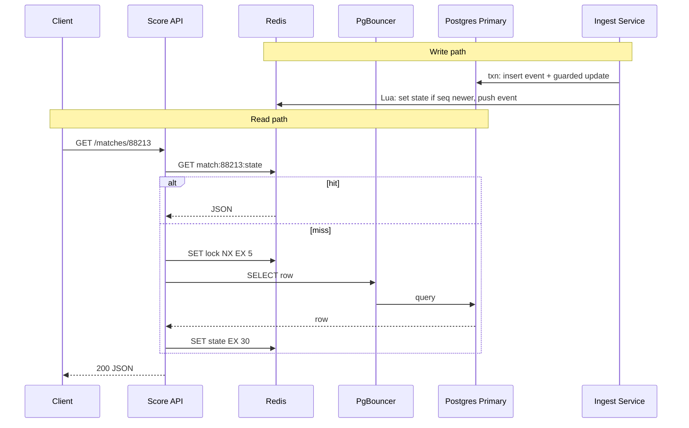

## Current State (V2)

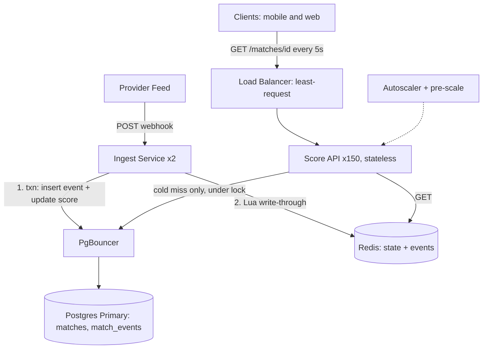

New in V2: the Redis cache, the write-through step in Ingest, and the cold-miss lock in Score API.

**Every current flow:**

1. **Write path:** Provider POSTs. Ingest verifies the signature and commits to Postgres, deduped and sequence-guarded. Then Ingest runs the Lua script against Redis, which sets state only if the sequence is newer and pushes the event onto a capped list.
2. **Read path (live score):** Client calls `GET /matches/{id}`. The load balancer picks a Score API instance. It reads `match:{id}:state` from Redis. On a hit, it returns immediately.
3. **Read path (cold miss):** On a miss, one instance wins a Redis lock, reads Postgres via PgBouncer, repopulates Redis, and returns. Other instances wait and re-read Redis.
4. **Read path (timeline):** `GET /matches/{id}/events` reads the `match:{id}:events` list from Redis. On a miss, it falls back to Postgres with the same lock.

## Interview follow-ups

**Q: Why not delete the cache key on write and let readers refill it?**
Delete-on-write creates a stampede on every goal. For a hot match, all 2M reads per second miss at the same moment right after the update. Write-through puts the new value in place before anyone can miss.

**Q: What if Ingest commits to Postgres but crashes before updating Redis?**
That's the classic dual-write gap. The cache stays stale until the 30s TTL expires. For a score, that is a tolerable bound, and the alert makes it visible. If it weren't tolerable, I'd publish a change event from Postgres (outbox or CDC) and let a separate worker update the cache. That removes the gap but adds a component.

## Recap

| Concept | The Insight |
|---|---|
| Cache fit | A cache pays off when the same question repeats and the answer rarely changes. Here it is 2M reads per second against about 1 write per second. |
| Write-through | The single writer updates the cache itself, so a goal shows up in milliseconds and there is no expiry cliff. |
| Sequence check in Lua | The same `seq` guard from Postgres runs atomically in Redis, so late events can't roll the cache back. |
| Stampede defense | Never-expiring live keys plus a lock for cold starts means Postgres sees one query, not thousands. |
| Layer choice | Redis fixes the database wall. It does not fix the fan-out wall. That is next. |

**Interview-arc sentence:** *"If asked how you protect the database from 2 million reads per second: the same row was being read millions of times between changes, so I put a Redis cache in front and have the single writer update it with a sequence-guarded write-through, which avoids both stale scores and a stampede on every goal."*

**Next up:** Postgres is safe, but all 2 million reads now land on Redis, and one popular match is one key on one shard that handles roughly 100K reads per second. V3 is about that hot key.

Say "next" when you're ready.


-----------------------------------------------------------------------------------------------------------------------
-----------------------------------------------------------------------------------------------------------------------
-----------------------------------------------------------------------------------------------------------------------
-----------------------------------------------------------------------------------------------------------------------


# V3: Absorb the Hot Key in Process

## Break it

It is the 89th minute again. Priya's request now lands on Redis, as do 2 million other requests per second, and almost all of them ask for `match:88213:state`.

Redis executes commands on one thread. One node does about 100K simple GETs per second. Our single key needs 20x that.

The data volume is not the problem. All live matches together fit in a few megabytes. The problem is throughput on one key, and a key lives on exactly one node.

## Teaching it: hot keys

Think of one library book that 10 million people want today. Buying a bigger shelf does not help. The shelf was never the problem, the one book is.

Sharding by `match_id` does not help here either. Hashing sends all reads for match 88213 to the same node, so the hot key stays on one shard no matter how many shards exist. Sharding spreads many keys. It cannot spread one key.

So we have to either make more copies of the key, or stop asking for it so often.

## Three established fixes

**1. Redis read replicas.** Each shard has replicas, and readers pick one at random.
```python
node = random.choice(replicas_for(slot(key)))
node.execute("READONLY"); node.get(key)
```
We would need about 20 replicas for one key. Every cold match would carry that cost too.

**2. Key spreading.** Store N copies under suffixed keys. The slot hash scatters them across shards.
```python
# write: all copies          # read: one random copy
for k in range(N): SET(f"match:88213:state:{k}", v)
GET(f"match:88213:state:{random.randrange(N)}")
```
Each of those 2M reads still lands on Redis. We would need about 40 shards at 50% utilization to serve one match. Each goal would also write 40 copies, and the copies would briefly disagree.

**3. Local micro-cache.** Each Score API instance keeps a copy in its own memory for a very short time, about 300 ms.
```python
v = local.get(key)
if v and v.expires_at > now(): return v.value
```
Redis then sees one read per instance per 300 ms, instead of one per client request.

Two engineers argue about the third option:

> **Dev:** We banned in-process caches in V1. Instances would disagree about the score.
> **Maya:** We banned *state*. This is a 300 ms copy of state that lives elsewhere. The worst disagreement is 300 ms, and the next refresh heals it.

| Option | Redis load for hot match | Staleness added | Extra cost |
|---|---|---|---|
| Read replicas | Spread over ~20 nodes | Replication lag (ms) | ~20 replicas per hot shard |
| Key spreading | Spread over ~40 shards | Copies differ for ms | 40 shards, 40x writes |
| Local micro-cache | ~500 reads/sec total | Up to 300 ms | Some memory per instance |

## Solve it

We pick the local micro-cache. The math decides it. 150 instances each refreshing 3.3 times per second is about 500 reads per second on Redis. That is 0.5% of one node.

It also fits the data. A score that is 300 ms old is still inside our 2-second target.

- ✅ **What we gained:** Redis load for a hot match drops from 2M to about 500 reads per second. Serving from memory is faster than a Redis round trip. Redis outages are also survivable, because instances can serve slightly stale data.
- ⚠️ **What we gave up:**
  - Staleness is now bounded at 300 ms plus the write-through delay.
  - Two viewers can briefly see different scores. The `seq` field lets clients ignore anything older than what they already show.
  - Instances use memory, and 150 instances each refresh independently.
- ❌ **Rejected:**
  - Key spreading: 40 shards for one match, and 40 writes per goal.
  - Redis replicas: it is the same repeated question, served by more machines.
  - A longer TTL such as 2 seconds. That would spend our entire latency budget on one cache layer.

This does not fix polling. Clients still ask every 5 seconds, so end-to-end latency is still up to 5 seconds. That is V4's problem.

## Implement it

The cache lives in the Score API process. It holds the shape `{value, expires_at}` per key, in an LRU capped at 5,000 entries (about 5 MB).

**Who writes and who reads:**

| Store | Who writes | When | Who reads | When |
|---|---|---|---|---|
| Local cache in each Score API instance | That same instance | On local expiry, after fetching from Redis | That same instance | Every client request |
| `match:{id}:state` in Redis | Ingest Service | After each Postgres commit (unchanged) | Score API | Once per ~300 ms per instance per match |

**Read path steps:**

1. Client sends `GET /matches/88213`. The load balancer routes it to a Score API instance.
2. The instance checks its local cache for `88213`.
3. **Branch: fresh.** Return it. This covers nearly every request, with no network hop.
4. **Branch: expired or missing.** The instance runs single-flight. The first request fetches from Redis. Concurrent requests on that instance await the same fetch, so there is one Redis call per instance, not one per request.
5. The fetch is `GET match:88213:state`. On a miss, it uses the V2 lock and Postgres path.
6. Store the result with `expires_at = now + 300ms ± 50ms jitter`. Jitter stops all 150 instances from refreshing in the same millisecond.
7. **Branch: Redis fails.** Serve the stale entry for up to 5 seconds, then return `503`.

```python
TTL, JITTER, GRACE = 0.300, 0.050, 5.0
local = LRU(maxsize=5000)      # match_id -> (value, expires_at)
inflight = {}                  # match_id -> asyncio.Future

async def get_state(match_id):
    now = time.monotonic()
    hit = local.get(match_id)
    if hit and hit.expires_at > now:
        return hit.value                              # fresh
    if match_id in inflight:
        return await inflight[match_id]               # join the fetch
    fut = inflight[match_id] = asyncio.get_running_loop().create_future()
    try:
        v = await redis_get_or_load(match_id)         # V2 path
        local[match_id] = Entry(v, now + TTL + random.uniform(-JITTER, JITTER))
        fut.set_result(v); return v
    except Exception as e:
        if hit and now - hit.expires_at < GRACE:      # serve stale on failure
            fut.set_result(hit.value); return hit.value
        fut.set_exception(e); raise
    finally:
        inflight.pop(match_id, None)
```

The timeline endpoint uses the same wrapper with a 1-second TTL. Timeline staleness matters less than the score.

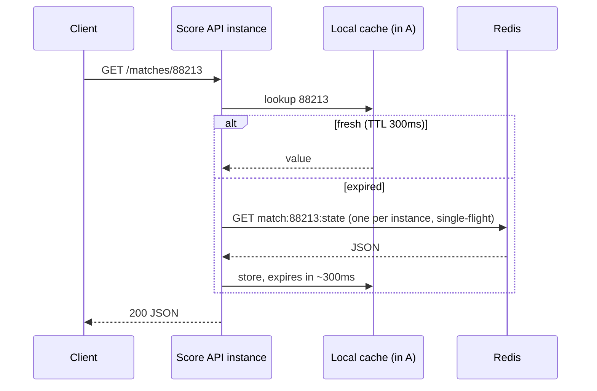

## Current State (V3)

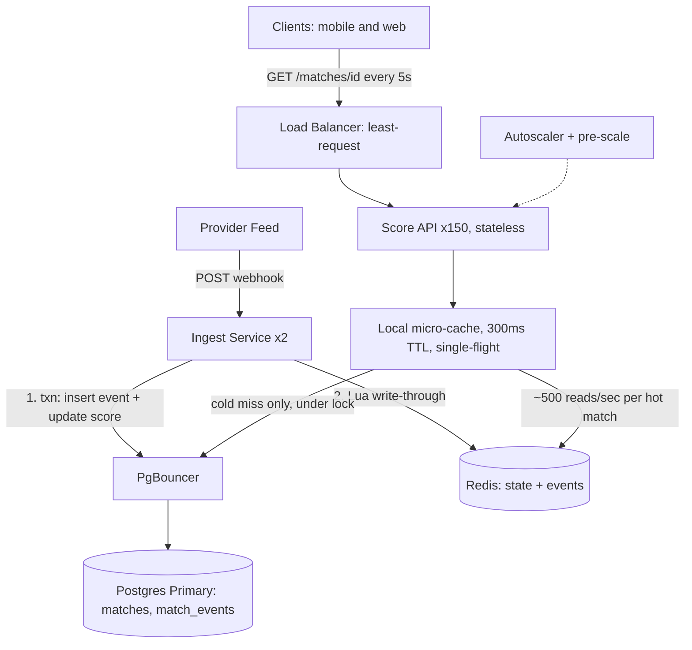

New in V3: the local micro-cache with single-flight inside each Score API instance.

**Every current flow:**

1. **Write path:** Unchanged. Ingest verifies the signature and commits to Postgres, deduped and sequence-guarded. Then it runs the Lua write-through to Redis.
2. **Read path (live score):** The client calls `GET /matches/{id}`. The load balancer picks a Score API instance, which serves from its local cache if fresh. Otherwise one request per instance fetches from Redis and refills the local cache.
3. **Read path (cold miss):** Unchanged below the local cache. One instance takes the Redis lock, reads Postgres via PgBouncer, and repopulates Redis.
4. **Read path (timeline):** Same pattern for `GET /matches/{id}/events`, with a 1-second local TTL and the V2 Redis list.
5. **Redis outage:** Instances serve stale local entries for up to 5 seconds.

## Interview follow-ups

**Q: Doesn't a local cache break your stateless-server rule?**
Statelessness means any instance can answer any request and none holds the only copy of anything. A 300 ms read-only copy of data that lives in Redis keeps that property. If an instance dies, nothing is lost. The cost is bounded staleness, and I'd say that out loud.

**Q: Why not shard Redis by `match_id` and call it done?**
Sharding spreads many keys. It can't split one key. The hot match would still sit on one shard. I'd shard when total data or total throughput across many keys outgrows a node, not for this problem.

## Recap

| Concept | The Insight |
|---|---|
| Hot key | The problem is throughput on one key, so more shards don't help. We need more copies or fewer requests. |
| Micro-cache | A 300 ms local copy collapses 2M reads per second into about 500, at the cost of 300 ms of staleness. |
| Single-flight | Concurrent misses on one instance share one fetch, so a refresh is one Redis call per instance. |
| TTL jitter | Randomizing expiry stops 150 instances from refreshing in lockstep. |
| Stale-on-error | When Redis fails, serving a score that is a few seconds old beats serving errors. |

**Interview-arc sentence:** *"If asked how you handle a hot Redis key: sharding can't split one key, and replicating it 40 ways is expensive, so each API instance holds a 300 ms single-flight local copy, which cuts Redis reads from 2 million to about 500 per second for a bounded 300 ms of staleness."*

**Next up:** Redis is safe, but every viewer still polls every 5 seconds. That means 5 seconds of worst-case latency, and 2M requests per second through our load balancer for answers that rarely change. V4 stops asking and starts telling.

Say "next" when you're ready.


-----------------------------------------------------------------------------------------------------------------------
-----------------------------------------------------------------------------------------------------------------------
-----------------------------------------------------------------------------------------------------------------------
-----------------------------------------------------------------------------------------------------------------------


# V4: Push Instead of Poll

## Break it

Priya is watching the final, and so is her friend Arjun, who has the TV on a 5-second delay. Arjun gets a push notification from another app that says "GOAL." Priya's app still shows 1-1 and won't refresh for up to 4 more seconds.

That is the latency problem. A client that polls every 5 seconds sees a goal anywhere from 0 to 5 seconds late, 2.5 seconds on average. Our target is 2 seconds, so polling cannot meet it no matter how fast the server is.

There is also a cost problem. 2 million requests per second still cross our load balancer, and almost all of them return the same answer as last time.

## Teaching it: how do you tell 10 million people at once?

Think of a stadium announcer versus a scoreboard. With the scoreboard, every fan has to look up. With the announcer, one voice reaches everyone, but the stadium needs speakers wired to the booth.

We want the announcer. The server must be able to speak first. That requires a connection that stays open.

## Three naive attempts

**Attempt 1: poll faster.** Poll every 1 second to cut latency to about 0.5 seconds on average.
- It looked reasonable because it is a one-line config change.
- It breaks at 10M requests per second. That is 5x the load, and V3's micro-cache would have to absorb all of it.
- We would be paying more to ask "anything new?" and hear "no" 99% of the time.

**Attempt 2: long polling.** The client asks, and the server holds the request open until something changes.

> **Dev:** No more empty answers. The request just waits for the goal.
> **Maya:** And when Saka scores, we release 10 million held requests at once. Every client immediately sends a new one. That is a synchronized stampede on every single goal.

- It looked reasonable because it is plain HTTP.
- It breaks because each release triggers a herd of re-requests. It also pays a full HTTP setup per update, and in a frantic match that happens constantly.

**Attempt 3: Ingest pushes directly to every client.** The Ingest Service keeps all the sockets and writes the update to each.
- It looked reasonable because there are no extra components.
- It breaks because one machine holds roughly 100K connections, not 10M. Ingest would also become the thing that can take down both the write path and the delivery path at once.

**The real fix:** a separate tier of **gateway** servers that only hold connections. Ingest tells the gateways about a change once. Each gateway forwards it to its own connected clients.

## Choosing the connection type

| Option | Direction | Reconnect behavior | Catch |
|---|---|---|---|
| Long polling | Server to client, per request | Built in, every request | Herd on release, HTTP overhead per update |
| WebSocket | Both ways | You write it | Needs upgrade support, more to build |
| Server-Sent Events (SSE) | Server to client only | Built in, with `Last-Event-ID` | One direction only |

Viewers never send anything back. Scores flow one way. We pick **SSE**. It is plain HTTP, proxies understand it, and the browser reconnects and resumes on its own. We would move to WebSocket only if we needed client-to-server messages.

## Solve it

Three pieces:

1. **A gateway tier.** It holds open SSE connections and nothing else.
2. **A pub/sub channel per match.** Ingest publishes each new event once. Gateways subscribe to the matches their clients are watching.
3. **A local fan-out loop.** Each gateway writes the event to its own sockets for that match.

**Numbers that decide the shape.** One gateway holds about 100K idle SSE connections, roughly 20 KB of memory each. 10M viewers need 100 gateways. We run about 150 for headroom.

On a goal, Ingest sends 1 publish. Redis delivers it to 150 gateways. Each gateway writes about 67K small messages from memory. That takes tens of milliseconds, so fan-out fits comfortably inside our budget.

- ✅ **What we gained:**
  - Latency drops from up to 5 seconds to well under 1 second.
  - Requests from idle clients disappear, because the traffic is now proportional to events, not viewers.
  - One write at the source becomes one message per gateway, not one per viewer.
- ⚠️ **What we gave up:**
  - We now have **stateful** servers. A gateway holds live sockets, so it can die and drop 67K connections at once. That is V5's problem.
  - Redis pub/sub is fire-and-forget. A gateway that misses a message never learns it did.
  - A slow phone can back up a gateway's memory.
  - Gateway capacity is now measured in connections, not requests per second.
- ❌ **Rejected:**
  - Faster polling: 5x load for a smaller improvement.
  - Long polling: stampede on every release.
  - WebSocket for now: bidirectional capability we don't use.
  - Kafka as the gateway feed: durable, but a heavier hop than we need to deliver a 200-byte message. We would reconsider it for replay.

## Implement it

**Technology note.** The gateway tier holds connections in memory. That state is not durable and does not need to be. If a gateway dies, clients reconnect and re-fetch from the same Redis and Postgres we already have.

**API call:**

```
GET /stream/matches/88213
Accept: text/event-stream
Last-Event-ID: 40          (sent by the browser on reconnect)

→ 200 text/event-stream
event: state
id: 41
data: {"hs":2,"as":1,"clock":"89:12","seq":41,"status":"live"}
```

**The gateway's in-memory shape:**

```python
subs = {}   # match_id -> set of Connection   (lives in this gateway only)
# Connection = { writer, queue (bounded, maxsize=8), last_seq }
```

**Who writes and who reads:**

| Structure | Who writes | When | Who reads | When |
|---|---|---|---|---|
| `subs` (gateway memory) | Gateway | On client connect and disconnect | Same gateway | On each pub/sub message |
| Redis channel `match:{id}` | Ingest Service | After each successful Lua write-through | All Gateways subscribed to that match | On each published event |
| `match:{id}:state` (Redis) | Ingest Service | Unchanged | Gateway | On client connect, for the snapshot |

**Connect path, steps:**

1. The client opens `GET /stream/matches/88213`.
2. The load balancer picks the gateway with the **fewest active connections**. Least-request, our V1 choice, does not fit here. These requests last an hour, so "in-flight requests" is just a connection count.
3. The gateway adds the connection to `subs[88213]`.
4. **Branch: first viewer of this match on this gateway.** The gateway runs `SUBSCRIBE match:88213` on Redis.
5. Only after subscribing, the gateway reads the snapshot using the V3 `get_state` path and sends it as the first event. Subscribing first closes a race. If we read the snapshot first, a goal could land between the read and the subscribe and be lost.
6. The gateway sends a comment line `: ping` every 15 seconds. This stops proxies from closing idle connections.

**Publish path, steps:**

1. Ingest commits to Postgres and runs the V2 Lua script.
2. **Branch: the Lua script returned 0.** The event was older than the cache. Do not publish.
3. **Branch: it returned 1.** Ingest runs:
   ```
   PUBLISH match:88213 '{"hs":2,"as":1,"clock":"89:12","seq":41,"status":"live"}'
   ```
4. Redis delivers the message to every gateway subscribed to `match:88213`.
5. Each gateway runs the fan-out loop below.

```python
async def on_message(match_id, event):            # runs in each gateway
    for conn in subs.get(match_id, ()):
        if conn.queue.full():
            conn.queue.get_nowait()                # drop oldest, keep newest
        conn.queue.put_nowait(event)               # per-connection writer drains it

async def writer(conn):                            # one task per connection
    while True:
        ev = await conn.queue.get()
        if ev.seq <= conn.last_seq: continue       # never go backwards
        await conn.write(f"event: state\nid: {ev.seq}\ndata: {ev.json}\n\n")
        conn.last_seq = ev.seq
```

**Slow clients.** Each connection has a bounded queue of 8. If a phone on a bad network falls behind, we drop the oldest queued event, not the newest. Every event carries the absolute score, so skipping intermediate events is safe. The client only needs the latest state. If a connection stays blocked for 10 seconds, the gateway closes it, and the client reconnects.

**Disconnect.** The gateway removes the connection from `subs`. If `subs[88213]` is now empty, it runs `UNSUBSCRIBE match:88213`.

**Polling stays.** `GET /matches/{id}` still exists. The client uses it as a fallback when SSE can't connect, and the gateway uses the same code path for snapshots.

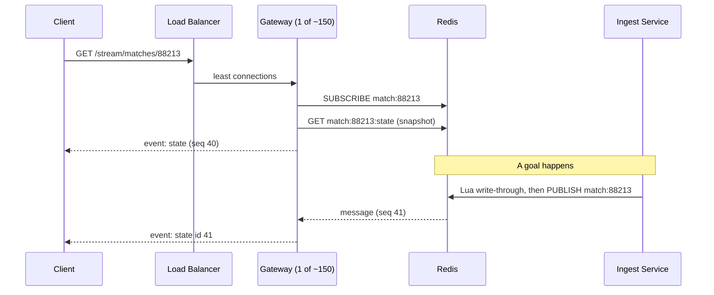

## Current State (V4)

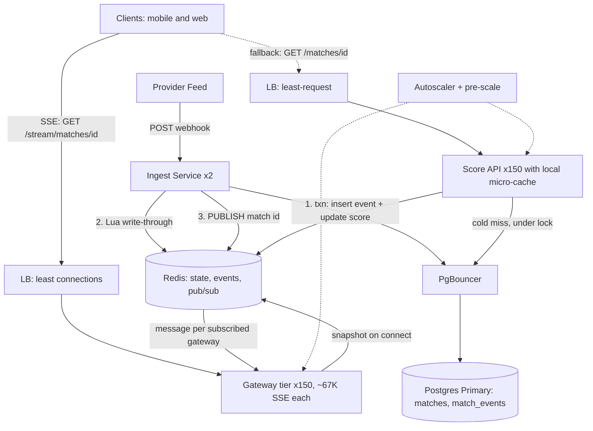

New in V4: the gateway tier, SSE connections, pub/sub channels, a connection-count load balancer, and the publish step in Ingest.

**Every current flow:**

1. **Write path:** Ingest verifies the signature, commits to Postgres (deduped, sequence-guarded), runs the Lua write-through to Redis, and if the cache accepted the event, publishes it on `match:{id}`.
2. **Live delivery (new):** The client opens an SSE stream. The load balancer picks the gateway with the fewest connections. The gateway subscribes to the match channel if it isn't already, sends a snapshot, then forwards every published event to its local sockets for that match.
3. **Read path (fallback and snapshot):** Unchanged. `GET /matches/{id}` goes through the load balancer to a Score API instance, which uses its micro-cache, then Redis, then Postgres on a cold miss.
4. **Read path (timeline):** Unchanged. `GET /matches/{id}/events` reads the Redis list.
5. **Redis outage:** Existing connections stay open, but no new events arrive. Score API still serves stale local entries for up to 5 seconds.

## Interview follow-ups

**Q: Why not use WebSockets?**
Our traffic is one-way, so SSE does the job with less machinery. It runs over plain HTTP, and the browser handles reconnect and resume with `Last-Event-ID`. I'd pick WebSocket if clients had to send messages, for example for in-game chat.

**Q: What if a gateway misses a published message?**
Redis pub/sub does not buffer, so it is lost. The client can detect the gap, because every event carries a sequence number, and refetch with `GET /matches/{id}`. Because each event is the absolute score, one later event also repairs the damage on its own. A proper resume mechanism comes next.

## Recap

| Concept | The Insight |
|---|---|
| Polling latency | Average delay is half the poll interval, so polling cannot meet a 2-second goal without huge load. |
| Long polling | Releasing every waiting request at once creates a stampede on each goal. |
| Gateway tier | One machine can't hold 10M sockets. Separate connection-holding servers do, at about 100K each. |
| Publish once, fan out locally | Ingest sends 1 message. Redis sends 150. Each gateway writes about 67K from memory. |
| Subscribe before snapshot | Doing it in the other order can lose a goal that lands between the two steps. |
| Bounded per-client queue | A slow phone can't exhaust gateway memory, and absolute state makes dropped events harmless. |

**Interview-arc sentence:** *"If asked how you deliver a goal to 10 million viewers in under 2 seconds: polling is capped by its interval and long polling stampedes on release, so I run a gateway tier holding SSE connections, publish each event once over pub/sub, and let every gateway fan out to its own sockets."*

**Next up:** A gateway just crashed at the 89th minute, and 67,000 phones reconnect in the same second, each needing a snapshot, while some missed the goal that landed during the gap. V5 is about reconnect storms and resuming without losing events.

Say "next" when you're ready.


-----------------------------------------------------------------------------------------------------------------------
-----------------------------------------------------------------------------------------------------------------------
-----------------------------------------------------------------------------------------------------------------------
-----------------------------------------------------------------------------------------------------------------------


# Clarifying the "Gateway" in V4

## Short answer

It is a **new set of servers**. It is not an API gateway.

I picked a confusing name. A better name is **connection server** or **push server**. Some companies call it a "realtime edge" or "fan-out tier." I'll use "push server" below and tie it back to "gateway" at the end.

## Two different things with the same word

| | API Gateway (Kong, AWS API Gateway) | Our push server |
|---|---|---|
| Job | Auth, rate limiting, routing of request/response calls | Hold open connections and write events to them |
| Request lifetime | Milliseconds | An hour or more |
| Capacity measured in | Requests per second | Open connections |
| Holds state | No | Yes: a map of who is connected to what |
| Contains business logic | No | Almost none |
| Do we need one? | Optional, in front of Score API | Yes, this is the V4 addition |

They can coexist. An API gateway could sit in front of Score API for rate limiting. The push server is a separate fleet that does a different job.

## Why a new fleet, and not Score API?

Score API instances answer a request in under 5 ms and forget it. Push servers keep a socket open for the whole match.

That difference changes everything about how you run them:

| Concern | Score API | Push server |
|---|---|---|
| Scales on | CPU and QPS | Connection count and memory |
| One instance handles | ~20K requests per second | ~100K idle connections |
| Restarting one | Invisible to users | Drops 67K connections |
| Deploying | Rolling restart, no one notices | Must drain slowly, or you cause a reconnect storm |
| Failure blast radius | One in-flight request each | Every viewer on that box |

Putting both on the same machines would let a push-server memory spike take down the read API, and the other way around. Separate fleets keep failures separate and let each scale on its own metric.

## What a push server actually is

It is a small program with an event loop. Think Node, Go, or Python asyncio. It does five things and nothing else:

1. Accept a TCP connection and parse `GET /stream/matches/88213`.
2. Remember it in a map: `subs[88213].add(conn)`.
3. Subscribe to the Redis channel for that match, once per match per server.
4. When Redis delivers a message, write it to every connection in that match's set.
5. Remove the connection when it closes.

That is the entire job. No database queries on the hot path. No scoring logic.

### What lives in its memory

```python
subs = {
  88213: {conn_a, conn_b, ... 67,000 of them},   # Arsenal vs Spurs
  88214: {conn_x, conn_y, ... 800 of them},      # a quiet match
}
redis_subscribed = {88213, 88214}                # channels this server listens to
```

This is why it is "stateful." If the server dies, that map dies with it. That is fine, because the map only records "who is listening right now," and clients rebuild it by reconnecting.

### Why one Redis subscription per match per server, not per client

This is the key to the whole design. Walk through it with three servers and 300,000 viewers of match 88213.

- G1 has 100K viewers. G2 has 100K viewers. G3 has 100K viewers.
- Each server holds **one** Redis subscription to `match:88213`, not 100K.
- Redis therefore tracks only 3 subscribers for that channel.

On a goal:

1. Ingest runs `PUBLISH match:88213 <json>`. One command.
2. Redis sends the message to 3 subscribers. Three network writes.
3. Each push server loops over its own 100K sockets and writes the bytes. This is memory-to-kernel work, and it takes tens of milliseconds.

The expensive multiplication (1 to 100K) happens inside each push server, where it is cheap. The expensive hop (over the network, through Redis) is only multiplied by the number of servers. That is the shape of the whole fan-out: **fan out in two stages, 1 to 150, then 150 to 10M.**

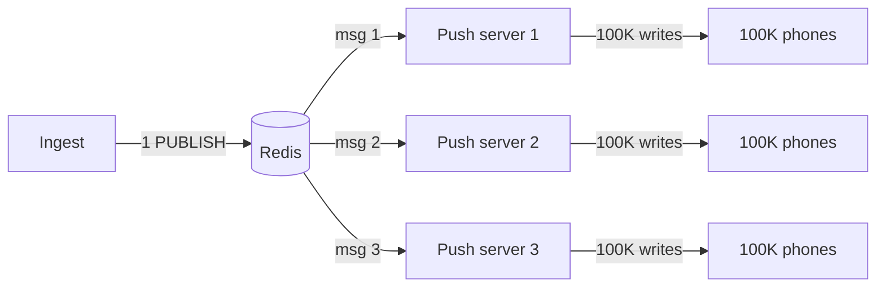

## How a single connection lives and dies

Follow Priya's phone.

1. **Connect.** Her app opens `GET /stream/matches/88213` to `scores.example.com`.
2. **Load balancer.** It picks the push server with the fewest open connections and proxies the TCP stream to it. The LB must have long idle timeouts (for example, 1 hour) and must not buffer responses. Otherwise SSE appears to hang.
3. **Accept.** The push server accepts the socket. It costs about 20 KB of memory (socket buffers plus our bounded queue of 8 events).
4. **Register.** It adds her connection to `subs[88213]`. If this is the first viewer of this match on this server, it also runs `SUBSCRIBE match:88213`.
5. **Snapshot.** It sends the current score as the first event.
6. **Idle.** For most of the match, nothing happens. The server sends `: ping` every 15 seconds so that proxies and mobile carriers don't kill the idle socket.
7. **Event.** A goal arrives from Redis, and the server writes it to her socket.
8. **End.** She closes the app. The server sees the socket close and removes her from `subs`. If the set is now empty, it runs `UNSUBSCRIBE match:88213`.

## Why one machine can hold 100K connections

Because most connections are idle, and idle connections cost almost nothing.

- Each is a file descriptor and a few KB of kernel buffer.
- The event loop only does work when a socket has data to read or a message to write.
- You do need OS tuning: raise the file descriptor limit (`ulimit -n 200000`) and widen the ephemeral port range. Those are the main knobs.

This is also why capacity here is measured in connections. CPU is mostly idle until a goal lands, and then it spikes for a few tens of milliseconds.

## Where the load balancer fits

There are now two public entry points, and they use different balancing rules.

| Path | Fleet | Balancing rule | Why |
|---|---|---|---|
| `GET /matches/{id}` | Score API | Least outstanding requests | Many short requests of equal cost |
| `GET /stream/matches/{id}` | Push servers | Least connections | Each request lasts an hour, so the number of open connections is the real load |

They can sit behind the same domain with path-based routing, or on separate hostnames. Separate hostnames are cleaner because the LB timeout settings differ.

## Where it sits in the full picture

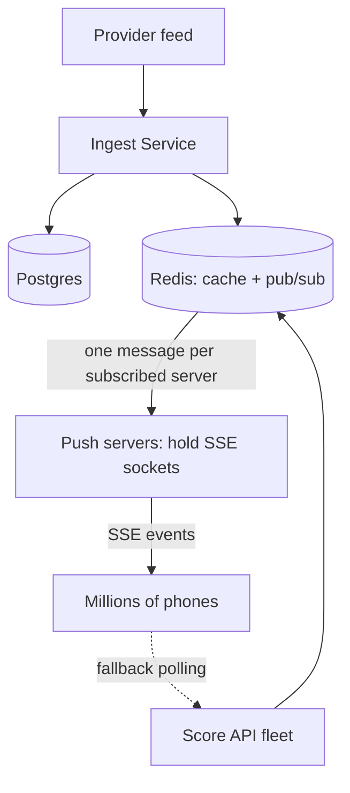

The push fleet is a leaf. It depends only on Redis. It never writes to Postgres. It never talks to Ingest. Ingest does not know it exists, and just publishes to a channel.

That decoupling is deliberate. Ingest can publish to a channel with zero subscribers, or with 150, and its code does not change.

## Why I called it "gateway"

The name comes from the idea that it is the **gateway between our internal world and the outside world's long-lived connections**. It is the door that sockets walk through. In real companies you'll hear the same thing called a "connection gateway," "push gateway," "realtime gateway," or "edge server." Twitter, Slack, and WhatsApp all have a tier like this under different names.

In an interview, say it plainly: *"a separate fleet of connection servers that hold SSE or WebSocket connections and fan out events from pub/sub."* That avoids confusion with API gateways entirely.

## Two things to be careful about

1. **Authentication.** For public scores, we need none. If the stream were private, the push server would validate a token at connect time, once, and never again for that connection.
2. **It is the first stateful tier we have.** Everything before it could be killed and replaced freely. This one cannot, because a restart hurts users. That is the root of the V5 problem.

---

That is the full picture of V4. Ask if any piece is still unclear, for example the pub/sub mechanics, the load balancer settings, or the memory math.

Otherwise, say "next" and we'll do V5: a push server dies, 67,000 phones reconnect in the same second, and some of them missed a goal during the gap.


-----------------------------------------------------------------------------------------------------------------------
-----------------------------------------------------------------------------------------------------------------------
-----------------------------------------------------------------------------------------------------------------------
-----------------------------------------------------------------------------------------------------------------------


# Does the push server talk to users directly?

## Short answer

Through the load balancer. Users never connect to a push server's own address. The load balancer is a middleman that relays bytes in both directions for the life of the connection.

## What actually happens

There are two separate TCP connections, joined by the load balancer.

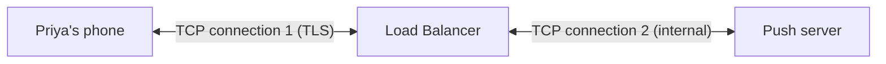

1. Priya's phone connects to `scores.example.com`. DNS resolves that to the load balancer's address.
2. The load balancer terminates TLS, so the encryption ends there.
3. It picks a push server (fewest connections) and opens a second connection to it.
4. It then copies bytes between the two connections.

When a goal arrives, the push server writes to connection 2. The load balancer reads it and writes it onto connection 1. Priya's phone receives it.

## Why not let phones connect straight to push servers?

You could, but you would lose things.

| Concern | Through load balancer | Direct to push server |
|---|---|---|
| Public addresses | One hostname, one set of IPs | Every push server needs a public IP and DNS entry |
| TLS certificates | Managed in one place | Managed on 150 machines |
| Picking a server | LB balances by connection count | Client or DNS must choose, usually badly |
| Server dies | LB stops routing new connections to it | Clients keep resolving to a dead address |
| DDoS exposure | LB absorbs it | Each push server is exposed |
| Adding or removing servers | Register with LB, done | Update DNS and wait for caches to expire |

Direct connection is what you'd do in a tiny system. At 150 servers, the LB is what makes the fleet look like one service.

## What the load balancer must be configured for

A load balancer built for short requests will quietly break SSE. Three settings matter.

```yaml
idle_timeout: 3600s        # default is often 60s, which would cut quiet matches
response_buffering: off    # otherwise events sit in a buffer and arrive late
protocol: HTTP/1.1 or HTTP/2   # long-lived streaming responses
```

- **Idle timeout.** A quiet 0-0 stretch can pass without events. Our 15-second `: ping` keeps the connection from looking idle.
- **Buffering off.** Many proxies collect response bytes before forwarding. For SSE that means a goal sits in a buffer. You also usually add the response header `X-Accel-Buffering: no` for nginx-style proxies.
- **Connection limits.** The LB now holds 10M connections of its own, one per viewer. It needs to be a fleet too. Cloud load balancers (AWS NLB, for example) scale this way for you. A self-hosted setup would run several Envoy or HAProxy instances behind DNS or anycast.

## One thing that surprises people

The load balancer has the same connection problem we gave the push servers. It holds 10M client-side connections plus 10M internal ones.

That is why the LB for this path should be a layer 4 or lightweight layer 7 proxy that does little per byte, not a heavy API gateway doing auth and transformation on every message. Heavy processing on long-lived streams is wasteful, because the work happens once per event per connection.

## What this means for failures

Since the LB owns connection 1, and the push server owns connection 2:

- **Push server dies.** Connection 2 breaks. The LB closes connection 1 to the phone. The phone sees the stream end and reconnects. The LB routes the new attempt to a healthy server. This is the reconnect storm in V5.
- **LB node dies.** Every connection through that node breaks. Phones reconnect through another LB node.
- **Phone loses signal.** Connection 1 goes quiet. The LB or push server notices when a write fails or the idle timeout fires, and cleans up the entry in `subs`.

Either way, the phone's job is the same: notice the stream ended, reconnect, and resume. That is the work V5 covers.

## Summary

| Question | Answer |
|---|---|
| Does the phone talk to the push server directly? | No. It talks to the load balancer. |
| Is it one connection or two? | Two, relayed by the LB. |
| Does the push server know the phone's real IP? | Only if the LB passes it along, for example in `X-Forwarded-For`. |
| Does anything else sit in between? | Possibly a CDN or DDoS shield in front of the LB, but not required here. |

Say "next" for V5 whenever you're ready.


-----------------------------------------------------------------------------------------------------------------------
-----------------------------------------------------------------------------------------------------------------------
-----------------------------------------------------------------------------------------------------------------------
-----------------------------------------------------------------------------------------------------------------------


# Why Pub/Sub, Explained Properly

In V4 I named pub/sub and moved on. I never showed the problem it solves, the alternatives, or what it costs. Here is that gap filled.

## The problem it solves

Ingest has one fact: "match 88213, seq 41, Arsenal scored." The people who need it are on 150 push servers. Ingest doesn't know which servers hold viewers of match 88213.

Push servers change constantly:
- Viewers connect and leave every second.
- A server may hold 67K viewers of the final and none of a quiet match.
- Servers are added, drained, and crash.

So the question is: **how does one fact reach exactly the servers that need it, when the set of interested servers keeps changing?**

## Pub/sub in plain language

Think of a radio station. The station broadcasts on a frequency. It doesn't know who is listening. Anyone who wants the match tunes in, and anyone who leaves just tunes out.

- **Channel:** a named frequency. Ours is `match:88213`.
- **Publisher:** Ingest. It says "here's a message for channel X."
- **Subscriber:** a push server. It says "send me everything on channel X."
- **The broker (Redis):** keeps the list of who is subscribed to what and forwards messages.

The publisher and subscribers never learn about each other. That is the whole idea.

## Four naive attempts

**Attempt 1: Ingest calls every push server directly.**

> **Dev:** Ingest has the list of 150 servers. On each goal, it sends an HTTP call to all of them.
> **Maya:** Do 149 of them care about the quiet match? And what happens when the list is stale and Ingest calls a server that was just killed?

It looked reasonable because there is no extra component.
It breaks because:
- Ingest must track fleet membership, which changes constantly.
- One slow or dead server stalls the publish loop unless you add timeouts, retries, and parallelism.
- Ingest's job was "accept the provider's event." Now it also runs a delivery system.

**Attempt 2: Ingest keeps a registry of who watches what.**
Push servers write "I have viewers of match 88213" to a table. Ingest reads the table and calls only those servers.

It looked reasonable because it skips uninterested servers.
It breaks because:
- The registry is shared mutable state that updates on every connect and disconnect.
- A crashed server leaves a stale entry. Ingest keeps calling a dead address until a heartbeat expires.
- We have rebuilt a pub/sub broker, badly, by hand.

**Attempt 3: Push servers poll Redis.**
Each server asks "any new event for my matches?" every 200 ms.

It looked reasonable because it is simple and robust.
It breaks because we have reintroduced polling. Latency is up to 200 ms per hop, and 150 servers asking constantly is wasteful for something that changes once every few minutes.

**Attempt 4: Ingest broadcasts every event to all 150 servers.**
Servers drop what they don't need.

It looked reasonable because it needs no membership tracking.
It is actually viable at our scale. Events total a few hundred per second across all matches, and each is 200 bytes. 150 servers times a few hundred messages is trivial. But it scales with fleet size and event rate, and every server does filtering work for matches it doesn't care about. It is a fine fallback, but pub/sub gives the same result more cheaply.

**The real fix:** let the broker own the "who is interested" list. Each push server subscribes to the channels it needs. Ingest publishes once.

## Which broker? The real candidates

| Option | Delivery guarantee | Replay possible | Latency | Ops weight | Fits us because / doesn't because |
|---|---|---|---|---|---|
| Redis Pub/Sub | At-most-once, fire and forget | No | Sub-millisecond | Already running | Fits: tiny messages, lowest latency, no new system |
| Redis Streams | At-least-once, consumer tracks position | Yes, within retention | Around 1 ms | Already running | Good for resume, heavier model for fan-out to 150 consumers |
| Kafka | Durable, ordered per partition | Yes, long retention | Tens of ms | Heavy cluster | Overkill for 200-byte "doorbell" messages, one topic per match is awkward |
| NATS | At-most-once (core) or durable (JetStream) | JetStream only | Sub-millisecond | New system to run | Great fit, but adds a component for little gain |
| Cloud managed (SNS, Google Pub/Sub) | At-least-once | Limited | Tens to hundreds of ms | Zero to run | Latency eats our 2-second budget, and it is billed per message |

**Decision for V4:** Redis Pub/Sub. It is already deployed. It is the fastest. Our messages are tiny and carry absolute state, so a lost message is repairable by the next one.

## What Redis Pub/Sub costs us

This is the part I under-explained.

- ✅ **What we gained:**
  - Ingest is decoupled from delivery. It publishes to a channel with 0 or 150 subscribers using identical code.
  - Membership tracking is delegated. Redis knows who is subscribed. If a push server dies, its subscription disappears when the connection drops.
  - Sub-millisecond hop. Nothing in our latency budget goes here.
  - No new infrastructure.
- ⚠️ **What we gave up:**
  - **No delivery guarantee.** If a push server is disconnected from Redis for 2 seconds, it misses every message in that window. Redis does not buffer for it.
  - **No replay.** There is no "give me everything since seq 40." Only the live stream exists.
  - **No acknowledgements.** Ingest never learns whether anyone received the goal.
  - **Slow subscriber risk.** If a push server can't keep up, Redis's output buffer for that client grows. Past a configured limit, Redis disconnects it, and the server silently loses messages until it resubscribes.
  - **Cluster behavior.** In Redis Cluster, classic `PUBLISH` is propagated to every node. Sharded pub/sub (`SPUBLISH` / `SSUBSCRIBE`, Redis 7+) routes by channel slot instead. At our message rate either works, but it is a detail to know.
  - **Redis becomes a delivery single point of failure.** If it is down, no push happens, even though Postgres is healthy.
- ❌ **What we considered and rejected:** Kafka (too heavy for a doorbell), direct RPC (Ingest would own fleet membership), polling (latency and waste).

## Why those weaknesses are tolerable here

The weaknesses matter less because of earlier decisions:

1. **Every event carries the absolute score.** A missed message is repaired by the next one.
2. **Sequence numbers are on every event.** A client or server can detect a gap.
3. **The truth lives elsewhere.** Redis holds `match:{id}:state` and the last 20 events, and Postgres holds everything. Pub/sub is a doorbell, not the source of truth.

This is the key design principle: **pub/sub is for speed, and the state store is for correctness.** A pure pub/sub design would be fragile. Pub/sub plus a durable catch-up path is robust.

If this were a chat system where every message must arrive, I would not use plain Redis Pub/Sub. I'd use Streams or Kafka. The choice depends on whether the data is state, where latest wins, or a log, where every item matters.

## How the pieces cooperate

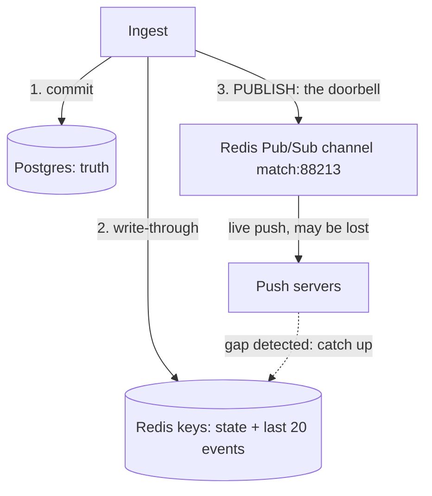

Two paths carry the same fact:
- **Fast path:** pub/sub, sub-millisecond, can lose messages.
- **Safe path:** read the state key or event list, slower, always correct.

V5 will use the safe path to repair gaps after reconnects.

## One-line answer for an interview

*"Ingest shouldn't know which of 150 servers have viewers for which match, so I use pub/sub: each push server subscribes to the matches its clients watch and Ingest publishes once. I chose Redis Pub/Sub for its latency and because it's already deployed. It is at-most-once, so every event carries absolute state and a sequence number, and clients repair gaps from the cached state."*

## Likely follow-ups

**Q: Why not Kafka?**
Kafka gives durability and replay, but it adds tens of milliseconds, a heavy cluster, and awkward per-match topics. Our messages are 200-byte state updates where only the latest matters. I'd pick Kafka if I needed an audit log or to feed downstream consumers like analytics, and that would sit beside this path, not replace it.

**Q: What if Redis Pub/Sub drops a message?**
The next event carries the full score, so the display heals itself. For a goal that is the last event for several minutes, the client detects the gap through the sequence number on its next event or on reconnect, and refetches state. In V5 we make that explicit with a heartbeat that carries the current `seq`, so a client knows within 15 seconds that it missed something.

That last point is a good preview of V5.

Say "next" when you're ready.


-----------------------------------------------------------------------------------------------------------------------
-----------------------------------------------------------------------------------------------------------------------
-----------------------------------------------------------------------------------------------------------------------
-----------------------------------------------------------------------------------------------------------------------


# V5: Resume Without Losing Events

I'm splitting the reconnect problem in two, per the one-concern-per-version rule. V5 is **correctness**: after a gap, the client ends up with the right state. V6 is **load**: 67,000 phones arriving in the same second. Here the storm is only the trigger.

## Break it

It is 89:10 in the final. Push server G7 crashes with 67,000 viewers.

Priya's phone sees the stream die. The browser's `EventSource` retries after about 3 seconds. At 89:12, while she is disconnected, Saka scores. Ingest publishes seq 41 on `match:88213`. G7 is dead, so Priya's connection never gets it.

At 89:13 she reconnects to G42. Here is a flaw in my V4 design that I need to correct.

1. G42 runs `SUBSCRIBE match:88213` (it was already subscribed, so this is a no-op).
2. G42 reads the snapshot with the V3 `get_state` path, which uses the 300 ms local micro-cache.
3. That cache entry was fetched at 89:11.8, before the goal. It still says seq 40, score 1-1.
4. The pub/sub message for seq 41 was delivered to G42 at 89:12.0. It went to the clients connected then, and Priya was not one of them.

Priya now sees 1-1. The match is 2-1. The next event may be ten minutes away. I claimed "subscribe before snapshot" closes this race in V4. It does not, because the snapshot can be older than the subscription. **The snapshot must be at least as fresh as the moment we registered the connection.**

The same hole appears in two other cases:

- **Redis pub/sub drops a message.** Redis disconnects a subscriber whose output buffer is full. The default pubsub limit is 32 MB hard, or 8 MB sustained for 60 seconds. The gateway silently misses everything until it resubscribes.
- **A Redis blip.** Every push server loses its subscription for 2 seconds, and nobody notices.

## Teaching it: three kinds of gap

A gap is any time a client's `seq` is behind the truth. There are three ways it happens, and each needs its own detector.

| Gap source | Who notices | How |
|---|---|---|
| Client disconnected, then returns | The client | It knows the last `id` it saw |
| Server missed a pub/sub message | Nobody, by default | Needs a server-side check against Redis |
| Message dropped on one client's slow queue | The client | `seq` jumps, but absolute state makes it harmless |

The second is the dangerous one, because silence looks the same as "nothing happened."

## Three established repair approaches

**1. Client refetch.** The client detects a gap and calls `GET /matches/88213`.
```js
if (ev.seq > lastSeq + 1 || hb.seq > lastSeq) fetch(`/matches/${id}`)
```
It is simple and needs no new server code. It works only if the client notices, and a mass gap sends thousands of requests to Score API at once.

**2. Server-side replay.** On connect, the client sends `Last-Event-ID: 40`. The push server replays everything after 40 from the Redis events list.
```python
missed = [e for e in recent_events if e.seq > last_id]
```
It is invisible to the client and fills the timeline too. It needs an ordering guarantee between live events and replayed ones.

**3. Server-side reconciliation.** Each push server periodically compares its own latest `seq` to Redis. If Redis is ahead, the server missed something and resyncs its local connections.
```python
if redis_seq > local_latest_seq[match_id]: resync(match_id)
```
It covers the silent case. It costs a small constant Redis read.

| Option | Covers reconnect | Covers silent server miss | Cost |
|---|---|---|---|
| Client refetch | Yes | Only via heartbeat | Herd on Score API |
| Server replay | Yes | No | Redis reads per connect |
| Reconciliation | Partly | Yes | ~4K GETs/s fleet-wide |

## Solve it

We use all three, but each covers a different gap, so this is one mechanism: **sequence-based catch-up**. The rule is that every path ends by sending events with `seq > conn.last_seq` in order.

- Replay (#2) handles reconnects.
- Reconciliation (#3) handles silent server misses and Redis outages. It reuses the replay path.
- Client refetch (#1) stays as the last-resort backstop, driven by the heartbeat.

**The ordering rule that fixes the Priya bug:** register the connection first, then fetch. Any event published after registration reaches her through the live path. Any event before it comes through the fetch. The V4 guard `if ev.seq <= conn.last_seq: continue` removes duplicates in the overlap. Together they leave no gap.

- ✅ **What we gained:**
  - No lost events after reconnect, a Redis blip, or a dropped pub/sub message.
  - Timeline events are recovered too, not just the score.
  - Worst-case repair for a silent miss is about 2 seconds.
- ⚠️ **What we gave up:**
  - Replay only reaches back 20 events (the Redis list cap). Beyond that we send a full state `reset`, which is safe because events are absolute.
  - Catch-up adds Redis reads. A mass reconnect multiplies them, which is V6's problem.
  - The repair window for a silent miss is 2 seconds, not milliseconds. That is the cost of a polling check.
  - Connect-time reads now bypass the V3 micro-cache, since a stale snapshot caused the bug.
- ❌ **Rejected:**
  - Only the client refetching: it can't detect a server-side miss, and a Redis blip would cause a stampede on Score API.
  - Switching to Redis Streams or Kafka just for replay: it solves the same gap with a heavier system, when our recent-events list already holds what we need.
  - Server pushes a full state on every heartbeat: wasteful, and it hides gaps instead of detecting them.

## Implement it

**API call on reconnect:**

```
GET /stream/matches/88213
Last-Event-ID: 40

→ 200 text/event-stream
event: state
id: 41
data: {"hs":2,"as":1,"clock":"89:12","seq":41,"type":"goal","scorer":"Saka"}
```

A first-time connect has no `Last-Event-ID`. It receives only the current state, not 20 old events.

**Technology note.** We reuse the V2 Redis list `match:{id}:events` (newest first, capped at 20). No new store is needed. The list already has what replay needs.

**Who writes and who reads:**

| Structure | Who writes | When | Who reads | When |
|---|---|---|---|---|
| `match:{id}:events` (Redis list) | Ingest Service | After each commit (unchanged) | Push server | Once per catch-up batch |
| `match:{id}:state` (Redis) | Ingest Service | Unchanged | Push server | Once per catch-up batch, and reconciler every 2s |
| `pending[match_id]` (gateway memory) | Push server connect handler, reconciler | On connect or detected gap | Push server batcher | Every 50 ms |
| `latest_seq[match_id]` (gateway memory) | Push server pub/sub handler | On each live event | Reconciler | Every 2s |

**Connect path, steps:**

1. Client opens the stream, with `Last-Event-ID` if reconnecting.
2. The push server sets `conn.last_seq = last_id or 0`.
3. It adds the connection to `subs[88213]`. **Registration comes first.**
4. If it is the first viewer of this match on this server, it runs `SUBSCRIBE match:88213`.
5. It adds the connection to `pending[88213]`.
6. The batcher (next section) serves it from a fresh Redis read.

**The batcher.** It runs every 50 ms. Everyone who registered before the read starts shares one pipeline call.

```python
async def batcher():
    while True:
        await asyncio.sleep(0.05)
        batch, pending_now = pending, defaultdict(list)
        pending.clear(); pending.update(pending_now)
        for match_id, conns in batch.items():
            # all conns were registered BEFORE this read begins
            pipe = redis.pipeline()
            pipe.get(f"match:{match_id}:state")
            pipe.lrange(f"match:{match_id}:events", 0, 19)
            state_raw, ev_raw = await pipe.execute()
            state = json.loads(state_raw)
            events = sorted(map(json.loads, ev_raw), key=lambda e: e["seq"])
            oldest = events[0]["seq"] if events else state["seq"]
            for c in conns:
                if c.last_seq == 0:                       # first connect
                    c.replay = [state]
                elif c.last_seq + 1 >= oldest:            # gap fully covered
                    c.replay = [e for e in events if e["seq"] > c.last_seq]
                else:                                     # gap too old
                    c.replay = [{"reset": True, **state}]
                c.wake()                                  # writer drains replay first
```

Three points matter here:

- **Replay is separate from the bounded live queue.** The writer drains `conn.replay` first, then the live queue of 8. Replay is at most 20 items, so it cannot overflow memory.
- **The `ev.seq <= conn.last_seq` guard** from V4 removes any event that arrives both live and in replay.
- **One pipeline per match per 50 ms**, not one per client. This is the same coalescing idea as V3's single-flight, but it is guaranteed fresh.

**Reconciler (the silent-miss detector), steps:**

1. Every 2 seconds, for each match this server is subscribed to, run `GET match:{id}:state` in one pipeline.
2. Compare `redis_state.seq` to `latest_seq[match_id]`, the highest `seq` this server received via pub/sub.
3. **Branch: equal.** Nothing missed.
4. **Branch: Redis is ahead.** This server missed a message. Add every local connection for that match to `pending`. The batcher then sends `seq > conn.last_seq` to each of them.

```python
async def reconciler():
    while True:
        await asyncio.sleep(2)
        ids = list(subs.keys())
        states = await redis.mget([f"match:{m}:state" for m in ids])
        for m, raw in zip(ids, states):
            if raw and json.loads(raw)["seq"] > latest_seq.get(m, 0):
                pending[m].extend(subs[m])        # same catch-up path
```

**Redis reconnect.** When the push server's Redis connection comes back, it resubscribes to every channel in `subs`. It then pushes all local connections into `pending`. This is the same batcher path, with no special case.

**Cost of the reconciler:** 150 servers, about 50 live matches each, every 2 seconds. That is roughly 3,750 GETs per second across the fleet, a rounding error for Redis.

**Heartbeat.** Every 15 seconds the server sends `event: hb` with the current seq. The client uses it for the last-resort check.

```
event: hb
data: {"seq":41}
```

```js
// client
if (hb.seq > lastSeq) fetch(`/matches/${id}`)     // backstop refetch (approach #1)
// watchdog: no bytes for 35s -> close and reconnect with Last-Event-ID
```

**Corrections** need no new mechanism. A VAR disallow is a new event, for example seq 43 with score 1-1. Replay delivers it in order, and the client always applies the highest `seq`.

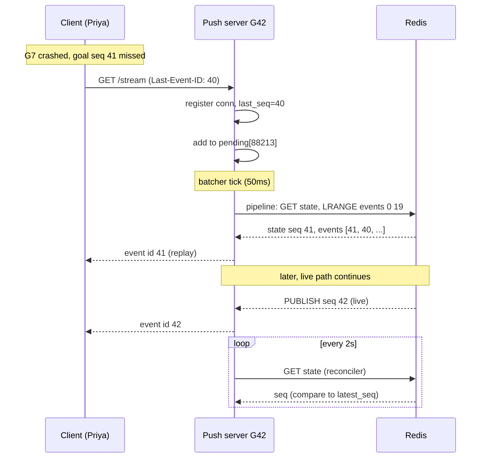

## Current State (V5)

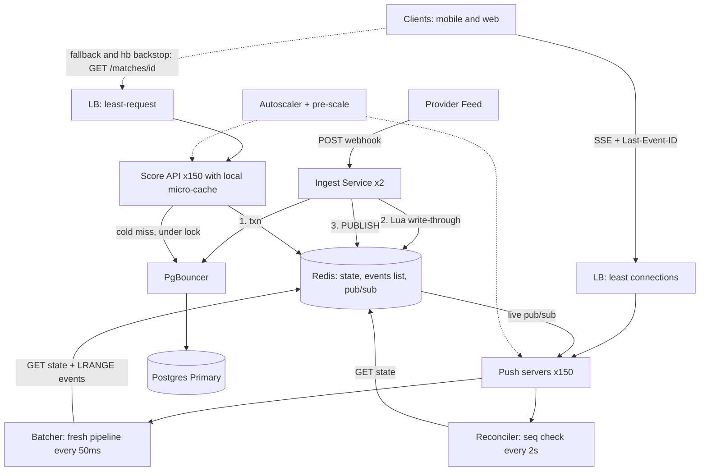

New in V5: the connect-time batcher, the reconciler, `Last-Event-ID` replay, and heartbeats that carry `seq`.

**Every current flow:**

1. **Write path:** Unchanged. Ingest verifies, commits to Postgres, runs the Lua write-through to Redis, and publishes if the cache accepted the event.
2. **Live delivery:** Unchanged. A pub/sub message reaches each subscribed push server, which writes it to local connections. It updates `latest_seq[match]`.
3. **Connect and resume (changed):** The client opens the SSE stream, with `Last-Event-ID` if reconnecting. The server registers the connection first, subscribes if needed, then queues it in `pending`. The batcher reads Redis once per match per 50 ms and sends first-connect state, replay, or a `reset` depending on the gap.
4. **Silent-miss repair (new):** Every 2 seconds the reconciler compares Redis's `seq` to the server's `latest_seq`. If Redis is ahead, it queues all local connections for catch-up.
5. **Redis outage and recovery (changed):** Existing sockets stay open. On reconnect, the server resubscribes and triggers catch-up for all local connections.
6. **Read path (fallback and timeline):** Unchanged. Score API with its micro-cache, then Redis, then Postgres on a cold miss.

## Interview follow-ups

**Q: Why not make pub/sub reliable by switching to Kafka or Redis Streams?**
That fixes delivery, but it makes every push server track an offset per match and adds a heavier hop. Our data is state, and the latest value wins. A recent-events list plus sequence numbers gives the same guarantee with what we already run. I'd move to Streams or Kafka if clients needed every event with no gaps, such as for a betting feed.

**Q: How do you stop replay and live events from arriving out of order or twice?**
Register the connection before the fetch, so nothing published after that can be missed. Then keep a per-connection `last_seq` and drop anything at or below it. The overlap between replay and live is harmless, because duplicates are filtered by sequence.

## Recap

| Concept | The Insight |
|---|---|
| Stale snapshot bug | A snapshot older than the subscription can hide an event that was published in between. Connect-time reads must start after registration. |
| Register, then fetch | Anything after registration comes live, anything before comes from the fetch, and `seq` dedupes the overlap. |
| Replay | `Last-Event-ID` plus the Redis events list recovers missed events with no new store. |
| Reconciler | Pub/sub fails silently, so each server polls Redis's `seq` every 2 seconds and resyncs if it fell behind. |
| Reset | If the gap is older than 20 events, send absolute state instead of replaying history. |

**Interview-arc sentence:** *"If asked how you avoid missing a goal after a reconnect: pub/sub is fire-and-forget and a snapshot can be older than the subscription, so I register the connection first, then fill the gap from a fresh Redis read using `Last-Event-ID` and sequence numbers, and a periodic reconciler catches silent drops."*

**Next up:** Correctness is now solid, but it multiplies load. When G7 dies, 67,000 phones all reconnect within 3 seconds, and each one triggers a catch-up read, a TLS handshake, and a new socket. If a whole Redis blip or a load balancer node goes, that is millions at once. V6 is about surviving the reconnect storm with jittered backoff and admission control.

Say "next" when you're ready.


-----------------------------------------------------------------------------------------------------------------------
-----------------------------------------------------------------------------------------------------------------------
-----------------------------------------------------------------------------------------------------------------------
-----------------------------------------------------------------------------------------------------------------------


# V6: Survive the Reconnect Storm

V5 made reconnects correct. V6 makes them cheap when millions happen together. Redis and the catch-up path are not the problem here, because the V5 batcher already collapses catch-up reads to one pipeline per match per server every 50 ms. The problem is the connections themselves.

One correction first. In V4 I said the browser reconnects on its own. That is true of `EventSource`, but it has two flaws. It retries on a fixed delay (about 3 seconds) with no backoff and no jitter. It also gives up for good on a non-200 response, so it can't obey a `503 Retry-After`. V6 replaces it with a small fetch-based SSE client.

## Break it

It is 89:12 in the final. Priya's phone is one of 10M connected. The load balancer in one availability zone fails, and 3.3M connections drop at the same instant.

Every phone sees the stream die and waits the same fixed ~3 seconds. At 89:15, 3.3M reconnect attempts arrive within about a second.

The surviving zones have 120 push servers, pre-scaled for the final. That is 120 × 83K connections, so a zone loss still fits under the 100K cap. Each server can complete roughly 3,000 new streams per second. Registering, queueing a catch-up, and writing the first bytes is the real cost per connection. Fleet-wide that is about 360K per second.

Demand is 3.3M in one second, so about 9x over capacity. What happens next:

1. Accept queues overflow and handshakes time out.
2. Servers burn CPU on connections the client has already abandoned.
3. About 90% of clients fail and wait the same ~3 seconds.
4. At 89:18 the same 3M clients arrive again, plus the ones who got in.

Goodput never recovers. The system stays down because of its own retries, even though the original fault is gone. This is called a **metastable failure**.

A single push server crash is not this problem. 67K connections spread over 149 survivors is about 450 each, which is trivial. Storms come from correlated events: a zone or LB failure, a bad deploy, or a mobile carrier outage ending.

## Teaching it: why synchronized retries are a trap

Picture a stadium after the final whistle. Open every exit at once and 60,000 people jam the corridors. Nobody moves faster than the narrowest door.

Now release one section at a time, with ushers telling each group "wait your turn." Everyone leaves sooner overall. The door's throughput is the same, but nobody wastes time pushing.

Our narrow door is 360K accepts per second. The clients' job is to arrive at a pace the door can take. The server's job is to say "not now" cheaply when they don't.

## Three naive attempts

**Attempt 1: fixed retry delay (the EventSource default).**
It looked reasonable because it is built in and needs no code.
It breaks because every client that dropped at the same moment retries at the same moment. The storm repeats every 3 seconds.

**Attempt 2: exponential backoff, no jitter.**

> **Dev:** Fixed delay is the problem. Double it each time: 1s, 2s, 4s, 8s.
> **Maya:** The 3.3M all dropped at once. They all wait 1s, all fail, all wait 2s. You've made waves at 1, 3, 7, 15 seconds instead of every 3. Same size, spaced further apart.

Backoff alone only stretches the gaps between synchronized waves. Randomness is what breaks the synchronization.

**Attempt 3: overprovision push servers to absorb the burst.**
It looked reasonable because it needs no client changes.
It breaks on cost and shape. Absorbing 3.3M per second needs about 1,100 servers, against 120 for steady state. Those servers idle for 99.9% of the match. A 20M-viewer final next year moves the goalposts again.

**The real fix:** clients spread themselves out with randomized backoff, and servers refuse excess arrivals instantly while telling clients when to return.

| Option | Spreads arrivals | Protects server | Cost |
|---|---|---|---|
| Fixed delay | No | No | None |
| Exponential, no jitter | Only across waves | No | Client code |
| Exponential, full jitter | Yes | Partly | Client code |
| Full jitter + server admission control | Yes | Yes | Client + server code |
| Overprovision 9x | n/a | Yes | About 1,000 idle servers |

## Solve it

Two halves of one mechanism, **spread and gate**.

**Spread (client).** On every disconnect, wait `random(0, min(cap, base × 2^attempt))`. This is "full jitter." It gives the lowest total server work of the common variants, because it spreads arrivals most evenly.

**Gate (server).** Each push server has a token bucket for new streams, at 3,000 per second. When the bucket is empty, it returns `503` with a `Retry-After` immediately. It does this before registering anything, so rejecting costs microseconds, not a connection setup. The hint grows with how overloaded the server is, so clients back off in proportion to the problem.

**While waiting.** A rejected client does one `GET /matches/{id}`. That hits the V3 micro-cache and costs almost nothing. The user sees a fresh score during the wait instead of a frozen one.

The result is a controlled drain. 3.3M clients at 360K per second take about 9 seconds to be fully back. The first clients are in within a second, and nobody is stuck in a retry wave.

- ✅ **What we gained:**
  - No metastable collapse. Goodput stays at capacity during the storm.
  - Recovery time is predictable (demand ÷ rate), about 9 seconds here.
  - Planned drains (deploys) become gentle too.
  - Waiting users still see fresh scores through the polling fallback.
- ⚠️ **What we gave up:**
  - Recovery is slower for the lucky clients. They now wait up to a couple of seconds on purpose.
  - The client is more complex. We replace a built-in browser feature with our own code.
  - Some users wait up to ~10 seconds for a live stream during a major outage.
  - Token rates need tuning. Set too low, they reject when capacity exists. Set too high, they don't protect.
  - Jitter must be in every client version, including old apps, so ancient app versions can still storm. We can only mitigate those with the server gate.
- ❌ **Rejected:**
  - Overprovisioning for the burst (1,000 idle servers).
  - Exponential backoff without jitter (synchronized waves).
  - Load balancer retries on `503`. They multiply the load by the retry count, so we turn them off for `/stream`.
  - Rate limiting only at the load balancer. It is cheaper, but it doesn't know each server's real connection count. We would add it later as a second layer.

## Implement it

**Client (fetch-based SSE).** It runs on web and mobile. `lastSeq` comes from V5.

```js
const BASE = 2000, CAP = 30000, STABLE_MS = 10000;
let attempt = 0;

async function connect() {
  const t0 = Date.now();
  let hint = 0;
  try {
    const res = await fetch(`/stream/matches/${id}`, {
      headers: { Accept: "text/event-stream", "Last-Event-ID": String(lastSeq) },
    });
    if (res.status === 503) {
      hint = Number(res.headers.get("Retry-After")) || 0;
      fetch(`/matches/${id}`).then(r => r.json()).then(render);   // one cheap poll while we wait
    } else {
      await readEvents(res);          // V5 logic; returns when the stream ends
    }
  } catch (_) {}
  if (Date.now() - t0 > STABLE_MS) attempt = 0;    // reset only after a stable connection
  const jitter = Math.random() * Math.min(CAP, BASE * 2 ** attempt);   // full jitter
  const serverWait = hint * 1000 * (0.5 + Math.random());              // jitter the hint too
  attempt++;
  setTimeout(connect, Math.max(jitter, serverWait));
}
```

Two details matter:
- **Reset `attempt` only after a stable connection.** A server that accepts and then immediately dies would otherwise reset the backoff every time and produce a rapid-fire loop.
- **Jitter the server's hint as well.** If everyone obeys `Retry-After: 8` exactly, we recreate the synchronized wave.

**Server admission (push server, before any registration).**

```python
RATE, BURST, MAX_CONNS = 3000, 3000, 100_000

class Bucket:
    def __init__(self): self.tokens, self.t = BURST, time.monotonic()
    def take(self):
        now = time.monotonic()
        self.tokens = min(BURST, self.tokens + (now - self.t) * RATE)
        self.t = now
        if self.tokens >= 1: self.tokens -= 1; return True
        return False

bucket = Bucket()

async def handle_stream(req):
    if len(all_conns) >= MAX_CONNS or not bucket.take():
        rejects.inc()
        hint = min(20, max(1, math.ceil(rejects.per_sec() / RATE)))
        return Response(503, headers={"Retry-After": str(hint), "Cache-Control": "no-store"})
    # accepted: continue with the V5 path (register, subscribe, enqueue in pending)
```

At the storm's start, each server sees about 27K attempts per second (3.3M ÷ 120). It accepts 3K and rejects 24K. The hint comes out as `ceil(24K / 3K) = 8` seconds. Clients wait `8s × (0.5 to 1.5)`, so retries are spread across about 4 to 12 seconds, and arrivals per second drop toward capacity.

**Load balancer config for `/stream`.**

```yaml
route: /stream/*
retry_policy: { num_retries: 0 }       # LB must never retry a rejected stream
cluster: push-servers
lb_policy: LEAST_REQUEST               # on long-lived streams this equals least connections
health_check: { path: /readyz, interval: 2s }
# /readyz returns 503 when conns > 90% of MAX_CONNS, so the LB stops sending new streams there
```

**Planned drain (deploys).** On `SIGTERM`, the server stops being ready, then closes its connections in slices over 2 minutes.

```python
async def drain(total_s=120):
    conns = list(all_conns); random.shuffle(conns)
    slice_n = math.ceil(len(conns) / (total_s * 10))        # 10 slices per second
    for i in range(0, len(conns), slice_n):
        for c in conns[i:i + slice_n]:
            c.send('event: bye\ndata: {"retry_ms": %d}\n\n' % random.randint(0, 2000)); c.close()
        await asyncio.sleep(0.1)
```

That is about 560 reconnects per second per draining server, well under the 3K gate. The client treats `bye` as a normal disconnect, using the server's jittered delay.

**Who writes and who reads:**

| Structure | Who writes | When | Who reads | When |
|---|---|---|---|---|
| `bucket` (push server memory) | Accept handler on that server | Each new-stream attempt | Same handler | Same call |
| `rejects` counter (push server memory) | Accept handler | Each rejection | Same handler, metrics exporter | Hint calculation, dashboards |
| `attempt`, `lastSeq` (client memory) | Client | On each disconnect or event | Client | On each reconnect |

**Sequence of the storm, with the fix:**

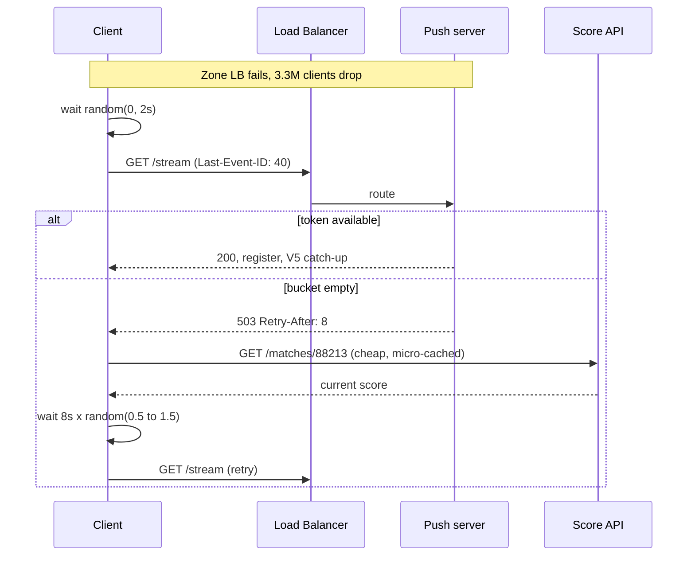

## Current State (V6)

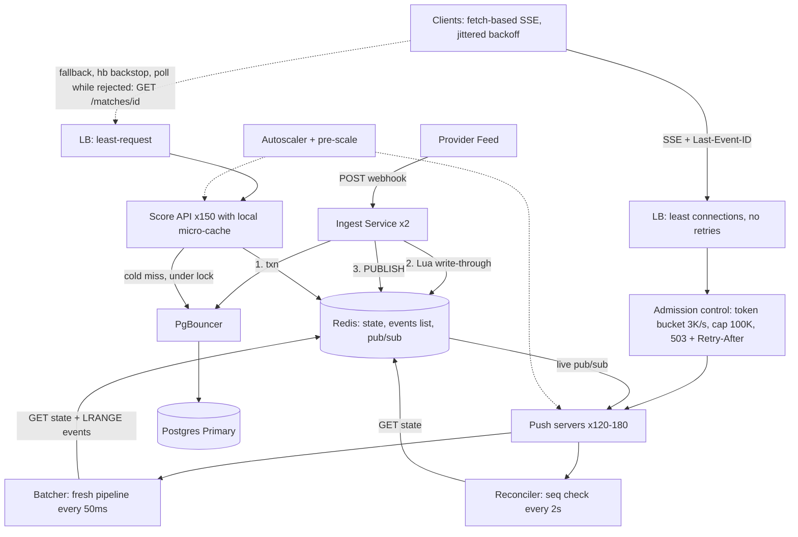

New in V6: client-side full-jitter backoff, the per-server admission gate, `Retry-After` hints, the planned-drain procedure, and LB retries turned off for streams. The admission gate is code inside each push server, drawn separately only to show where it sits in the flow.

**Every current flow:**

1. **Write path:** Unchanged. Ingest verifies, commits to Postgres, runs the Lua write-through, and publishes if the cache accepted the event.
2. **Live delivery:** Unchanged. Pub/sub reaches each subscribed push server, which writes to local connections.
3. **Connect and resume (changed):** The client connects through the LB. The push server first checks the token bucket and connection cap. If admitted, it runs the V5 path: register, subscribe, `pending`, batcher, replay or reset. If not, it returns `503` with `Retry-After`.
4. **Rejected client (new):** The client polls `GET /matches/{id}` once for a fresh score. It then waits `max(full-jitter backoff, jittered Retry-After)` and retries. The backoff counter resets only after a connection lasts 10 seconds.
5. **Planned drain (new):** On deploy, the server leaves the LB pool, then closes connections in slices over 2 minutes. Each close sends a `bye` with a random retry delay.
6. **Silent-miss repair, Redis outage, read fallback, timeline:** Unchanged from V5.

## Interview follow-ups

**Q: Why full jitter and not "equal jitter" or "decorrelated jitter"?**
Full jitter, `random(0, backoff)`, spreads clients across the whole window. That gives the lowest total number of failed attempts in the published comparisons, at the cost of some clients retrying very quickly. Those quick retries are harmless because the server gate rejects excess cheaply. Equal jitter keeps a floor of half the backoff, which leaves a visible synchronized lump.

**Q: Won't some unlucky clients be starved?**
Each retry is an independent random draw against a token bucket, so every client has the same chance each round. The backoff is capped at 30 seconds, so nobody waits long between tries. During a wait they still see fresh scores through the polling call. In practice the whole population is back in about the demand ÷ capacity time, and a long tail is rare. If tail latency mattered more, I'd add a short-lived signed "queue ticket" so earlier rejects are admitted first, but that needs shared state and I wouldn't start with it.

## Recap

| Concept | The Insight |
|---|---|
| Metastable failure | Synchronized retries keep an overloaded system overloaded after the original fault is gone. |
| Backoff alone | Exponential delays without randomness only space out the waves. Jitter breaks them up. |
| Gate on the server | A token bucket rejects excess arrivals in microseconds and says when to return, so capacity is spent on real work. |
| Jitter the hint | If everyone obeys `Retry-After: 8` exactly, you rebuild the wave. |
| Cheap degradation | A rejected client polls once through the micro-cached read path, so it sees a fresh score while it waits. |
| Drain, don't drop | Planned restarts should close connections slowly, with random delays, so deploys never look like outages. |

**Interview-arc sentence:** *"If asked how you survive a reconnect storm: fixed retries make every dropped client come back in the same second and keep the system down, so clients retry with full-jitter backoff, and each push server runs a token-bucket admission gate that returns 503 with a jittered Retry-After, so 3.3 million reconnects drain in about 9 seconds at the server's real capacity instead of collapsing it."*

**Next up:** The edge is now stable, but everything depends on one Redis node. It holds the cache, the event list, and the pub/sub doorbell for the whole system. If it dies at 89:12, there is no push, no state, and 10M clients hitting Postgres. V7 is about replication and failover.

Say "next" when you're ready.


-----------------------------------------------------------------------------------------------------------------------
-----------------------------------------------------------------------------------------------------------------------
-----------------------------------------------------------------------------------------------------------------------
-----------------------------------------------------------------------------------------------------------------------


# V7: Redis Survives Losing a Node

Redis is now doing three jobs: the cache, the recent-events list, and the pub/sub doorbell. Every flow from V2 to V6 depends on it, and today it is one node. V7 is **availability**. Postgres has the same single-node weakness, and it gets its own version next.

## Break it

It is 89:12 in the final. Saka scores, and Ingest commits seq 41 to Postgres. The Redis node's host fails at the same moment.

1. Ingest's Lua write-through fails. After 3 retries it logs an alert. The score in Redis stays at seq 40.
2. `PUBLISH` goes nowhere. All 120 push servers lose their subscriptions, so no one receives the goal.
3. Score API's local entries expire within 300 ms. They get 5 seconds of grace (V3), and then every poll returns `503`.
4. The V5 reconciler and batcher fail on every call.

Nobody sees 2-1. Within 5 seconds, people who poll see errors instead.

Recovery by hand looks like this:
- An alert fires after about 30 seconds.
- An engineer restarts the node, or the scheduler reschedules it. That takes 1-3 minutes.
- The new node comes up **empty**, because the cache was in memory.
- Matches with no new event have no `match:{id}:state` key until someone repopulates it.

That is 2-3 minutes of a frozen score for 10M viewers, caused by one machine.

The data volume is not the issue. Everything live in Redis is a few MB, and Postgres has the truth. We are protecting **uptime**, not data.

## Teaching it: what replication is for

Think of a understudy standing in the wings who watches every performance. If the lead collapses, the understudy walks on within seconds. That only works if the understudy has seen the show up to the last minute, and if someone decides when to send them on.

That gives us three questions:
1. How does the replica stay current? That is replication.
2. Who notices the primary is dead and promotes the replica? That is failover.
3. How do clients find the new primary? That is discovery.

**Are read replicas justified here?** No. Reads from Redis are about 500 per second from the micro-caches, plus about 4K per second from the reconcilers. A single node does 100K. We want replicas only as standbys.

## Candidate approaches

| Option | What it optimizes | What it breaks |
|---|---|---|
| Single node, restart and rewarm | Zero extra cost | 2-3 minutes of outage, human in the loop |
| Primary + replicas + Sentinel | Automatic failover in about 10 seconds | You run 3 more processes, and failover can lose the last few writes |
| Managed multi-AZ (ElastiCache and similar) | No ops | Failover often takes tens of seconds, which is a longer freeze |
| Redis Cluster with replicas | Sharding and failover in one | Solves sharding, which we don't need (data is MBs) |

**Decision:** one primary and two replicas across three availability zones, with three Sentinel processes for failure detection. A managed equivalent is a fine choice in practice, but I would verify its failover time against our freeze budget.

## Known sub-problems, enumerated

**Sub-problem 1: replication is async, so failover can lose the last write.**
The primary acknowledges `SET` before the replica has it. If it dies in that gap, the new primary lacks seq 41.

Three fixes:
1. **Synchronous replication with `WAIT`.** Ingest runs `WAIT 1 50` after the Lua call. It blocks until one replica acknowledges. This adds about 1 ms but does not strictly guarantee no loss.
2. **Accept the loss and repair from the truth.** Postgres has seq 41. After failover, a rewarmer rewrites Redis from Postgres.
3. **Move to a durable log (Kafka).** This is a much bigger change.

**Pick: #2.** Redis is a cache. Postgres is the truth. Repair is cheap, because there are only a few hundred live matches.

**Sub-problem 2: split-brain.**
A network partition cuts the old primary off from Sentinels but not from Ingest. Sentinels promote a replica. Now two primaries accept writes.

Three fixes:
1. **Quorum for promotion.** Promotion needs a majority of Sentinels (2 of 3).
2. **Fencing with `min-replicas-to-write`.** An isolated primary with no replicas refuses writes.
3. **A lease or epoch in clients.** Heavier than we need.

**Pick: #1 and #2.** Together they are cheap.

## Solve it

- ✅ **What we gained:**
  - Automatic failover in about 10 seconds, not 2-3 minutes.
  - A warm standby: the replica already holds the data.
  - The rewarmer turns even a total loss of Redis into a one-minute repair.
- ⚠️ **What we gave up:**
  - The last write may be lost in a failover, so a repair job is now required.
  - Three Sentinels plus two replicas add components, and Sentinel config is a classic source of mistakes.
  - Failover takes about 10 seconds, which exceeds V3's 5-second stale grace, so we must lengthen it.
  - `min-replicas-to-write` means losing both replicas makes the primary refuse writes.
- ❌ **Rejected:**
  - Restart and rewarm only: 2-3 minutes frozen.
  - Redis Cluster: it fixes sharding, which we don't need.
  - Fully synchronous replication for every write: the extra latency buys little, because Postgres already holds the truth.
  - Kafka as the primary delivery path: too heavy a change for a cache-availability problem.

## Implement it

**Technology note.** Redis keeps its replication stream in memory (a replication backlog), so replicas sync in under a second at our data size. Sentinel is a separate small process that watches Redis.

**Topology and config:**

```
Primary  (AZ-a)  --async-->  Replica 1 (AZ-b)
                 --async-->  Replica 2 (AZ-c)
Sentinel x3 (one per AZ)
```

```conf
# redis.conf (on the primary; replicas use: replicaof <primary> 6379)
min-replicas-to-write 1
min-replicas-max-lag 10
repl-backlog-size 64mb

# sentinel.conf
sentinel monitor scores redis-a 6379 2
sentinel down-after-milliseconds scores 5000
sentinel failover-timeout scores 10000
sentinel parallel-syncs scores 1
```

`quorum 2` means two Sentinels must agree the primary is down. `down-after-milliseconds 5000` means a node that doesn't answer for 5 seconds is considered down.

**Failover timeline:**
- 0s: the primary dies.
- 5s: Sentinels mark it down.
- 6-7s: they elect a leader Sentinel and promote the most up-to-date replica.
- 7-10s: clients learn the new address and reconnect.

**Discovery.** All clients (Ingest, Score API, push servers) ask Sentinel for the current primary. When a connection breaks, they ask again.

```python
sentinel = Sentinel([("s-a", 26379), ("s-b", 26379), ("s-c", 26379)])
redis = sentinel.master_for("scores", socket_timeout=0.2)
```

**Rule changes during the failover window (about 10s):**

1. **Score API grace.** In V3, `GRACE = 5.0` served stale entries for 5 seconds before returning `503`. We raise it to 30 seconds. A slightly old score is better than an error.
2. **Ingest retries.** The Postgres commit has already succeeded, so Ingest returns `200` to the provider. The failed Redis write goes into a bounded retry loop with jittered backoff for up to 30 seconds. The Lua script is idempotent because of its `seq` guard.

```python
async def write_through_with_retry(match_id, state, event):
    deadline = time.monotonic() + 30
    delay = 0.1
    while time.monotonic() < deadline:
        try:
            if await redis.eval(LUA, 2, state_key, events_key, state, state.seq, event):
                await redis.publish(f"match:{match_id}", state)
            return
        except RedisError:
            await asyncio.sleep(random.uniform(0, delay))
            delay = min(delay * 2, 2)
    alert("write-through gave up; rewarmer will repair")
```

3. **Push servers.** The V5 path already handles this. When a Redis connection drops, the server resubscribes through Sentinel and queues all local connections for catch-up. The reconciler then notices that Redis is ahead of `latest_seq` once Ingest's retry lands, and resyncs.

**New: the rewarmer.** It repairs Redis from Postgres after a failover, covering the lost-write case and the empty-node case.

**Trigger:** a Sentinel `+switch-master` event. A leader-elected instance of Ingest subscribes to Sentinel's event channel.

**Steps:**
1. Read live matches from Postgres, using the primary through PgBouncer:
   ```sql
   SELECT * FROM matches WHERE status = 'live';
   ```
2. For each match, read its last 20 events:
   ```sql
   SELECT seq, type, payload FROM match_events
   WHERE match_id = $1 ORDER BY seq DESC LIMIT 20;
   ```
3. Write each match to Redis through the **same Lua script** Ingest uses. The `seq` guard means the rewarmer cannot overwrite anything newer that Ingest has already written.
4. Pipeline the writes. A few hundred matches take well under a second.

The guard works in both directions. If Redis already has seq 42, the rewarmer's seq 41 is ignored.

**One V5 bug to fix.** The batcher assumes `state_raw` exists. On an empty Redis it is `None`, and `json.loads(None)` crashes. The fix is a fallback to the V2 cold-miss path:

```python
state_raw, ev_raw = await pipe.execute()
if state_raw is None:                         # cold or freshly failed-over Redis
    state = await get_state_from_postgres_with_lock(match_id)   # V2 path
    ev_raw = []
```

**Who writes and who reads:**

| Structure | Who writes | When | Who reads | When |
|---|---|---|---|---|
| Replication stream | Redis primary | Every write | Redis replicas | Continuously |
| Sentinel state | Sentinels | On failure detection and election | All Redis clients | On connect and on connection error |
| `match:{id}:state`, `match:{id}:events` | Ingest Service (normal) | After each commit | Push servers, Score API | As before |
| `match:{id}:state`, `match:{id}:events` | Rewarmer (new) | After a failover | Same readers | Same |

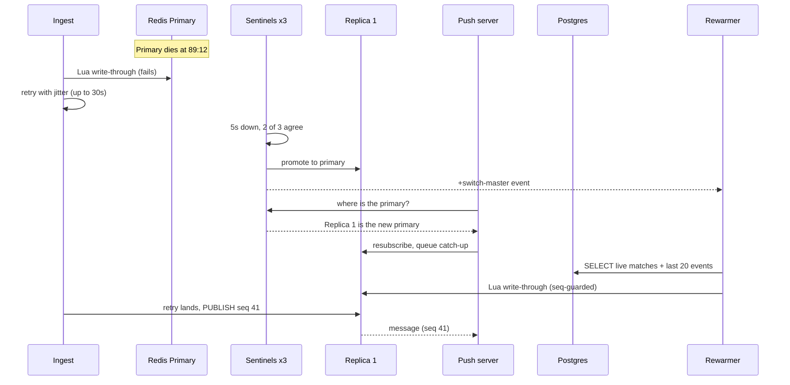

## Current State (V7)

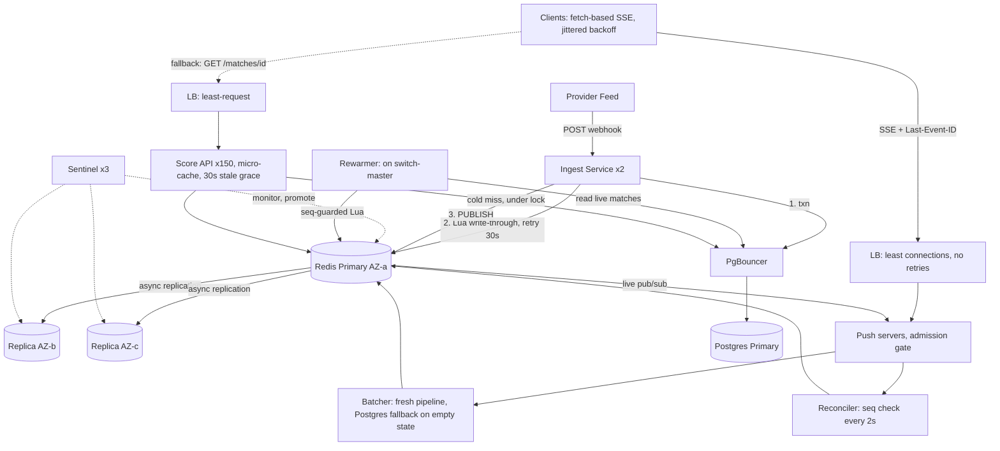

New in V7: two Redis replicas, Sentinels, the rewarmer, Ingest's retry loop, the 30-second stale grace, and the batcher fallback. All clients find Redis through Sentinel.

**Every current flow:**

1. **Write path (changed):** Ingest commits to Postgres, then runs the Lua write-through against the current primary. If Redis fails, it retries for up to 30 seconds. On success it publishes. Replicas follow asynchronously.
2. **Live delivery:** Unchanged in normal operation. Pub/sub reaches each push server.
3. **Connect and resume:** As V6. If Redis has no state for a match, the batcher falls back to the Postgres cold-miss path.
4. **Failover (new):** Sentinels detect the failure in about 5 seconds and promote a replica. Clients rediscover it. Push servers resubscribe and queue catch-up. The rewarmer repairs Redis from Postgres.
5. **During the freeze (new):** Score API serves stale local entries for up to 30 seconds. Existing SSE sockets stay open. No new pushes arrive until failover completes.
6. **Silent-miss repair, reject and backoff, planned drain, read fallback:** Unchanged.

## Interview follow-ups

**Q: Replication is async. Isn't losing a write unacceptable for a score?**
The write isn't lost for good. Postgres committed it first, and Redis is only a cache of that truth. After failover, the rewarmer rewrites the live matches from Postgres through the same seq-guarded script. The cost is a short window where the cache is behind. I'd use `WAIT` only if that window were unacceptable.

**Q: How do you prevent two primaries after a partition?**
Promotion needs a quorum of Sentinels, so a minority partition can't elect anyone. The old primary also has `min-replicas-to-write 1`, so once it is cut off from its replicas it refuses writes. Any write that slips through is in Postgres anyway, so the rewarmer corrects it.

## Recap

| Concept | The Insight |
|---|---|
| Replicas for availability | Reads here are tiny, so replicas exist as standbys, not for read capacity. |
| Sentinel quorum | Failure detection needs a majority, so one confused observer can't trigger a promotion. |
| Async replication | Failover can lose the last write, so it needs a repair path rather than a stronger guarantee. |
| Rewarmer | Because Postgres is the truth, a seq-guarded rewrite from it makes cache loss harmless. |
| Freeze budget | Failover takes about 10 seconds, so the stale-serve grace must be longer than that. |

**Interview-arc sentence:** *"If asked how you make Redis highly available: a single node freezes 10M viewers for minutes, so I run a primary with two cross-AZ replicas under Sentinel quorum for failover in about 10 seconds, accept that async replication can lose the last write, and repair it from Postgres with a sequence-guarded rewarm, since the cache is never the source of truth."*

**Next up:** Redis is now resilient, but Postgres, the source of truth, is still one node in one AZ. If it dies, Ingest can't commit, new events are rejected, and the rewarmer has nothing to rewarm from. V8 is Postgres replication and failover, where the cost of losing a write is much higher.

Say "next" when you're ready.


-----------------------------------------------------------------------------------------------------------------------
-----------------------------------------------------------------------------------------------------------------------
-----------------------------------------------------------------------------------------------------------------------
-----------------------------------------------------------------------------------------------------------------------


# V8: Postgres Survives Losing a Node

Postgres is the source of truth, and it is still one node in one AZ. V8 is **replication and failover for Postgres**. It is the same family of problem as V7, but the stakes are different. Redis could lose a write because Postgres could repair it. Nothing can repair a lost Postgres write.

## Break it

It is 89:12 in the final. The Postgres primary's host dies one second after it committed seq 41.

1. Ingest had committed seq 41, then written it to Redis and published it. The goal reached viewers.
2. Ingest returned `200` to the provider, so the provider considers seq 41 delivered and will never resend it.
3. We restore from the last backup or promote an async replica. Neither has seq 41. The replica was 800 ms behind.

The goal that 10M people saw is **gone from the source of truth**. Redis may hold seq 41 while Postgres does not. The rewarmer, which trusts Postgres, would then overwrite the cache with seq 40 and show 1-1 to everyone.

Seq 42 arrives later with the absolute score 2-1, so the score self-heals. But the `match_events` timeline has a hole, and the `last_seq` guard in Postgres now behaves oddly around the gap.

There is a second cost. While we restore by hand (10-15 minutes), every provider webhook fails. Redis keeps serving seq 40, and the match looks frozen.

There is also a latent bug from V2. The Lua script sets `EX 30` on every state write. A quiet match's key expires 30 seconds after its last event. Normally that causes a harmless cold miss. During a Postgres outage, the cold-miss path hits a dead database, and Score API returns errors for any match that has gone quiet.

## Teaching it: what the replica must guarantee

Think of a notary who keeps a second copy of every signed document. If the notary only mails the copy later (async), a fire in the office can destroy documents that clients were already told were safe. If the notary waits for the copy to be filed before saying "done" (sync), nothing that was confirmed can be lost. The price is waiting for the filing.

Is that price acceptable here? Writes are about 1 to 3 per second across all matches. Waiting for a cross-AZ acknowledgement adds roughly 1-2 ms to a commit. At our write rate that cost is invisible.

**Are read replicas justified?** No. Postgres reads are cold misses, the rewarmer, and the timeline fallback. That is well under 100 per second. The replicas here are standbys for safety, not for read capacity.

**Is sharding justified?** No. One write per second and a few MB of live data fit on one node many times over. Sharding would add a coordination problem to solve a load problem we don't have.

## Candidate approaches

| Option | What it optimizes | What it breaks |
|---|---|---|
| Async replica, manual promotion | Lowest commit latency | Loses acknowledged writes, and a human decides |
| Sync to every standby | Zero loss | Any standby failure blocks all commits |
| Sync to any 1 of 2 standbys (quorum) | Zero loss, survives one standby failing | Commit waits for the faster of two acknowledgements |
| Managed multi-AZ (RDS and similar) | No ops | Failover time and tuning are out of our hands, so we verify against our budget |

**Decision:** one primary and two standbys in three AZs. Commits wait for **any one** standby to confirm. A cluster manager (Patroni with etcd) detects failure and promotes.

## Known sub-problems, enumerated

**Sub-problem 1: which standby do we promote?**
Promoting the wrong one loses data.
1. **Promote the first to answer.** Fast, and may pick the lagging one.
2. **Promote the standby with the highest WAL position.** The cluster manager compares positions.
3. **Only promote standbys known to be in the sync set.** Combined with #2, this guarantees the candidate holds every acknowledged commit.

**Pick: #2 and #3.** With quorum sync, at least one standby holds every acknowledged commit, and the manager picks the one that is furthest ahead.

**Sub-problem 2: split-brain.**
A partition leaves the old primary alive but cut off. It keeps accepting writes while a standby is promoted.
1. **Leader key with a TTL in a consensus store (etcd).** The primary must keep renewing the key. If it can't, it demotes itself.
2. **Fencing the old node.** Cut its network or power from outside.
3. **Sync replication as a backstop.** An isolated primary can't get a standby acknowledgement, so its commits block and never return success.

**Pick: #1 and #3.** The leader key forces self-demotion, and quorum sync means an isolated primary can't acknowledge anything. #2 needs infrastructure access we don't want to depend on.

**Sub-problem 3: how do clients find the new primary?**
1. **DNS update.** TTLs make it slow.
2. **Client-side discovery** (like Sentinel in V7). Every client library needs support.
3. **A proxy that health-checks for "who is primary."** The clients keep one stable address.

**Pick: #3.** HAProxy checks Patroni's REST endpoint, and PgBouncer points at HAProxy.

## Solve it

- ✅ **What we gained:**
  - Zero loss of acknowledged commits. If Ingest returned `200`, seq 41 exists on at least two nodes.
  - Automatic failover in about 20 seconds, with no human.
  - The cache can never be ahead of the database, which was the V7 rewarmer's hidden hazard.
- ⚠️ **What we gave up:**
  - Every commit waits one cross-AZ round trip, about 1-2 ms.
  - If both standbys are down, commits block. The primary is alive but can't acknowledge writes. This is deliberate, but someone must decide whether to relax it.
  - The failover window is about 20 seconds, during which Ingest cannot commit.
  - We operate etcd (3 nodes), Patroni on each database node, and HAProxy. Misconfiguring any of them is a classic outage.
- ❌ **Rejected:**
  - Async replication: it loses acknowledged writes, which here means a goal we told 10M people about.
  - Sync to all standbys: one standby failure would stop all scoring.
  - Manual promotion: 10-15 minutes of frozen scores.
  - Multi-region synchronous replication: tens of milliseconds per commit, and that belongs to the multi-region version.

## Implement it

**Topology:**

```
Primary  (AZ-a) --sync-->  Standby 1 (AZ-b)
                 --sync-->  Standby 2 (AZ-c)     (commit waits for ANY 1 of these 2)
etcd x3 (one per AZ)    Patroni agent on every DB node
HAProxy x2  ->  PgBouncer  ->  Postgres
```

**Postgres config:**

```conf
synchronous_commit = on
synchronous_standby_names = 'ANY 1 (standby_b, standby_c)'
wal_level = replica
max_wal_senders = 5
wal_keep_size = 2GB
```

`ANY 1` is quorum commit. It returns success once any one listed standby has flushed the WAL record to disk.

**Patroni config (failover behavior):**

```yaml
ttl: 20                 # leader key lifetime in etcd
loop_wait: 5            # how often each node checks
retry_timeout: 5
maximum_lag_on_failover: 0     # never promote a standby that is behind
synchronous_mode: true
synchronous_mode_strict: true  # refuse to fall back to async automatically
```

`synchronous_mode_strict: true` is the deliberate stall. If no standby is available, writes block. They do not silently become async.

**Discovery:**

```conf
# haproxy.cfg
backend postgres_primary
  option httpchk GET /primary          # Patroni returns 200 only on the leader
  http-check expect status 200
  default-server inter 2s fall 2 rise 1
  server db-a db-a:5432 check port 8008
  server db-b db-b:5432 check port 8008
  server db-c db-c:5432 check port 8008
```

PgBouncer's `host` is the HAProxy address. After a promotion, HAProxy sees `/primary` flip from one node to another within about 4 seconds and routes there. PgBouncer's server connections to the old primary break and are replaced.

**Failover timeline:**
- 0s: the primary dies, so the leader key stops being renewed.
- 20s: the key expires in etcd. Standbys compare WAL positions and the furthest-ahead one acquires the key.
- 21-23s: it promotes itself.
- 25s: HAProxy marks it healthy and routes writes there.

**Ingest during the window.** We do not acknowledge what we could not commit.

```python
async def handle_webhook(req):
    ev = verify_and_parse(req)
    try:
        committed = await commit_event(ev)           # V0 transaction, via PgBouncer
    except (OperationalError, TimeoutError):
        return Response(503, headers={"Retry-After": "5"})   # provider will retry
    ...  # V7 write-through with retry
    return Response(200)
```

The `(match_id, seq)` constraint from V0 makes every provider retry safe. We assume the provider retries for several minutes, which we'd confirm with them. If it can't, we'd need a periodic backfill against the provider's REST API. That is a separate gap-detection concern, and I'm noting it rather than building it here.

**Two fixes that fall out of the failure.**

1. **Cache TTL (correcting V2).** The Lua script's `EX 30` made quiet-match keys expire, and a cold miss during a Postgres outage fails. We change it:

```lua
redis.call('SET', KEYS[1], ARGV[1], 'EX', 21600)   -- was 30. 6h for live matches
```

The 30-second TTL was meant as a safety net against a lost write-through. The V5 reconciler and V7 rewarmer now cover that case, so it is no longer needed.

2. **Rewarmer ordering.** The V7 rewarmer reads Postgres. With sync replication, Postgres always holds everything Redis holds, so the rewarmer can never roll the cache back. We add one more guard: after a Postgres failover, the rewarmer waits until `pg_is_in_recovery()` returns `false`, so it never reads from a standby that is still catching up.

**Who writes and who reads:**

| Structure | Who writes | When | Who reads | When |
|---|---|---|---|---|
| WAL stream | Postgres primary | Every commit | Standbys | Continuously |
| Leader key in etcd | Patroni on the primary | Every 5s (renewal) | Patroni on standbys, HAProxy via the REST check | Every 5s and every 2s |
| `matches`, `match_events` | Ingest Service | Each webhook | Score API (cold miss), rewarmer, batcher fallback | As before |
| Sync ack | Standby | Before each commit returns | Primary | Each commit |

```mermaid
sequenceDiagram
    participant P as Provider
    participant I as Ingest
    participant PG1 as Postgres Primary (AZ-a)
    participant S2 as Standby (AZ-b)
    participant E as etcd x3
    participant H as HAProxy

    I->>PG1: INSERT event, UPDATE matches, COMMIT
    PG1->>S2: WAL record
    S2-->>PG1: flushed (ack)
    PG1-->>I: committed
    I-->>P: 200
    Note over PG1: Primary dies
    P->>I: webhook seq 42
    I->>PG1: COMMIT (fails)
    I-->>P: 503 Retry-After 5
    E->>E: leader key expires (20s)
    S2->>E: acquire leader key (highest WAL)
    S2->>S2: promote
    H->>S2: GET /primary returns 200
    P->>I: retry seq 42
    I->>S2: COMMIT (succeeds)
    I-->>P: 200
```

## Current State (V8)

```mermaid
graph TD
    P[Provider Feed] -->|POST webhook| I[Ingest Service x2]
    I -->|1. txn, 503 on failure| PB[PgBouncer]
    PB --> HA[HAProxy: routes to Patroni leader]
    HA --> DB[(Postgres Primary AZ-a)]
    DB -->|sync, ANY 1| S1[(Standby AZ-b)]
    DB -->|sync, ANY 1| S2[(Standby AZ-c)]
    PT[Patroni on each DB node] -.-> ET[etcd x3: leader key]
    HA -.->|GET /primary| PT
    I -->|2. Lua write-through, retry 30s, TTL 6h| R[(Redis Primary AZ-a)]
    I -->|3. PUBLISH| R
    R -->|async| R1[(Redis Replica AZ-b)]
    R -->|async| R2[(Redis Replica AZ-c)]
    SE[Sentinel x3] -.-> R
    RW[Rewarmer: waits for pg primary ready] --> PB
    RW --> R
    C[Clients: fetch SSE, jittered backoff] -->|SSE + Last-Event-ID| LB2[LB: least connections, no retries]
    LB2 --> G[Push servers, admission gate]
    R -->|live pub/sub| G
    G --> B[Batcher + Postgres fallback]
    G --> RC[Reconciler every 2s]
    B --> R
    RC --> R
    C -.->|fallback: GET /matches/id| LB[LB: least-request]
    LB --> A[Score API x150, micro-cache, 30s grace]
    A --> R
    A -->|cold miss, under lock| PB
```

New in V8: two synchronous standbys, Patroni with etcd, HAProxy for primary discovery, `503` from Ingest during failover, and the Redis TTL fix.

**Every current flow:**

1. **Write path (changed):** Ingest verifies the signature and commits through PgBouncer and HAProxy. The commit returns only after one standby has flushed it. Then it runs the Lua write-through, with a 6-hour TTL, and publishes. If the commit fails, Ingest returns `503` and the provider retries.
2. **Live delivery:** Unchanged. Pub/sub to push servers to SSE sockets.
3. **Connect and resume:** Unchanged from V6 and V7.
4. **Postgres failover (new):** The leader key expires after 20 seconds. The standby with the highest WAL position promotes itself. HAProxy re-routes, PgBouncer reconnects, and the provider's retries land.
5. **During the Postgres freeze (new):** Viewers keep their sockets and see the last score. Score API serves from Redis. Only new events are delayed, by about 25 seconds.
6. **Redis failover, silent-miss repair, reject and backoff, planned drain, read fallback:** Unchanged.

## Interview follow-ups

**Q: Synchronous replication hurts latency and availability. Why accept that?**
The latency is invisible here. We write 1-3 events per second, so an extra 1-2 ms per commit is nothing. For availability, I use quorum (`ANY 1 of 2`), so one standby failure does not stop commits. Asynchronous replication would lose a goal after we told the provider it was safe, and the provider will never resend it.

**Q: Why not Postgres sharding or read replicas to scale?**
Neither problem exists. Writes are about 1 per second, the live data is a few MB, and reads are almost entirely absorbed by Redis and the micro-cache. I'd shard only if total write volume or data size outgrew one node. Adding it now would buy coordination cost with no benefit.

## Recap

| Concept | The Insight |
|---|---|
| Cost of loss | Redis can lose a write because Postgres repairs it. Postgres can't, so it needs a stronger guarantee. |
| Quorum sync | `ANY 1 of 2` standbys means no acknowledged commit is lost, and one standby can fail without blocking writes. |
| Promotion rule | Promote the standby with the highest WAL position, and never one that is behind. |
| Split-brain defense | A leader key with a TTL forces the old primary to demote itself, and sync commit stops it from acknowledging anything while isolated. |
| Fail closed | The provider is retried with `503` rather than acknowledged, because the `(match_id, seq)` key makes retries safe. |
| TTL correction | A 30-second cache TTL turns a database outage into errors for quiet matches, so live keys must outlive the outage. |

**Interview-arc sentence:** *"If asked how you make the source of truth highly available: async replication would lose a goal we already acknowledged to the provider, so I use quorum synchronous commit to two cross-AZ standbys, let Patroni promote the furthest-ahead one through a leader key in etcd, and return 503 to the provider during the roughly 20-second failover, because the (match_id, seq) key makes its retries safe."*

**Next up:** Everything now lives in one region. A viewer in Sydney crosses an ocean for every connect, and a regional failure takes down the whole world's scores. V9 is multi-region delivery: who owns writes, what gets replicated, and whether a CDN earns a place for the polling fallback.

Say "next" when you're ready.


-----------------------------------------------------------------------------------------------------------------------
-----------------------------------------------------------------------------------------------------------------------
-----------------------------------------------------------------------------------------------------------------------
-----------------------------------------------------------------------------------------------------------------------


# V9: Multi-Region Delivery

I'm splitting the V8 teaser. V9 is **multi-region**: where users connect, who owns writes, and what crosses the ocean. Whether a CDN earns a place for the polling fallback is a different mechanism, so it becomes V10.

## Break it

Meera is in Sydney, and she opens the final. Everything we built lives in London (eu-west).

1. The round trip to London is about 270 ms.
2. Connecting costs a TCP handshake, a TLS handshake, and the HTTP request, which is 3 round trips. Her first byte arrives after about 800 ms. From a Singapore region it would be about 285 ms.
3. After connecting, a push crosses the ocean one way (about 135 ms). That is fine.

Latency is only the mild problem. The real one is blast radius.

- The whole world connects to one region. If London loses power at 89:12, all 10M viewers lose their sockets at once.
- Their reconnects have nowhere to go. V6's gate protects a surviving fleet, but there is no surviving fleet.
- Scores go dark worldwide until London returns, or someone rebuilds the stack elsewhere by hand.

V6 survived a zone failure of 3.3M. A region failure is 10M with no other home.

## Teaching it: one editor, many printing presses

Think of a newspaper with one editor and printing presses in many cities. The editor decides what the front page says. The page is wired to every press, and readers collect copies from their local press.

If the editor's building burns, a deputy takes over. The deputy must be sure the editor has really stopped, or two editors will print two different front pages. That is split-brain across regions.

Our data fits this shape well. Scores come from one provider, in one order, as `seq`. That is a single writer by nature. Writes are 1 to 3 per second, so the write path is nowhere near a bottleneck. Delivery is where the load is, and delivery can be local.

## Candidate approaches

| Option | What it optimizes | What it breaks |
|---|---|---|
| One region, bigger | Simplicity | Latency for far users, and total outage on regional failure |
| Active-passive: whole stack in a second region, idle | Survives a region loss | Cold standby takes minutes to warm. Far users still pay the latency |
| **Single write region + delivery in every region** | Local reads and local sockets, cheap writes, region loss is survivable | Cross-region replication and a failover procedure |
| Multi-master Postgres, every region writes | Local writes | Conflict resolution, for a problem we don't have, since the provider already gives one total order |
| Per-match home region | Spreads write ownership | Every event must be routed to its owner. There is a directory lookup, and it solves a load problem we don't have |

**Decision:** one write region (eu-west) and three delivery regions: eu-west, us-east, ap-southeast. Each delivery region runs its own push servers, Score API, and Redis (primary and two replicas under Sentinel, as in V7). Only eu-west runs Postgres as primary and the Ingest Service. An async DR standby of Postgres sits in ap-southeast.

**Capacity decision.** Each region must be able to hold 60% of the world, about 6M viewers, so that losing any one region still fits. At 83K connections per server, that is about 75 push servers per region, 225 in total. That is roughly 1.9x the 120 from V6. We pre-scale for big matches and shrink on ordinary days.

## Known sub-problems, enumerated

**Sub-problem 1: cross-region failover can lose the last write.**
Replication to the DR standby is async. Synchronous would add 130 to 270 ms to every commit, which is invisible at 1 to 3 writes per second. The real cost is that a cross-region partition would block every commit.

Three fixes:
1. **Synchronous cross-region commit.** Zero loss, but a partition between regions freezes all scoring.
2. **Backfill from the provider.** After promotion, fetch every event with `seq` above our latest from the provider's replay API.
3. **Recover from remote Redis.** The delivery regions already hold the last 20 events per match, written by the replicator. Copy them back into Postgres.

**Pick: #2, with #3 as the fallback.** Delivery regions are usually ahead of the DR standby by a few hundred milliseconds, so they hold exactly the tail that was lost. This assumes the provider offers replay by `seq`, which I'd confirm in the clarifying round.

**Sub-problem 2: two write regions after a partition.**
The old home is alive but cut off from the world. Its sync standbys are in the same region, so it still commits happily.

Three fixes:
1. **Human-approved promotion.** Slow and error-prone at 3 a.m.
2. **A cross-region lease.** The home primary must renew a lease every 10 seconds. If it can't, it demotes itself. The DR region may take the lease only after it expires.
3. **Epoch fencing on every commit.** Strong, but it adds a cross-region read to every write.

**Pick: #2.** The lease expires in 30 seconds, and the home primary self-demotes after about 20 seconds without renewal. The 10-second gap guarantees the old node has stopped before the new one starts.

## Solve it

- ✅ **What we gained:**
  - Every user connects to a nearby region: about 285 ms to first byte instead of 800 ms.
  - A region loss no longer takes down the world. The other regions keep serving their viewers without interruption.
  - Remote regions keep serving the last known score even while the home region is down.
- ⚠️ **What we gave up:**
  - Replication lag: a goal reaches remote regions 150 to 300 ms after commit.
  - About 1.9x push-server capacity.
  - Cross-region failover loses the tail until backfill completes, and the lease and witness are new pieces to get right.
  - Remote cold misses cost a cross-region call.
  - Three Redis stacks to operate instead of one.
- ❌ **Rejected:**
  - Multi-master writes: no conflicts exist to resolve.
  - Per-match ownership: it is a directory lookup that buys nothing at 1 to 3 writes per second.
  - Synchronous cross-region commit: a partition would freeze scoring everywhere.
  - Cold standby region: minutes to warm, and no latency benefit.

## Implement it

**Schema delta.** The replicator needs the absolute state with each event. We add one column and have Ingest fill it:

```sql
ALTER TABLE match_events ADD COLUMN state JSONB NOT NULL DEFAULT '{}';
-- Ingest writes the full {"hs":2,"as":1,"clock":"89:12","seq":41,...} on every insert
CREATE PUBLICATION match_events_pub FOR TABLE match_events (INSERT only);
```

**Routing (latency-based DNS with health checks):**

```
scores.example.com          latency-based -> eu-west LB | us-east LB | ap-southeast LB
stream.scores.example.com   latency-based, same three, health check /readyz, TTL 30s
hooks.scores.example.com    failover: primary eu-west, secondary ap-southeast, TTL 30s
```

A region that fails its health check drops out of DNS. New connections go to the next-nearest region. We chose DNS routing over anycast because it is simple and the V6 gate absorbs the shift. The cost is the 30-second TTL.

**The replicator.** It is a new process in eu-west, one per remote region. It reads a logical replication slot and applies each event to the remote Redis with the same Lua script that Ingest uses.

```python
async def replicate(region):
    conn = await pg_logical_connect(slot=f"repl_{region}", publication="match_events_pub")
    async for msg in conn.stream():                      # one INSERT per event, in commit order
        ev = decode(msg)                                 # match_id, seq, type, state
        r = remote[region]
        if await r.eval(LUA, 2, f"match:{ev.match_id}:state", f"match:{ev.match_id}:events",
                        ev.state_json, ev.seq, ev.event_json):
            await r.publish(f"match:{ev.match_id}", ev.state_json)   # V4 doorbell, now regional
        await conn.confirm(msg.lsn)                      # slot advances only after the remote write
```

- Retries with jittered backoff if the remote Redis is down. It does not confirm until the write lands.
- The Lua `seq` guard from V2 makes every apply idempotent. A duplicate returns `0` and publishes nothing.
- A stuck slot would make Postgres keep WAL forever, so we set `max_slot_wal_keep_size = 5GB`. If the slot is invalidated, the remote region does a full rewarm from the home API.

**Remote cold miss.** In a non-home region there is no local Postgres. The V2 lock path now calls home instead:

```python
async def load_state(match_id):                          # same Redis lock as V2
    r = await http.get(f"https://home.internal/matches/{match_id}", timeout=1.0)
    return r.json()                                      # V8 Postgres path serves it in eu-west
```

The V5 batcher fallback uses the same function. It is rare, since the replicator keeps keys warm and TTLs are 6 hours.

**Failover of the write region, steps:**

1. The home primary stops renewing the cross-region lease. At about 20 seconds without renewal, it self-demotes via Patroni.
2. At 30 seconds the lease expires. A witness check confirms that 2 of 3 regions can't reach eu-west.
3. ap-southeast takes the lease and promotes its DR standby.
4. DNS for `hooks.scores.example.com` flips to ap-southeast. The provider's retries (`503` with `Retry-After`, from V8) land there.
5. The backfill job runs before Ingest accepts new events:
   ```sql
   SELECT max(seq) FROM match_events WHERE match_id = $1;   -- per live match
   ```
   Then it calls the provider's replay API for `seq` above that value, and inserts through the normal Ingest path. If the provider can't replay, the job copies the last 20 events from the local Redis list. Those events came from the replicator, so the delivery region holds them.
6. The V7 rewarmer runs against the new primary. Its Lua guard rejects any `seq` older than Redis, so it cannot roll a cache back.
7. The old home region is rebuilt as a standby when it returns.

**What viewers see.** In regions that stayed up, nothing breaks. Sockets stay open, reads are local, and only new events are delayed by about 1 to 3 minutes. Viewers in the dead region reconnect to the nearest survivor, and the V6 gate paces them.

**Who writes and who reads:**

| Structure | Who writes | When | Who reads | When |
|---|---|---|---|---|
| Postgres (eu-west primary) | Ingest Service | Each webhook | Replicator (via slot), home API, rewarmer | Continuously, on remote cold miss, after failover |
| DR standby (ap-southeast) | Postgres replication | Continuously, async | Promotion and backfill | Only on region failover |
| Remote Redis (per region) | Replicator | After each event | Push servers, Score API, reconciler | As in V5 and V7 |
| Cross-region lease | Home primary's Patroni | Every 10s | DR region's witness | Every 10s |

```mermaid
sequenceDiagram
    participant I as Ingest (eu-west)
    participant PG as Postgres (eu-west)
    participant RP as Replicator
    participant RR as Redis (ap-southeast)
    participant G as Push server (ap-southeast)
    participant M as Meera (Sydney)

    I->>PG: COMMIT event seq 41 (sync standby ack)
    PG-->>RP: logical stream (INSERT seq 41)
    RP->>RR: Lua apply (seq-guarded) + PUBLISH
    RR-->>G: message seq 41
    G-->>M: event id 41
    RP->>PG: confirm LSN
```

End-to-end budget for a goal in Sydney: commit and sync ack (~2 ms), logical decoding (~30 ms), one-way trip to Singapore (~100 ms), Redis and push (~20 ms), mobile last mile (~100 ms). That is about 250 to 300 ms, well inside 2 seconds.

## Current State (V9)

```mermaid
graph TD
    P[Provider Feed] -->|hooks.scores.example.com| I
    subgraph HOME["eu-west: write region"]
        I[Ingest x2] -->|txn, 503 on failure| PB[PgBouncer + HAProxy]
        PB --> DB[(Postgres Primary)]
        DB -->|sync ANY 1| S1[(Standby AZ-b)]
        DB -->|sync ANY 1| S2[(Standby AZ-c)]
        PT[Patroni + etcd, global lease] -.-> DB
        I -->|Lua + PUBLISH, retry| RH[(Redis eu-west + replicas + Sentinel)]
        DB -->|logical slot per region| RP[Replicators]
        RW[Rewarmer + backfill] --> PB
        RW --> RH
        RH --> GH[Push servers x75, gate]
        AH[Score API x75, micro-cache] --> RH
    end
    DB -.->|async physical| DR[(DR standby ap-southeast)]
    RP -->|Lua + PUBLISH over WAN| RU[(Redis us-east + replicas)]
    RP -->|Lua + PUBLISH over WAN| RA[(Redis ap-southeast + replicas)]
    subgraph US["us-east: delivery region"]
        RU --> GU[Push servers x75, gate]
        AU[Score API x75] --> RU
    end
    subgraph AP["ap-southeast: delivery region"]
        RA --> GA[Push servers x75, gate]
        AA[Score API x75] --> RA
    end
    AU -.->|cold miss| AH
    AA -.->|cold miss| AH
    C[Clients: jittered backoff] -->|latency-based DNS| GH
    C --> GU
    C --> GA
    C -.->|fallback GET /matches/id| AH
    C -.-> AU
    C -.-> AA
```

New in V9: two delivery regions, the replicators, the DR standby, the cross-region lease, regional DNS routing, and the backfill step. Each region keeps the V3 to V7 internals (micro-cache, batcher, reconciler, admission gate, Sentinel). I draw them once for clarity.

**Every current flow:**

1. **Write path:** Unchanged in eu-west. Ingest verifies, commits with sync quorum, runs the Lua write-through, and publishes. It now also stores `state` on each event row.
2. **Cross-region replication (new):** A replicator per remote region reads the logical slot, applies each event to that region's Redis through the seq-guarded Lua script, publishes on the regional channel, then confirms the LSN.
3. **Live delivery:** In every region, pub/sub reaches that region's push servers, which write to local SSE sockets.
4. **Connect and resume:** DNS routes the client to the nearest healthy region. The V5 and V6 path then runs against that region's Redis. On a state miss, the batcher falls back to the home API instead of local Postgres.
5. **Read path (fallback and timeline):** A regional Score API answers from its micro-cache, then local Redis, then the home API on a cold miss.
6. **Region loss, remote (new):** DNS drops the region. Its viewers reconnect to the nearest survivors through the V6 gate, which has headroom because each region is sized for 60%.
7. **Region loss, home (new):** The lease expires, the DR standby promotes, DNS flips the webhook hostname, backfill runs, and the rewarmer repairs caches. Viewers stay connected throughout.
8. **Redis failover, Postgres failover, silent-miss repair, planned drain:** Unchanged, per region.

## Interview follow-ups

**Q: Why not let every region accept writes?**
There is only one provider and one total order, `seq`. Multi-master would add conflict resolution to a problem with no conflicts. A single writer plus regional readers gets local delivery without that cost. I'd revisit it only if scorers in many regions entered data independently.

**Q: How do you stop two regions both thinking they own writes?**
The home primary must renew a cross-region lease every 10 seconds, and it self-demotes after about 20 seconds without renewal. The lease lives 30 seconds, so the DR region can only acquire it after the old primary has stopped. Quorum sync inside the old region does not help here, because it's still reachable there, which is why the lease is needed.

## Recap

| Concept | The Insight |
|---|---|
| Single writer, many readers | One provider gives one total order, so write ownership stays in one region and only delivery is replicated. |
| Blast radius | The main reason for regions is surviving a regional loss, not shaving a few hundred milliseconds. |
| Replicate events, not caches | A logical slot feeds each region's Redis through the same seq-guarded Lua script, so applies are idempotent and in order. |
| Lease before promotion | A 30-second lease with a 20-second self-demotion guarantees the old writer has stopped before the new one starts. |
| Tail repair | Async cross-region replication can lose the last write. Provider backfill, or the remote Redis event list, restores it. |
| Capacity at N-1 | Each region is sized for 60% of the world, so losing one region still fits under the connection cap. |

**Interview-arc sentence:** *"If asked how you go multi-region: scores have one provider and one total order, so I keep a single write region and replicate events through a logical slot into per-region Redis and push fleets, sized so any region can absorb 60% of the world, and I fail the writer over with a cross-region lease and a provider backfill rather than running multi-master."*

**Next up:** The polling fallback still hits our Score API fleet. During a big match, millions of clients on bad networks fall back to `GET /matches/{id}`, and every one of those responses is identical for a few hundred milliseconds. V10 asks whether a CDN belongs in front of it, and what it would cost us in staleness.

Say "next" when you're ready.


-----------------------------------------------------------------------------------------------------------------------
-----------------------------------------------------------------------------------------------------------------------
-----------------------------------------------------------------------------------------------------------------------
-----------------------------------------------------------------------------------------------------------------------


# V10: Put a CDN in Front of the Polling Fallback

V9 left an open question: does a CDN belong in the design at all? I'll decide that here, with a number, instead of adding one by reflex. V10 covers only the fallback `GET /matches/{id}` path. The SSE streams are untouched.

## Break it

It is 89:12 in the final. A bad deploy crashes the eu-west push servers on connect. Priya and 3.3M eu-west viewers lose their streams.

The V6 client retries with jitter, and the gate keeps rejecting. After three failed attempts, the client switches to its fallback: poll `GET /matches/88213` every 5 seconds.

Look at how the polling is timed.

1. All 3.3M clients failed within the same 2-second window, so their poll phases are clustered.
2. Every 5 seconds, 3.3M requests arrive inside about 2 seconds. That is a burst of about 1.65M requests per second.
3. eu-west has 75 Score API instances at 20K each, so 1.5M requests per second. That 20K figure assumes warm keep-alive connections. Reconnecting mobile clients pay a TLS handshake each time, so real capacity is lower.
4. Latency passes the client's 3-second timeout. The clients retry, and the load grows.

The stream path got its protection in V6. The polling path has none, and it is the path every client falls back to. We built a stateless fleet that costs 225 instances globally, sized for a path that normally carries 1-5% of traffic.

One smaller problem is the same story. Meera in Sydney pays a 285 ms first-byte cost on every fresh poll connection, because each poll goes to a regional origin.

## Teaching it: why this path is a perfect cache fit

Think of street-corner kiosks that photocopy the front page once per second. A million passers-by read the copy. The printing press sees 1 request per kiosk per second, however big the crowd is.

The response to `GET /matches/88213` suits that exactly:
- It is the same bytes for every viewer, with no per-user data.
- It is about 300 bytes.
- It changes about once per several minutes.
- Fallback clients already sit outside our 2-second promise, because a 5-second poll averages 2.5 seconds of delay.

That last point decides the staleness question. Adding up to 1 second of CDN delay to a path whose latency is dominated by a 5-second poll interval costs almost nothing.

**Is a CDN warranted?** Yes, for the fallback and timeline GETs only.

| Path | CDN? | Why |
|---|---|---|
| `GET /matches/{id}`, `/events` | Yes | Identical, tiny, public, and a burst target |
| `GET /stream/...` (SSE) | No | Hour-long connections, our own admission gate (V6), and CDNs bill and time out streams awkwardly |
| `POST /provider/webhook` | No | Authenticated, uncacheable, and 1-3 per second |

## Known sub-problem: staleness at the edge

A CDN adds another cache layer, and caches serve old answers. Three established fixes:

**1. Short TTL with request collapsing and stale-while-revalidate.**
```
Cache-Control: public, max-age=0, s-maxage=1, stale-while-revalidate=1, stale-if-error=30
```
The edge keeps the object for 1 second. Concurrent misses collapse into one origin request. It is simple and bounded.

**2. Purge on write.** The replicator calls the CDN's purge API after each goal.
```python
await cdn.purge(f"/matches/{match_id}")
```
Goals are rare, so the call volume is low. But purge propagation is not guaranteed (tens of milliseconds on some vendors, seconds on others). A failed purge silently leaves a stale object until the TTL. It also adds a second write path into the CDN, which we'd have to monitor.

**3. Versioned cache keys.** Put the sequence in the URL, `/matches/88213?min_seq=41`, so a new `seq` is a new object.

**Our pick: #1, plus a limited use of #3.** The heartbeat backstop from V5 refetches when `hb.seq > lastSeq`. With a 1-second CDN TTL, that refetch could return the very stale object it was trying to escape. That is the V5 stale-snapshot bug again, one layer out. So the backstop sends `min_seq`, and the origin honors it. Plain polling stays unversioned, because it doesn't know the latest `seq`. We reject #2 for now. It adds a failure mode, and the TTL already bounds staleness.

## Solve it

Put a CDN in front of each region's Score API, with an origin shield, so that the whole CDN asks each region's origin about 1 time per second per match.

Origin load for the hot match falls from about 1.65M requests per second to about 1 per second per shield. Across roughly 50 live matches, that is on the order of 50 requests per second at each region's origin.

- ✅ **What we gained:**
  - The polling burst is absorbed at the edge. Origin load is proportional to matches, not viewers.
  - Sydney's fallback poll hits an edge in about 60 ms instead of a 285 ms origin handshake.
  - It protects against junk and abusive traffic before it reaches our fleet.
  - Fallback capacity no longer needs a huge Score API fleet, so the HPA floor can drop.
- ⚠️ **What we gave up:**
  - Fallback readers see up to 1 extra second of staleness (about 2 seconds if the origin is slow and `stale-while-revalidate` applies).
  - A new vendor in the critical path, with per-request cost and its own failure modes.
  - Cache-key mistakes. Unnormalized query strings create unique keys, so every request becomes a miss and goes to origin.
  - Cached errors. If an edge caches a `503` for a second, we've amplified our own outage.
  - A CDN outage needs a DNS failover straight to the regional load balancers.
- ❌ **Rejected:**
  - A larger Score API fleet: it fixes capacity but not the handshake cost, and it pays for idle instances.
  - Purge on write: it adds a second write path and a silent failure mode, and the TTL already bounds staleness.
  - CDN for SSE: wrong tool for hour-long streams, and it would bypass the V6 admission gate.
  - A longer TTL: it eats the latency budget for no extra protection.

## Implement it

**Technology note.** The CDN is an edge HTTP cache keyed by URL. The access pattern, an identical small object read by many clients each second, is exactly what it is built for. The Score API still holds the V3 micro-cache underneath.

**API call and response:**

```
GET https://api.scores.example.com/matches/88213
→ 200
Cache-Control: public, max-age=0, s-maxage=1, stale-while-revalidate=1, stale-if-error=30
ETag: W/"41"
{"match_id":88213,"hs":2,"as":1,"clock":"89:12","seq":41,"status":"live"}
```

`max-age=0` stops browsers from adding their own caching. `ETag` lets the edge revalidate with a cheap `304`.

**CDN config (generic):**

```yaml
route: api.scores.example.com/matches/*
cache_key: [path, query.min_seq]          # every other query param is stripped
ignore: [cookies, authorization]          # public data, never vary on identity
collapse_forwarding: true                 # concurrent misses become one origin request
origin_shield: per-region                 # edges ask a shield, the shield asks us
errors: { 5xx: no-store, 404: ttl 1s }    # never cache an outage
route: stream.scores.example.com/*
cache: bypass                             # SSE is not cached
```

**Score API change (honors `min_seq`, emits cache headers):**

```python
@app.get("/matches/{match_id}")
async def get_match(match_id: int, request: Request, min_seq: int = 0):
    state = await get_state(match_id)                     # V3 micro-cache
    if state.seq < min_seq:                               # backstop wants newer than we hold
        state = await redis_get_fresh(match_id)           # bypass micro-cache
    etag = f'W/"{state.seq}"'
    if request.headers.get("If-None-Match") == etag:
        return Response(status_code=304, headers={"ETag": etag})
    if state.seq < min_seq:                               # Redis is still behind: don't cache
        return JSONResponse(state.dict(), headers={"Cache-Control": "no-store"})
    return JSONResponse(state.dict(), headers={
        "Cache-Control": "public, max-age=0, s-maxage=1, stale-while-revalidate=1, stale-if-error=30",
        "ETag": etag})
```

The timeline `GET /matches/{id}/events` uses `s-maxage=2`.

**Client changes (two lines):**

```js
// 1. unlock phase-locked polling: jitter the interval
setTimeout(poll, 5000 * (0.8 + Math.random() * 0.4));
// 2. heartbeat backstop (V5) now carries the version it needs
if (hb.seq > lastSeq) fetch(`https://api.scores.example.com/matches/${id}?min_seq=${hb.seq}`);
```

The V6 "one poll while rejected" call also goes through the CDN now, which makes it nearly free.

**Request flow, with branches:**

1. The client sends `GET api.scores.example.com/matches/88213`. DNS routes it to the nearest edge.
2. **Branch: edge fresh (age under 1s).** Return it. This is nearly every request.
3. **Branch: edge stale but within `stale-while-revalidate`.** Return it immediately and revalidate in the background with `If-None-Match`.
4. **Branch: edge miss or expired.** The edge forwards to the regional shield. Concurrent misses collapse into one request.
5. **Branch: shield hit.** Return it and fill the edge.
6. **Branch: shield miss.** One request goes to the regional Score API, which answers from its micro-cache, or Redis on a miss (V2, V3). The response fills the shield and then the edge.
7. **Branch: origin errors.** The edge serves the last good copy for up to 30 seconds (`stale-if-error`). Errors themselves are never cached.

```mermaid
sequenceDiagram
    participant C as Client (Meera)
    participant E as CDN edge (Sydney)
    participant SH as Origin shield (ap-southeast)
    participant A as Score API
    participant R as Redis

    C->>E: GET /matches/88213
    alt fresh
        E-->>C: 200 (from edge)
    else miss, collapsed
        E->>SH: one request for all waiting clients
        alt shield hit
            SH-->>E: 200
        else shield miss
            SH->>A: GET /matches/88213
            A->>R: micro-cache, then GET state
            R-->>A: seq 41
            A-->>SH: 200, s-maxage=1, ETag 41
        end
        E-->>C: 200
    end
```

**Who writes and who reads:**

| Structure | Who writes | When | Who reads | When |
|---|---|---|---|---|
| Edge cache entry (`/matches/{id}`) | CDN edge | On origin or shield response | CDN edge | Every client poll |
| Shield cache entry | CDN shield | On origin response | CDN edges in that region | On edge miss |
| `Cache-Control`, `ETag` headers | Score API | On every response | CDN, clients | On caching and revalidation |
| `min_seq` | Client | On heartbeat backstop | Score API | On that request |

**Staleness budget for a fallback reader:** replication 0.3s + local micro-cache 0.3s + CDN 1s is about 1.6s. If the origin is slow and `stale-while-revalidate` applies, it is about 2.6s. Both are small next to the 5s poll interval.

## Current State (V10)

```mermaid
graph TD
    P[Provider Feed] -->|hooks.scores.example.com| I
    subgraph HOME["eu-west: write region"]
        I[Ingest x2] -->|txn, 503 on failure| PB[PgBouncer + HAProxy]
        PB --> DB[(Postgres Primary)]
        DB -->|sync ANY 1| S1[(Standby AZ-b)]
        DB -->|sync ANY 1| S2[(Standby AZ-c)]
        PT[Patroni + etcd, global lease] -.-> DB
        I -->|Lua + PUBLISH, retry| RH[(Redis eu-west + replicas + Sentinel)]
        DB -->|logical slot per region| RP[Replicators]
        RW[Rewarmer + backfill] --> PB
        RW --> RH
        RH --> GH[Push servers, gate]
        AH[Score API, micro-cache, min_seq, cache headers] --> RH
    end
    DB -.->|async physical| DR[(DR standby ap-southeast)]
    RP -->|Lua + PUBLISH over WAN| RU[(Redis us-east + replicas)]
    RP -->|Lua + PUBLISH over WAN| RA[(Redis ap-southeast + replicas)]
    subgraph US["us-east: delivery region"]
        RU --> GU[Push servers, gate]
        AU[Score API] --> RU
    end
    subgraph AP["ap-southeast: delivery region"]
        RA --> GA[Push servers, gate]
        AA[Score API] --> RA
    end
    AU -.->|cold miss| AH
    AA -.->|cold miss| AH
    C[Clients: jittered backoff, jittered poll] -->|SSE: latency-based DNS| GH
    C --> GU
    C --> GA
    C -.->|fallback + min_seq backstop| CDN[CDN edge + per-region origin shield  <- new in V10]
    CDN --> AH
    CDN --> AU
    CDN --> AA
```

New in V10: the CDN edge and origin shield on the fallback and timeline reads, cache headers and `ETag` on Score API, `min_seq` handling, and jittered polling.

**Every current flow:**

1. **Write path:** Unchanged. Ingest commits with sync quorum, runs the Lua write-through, and publishes. It stores `state` on each event row.
2. **Cross-region replication:** Unchanged. A replicator per region applies each event to that region's Redis through the seq-guarded script and publishes.
3. **Live delivery:** Unchanged. Regional pub/sub to push servers to SSE sockets.
4. **Connect and resume:** Unchanged from V9. DNS to the nearest region, admission gate, register, batcher catch-up.
5. **Read path, fallback and timeline (changed):** The client calls the CDN. A fresh edge copy answers. Otherwise misses collapse through the regional shield to Score API, then micro-cache, then Redis, then the home API on a cold miss.
6. **Heartbeat backstop (changed):** The client refetches with `min_seq`. Score API bypasses its micro-cache if it holds an older `seq`, and returns `no-store` if Redis is still behind.
7. **Rejected-client poll (changed):** The V6 one-shot poll goes through the CDN.
8. **Region loss, Postgres and Redis failover, silent-miss repair, planned drain:** Unchanged.

## Interview follow-ups

**Q: Why is a CDN fine here when you refused it for the hot key problem in V3?**
V3 was about the live push path, where 300 ms of staleness already mattered and clients were holding sockets. This path is the fallback, which already runs at a 5-second poll interval. The CDN adds at most about a second to a path that is already outside the 2-second promise. If I were using the CDN for the primary delivery path, I'd say no.

**Q: What stops the CDN from caching a bad answer during an outage?**
Three rules. Errors are `no-store`, so a `503` is never cached. A response older than the client needs (`min_seq`) is `no-store`. And `stale-if-error` bounds how long an old good copy can be served, so a degraded origin never turns into a long-lived wrong score.

## Recap

| Concept | The Insight |
|---|---|
| Fallback is the real load | The path used when streaming fails is the path every client moves to at once, so it needs its own protection. |
| Cache fit | Identical, tiny, public, rarely changing, and already outside the 2-second promise. |
| Request collapsing | Origin load becomes proportional to matches (about 1 per second), not viewers (millions). |
| Phase-locked polling | Clients that fail together poll together, so jitter the interval to spread the bursts. |
| `min_seq` | A cache layer can bring back the stale-snapshot bug, so the backstop must name the version it needs. |
| Never cache errors | The edge amplifies whatever it caches, so outages must not be cacheable. |

**Interview-arc sentence:** *"If asked whether you need a CDN: not for the push path, but the polling fallback is identical for every viewer and tolerates a second of staleness, so I put a CDN with request collapsing and an origin shield in front of it, which turns 1.6 million requests per second into about one per match, and I send min_seq on the heartbeat refetch so the edge can't hand back the stale answer the client was trying to escape."*

**Next up:** We have a fast, resilient system, but how do we know it keeps its 2-second promise? One slow replicator or a silent pub/sub drop could add seconds of delay and no alarm would ring. V11 is observability: measuring goal-to-phone latency end to end, and the few alerts that matter. After that we do the final wrap-up.

Say "next" when you're ready.


-----------------------------------------------------------------------------------------------------------------------
-----------------------------------------------------------------------------------------------------------------------
-----------------------------------------------------------------------------------------------------------------------
-----------------------------------------------------------------------------------------------------------------------


# V11: Measure the Promise, Not the Parts

V10 left us with a fast, resilient system. V11 is **observability**: how do we know it keeps its 2-second promise? One concern only: detection. Remediation is runbook territory, and I'll name it where it matters.

## Break it

It is 89:11 in the final. A route flap on the WAN link from eu-west to ap-southeast drops about 40% of packets.

1. The ap-southeast replicator's writes to its Redis start timing out. Each apply takes about 3 seconds with retries.
2. Saka scores at 89:12. The goal commits in eu-west and reaches eu-west and us-east viewers in about 300 ms.
3. The replicator's slot is stuck behind slow applies. Ap-southeast gets the goal at 89:52, 40 seconds late.

Now look at the dashboards during those 40 seconds.

| Signal | Reading |
|---|---|
| ap-southeast push servers | Up, 2.5M sockets open |
| Error rate | 0% |
| CPU, memory | Normal |
| Redis (ap-southeast) | Healthy, replicas in sync |
| V5 reconciler | Quiet |

The reconciler is quiet for a structural reason. It compares each push server's `latest_seq` against **the local Redis**, and the local Redis is also behind. Both are consistently wrong together.

Meera in Sydney learns about the goal from a friend's message at 89:30. Support hears about it from social media. No alarm ever rang.

Every signal we have measures a **component**. None measures the **promise**, which is "a goal reaches a phone within 2 seconds."

## Teaching it: health vs. promise

Think of a pizza shop. The oven is at the right temperature, the cashier is smiling, and the fridge is cold. Meanwhile deliveries take 90 minutes. Every part is healthy and the product is broken.

The fix is to mark one order, time it from the oven to the doorstep, and watch that number. That is the whole idea: **measure what the customer experiences, directly, all the time.**

Our version has a twist. Our product is "tell me when something changes," and most of the time nothing changes. A quiet match and a broken pipeline look identical, because silence is the output of both.

## Candidate approaches

| Option | What it measures | What it breaks |
|---|---|---|
| Component metrics only (CPU, errors, QPS) | Health of each part | Stays green in the 40-second incident |
| Client-reported latency | Real users, real last mile | Phone clocks are off by seconds, privacy and battery cost, and nothing is reported when the stream is silent |
| In-band timestamp at the push server | Real goals, real delivery time to the socket | Only fires when events occur, so silence is invisible |
| Synthetic canary with probe clients | The full path, continuously, even when nothing happens | Fake traffic in the real path, and the last mile is not measured |
| Full distributed tracing per event | Every hop of every event | Heavy machinery for 1 to 3 events per second |

**Decision:** in-band timestamps for real events, plus a synthetic canary for silence. Together they cover the two failure shapes. Client telemetry stays as an optional coarse metric, not the source of truth.

## Known sub-problem: silence is ambiguous

"No events arrived" could mean a quiet match or a dead pipeline. Three established fixes:

**1. Alert on no events for N seconds.**
```
alert if time() - last_event_received > 60
```
It is trivial. It also pages during every quiet stretch of a 0-0 draw.

**2. Compare against the source of truth.**
```python
if remote_seq < home_seq: alert()      # remote region reads the home region's seq
```
It catches real divergence. It needs a cross-region read to run constantly, and that read breaks during exactly the incidents we care about.

**3. Synthetic canary events.**
A fake match gets a real event every 5 seconds through the real path. Silence on the canary is always a failure, because we know something should have arrived.

**Pick: #3 as the primary signal.** It is the only fix that turns ambiguity into certainty. Replicator lag (see below) gives a second, cheaper confirmation.

## Solve it

Four signals, all measured against the promise:

1. **Goal-to-socket latency** for real events, measured in-band at every push server.
2. **Canary end-to-end latency** per region, on both the push path and the polling path.
3. **Replicator apply lag** per region, since the replicator is where V9 can silently stall.
4. **Per-event correlation by `(match_id, seq)`** in logs, so one missing goal is findable in minutes.

- ✅ **What we gained:**
  - The 40-second incident pages in about 20 seconds: the canary stops arriving in ap-southeast.
  - Real goals give a real latency distribution per region.
  - Quiet matches no longer hide failures.
  - Few alerts, all tied to the 2-second promise.
- ⚠️ **What we gave up:**
  - Synthetic traffic flows through the production path, so it must be isolated from real data.
  - Clock skew between servers is now part of the measurement. NTP keeps it within tens of milliseconds, which is fine against a 2-second budget but not against a 50 ms one.
  - We do not measure the mobile last mile (about 100 ms, plus the long tail).
  - Monitoring is a system that can fail too. It needs its own dead-man's switch and must live outside the region it watches.
- ❌ **Rejected:**
  - Component metrics only: green during the incident we just walked through.
  - Client-reported latency as the source of truth: phone clocks are wrong, and a silent stream reports nothing.
  - Alerting on no events for N seconds: paging on every quiet draw.
  - Full tracing: at 1 to 3 events per second, `(match_id, seq)` already works as a trace ID.
  - Alerting on every component metric: alert fatigue ends with people ignoring the pager.

## Implement it

**Schema delta.** The V9 `state` column already travels end to end, through Postgres, the replicator, Redis, and pub/sub. We add one field to it and one flag to `matches`:

```sql
ALTER TABLE matches ADD COLUMN synthetic BOOLEAN NOT NULL DEFAULT false;
-- state JSON gains:  "ts": 1767456732123     (epoch ms, set by Ingest at commit time)
```

Ingest sets `ts` in the same transaction as the event insert. The clock starts when **we** accept the event. Provider-to-us latency is a separate gauge: `provider_ts - ts`.

**Signal 1: in-band goal-to-socket latency.** Measured in the push server's writer task (V4), sampled on 1% of connections:

```python
LAG = Histogram("goal_to_socket_seconds", "commit to socket write",
                ["region"], buckets=[.05,.1,.25,.5,1,2,5,10,30])

async def writer(conn):
    while True:
        ev = await conn.queue.get()
        if ev.seq <= conn.last_seq: continue
        await conn.write(frame(ev))
        conn.last_seq = ev.seq
        if conn.sampled and ev.live:                       # live pub/sub events only
            LAG.labels(REGION).observe(time.time() - ev.ts / 1000)
```

`ev.live` is false for V5 replay events. Without that flag, a reconnect storm would deliver old events and look like a latency breach.

**Signal 2: the canary.** An Injector service posts a signed webhook to the real public hostname:

```python
# Injector, runs in us-east, deliberately NOT in the write region
async def tick():
    seq = int(time.time())                       # monotonic and restart-safe
    body = {"match_id": 9_000_001, "seq": seq, "type": "tick",
            "home_score": seq % 7, "away_score": 0, "clock": "00:00"}
    await http.post("https://hooks.scores.example.com/provider/webhook",
                    json=body, headers=sign(body, CANARY_KEY))
# scheduled every 5 seconds
```

The match row has `synthetic = true`. It is excluded from any public listing and from provider-facing stats. A nightly job deletes canary events older than a day.

A Probe runs in each region. It speaks to the **real** regional hostnames:

```python
# Probe, one per region, one SSE stream plus one poll loop
async for ev in sse(f"https://{REGION}.stream.scores.example.com/stream/matches/9000001"):
    if ev.live:
        E2E.labels(REGION, "push").observe(time.time() - ev.ts / 1000)
    LAST.labels(REGION).set(time.time())

async def poll():                                # through the CDN, V10 path
    s = await http.get("https://api.scores.example.com/matches/9000001")
    POLL_AGE.labels(REGION).set(time.time() - s.json()["ts"] / 1000)
```

The poll-path age includes up to 5 seconds since the last tick, plus the V10 staleness budget. So the alert threshold is 12 seconds, not 2.

**Signal 3: replicator apply lag.** Added to the V9 replicator loop:

```python
APPLY_LAG = Gauge("replicator_apply_lag_seconds", "commit to remote apply", ["region"])
...
applied = await r.eval(LUA, ...)
APPLY_LAG.labels(region).set(time.time() - ev.ts / 1000)
```

**Signal 4: correlation.** Every hop logs one structured line with the same two keys:

```json
{"hop":"replicator","region":"ap-southeast","match_id":88213,"seq":41,"lag_ms":40112}
```

"Where did seq 41 go?" becomes one query across hops.

**The few alerts that matter:**

| Alert | Condition | Action |
|---|---|---|
| Promise breached | Canary push p99 > 2s for 2 of the last 3 minutes, in any region | Page |
| Canary silent | No canary received in a region for 20s | Page |
| Replicator stalled | `replicator_apply_lag_seconds` > 5 for 30s | Page |
| Commit failures | Ingest `503` rate > 0 for 30s | Page |
| Region losing viewers | Open sockets down more than 20% in 60s, or admission rejects above 50% | Page |
| Silent drops accumulating | V5 reconciler resyncs per minute above baseline, or Redis failover events | Ticket |

```yaml
- alert: GoalLatencySLOBreach
  expr: histogram_quantile(0.99, sum by (le, region) (rate(canary_e2e_seconds_bucket{path="push"}[2m]))) > 2
  for: 1m
- alert: CanarySilent
  expr: time() - canary_last_received_timestamp_seconds > 20
- alert: ReplicatorStalled
  expr: replicator_apply_lag_seconds > 5
  for: 30s
- alert: Watchdog                    # always firing, goes to an external dead-man's-switch pager
  expr: vector(1)
```

**Cardinality.** Labels are `region` and `path` only. We never label by `match_id` or by user. At the biggest scale the cost is a few hundred series per region.

**Where it lives.** Each region runs its own Prometheus, which scrapes local targets. Alert evaluation and Alertmanager run in us-east and ap-southeast, so losing eu-west cannot blind us. The Injector sits in us-east for the same reason: it tests the real external path, including the DNS failover for the webhook host.

**Who writes and who reads:**

| Structure | Who writes | When | Who reads | When |
|---|---|---|---|---|
| `ts` field in event `state` | Ingest | In each commit transaction | Push servers, replicator, probes | On each event |
| `goal_to_socket_seconds` | Push server writer | On sampled live events | Prometheus | Every 15s scrape |
| `replicator_apply_lag_seconds` | Replicator | After each apply | Prometheus | Every 15s scrape |
| `canary_e2e_seconds`, `canary_last_received` | Probe (per region) | On each canary event | Prometheus, Alertmanager | Scrape and rule evaluation |
| Canary events (match 9000001) | Injector, via Ingest | Every 5s | Probes | Every 5s |
| Structured logs `(match_id, seq, hop)` | Every service | On each event hop | Humans, during incidents | On demand |

**What the incident looks like now:**

1. 89:12:00. Saka scores. The route flap is already slowing the replicator.
2. 89:12:05. The next canary tick commits in eu-west and reaches the eu-west and us-east probes in about 300 ms.
3. 89:12:20. The ap-southeast probe has received nothing for 20 seconds. `CanarySilent` pages.
4. 89:12:30. `ReplicatorStalled` fires. The two alerts together point at the replicator.
5. The runbook step is to restart the apply path against a different WAN route, or drain ap-southeast so its viewers move to survivors. That is a human decision here, not a part of V11.

```mermaid
sequenceDiagram
    participant J as Canary Injector (us-east)
    participant I as Ingest (eu-west)
    participant PG as Postgres
    participant RP as Replicator
    participant RR as Redis (ap-southeast)
    participant G as Push server (ap-southeast)
    participant PR as Probe (ap-southeast)
    participant M as Prometheus + Alertmanager

    J->>I: POST /provider/webhook (match 9000001, every 5s)
    I->>PG: COMMIT, ts = now
    PG-->>RP: logical stream
    RP->>RR: Lua apply (seq-guarded)
    RP->>M: replicator_apply_lag_seconds
    RR-->>G: PUBLISH
    G-->>PR: SSE event with ts
    PR->>M: canary_e2e_seconds, canary_last_received
    M->>M: 20s with no canary in ap-southeast, page
```

## Current State (V11)

```mermaid
graph TD
    P[Provider Feed] -->|hooks.scores.example.com| I
    J[Canary Injector us-east: tick every 5s  <- new in V11] -->|signed webhook| I
    subgraph HOME["eu-west: write region"]
        I[Ingest x2, stamps ts] -->|txn, 503 on failure| PB[PgBouncer + HAProxy]
        PB --> DB[(Postgres Primary)]
        DB -->|sync ANY 1| S1[(Standby AZ-b)]
        DB -->|sync ANY 1| S2[(Standby AZ-c)]
        PT[Patroni + etcd, global lease] -.-> DB
        I -->|Lua + PUBLISH, retry| RH[(Redis eu-west + replicas + Sentinel)]
        DB -->|logical slot per region| RP[Replicators, emit apply lag]
        RW[Rewarmer + backfill] --> PB
        RW --> RH
        RH --> GH[Push servers, gate, lag histogram]
        AH[Score API, micro-cache, min_seq, cache headers] --> RH
        PM1[Prometheus eu-west] -.-> GH
        PB1[Probe eu-west  <- new] -.-> GH
    end
    DB -.->|async physical| DR[(DR standby ap-southeast)]
    RP -->|Lua + PUBLISH over WAN| RU[(Redis us-east + replicas)]
    RP -->|Lua + PUBLISH over WAN| RA[(Redis ap-southeast + replicas)]
    subgraph US["us-east: delivery region + monitoring"]
        RU --> GU[Push servers, gate, lag histogram]
        AU[Score API] --> RU
        PB2[Probe us-east  <- new] -.-> GU
        AM[Alertmanager HA + global rules  <- new]
    end
    subgraph AP["ap-southeast: delivery region + monitoring"]
        RA --> GA[Push servers, gate, lag histogram]
        AA[Score API] --> RA
        PB3[Probe ap-southeast  <- new] -.-> GA
        AM2[Alertmanager HA replica  <- new]
    end
    PM1 -.-> AM
    PB1 -.->|canary metrics| AM
    PB2 -.-> AM
    PB3 -.-> AM
    AM --> PG1[Pager + dead-man's-switch heartbeat]
    AU -.->|cold miss| AH
    AA -.->|cold miss| AH
    C[Clients: jittered backoff, jittered poll] -->|SSE: latency-based DNS| GH
    C --> GU
    C --> GA
    C -.->|fallback + min_seq backstop| CDN[CDN edge + origin shield]
    CDN --> AH
    CDN --> AU
    CDN --> AA
```

New in V11: the `ts` stamp, in-band latency histograms, replicator apply lag, the canary Injector and per-region probes, and a monitoring tier that lives outside the write region. Each region also keeps its V3 to V10 internals, drawn once for clarity.

**Every current flow:**

1. **Write path:** Unchanged, except Ingest stamps `ts` into the event's `state`.
2. **Cross-region replication:** Unchanged, plus the replicator reports apply lag.
3. **Live delivery:** Unchanged, plus 1% of sockets are sampled for goal-to-socket latency on live events.
4. **Connect and resume:** Unchanged from V9 and V10. Replayed events are flagged so they never enter latency metrics.
5. **Read path, fallback and timeline:** Unchanged from V10.
6. **Canary flow (new):** Every 5 seconds the Injector posts a signed webhook for match 9000001. It travels the full real path. Each region's probe measures end-to-end latency on the push path and state age on the polling path.
7. **Alerting (new):** Prometheus evaluates the SLO and stall rules. Alertmanager pages, with a dead-man's-switch heartbeat to confirm monitoring itself is alive.
8. **Investigation (new):** Structured logs keyed by `(match_id, seq)` show which hop delayed a given event.
9. **Postgres and Redis failover, region loss, reject and backoff, planned drain, silent-miss repair:** Unchanged.

## Interview follow-ups

**Q: You already have real traffic. Why add fake traffic?**
Real traffic is silent when nothing happens, and a broken pipeline is silent too. Without a heartbeat I can't tell a quiet 0-0 from a dead region. The canary gives a known event every 5 seconds, so silence always means failure. I keep real-event latency as well, because the canary can look healthy while real traffic misbehaves.

**Q: How do you measure latency without trusting phone clocks?**
I measure from our commit to the socket write inside our own fleet, where NTP keeps clocks within tens of milliseconds. Probe clients in each region add an end-to-end check. The mobile last mile, about 100 ms in the median, is not measured directly. If it mattered, I'd collect a sampled client-side metric measured against a server-supplied time, and treat it as a trend signal only.

## Recap

| Concept | The Insight |
|---|---|
| Health vs. promise | Every component can be green while the product is broken, so alert on the user-visible promise. |
| Shared blind spot | The V5 reconciler compared against the same lagging Redis, so it agreed with the thing that was wrong. |
| Silence is ambiguous | A quiet match and a dead pipeline look the same, and only a synthetic heartbeat separates them. |
| In-band `ts` | Stamping the event at commit makes every hop measure the same clock without extra infrastructure. |
| Exclude replays | Replayed events carry old timestamps and would make a reconnect storm look like a latency breach. |
| Watch from outside | Monitoring and the Injector live outside the write region, so losing eu-west can't blind us. |

**Interview-arc sentence:** *"If asked how you know the 2-second promise holds: component dashboards stay green while a stalled replicator delays a whole region, and quiet matches hide failures, so I stamp every event at commit and measure goal-to-socket latency in-band, run a canary match that ticks every 5 seconds through the real path with a probe in each region, and page on a few promise-level alerts, with monitoring placed outside the write region."*

**Next up:** The design is now interview-complete for the scoped requirements. Next is the final wrap-up: one full architecture diagram, every end-to-end path restated with sequence diagrams, a "why not X" arsenal, the master recap table, and an offer to drill deeper or run a mock interview.

Say "next" when you're ready.


-----------------------------------------------------------------------------------------------------------------------
-----------------------------------------------------------------------------------------------------------------------
-----------------------------------------------------------------------------------------------------------------------
-----------------------------------------------------------------------------------------------------------------------


# Final Wrap-Up: Live Sports Score System

## The design in one paragraph

One provider gives one total order (`seq`). So we keep a single write region, store every event in Postgres, and treat Redis as a rebuildable cache and doorbell. Delivery is local in each region: push servers hold SSE sockets, and every event carries the absolute score. That one choice makes duplicates, reordering, dropped messages, and replays harmless.

## Full architecture

```mermaid
graph TD
    PROV[Provider feed] -->|"hooks.scores.example.com"| I
    CAN[Canary injector, us-east] -->|signed webhook, every 5s| I

    subgraph HOME["eu-west: write region"]
        I[Ingest x2] -->|"txn, 503 on failure"| PB[PgBouncer + HAProxy]
        PB --> DB[(Postgres primary)]
        DB -->|"sync ANY 1 of 2"| SB[(Standbys, 2 other AZs)]
        PAT["Patroni + etcd + cross-region lease"] -.-> DB
        I -->|"Lua write-through, then PUBLISH"| RH[("Redis primary + 2 replicas + Sentinel")]
        DB -->|"logical slot per region"| REP[Replicators]
        RW[Rewarmer + backfill] --> PB
        RW --> RH
        RH --> GH["Push servers: admission gate, batcher, reconciler"]
        RH --> AH["Score API: micro-cache 300ms"]
    end

    DB -.->|async physical| DR[(DR standby, ap-southeast)]
    REP -->|"Lua + PUBLISH over WAN"| RU[("Redis us-east")]
    REP -->|"Lua + PUBLISH over WAN"| RA[("Redis ap-southeast")]

    subgraph US["us-east: delivery + monitoring"]
        RU --> GU[Push servers]
        RU --> AU[Score API]
        PRU[Probe]
        ALM[Alertmanager + dead-man switch]
    end

    subgraph AP["ap-southeast: delivery + monitoring"]
        RA --> GA[Push servers]
        RA --> AA[Score API]
        PRA[Probe]
    end

    AU -.->|cold miss| AH
    AA -.->|cold miss| AH

    CL["Clients: fetch-based SSE, full-jitter backoff"] -->|"latency-based DNS, SSE + Last-Event-ID"| GH
    CL --> GU
    CL --> GA
    CL -.->|"fallback poll, min_seq backstop"| CDN["CDN edge + regional shield"]
    CDN --> AH
    CDN --> AU
    CDN --> AA

    PRU -.-> GU
    PRA -.-> GA
    PRU -.-> ALM
    PRA -.-> ALM
```

Each delivery region has the same internals: Redis with Sentinel, push servers with the gate, batcher and reconciler, and Score API with its micro-cache. They are drawn once for readability.

## Every end-to-end path

### 1. Write path (home region)

1. The provider sends `POST /provider/webhook` with `{match_id, seq, type, home_score, away_score, clock}`.
2. Ingest verifies the HMAC, stamps `ts`, and opens a transaction through PgBouncer and HAProxy.
3. It runs `INSERT ... ON CONFLICT (match_id, seq) DO NOTHING`. A duplicate commits and returns `200`.
4. A new event runs `UPDATE matches ... WHERE last_seq < $seq`. Late events cannot roll the score back.
5. Commit returns only after one standby flushes the WAL. Ingest then runs the Lua script on Redis (state, events list, `seq` guard, 6h TTL).
6. If Lua returns `1`, Ingest runs `PUBLISH match:{id}`. If Redis fails, it retries for up to 30 seconds. If Postgres fails, it returns `503` and the provider retries safely.

### 2. Cross-region replication and live delivery

1. A replicator reads the logical slot and gets the event in commit order.
2. It applies the event to the remote Redis through the same Lua script, then publishes on the regional channel, then confirms the LSN.
3. Each push server subscribed to `match:{id}` receives one message.
4. It loops over its local sockets and writes the event, dropping anything at or below `conn.last_seq`.

```mermaid
sequenceDiagram
    participant I as Ingest (eu-west)
    participant PG as Postgres
    participant R1 as Redis eu-west
    participant RP as Replicator
    participant R2 as Redis ap-southeast
    participant G as Push server (ap)
    participant M as Meera (Sydney)

    I->>PG: INSERT + guarded UPDATE, COMMIT (sync ack)
    I->>R1: Lua write-through
    I->>R1: PUBLISH match:88213
    PG-->>RP: logical stream (seq 41)
    RP->>R2: Lua apply (seq-guarded)
    RP->>R2: PUBLISH match:88213
    R2-->>G: message seq 41
    G-->>M: SSE event id 41
    RP->>PG: confirm LSN
```

### 3. Connect and resume

1. The client calls `GET /stream/matches/88213` with `Last-Event-ID`. DNS sends it to the nearest healthy region.
2. The load balancer picks the push server with the fewest connections, with no retries.
3. The admission gate checks the token bucket and connection cap. If either fails, it returns `503` with `Retry-After`.
4. If admitted, the server registers the connection first, then subscribes if needed, then queues it in `pending`.
5. Every 50 ms the batcher reads state and events from Redis in one pipeline per match. If Redis is empty, it falls back to the Postgres path (or the home API in remote regions).
6. Each connection gets one of three things. A first connect gets state. A covered gap gets replayed events. An old gap gets a `reset` with absolute state.

```mermaid
sequenceDiagram
    participant C as Client
    participant G as Push server
    participant R as Redis (regional)

    C->>G: GET /stream (Last-Event-ID: 40)
    alt gate rejects
        G-->>C: 503 Retry-After 8
        C->>C: poll once via CDN, wait jittered delay
    else admitted
        G->>G: register conn, subscribe if first
        G->>G: add to pending
        Note over G: batcher tick, 50 ms
        G->>R: pipeline GET state, LRANGE events
        R-->>G: state + events
        G-->>C: replay seq 41 (or state, or reset)
        R-->>G: live PUBLISH seq 42
        G-->>C: event id 42
    end
```

### 4. Fallback and timeline reads

1. The client calls `GET api.scores.example.com/matches/88213` through the CDN.
2. A fresh edge copy (under 1s) answers. A stale copy within the grace window answers while revalidating.
3. On a miss, concurrent requests collapse into one request to the regional shield.
4. On a shield miss, one request reaches Score API. It checks its micro-cache, then Redis, then (single-flight, locked) Postgres or the home API.
5. The response carries `s-maxage=1`, `ETag`, and `stale-if-error`. Errors are never cached.
6. The heartbeat backstop adds `min_seq`. Score API bypasses its micro-cache if it holds an older `seq`, and returns `no-store` if Redis is still behind.

```mermaid
sequenceDiagram
    participant C as Client
    participant E as CDN edge
    participant SH as Regional shield
    participant A as Score API
    participant R as Redis

    C->>E: GET /matches/88213
    alt edge fresh
        E-->>C: 200
    else miss, collapsed
        E->>SH: one request
        alt shield hit
            SH-->>E: 200
        else shield miss
            SH->>A: GET /matches/88213
            A->>R: micro-cache, then GET state
            R-->>A: seq 41
            A-->>SH: 200 s-maxage=1, ETag 41
        end
        E-->>C: 200
    end
```

### 5. Reconnect storm

1. A zone or load balancer fails, and millions of sockets drop.
2. Each client waits `random(0, min(30s, 2s × 2^attempt))`.
3. Each push server admits 3K new streams per second and rejects the rest in microseconds with a jittered `Retry-After`.
4. A rejected client polls once through the CDN, so it still sees a fresh score.
5. The backoff counter resets only after a connection survives 10 seconds.

### 6. Silent-miss repair

1. Every 2 seconds each push server compares Redis's `seq` to its own `latest_seq` per match.
2. If Redis is ahead, it queues all local connections into `pending`.
3. The batcher sends `seq > conn.last_seq`, and the guard dedupes any overlap.
4. Heartbeats every 15 seconds carry `seq`, so a client can detect a gap and refetch.

### 7. Redis failover

1. Sentinels mark the primary down after 5 seconds, a quorum of 2 agrees, and a replica is promoted.
2. Clients rediscover the primary through Sentinel. Push servers resubscribe and queue catch-up.
3. Score API serves stale local entries for up to 30 seconds. Ingest retries its write-through.
4. The rewarmer rewrites live matches from Postgres through the seq-guarded Lua script.

### 8. Postgres failover

1. The primary dies and its Patroni leader key expires after 20 seconds.
2. The standby with the highest WAL position promotes itself. `synchronous_mode_strict` guarantees it holds every acknowledged commit.
3. HAProxy sees `/primary` flip and re-routes. PgBouncer reconnects.
4. Ingest returned `503` meanwhile, and the provider's retries land safely because of `(match_id, seq)`.

### 9. Region loss

1. **Remote region:** DNS drops it, and its viewers reconnect to the nearest survivors through the gate. Each region is sized for 60% of the world, so it fits.
2. **Home region:** The lease expires, the DR standby promotes, and webhook DNS flips.

```mermaid
sequenceDiagram
    participant L as Lease (global)
    participant H as Old home primary
    participant D as DR standby (ap)
    participant DNS as Webhook DNS
    participant P as Provider
    participant BF as Backfill job

    H-xL: renewal stops (region lost)
    Note over H: self-demotes at ~20s
    L->>L: lease expires at 30s
    D->>L: witness check, acquire lease
    D->>D: promote
    DNS->>D: hooks.scores.example.com flips
    BF->>P: replay events with seq above local max
    BF->>D: insert via normal Ingest path
    P->>D: retried webhooks (seq 42...)
```

### 10. Observability path

1. Ingest stamps `ts` at commit. Sampled push-server sockets record goal-to-socket latency on live events only.
2. The canary injects a tick for match 9000001 every 5 seconds through the real path.
3. A probe in each region measures push latency and poll age. The replicator reports apply lag.
4. Alertmanager, running outside the write region, pages on a few promise-level alerts.

### 11. Planned drain (deploys)

1. The server fails its `/readyz` check, so the load balancer stops sending new streams.
2. It closes its connections in slices over 2 minutes, each with a `bye` and a random retry delay.
3. The reconnect rate stays far below the 3K per second gate.

## Corrections made along the way

These are worth knowing, because interviewers like to probe exactly these.

| Where | The flaw | The fix |
|---|---|---|
| V5 | "Subscribe before snapshot" still served a stale micro-cached snapshot | Register first, then read fresh from Redis, and dedupe by `seq` |
| V6 | Browser `EventSource` has a fixed delay and gives up on `503` | A fetch-based client with full jitter and `Retry-After` |
| V8 | The 30s cache TTL turned a Postgres outage into errors for quiet matches | A 6-hour TTL, since the reconciler and rewarmer cover lost writes |
| V10 | A CDN could return the stale answer the heartbeat refetch was escaping | `min_seq` in the URL, and `no-store` when the origin is behind |

## "Why not X" arsenal

| Question | One-line answer |
|---|---|
| Why not WebSockets? | Traffic is one-way, and SSE is plain HTTP with built-in `Last-Event-ID`. I'd switch only if clients had to send messages. |
| Why not Kafka for delivery? | Messages are 200-byte absolute states where latest wins. Kafka adds latency and per-match offset tracking, and fits a side feed for analytics instead. |
| Why not shard Redis or Postgres? | Total data is a few MB and writes are 1 to 3 per second. Sharding spreads many keys but cannot split one hot key, and our problem was a hot key. |
| Why not multi-master across regions? | One provider gives one total order, so there are no conflicts to resolve. A single writer with local readers gets the latency benefit without the cost. |
| Why not async replication for Postgres? | Failover would lose a goal we already acknowledged to the provider, and the provider will never resend it. Quorum sync costs 1 to 2 ms at our write rate. |
| Why not long polling or faster polling? | Long polling stampedes on every release, and 1s polling is 5x the load for a smaller gain. |
| Why not overprovision for reconnect storms? | Absorbing 3.3M per second needs about 1,000 idle servers. A jittered client plus a server gate drains the same storm in about 9 seconds. |
| Why a CDN only on the fallback? | That path is identical, tiny, public, and already outside the 2-second promise. The SSE path has its own admission gate, and a CDN would bypass it. |

## Master recap table

| Version | Concept | The Insight |
|---|---|---|
| V0 | Idempotent ingest | A unique `(match_id, seq)` turns provider retries into non-events. |
| V0 | Absolute state | Sending the full score, not deltas, makes duplicates and reordering harmless. |
| V0 | `last_seq <` guard | A write applies only if newer, so late events cannot roll the score back. |
| V1 | Horizontal scaling | It works only because the API is stateless. |
| V1 | Connection pooling | PgBouncer shares a few real connections among thousands of clients. |
| V1 | Moving the bottleneck | Scaling the API tier relocated the wall to the database. |
| V2 | Cache fit | 2M reads per second against about 1 write per second is ideal for a cache. |
| V2 | Write-through | One writer updates the cache itself, so there is no expiry cliff and no stampede per goal. |
| V2 | Seq check in Lua | The same guard runs atomically in Redis. |
| V3 | Hot key | Sharding cannot split one key, so make copies or ask less often. |
| V3 | Micro-cache | A 300 ms local copy cuts 2M reads per second to about 500. |
| V3 | Single-flight and jitter | One fetch per instance, and no lockstep refreshes. |
| V4 | Polling latency | Average delay is half the interval, so polling cannot meet 2 seconds. |
| V4 | Gateway tier | Separate connection-holding servers hold about 100K sockets each. |
| V4 | Pub/sub fan-out | Publish once, then fan out in two stages: 1 to 150, then 150 to 10M. |
| V4 | Bounded client queue | A slow phone cannot exhaust memory, and absolute state makes drops safe. |
| V5 | Stale snapshot bug | Register the connection before fetching state, then dedupe by `seq`. |
| V5 | Replay and reset | `Last-Event-ID` plus the events list recovers gaps. Older gaps get absolute state. |
| V5 | Reconciler | Pub/sub fails silently, so each server polls Redis's `seq` every 2 seconds. |
| V6 | Metastable failure | Synchronized retries keep an overloaded system down after the fault is gone. |
| V6 | Spread and gate | Full jitter on the client, token bucket on the server. |
| V6 | Jitter the hint | If everyone obeys `Retry-After: 8` exactly, you rebuild the wave. |
| V7 | Replicas as standbys | Reads are tiny, so replicas exist for availability, not capacity. |
| V7 | Cache is not truth | Failover can lose the last write, so a seq-guarded rewarm from Postgres repairs it. |
| V7 | Freeze budget | Stale-serve grace must exceed the failover time. |
| V8 | Cost of loss | Postgres loss is unrepairable, so it needs quorum sync. |
| V8 | Promotion and fencing | Promote the furthest-ahead standby, and a leader key forces the old primary to demote. |
| V8 | Fail closed | Return `503` and let the provider retry, since `(match_id, seq)` makes retries safe. |
| V9 | Single writer, many readers | One total order keeps writes in one region and replicates only delivery. |
| V9 | Replicate events, not caches | A logical slot feeds each region through the same idempotent Lua script. |
| V9 | Lease before promotion | A 30s lease with 20s self-demotion ensures the old writer stopped first. |
| V9 | Capacity at N-1 | Each region is sized for 60% of the world. |
| V10 | Fallback is the real load | Every client moves to the polling path at once when streaming fails. |
| V10 | Request collapsing | Origin load becomes proportional to matches, not viewers. |
| V10 | `min_seq` and no cached errors | A cache layer can bring back stale bugs, and an edge amplifies whatever it caches. |
| V11 | Health vs. promise | Every component can be green while the product is broken. |
| V11 | Canary | Silence is ambiguous, and a synthetic heartbeat resolves it. |
| V11 | Watch from outside | Monitoring must live outside the region it watches. |

## One-breath interview summary

*"The score is one total order from one provider, so I keep a single writer with quorum-synchronous Postgres, cache and doorbell it through a seq-guarded Redis write-through, push over SSE through a stateless connection tier that fans out locally, repair every gap with sequence numbers, protect the edge with jittered clients and an admission gate, replicate events to regional delivery stacks, front the fallback with a request-collapsing CDN, and prove the 2-second promise with a canary rather than component dashboards."*

## What next?

1. **Drill deeper** into any one piece. Good candidates are the Postgres lease and failover mechanics, the batcher and reconciler interplay, or the push server's memory and kernel tuning.
2. **Mock interview.** I play the interviewer, give you the problem cold, and pressure-test your design with follow-ups and curveballs such as "the provider has no replay API" or "now add per-user team notifications".

Tell me which you want.


-----------------------------------------------------------------------------------------------------------------------
-----------------------------------------------------------------------------------------------------------------------
-----------------------------------------------------------------------------------------------------------------------
-----------------------------------------------------------------------------------------------------------------------


# Why We Need `seq`, and Who Should Own It

My clarifying questions asked where scores come from, but never whether the feed carries an ordering number. The whole design leans on that assumption, so it deserves a proper answer.

## What `seq` actually does

A sequence number does two different jobs. People often mix them up.

| Job | Question it answers | Where we used it |
|---|---|---|
| **Identity** | "Have I seen this exact event before?" | V0 `PRIMARY KEY (match_id, seq)`, provider retries |
| **Order** | "Is this newer than what I hold?" | V0 `last_seq < $seq` guard, V2 Lua guard, V4 client `if ev.seq <= last_seq`, V5 replay and `Last-Event-ID`, V9 idempotent replicator, V10 `min_seq` |

This is the thread running through V0 to V10. It is the one value that every layer can compare to decide "apply or ignore."

## What breaks without it

Suppose events carry only the score and a wall-clock timestamp.

1. **Provider retries.** Our `200` is lost on the network, so the provider resends the goal. With no event identity, we can't tell a retry from a second goal.
2. **Out-of-order arrival.** The 2-1 event is delayed in transit. The 1-1 event from earlier arrives after it. Without an order, "last write wins" rolls the score back to 1-1.
3. **Resume.** Priya reconnects and says "I have everything up to...?" Up to what? There is nothing to name.
4. **Gap detection.** A pub/sub message is dropped. Nothing tells us a message is missing.

**Why not timestamps?** Two goals can share the same millisecond. Clocks across machines disagree by tens of milliseconds, sometimes seconds. A provider's clock and ours are different clocks. A timestamp can say roughly when, but it can't give a reliable "before or after."

## The three options

### Option A: the provider's per-match sequence

Ingest trusts the number on the webhook, which is what V0 does.

- ✅ It reflects the **true order the events happened in**, not the order they reached us. A late seq 39 stays older than 41.
- ✅ The same number identifies a retry. Dedupe and ordering come from one field.
- ✅ Nothing to maintain. No counter, no lock.
- ⚠️ We depend on a guarantee we don't control. If the provider resets numbers, skips them, or reuses them across a restart, our guards misbehave.
- ⚠️ Gaps. Some feeds number events with gaps. Then "seq jumped by 2" doesn't mean "we missed one."
- ⚠️ If we switch to a second provider, the numbers live in a different space and can't be compared.

### Option B: our own sequence, assigned at ingest

Ingest bumps a counter for the match inside the transaction.

```sql
UPDATE matches SET last_seq = last_seq + 1
WHERE match_id = 88213 RETURNING last_seq;     -- row lock serializes writers per match
```

- ✅ We control it. It is gapless and monotonic, and it survives a provider switch.
- ✅ Cheap here. At 1 to 3 writes per second, the per-match row lock costs nothing.
- ⚠️ **It records arrival order, not event order.** The late "1-1" event now gets seq 42, which is higher than the "2-1" event's 41. Our guard sees the newest number and rolls the score back. This is the exact bug the sequence was meant to prevent.
- ⚠️ **It loses retry identity.** The provider's resend of the goal arrives as a new row and gets a new number. We'd show the goal twice.

So Option B alone is **worse** than A. It needs a second key for dedupe, and a second ordering signal to detect late events.

### Option C: hybrid

Keep the provider's identifiers for what only the provider can tell us. Add our own number for what only we can guarantee.

```sql
ALTER TABLE match_events ADD COLUMN provider_event_id TEXT NOT NULL;
CREATE UNIQUE INDEX ON match_events (match_id, provider_event_id);   -- identity
-- our seq: assigned only when the insert actually happened
```

```
1. INSERT ... ON CONFLICT (match_id, provider_event_id) DO NOTHING
2. duplicate? commit, return 200
3. new? UPDATE matches SET last_seq = last_seq + 1 RETURNING last_seq   -- our delivery seq
4. update the score only if provider_order > matches.provider_order     -- truth ordering
```

- ✅ Dedupe comes from the provider's id, so retries are safe.
- ✅ Our number is gapless, so clients and reconcilers can use `+1` gap detection and `Last-Event-ID`.
- ✅ A provider swap or a seq reset doesn't break delivery.
- ⚠️ Two numbers to explain. We still need a trustworthy "which event is newer" signal from the provider, such as a game clock, period, or revision field. Otherwise, we're back to arrival order.
- ⚠️ A late event consumes a delivery number without changing the score. Clients see a seq step with no visible change. That is harmless because state is absolute.

## Comparison

| | A: provider seq | B: own seq only | C: hybrid |
|---|---|---|---|
| Handles provider retries | Yes | No | Yes |
| Handles late events | Yes | **No** | Yes, if provider gives an order signal |
| Gapless for client resume | Only if provider is gapless | Yes | Yes |
| Survives provider switch or reset | No | Yes | Yes |
| Extra moving parts | None | Counter | Counter and unique index |
| Fits our current code | Exactly | Needs rework | Small delta |

## Which is best?

It depends on one fact I should have asked up front: **what does the feed guarantee?**

1. **Provider gives a per-match, monotonic sequence.** Use Option A. It's what the design assumes, it is the simplest, and it is correct. This is my default.
2. **Provider gives only an event id plus timestamp or game clock.** Use Option C. The id handles dedupe, and the game clock plus period handle "is this newer." We add our own gapless number for delivery.
3. **Multiple providers, or a failover provider.** Use Option C. Their numbers can't be compared, so our own seq becomes the single ordering that the whole downstream system uses.

I don't know which numbering a given vendor offers, and I'd rather not guess. Their docs decide it, and in an interview, I'd ask the question rather than assume.

## Places in my design that quietly relied on this

You should know where my answer leaned on the assumption, since an interviewer could poke at them.

- **V5's client check `ev.seq > lastSeq + 1`** assumes gapless numbering. If the provider has gaps, that would trigger needless refetches. The safer rule is `>` comparison, which is what the reconciler and the server-side guards already use.
- **V9 backfill** asks the provider to replay "events with seq above our latest." That only works if the provider offers replay by that same number.
- **V11 canary** used `seq = int(time.time())`. That is a shortcut for a fake match. Real matches don't get that.
- **V8's `(match_id, seq)` retry safety** is the same dedupe role, resting on the same assumption.

## One more case: corrections

A VAR disallow could arrive two ways, and the design needs to hold for both.

- **A new event with a higher seq** carrying the corrected score. Everything works unchanged, and this is the case I described.
- **The same event id, revised.** The provider re-sends event 41 with the changed content. Our `ON CONFLICT DO NOTHING` would silently ignore the correction. If the provider does this, we need a revision field in the key, such as `(match_id, event_id, revision)`, and the guard compares revisions.

This is a good question to ask the interviewer.

## What to say in an interview

*"Sequence numbers do two jobs: identity, so a retry isn't a second goal, and order, so a late event can't roll back the score. If the provider gives a per-match monotonic sequence, I use it directly. If it only gives event ids and timestamps, I dedupe on the id, order on game clock and period, and assign my own gapless delivery sequence for clients. I would not assign my own number alone, because it captures arrival order, and the whole point is to survive out-of-order arrival."*

If you want, we can redo V0 under Option C so you can see the schema and guard side by side, or move to the mock interview and I'll ask this as a curveball.


-----------------------------------------------------------------------------------------------------------------------
-----------------------------------------------------------------------------------------------------------------------
-----------------------------------------------------------------------------------------------------------------------
-----------------------------------------------------------------------------------------------------------------------


-----------------------------------------------------------------------------------------------------------------------
-----------------------------------------------------------------------------------------------------------------------
-----------------------------------------------------------------------------------------------------------------------
-----------------------------------------------------------------------------------------------------------------------


-----------------------------------------------------------------------------------------------------------------------
-----------------------------------------------------------------------------------------------------------------------
-----------------------------------------------------------------------------------------------------------------------
-----------------------------------------------------------------------------------------------------------------------


-----------------------------------------------------------------------------------------------------------------------
-----------------------------------------------------------------------------------------------------------------------
-----------------------------------------------------------------------------------------------------------------------
-----------------------------------------------------------------------------------------------------------------------


-----------------------------------------------------------------------------------------------------------------------
-----------------------------------------------------------------------------------------------------------------------
-----------------------------------------------------------------------------------------------------------------------
-----------------------------------------------------------------------------------------------------------------------


-----------------------------------------------------------------------------------------------------------------------
-----------------------------------------------------------------------------------------------------------------------
-----------------------------------------------------------------------------------------------------------------------
-----------------------------------------------------------------------------------------------------------------------


