# Live Sports Score System: Learning Roadmap

Here is the plan. We go one chapter at a time, and I move on only when you say you've understood the current one.

| # | Chapter | The story question |
|---|---|---|
| 1 | Requirements, scale math, and the naive V1 | "Why does the simplest design die on match day?" |
| 2 | The write path: how scores get in | "Where does the data come from, and can we trust it?" |
| 3 | The read path: polling → long polling → SSE → WebSockets | "How do we show a score without users hammering refresh?" |
| 4 | Fan-out at scale: pub/sub and connection gateways | "One goal, 20 million phones. Now what?" |
| 5 | Caching and CDN | "Why the DB should almost never see a read" |
| 6 | Database: data model, sharding, replication | "Where does the truth live?" |
| 7 | Reliability: errors, duplicates, ordering, idempotency | "Providers lie, networks drop, events arrive twice" |
| 8 | Hot events: thundering herd, pre-warming, autoscaling | "The World Cup final starts in 10 minutes" |
| 9 | Multi-region and disaster recovery | "A whole data center is gone mid-match" |
| 10 | Observability, deployments, and security | "Shipping and running it safely" |
| 11 | Interview wrap-up: the 45-minute script and cheat sheet | "Putting it together" |

---

# Chapter 1: Requirements, Scale Math, and the Naive V1

## 1.1 The story begins

Imagine it's 2008. You run a small startup, **ScoreBoard.com**. Cricket fans keep asking, "What's the score right now?" and you decide to build a site that answers that.

Before writing any code, an experienced engineer asks: **what exactly are we building?** In an interview, this is your first 5 minutes.

## 1.2 Functional requirements

1. **Scorers/data providers publish updates.** For example: "Ball 14.3: Kohli hits a FOUR", or "Goal! 67', Messi."
2. **Users see live scores** for a match: the current score, key events, and status (live, halftime, finished).
3. **Users see a list of live and upcoming matches**, such as a home page with today's fixtures.
4. **Users get near-real-time updates** without refreshing manually.
5. *(Optional, usually out of scope unless asked)* Push notifications, commentary, player stats, and historical archives.

## 1.3 Non-functional requirements

These are what the interviewer really cares about.

| Requirement | What it means here |
|---|---|
| **Low latency (freshness)** | A goal must show up within ~1–3 seconds. Users also watch TV, and if your app lags 30 seconds behind, they see spoilers from group chats first. |
| **High availability** | The system must not go down mid-match. An outage during a final is front-page news. |
| **Extreme read-heavy** | Millions read; only a handful of sources write. |
| **Spiky traffic** | Load is predictable by schedule but violent in shape: near zero, then a huge spike at kickoff or a wicket. |
| **Consistency** | Eventual consistency is fine (a 1–2 second difference between users is OK), but a score must **never go backwards or show a wrong value permanently**. |
| **Scalability** | Must handle the biggest event, such as a World Cup final or an IPL final. |

> **Interview tip:** Say this aloud: *"The defining characteristic of this system is an enormous read:write ratio with a tiny, shared, rapidly-changing dataset."* That sentence drives every design decision we'll make.

## 1.4 Back-of-the-envelope estimation

Let's put numbers on it. Assume a big event, such as a cricket World Cup final.

**Users**
- Peak concurrent users watching the score: **20 million**

**Writes (score updates)**
- Cricket: 1 ball roughly every 30–40 seconds per match, plus commentary and extras.
- Say a busy day has **~100 live matches** globally (many sports and leagues), each producing ~1 event every few seconds at the extreme (football, basketball, and tennis are faster).
- Total writes: **~50–100 events/second globally** at peak. This is tiny. Even one modest database handles it.

**Reads, assuming the naive "refresh every 5 seconds" approach**
- 20,000,000 users ÷ 5 seconds = **4,000,000 requests/second**

**Payload size**
- One score JSON is about 1 KB, for example:
```json
{ "matchId": 9981, "status": "LIVE", "score": "IND 182/4", "overs": "28.3",
  "lastEvent": "FOUR", "version": 1042 }
```
- Bandwidth: 4M × 1 KB = **4 GB/s ≈ 32 Gbps** of egress, just for score data.

**The key ratio**

```
Writes:  ~100 per second
Reads:   ~4,000,000 per second
Ratio:   ~40,000 : 1
```

So we have **a tiny dataset (a few KB per match) that is read by millions and is identical for every reader.** Hold onto that: *identical for every reader* is the most powerful property in this whole design.

## 1.5 V1: the naive design

You build the simplest thing that works:

- A **scorer** (a person at the stadium, or an admin) types updates into an admin panel.
- The panel writes to a **MySQL** table.
- The website is a page with `<meta http-equiv="refresh" content="30">` or a small JS timer. Every 30 seconds it asks the server for the latest score, and the server runs a SQL query.

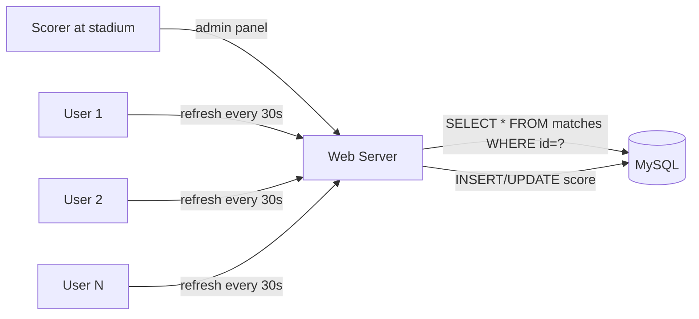

The schema:

```sql
CREATE TABLE matches (
  match_id    BIGINT PRIMARY KEY,
  team_a      VARCHAR(50),
  team_b      VARCHAR(50),
  score_a     INT,
  score_b     INT,
  status      VARCHAR(20),   -- LIVE, HT, FT
  updated_at  TIMESTAMP
);
```

**For 1,000 users this works great.** 1,000 ÷ 30s ≈ 33 requests/second. A single MySQL server barely notices.

## 1.6 The day it all breaks

Word spreads. The site grows. Then comes a big derby match.

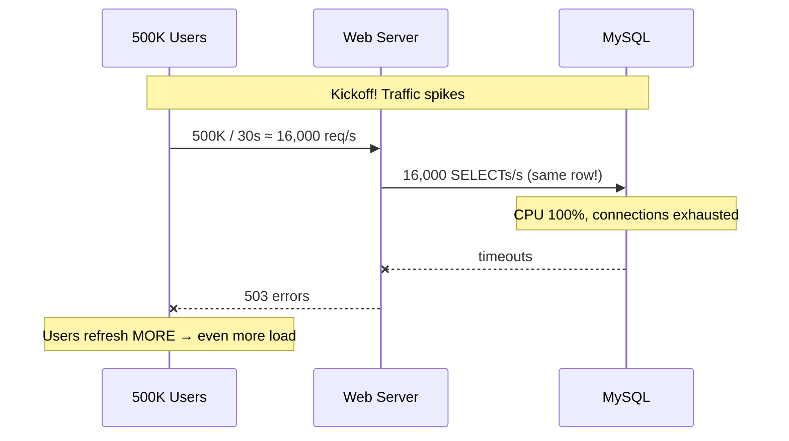

What exactly went wrong? Let's diagnose it like a real postmortem.

**Problem 1: Read amplification on one hot row.**
Millions of requests all ask for the *same row*. The DB does identical work again and again. This is pure waste, because the answer only changes when a goal happens.

**Problem 2: The retry storm (positive feedback loop).**
When the site gets slow, frustrated users hit refresh harder. That adds more load, which makes it slower. This is a classic *metastable failure*.

**Problem 3: Every user is a connection.**
Web servers and DB connection pools have hard limits (a typical MySQL tops out at a few thousand connections). Under overload, writes also fail, so the **scorer can't even save the goal**. The most important operation, writing the truth, gets starved by the least important one, reading.

**Problem 4: Polling is wasteful and also slow.**
- Between goals, 99% of polls return "nothing changed", which is wasted work.
- A goal at second 1 of a 30-second window isn't seen for up to 29 seconds. That's too stale, and the spoiler problem is real.

**Problem 5: Single point of failure.**
One DB and one web server. If either dies, everything is down.

## 1.7 The core insight that shapes everything

Let's pause and name what we learned, because this is what you'll say in the interview:

> 1. **The data is tiny** (~1 KB per match).
> 2. **The data is the same for all users** (not personalized).
> 3. **The data changes rarely** relative to how often it's read.
> 4. **Reads outnumber writes ~40,000 to 1.**
>
> Therefore: **protect the database from reads entirely.** Treat the database as the *source of truth for writes*, not as the thing users talk to.

That single idea creates the "evolution" in the next chapters:

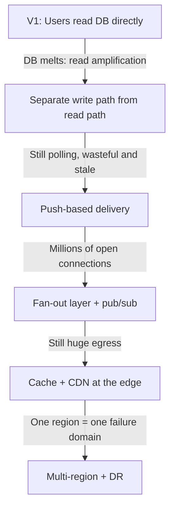

## 1.8 Chapter 1: what to say in an interview

If asked "Design a live score system," your **first 5 minutes** should sound like this:

1. Clarify the scope: which sports, any notifications, any commentary or stats, how fresh is "live"? (Say 1–3 seconds.)
2. State the read:write skew with numbers (20M users, ~100 writes/s, ~4M RPS if naive polling).
3. Show that you see the data is **small, shared, and cacheable**.
4. Say that you will **decouple the write path from the read path**, and that is where the architecture will go.

---

## Checkpoint questions

Try answering these in your own words. This is how we check that Chapter 1 has landed:

1. Why is this system's difficulty about **reads** and not writes, even though it's called a "score *update*" system?
2. In V1, why did the scorer's write fail during the traffic spike, and why is that the worst possible failure?
3. Why does the property "same data for every user" matter so much for the design to come?

When you're ready, either answer these (I'll give feedback), or tell me anything that's unclear in Chapter 1 and I'll go deeper. Once you say you've got it, we move to **Chapter 2: the write path**, where we deal with where scores actually come from (stadium scorers, official data feeds, third-party providers) and why that turns out to be a surprisingly hard trust-and-ordering problem.


-----------------------------------------------------------------------------------------------------------------------
-----------------------------------------------------------------------------------------------------------------------
-----------------------------------------------------------------------------------------------------------------------
-----------------------------------------------------------------------------------------------------------------------


# Chapter 2: The Write Path (How Scores Get In)

In Chapter 1 we learned that reads dominate, but they all depend on one thing: **the data being correct**. If the write path produces a wrong score, we distribute that wrong score to 20 million people at lightning speed. So this chapter is about **truth**: where scores come from, how we trust them, and how we store them.

Write volume is tiny (~100 events/s), so the challenge here is **correctness, not throughput**.

---

## 2.1 The story: V1.1, a human at the stadium

ScoreBoard.com's first source of truth was one employee per match, typing into an admin panel.

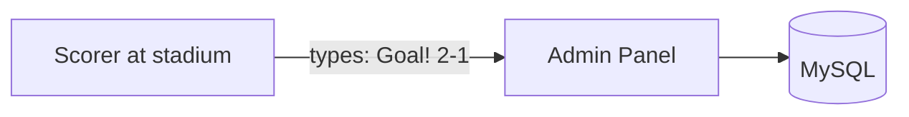

It worked for a few local matches, then the problems showed up:

| Problem | Real example |
|---|---|
| **Human latency** | The scorer watches the goal, then types, then submits. 10–20 seconds late. TV is already ahead. |
| **Typos** | Types `21` instead of `2-1`, or enters the goal for the wrong team. |
| **Doesn't scale in people** | 100 simultaneous matches need 100 trained scorers worldwide. |
| **No audit trail** | `UPDATE matches SET score_a = 2` overwrites history. Who changed it? What was it before? |
| **Security** | The admin panel is a public web page. Anyone who guesses the password can set "Brazil 10-0". |

**Next evolution:** stop using humans, and buy data from **official sports data providers**.

---

## 2.2 V2: data providers

Companies like Sportradar, Opta/Stats Perform, and Genius Sports have trained staff or sensors at the stadium and sell a **real-time data feed**. Now the problem shifts from "how do we type scores" to "how do we *receive* them reliably."

### Three ways to receive a provider feed

| Method | How it works | Pros | Cons |
|---|---|---|---|
| **Webhook (push)** | Provider calls our HTTPS endpoint on each event | Lowest latency, simple | We must be up and reachable; providers retry, so **duplicates**; we need auth and signature checks |
| **Polling (pull)** | We call the provider's API every N seconds | We control the pace | Added latency (up to N seconds), wasteful, rate limits |
| **Persistent stream** (TCP/WebSocket/AMQP) | We hold a long connection, provider streams events | Fastest and ordered | Connection management, reconnect logic, **missed events during disconnect** need replay |

In practice, big providers offer a **stream plus a snapshot/replay API**: you read the stream live, and if you disconnect you call "give me everything since sequence #4521." We'll use that pattern.

---

## 2.3 New problem: every provider speaks a different language

Provider A sends:
```json
{"match": "A-778", "type": "goal", "team": "home", "minute": 67, "player": "Messi"}
```
Provider B sends XML:
```xml
<event><fixture>88213</fixture><kind>SCORE</kind><side>1</side><clock>66:58</clock></event>
```
Provider C uses different team IDs, a different clock format, and different names for the same thing.

If our downstream code understands every provider's format, it becomes unmaintainable, and adding provider D means touching everything.

### Solution: the Adapter / Normalizer pattern (Anti-Corruption Layer)

Each provider gets a small **adapter** that converts its format into **one canonical event model** that the rest of the system understands.

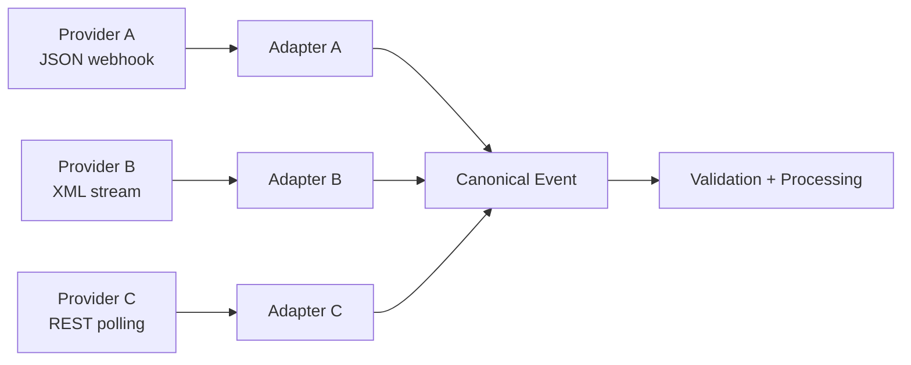

Adding a new provider means writing **one adapter**; nothing else changes. This is the same idea as a USB adapter: the laptop only knows one plug type.

### The canonical event

```json
{
  "eventId": "evt_9f3a...",          // globally unique (we generate or derive it)
  "matchId": 9981,                   // OUR internal ID, mapped from provider IDs
  "seq": 1042,                       // per-match sequence number
  "type": "GOAL",                    // GOAL, CARD, SUBSTITUTION, WICKET, BOUNDARY, ...
  "payload": { "team": "HOME", "player": "Messi", "minute": 67 },
  "source": "providerA",
  "sourceEventId": "A-778-45",       // provider's own ID, used for dedup
  "occurredAt": "2026-11-04T14:02:11Z",   // when it happened in the stadium
  "receivedAt": "2026-11-04T14:02:12Z"    // when we got it
}
```

Note the two timestamps: `occurredAt` (event time) vs `receivedAt` (processing time). Confusing the two is a classic bug source, and we revisit it in Chapter 7.

**Interview point:** mention the **ID mapping table** too. Every provider has its own IDs for teams, players, and matches, and we maintain `provider_match_map(provider, provider_match_id → our matchId)`.

---

## 2.4 New problem: overwriting state loses history, so use event sourcing

Look back at V1: `UPDATE matches SET score_a = 2`. Consider this real situation:

> 67': Goal! (2-1). 69': VAR reviews, **goal disallowed**. Score goes back to 1-1.

With plain updates:
- We just overwrote 2-1 with 1-1, and have no record that a goal happened and was reversed.
- If an update arrives wrong or late, we can't tell what the correct state should be.
- We can't answer "what was the score at 65'?" or recover from a bug.

### Evolution: store events, derive state

Instead of storing the *current score*, store the **append-only sequence of things that happened**. The current score is simply computed from them.

```
match 9981 event log (append-only, never edited):
seq  type            payload
1    MATCH_STARTED   -
2    GOAL            HOME
3    GOAL            AWAY
4    GOAL            HOME     ← 67'
5    GOAL_CANCELLED  ref=4    ← 69' VAR
```

Derived state: HOME goals = 2 (seq 2, 4) − 1 (cancelled seq 4) = 1; AWAY = 1. Score: **1–1**.

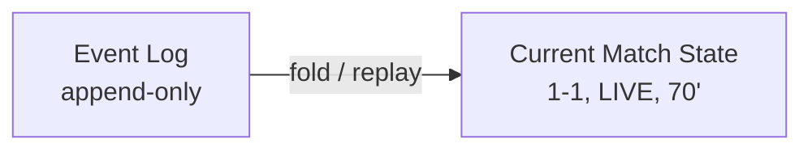

This is **Event Sourcing**. Notice that corrections are modeled as **new events** (`GOAL_CANCELLED`), not edits of old ones. Benefits:

- **Full audit trail**: who/what changed the score, and when.
- **Replayable**: rebuild state from scratch after a bug (apply the fixed logic to the same events).
- **Late/duplicate events are safe to reason about** because order and IDs are explicit.
- **Time travel**: "show the score at 65'."

Trade-off: replaying a long event log for every read is slow, so we keep a **materialized current state** (a snapshot, a small row per match) updated as each event is applied. The event log is the **source of truth**; the snapshot is a **derived, disposable cache of it**. Remember this split: it shapes the read path in later chapters.

---

## 2.5 The ingestion pipeline: where validation happens

An event comes from a provider, and before it changes the official score it must pass through **validation**. Think of this as a checkpoint.

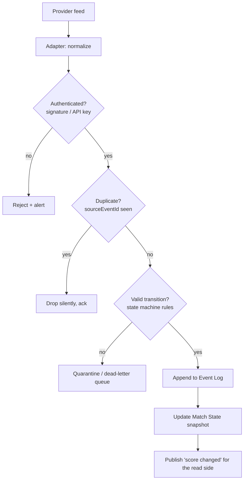

### Business-rule validation (examples)

- A match must go `SCHEDULED → LIVE → HALFTIME → LIVE → FINISHED`. A `GOAL` for a match that's `SCHEDULED` or `FINISHED` is suspicious.
- A score may only *decrease* via an explicit correction event (`GOAL_CANCELLED`), never silently.
- A cricket over can't have 7 legal deliveries.
- A jump of +5 goals in one event is almost certainly bad data.

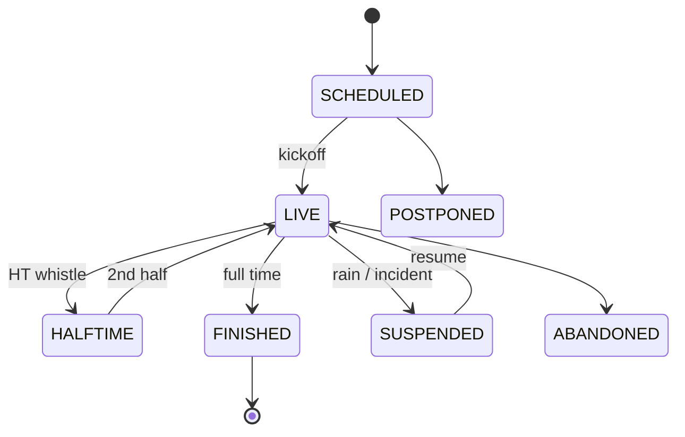

**What happens to invalid events?** They're not discarded and not applied. They go to a **dead-letter queue (DLQ)** or quarantine store for a human or automated review. Throwing them away hides problems, and applying them corrupts the truth.

---

## 2.6 New problem: what if two providers disagree (or one dies)?

We pay for Provider A (primary) and Provider B (backup), because one provider's outage during the final can't take us down (high availability, from Chapter 1).

But now:
- A says 2–1 at 14:02:11. B says 1–1 at 14:02:11 (B is just slower). Is that a conflict or just lag?
- A's stream drops. We silently stop getting events.
- A and B send the *same* goal, and we must not count it twice.

### Strategies

| Strategy | Idea | When to use |
|---|---|---|
| **Primary + hot standby** | Use A; fail over to B if A is silent for N seconds | Simple, most common |
| **Fastest wins, with dedup** | Accept whichever provider reports an event first; dedup the later duplicate | Lowest latency, needs good event identity |
| **Source priority / trust ranking** | Official feed > secondary > crowd/manual; higher trust can override lower | When quality differs |
| **Reconciliation job** | Periodically compare our state with each provider's snapshot, and alert or repair on divergence | Safety net for all of the above |

How do we dedup across providers with different IDs? We derive a **logical event key**, such as `(matchId, type, team, minute, ordinal)`: "the 2nd HOME goal in match 9981". Two reports mapping to the same key are the same event. This is an introduction only. Chapter 7 goes deep on idempotency and ordering.

**Failure detection:** a **heartbeat/watchdog** monitors each feed. If Provider A has sent nothing for 15 seconds during a LIVE match (cricket can legitimately be quiet, so thresholds are sport-specific), we alert and switch to B.

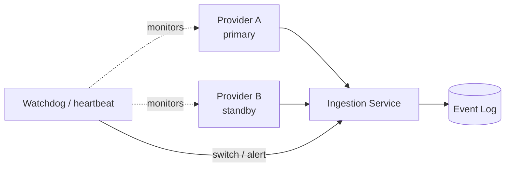

---

## 2.7 Making ingestion durable and ordered, and the handoff

Should the ingestion service write straight into the database? Consider the failure case: a goal arrives, the DB is momentarily slow or restarting, and the event is lost. The provider already moved on. **Losing a goal is unacceptable.**

So we put a **durable, ordered log/queue** (e.g., Kafka) at the front door:

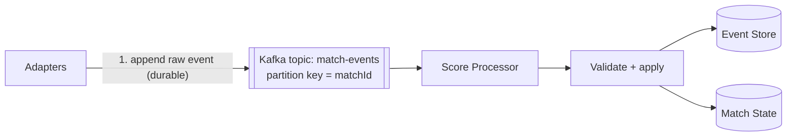

Why is the **partition key = matchId** important? Kafka guarantees order *within a partition*. Hashing by `matchId` means **all events of one match land on the same partition and are processed in order by a single consumer**, so there are no concurrent writers racing on the same match, and the "goal then cancel" order is preserved. Different matches parallelize freely across partitions. (We cover sharding in depth in Chapter 6, and pub/sub in Chapter 4.)

The pipeline's guarantee: once we've acknowledged an event to the provider, it is **safely stored in the log**. Even if the processor or DB crashes, we replay from the log. This is **decoupling plus durability**.

---

## 2.8 Write-side summary

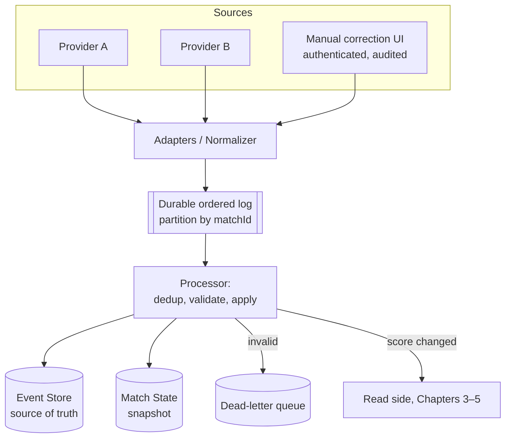

### What to say in the interview
1. Sources: providers via webhook/stream, with a snapshot or replay API to recover from gaps, plus a secured manual override tool.
2. **Adapters** normalize into a canonical event model with our own `matchId`.
3. **Event sourcing**: an append-only event log is the truth, a materialized snapshot is the fast copy, and corrections are new events.
4. **Validation** with a match state machine, dedup, and a DLQ.
5. A **durable log partitioned by matchId** for no-loss and per-match ordering.
6. **Multiple providers** with failover, watchdog, and reconciliation.

---

## Checkpoint questions

1. Why do we store `GOAL_CANCELLED` as a new event instead of just changing the score from 2–1 back to 1–1?
2. What goes wrong if we skip the durable log and have the ingestion service write straight to the database? Give a concrete failure scenario.
3. Why is `matchId` the right partition key? What would break if we partitioned randomly instead?
4. Provider A and Provider B both report the same goal with different IDs. How do we avoid counting it twice?

Answer these (or ask about anything unclear) and tell me when you're comfortable. Then we move to **Chapter 3: the read path**, where we go from "users refresh the page every 30 seconds" through polling, long polling, Server-Sent Events, and WebSockets, and discover why each one was invented.


-----------------------------------------------------------------------------------------------------------------------
-----------------------------------------------------------------------------------------------------------------------
-----------------------------------------------------------------------------------------------------------------------
-----------------------------------------------------------------------------------------------------------------------


# Chapter 3: The Read Path (How Users Get Live Updates)

## 3.0 Where we are

Chapter 2 gave us a trustworthy write side. When a goal happens, we have:

- a durable event log (the truth),
- a small, up-to-date **match state** (`IND 182/4, version 1042`),
- a "score changed" signal.

Now the core question of this system: **how does that tiny piece of data reach 20 million screens within 1-3 seconds?** In this chapter we look at the *protocol* between one client and our servers. How we scale it to millions of clients is Chapter 4.

The story has four generations. Each one exists because the previous one hurt.

---

## 3.1 Generation 1: Short polling (what V1 did)

The client asks on a timer, and the server answers immediately, even if nothing changed.

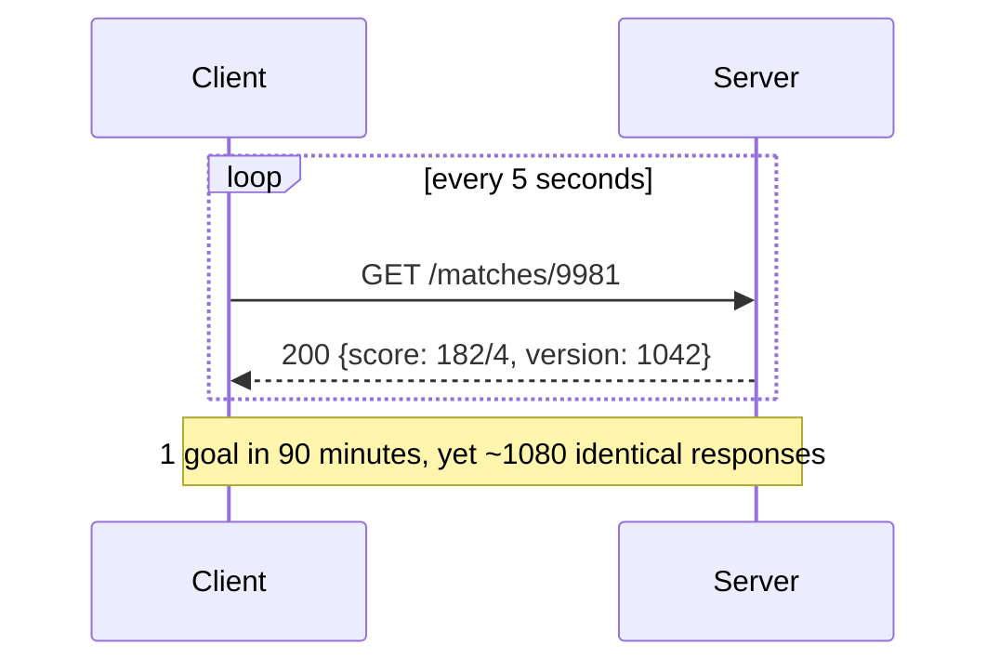

### The math that kills it

If the client polls every `T` seconds, the average staleness is `T/2` and the worst case is `T`.

| Poll interval | Avg delay | Worst delay | Requests/s at 20M users |
|---|---|---|---|
| 30 s | 15 s | 30 s | 0.67M |
| 5 s | 2.5 s | 5 s | 4M |
| 2 s | 1 s | 2 s | **10M** |
| 1 s | 0.5 s | 1 s | **20M** |

So there's a direct tradeoff: **lower latency means proportionally more load.** And almost all of that load is waste, because most responses say "nothing changed."

### Cheap improvement: conditional requests

The server tags the response with a version, and the client says "I already have version 1042":

```http
GET /matches/9981
If-None-Match: "v1042"

HTTP/1.1 304 Not Modified      <- no body, tiny response
```

This saves bandwidth (a 304 is ~200 bytes instead of 1 KB) but **not request count**. Every client still makes a round trip every interval, and the connection setup and header overhead remain.

**Verdict:** polling is simple and cache-friendly (we'll exploit that in Chapter 5), but you can't buy low latency with it. We need the **server to tell the client** when something changes.

---

## 3.2 Generation 2: Long polling

**Idea:** the client asks "anything new since version 1042?" and the server **holds the request open** until there *is* something new (or a timeout like 25-30 s).

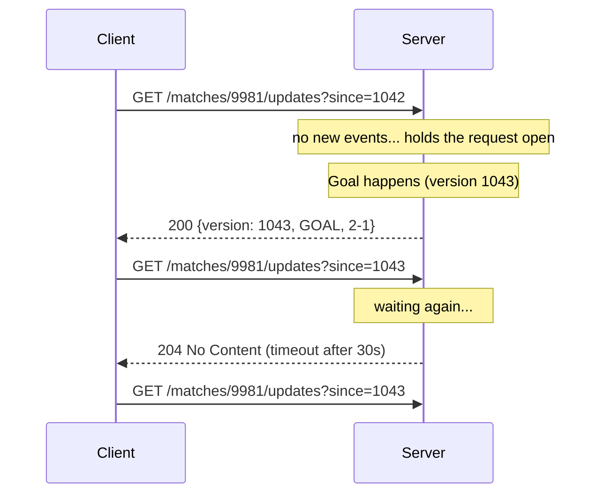

**What improved:** delivery is near-instant (the response goes out the moment the event exists), and idle traffic drops from one request per 5 s to one per ~30 s.

**What hurt (this is what pushed people forward):**

1. **The gap problem.** Between receiving a response and issuing the next request, there's a window where the client isn't listening. If two events fire in that window, the client could miss one. We fix it with the `since=<version>` cursor: the server replays everything after that version. So **cursors/sequence numbers are mandatory**, and they'll come back again later.
2. **Reconnect stampede.** A goal triggers responses to 1M waiting clients, and **all 1M immediately re-request at the same instant**, which is a self-inflicted spike. This is a mini thundering herd (Chapter 8).
3. **Per-request overhead.** Every cycle pays for HTTP headers (cookies, user agent, etc. are often 500-800 bytes), TLS session handling, and auth checks, repeated forever.
4. **Servers must hold many idle requests.** One thread per waiting request does not scale. A thread-per-connection server dies around a few thousand connections (the classic **C10K problem**). We need **event-loop / async I/O servers** (epoll/kqueue, e.g., Netty, Node, Go, Envoy) that can hold 100K+ idle connections cheaply.

**Verdict:** a big step up in freshness, but it's a hack: we're using request/response to simulate a stream. Let's use an actual stream.

---

## 3.3 Generation 3: Server-Sent Events (SSE)

**Idea:** one long-lived HTTP response that the server keeps writing to. The client opens it once, and the server pushes events as they happen.

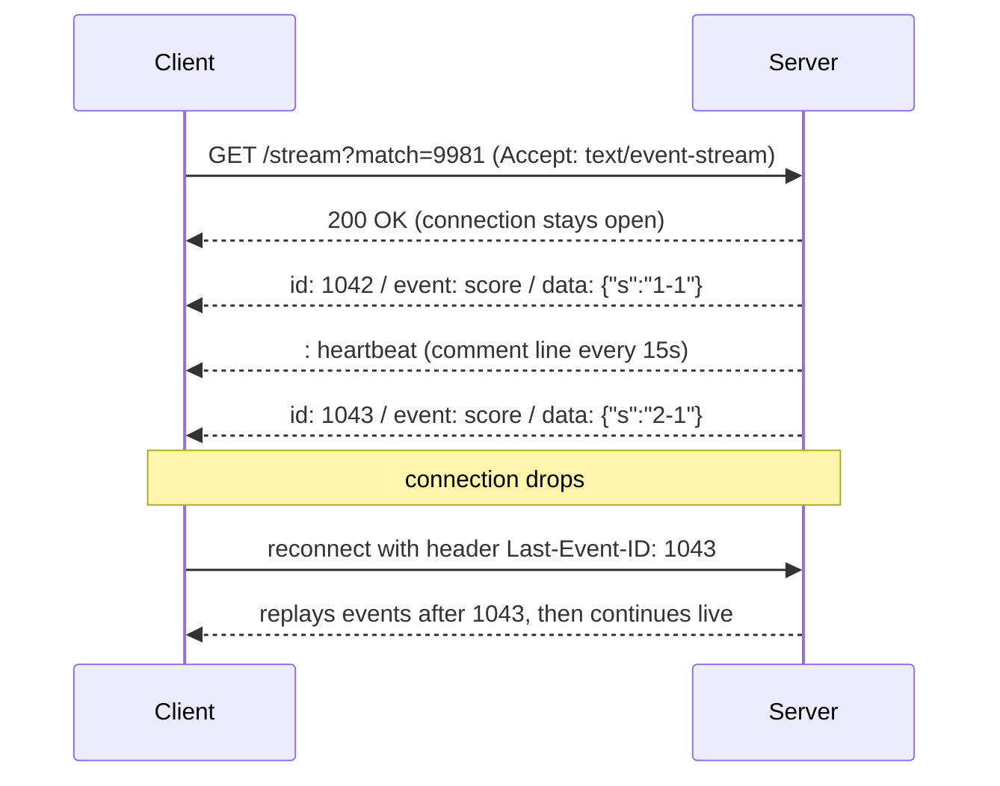

On the wire it's plain text:

```
id: 1043
event: score
data: {"matchId":9981,"score":"2-1","type":"GOAL","minute":67}

```

(A blank line ends each event.)

### Why SSE fits our problem so well

- **One-directional (server to client)**, and that's exactly our need. Users don't send anything while watching.
- **Built into browsers** (`EventSource`), including **automatic reconnect**.
- **`Last-Event-ID` resume is built in.** The browser sends the last `id` it saw, and our server replays the gap. That is our cursor idea, standardized.
- It's just **HTTP**, so it works with existing auth, load balancers, logging, and with **HTTP/2 multiplexing** (many streams over one connection).

### SSE's weak spots

- **Text only** (JSON is fine; binary needs base64).
- **Proxy buffering:** some proxies and CDNs buffer responses and break streaming, so you must disable buffering (`X-Accel-Buffering: no`, `Cache-Control: no-cache`).
- **HTTP/1.1 limit:** browsers allow ~6 connections per domain, which is why you **multiplex many matches over one stream**, or use HTTP/2.
- **No client-to-server channel** (use a normal REST call for that).
- Idle connections get killed by intermediaries after ~60 s, so we send **heartbeats** (the `: heartbeat` comment lines above).

---

## 3.4 Generation 4: WebSockets

**Idea:** upgrade an HTTP connection into a **full-duplex, persistent TCP channel**. Both sides can send any time.

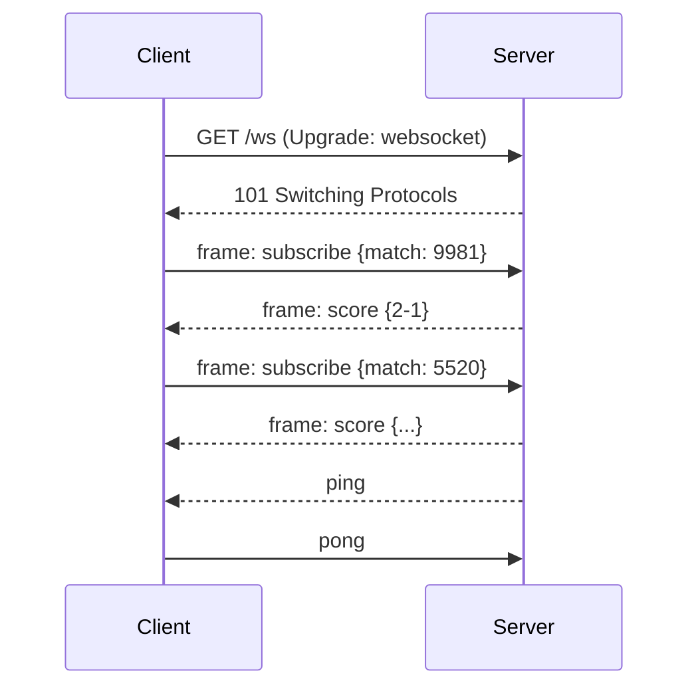

**Strengths:** bidirectional (subscribe and unsubscribe on the fly, send acks), binary frames, very low overhead per message (2-14 byte frame header), the best fit for chat, games, and collaborative editing.

**Costs:**
- **No built-in reconnect or resume**; you write that logic yourself (backoff, last-seen cursor).
- **Stateful**, so the load balancer must handle long-lived connections (L4, or L7 with upgrade support), and rolling deploys must drain them (Chapter 10).
- Some corporate proxies and firewalls interfere with the upgrade.
- You must implement your own ping/pong liveness checks.

---

## 3.5 So which one do we choose?

| | Short poll | Long poll | **SSE** | **WebSocket** |
|---|---|---|---|---|
| Direction | C→S | C→S (held) | **S→C** | **Both** |
| Latency | up to interval | ~instant | ~instant | ~instant |
| Idle overhead | high | medium | **very low** | **very low** |
| Auto reconnect/resume | n/a | manual | **built in** | manual |
| Works through proxies/CDN | **easiest** | yes | mostly | sometimes not |
| Binary | yes | yes | no | **yes** |
| Server complexity | low | medium | medium | **highest** |

**The decision for a score system:**

> Updates flow **only server to client**, to millions of passive viewers. **SSE is the natural fit** (simple, resumable, HTTP-friendly). WebSockets are also acceptable and very common in practice. Choose them if you need bidirectional features like live reactions, predictions, or chat in the same connection.

**In an interview, don't just name a winner. Give the reasoning and the fallback:**

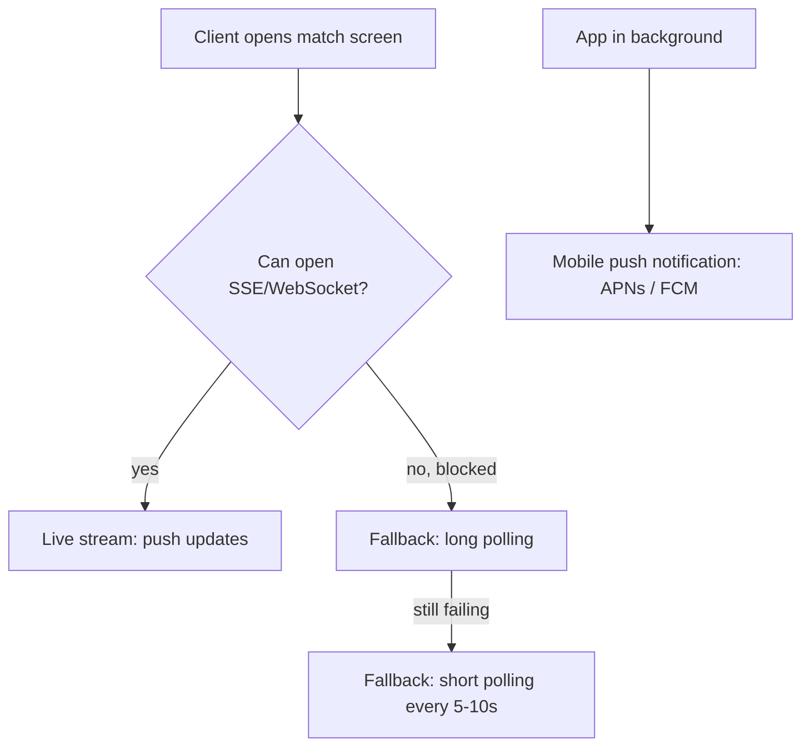

This degradation ladder is a mark of a senior answer: **graceful fallback** keeps the product working on hostile networks.

Also note the **other two delivery channels**:
- **Home page / match list:** it changes rarely and is the same for everyone, so plain **short polling of a cached response** works (Chapter 5).
- **Background mobile users:** a persistent connection drains battery and gets killed by the OS, so for goals and wickets we use **push notifications** (APNs for iOS, FCM for Android). That's a separate fan-out pipeline for "notify the 3M users who follow this team."

---

## 3.6 The most subtle problem: snapshot vs stream (the race)

A new user opens the app 10 minutes into a match. They need **current state** (a snapshot) **and** future updates (a stream). Naive approach:

1. `GET /matches/9981` returns the snapshot at version 1042.
2. Open the stream.

**The race:** between step 1 and step 2, version 1043 (a goal) can fire. The client never sees it. They show 1-1 while the real score is 2-1, **until the next event**, which might be minutes away. A permanently wrong screen is exactly the kind of bug we declared unacceptable.

### Fix: subscribe first, then snapshot, and dedupe by version

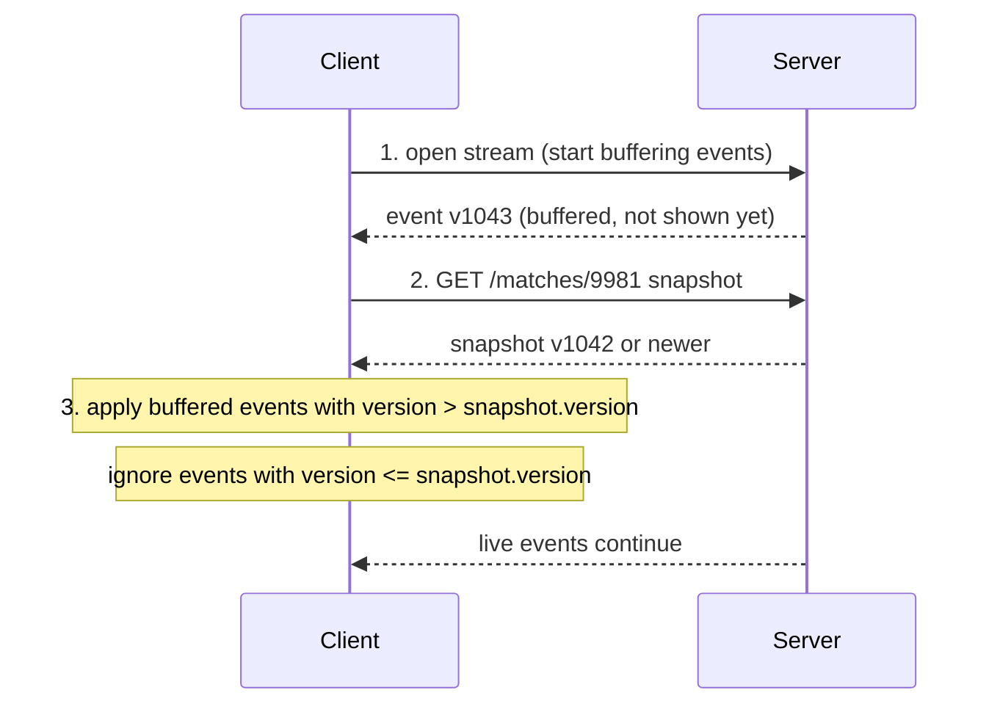

Or the equivalent trick: connect to the stream and send `Last-Event-ID: 1042`, so the server fills the gap from the snapshot's version onward. Both approaches rely on the same invariant:

> **Every state change has a monotonically increasing per-match `version`, and the client applies an update only if `update.version > local.version`.**

This makes the client **idempotent** (duplicates are ignored) and **order-safe** (stale or late events are dropped). Even if the network delivers events twice or out of order, the screen ends up correct. This is the single most reusable concept in live-update systems.

**Gap detection:** if the client has v1042 and receives v1045, it knows 1043-1044 are missing, so it calls `GET /matches/9981/events?from=1043` (or refetches the snapshot) and heals itself.

---

## 3.7 Staying connected: heartbeats, reconnects, backoff

A million phones on flaky mobile networks means **disconnections are normal, not exceptional.**

- **Heartbeat** (every ~15-30 s): keeps NAT and proxy idle timers from killing the connection, and lets each side detect "half-dead" TCP connections (the OS doesn't notice a dead peer for minutes).
- **Client timeout:** if no message *or* heartbeat arrives for ~2× the heartbeat interval, assume dead and reconnect.
- **Reconnect with exponential backoff + jitter:** wait 1s, 2s, 4s, 8s (capped), each multiplied by a random factor. Without jitter, after a server blip **all clients retry in lockstep** and crush the recovering server. That's the stampede again, which we deal with in Chapter 8.
- **Resume with the cursor:** reconnect carries the last seen `version`, and the server replays the gap.

---

## 3.8 Multiplexing and subscriptions

A user on the home page watches 12 live matches. Do they open 12 connections? **No.** One connection carries many subscriptions:

```
client -> server:  subscribe  topics=[match:9981, match:5520, live-list]
server -> client:  {topic: "match:9981", version: 1043, ...}
```

Keep these concepts in mind, because they set up Chapter 4:
- Each match is a **topic**.
- A client connection is a **subscriber** of one or more topics.
- The question becomes: *when a message is published to `match:9981`, how do we reach every server that holds a subscriber to it?*

---

## 3.9 Where we stand, and the next problem

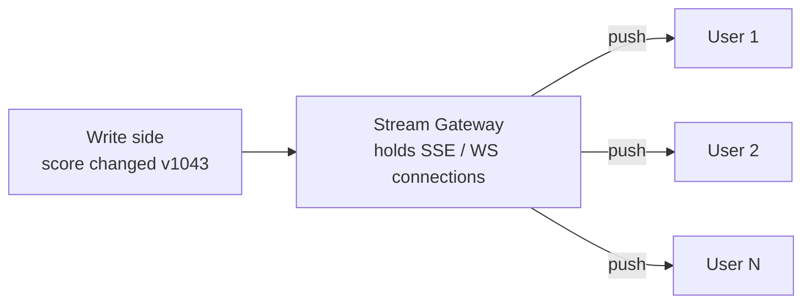

This works beautifully for 50,000 users on a single gateway. But look at the reality:

- One well-tuned server can hold maybe **100K-1M** mostly idle connections (limited by memory per connection, file descriptors, and the cost of the fan-out writes).
- We need to serve **20M**. That's **hundreds of gateway servers**.
- A goal event arrives at the write side **once**. Which of those hundreds of servers hold viewers of match 9981? How does the event get to *all* of them, quickly and reliably, without each server hammering the database?

That's the **fan-out problem**, and it's the heart of the whole system.

---

## Checkpoint questions

1. Why does lowering polling latency from 5 s to 1 s increase server load by 5×, while long polling avoids that?
2. Name two problems of long polling that SSE solves out of the box.
3. Why is SSE a better default than WebSockets for a score app, and what feature requirement would make you switch?
4. A user opens the app mid-match. Walk through the race between "fetch snapshot" and "open stream", and explain how version numbers fix it.
5. Why do reconnecting clients need *jitter* in their backoff?

Answer these in your own words, or ask about any part you'd like me to go deeper on. When you're comfortable, say **next** and we'll do **Chapter 4: Fan-out at scale**: pub/sub, gateway servers, how to route one goal to millions of connections, and the "celebrity problem" of one hot match.


-----------------------------------------------------------------------------------------------------------------------
-----------------------------------------------------------------------------------------------------------------------
-----------------------------------------------------------------------------------------------------------------------
-----------------------------------------------------------------------------------------------------------------------


# Chapter 4: Fan-Out at Scale

## 4.0 Where we are

At the end of Chapter 3 we had a nice protocol (SSE or WebSocket, with versions, cursors and heartbeats), but only for a single server. The real situation:

- **20M concurrent connections** to serve.
- A goal is produced **once**, on the write side.
- That one event must reach **every** user watching that match, within about a second.

This is **fan-out**: 1 event in, millions of messages out. It's the heart of the system, and the story of how it's solved is a nice example of "try the obvious thing, watch it break, evolve."

---

## 4.1 The numbers first

**How many gateway servers do we need?**

A gateway is a server that holds open client connections (SSE/WebSocket). Each idle connection costs memory (socket buffers, TLS state, per-connection objects, roughly 10-50 KB) and a file descriptor.

```
One well-tuned box: ~200K connections (say 32 GB RAM, ~50 KB per connection → 10 GB, leaving headroom)
Needed for 20M:     20M / 200K = 100 gateways (plan for ~150 with headroom and failures)
```

**How much data moves when a goal happens?**

```
Message size:        ~300 bytes of useful payload after compression/framing
Messages per goal:   20,000,000
Total burst:         20M × 300 B = 6 GB pushed out in a short window
Per gateway:         200K messages × 300 B = 60 MB   (a 10 Gbps NIC does that in ~50 ms)
```

Network bandwidth is fine. The real cost is CPU: 200K `write()` calls per event per gateway. At ~5 µs each that's ~1 second on one thread, so we need multiple cores and smart batching (more below).

So the unit of work is: **get one event to ~100-150 gateways, then each gateway writes to its own ~200K sockets.** Let's see how people arrived at that.

---

## 4.2 Attempt 1: gateways poll the database

The first idea is the minimal change from what already works. Each gateway keeps its connections and **checks the DB itself** every second.

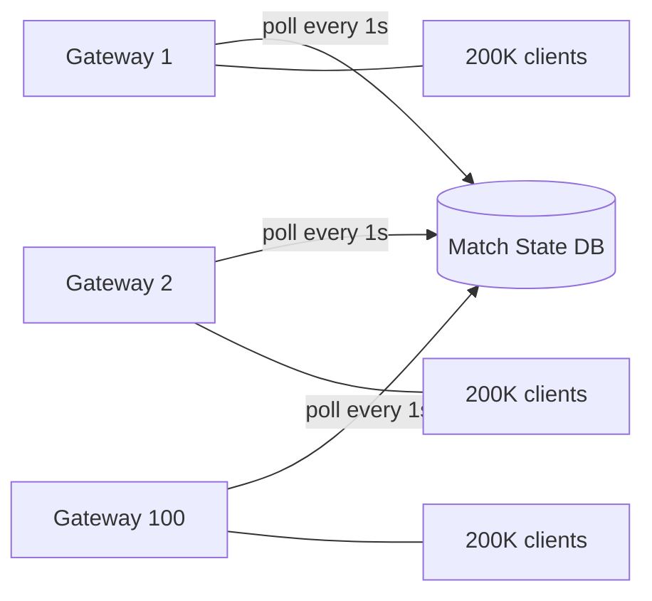

**What's good:** we replaced *20M* client polls with *100 gateways × live matches* polls. If there are 100 live matches, that's about 10,000 queries/s, which is completely manageable. This is a real improvement and a legitimate stepping stone.

**What's wrong:**

1. **Latency again:** with a 1 s poll the delay is up to 1 s *plus* fan-out. Make it 100 ms and DB load becomes 100K queries/s.
2. **Waste:** 99% of polls return "nothing changed".
3. **DB load grows with fleet size** (`gateways × matches × poll rate`). Scaling out the gateways makes the database worse.

We're still *pulling* when we should be *pushed to*. Let's flip it.

---

## 4.3 Attempt 2: the processor calls every gateway directly

When the processor applies a goal, it loops over all gateways and calls each one.

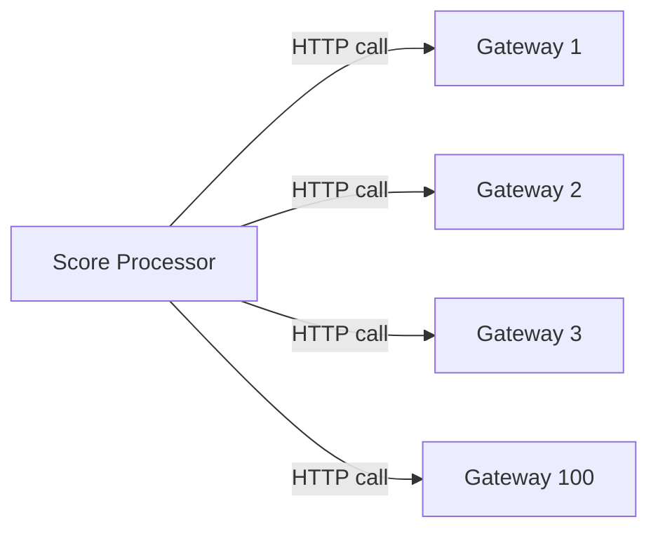

**Why it breaks:**

- **Tight coupling:** the processor must know the *current list of gateways*. Gateways autoscale, crash, and get deployed all the time, so you need a service registry, health checks, and stale-entry handling.
- **Slow consumers hurt the producer:** if Gateway 37 is slow or hung, the processor waits or retries, **delaying the goal for everyone else**. A synchronous loop is only as fast as its slowest member.
- **Failure handling lands in the wrong place:** retries, timeouts and ordering for 100 destinations live inside the score processor, which should only care about scores.
- **Wasted traffic:** some gateways hold *zero* viewers of this match, but get called anyway (we'll revisit whether that waste matters).

What we want is **decoupling**: the producer shouts "match 9981 changed" once, and whoever cares hears it. That's **publish/subscribe**.

---

## 4.4 Attempt 3: pub/sub, the solution that stuck

```mermaid
flowchart TD
    P[Score Processor] -->|"publish ONCE: match 9981, v1043"| B[["Pub/Sub Broker"]]
    B -->|deliver| G1[Gateway 1]
    B -->|deliver| G2[Gateway 2]
    B -->|deliver| G3[Gateway 100]
    G1 --> C1["200K connections"]
    G2 --> C2["200K connections"]
    G3 --> C3["200K connections"]
```

This is a **two-level fan-out tree**:

- **Level 1:** broker to gateways (1 → ~100). Cheap.
- **Level 2:** each gateway to its own connections (1 → ~200K). Done locally, in memory, in parallel across gateways.

Nobody ever fans out to 20M directly, and the work is spread across 100 machines. This "tree" is the general trick for big fan-out: **never one node to millions; always layers of ~100-1000.**

### How each gateway knows who to notify

Every gateway keeps an **in-memory subscription table**:

```
matchId 9981 → [conn#17, conn#942, conn#88213, ... 150K connections]
matchId 5520 → [conn#3, conn#701, ...]
```

When a message for match 9981 arrives from the broker, the gateway looks up its list and writes to those connections. **No database is touched.** This table is also **disposable state**: if the gateway dies, clients reconnect elsewhere and re-subscribe (Chapter 3's cursor makes that safe).

### Which broker?

| Option | Behavior | Fit |
|---|---|---|
| **Redis Pub/Sub** | Very fast, in-memory, fire-and-forget (**at-most-once**, no replay) | Great for live fan-out *if* we have a recovery path for missed messages |
| **NATS** | Similar speed, light-weight subjects and wildcards | Same trade-off |
| **Kafka** | Durable, replayable, ordered per partition, but heavier; **not designed for 100K tiny topics** | Fine for the *write-side* log (Chapter 2); can feed gateways via a few topics |
| **Cloud pub/sub** (Google Pub/Sub, SNS+SQS, Kinesis) | Managed, durable | Higher latency (tens to hundreds of ms) |

A common, defensible interview answer: **Kafka (or similar) as the durable source of truth on the write side, and a lightweight low-latency pub/sub (Redis/NATS) on the delivery side.** The processor writes durably first, then publishes the "changed" notification.

### A simplification worth saying out loud

Here is a nice interview insight. Ask: *do we even need topic-level subscriptions?*

```
Total events across ALL live matches ≈ 100 per second
Message size ≈ 1 KB
Data if we send EVERYTHING to EVERY gateway = 100 KB/s per gateway   (trivial)
Across 150 gateways = 15 MB/s total broker egress                     (trivial)
```

Because the write volume is tiny (Chapter 1), we can **broadcast every event to every gateway** and let each gateway discard the ones it has no subscribers for. This removes subscription management between gateways and broker, a big reduction in complexity. **Selective topic subscription only becomes worth it when event volume is large** (e.g., per-ball tracking data, 25 position updates per second per player). Show you know both options and the volume at which you'd switch.

---

## 4.5 The fan-out path of one goal

```mermaid
sequenceDiagram
    participant PR as Score Processor
    participant ES as Event Store
    participant BR as Pub/Sub Broker
    participant GW as Gateway (1 of 100)
    participant CL as Clients (200K on this gateway)
    PR->>ES: 1. append GOAL event, update state to v1043 (durable)
    PR->>BR: 2. publish matchId=9981, version=1043, payload
    BR->>GW: 3. deliver to every gateway
    GW->>GW: 4. look up local subscribers of 9981
    GW->>GW: 5. serialize the message ONCE
    GW-->>CL: 6. write same bytes to each connection
    Note over PR,CL: Target: under ~1 second end to end
```

**Latency budget (good to quote):**

| Hop | Typical |
|---|---|
| Provider to our adapter | 100-300 ms (outside our control) |
| Durable log + processing + state update | 20-50 ms |
| Publish and broker delivery | 5-20 ms |
| Gateway fan-out writes (200K sockets, multi-core) | 50-300 ms |
| Network to phone | 50-200 ms |
| **Total** | **~0.5-1 s** |

### Order of operations matters: persist first, publish second

Why not publish first for speed? Because if we publish "2-1" and then the write to the store fails, users have seen a goal that **doesn't officially exist**. A client that connects *later* would fetch the snapshot, which says 1-1: inconsistent. So we persist, then publish. If we crash between the two steps, we have the opposite, tolerable failure: the state is right, but the notification was lost. We fix that next.

---

## 4.6 Pub/sub can lose messages, so make the system self-healing

Redis Pub/Sub is at-most-once. If a gateway is briefly disconnected from the broker, or restarting, **it misses messages**. Do we need exactly-once broker delivery? No. We already built the cure in Chapter 3:

1. Every message carries a **per-match monotonically increasing version**.
2. A gateway tracks the **last version it forwarded per match**.
3. If the next message is `v1045` but the last was `v1042`, it **detects the gap** and calls the state/event store: *"give me events 1043-1044 for match 9981"*, then forwards them in order.
4. On (re)connecting to the broker, the gateway does a **catch-up**: for each match it has subscribers for, it asks "anything newer than my last version?"

Add a **safety-net heartbeat**: every ~10 seconds, the processor republishes the *current* state of every live match (even if unchanged). Any gateway or client that missed something self-corrects within 10 seconds. It costs almost nothing (100 matches × 1 KB per 10 s) and gives you a hard upper bound on how stale anything can be.

> **Principle:** *Use a fast, lossy transport for latency, and add cheap sequence-number-based recovery for correctness.* This is simpler and faster than demanding an exactly-once, ordered, durable pipe at every hop.

---

## 4.7 Inside a gateway

```mermaid
flowchart TD
    subgraph Gateway
      A["Network I/O event loop (epoll / io_uring)"]
      T["Subscription table: matchId → connections"]
      Q["Per-connection bounded send queue"]
      H["Heartbeat and timeout timers"]
    end
    BR[["Broker"]] -->|"match updates"| T
    T --> Q
    Q --> A
    A <-->|"SSE / WebSocket"| CL["Clients"]
    H --> A
    A -->|"on connect: resume from cursor"| ST[("State / Event Store")]
```

Key design points you can mention:

- **Event-loop, non-blocking I/O** (Netty, Go's runtime, Envoy, Node, epoll): a handful of threads manage hundreds of thousands of sockets. Thread-per-connection collapses at the C10K level.
- **Serialize once, write many:** build the JSON/frame bytes once per event and reuse the same buffer for all 200K sockets. Don't re-encode per user.
- **TLS is a real cost:** every connection has its own encryption state, so encryption happens *per connection*. Many designs **terminate TLS at a dedicated edge layer** (load balancers or edge proxies), so gateways deal with plain TCP internally. That's a trade-off between CPU and network trust boundaries.
- **Shard work across cores**, with each core owning a subset of connections, to avoid lock contention on the subscription table.
- **Stateless-ish:** a gateway's only state is connections and subscriptions, which are rebuilt by clients reconnecting. That makes scaling and replacing gateways easy.

---

## 4.8 The slow consumer problem (backpressure)

Mobile networks are variable. One client on a bad 2G connection can't drain its socket. What happens when we keep writing to it?

```mermaid
flowchart LR
    G["Gateway writes goals fast"] --> Q["Client's send queue grows"]
    Q --> M["Memory balloons across thousands of slow clients"]
    M --> X["Gateway out of memory, ALL users affected"]
```

A few slow clients can take down a gateway full of healthy ones. Solutions:

1. **Bounded per-connection queue.** Never let it grow unbounded.
2. **Conflation (this is the elegant one for scores):** the score is **state**, not a stream of everything. If a slow client has queued `v1043` and `v1044` unsent and `v1045` arrives, **drop the stale ones and keep only the latest**. The client doesn't need every intermediate state, only the newest. (For a *commentary feed* where every event matters, you'd instead send a "you missed some, refetch" signal.)
3. **Disconnect clients that stay behind** beyond a threshold. They'll reconnect and resume with the cursor.
4. **Send full state, not deltas, where possible.** A message saying "score is 2-1, v1043" is self-contained and idempotent, so any lost message heals on the next one. A delta like "+1 home goal" corrupts the screen if one is lost. Deltas save bytes, but full-state messages (~1 KB) are cheap here and far more robust.

---

## 4.9 How do connections get spread across gateways?

A load balancer assigns each new connection to a gateway. Decisions to discuss:

- **Distribute connections *randomly / least-connections*, NOT by match.** This is the crucial design choice. Consider the alternative:

| Strategy | Hot match (20M viewers) | Small match (50 viewers) |
|---|---|---|
| **Shard gateways by match** (match 9981 → gateway 7) | One gateway needs to hold 20M connections. Impossible, a **hot shard**. | Fine |
| **Random / least-connections** | 20M spread evenly over 100 gateways, 200K each. | 50 viewers land on ~50 different gateways. Fine. |

Spreading by *connection* rather than by *match* makes load **independent of match popularity**. The cost is that popular matches have subscribers on *every* gateway, which is fine because we saw it's cheap to deliver an event to every gateway.

- **Layer 4 (TCP) vs Layer 7 (HTTP) load balancing:** L4 is simpler, faster, and ideal for long-lived connections. L7 gives routing and observability, but costs CPU. Make sure whichever you choose supports long-lived idle connections and WebSocket upgrades, with a long idle timeout.
- **Stickiness is *not* needed**, because any gateway can serve any client thanks to cursors and state in the store.
- **Autoscale on connection count (and fan-out latency), not just CPU.** Idle connections use little CPU but still fill memory and file descriptors.
- **Draining on deploy:** to remove a gateway gracefully, stop sending it new connections, then ask existing clients to reconnect elsewhere (spread over time with jitter to avoid a stampede). We expand on this in Chapter 10.

---

## 4.10 A different fan-out: push notifications

Users who aren't in the app need **push notifications** (APNs/FCM) for goals and wickets. This is a *different* pipeline with a different shape:

```mermaid
flowchart LR
    E["Goal event"] --> N["Notification Service"]
    N -->|"who follows Team A or Match 9981?"| F[("Follow / preferences store")]
    N --> Q[["Notification queue"]]
    Q --> W1["Worker"]
    Q --> W2["Worker"]
    W1 -->|"batched"| APNS["APNs / FCM"]
    W2 -->|"batched"| APNS
    APNS --> D["Devices"]
```

Differences from live streaming:

- Targets are **personalized** (only people who follow the team), so we must *look up* the audience, which could be millions.
- Delivery is through **third-party services with rate limits**, so we batch, retry with backoff, and prioritize (goal alerts over "match starting soon").
- Delivery is **best-effort** with seconds-to-minutes variance, and expectations are looser.
- The classic trade-off here is **fan-out-on-write** (precompute each user's list of who to notify) vs **fan-out-on-read** (compute the audience at send time). For "followers of a team," it's typically a **partitioned workers + queue** design that processes the audience in chunks.

---

## 4.11 Summary of this chapter's evolution

```mermaid
flowchart TD
    A["Clients poll DB directly"] -->|"4M req/s kills DB"| B["Persistent connections: SSE / WS (Ch 3)"]
    B -->|"One box cannot hold 20M connections"| C["Fleet of gateways, ~100 to 150"]
    C -->|"How does each gateway learn about a goal?"| D["Gateways poll DB: latency + DB load grows with fleet"]
    D --> E["Processor calls each gateway: coupling, slow-peer blocking"]
    E --> F["Pub/Sub broker: publish once, tree fan-out"]
    F -->|"Broker can drop messages"| G["Versions + gap detection + periodic republish"]
    G -->|"Slow clients bloat memory"| H["Bounded queues + conflation + disconnect"]
```

**What to say in the interview (30-second version):**
> "We separate the write path from the delivery path. After persisting an event, the processor publishes once to a broker. A fleet of ~100-150 gateways holds the client connections, and each gateway keeps an in-memory map from match to its local subscribers, so fan-out is a two-level tree rather than one node hitting millions. Connections are load-balanced by connection count, not by match, so a hot match can't create a hot shard. Delivery uses per-match version numbers so lost or duplicated messages are detected and healed, and slow clients are handled with bounded queues and conflation, since a score is state and only the latest matters."

---

## Checkpoint questions

1. Why is "gateways poll the DB" better than client polling, yet still not good enough?
2. Give two reasons the processor shouldn't call gateways directly, and say what pub/sub changes.
3. Why can we get away with broadcasting *every* event to *every* gateway here? At what point would that stop being OK?
4. Why do we persist to the store **before** publishing? What failure does the opposite order cause?
5. Why do we distribute connections by *load* rather than *by match*? Describe what goes wrong if we sharded gateways by match for a World Cup final.
6. What is conflation and why is it safe for scores but not for a play-by-play commentary feed?

Answer these, or ask about anything fuzzy (for example the pub/sub choices, the gap detection, or the backpressure part). When you're ready, say **next**, and we'll do **Chapter 5: Caching and CDN**. Not every user needs a live stream: new joiners, the home page, and fallback pollers all need *snapshots*, and a smart cache layer can serve millions of those without touching the database. We'll also see how CDNs fit in, and why they work well for snapshots but awkwardly for streams.


-----------------------------------------------------------------------------------------------------------------------
-----------------------------------------------------------------------------------------------------------------------
-----------------------------------------------------------------------------------------------------------------------
-----------------------------------------------------------------------------------------------------------------------


# Chapter 5: Caching and CDN

## 5.0 Where we are

Chapter 4 solved delivery for people who are **connected** to a stream. But not everyone is, and not all the time. Many requests are **snapshot reads**: "tell me the current state of match 9981".

| Who asks for a snapshot | Why |
|---|---|
| A user opening the app or match page | They need the current state *before* the stream takes over (Chapter 3's snapshot-then-stream) |
| Users on the **fallback ladder** (SSE blocked, so they short-poll) | Hostile networks, old browsers |
| Clients **reconnecting** after a gateway restart | Gap healing: "what did I miss?" |
| The **home page** with the live match list | Everyone sees it, and it refreshes often |
| Web crawlers, embedded widgets, partner sites | Anyone with HTTP |

Let's quantify it for our 20M-user final:

```
Pollers on fallback: 10% of 20M = 2M users, one request every 5 s → 400,000 req/s
Join wave:           5M users open the app in the 10 minutes before kickoff → ~8,000 req/s
Gateway failure:     one gateway dies → 200K clients reconnect at once → 200K snapshot reads in seconds
```

The state store (Chapter 2) must **never** see this traffic. This chapter is about building a layered shield in front of it.

---

## 5.1 The story: how the shield was built

### Attempt 1: read the database

Every snapshot request runs `SELECT ... FROM match_state WHERE match_id = 9981`. This is V1 all over again: same row, same answer, 400K times a second. It dies.

### Attempt 2: a Redis cache (cache-aside)

The classic fix. The app checks Redis first, and only on a miss goes to the DB and fills the cache.

```mermaid
sequenceDiagram
    participant C as Client
    participant A as API Server
    participant R as Redis
    participant D as State DB
    C->>A: GET /matches/9981
    A->>R: GET match:9981
    alt cache hit
        R-->>A: state v1043
    else cache miss
        R-->>A: nil
        A->>D: SELECT state
        D-->>A: state v1043
        A->>R: SET match:9981 (TTL 2s)
    end
    A-->>C: 200 state v1043
```

This is called **cache-aside (lazy loading)**. It's the right first move, and for a typical website it's often enough. But three problems show up here.

**Problem A: staleness vs load (the TTL dilemma).**
A TTL of 2 s means up to 2 s of staleness *on top of* the stream latency, so a poller might see a goal 2 s late. A shorter TTL means more DB hits. We're back to the polling trade-off from Chapter 3.

**Problem B: the cache stampede.**
When the key expires, hundreds of requests arrive in the same millisecond, **all miss**, and all hit the DB at once. The cache designed to protect the DB creates a periodic spike right on it.

```mermaid
sequenceDiagram
    participant R1 as Request 1..5000
    participant Redis
    participant DB
    Note over Redis: key match:9981 expires
    R1->>Redis: GET (5000 concurrent)
    Redis-->>R1: miss x5000
    R1->>DB: 5000 identical SELECTs
    Note over DB: spike, slow, timeouts
```

**Problem C: one Redis node can't take 400K reads per second for one key.**
A single Redis instance does roughly 100K simple ops/s. All requests for match 9981 hit the **same key**, which lives on one shard. That's the **hot key problem**: adding more Redis shards doesn't help, because the key lives on exactly one of them.

Each problem has its own cure. Let's evolve step by step.

---

## 5.2 Evolution 1: stop guessing, because we know exactly when data changes

Cache-aside is for data whose changes you can't observe. Here we **own the writer**: the score processor knows precisely when `match 9981` changes. So we should not wait for a TTL to expire. We should **write the new value into the cache ourselves**.

```mermaid
flowchart LR
    P["Score Processor"] -->|"1. append event and update state (durable)"| DB[("State DB")]
    P -->|"2. write-through: set cache if version is newer"| R[("Redis")]
    P -->|"3. publish to gateways (Ch 4)"| B[["Broker"]]
    API["API servers"] -->|"reads"| R
    R -. "miss only after cold start or eviction" .-> DB
```

This is **write-through / event-driven cache update** (as opposed to TTL-based expiry):

- The cache is **always as fresh as the DB**, within milliseconds.
- Live matches **don't use a TTL at all**, so there are no expiry stampedes.
- The DB is read only on cold start or rare evictions.

### The subtle bug: out-of-order cache writes

Suppose two updates, v1043 and v1044, are written to Redis by two workers, and the writes **arrive reversed**: v1044 lands first, then v1043 overwrites it. The cache now shows an *older* score **permanently** (until the next event). This is exactly the "score goes backward" bug we ruled out in Chapter 1.

**Fix: conditional write (compare-and-set on version).** Only write if the new version is greater than the stored one. In Redis this is a tiny Lua script, executed atomically:

```lua
-- KEYS[1] = match:9981   ARGV[1] = new version   ARGV[2] = payload
local cur = redis.call('HGET', KEYS[1], 'v')
if (not cur) or (tonumber(ARGV[1]) > tonumber(cur)) then
  redis.call('HSET', KEYS[1], 'v', ARGV[1], 'data', ARGV[2])
  return 1
end
return 0   -- stale write ignored
```

Because partitioning by `matchId` (Chapter 2) already gives one writer per match, this is a **belt-and-braces guard**. It also protects us during failovers and replays, when two writers might briefly overlap.

### The other approach, for comparison

| Strategy | How it works | Fit here |
|---|---|---|
| **Cache-aside** | App fills the cache on a miss | OK as a *fallback* for cold starts |
| **Read-through** | The cache library loads from the DB on a miss | Same as above, less app code |
| **Write-through** | Write to cache and DB together | **Primary approach** (we own the writer) |
| **Write-behind** | Write to cache, flush to DB later asynchronously | Risky: the cache must never be the only copy of a goal. Not for the source of truth |
| **Invalidate on write** | Delete the key on change, the next read refills | Simple, but causes a miss storm on the hottest keys |

For hot, shared, frequently changing data, **update in place beats invalidate**. Deleting the key right when a goal happens would cause thousands of misses at the most-watched moment.

---

## 5.3 Evolution 2: a cache in front of the cache (local in-process cache)

Problem C remains: 400K reads/s on one hot key. The insight is that **the data only changes every few seconds at most, but we've been asking Redis on every request**.

Each API server keeps the snapshot **in its own memory** for a very short time (say **500 ms to 1 s**).

```mermaid
flowchart TD
    C["400K req/s"] --> LB["Load Balancer"]
    LB --> A1["API server 1<br/>local cache 1s"]
    LB --> A2["API server 2<br/>local cache 1s"]
    LB --> A3["API server 200<br/>local cache 1s"]
    A1 -->|"at most 1 req/s per match"| R[("Redis")]
    A2 -->|"at most 1 req/s per match"| R
    A3 -->|"at most 1 req/s per match"| R
```

**The numbers:**

```
Without local cache: 400,000 req/s hit Redis
With 1 s local cache: 200 servers × 100 live matches × 1 per second = 20,000 req/s hit Redis (20x fewer)
Staleness added: at most 1 s (and since the cache is updated on every event, usually much less)
```

An in-process cache hit costs microseconds with no network hop. And because it's per-server, adding API servers adds cache capacity too.

**Trade-off to state:** the staleness from local caching is bounded and tiny, and the stream path (Chapter 4) has none. Pollers are the *fallback* path, so slightly staler data is acceptable. If we wanted tighter freshness, the broker could also push a "version changed" signal to API servers to refresh their local copies instantly (the same pub/sub we already have).

### Stampede protection at the local level: single-flight

If a local cache entry expires while 5,000 requests are in flight on that server, only **one** should go to Redis; the others **wait for its result**. This is **request coalescing / single-flight** (Go calls it `singleflight`, Java has `Caffeine`'s `LoadingCache`). It turns 5,000 simultaneous misses into 1.

Other stampede defenses, useful to name:

| Technique | Idea |
|---|---|
| **Single-flight / coalescing** | One loader per key; the others wait |
| **TTL jitter** | Randomize expiries so thousands of keys don't expire together |
| **Stale-while-revalidate** | Serve the old value while one request refreshes it in the background |
| **Probabilistic early refresh** | Refresh slightly *before* expiry with a small random probability |
| **No-expiry + event updates** | For our live matches, avoid the problem entirely (5.2) |

---

## 5.4 Evolution 3: the CDN, where the real scale win happens

We're now handling 400K req/s with 200 API servers. But look at what's still true: the data is **public, identical for everyone, tiny, and changes every few seconds at most**. That's the *ideal* CDN workload. Why serve it from our data center at all?

A **CDN** (Content Delivery Network) is a global fleet of cache servers (**PoPs**, points of presence) close to users. A request goes to the nearest PoP, and if the PoP has the object, it replies without involving us.

```mermaid
flowchart LR
    U1["Users in India"] --> E1["CDN PoP Mumbai"]
    U2["Users in UK"] --> E2["CDN PoP London"]
    U3["Users in Brazil"] --> E3["CDN PoP Sao Paulo"]
    E1 -->|"miss, once per TTL"| SH["Origin Shield<br/>(regional mid-tier cache)"]
    E2 -->|"miss"| SH
    E3 -->|"miss"| SH
    SH -->|"miss, a few req/s"| O["Our API / Origin"]
```

### Cache headers

Our origin tells the CDN how to cache with HTTP headers:

```http
HTTP/1.1 200 OK
Cache-Control: public, max-age=1, stale-while-revalidate=2, stale-if-error=60
ETag: "v1043"
Content-Type: application/json

{"matchId":9981,"score":"2-1","status":"LIVE","version":1043}
```

| Directive | Meaning for us |
|---|---|
| `public` | Safe to cache in shared caches (the data isn't personalized) |
| `max-age=1` | Fresh for 1 second |
| `stale-while-revalidate=2` | For 2 more seconds, serve the old copy *while* fetching a new one in the background. Users never wait on origin |
| `stale-if-error=60` | **If origin is down or erroring, keep serving the last known score for up to 60 s.** This is a resilience feature, not just performance |
| `ETag` | Revalidation: `If-None-Match: "v1043"` gets a tiny `304` |

### The math of the CDN win

```
Edge requests:  400,000 req/s (spread over ~200 PoPs)
Per PoP, per object, per TTL (1 s):   1 origin fetch      → 200 PoPs × 100 matches ≈ 20,000 req/s (without shielding)
With an origin shield (tiered cache): all PoPs ask the shield; shield asks origin
                                      → 100 matches × 1 req/s = ~100 req/s to origin
CDN request collapsing: 10,000 simultaneous requests at a PoP during a refresh → 1 upstream request

Origin load: from 400,000 → ~100 req/s    (4,000x reduction)
```

Notice the shape of the solution:

> Each layer **divides** the traffic by the number of consumers below it. CDN edge → shield → local cache → Redis → DB. A request has to fall through *every* layer to reach the database, and at each layer, concurrent requests for the same key get **merged**.

---

## 5.5 Designing the cache keys and URLs

A CDN caches by URL, so **URL design is cache design.** Two patterns make a big difference.

### Pattern 1: mutable "latest" URL with a short TTL

```
GET /v1/matches/9981/state      → Cache-Control: max-age=1   (the "latest" pointer)
```

### Pattern 2: immutable versioned URLs, which can be cached forever

```
GET /v1/matches/9981/events/1043        → Cache-Control: public, max-age=31536000, immutable
GET /v1/matches/9981/events?from=1040&to=1043   (a range of past events; also immutable once complete)
```

Event #1043 of match 9981 **never changes** (Chapter 2: append-only log, corrections are *new* events). So any request for "give me events 1040-1043" for a gap-heal can be cached **forever** at the CDN. This is how a mass reconnect after a gateway failure (200K clients all asking for the same gap) is absorbed almost entirely by the CDN rather than by us.

Event sourcing paid off again: **immutability gives us trivially cacheable history.**

### Finished matches

Once a match is `FINISHED` (and final corrections are settled), its state is immutable too, so we switch it to `max-age=86400` or longer. Archive pages for old matches cost us almost nothing.

### What *not* to put in a shared cache

- **Personalized** responses ("my teams", "my notifications"): mark `Cache-Control: private` or `no-store`, or avoid putting user identity in cacheable URLs. A mistake here **leaks one user's data to another** (a classic, serious cache-poisoning bug).
- The right pattern: the **public** home-page match list is cached, and the **personalization overlay** (e.g., highlighting "your teams") is fetched separately or merged on the client.
- Beware the `Vary` header and query-string noise: `?utm_source=...` creates a distinct cache entry per variation, so **normalize or ignore irrelevant query params** in the CDN cache key.

---

## 5.6 Invalidation: purge or expire?

"There are only two hard things in computer science: cache invalidation and naming things." Our options:

| Approach | How | Verdict for live scores |
|---|---|---|
| **TTL expiry** | Short `max-age` of 1-2 s | **Simple, robust, our default.** Bounded staleness, no coordination |
| **Explicit purge** on every event | Call the CDN's purge API when a goal happens | Possible (some CDNs purge globally in ~150 ms to several seconds), but it adds a dependency, risks rate limits, and purge-then-miss-storm hits the origin at the worst moment |
| **Versioned URLs** | New URL per version (`/state?v=1043`) | Needs the client to *know* the version, so best combined with the stream or a tiny "latest version" endpoint |
| **Surrogate keys / tags** | Tag responses (`match-9981`) and purge by tag | Great for *rare* corrections (e.g., "this match's data was corrected, purge all derived pages") |

**Our design:** short TTL for live "latest" objects, immutable URLs for history, and **purge by tag only for exceptional corrections**. Don't rely on purging for the fast path.

---

## 5.7 Can the CDN carry the live stream too?

Streams hold connections open, and CDNs are designed for short requests, so this is a subtle area. Be honest in an interview about the options:

1. **SSE/WebSocket directly to our gateways** (what we designed). Maximum control. We pay for the gateway fleet and its egress.
2. **Streaming through the CDN edge.** Several providers can hold long-lived connections at the PoP and **fan out from the edge**, using one origin connection per PoP and thousands of client connections per PoP. This can reduce our gateway fleet and cut latency, but capabilities, limits and pricing vary by vendor, so you'd verify before promising it.
3. **CDN-friendly long polling** (a neat trick). Make the long-poll request *cacheable and identical for everyone*:

```
GET /v1/matches/9981/updates?after=1042
```

Every client that has v1042 sends the **exact same URL**. The CDN **collapses** all waiting requests into **one** origin request, which the origin holds open until v1043 exists. When it returns, the CDN fans the response out to every waiting client, and the *edge* does the fan-out for us. Clients then ask for `?after=1043`, and so on. This makes the CDN a free fan-out tree, and it shows why *"same data for everyone"* keeps paying off. Even clients on networks that block SSE/WebSockets work fine.

**Trade-off summary:** direct streaming = lowest latency and the most control; CDN-based = simplest operations and strong resilience, with slightly higher latency and vendor dependency. Many real systems use **both**: streams for the primary path, CDN-cacheable polling as the fallback.

---

## 5.8 Cache failure modes (what interviewers love to ask)

### a) Redis goes down
- With `stale-if-error` at the CDN plus local caches, **most users never notice** for tens of seconds.
- Requests that fall through hit the DB, which must be protected by **rate limiting, a circuit breaker, and single-flight**, so the DB isn't flattened by a failing cache.
- **Redis is a cache, not the source of truth**: rebuild by replaying `match_state` from the DB (a warm-up job, Chapter 8). Run Redis with **replicas and automatic failover** (Sentinel or Cluster), but design as if it can disappear.

### b) Cold start (the cache is empty)
Everything misses at once, which is the stampede again. Mitigations: **pre-warm** the cache from the DB before taking traffic (Chapter 8), and use single-flight and gradual traffic ramp-up.

### c) Cache penetration (requests for keys that don't exist)
Bots request `/matches/99999999`. Every request misses the cache and the DB. Fixes: **negative caching** (cache the 404 for a short TTL), validate IDs, and optionally use a **Bloom filter** of valid match IDs.

### d) Hot key
All reads concentrate on one key. We addressed this with **layered caching** (CDN → local → Redis). A further tactic is **key replication**: store `match:9981#0 ... #7` copies and have readers pick one at random, spreading load across shards.

### e) Cache and DB inconsistency
Order of operations again: **write the DB first, then update the cache** (conditionally, by version). If the cache update fails, the next event or the periodic republish (Chapter 4) corrects it. A bounded-staleness design means inconsistency is always self-healing and never permanent.

---

## 5.9 What the full read path looks like now

```mermaid
flowchart TD
    C["Client"] --> CDN["CDN edge PoP<br/>cache: ~1s, collapsing, stale-if-error"]
    CDN -->|"miss"| SH["Origin shield"]
    SH -->|"miss"| LB["Load Balancer"]
    LB --> API["API server<br/>local in-process cache ~1s, single-flight"]
    API -->|"miss"| R[("Redis<br/>write-through, versioned")]
    R -.->|"cold start only"| DB[("State DB")]
    P["Score Processor"] -->|"persist"| DB
    P -->|"conditional update"| R
    C2["Live viewers"] -.->|"SSE / WebSocket (Ch 4)"| GW["Gateways"]
```

### How traffic falls through the layers at peak

| Layer | Requests per second it sees |
|---|---|
| Clients | 400,000 |
| CDN edge | 400,000 (absorbs ~99.9%+) |
| Origin shield | ~ a few hundred to a few thousand |
| API local cache | ~ hundreds |
| Redis | ~ tens to hundreds |
| **State DB** | **~0 (cold start only)** |

**Interview summary line:**
> "Snapshot reads are served by layered caching. The CDN absorbs nearly everything with a one to two second TTL, request collapsing, and stale-if-error. Behind it, API servers have a tiny local cache with single-flight, then Redis which is updated write-through with version checks by the processor. Historical events use immutable URLs cached forever. The database is essentially never read at peak."

---

## Checkpoint questions

1. Why is *write-through (updating the cache from the processor)* better than plain cache-aside for live scores? What specific problem does it remove?
2. A cache write for v1043 arrives *after* v1044 was written. What happens without protection, and how do we prevent it?
3. Explain the hot-key problem, and why simply adding more Redis shards doesn't fix it. Which layers do fix it?
4. Why can `/matches/9981/events/1043` be cached "forever" while `/matches/9981/state` can only be cached for ~1 s?
5. What does `stale-if-error=60` buy us during an outage?
6. Why is it dangerous to put personalized data behind a `public` cache header? How do we structure the API to avoid it?
7. Explain the "CDN-friendly long polling" trick. Why does it make the CDN do our fan-out?

Take your time, and answer in your own words or ask me to go deeper on any part, such as the Lua script, the TTL math, or CDN collapsing. When you're ready, say **next**, and we'll go to **Chapter 6: the database**, covering the data model, why a single DB isn't enough for the write side and the event log, **sharding** (by what key, and what goes wrong with a bad key), **replication** (leader-follower, lag, failover), and the SQL vs NoSQL decision, all grounded in the same story style.


-----------------------------------------------------------------------------------------------------------------------
-----------------------------------------------------------------------------------------------------------------------
-----------------------------------------------------------------------------------------------------------------------
-----------------------------------------------------------------------------------------------------------------------


# Chapter 6: The Database (Data Model, Replication, Sharding)

## 6.0 Where we are

By now almost every user-facing read is absorbed by the CDN, the local caches, Redis, and the gateways. The database sees almost no user traffic. So what is it still for?

| Job | Why we still need it |
|---|---|
| **Source of truth for events** | Redis can vanish, and the CDN is only a copy. Truth must survive anything. |
| **Cold-start and recovery** | Rebuild caches and gateway state from it |
| **Gap-healing for cache misses** | `GET /events?from=1040` falls through to it occasionally |
| **History and archive** | Old matches, stats, "what happened in the 2019 final?" |
| **Reference data** | Teams, players, venues, competitions, fixtures, standings |
| **Analytics feeds** | Downstream pipelines read from it (or from the log) |

> **Interview honesty point:** because of the layers above, this database is *not* the bottleneck for live traffic. Say that out loud. Then explain that you still have to design it correctly for **durability, availability, correctness, growth and maintainability**. Interviewers are impressed by candidates who don't blindly shard "because scale."

---

## 6.1 The data model

### Entities

```mermaid
erDiagram
    SPORT ||--o{ COMPETITION : has
    COMPETITION ||--o{ MATCH : schedules
    TEAM ||--o{ MATCH : "plays in"
    MATCH ||--o{ MATCH_EVENT : "append-only log"
    MATCH ||--|| MATCH_STATE : "derived snapshot"
    TEAM ||--o{ PLAYER : has
    MATCH ||--o{ LINEUP : has
    COMPETITION ||--o{ STANDING : computes
```

### The two tables that matter (from Chapter 2)

```sql
-- SOURCE OF TRUTH: append-only, never updated, never deleted
CREATE TABLE match_event (
  match_id       BIGINT       NOT NULL,
  seq            INT          NOT NULL,      -- per-match monotonically increasing
  type           VARCHAR(30)  NOT NULL,      -- GOAL, WICKET, CARD, GOAL_CANCELLED ...
  payload        JSON         NOT NULL,
  source         VARCHAR(30),
  source_event_id VARCHAR(100),              -- provider's id, for dedup
  occurred_at    TIMESTAMP    NOT NULL,
  received_at    TIMESTAMP    NOT NULL,
  PRIMARY KEY (match_id, seq),               -- identity AND physical ordering
  UNIQUE (match_id, source, source_event_id) -- idempotency guard
);

-- DERIVED: one small row per match, overwritten on each event
CREATE TABLE match_state (
  match_id    BIGINT PRIMARY KEY,
  status      VARCHAR(20),
  score_json  JSON,
  version     INT,                           -- = seq of the last applied event
  updated_at  TIMESTAMP
);
```

Details worth being able to explain:

- **`PRIMARY KEY (match_id, seq)`** does two jobs. It's the uniqueness constraint (the same event can't be inserted twice), and with a clustered index it **stores one match's events physically together in order**, so "give me events 1040 to 1100 of match 9981" is a single sequential range read.
- **`UNIQUE (match_id, source, source_event_id)`** gives **idempotent ingestion** at the storage level. If the provider retries and the processor crashes and replays, the insert simply fails harmlessly instead of creating a duplicate goal. Applications should never be the only line of defense against duplicates.
- **`match_state.version = last seq`** is the version we've used since Chapter 3.
- The event append and the state update happen in **one transaction**, so we never have an event with no state, or state with no event:

```sql
BEGIN;
  INSERT INTO match_event (match_id, seq, ...) VALUES (9981, 1043, ...);
  UPDATE match_state SET score_json = ?, version = 1043
   WHERE match_id = 9981 AND version = 1042;   -- optimistic concurrency check
COMMIT;
```

The `WHERE version = 1042` clause is **optimistic locking**: if some other writer already advanced the state, zero rows update and we know there's a conflict. This is cheap insurance on top of "one partition, one writer."

---

## 6.2 How big is the data, really?

Never shard before you've done the arithmetic.

```
Matches per year (all sports, leagues, tiers worldwide):   ~300,000
Events per match (goals, cards, subs, fouls, overs, ...):  ~500 (generous; cricket has ball-by-ball)
Row size (with payload and indexes):                       ~1 KB

Events per year:   300,000 × 500 = 150 million rows
Storage per year:  150M × 1 KB   = ~150 GB
10 years:          ~1.5 TB
```

**That fits on one decent server.** And the write rate is ~100 events/s at peak.

So for coarse event data, a single well-provisioned primary can handle the *size* and the *throughput*. This is why our story's V1 database didn't fall over because of writes. It fell over because of reads (Chapter 1).

When does that change?

- **Fine-grained tracking data:** ball position and player coordinates 25 times per second × 22 players × 100 matches ≈ **60,000 writes/s** and terabytes per day. Now you *do* need a horizontally scalable store (and probably a time-series or columnar store rather than the main DB).
- **Many tenants or sports at once**, with higher write bursts.
- **Operational reasons:** very large tables make backups, schema changes, and failure recovery slow, even when query throughput is fine.
- **Latency by geography** (Chapter 9).

Keep this framing in mind: **replication first (for availability), sharding later (for scale), and archiving always.**

---

## 6.3 Story step 1: the database dies, so replication

V1 had one database. Imagine the primary's disk fails mid-match.

```mermaid
flowchart LR
    P["Processor"] --> DB[("Single DB")]
    DB -. disk failure .-> X["Total outage + possible data loss"]
```

We lose availability (nothing can be written, and cache misses fail) and maybe durability (the last few seconds of data).

### Solution: leader-follower replication

```mermaid
flowchart LR
    P["Processor (writer)"] -->|writes| L[("Leader / Primary")]
    L -->|"replication log (binlog / WAL)"| F1[("Follower 1")]
    L -->|"replication log"| F2[("Follower 2")]
    A["API / history reads"] -->|reads| F1
    A -->|reads| F2
```

All writes go to the **leader**. It streams its change log to **followers**, which replay it and serve reads. If the leader dies, a follower is promoted.

### Sync vs async: the central trade-off

| Mode | Leader waits for | Durability | Write latency | Availability risk |
|---|---|---|---|---|
| **Asynchronous** | Nothing; acks the client immediately | Followers may miss the last few transactions if the leader dies | Lowest | Best |
| **Synchronous** | *All* followers to confirm | Strongest | Highest | One slow or dead follower **blocks all writes** |
| **Semi-synchronous** | *At least one* follower to confirm | Strong (data lives on 2 machines) | Moderate | A good middle |

**For us:** semi-sync (or quorum replication, below) inside a region. Our write rate is low, so the extra latency of waiting for one replica (~1-2 ms in the same data center) is invisible, and we get a real durability guarantee.

**Our extra safety net:** even if async failover loses the last second of writes, the **durable ordered log from Chapter 2 still has those events**, and the processor can replay them (idempotently, thanks to the unique key). The log is the true point of recovery, so the DB loss window effectively closes. This is a great cross-chapter observation: *RPO ≈ 0 because of the log, not because of the DB.*

### Replication lag

Followers are *behind* the leader by milliseconds to seconds, and under load, longer. Consequences for us:

| Scenario | What goes wrong | Our handling |
|---|---|---|
| The processor reads state from a follower to decide the next version | Stale read, a wrong version, a wrong conflict decision | **The write path always reads the leader**, or doesn't read at all because it holds its own in-memory state per partition |
| A client sees v1043 on the stream, then fetches a gap from a lagging follower that only has v1041 | Looks like the data "went backwards" | Request carries `minVersion=1043`. If the replica is behind, **fall back to the leader or retry**. Clients also ignore versions lower than the one they have (Chapter 3) |
| History pages | Harmless, lag is irrelevant for old data | Serve from followers |

This is the **read-your-writes / monotonic reads** problem. Our version numbers solve it: *a version is a built-in consistency token.* "Give me state at least as new as v1043."

### Failover: what really happens

```mermaid
sequenceDiagram
    participant O as Orchestrator (Patroni / Orchestrator / RDS)
    participant L as Leader
    participant F1 as Follower 1
    participant F2 as Follower 2
    Note over L: Leader crashes
    O->>L: health check fails (x3)
    O->>F1: pick the most up-to-date follower, promote
    O->>F2: repoint to new leader
    O->>L: FENCE the old leader (so it can't accept writes if it comes back)
    Note over F1: New leader accepts writes. Typical RTO: 10 to 60 seconds
```

Points interviewers probe:

- **Detection:** health checks need multiple failures and a quorum of observers, otherwise a brief network blip triggers a false failover.
- **Which follower?** The one with the most replicated log (least data loss).
- **Split brain:** if the old leader was just *partitioned*, not dead, and comes back still believing it's leader, we have **two leaders accepting writes**, which causes divergent data. The cure is **fencing** (revoke its network or storage access, use epoch/term numbers so stale leaders' writes are rejected), plus a quorum-based election.
- **Failover is not instant** (10-60 s), so the **layers above must ride through it**. The processor buffers in the durable log and the cache serves stale, with `stale-if-error`. Users see nothing. That's the real value of the whole layered design.

---

## 6.4 Story step 2: growth, so sharding

Time passes. We now cover every sport. Tracking data arrives. The leader can't absorb writes, or the table is 20 TB and backups take a day. Adding followers adds read capacity, but **doesn't help writes or storage**, since every replica holds *everything*. Now we need to **split the data**: sharding.

```mermaid
flowchart TD
    R["Router / Shard Map"] --> S1[("Shard 1<br/>leader + followers")]
    R --> S2[("Shard 2<br/>leader + followers")]
    R --> S3[("Shard 3<br/>leader + followers")]
    R --> S4[("Shard 4<br/>leader + followers")]
```

Each shard is itself a replicated group (leader plus followers). **Sharding and replication are orthogonal**: you use both. Sharding splits *which data lives where*, replication copies *each piece* for safety.

### The most important decision: the shard key

We tried a few ideas over time. Here's the evolution, with what went wrong.

**Attempt A: shard by sport or competition.**
Cricket on shard 1, football on shard 2, and so on.
- **Hot shard:** the IPL final or the World Cup makes one shard take everything while others idle.
- **Uneven size:** football has far more events than golf.
- **Bad ceiling:** a single sport can't be split further.

**Attempt B: shard by date or time range (e.g., by month).**
- Great for archiving and deletion (drop an old partition).
- **Terrible for live traffic:** *all* current writes land on the newest shard (a **write hotspot**), and all old shards sit idle.
- Classic mistake with monotonically increasing keys (timestamps, auto-increment IDs).

**Attempt C: shard by team.**
- A match has two teams, so which one owns it? Cross-shard duplication or joins everywhere.

**Attempt D: shard by `hash(matchId)`. ✅**

```
shard = hash(matchId) mod N
```

- **Even spread:** thousands of matches distribute uniformly. A popular match is still *one* partition's worth of write load (tiny).
- **Locality for the dominant access pattern:** "all events of match 9981" live on **one shard**, so the hot queries (append event, read range, read state) are **single-shard operations**, with no scatter-gather and no distributed transaction.
- **Aligned with our write-side partitioning** (Kafka partition key = `matchId`, Chapter 2). The same key flows through the whole system, so one consumer, one shard, one match: **no contention and no cross-talk.**

> **Rule of thumb:** choose a shard key that has **high cardinality**, spreads load evenly, and keeps **the most common queries within one shard.**

### Is a single match a hot shard? Let's check

Is "match 9981 on the final" too much for one shard? Per match, writes are ~1-10 events/s and the dataset is a few MB. Even for the biggest event it's trivial. Reads are shielded by caches. The *load* is high only in the read fan-out, and we've moved that elsewhere. Only if we stored high-frequency tracking data in the same store would one match become heavy, in which case we use a **composite key** (`matchId` plus a time bucket, e.g., `(matchId, minute)`) to spread one match across multiple partitions.

### The problem hash-mod-N creates: resharding

With `hash(matchId) mod 4`, adding a fifth shard changes `mod 5`, so **~80% of keys change shards**, which means moving almost everything. Painful.

Better approaches:

**1) Many small logical shards mapped to few physical nodes (the pragmatic standard).**

```mermaid
flowchart LR
    K["hash(matchId) mod 1024"] --> LS["1024 logical shards (fixed forever)"]
    LS -->|"shard map (config / directory)"| N1["Node A: logical 0..255"]
    LS --> N2["Node B: logical 256..511"]
    LS --> N3["Node C: logical 512..767"]
    LS --> N4["Node D: logical 768..1023"]
```

The key-to-logical-shard formula never changes. To add capacity, you **move some logical shards (whole units)** to a new node and update the map. Only a fraction of data moves, and each move is bounded. (Redis Cluster uses 16,384 hash slots, and Vitess uses keyspace ranges, both in the same spirit.)

**2) Consistent hashing (ring with virtual nodes).** Adding a node takes over only ~1/N of keys from its neighbors. This is common for Cassandra, DynamoDB and caches. We'll touch it again if you want a drill.

### Live resharding without downtime (the playbook)

1. Start copying the logical shard to the new node (snapshot plus the replication log).
2. Keep it caught up via change capture (replication).
3. Briefly pause writes for that shard (or dual-write), verify that counts and checksums match.
4. **Flip the shard map atomically.** The router sends the shard to the new node.
5. Keep the old copy for a while (rollback), then delete.

Because *this data is append-only and partitioned by match*, with ongoing matches being the only mutable part, resharding is easier than for most systems. And we can schedule moves **away from live matches**: finished matches are immutable and can move any time.

### The cost of sharding: cross-shard queries

| Query | Problem | Solution |
|---|---|---|
| "Events of match 9981" | None, single shard | Direct |
| "All matches happening today" | Scatter-gather across every shard | Not a DB query. Use a **denormalized read model** (a "live matches" list maintained by the processor in Redis and cached on CDN) |
| "All matches of Team X this season" | Team isn't the shard key | Maintain a **secondary index / read model** `team_matches(team_id → match_ids)` in a separate store |
| "League table / standings" | Aggregation over many matches | **Precompute** on each `FINISHED` event and store in a `standing` table or cache |
| "Top scorers this season" | Aggregation | Stream processing job writes to a stats store (this is a CQRS idea) |

The pattern is **CQRS-lite**: the source-of-truth store is optimized for *writes and per-match reads*, and **separate precomputed read models** serve every other query shape. Never run an analytics scan over the OLTP shards at match time.

---

## 6.5 SQL vs NoSQL for this workload

Don't pick by fashion. Write down the access patterns.

| # | Access pattern | Frequency | Shape |
|---|---|---|---|
| 1 | Append event(s) for a match | ~100/s | write by `(match_id, seq)` |
| 2 | Read match state | rare (cached) | point read by `match_id` |
| 3 | Read events of a match in a range | occasional | range read by `match_id` |
| 4 | Fixtures by date or competition | frequent (cached) | secondary lookup |
| 5 | Teams, players, venues (reference) | rare changes | relational lookup |
| 6 | Standings and aggregates | per match end | derived |

**Observations:** the hot data model is **key/range access by `match_id`**, with **no multi-entity joins** and **no cross-match transactions**. The reference data is small, relational, and changes rarely.

### Option 1: sharded relational (MySQL/Postgres with Vitess, Citus, or just application sharding)

- ✅ ACID transactions (event + state in one transaction), unique constraints for idempotency, rich queries, mature tooling, familiar operations.
- ✅ Works great while we're at modest scale.
- ❌ Sharding is something you build or add on (routing, resharding, cross-shard queries). Operational weight grows.

### Option 2: wide-column / distributed (Cassandra, ScyllaDB, DynamoDB)

```
Partition key: match_id          (decides which node)
Clustering key: seq              (orders rows within the partition)
```

```
match_id=9981:  seq 1 | seq 2 | seq 3 | ... | seq 1043     <- one partition, sorted, contiguous on disk
```

- ✅ **Built for horizontal scale**: automatic partitioning, replication, no manual shard management, add nodes online.
- ✅ A **perfect fit** for "append and range-read by partition key". Writes are LSM-tree-based (fast sequential appends).
- ✅ Multi-region replication is a first-class feature (Chapter 9).
- ❌ No joins, limited secondary indexes, and you **design tables per query** (denormalization).
- ❌ Weaker transactions: batches only within one partition (fine for us: event plus state share a `match_id`), plus lightweight transactions (conditional writes) that cost more.
- ❌ Eventual consistency by default unless you ask for quorum.

### Our decision (a good interview answer)

> **Polyglot persistence:** a **relational DB for reference data and fixtures** (small, relational, rarely changing, needs integrity), and a **partitioned, replicated store keyed by `matchId`** (Cassandra/DynamoDB-style, or a sharded SQL if the team's expertise is there) for **events and match state**. A **log (Kafka) feeds both**, and **Redis/CDN serve the reads**. If someone asks "why not just Postgres?", the honest answer is: *at our event volume, sharded or even single-primary Postgres works fine. I'd switch to a wide-column store when write volume or multi-region active-active becomes the driver.* Explaining the *trigger* matters more than the brand.

### Quorum replication (if you pick Cassandra/Dynamo-style)

With replication factor **N = 3**, each write goes to 3 replicas. We choose how many must acknowledge:

```
W = number of replicas that must confirm a write
R = number of replicas consulted on a read
If  R + W > N  →  the read set and write set overlap, so a read sees the latest acknowledged write.
```

| Setting | Meaning | Behavior |
|---|---|---|
| **W=2, R=2** (QUORUM) | Majority both ways | Strong-ish consistency, survives 1 replica down |
| **W=1, R=1** | Fastest | Fast, but may read stale, can lose data on a crash |
| **W=3, R=1** | Slow writes, fast reads | Any single node down blocks writes |
| **W=1, R=3** | Fast writes, slow reads | Rarely used |

For score events we choose **W = QUORUM** (a goal must be on at least 2 of 3 nodes before we ack) and read at **ONE or QUORUM** depending on need. Within a region we typically use `LOCAL_QUORUM` to avoid cross-region latency (Chapter 9).

Background repair mechanisms you can name: **hinted handoff** (a node stores writes for a temporarily down peer), **read repair** (fix stale replicas found during reads), and **anti-entropy repair** (Merkle-tree comparison in the background).

**CAP / PACELC perspective (briefly):** during a network partition, we favor **availability** for *reads* (serve cached, possibly slightly stale scores) but **consistency** for *writes of events* (a quorum is required), since a lost or split event is worse than a delayed one. Else (no partition), we trade a little latency for stronger consistency (quorum writes), because our write rate is small.

---

## 6.6 Keeping it healthy over time: hot, warm, cold

Data we'll read 100 times in a day (live) differs from data read twice a year (2014 matches).

```mermaid
flowchart LR
    H["HOT: live and last 7 days<br/>primary store + Redis"] -->|"after match finalized"| W["WARM: current season<br/>primary store"]
    W -->|"after N months"| C["COLD: archive<br/>object storage (S3), Parquet/columnar<br/>query via Athena / Spark"]
    C -.->|"on demand"| H2["Restore or read-through"]
```

Benefits: the primary store stays small and fast (cheaper backups, faster failover, faster rebuilds), and cold data is ~10-50x cheaper. Matches are naturally **immutable once finalized**, so archival is safe. Finished-match pages are served from CDN anyway.

**Backups and point-in-time recovery:** snapshots plus the replication log enable restoring to any second. And we always have the Kafka log retained for days, which allows **rebuilding state by replay** after a bug. Run **restore drills**, because an untested backup isn't a backup.

---

## 6.7 Failure modes (what interviewers ask)

| Failure | Impact | Mitigation |
|---|---|---|
| **Leader/node dies** | Writes on that shard stall 10-60 s | Replicas + auto-failover. The durable log buffers writes. Cache and CDN serve stale. Replay on recovery. |
| **Replica lag spike** | Stale history reads | Version tokens (`minVersion`), fall back to the leader, lag alarms |
| **Split brain** | Divergent writes | Quorum election, fencing, epoch numbers |
| **Hot shard / hot partition** | One node saturated | Hash on a high-cardinality key, composite keys for heavy matches, shard-level metrics |
| **Duplicate writes (retries, replays)** | Double-counted goal | Unique constraint on `(match_id, source, source_event_id)` and `(match_id, seq)`; conditional inserts |
| **Bad deploy or bug corrupts derived state** | Wrong scores | Events are immutable truth. Fix the code, **replay** the log to rebuild `match_state` |
| **Disk full / big table** | Outage | Archival, capacity alerts, partitioning |
| **Resharding mishap** | Missing data | Logical shards, checksums, dual-read verification, and rollback copy |

---

## 6.8 The storage layer, end to end

```mermaid
flowchart TD
    K[["Kafka: match-events<br/>(partition = matchId)"]] --> PR["Score Processor"]
    PR -->|"txn: append event + update state"| SH
    subgraph SH["Event / State store: sharded by hash(matchId), RF=3"]
      S1[("Shard A<br/>leader + 2 replicas")]
      S2[("Shard B<br/>leader + 2 replicas")]
      S3[("Shard C<br/>leader + 2 replicas")]
    end
    PR --> RC[("Redis (write-through)")]
    SH -->|"change stream"| RM["Read-model builders"]
    RM --> IDX[("Fixtures / team index / standings")]
    SH -->|"after finalization"| AR[("Cold archive: object storage")]
    REF[("Reference DB (SQL)<br/>teams, players, venues")] --> IDX
```

### Interview summary line

> "Events are the source of truth, stored append-only and partitioned by `matchId`, which keeps all of a match's data on one shard and aligns with the Kafka partition key, so writes are single-shard and ordered. Within each shard we replicate three ways with quorum or semi-sync writes, and fail over with fencing. A unique key on `(match_id, source, source_event_id)` gives idempotent ingestion. I'd use logical shards, e.g. 1024 mapped to physical nodes, so resharding moves whole logical units. Cross-match queries come from precomputed read models, and finished matches are archived to cheap storage. The durable log means even a failed failover can be repaired by replay."

---

## Checkpoint questions

1. Our data is only ~150 GB per year with ~100 writes/s. Why might we still shard, and what would you check *before* doing it?
2. Explain why replication does not help with write scaling or storage size, but sharding does.
3. Compare shard-by-date, shard-by-sport, and shard-by-`hash(matchId)`. What goes wrong with each of the first two?
4. Why does `hash(key) mod N` make resharding painful, and how do logical shards fix it?
5. In semi-sync replication, what do we gain over async, and what do we gain over fully sync?
6. During failover, what is *split brain*, and how does fencing prevent it?
7. A client holds v1043 and calls a follower that only has v1041. What should happen and why?
8. "Show all matches Team X played this season": how do we serve this given we sharded by `matchId`?
9. With N=3, W=2, R=2, why does a read always see the latest acknowledged write? What if W=1, R=1?

Answer these in your own words, or ask me to go deeper: consistent hashing with a worked example, the Lua or SQL transaction details, or the SQL vs NoSQL choice. When you feel comfortable, say **next**, and we'll go to **Chapter 7: Reliability**. That covers the messy real world: providers that send late, duplicate or wrong data, out-of-order events, retries, exactly-once semantics (and why it's really "effectively-once"), the outbox pattern, circuit breakers, and a complete error-handling matrix for every component.


-----------------------------------------------------------------------------------------------------------------------
-----------------------------------------------------------------------------------------------------------------------
-----------------------------------------------------------------------------------------------------------------------
-----------------------------------------------------------------------------------------------------------------------


# Chapter 7: Reliability (Errors, Duplicates, Ordering, Idempotency)

## 7.0 Where we are

We now have a pipeline that looks clean on a whiteboard:

```mermaid
flowchart LR
    P["Providers"] --> AD["Adapters"] --> K[["Kafka"]] --> PR["Processor"] --> DB[("Store")]
    PR --> R[("Redis")]
    PR --> B[["Pub/Sub"]] --> GW["Gateways"] --> U["Users"]
```

On a real match day, every arrow on this diagram will fail at some point. This chapter is about the question interviewers love most: **"What happens when X fails?"** We'll go through the failure types as a story of incidents, each leading to a mechanism.

> **Core mindset:** *In a distributed system, you can't prevent failures, retries, duplicates or reordering. You design so that they are harmless.* The key tool is making every operation **idempotent** and every message **self-describing (version, ID)**.

---

## 7.1 Incident 1: "The goal that counted twice"

**What happened:** the provider sent a goal via webhook. Our server processed it, saved it, and then the response to the provider was lost on the network. The provider saw a timeout and **retried**. We processed it again. The score showed 2-0 instead of 1-0.

This is the classic problem of **delivery guarantees**:

| Guarantee | Meaning | How it's achieved | Problem |
|---|---|---|---|
| **At-most-once** | Never duplicated, may be lost | Send once, don't retry | **Lost goals**, unacceptable |
| **At-least-once** | Never lost, may be duplicated | Retry until acknowledged | **Duplicates** (our incident) |
| **Exactly-once** | Neither lost nor duplicated | Looks ideal | Impossible end-to-end over an unreliable network in the strict sense |

Why exactly-once is impossible: the sender can't distinguish "the receiver never got it" from "the receiver got it but the ack was lost" (the **Two Generals problem**). To be safe it must retry, and a retry can duplicate.

**What people actually build: effectively-once = at-least-once delivery + idempotent processing.**

> Duplicates *will* arrive. Processing the same message twice must have the **same effect** as processing it once.

### How to make processing idempotent

**Method 1: a unique event identity, enforced by the database.** We built this in Chapter 6:

```sql
UNIQUE (match_id, source, source_event_id)
```

```mermaid
sequenceDiagram
    participant PV as Provider
    participant PR as Processor
    participant DB as Store
    PV->>PR: event A-778-45 (goal)
    PR->>DB: INSERT ... (unique key)
    DB-->>PR: OK
    PR--xPV: ack lost in network
    PV->>PR: retry event A-778-45
    PR->>DB: INSERT ... (unique key)
    DB-->>PR: duplicate key, ignore
    PR-->>PV: ack (safe: already applied)
```

The retry gets a **success response**, because from the provider's perspective the goal is now safely recorded. We must not return an error for a duplicate.

**Method 2: version checks (compare-and-set).** "Apply the event only if `state.version == event.seq - 1`." A replay of event 1043 fails the check, because the state is already at 1043.

**Method 3: make the operation naturally idempotent.** "Set score to 2-1 (v1043)" is idempotent. "Add 1 to the score" is not. **This is why we send full state, and why events carry absolute sequence numbers.** Whenever you can, prefer *set* over *increment*.

### The cross-provider duplicate

Provider A and B both report the same goal under different IDs, so the unique key doesn't catch it. We need a **logical event key**:

```
logicalKey = (matchId, type, team, ordinal)      e.g. (9981, GOAL, HOME, 2)   = "the 2nd home goal"
```

A short-lived dedup store (Redis `SET NX` with a TTL, or a unique index) records which logical keys have been applied:

```
SET dedup:9981:GOAL:HOME:2  <eventId>  NX  EX 86400
```

`NX` ("only if absent") succeeds for exactly one of the two reports, and the second one gets "already exists" and is dropped (we may still record it as a *confirmation* for source-agreement metrics).

**Subtlety:** logical keys like "2nd home goal" break when a goal is later cancelled and re-scored. That's why corrections are modeled as events that *reference* the original (`GOAL_CANCELLED ref=...`), and why real systems often prefer provider-issued sequence numbers within a *single* provider plus reconciliation across providers (Section 7.8).

---

## 7.2 Incident 2: "The score that went backwards"

**What happened:** two events arrived swapped. `GOAL (v1043)` was delayed on the network, and `GOAL_CANCELLED (v1044)` arrived first. We applied the cancellation (nothing to cancel), then applied the goal. The final state showed a goal that VAR had actually disallowed.

### Why ordering breaks

- Different network paths and retries mean arrival order does not equal event order.
- Parallel consumers can process messages from one match at the same time.
- A retried message re-enters later than newer ones.
- Provider-side bugs or different latencies.

### The layered defense

**Layer 1: preserve order structurally.**
Kafka guarantees order **within a partition**. Our key is `matchId`, so one match is one partition, and a **single consumer** handles it. No two workers race on the same match.

```mermaid
flowchart LR
    subgraph Kafka
      P0["Partition 0: matches 12, 45, 9981"]
      P1["Partition 1: matches 7, 88, 5520"]
    end
    P0 --> C0["Consumer 0 (sole owner)"]
    P1 --> C1["Consumer 1 (sole owner)"]
```

**Layer 2: detect and repair out-of-order data using sequence numbers.**
The processor keeps `expectedSeq` per match. For each incoming event:

```mermaid
flowchart TD
    E["Event with seq = n"] --> C{"Compare with lastApplied"}
    C -- "n == last + 1" --> A["Apply, then drain buffer"]
    C -- "n <= last" --> D["Duplicate or stale: drop, ack"]
    C -- "n > last + 1" --> B["GAP: buffer it, start gap timer"]
    B --> T{"Missing seq arrives before timeout?"}
    T -- yes --> A
    T -- no --> G["Request replay from provider snapshot or replay API, alert if still missing"]
```

This is the **resequencing buffer**, the same idea TCP uses to put packets back in order. A **gap timeout** (a few seconds) matters, because waiting forever on a lost event would **block the entire match** (head-of-line blocking). After the timeout we ask the provider for a replay, or apply a fresh authoritative **snapshot** from the provider and mark the gap for review.

**Layer 3: the client defends itself too** (Chapter 3): apply an update only if `version > local.version`, and heal gaps by fetching from the cursor.

### Event time vs processing time

| Time | Meaning | Use for |
|---|---|---|
| **Event time** (`occurredAt`) | When it happened in the stadium | Ordering in match history, the displayed match clock |
| **Processing time** (`receivedAt`) | When our system saw it | Latency metrics, timeouts |

**Never order the match by wall-clock arrival.** Even event time is risky across providers, because clocks drift. The **provider's sequence number** or **our assigned `seq`** is the source of order. Timestamps are for humans and analytics.

*Late data:* a provider sends "yellow card at 34'" at 36'. It's **a late event**, not a reordering bug. We record it with its event-time minute, and it gets the next `seq`, since the **log order is our order** and event time is just a field. Stream processors use "watermarks" to decide how long to wait for late data. For live scores we apply late events immediately, because showing late truth beats waiting.

---

## 7.3 Incident 3: "The goal that never reached Redis"

**What happened:** the processor saved the goal to the DB and then crashed **before** publishing to the broker. The DB said 2-1. No user was ever told. Everyone saw 1-1 until the next event, which was 10 minutes away.

This is the **dual-write problem**: updating two systems (DB and broker/cache) with no shared transaction.

```mermaid
sequenceDiagram
    participant PR as Processor
    participant DB as DB
    participant BR as Broker
    PR->>DB: 1. write event (success)
    Note over PR: CRASH HERE
    PR--xBR: 2. publish never happens
    Note over DB,BR: DB and broker disagree, and nobody knows
```

Reversing the order is worse (we'd publish a goal that wasn't saved). We need the two outcomes to be **atomic**, without a distributed transaction.

### Solution: the Transactional Outbox pattern

Write the event **and** a "to-be-published" row in the **same local DB transaction**. A separate relay publishes outbox rows to the broker, at-least-once.

```mermaid
flowchart LR
    PR["Processor"] -->|"ONE transaction"| DB[("DB")]
    subgraph DB_TX["Same transaction"]
      EV["match_event row"]
      OB["outbox row: publish v1043"]
    end
    DB --- DB_TX
    RL["Relay / CDC (Debezium)"] -->|"reads outbox, publishes"| BR[["Broker"]]
    DB --> RL
    RL -->|"mark sent"| DB
```

- Crash after the DB commit? The outbox row exists, so the relay publishes it on restart.
- Relay crashes after publishing but before marking "sent"? It publishes again, a **duplicate**, but consumers are idempotent via versions. Fine.
- A common implementation tails the DB's replication log with **CDC** (change data capture, e.g., Debezium), so no polling of the outbox table is needed.

**Alternative:** treat the **Kafka log as the primary truth** and have *everything* (DB, Redis, gateways) as consumers deriving state from it. Then there's only one write (to the log), and the dual-write problem disappears. We already placed Kafka at the front door in Chapter 2, so this is natural: *"single write to the log, many derived views."* Either approach is valid, so explain whichever you choose.

---

## 7.4 Incident 4: "The consumer crashed halfway"

The processor reads an event from Kafka, writes to the DB, and then must **commit its offset** (telling Kafka "I'm done with this message").

| Order | Crash between steps | Result |
|---|---|---|
| **Commit offset first, then write DB** | offset committed, DB write not done | **Event lost** (at-most-once) |
| **Write DB first, then commit offset** | DB written, offset not committed | Event **re-delivered on restart** (at-least-once) → duplicate |

We choose the second, always. The duplicate is harmless because of the unique key plus the version check:

```mermaid
sequenceDiagram
    participant K as Kafka
    participant PR as Processor
    participant DB as DB
    K->>PR: event seq 1043 (offset 500)
    PR->>DB: apply (txn)
    DB-->>PR: committed
    Note over PR: CRASH before offset commit
    PR->>K: restart, resume from offset 499 or 500
    K->>PR: event seq 1043 again
    PR->>DB: apply, duplicate: skipped by unique or version check
    PR->>K: commit offset 500
```

**Kafka's own "exactly-once"** (idempotent producers + transactions) does give exactly-once *within Kafka* (read-process-write between topics). Once a side effect leaves Kafka (a DB write, an HTTP call), you're back to at-least-once plus idempotency. State this precisely in interviews. It shows depth.

### Rebalancing and zombie consumers

When a consumer is slow or dies, Kafka **reassigns its partitions** to another consumer. The original may actually be alive, just paused (a long GC pause, say), and wake up still thinking it owns the partition. Now **two processors write the same match**, a "zombie".

Defenses:
- **Fencing tokens / epoch numbers:** every consumer assignment carries a generation number, and the DB rejects writes from stale generations.
- **Optimistic concurrency** in the DB (`WHERE version = 1042`) already rejects a zombie's stale write.
- Short, bounded processing time, and heartbeat-based liveness.

---

## 7.5 Incident 5: "One bad message froze the match"

The provider sent a goal for a player ID we've never seen, in a malformed payload. The processor threw an exception, Kafka redelivered it, and it failed again, **forever**. Because ordering per partition is strict, every match on that partition was **blocked behind this poison message**.

```mermaid
flowchart TD
    M["Message fails"] --> R{"Transient or permanent?"}
    R -- "Transient: DB timeout, network" --> RT["Retry with backoff + jitter, bounded attempts"]
    R -- "Permanent: bad schema, invalid transition" --> DLQ["Dead-letter queue + alert"]
    RT -->|"still failing after N attempts"| DLQ
    DLQ --> H["Human or automated review, fix, then replay"]
    M -.->|"never block the partition indefinitely"| X["Move on, sequence gap handling covers the hole"]
```

Key rules:

1. **Classify errors.** A timeout is *retryable*. A validation failure is *not*, so don't retry it a million times.
2. **Bound retries** (e.g., 5 attempts with exponential backoff).
3. **Park poison messages** in a **dead-letter queue** with context (payload, error, stack, attempts), and keep the stream moving.
4. **Alert on DLQ depth.** A DLQ nobody watches is a silent data-loss mechanism.
5. **Replay tooling:** after fixing the bug, re-inject DLQ messages through the normal path (idempotency makes this safe).
6. For *ordered* streams like ours, parking a message creates a **sequence gap**, so the gap logic from 7.2 asks the provider for a replay or snapshot to fill it.

---

## 7.6 Incident 6: "The retry storm" (protecting the system from itself)

The state DB had a slow 30 seconds during failover. Every processor, API server and gateway retried aggressively, so **retry traffic multiplied the load** and the recovering DB was flattened again. That is a **metastable failure**: the system stays broken even after the original cause is gone, because retries sustain the overload.

### The toolbox (know each tool and when to apply it)

**1. Timeouts everywhere.** Never make a call without one. A missing timeout turns a slow dependency into thread exhaustion for the caller (cascading failure). Set timeouts from observed latency (e.g., slightly above p99), and make them shorter the deeper in the stack you go, so the deadline propagates.

**2. Exponential backoff with jitter.**

```
delay = random(0, min(cap, base × 2^attempt))      // "full jitter"
```

Jitter desynchronizes clients, so they don't retry in lockstep.

**3. Retry budgets.** Limit retries to a *fraction* of normal traffic (e.g., retries ≤ 10% of requests). When everything is failing, you stop amplifying, which is better than "retry 3 times each", since 3 retries × N layers deep means a 27× load multiplication.

**4. Circuit breaker.**

```mermaid
stateDiagram-v2
    [*] --> CLOSED
    CLOSED --> OPEN: failure rate > threshold
    OPEN --> HALF_OPEN: after cool-down timer
    HALF_OPEN --> CLOSED: trial calls succeed
    HALF_OPEN --> OPEN: trial calls fail
```

- **Closed:** normal traffic.
- **Open:** fail fast immediately (don't even call the sick dependency), and let it recover.
- **Half-open:** let a few trial requests through to test recovery.

For us: if Redis fails, the API breaker opens and serves from the local cache or the CDN's stale copy instead of hammering Redis.

**5. Bulkheads (isolation).** Separate thread pools, connection pools, and even clusters for different workloads, so one failing dependency can't drain shared resources. For us: the **ingestion path and the read path have separate infrastructure**. A read-side meltdown must **never** block a goal from being recorded (the lesson of Chapter 1). Likewise, separate pools for "live matches" and "archive queries".

**6. Load shedding and rate limiting.** When overloaded, reject excess work early and cheaply (HTTP 429/503 with `Retry-After`) rather than collapsing. Prioritize: live score reads > history > search > analytics. Rate-limit per client and per IP at the edge (also a basic abuse defense).

**7. Backpressure.** Bounded queues, as in Chapter 4: don't buffer unboundedly. Slow producers down, or shed or conflate.

---

## 7.7 Incident 7: "A dependency died and everything went blank"

**Graceful degradation** means deciding in advance what each failure *looks like to the user*. Nobody should see a blank page.

| Failure | Users see | Mechanism |
|---|---|---|
| Redis is down | Scores continue, slightly staler | Local cache and CDN `stale-if-error`, breaker, DB fallback with rate limit |
| State DB leader failover (30 s) | **Nothing noticeable** | Kafka buffers, caches serve stale, writes resume |
| Pub/sub broker down | Streams quiet, but data still available | Gateways **fall back to polling the cache** at a modest interval; the periodic republish heals; clients can fall back to long poll/short poll |
| Gateway dies | A brief reconnect | Client auto-reconnect with jittered backoff and a cursor |
| One provider is down | Nothing | Failover to the standby provider; watchdog |
| **All** providers down | "Live data temporarily unavailable" banner on the match, last known score still shown with an "as of 14:02" timestamp | Honest staleness indicator rather than silent wrongness |
| CDN issue | Slightly slower | Multi-CDN or direct-to-origin fallback, DNS failover |
| Notification service down | No pushes, in-app still live | Isolated pipeline, queue retains, delayed delivery |

**Principle:** *a stale-but-labeled score is better than an error page, and a wrong score is worse than both.* Always favor availability for reads and correctness for writes.

---

## 7.8 Reconciliation: trust, but verify

Even with perfect plumbing, **the data itself can be wrong**: a provider's operator mistypes, two providers disagree, VAR reverses a call. We add active verification:

```mermaid
flowchart LR
    A["Provider A feed"] --> CMP["Reconciler"]
    B["Provider B feed"] --> CMP
    S[("Our match_state")] --> CMP
    CMP -->|"agree"| OK["Mark confidence high"]
    CMP -->|"disagree for > N seconds"| AL["Alert + trust ranking + manual review UI"]
    CMP -->|"fix"| COR["Emit CORRECTION event"]
```

- **Periodic snapshot comparison** (e.g., every 30 s, compare our score with each provider's snapshot). Divergence triggers an alert.
- **Two-source confirmation for risky changes:** an unusual event (score jumps by 3, a red card in minute 1, a result change after full time) is held briefly until a second source confirms, or a human approves.
- **Corrections as events:** an authenticated, audited **manual override** tool emits `CORRECTION` events. They are never database edits, so history stays auditable (Chapter 2).
- **Post-match finalization:** after the whistle, a settle step reconciles against the official result, and then locks the match as immutable (and cacheable "forever", Chapter 5).

---

## 7.9 Handling misbehaving clients (the other direction)

Clients are also part of the reliability story:

- **Reconnect storms:** jittered backoff (7.6), and the server can reply `Retry-After` to spread them out.
- **Abusive pollers or scrapers:** per-IP limits, and a CDN in front so they cost us nothing. Require API keys for heavy consumers (partners), with quotas.
- **Very old clients or bad apps:** a **kill switch** and a **remote config** that can tell all clients "poll every 15 s instead of every 5 s" during an emergency (a very practical big-event lever).
- **Poisoned or oversized requests:** validate the IDs and sizes of all inputs, with negative caching (Chapter 5).

---

## 7.10 The master error-handling matrix

A strong interview habit is to walk *every arrow* on the diagram, saying what fails, how we detect it, and what we do.

| Component / hop | Failure | Detection | Handling | User impact |
|---|---|---|---|---|
| Provider to adapter | Disconnect, silence | Heartbeat watchdog | Reconnect + replay from last seq; failover to the standby provider | None |
| Provider to adapter | Duplicate, retry | `sourceEventId` unique key | Idempotent drop, still ack | None |
| Provider to adapter | Malformed or unknown IDs | Schema and mapping validation | DLQ + alert + manual fix | Possible short delay for that event |
| Adapter to Kafka | Kafka unavailable | Producer errors | Local buffer with retry; `acks=all` once up; spill to disk | Delay |
| Kafka | Broker loss | Replication | RF=3, `min.insync.replicas=2` | None |
| Kafka to processor | Crash mid-processing | Consumer group heartbeat | Offset commit **after** DB commit; replay; idempotent apply | None |
| Processor | Out-of-order or gap | Seq compare | Resequencing buffer, gap timeout, provider replay | Tiny delay |
| Processor | Zombie / split ownership | Epoch mismatch | Fencing + optimistic version check | None |
| Processor to DB | Leader down | Timeout, errors | Retry with backoff, breaker; the Kafka backlog absorbs the pause | Stale, no errors |
| Processor | DB write OK, publish lost | Dual-write gap | Transactional outbox / CDC, or the log as the single source | None |
| Processor to Redis | Redis down | Errors | Ignore (cache is derived); rebuild later; periodic republish | Slightly stale |
| Broker to gateway | Message lost | Version gap detection | Fetch gap from the store; periodic state republish | None to a second or two |
| Gateway | Crash | LB health checks | Clients reconnect with jitter + cursor | Brief blip |
| Gateway | Slow clients | Queue depth | Bounded queue, conflation, disconnect | None for others |
| API | Dependency slow | Latency alarms | Timeouts, breaker, bulkheads, shed load | Stale at worst |
| CDN | Origin errors | 5xx rate | `stale-if-error`, shielding | None for up to minutes |
| Whole pipeline | Data wrong | Reconciler | Hold + confirm + correction event | Possible short delay |

---

## 7.11 What to say in an interview

> "I assume at-least-once everywhere and make processing idempotent: unique keys on provider event IDs, version checks on state, and set-rather-than-increment updates. Order is preserved structurally by partitioning on `matchId` with a single consumer, and defensively by a resequencing buffer with gap timeouts and provider replay. I commit consumer offsets only after the DB commit, so a crash causes a harmless replay. To avoid the dual-write problem I use a transactional outbox, or make the log the single source of truth. Failures are contained: retries with backoff and jitter and a budget, circuit breakers, bulkheads between the write path and the read path, DLQs for poison messages, and load shedding. Degradation is planned so users see stale-but-labeled data rather than errors. Finally, we reconcile across providers and model fixes as correction events."

---

## Checkpoint questions

1. Why is exactly-once delivery impossible in general, and what do we build instead? Give the formula.
2. Show two different ways the system can reject a duplicated goal, and explain why the duplicate should still be *acknowledged* to the provider.
3. Why should we commit the Kafka offset *after* the DB write? What happens in the reverse order?
4. Events 1043 and 1045 arrived, but not 1044. What does the processor do, and why do we need a gap timeout?
5. Explain the dual-write problem with a concrete crash scenario, and how the outbox pattern fixes it.
6. What is a poison message, and what happens to a partition if you retry it forever? What's the right handling?
7. Explain a retry storm. Which three mechanisms prevent it, and why is "retry 3 times at every layer" dangerous?
8. Why is the ingestion path isolated from the read path (bulkhead)? What incident from Chapter 1 does this prevent?
9. If *all* providers go dark during a match, what should the user see, and why?

Answer these, or ask me to dig deeper into any piece (the outbox/CDC mechanics, circuit breaker tuning, resequencing buffers, or zombie fencing). When you're ready, say **next**, and we'll go to **Chapter 8: Hot events**. That covers what happens when a World Cup final starts: the thundering herd at kickoff, **pre-warming** caches and connections, **autoscaling** (and why reactive scaling alone is too slow), capacity planning, load testing, game-day rehearsals, and pre-provisioning for scheduled spikes.


-----------------------------------------------------------------------------------------------------------------------
-----------------------------------------------------------------------------------------------------------------------
-----------------------------------------------------------------------------------------------------------------------
-----------------------------------------------------------------------------------------------------------------------


# Chapter 8: Hot Events (Thundering Herd, Pre-Warming, Autoscaling)

## 8.0 Where we are

We now have a correct, layered, fault-tolerant system. But it has only been tested in our imagination. This chapter answers: **"What happens in the 10 minutes before the World Cup final kicks off?"**

The defining property of our workload is that **it is spiky and predictable at the same time**. We know the kickoff time weeks in advance, but the traffic climbs from almost nothing to the yearly maximum in minutes. That combination decides the whole strategy:

> **Don't react to the spike. Prepare for it.** Because we know when it comes, we can pre-scale, pre-warm, and rehearse. Reactive autoscaling is only the safety net for what we couldn't predict.

---

## 8.1 The shape of a match-day load

```mermaid
flowchart LR
    A["T-60 min<br/>trickle: early fans, lineups"] --> B["T-15 to T-0<br/>JOIN WAVE<br/>millions connect"]
    B --> C["Kickoff<br/>peak concurrent"]
    C --> D["Goal / wicket<br/>BURST: push + reads + app opens"]
    D --> E["Halftime<br/>drop-off + reconnect churn"]
    E --> F["Second half<br/>climbs to the highest peak"]
    F --> G["Final whistle<br/>reads spike, then cliff"]
    G --> H["T+30 min<br/>results, highlights, standings"]
```

Four distinct stressors hit different parts of the system:

| Stressor | When | What it hits |
|---|---|---|
| **Join wave** | The 10-15 minutes before kickoff | Load balancers, TLS handshakes, auth, gateways, the CDN's first requests |
| **Goal burst** | Every goal or wicket | The broker, gateway write fan-out, push notification pipeline, downstream "app open" traffic |
| **Reconnect storm** | After any hiccup, and at halftime | Gateways and the snapshot path (CDN, cache) |
| **Result rush** | At the final whistle | Reads of final scores and standings, and notification digests |

Let's walk through each, since each has its own "herd".

---

## 8.2 Herd 1: the join wave (connection storm)

**Numbers:** 5M users join in the 10 minutes before kickoff.

```
5,000,000 / 600 s ≈ 8,300 new connections/s on average
Peak minute is far higher than the average: say 4× → ~35,000 new connections/s
```

Every new connection costs a lot more than a steady-state one:

| Step | Cost |
|---|---|
| TCP handshake (SYN, SYN-ACK, ACK) | SYN backlog and kernel queue pressure |
| **TLS handshake** | Asymmetric crypto, the most expensive step: roughly 1-2 ms of CPU per full handshake |
| HTTP upgrade or SSE setup, auth token check | Small but nonzero |
| Initial snapshot fetch plus subscription | A cache or CDN hit, hopefully |

```
35,000 handshakes/s × ~1.5 ms CPU = ~52 CPU-cores just for TLS during the peak minute
```

That's fine **if provisioned in advance, and a disaster if the fleet is idle-sized and autoscaling only reacts after CPU is already pegged.**

### Mitigations

1. **TLS session resumption** (session tickets, TLS 1.3 PSK): returning clients skip the expensive handshake. Prefer **ECDSA certificates** (cheaper than RSA).
2. **Terminate TLS at a dedicated edge layer** (LB or edge proxies) with hardware or AES-NI optimizations, so gateways deal with plain TCP.
3. **Spread arrivals deliberately.** The cause of the herd is *synchronized human behavior* ("the match starts at 8:00!"). Apps can add **randomized client delays**: for example, a pre-match "match is about to start" screen that opens its stream at a random time in a 60-90 s window (a jittered join). Users don't notice, and the peak flattens a lot.
4. **Admission control:** each gateway caps the rate of new connections it accepts (a token bucket). Excess clients receive `Retry-After` (with jitter), which beats collapsing everyone.
5. **Kernel and network tuning:** raise file descriptor limits, `somaxconn`, SYN backlog, TCP buffer sizes, and ephemeral port ranges. A well-known trap is the **64K-port limit**: a single load balancer IP connecting to a single backend IP and port can have at most ~64K concurrent connections. For 200K per gateway, use multiple backend IPs/ports (or direct-server-return L4 designs).

---

## 8.3 Herd 2: the cold cache

Kickoff arrives and 5M clients ask for match 9981's snapshot. If neither the CDN, nor Redis, nor local caches have it, everything misses simultaneously (Chapter 5's stampede, at maximum scale).

### Pre-warm every layer, in the order requests travel

```mermaid
flowchart TD
    W1["1. Reference data:<br/>teams, players, lineups loaded into Redis"] --> W2["2. Match state keys created for the upcoming match<br/>(status SCHEDULED, version 0)"]
    W2 --> W3["3. API local caches: synthetic requests per server"]
    W3 --> W4["4. CDN: warm the hot URLs at every PoP<br/>(state, home list, lineup, static assets)"]
    W4 --> W5["5. Connection pools: DB, Redis, broker pre-established"]
    W5 --> W6["6. Gateways: boot, JIT-warm, register with LB, pass health checks"]
```

| Layer | What "cold" costs | Pre-warm action |
|---|---|---|
| **CDN edge** | First request per PoP goes to origin (collapsing helps, but a global first fetch is still an origin spike) | Replay requests from synthetic probes in each region before the event, and pre-position static assets (app bundle, images, team logos) |
| **Redis** | Misses fall to DB | A **warm-up job** loads upcoming fixtures and states from the DB |
| **API in-process cache** | Each server misses once per key | Warm-up hook that preloads the top-N live and upcoming matches before the server reports healthy |
| **JVM / runtimes** | Cold JIT means slow first requests and latency spikes | Run **synthetic traffic** through new instances before adding them to the LB (or use AOT/CDS-style snapshotting) |
| **Connection pools** | New instances open connections lazily under load | Initialize min-pool size at boot |
| **Cloud load balancers** | Many cloud LBs scale their own capacity gradually, and a sudden step can be throttled | Ask the provider to **pre-scale/pre-warm the LB** for the event, or use many LB shards |
| **DNS** | Long TTLs make failover slow, and short TTLs raise resolver load | Moderate TTLs (e.g., 30-60 s) on routed names, and pre-resolve |

**Readiness gating:** a new instance must not receive traffic until it passes a **readiness check that includes warm-up** ("caches loaded, pools connected, JIT warmed"). Liveness ("process is running") and readiness ("ready to serve at full speed") are different probes. Mixing them up is a common outage cause.

---

## 8.4 Herd 3: the goal burst

A goal happens. In the next second, a lot happens at once:

```mermaid
flowchart TD
    G["GOAL v1043"] --> A["Broker fan-out to ~150 gateways"]
    A --> B["Each gateway writes to ~200K sockets in ~100-300 ms<br/>CPU and NIC microburst"]
    G --> C["Push notification fan-out to millions of follower devices"]
    B --> D["20M phones render the update and fire analytics beacons and image requests"]
    C --> E["Users tap the notification, so a wave of app opens, i.e. snapshot reads and new connections"]
    D --> F["Telemetry and ads endpoints spike"]
```

The *obvious* load (the score push itself) is the cheapest part of this. The **secondary effects** are the ones that bite:

### a) Gateway write microburst
200K socket writes in one tick can spike CPU and saturate a NIC queue.
- **Spread the writes** over ~50-300 ms (batch into chunks, or per-core queues). Nobody perceives a 200 ms stagger, but the burst flattens a lot.
- Serialize the payload **once**, as in Chapter 4, and use zero-copy sends where available.

### b) The notification-driven app-open herd
A push notification is the most **synchronized** trigger there is: 3M phones buzz at the same instant, and a large share of users tap within ~10 seconds, each opening the app, making a snapshot call, and opening a stream.
- The snapshot endpoint is CDN-cached, which is the whole reason Chapter 5 mattered.
- **Deep link directly to a cacheable match URL** (not a personalized "home" API), so taps hit the CDN.
- The notification service itself **fans out in parallel chunks** with its own rate limits per APNs/FCM, and goal alerts have priority over low-urgency pushes.

### c) The client-telemetry herd
20M apps all log "goal_displayed" at the same second. If every client POSTs an analytics beacon immediately, you've built a **self-inflicted DDoS on your analytics backend** (a very common real-world incident).
- **Batch** events on the client and send them with **random delays** (jitter).
- Send telemetry to an isolated endpoint with its own capacity, and **drop or sample** it first under load.

### d) Image and asset requests
Goal replays and player photos load from the CDN, but only if they're **pre-cached with long TTLs**. Version assets by URL, so they are cacheable forever.

---

## 8.5 Autoscaling: why "just autoscale" isn't enough

The naive answer in an interview is "autoscaling will handle it." The senior answer explains **why reactive autoscaling is too slow here**.

### The latency chain of a reactive scale-out

```mermaid
sequenceDiagram
    participant T as Traffic
    participant M as Metrics pipeline
    participant AS as Autoscaler
    participant CP as Cloud / orchestrator
    participant N as New instance
    T->>M: load rises (t=0)
    M->>AS: metric aggregated (15 to 60 s)
    AS->>AS: evaluation + stabilization window (30 to 180 s)
    AS->>CP: request more capacity
    CP->>N: provision VM / schedule pod (30 s to 5 min)
    N->>N: boot, pull image, start app (30 to 120 s)
    N->>N: warm-up: JIT, caches, pools (30 to 120 s)
    N-->>T: finally serving (total: ~3 to 10 minutes after the spike began)
```

Our join wave goes from near zero to peak in **~10 minutes**, and a goal burst lasts **seconds**. Reactive scaling arrives after the damage.

### The extra twist for gateways: connections are sticky

New gateways only receive **new** connections. When the herd arrives, 5M connections are established in minutes. If the existing gateways are full, the *new* gateways that spin up later help only the *next* arrivals, while connections already made don't rebalance. So for connection-oriented tiers, **scaling must happen before the users arrive**, and scale-out only helps future connections.

### The four-part strategy

**1. Scheduled / predictive scaling (the primary mechanism).**
We have the fixture calendar, so we scale on a schedule driven by **expected audience**:

```
expected_peak_concurrent = f(competition tier, teams' follower counts, historical audience for similar fixtures,
                             "remind me" subscriptions, marketing, time of day, region)

capacity_target = expected_peak × safety_factor (1.5 to 2×)
```

- Start the ramp ~60-90 minutes before kickoff, so there is time for warm-up and **verification**.
- Tag matches **Tier 1 (finals, derbies)**, **Tier 2**, **Tier 3** (small leagues), each with a playbook of fleet size, TTLs and feature flags.

**2. Reactive autoscaling (the safety net).**
Run it anyway for forecast errors (a surprise upset in a small match draws a crowd). Key points:
- **Scale on the right signals:**

| Tier | Scale on |
|---|---|
| Gateways | Connections per node, memory, fan-out latency (publish to socket-write p99), file descriptors, not just CPU (idle connections are cheap on CPU but fill memory) |
| API servers | RPS per instance, latency p99, CPU |
| Kafka consumers | Consumer lag (up to the number of partitions) |
| Notification workers | Queue depth and age of the oldest message |

- **Scale out fast, scale in slowly** (asymmetric): add aggressively, but remove only after a long cool-down, since **scale-in kills connections** (a reconnect storm) and flapping wastes money.
- Keep **headroom**: target ~50-60% utilization at predicted peak, so a surprise 2× doesn't tip the system over before new capacity arrives.

**3. Pre-provision the stateful tiers, which don't autoscale quickly.**
Redis shards, Kafka partitions and brokers, database primaries, and the LB can't be doubled in seconds (resharding, rebalancing and data movement take time). Provision them **ahead of the season** for the biggest foreseeable event, and verify with load tests. Kafka consumers can't exceed the partition count, so **pre-create enough partitions** (increasing partitions later changes key-to-partition mapping, which can break per-key ordering, so choose generously up front).

**4. Capacity math that survives failure.**
We estimated 150 gateways at peak (Chapter 4). But plan for **losing an availability zone during the final**:

```
Need capacity C = 150 gateways' worth, even after losing 1 of 3 AZs.
Total provisioned = C × 3/2 = 225 gateways  (75 per AZ)   → each AZ at 67% load normally; survivors at 100% after an AZ loss
Add ~20-30% headroom for forecast error → ~270-290 gateways for a Tier-1 event
```

It's expensive, which is why this applies *only to Tier-1 events* on a schedule, and cost is reclaimed right after (scale-in with draining).

---

## 8.6 The timeline: a Tier-1 event runbook

```mermaid
flowchart TD
    D7["T-7 days<br/>Capacity forecast, load test at 1.5-2x, fix findings"] --> D1["T-24 h<br/>Code and config freeze. Verify rollback plans. Provider failover test"]
    D1 --> H3["T-3 h<br/>Pre-scale stateful tiers, check quotas: APNs/FCM, CDN, cloud limits, provider rate limits"]
    H3 --> H1["T-90 to T-60 min<br/>Scale stateless tiers to target. Warm caches, CDN. Synthetic canaries green"]
    H1 --> M30["T-30 min<br/>War room open. Dashboards and alerts staffed. Degradation levers armed"]
    M30 --> K["Kickoff to final whistle<br/>Watch SLOs. No deploys. Manual scaling authority"]
    K --> P["T+30 to 60 min<br/>Controlled scale-in with connection draining. Post-event review"]
```

Specific actions worth naming:

- **Freeze:** no deploys or risky config changes for ~24 h before a Tier-1 event.
- **Quota checks:** cloud API limits, instance availability in each AZ (can we *actually* get 290 instances?), CDN bandwidth commitments, **APNs/FCM rate limits**, **provider API limits**, **TLS certificate expiry** (a boring killer).
- **Pre-flight synthetic canaries:** probes that open real connections from several regions and verify the whole path (provider feed → processor → gateway → client) with a test match, and **alert if end-to-end latency exceeds the budget**.
- **Staffing:** an incident commander, on-calls for each tier, and **clear authority to pull degradation levers without asking permission**.

---

## 8.7 Load testing: proving it before the final

An untested capacity plan is a guess. What a credible load test includes:

| Aspect | Approach |
|---|---|
| **Realistic behavior** | Model the join ramp, steady state, goal bursts, halftime churn, and reconnect storms. Not just a flat RPS |
| **Scale** | At least 1.5-2× expected peak, to find the cliff before users do |
| **Connection-heavy generators** | Distributed fleets (k6, Gatling, Locust, or custom WebSocket/SSE clients), from multiple regions. **Beware generator limits**: ~64K source ports per IP means you need multiple source IPs per generator for hundreds of thousands of connections |
| **Production-like environment** | Same instance types, same topology, same data sizes. A smaller environment gives misleading results |
| **Failure injected during load** | Kill a gateway, an AZ, the Redis primary, a provider feed *while* under load. Failure under peak is the real test |
| **Explicit reconnect-storm test** | Drop 200K connections at once and measure recovery time and snapshot-path load |
| **What to measure** | p99 end-to-end latency (event to client), connection-accept rate, error rate, memory per connection, GC pauses, queue depths, origin hit ratio, DB QPS |
| **Shadow / replay** | Replay a recorded real traffic profile from a previous final, scaled up |

Run **game days** too: scheduled drills where the team practices the runbook and chaos scenarios, so the first time anyone sees "Redis failover during kickoff" isn't during the real kickoff.

---

## 8.8 The degradation ladder (brownouts)

Even with all the preparation, reality can exceed the forecast. **Define the levers in advance, ordered from least to most painful**, and make them one-click, controlled by **remote config that does not depend on the overloaded path** (e.g., a tiny config file on the CDN, plus a push command over the stream).

```mermaid
flowchart TD
    L0["Level 0: normal"] --> L1["Level 1: raise CDN TTL 1s to 3s, increase client poll intervals"]
    L1 --> L2["Level 2: turn off non-essential features: commentary, stats, images, ads, 'recommended matches'"]
    L2 --> L3["Level 3: shrink payloads, conflate harder, reduce live-update frequency for low-priority matches"]
    L3 --> L4["Level 4: throttle or queue new connections with Retry-After; prioritize existing viewers"]
    L4 --> L5["Level 5: static 'scores' fallback served entirely from the CDN, no origin dependence"]
```

Principles:
- **Protect the core promise** (the score, fast) and **shed everything else** first.
- **Prioritize by value:** live score reads > event stream > history > stats > search > analytics.
- **Prioritize by audience:** shed low-tier matches' freshness before Tier-1's.
- Remote config must **propagate within seconds** and be **safe by default** (if the config service is unreachable, clients keep the last config, falling back to conservative intervals).
- Rehearse the levers during load tests so you *know* they work and how much load each removes.

---

## 8.9 Surprises and the unpredictable

Not every spike is scheduled:

| Surprise | Why it spikes | Response |
|---|---|---|
| An underdog reaches a final unexpectedly | Audience far above forecast | Headroom plus reactive scaling, quick manual override |
| Breaking news or a social-media viral moment | Sudden direct traffic | CDN absorbs, degradation levers |
| Extra time, penalties | Peak stretches beyond the planned window, with the highest concurrency | **Don't scale in on a timer.** Tie scale-in to *actual* load, not the schedule |
| Simultaneous matches (the last group-stage round) | Many Tier-1 matches overlap | Plan capacity for the *sum*, not the maximum single match |
| Suspension and resume (rain, power cut) | Big reconnect waves | Same reconnect machinery, jittered |

Also, **never autoscale-in during a live Tier-1 event** unless you are sure of what the extra capacity cost is buying you.

---

## 8.10 Cost awareness (a mature trade-off to mention)

Capacity that sits idle most of the year is expensive. A high-quality answer acknowledges the economics:

- **Scheduled scale-up only for Tier-1 and Tier-2 events**; baseline the rest of the year at a small fraction.
- **Spot/preemptible instances** for stateless, tolerant workloads (but not a gateway fleet at the final).
- **Reserved capacity** for the stateful baseline.
- **Use the CDN as the elastic layer**: its capacity is effectively already provisioned for us, at per-GB pricing, and egress dominates the bill. Compressing payloads (gzip/brotli, compact formats like protobuf or delta-encoded diffs) and **longer TTLs for low-priority data** cut cost.
- A **cost-per-concurrent-user** metric makes capacity decisions defensible.

---

## 8.11 What to say in the interview

> "The load is spiky but predictable, so I rely on scheduled, predictive scaling and pre-warming, with reactive autoscaling only as a safety net. Reactive scaling is too slow because provisioning plus warm-up takes minutes and gateway connections are sticky, so new instances can't relieve existing ones. Before a Tier-1 event I pre-scale gateways with AZ-loss headroom, pre-provision stateful tiers, warm the CDN, Redis, local caches and connection pools, and gate traffic on readiness checks. I flatten the herds: jittered client joins, TLS session resumption, admission control, staggered fan-out writes, batched and jittered client telemetry, and notification deep links to CDN-cacheable URLs. I validate with load tests at 1.5-2× including failure injection and reconnect storms, rehearse with game days, and keep a degradation ladder of remote-config levers that shed non-essential features before the core score is affected."

---

## Checkpoint questions

1. Why is reactive autoscaling alone insufficient for the join wave? List the delays in the chain.
2. Why do *new gateways* not help with connections that already exist? What does this imply about *when* to scale gateways?
3. Compute the number of gateways to provision so the fleet survives the loss of one of three AZs when the peak needs 150 gateways' worth.
4. Name three techniques that flatten the join-wave connection storm, and one that flattens the goal-burst write microburst.
5. Why are *client telemetry beacons* and *push-notification taps* dangerous at goal time, and how do you defuse each?
6. What's the difference between a liveness and a readiness probe, and why does warm-up belong in readiness?
7. Why should scale-in be slow and tied to real load, not the schedule? What happens in extra time or penalties otherwise?
8. Describe a degradation ladder: which features go first, and why must the lever mechanism not depend on the overloaded system?
9. Which parts of the system can't scale quickly, and what do we do about them?

Answer in your own words or ask for a deeper dive (TLS handshake costs, the 64K-port limit, predictive scaling formulas, or the load-test design). When you're ready, say **next**, and we'll go to **Chapter 9: Multi-Region and Disaster Recovery**. That covers what happens when an entire data center or region fails mid-match: active-passive vs active-active, RPO/RTO, global traffic routing, cross-region replication of the event log and store, regional provider feeds, split-brain across regions, and failover drills.


-----------------------------------------------------------------------------------------------------------------------
-----------------------------------------------------------------------------------------------------------------------
-----------------------------------------------------------------------------------------------------------------------
-----------------------------------------------------------------------------------------------------------------------


# Chapter 9: Multi-Region and Disaster Recovery

## 9.0 Where we are

So far we've survived a lot: a dead gateway, a dead Redis, a database failover, a dead provider and an AZ loss. Every one of those failures stayed *inside one region*. Now the final is 20 minutes in, 20M users are connected, and:

> **The entire region is gone.** A network fabric failure, a cloud control-plane incident, a power event, or a bad config push takes out every AZ at once.

With one region, this is a total outage on the biggest day of the year. This chapter is about making sure it isn't.

---

## 9.1 Failure domains, and what multi-region really buys

```mermaid
flowchart TD
    A["Process / instance"] --> B["Rack / host"]
    B --> C["Availability Zone<br/>(Chapters 4-8 handle this)"]
    C --> D["Region<br/>(THIS chapter)"]
    D --> E["Cloud provider / global control plane / DNS / CDN vendor"]
```

Each level up is **rarer but more catastrophic**, and needs a different, more expensive defense. Multi-AZ already gives us roughly 99.99%. Multi-region matters for three reasons, and you should name all three in an interview, because they lead to different designs:

| Driver | Why | Design consequence |
|---|---|---|
| **Disaster recovery / availability** | Survive a regional outage | Standby or active capacity elsewhere |
| **Latency** | Users in Sydney shouldn't fetch from Virginia (~200 ms RTT hurts TLS handshakes, snapshot fetches, and stream reconnects) | Serve users from the nearest region (CDN already helps with snapshots, but the stream gateways are origin-side) |
| **Capacity and regulatory** | One region may not have 290 instances available for the final (Chapter 8's quota check), and some user data must stay in-country | Spread load, pin personal data |

> **Honest framing:** for a *public, non-personalized, tiny-dataset* system like ours, the CDN already gives us a lot of global reach. Multi-region here is primarily about **surviving regional loss and keeping the live stream path close to users**, not about moving big data around.

---

## 9.2 RPO and RTO, our targets

| Term | Meaning |
|---|---|
| **RPO** (Recovery Point Objective) | How much data we can afford to lose, measured in time, e.g. "the last 5 seconds of writes" |
| **RTO** (Recovery Time Objective) | How long we can be down, e.g. "back within 2 minutes" |

We set them **per path**, because the paths have different value:

| Path | RPO target | RTO target | Why |
|---|---|---|---|
| **Reads (users seeing scores)** | n/a (derived data) | **seconds** (CDN holds stale copies) | Users should barely notice |
| **Write / ingestion (recording goals)** | **~0 events lost** | **1-2 minutes** | A lost goal is unacceptable, a 60 s delay is tolerable if the last score stays visible and labeled |
| **Archive, history, reference data** | minutes | tens of minutes | Not time-critical |

Notice that the **read path gets the fast RTO** because of caching and CDNs, and the **write path gets the strict RPO** because of the durable log. That asymmetry shapes the design.

---

## 9.3 The story: five generations of DR

### Generation 0: single region, multi-AZ

Survives an AZ failure, and an entire region loss means a total outage until the cloud provider recovers it (hours). Unacceptable for a final.

### Generation 1: backups only ("cold DR")

Ship DB snapshots and logs to another region. On disaster: provision infrastructure from scratch, restore, and redeploy.

- **RPO:** minutes to hours (since the last backup shipment).
- **RTO:** hours.
- **Problem:** a restore under pressure is slow, and often untested. We'd be down for the entire second half.

### Generation 2: warm standby or pilot light

Region B holds a **small, always-running copy**: a Kafka cluster fed by async replication, a DB replica, a minimal fleet. On disaster: scale B up and switch traffic.

- **RPO:** seconds (async replication lag).
- **RTO:** 10-30 minutes. The time goes to scaling out, warming caches and CDN (Chapter 8), and moving DNS.
- **Problem:** exactly the "reactive scaling is too slow" lesson from Chapter 8. And a standby that never serves traffic **rots silently**: stale configs, expired certificates, missing quotas, a deploy that was never applied there. Many real DR failovers have failed because the standby simply didn't work.

### Generation 3: hot standby (active-passive at full capacity)

Region B runs at **full capacity** and gets traffic only after failover. Better RTO (minutes), but you pay 2× for capacity that sits idle, and you still don't *know* it works until you use it.

### Generation 4: active-active (the destination)

Every region serves real traffic all the time. Because B serves users every day, we **know it works**, and failover merely shifts load. But "active-active" hides an important question: *what exactly is active?* For us, the answer splits into two:

```mermaid
flowchart LR
    subgraph READ["READ path: ACTIVE-ACTIVE"]
      R1["Every region serves users from local gateways, API, Redis"]
    end
    subgraph WRITE["WRITE path: SINGLE WRITER per match, with failover"]
      W1["Each match has ONE home region that applies its events"]
    end
```

Why not make the write path fully active-active too? That is the next section, and it is a deep interview topic.

---

## 9.4 Why we do not want multi-writer here (the conflict story)

Suppose both regions ingest from the provider and both accept writes for match 9981. Consider what happens:

```mermaid
sequenceDiagram
    participant PV as Provider
    participant RA as Region A
    participant RB as Region B
    PV->>RA: Goal (webhook)
    PV->>RB: Goal (same event, second endpoint)
    RA->>RA: assign seq 1043 = GOAL
    RB->>RB: assign seq 1043 = GOAL
    Note over RA,RB: Looks fine, until a network partition between regions
    PV->>RA: GOAL_CANCELLED (VAR)
    Note over RB: Region B is partitioned from the provider for this event
    RA->>RA: seq 1044 = GOAL_CANCELLED, score 1-1
    RB->>RB: local manual-correction operator adds seq 1044 = YELLOW_CARD
    Note over RA,RB: Two different seq 1044 events. State diverges: A says 1-1, B says 2-1
```

When two writers can both extend the log, **sequence numbers collide and states diverge**. General multi-leader systems solve this with conflict resolution (last-writer-wins, vector clocks, CRDTs), but for a score each of those is dangerous:

| Resolution | Problem for scores |
|---|---|
| **Last-writer-wins by timestamp** | Clock skew picks the wrong score, and silently drops a real goal |
| **Merge (CRDT counter)** | "Goals" is not a mergeable counter, because cancellations and corrections are *semantic* |
| **Manual resolution** | Too slow for live data |

> **Key insight:** a match has **a single real-world truth** and a single ordered source of events. We don't need multi-writer concurrency, because **there is no concurrent writing to reconcile**. There is one stream of events per match. So we make the order **authoritative and single-writer** and use replication only for availability.

This is a perfect example of the principle: *don't pay for a hard distributed-systems capability (multi-master) you don't need.*

---

## 9.5 The design: single-writer per match, active-active reads

### Match home regions

Each match is **homed** in one region (the "leader region" for that match), which is the only one that assigns `seq` and applies events. Matches are spread across regions to balance load (e.g., by `hash(matchId)` or by geography of the competition, with Europe's matches homed in the EU region for lower provider latency).

```mermaid
flowchart TD
    GL["Global: DNS / Anycast / CDN<br/>routes users to the nearest healthy region"]
    subgraph RA["Region A (homes matches 0..N/2)"]
      ING_A["Ingestion + Processor"]
      K_A[["Kafka A"]]
      DB_A[("Store A<br/>leader for its matches")]
      RD_A[("Redis A")]
      GW_A["Gateways A"]
      API_A["API A"]
    end
    subgraph RB["Region B (homes matches N/2..N)"]
      ING_B["Ingestion + Processor"]
      K_B[["Kafka B"]]
      DB_B[("Store B<br/>leader for its matches")]
      RD_B[("Redis B")]
      GW_B["Gateways B"]
      API_B["API B"]
    end
    K_A <-->|"async cross-region replication"| K_B
    DB_A <-->|"async replication"| DB_B
    GL --> GW_A
    GL --> GW_B
    GL --> API_A
    GL --> API_B
    ING_A --> K_A --> DB_A
    DB_A --> RD_A --> API_A
    K_A --> GW_A
    K_B --> GW_B
    ING_B --> K_B --> DB_B --> RD_B --> API_B
```

How an event for a match homed in A reaches a user in B:

1. The provider feed lands in Region A (the home), so the event is applied and assigned its `seq`.
2. It is replicated to Region B (log replication, async, typically 50-150 ms across continents).
3. Region B's consumers update **B's Redis** and publish to **B's gateways**, which push to B's users.

So **reads and streaming are served locally in every region** (active-active), while **writes are single-homed** (single writer). Cross-region delay adds ~100 ms, which is within our 1-3 s freshness budget.

### Why sequence numbers don't conflict

`seq` is assigned **only by the home region**, so the log is one total order. Remote regions only **apply** that order (they never extend it). The version number means the same thing everywhere, which is why a client with `v1043` can reconnect to a **different region** and resume with the same cursor (Chapter 3). *Cursors are region-independent because versions come from the match, not the region.*

### Two ways to replicate, and which to choose

**Option A: replicate the log and the state** (what's drawn above). Region B consumes A's replicated Kafka topic and its own DB replicas.
- ✅ Simple mental model.
- ❌ On failover, any events not yet replicated (async lag) are at risk.

**Option B: replicate the inputs** (dual ingestion).
Both regions receive the provider's feed independently, and each runs a **deterministic processor** to compute the same state from the same inputs (state-machine replication). Provider-issued sequence numbers define the order, so there are no collisions.
- ✅ No cross-region replication on the hot path, and the standby's state is already "live".
- ❌ Divergence risk if the providers send slightly different streams to each region, or if our processing isn't perfectly deterministic. Needs **continuous cross-region reconciliation** (Chapter 7, section 7.8).

**A pragmatic answer:** Option A for the authoritative record, plus the standby region **also** keeping a warm connection to each provider's stream. On failover it resumes directly from the provider with a **replay from the last replicated sequence**. This brings us to the nicest property of our domain.

### The effective RPO is zero, because the source can replay

Async replication leaves a tiny window of events that might not have crossed regions:

```
Write rate: ~100 events/s globally  (~10 per home region per second for hot matches)
Cross-region replication lag: ~200 ms
Events at risk during a sudden region loss: ~20
```

But those events exist **upstream** as well. The provider's replay/snapshot API can give us "everything since seq 1040 for match 9981". After failover, the new home region asks each provider for events after the last sequence it holds, so the lost window is **refilled from the source**:

```mermaid
flowchart LR
    A["Region A dies; last replicated seq = 1040"] --> B["Region B becomes home"]
    B --> C["Ask provider: replay match 9981 from seq 1041"]
    C --> D["Apply 1041..1043 idempotently (Chapter 7)"]
    D --> E["Continue live"]
```

Idempotent apply (unique keys and version checks) means a replayed event that did make it across is simply ignored. **This is why RPO ≈ 0 holds even with asynchronous replication.** It's an excellent point to make in an interview, because it shows you used a property of the domain instead of paying for synchronous cross-region commits (which would add 100+ ms to every write and make a regional partition block writes).

> If the provider can't replay (a manual scorer, no replay API), that match has a real RPO window of a few events, and a **human operator** reconciles it on the manual-correction tool. State this limitation honestly.

---

## 9.6 Who decides who is the writer? Preventing cross-region split brain

This is the hardest part of multi-region failover. Region A is *partitioned*, not dead. It still believes it homes match 9981 and keeps accepting provider events. Meanwhile B decides A is dead and promotes itself. Now there are **two writers**, which is the divergence disaster of 9.4.

### The solution: a leader lease in a consensus system that sits outside the failure

```mermaid
flowchart TD
    subgraph CS["Ownership service: consensus quorum across 3+ regions (e.g., etcd, ZooKeeper, Spanner-like)"]
      M["match 9981: owner = Region A, epoch 7, lease expires in 10s"]
    end
    RA["Region A processor"] -->|"renew lease every 3s"| CS
    RB["Region B"] -->|"watch, take over if the lease lapses"| CS
```

Rules:

1. **Only the lease holder may write.** Every write carries the **epoch** (a fencing token, here 7).
2. The lease has a **short TTL** and is **renewed by heartbeat**. If region A is partitioned, it can't renew and its lease **expires**, and it **must stop writing** when the lease expires (it checks its own clock-bounded lease, with a safety margin).
3. Region B acquires the lease with **epoch 8** only after the lease expires.
4. **Storage rejects stale epochs**: the DB write includes `WHERE epoch >= current_epoch`, so even if A is a zombie that doesn't know it lost the lease, its epoch-7 writes are **refused** (fencing, exactly as in Chapter 6).
5. The consensus quorum must span **at least 3 locations**, so that losing any one region still leaves a majority that can decide. With only two regions, you'd have no tiebreaker, so you add a lightweight "witness" in a third location.

**Trade-off:** consensus is slow-ish (tens of ms), so it is used only for **ownership changes and lease renewals**, never for each event. The hot path stays local and fast.

### Automatic or manual failover?

| | Automatic | Manual (human-approved) |
|---|---|---|
| **Read path (traffic routing)** | ✅ Yes. Health-checked DNS/Anycast shifts users automatically | n/a |
| **Write path (match ownership)** | ✅ For a single match or a small shard of matches | ✅ For a **whole-region promotion**, a human confirms, because the cost of a false positive (flapping or split brain) is high |

A common compromise: *automate detection and the safe parts, with a one-button human-approved promotion for the irreversible part.* During a final, the whole decision should take under 2 minutes, and the **read path keeps working the entire time**, so users never see the decision.

---

## 9.7 Traffic routing: how users get to the right region

| Mechanism | How it works | Failover speed | Caveats |
|---|---|---|---|
| **GeoDNS / latency-based DNS** | DNS returns the nearest healthy region | Limited by **TTL and resolver caching** (30-60 s at best, some resolvers ignore TTLs) | Slow tail: some clients stay on a dead IP for minutes |
| **Anycast** (same IP announced from every region via BGP) | The network routes to the nearest announcer; if a region withdraws, traffic reroutes | **Seconds** | Long-lived TCP connections to a *withdrawn* region break and must reconnect |
| **Global load balancer / CDN as the front door** | The edge terminates connections and picks a healthy origin per request | Seconds | Vendor dependency |
| **Client-side failover** | The app has a **list of endpoints** (`eu.scores.example`, `us.scores.example`) and retries the next on failure | Seconds, independent of DNS | Needs client logic and remote config |

**Our design layers them:** Anycast or a global LB as the primary mechanism, short-TTL DNS as a backup, and **client-side multi-endpoint failover with jittered retries** as the last line, *because it is the only layer that works even if our DNS or edge routing is part of the problem*. The CDN's **origin groups** (primary origin, secondary origin) cover the snapshot path: if origin A returns errors, the CDN fetches from B, with `stale-if-error` as the cushion.

### Health checks that tell the truth

- Check from **multiple external vantage points** (not only from inside the region, since a region can think it's healthy while being unreachable).
- Check **deep health**: "can I fetch a fresh score and complete a round trip to the store?", not just "is the port open".
- Use **synthetic end-to-end canaries**: a heartbeat match whose events flow through the entire pipeline every few seconds, with an alarm if the end-to-end freshness exceeds the budget.
- Require several consecutive failures from several observers before triggering failover, to avoid flapping.

---

## 9.8 What actually happens when a region dies during the final

```mermaid
sequenceDiagram
    participant U as Users in Region A (12M)
    participant EDGE as Edge / Anycast / CDN
    participant A as Region A
    participant B as Region B
    participant OWN as Ownership service
    participant PV as Provider
    Note over A: t=0: region A fails
    U->>U: stream connections drop, clients detect no heartbeat (about 30s max)
    EDGE->>EDGE: health checks fail, A is withdrawn within seconds
    U->>EDGE: reconnect with jittered backoff plus cursor
    EDGE->>B: traffic now lands in B
    Note over B: B absorbs a reconnect surge (needs pre-provisioned headroom)
    Note over EDGE: CDN serves stale snapshots with stale-if-error, users still see the last score
    OWN->>OWN: A's leases expire (about 10s)
    B->>OWN: acquire ownership of A's matches with epoch+1
    B->>PV: replay from last replicated seq
    PV-->>B: missed events
    B->>B: apply idempotently, publish to B's gateways
    Note over U,B: t=about 60 to 120s: live updates flowing for everyone
```

### The capacity problem: B must absorb A's users

If A served 12M and B served 8M, B suddenly needs to serve 20M. That's the "N+1 across regions" requirement, and it's expensive:

```
Total peak users: C
2 regions, survive loss of either:   each region sized for C  → total 2.0 C   (100% overhead)
3 regions, survive loss of any one:  each region sized for C/2 → total 1.5 C  (50% overhead)
4 regions:                           each sized for C/3 → total 1.33 C       (33% overhead)
```

More regions mean a **lower overprovisioning cost** (but more operational complexity and more cross-region links). This is why large systems tend to settle on **3-5 regions**. Also remember Chapter 8: pre-provisioned capacity matters, because *autoscaling during a regional failover is the worst time to rely on a control plane that may itself be degraded*.

### Static stability: don't depend on the failed region to fail over

A principle worth naming:

> **A system is statically stable if it keeps working during a failure without needing to make any changes through a control plane that might itself be down.**

So the failover path should use only **pre-provisioned capacity**, **pre-established connections** to providers, **pre-warmed caches**, and **data-plane health checks** that run outside the failing region. If your failover plan says "call the cloud API in the failed region to launch instances," it will fail at exactly the wrong moment. Also keep the **runbooks, dashboards, deploy tooling, and credentials** accessible outside the region that might fail (a surprisingly common trap).

### Reconnect storm into the surviving region

12M clients reconnect to B within a minute. All the Chapter 8 tools apply:
- jittered backoff, admission control with `Retry-After`, TLS resumption;
- snapshot fetches absorbed by CDN (the gap-heal URLs are immutable and cacheable, Chapter 5);
- the degradation ladder at the ready (Level 1-2: longer TTLs, drop non-essential features).

---

## 9.9 State that is *not* just scores

We've focused on public match data. A real product also holds **user-specific data**: accounts, favorite teams, notification preferences, and push tokens.

| Data | Properties | Multi-region approach |
|---|---|---|
| **Match events and state** | Public, one writer per match | Single-writer + replicated (above) |
| **Reference data** (teams, players, fixtures) | Public, rarely changes | Central source, replicated read-only to every region, cached |
| **User preferences and follows** | Personal, written by users in their own region | **Home each user to a region** (by account/country). Replicate asynchronously for DR. Writes can be multi-region safely because each user's record has one natural writer: *the user*. Conflicts are rare and resolvable (last-writer-wins on a preference is fine) |
| **Push tokens** | Personal, changes on app install | Same as above |
| **Compliance** | GDPR and similar rules may restrict where personal data lives | Pin personal data to the legal region, and keep it out of global replication where required. Public score data stays global |

A good point: **match data and user data have different consistency needs, so they get different replication strategies.** Don't apply one blanket policy.

---

## 9.10 Beyond "region down": the DR scenarios that multi-region does NOT cover

Interviewers love this, because a candidate who says "we're multi-region so we're safe" is wrong.

| Scenario | Does multi-region help? | What does |
|---|---|---|
| **A bad deploy or config push** (replicated to all regions) | ❌ Takes down *all* regions at once. A common cause of major outages | **Staged rollouts** (one region or a small canary first), automatic rollback, config validation, deploy freezes (Chapter 10) |
| **Data corruption** (a bug writes wrong scores, and replication copies the corruption everywhere) | ❌ Replication faithfully replicates bad data | **Immutable event log** + replay, PITR backups, validation and reconciliation (Chapters 2, 6, 7) |
| **Provider (data feed) outage** | ❌ | Multiple providers with failover (Chapter 2) |
| **Cloud provider-wide outage** | ❌ Same provider, all regions | Multi-cloud for the thin critical path (traffic routing, CDN), or accept the risk consciously |
| **CDN vendor outage** | ❌ | **Multi-CDN** with DNS or client-side switching |
| **DNS provider outage** | ❌ | **Secondary DNS provider** |
| **Expired TLS certificate, expired credentials, exhausted quota** | ❌ Hits every region simultaneously | Expiry monitoring, automation, and quota checks (Chapter 8) |
| **Malicious attack (DDoS)** | Partially (distribution helps) | CDN/WAF, rate limiting, shedding (Chapter 10 covers security) |
| **Accidental deletion** | ❌ Replicated too | Backups, soft deletes, access controls, delayed replicas |

Say it plainly: *multi-region defends against infrastructure-level correlated failure inside one region. It doesn't defend against logical or global failures. For those, we need change management, immutability, backups and diversity.*

---

## 9.11 Failback and testing

### Failback (returning home) is its own project

After Region A recovers:
1. Don't flip back instantly. A's data is **behind** (it missed everything since the failure).
2. Re-establish replication **from B to A**, let A catch up and verify (checksums, counts).
3. Move ownership back **gradually, per match**, preferably **between matches** or at halftime, using the same lease and epoch mechanism (a *planned* handover is safer than a failover, since both sides are healthy).
4. Or simply leave B as the home and make A the new standby. There is nothing sacred about the original primary.

### Testing, because an untested DR plan is a hope

- **Game days / region evacuation drills:** regularly drain a region in production (move all traffic and ownership to others) during low-stakes periods. If your standby only runs during disasters, you've never tested it. The cure for that is active-active, where every region carries real traffic every day.
- **Chaos experiments:** cut inter-region links (to exercise split-brain protection), kill the ownership-service quorum members, delay replication.
- **Measure actual RTO and RPO**, not the theoretical ones, and record them after every drill.
- **Backup restore tests:** actually restore a backup into a scratch environment on a schedule.
- **Keep the runbook current**, with named owners and tested access paths.

---

## 9.12 The complete multi-region picture

```mermaid
flowchart TD
    P["Providers (multiple), webhook and stream endpoints in every region"] --> ING_A["Region A ingestion"]
    P --> ING_B["Region B ingestion"]
    P --> ING_C["Region C ingestion (witness plus capacity)"]
    OWN["Ownership service: consensus across A, B, C. Match leases, epochs"]
    ING_A -.->|"lease check"| OWN
    ING_B -.->|"lease check"| OWN
    ING_C -.->|"lease check"| OWN
    ING_A --> LA["Log + Store A (home for subset)"]
    ING_B --> LB["Log + Store B (home for subset)"]
    ING_C --> LC["Log + Store C (home for subset)"]
    LA <--> LB
    LB <--> LC
    LA <--> LC
    LA --> SA["Local Redis, API, Gateways A"]
    LB --> SB["Local Redis, API, Gateways B"]
    LC --> SC["Local Redis, API, Gateways C"]
    SA --> GL["Global edge: Anycast / GeoDNS / multi-CDN"]
    SB --> GL
    SC --> GL
    GL --> U["Users, nearest healthy region, with client multi-endpoint fallback"]
```

### Interview summary line

> "I split the problem by path. The read and stream path is active-active: every region has its own gateways, API tier and Redis, fed by a replicated event log, so users connect to the nearest healthy region and cursors work across regions because versions come from the match, not the region. The write path is single-writer per match. Matches are homed across regions, and ownership is a lease with an epoch held in a consensus service spanning three locations, so a partitioned region can't keep writing, and storage rejects stale epochs. I avoid multi-master because a match has one authoritative ordered stream and score semantics don't merge cleanly. Replication is async for speed, but effective RPO is near zero because the new home region replays from the provider after the last replicated sequence number and applies idempotently. RTO is about a minute or two for writes, and seconds for reads thanks to the CDN's stale-if-error. I size regions so survivors can absorb a regional loss, favor statically stable failover with pre-provisioned capacity, handle personal user data separately and region-homed, and rehearse with evacuation drills. Multi-region doesn't protect against bad deploys or corrupted data, so I'd back it with staged rollouts and the immutable log."

---

## Checkpoint questions

1. What are the three drivers for going multi-region? Which matters most for this system, and why does the CDN reduce the need for the others?
2. Define RPO and RTO. Why do we set different targets for the read path and the write path?
3. Walk through generations 1 to 4 of DR. What specifically went wrong with warm standby that active-active fixes?
4. Why not make the write path fully active-active (multi-master)? Show the `seq 1044` conflict and explain why LWW and CRDTs don't suit scores.
5. How does `RPO ≈ 0` hold even with asynchronous replication? What's the role of the provider's replay API and idempotency? When doesn't it hold?
6. Explain cross-region split brain. How do the lease, the epoch (fencing token), and the 3-location quorum together prevent two writers?
7. Why can a client resume on a *different region* using the same cursor?
8. With a peak of C users, how much total capacity is needed to survive a region loss with 2, 3, and 4 regions? What does that tell you about the number of regions?
9. What is *static stability*, and why must the failover path not depend on the failing region's control plane?
10. Name four failures that multi-region does **not** protect against, and what defends against each.
11. Why do we treat user-preference data differently from match data in a multi-region design?

Answer in your own words, or ask for a deeper dive (lease mechanics and clock skew, Anycast vs GeoDNS, Kafka cross-region replication and offset translation, or the cost math). When you're ready, say **next**, and we'll go to **Chapter 10: Observability, Deployments, and Security**, grouped as one chapter. It covers what to measure (SLIs and SLOs for freshness, the golden signals, tracing an event from provider to phone), alerting without fatigue, safe deployments for a stateful, connection-heavy system (canaries, blue-green, connection draining, schema migrations, migrating from one store to another), and security (authenticating providers, signed webhooks, API abuse and DDoS, protecting the admin and correction tool, and the integrity of scores).


-----------------------------------------------------------------------------------------------------------------------
-----------------------------------------------------------------------------------------------------------------------
-----------------------------------------------------------------------------------------------------------------------
-----------------------------------------------------------------------------------------------------------------------


# Chapter 10: Observability, Deployments, and Security

## 10.0 Where we are

We've designed a system that is fast (Chapters 3-5), correct (2, 6, 7), scalable (4, 8) and survivable (9). Three questions remain, and they are the ones that decide whether it stays good in production:

1. **Observability:** *How do we know it's working right now, and how do we find out why it isn't?*
2. **Deployments:** *How do we change a live, stateful, connection-heavy system without hurting users?*
3. **Security:** *How do we stop people from lying to us, abusing us, or taking us down?*

They're grouped because they share one theme: **operating the system safely.** Most real outages come from changes and from things nobody noticed in time, not from hardware failures.

---

# Part A: Observability

## 10.1 The story: the outage nobody noticed

During a mid-table league match, Provider A silently started sending events 40 seconds late. Every dashboard was green: CPU fine, error rate zero, latency fine. Meanwhile users saw goals long after they happened on TV, and social media lit up. **The system was "healthy" and useless.**

Lesson: **infrastructure health is not product health.** Measure what users experience. For us, the number that matters most is *freshness*.

## 10.2 SLIs and SLOs that fit this product

- **SLI** (Service Level Indicator): a measurement, e.g. "% of goals delivered to clients within 3 s."
- **SLO** (Service Level Objective): the target, e.g. "99.9% of goals within 3 s over 30 days."
- **Error budget:** `100% - SLO`. At 99.9% we may "spend" 0.1% of events being late. When the budget is nearly gone, we freeze risky changes and prioritize reliability. This makes the trade-off between shipping fast and staying stable **explicit and objective**.

| User promise | SLI | Example SLO |
|---|---|---|
| **Freshness** (the headline) | Time from the real-world event to the client rendering it: `p50 / p99` of end-to-end delay | p99 < 3 s for 99.9% of events |
| **Availability** | % of snapshot requests succeeding (non-5xx within 500 ms), and % of stream connections established | 99.95% |
| **Correctness** | Mismatches between our state and the reconciliation source, and count of score corrections after publication | < 1 per 10,000 matches |
| **Completeness** | % of events from the provider that reached users (nothing silently dropped) | 99.99% |
| **Connection health** | Time to establish a stream, reconnect rate per minute | p99 < 2 s |

## 10.3 Tracing an event end to end

Freshness spans many components, so we measure it **along the path**:

```mermaid
flowchart LR
    A["Stadium event<br/>occurredAt (provider clock)"] -->|"t1: provider lag"| B["Adapter receives<br/>receivedAt"]
    B -->|"t2: ingest + queue"| C["Processor applies<br/>appliedAt"]
    C -->|"t3: persist + publish"| D["Gateway receives<br/>gwRecvAt"]
    D -->|"t4: fan-out writes"| E["Socket written<br/>gwSentAt"]
    E -->|"t5: network + render"| F["Client displays<br/>clientAt"]
```

We carry timestamps **inside the event envelope** (`occurredAt`, `receivedAt`, `appliedAt`, and so on). Each hop records its own, so every stage's latency is measurable. If end-to-end p99 jumps, we immediately see *which segment* grew: provider lag (t1), our queueing (t2), the DB (t3), or fan-out (t4).

**Client-side measurement is essential.** Only the client knows when the score actually appeared. Apps report `clientAt - occurredAt` as sampled, batched, jittered telemetry (jittered so goal-time beacons don't become a herd, Chapter 8). Clock skew between the device and the server makes absolute numbers noisy, so compare by percentile across many users and calibrate with server-supplied time.

**Synthetic canaries (the heartbeat match):** a fake match ingests a known event every few seconds through the *full real pipeline*, and a probe fleet in each region receives it and records the delay. This detects "healthy infrastructure, broken product" even when no real match is on, and it would have caught the Provider A incident in seconds.

## 10.4 The three pillars (plus a fourth)

| Pillar | What | Our use | Cost control |
|---|---|---|---|
| **Metrics** | Numeric time series | Dashboards, alerts, SLOs | Keep **label cardinality** low. Never label by `userId` or `connId`, since millions of series will crash the metrics store. Labeling by `matchId` is OK for live matches but needs care |
| **Logs** | Event records | Debugging specific incidents | Structured (JSON), with `matchId`, `seq`, `eventId`. **Sample** high-volume logs (e.g., per-connection logs), keep all error logs |
| **Traces** | A request's path through services (OpenTelemetry) | Follow one event from the adapter to the gateway via a **trace ID** carried in the event | **Sample**: keep 100% of errors and slow outliers (tail-based sampling), 0.1-1% of normal traffic |
| **Profiles / events** *(the fourth)* | Continuous CPU and memory profiling, deploy markers | "Why did GC pauses double after the 3pm deploy?" | Cheap sampling |

**Correlation IDs:** `eventId` and `matchId` appear in every log line, metric exemplar and trace. Given "match 9981's goal at 67' looked late", we can pull the whole story in one query.

## 10.5 What to measure per component (the golden signals plus ours)

The classic **golden signals**: **Latency, Traffic, Errors, Saturation.** Applied to our components:

| Component | Key metrics |
|---|---|
| **Provider adapters** | Events/s per provider, **feed silence duration** (the watchdog), provider lag (`receivedAt - occurredAt`), malformed-event rate, duplicates rate |
| **Kafka** | **Consumer lag** (per partition, in messages and in seconds), produce latency, under-replicated partitions, partition skew |
| **Processor** | Apply latency, gap count and gap-timeout count, DLQ depth and age of the oldest item, out-of-order rate, replay volume |
| **DB / store** | Write latency p99, **replication lag**, failover count, connection pool saturation, disk and compaction pressure |
| **Redis** | Hit ratio, memory and evictions, command latency, hot-key detection, replica lag |
| **Gateways** | **Active connections** (the capacity metric), accept rate, memory per connection, FD usage, **publish-to-socket-write latency**, send-queue depth and slow-client disconnects, reconnect rate, GC pauses |
| **API / CDN** | RPS, p50/p95/p99 latency, 4xx/5xx by route, **CDN cache-hit ratio** (a sudden drop means a stampede is coming), origin offload % |
| **Notifications** | Queue age, send rate vs APNs/FCM limits, delivery success, time from goal to device |
| **Business** | Concurrent viewers per match, version staleness seen by clients, reconciliation mismatches |

**Saturation signals** deserve special mention for us: *connections per gateway vs the limit, memory headroom, FDs, and queue depth.* They give early warnings **before** errors begin.

## 10.6 Alerting without alert fatigue

Bad alerting kills on-call teams (pages at 3 AM for a CPU blip) and misses real incidents. Principles:

1. **Alert on symptoms (user pain), not causes.** Page for "freshness p99 > 5 s for 3 minutes" or "error budget burning fast", not for "CPU at 85%." Cause-based metrics go on dashboards for diagnosis.
2. **Multi-window, multi-burn-rate alerts** for SLOs: page when the budget is burning fast (e.g., 2% of the monthly budget in 1 hour), and ticket when it's burning slowly. This catches both sharp outages and slow leaks.
3. **Every page must be actionable**, with a runbook link. If there's nothing to do, it's not a page.
4. **Tiered severity:** page (user-impacting now), ticket (fix within days), log (informational).
5. **Event-aware thresholds:** during a Tier-1 match the on-call is staffed and thresholds are tighter. For low-tier matches a looser threshold is fine.
6. **Alert on absence of data** (the *dead-man's switch*). "No events from Provider A for a live match for 20 s" is a signal, and "no metrics at all" must also page, because a broken monitoring pipeline looks like a calm system.

```mermaid
flowchart TD
    S["Symptom alert: freshness SLO burning"] --> D["Dashboard drill-down"]
    D --> Q1{"Which segment grew?"}
    Q1 -->|"t1 provider lag"| P["Provider issue: failover feed"]
    Q1 -->|"t2 Kafka / processor lag"| K["Scale consumers, check poison messages and DLQ"]
    Q1 -->|"t3 store latency"| DB["DB failover or slow queries"]
    Q1 -->|"t4 gateway fan-out"| G["Gateway saturation: scale, shed, stagger"]
    Q1 -->|"t5 client network"| N["ISP or region: check CDN and routing"]
```

**Dashboards:** one **executive view** (SLOs, viewers, incidents), one **per tier** (ingest, store, delivery), and one **per-match view** ("is match 9981 healthy?") for the war room. Add **deploy markers** to every graph, since a large share of incidents correlate with a change.

---

# Part B: Deployments

## 10.7 Why deploying this system is hard

A stateless web app can be redeployed by killing and replacing pods. Our system has **special difficulties**:

| Challenge | Why |
|---|---|
| **Long-lived connections** | Restarting a gateway drops 200K connections, and a rolling restart of the fleet causes waves of reconnects (a stampede) |
| **Ordered, stateful stream processing** | Restarting a processor pauses its partitions, which shifts ownership and risks zombie writers (Chapter 7) |
| **Live matches have no maintenance window** | Matches run across time zones, nearly 24/7 |
| **Schema and event-format changes** | Old and new code coexist, and events in the log last forever |
| **Global blast radius** | A bad deploy replicates everywhere (Chapter 9) |

## 10.8 The deployment strategies, as a story

**Generation 1: "stop everything, deploy, start everything."** Downtime is unacceptable, especially during matches.

**Generation 2: rolling deployment.** Replace instances in small batches (e.g., 10% at a time), checking health between batches.
- ✅ No downtime, simple, built into orchestrators.
- ❌ Old and new versions coexist (needs compatibility). A bad version is partly live before detection, and rollback is another full roll.

**Generation 3: blue-green.** Run a full second copy ("green") with the new version, test it, then flip traffic from blue to green.
- ✅ Instant rollback (flip back), full pre-flight testing.
- ❌ 2× capacity during the deploy. And for **gateways**, flipping traffic does not move existing connections, so the flip only affects new ones. For stateful stores, "two copies" is hard.

**Generation 4: canary release.** Send a **small slice** (1% to 5%) of real traffic to the new version, compare its metrics against the baseline automatically, and then ramp up (1% → 5% → 25% → 100%) or roll back automatically.
- ✅ Limits the blast radius, catches bugs only real traffic reveals.
- ❌ Needs good metrics and automated analysis, and the slice should be representative.

**The recommended approach for us: canary within a region, then region by region** ("cell-based" or progressive rollout).

```mermaid
flowchart LR
    A["Merge + CI + tests"] --> B["Deploy to staging + replay test traffic"]
    B --> C["Canary: 1% in ONE low-traffic region"]
    C -->|"SLOs hold for N min"| D["25% in that region"]
    D --> E["100% in that region"]
    E -->|"bake time"| F["Next region (repeat)"]
    C -->|"SLO regression"| R["AUTO rollback"]
    D -->|"regression"| R
```

Key rules:
- **Never deploy to all regions at once.** A global push is the way a single bug takes down everything (Chapter 9's warning).
- **Deploy low-stakes regions first**, and **never during a Tier-1 event** (the freeze from Chapter 8).
- Use **automatic rollback on SLO regression**, not human judgment at 3 AM.
- **Bake time** between stages, since some bugs (memory leaks, rare paths) take an hour to appear.
- **Feature flags** separate *deploying code* from *releasing a feature*. Ship dark, enable for 1% of users, then ramp, and kill instantly without a redeploy. Our degradation levers (Chapter 8) are the same mechanism.

## 10.9 Deploying gateways: connection draining

The hard part: **we must not kill 200K live connections at once.**

```mermaid
sequenceDiagram
    participant LB as Load Balancer
    participant OLD as Old gateway (200K conns)
    participant NEW as New gateway
    participant C as Clients
    Note over OLD: Step 1: mark DRAINING, stop sending it new connections
    LB->>NEW: route all new connections here
    Note over OLD: Step 2: ask clients to move, spread over 2 to 5 minutes
    OLD-->>C: "reconnect" hint with a random delay (jitter)
    C->>LB: reconnect with cursor (last version)
    LB->>NEW: connection lands on a healthy new instance
    Note over OLD: Step 3: when connections near zero (or after a max timeout), terminate
```

Principles:
- **Drain, don't drop.** Tell clients "reconnect in a random 0-120 s" so migration is smooth and doesn't create a stampede.
- Update **one small batch of gateways at a time**, and make sure the surviving fleet has headroom to absorb the moved connections (Chapter 8's capacity math, which includes N+1 during deploys).
- Set a **maximum drain time**, after which stragglers are cut.
- **Cursors make it safe:** any client resuming at `lastVersion` loses nothing (Chapter 3).
- Schedule gateway deploys **between** matches or during **low-traffic windows**, and never at halftime peaks. Deploy-induced reconnect churn is, for a connection-heavy fleet, the main reason to **deploy less often and in smaller scoped changes**, so split the "dumb connection holder" (rarely changes) from the "business logic" (changes often) wherever possible. Keep gateways thin.

## 10.10 Deploying the processors and the pipeline

- **Rebalance gently:** use cooperative or static partition assignment, so a rolling restart doesn't cause a mass reshuffle of partitions. Each restart should pause only that instance's partitions for a few seconds, and the Kafka backlog absorbs it (users see nothing, Chapter 7).
- **Graceful shutdown:** stop consuming, finish in-flight events, commit offsets **after** the DB commit, release the ownership lease, then exit.
- **Replay-based verification (shadow mode):** run the **new processor version in shadow**, consuming the same live log but writing to a scratch store. Compare its derived state against production's continuously, and **promote only if identical**. Because our log is immutable and deterministic, we can also **replay yesterday's matches** through the new code before releasing it, as a regression test on real data.
- **Idempotency is the safety net** if two versions briefly process the same events.

## 10.11 Compatibility: schema and event-format evolution

The event log is **forever**, and old and new code coexist during every rollout. So **every change must be backward and forward compatible.**

**Rules (for event schemas, APIs and DB tables):**
- **Add fields, don't repurpose them.** New fields are optional, with defaults. Old consumers ignore what they don't know.
- **Never reuse a field's meaning**, and never remove a field until no one reads it (deprecate first).
- Use a schema format with explicit evolution rules (Protobuf, Avro with a **schema registry** that enforces compatibility checks in CI).
- **Version the API** (`/v1/`, `/v2/`) and keep old versions alive for old app builds, since users on old app versions can persist for years.
- Keep **tolerant readers**: unknown event types go to a safe default path (log and skip, or DLQ), instead of crashing the processor.

**Database migrations: the expand/contract pattern** (zero downtime):

```mermaid
flowchart LR
    A["1. EXPAND<br/>add new column or table (nullable), no behavior change"] --> B["2. DUAL-WRITE<br/>new code writes old AND new"]
    B --> C["3. BACKFILL<br/>copy old data into the new shape, in throttled batches"]
    C --> D["4. SWITCH READS<br/>read from new, verify against old"]
    D --> E["5. CONTRACT<br/>stop writing old, later drop it"]
```

Never "rename a column in one deploy": the moment the code and schema disagree during a rolling update, something breaks. Large-table changes use **online schema change tools** (gh-ost, pt-online-schema-change, or Postgres concurrent index builds), throttled so they don't spike replication lag.

## 10.12 Migrating from one store to another (e.g., MySQL to Cassandra)

If we outgrow the first choice from Chapter 6, we need a **live migration** with no downtime and no data loss. The standard playbook:

```mermaid
flowchart TD
    S1["1. Build the new store and a migrator.<br/>Dual-write: every event goes to old AND new"] --> S2["2. Backfill history from old to new, throttled, idempotent (unique keys make retries safe)"]
    S2 --> S3["3. Shadow-read: serve users from OLD, but also read NEW and compare. Log mismatches"]
    S3 --> S4["4. Fix discrepancies until mismatch rate is ~0"]
    S4 --> S5["5. Cut reads over gradually: 1% → 10% → 50% → 100% of traffic reads NEW (feature flag)"]
    S5 --> S6["6. Keep dual-writing for a safety period (rollback possible)"]
    S6 --> S7["7. Stop writing OLD, archive it, decommission"]
```

We benefit again from the **append-only, immutable event log**: backfill and verification are just "replay and compare", and checksums over `(match_id, seq range)` make verification cheap. And **because Kafka is the log of record, the new store can simply be rebuilt by replaying from the log**, a major advantage of keeping a log as the source of truth.

## 10.13 Rollback, and the golden rules

- **Every deploy must be reversible quickly.** Test the rollback path regularly. If a migration step is irreversible (a dropped column), it needs extra review, and it's separated from the code deploy.
- **Roll forward vs roll back:** prefer rollback for fast mitigation, and fix properly afterwards.
- **Config changes are deploys.** Treat them with the same staged rollout. Many global outages are a single config push.
- **Deploy freeze windows** around Tier-1 events (Chapter 8), and an **emergency lane** with extra approval.
- **Infrastructure as code** and reproducible builds, so environments don't drift, and the "standby region rots" problem (Chapter 9) can't happen.

---

# Part C: Security

## 10.14 Threat model: who attacks a score system?

We follow the data's path and ask "who could abuse each hop?"

```mermaid
flowchart LR
    ATT1["Fake provider or forged webhook<br/>(spoofing)"] --> IN["Ingestion"]
    ATT2["Insider or stolen admin credentials<br/>(tampering)"] --> ADM["Correction tool"]
    ATT3["Scrapers, DDoS bots<br/>(abuse, availability)"] --> EDGE["Edge / API"]
    ATT4["Betting fraudsters<br/>(exploiting latency and bad data)"] --> OUT["Delivery"]
    ATT5["Malicious clients<br/>(connection floods, oversized messages)"] --> GW["Gateways"]
    IN --> CORE["Core pipeline"]
    ADM --> CORE
    CORE --> OUT
    OUT --> EDGE
    EDGE --> GW
```

Why anyone cares: **scores move money.** Betting platforms, fantasy apps and media act on our numbers, and a wrong score at the wrong moment has financial and reputational impact. Integrity is the top security priority, followed by availability, then confidentiality (mostly low, since scores are public).

## 10.15 Protecting the write path (integrity)

This is where a forged "Goal!" would be catastrophic.

| Threat | Defense |
|---|---|
| **Forged provider webhook** | **Authenticate every feed:** mutual TLS (client certificates), **HMAC signatures** over the body plus a timestamp (verify the signature with a shared secret, reject if the timestamp is more than ~5 minutes old), and **IP allowlists** for provider egress ranges |
| **Replay of a legitimate old request** | Signed timestamps + **nonce/unique event IDs** + our idempotency checks (a replayed goal is dropped as a duplicate) |
| **Tampering in transit** | TLS 1.2+/1.3 everywhere, including **internal** service-to-service traffic (mTLS via a service mesh), so a compromised internal host can't inject events |
| **Compromised or buggy provider sends garbage** | Validation and the state machine (Chapter 2), **two-source confirmation** for anomalies (Chapter 7), reconciliation, rate limits per provider, and a *kill switch* to ignore a feed |
| **Internal service compromise** | **Least privilege:** only the processor can write to the event store, the gateways have **read-only** credentials, and each service has its own identity and narrowly scoped IAM role |
| **Insider or stolen credentials on the correction tool** | Strong authentication (SSO + MFA), **role-based access** (viewer / operator / admin), **four-eyes approval** for score-changing corrections on finished or high-profile matches, **full audit log** (who, when, what, before and after), anomaly alerts ("10 corrections in a minute"), and just-in-time elevated access |
| **Tampering with history after the fact** | Append-only log, and corrections as **new events**, never edits (Chapter 2). Optional **hash chaining** or signed batches make tampering detectable |

**Secret management:** keys and credentials live in a secrets manager (not in code or config files), are rotated, and use short-lived tokens where possible. **Certificate expiry monitoring** (the boring outage from Chapter 8) belongs here too.

## 10.16 Protecting the read path (availability and abuse)

Reads are public, so we can't require login for the basics. Attackers can still hurt us with volume.

**Layered defense, outermost first:**

```mermaid
flowchart LR
    A["Internet"] --> B["DDoS protection<br/>(network scrubbing, Anycast absorption)"]
    B --> C["CDN + WAF<br/>(bot rules, rate limits, geo/ASN blocks)"]
    C --> D["Edge rate limiting and connection limits"]
    D --> E["Gateways / API<br/>(auth tokens, quotas, input validation)"]
    E --> F["Core (never directly reachable)"]
```

| Threat | Defense |
|---|---|
| **Volumetric DDoS** (L3/L4 floods) | Absorb at the **CDN and Anycast edge** (capacity is spread over hundreds of PoPs), upstream scrubbing, and never expose origin IPs (origin accepts traffic **only from the CDN's ranges** or through private connectivity, otherwise attackers bypass the CDN) |
| **Application-layer DDoS** (floods of real HTTP requests) | The CDN absorbs cacheable reads (almost all ours). WAF rules, **rate limiting** per IP/token/fingerprint, bot detection and challenges for suspicious clients. Cache-busting attacks (`?random=123`) are defeated by **normalizing the CDN cache key**, ignoring unknown query params (Chapter 5) |
| **Connection exhaustion** (slow loris, millions of idle sockets) | Limits per IP/token, handshake and header **timeouts**, **admission control** (Chapter 8), cheap rejection before TLS where possible, and SYN cookies |
| **Scrapers and unauthorized commercial use** | API keys for partners with quotas and tiered plans, **signed short-lived tokens** for app streams (so the stream endpoint isn't a free public firehose), and behavior-based detection. The public data itself is low-value, so avoid over-spending here |
| **Hot-key or cache-penetration abuse** | Negative caching, ID validation, a Bloom filter (Chapter 5) |
| **Malicious clients on streams** | Cap message size and rate **from the client side** (viewers don't need to send much), and validate subscription requests (only valid match IDs, a maximum number of subscriptions per connection), so a client can't subscribe to 10,000 topics and blow up the gateway's tables |

**Authentication for clients:** short-lived **signed tokens** (JWT or similar) with a small TTL, issued at app start and validated **locally at the gateway** with a public key. That's a CPU check, not a network call, which matters at 35K connections per second (Chapter 8). Don't call an auth service synchronously on every connect, or it becomes the bottleneck and the single point of failure.

## 10.17 Data privacy and compliance

Match data is public, but **user data** (accounts, follows, push tokens, device IDs, location for regional feeds) is personal:

- Collect the **minimum**, encrypt at rest and in transit, and restrict access.
- **Regional residency** and consent rules (GDPR, DPDP in India, and others): personal data stays in-region, and deletion requests propagate (Chapter 9's per-user homing).
- **Push tokens** are credentials of a sort, so store them securely and purge invalid ones.
- **Logs and telemetry** shouldn't carry personal data (IP addresses and device IDs may need hashing or short retention).
- **Dependency and supply-chain hygiene:** scan dependencies, pin versions, sign build artifacts. A compromised library in the gateway would be catastrophic.

## 10.18 Security is part of operability

The three parts of this chapter reinforce each other:

| Concern | Observability | Deployment | Security |
|---|---|---|---|
| Forged events | Anomaly metrics (rate by source, sudden score jumps) | Config and secrets rotation via a safe pipeline | HMAC/mTLS, validation |
| DDoS | Edge traffic dashboards, per-route 429 and 5xx rates | Pre-scaled, kill-switch config pushes within seconds | WAF, rate limits, Anycast |
| Bad change | Deploy markers, auto-rollback on SLO regression | Canary and staged regions | Peer review, signed artifacts |
| Insider misuse | Audit log alerts | Approval gates | Least privilege, four-eyes |

---

## 10.19 What to say in the interview

> **Observability:** "I'd define SLOs around user experience: end-to-end freshness (event to screen, p99 under 3 seconds), availability, and correctness. I carry timestamps in the event envelope to measure each hop, run synthetic canary matches through the full pipeline, and have clients report sampled freshness. Alerts are symptom-based with burn-rate thresholds and runbooks, and I watch saturation signals like connections per gateway, consumer lag, replication lag, and CDN hit ratio."
>
> **Deployments:** "Progressive, per-region canary rollouts with automatic rollback on SLO regression, feature flags, and never a global push. Gateways are drained gradually with jittered client reconnects, and cursors make that lossless. Processors shut down gracefully and I test new versions in shadow mode or by replaying recorded matches against the immutable log. Schemas evolve backward-compatibly, with expand/contract for DB changes, and store migrations use dual-write, backfill, shadow-read, then a gradual cutover."
>
> **Security:** "Integrity first: authenticated providers with mTLS and HMAC-signed timestamped payloads, validation and two-source confirmation, least-privilege service identities, and an audited, MFA-protected, four-eyes correction tool, with history append-only. For availability, I rely on the CDN, Anycast and WAF at the edge, keep origins reachable only from the CDN, normalize cache keys, rate limit, and use short-lived signed client tokens validated locally at gateways."

---

## Checkpoint questions

1. Why can all infrastructure dashboards be green while the product is broken? Which SLI catches that, and how do you measure it end to end?
2. What is an error budget, and how does it change deployment behavior?
3. How does carrying timestamps in the event envelope help diagnose a freshness regression? Name the five hops.
4. What is a synthetic canary match, and what failure would it catch that real-traffic metrics wouldn't during a quiet period?
5. Why alert on symptoms rather than CPU? What is a dead-man's switch alert, and why does it matter?
6. Compare rolling, blue-green and canary deployments. Which fits a gateway fleet, and why doesn't blue-green's traffic flip help existing connections?
7. Walk through draining a gateway with 200K connections. Why must the reconnect be jittered, and what makes it lossless?
8. What is the expand/contract migration pattern? Why is "rename a column in one deploy" dangerous?
9. Outline a live migration from MySQL to Cassandra with no downtime. How does the immutable event log make it easier?
10. List four attacks on the write path and a defense for each. Why must the correction tool be four-eyes and audited?
11. How do you stop attackers from bypassing the CDN to hit the origin directly, and why does normalizing the CDN cache key matter?
12. Why validate client tokens locally at the gateway rather than calling an auth service on every connect?

Answer these in your own words, or ask me to go deeper on any topic (burn-rate alert math, the HMAC verification flow, Kafka consumer rebalancing during deploys, or the Anycast and WAF layers). When you're ready, say **next**, and we'll finish with **Chapter 11: the interview wrap-up**, a complete 45-minute walkthrough script in the right order, the full architecture on one page, the numbers cheat sheet, the trade-off tables, and the common follow-up questions (with model answers) interviewers ask for this problem.


-----------------------------------------------------------------------------------------------------------------------
-----------------------------------------------------------------------------------------------------------------------
-----------------------------------------------------------------------------------------------------------------------
-----------------------------------------------------------------------------------------------------------------------


# Chapter 11: Interview Wrap-Up

## 11.0 What this chapter is

You now know every piece. The interview tests whether you can **deliver it in order, in 45 minutes, under questioning**. This chapter gives you:

1. The evolution story in one page (your mental spine)
2. The 45-minute script, with timings
3. The final architecture on one page
4. A numbers cheat sheet
5. Trade-off tables (the "why this, not that" answers)
6. Common follow-up questions with model answers
7. Mistakes to avoid, and a last self-test

---

## 11.1 The whole story on one page

This is the thread connecting all ten chapters. If you forget details under pressure, replay this chain: **problem → fix → new problem → next fix.**

```mermaid
flowchart TD
    A["V1: users poll MySQL<br/>(Ch 1)"] -->|"4M req/s on one hot row, the DB melts, the scorer cannot even write"| B["Separate write path from read path (Ch 1)"]
    B -->|"human scorers are slow, wrong, unauditable"| C["Provider feeds + adapters + canonical events (Ch 2)"]
    C -->|"overwrites lose history, VAR reverses goals"| D["Event sourcing: append-only log, derived state (Ch 2)"]
    D -->|"DB hiccup loses a goal"| E["Durable log (Kafka), partition by matchId (Ch 2)"]
    E -->|"polling is stale and wasteful"| F["Long poll → SSE / WebSocket + versions + cursors (Ch 3)"]
    F -->|"one server cannot hold 20M connections"| G["Gateway fleet + pub/sub, two-level fan-out tree (Ch 4)"]
    G -->|"snapshot reads still hammer the store"| H["Write-through Redis + local cache + CDN (Ch 5)"]
    H -->|"availability, growth, hot data"| I["Replication, shard by hash(matchId), read models (Ch 6)"]
    I -->|"duplicates, reordering, crashes, retry storms"| J["Idempotency, resequencing, outbox, breakers, DLQ (Ch 7)"]
    J -->|"kickoff herd, cold caches, slow autoscaling"| K["Pre-scale, pre-warm, flatten herds, degradation ladder (Ch 8)"]
    K -->|"a region dies"| L["Active-active reads, single-writer per match with epochs (Ch 9)"]
    L -->|"bad deploys, silent staleness, forged events"| M["SLOs, canaries, drains, signed feeds, audited corrections (Ch 10)"]
```

### The five ideas that explain everything

1. **Tiny, shared, read-heavy data**: ~40,000:1 reads to writes, identical for every user. So protect the store from reads and make everything cacheable.
2. **Events are truth, state is a derived copy**: append-only log, corrections as new events. This gives auditability, replay, and immutable cacheable history.
3. **Versions are the universal consistency token**: per-match monotonic `version` gives idempotency, ordering, gap detection, cursor resume across gateways and regions, and "at least this fresh" reads.
4. **Assume at-least-once and make everything idempotent**: don't chase exactly-once.
5. **Layers divide the load**: CDN → local cache → Redis → store, and publish → gateway tree → sockets. Every layer merges concurrent requests for the same key.

---

## 11.2 The 45-minute script

| Minutes | Phase | What you say and do |
|---|---|---|
| 0-5 | **Requirements and scope** | Ask: which sports, notifications, commentary, how fresh is "live"? State FRs and NFRs. Say the defining sentence: *"Enormous read:write skew over a tiny, shared, fast-changing dataset."* |
| 5-8 | **Estimation** | 20M concurrent, ~100 writes/s, ~4M RPS if naive polling, ~1 KB payload, ~32 Gbps naive egress. Conclude: protect the store, decouple read from write |
| 8-12 | **API and data model** | `GET /matches/{id}/state`, `GET /matches/{id}/events?from=`, stream endpoint with `Last-Event-ID`. Tables: `match_event` (append-only), `match_state` (derived), reference data |
| 12-20 | **Write path** | Providers → adapters → canonical event → Kafka (partition by `matchId`) → processor (dedup, validate, state machine) → store + outbox. Mention failover between providers and the DLQ |
| 20-30 | **Read and delivery path** | SSE vs WebSocket decision, snapshot-then-stream race and versions, gateway fleet, pub/sub fan-out tree, conflation, CDN and cache layers |
| 30-37 | **Scale and storage** | Replication, sharding by `hash(matchId)` with logical shards, read models for cross-match queries, hot hot-key handling, spikes: pre-warm and pre-scale |
| 37-42 | **Reliability, multi-region** | Idempotency, ordering, gap handling, circuit breakers, degradation ladder, region failover with leases and epochs, RPO/RTO |
| 42-45 | **Ops and wrap-up** | SLOs and freshness measurement, canary deployments, security of feeds. Summarize trade-offs and what you'd do next |

**Style tips:**
- **Draw once, narrate evolution.** Start with the simplest box diagram and add components as you reveal each problem. Interviewers love "here's what breaks, so I add X."
- **Quantify before you choose.** Every major decision should be preceded by a number (connections per box, events per second, cache hit math).
- **Name the trade-off aloud** every time you pick something ("SSE over WebSocket because the flow is one-way, I'd switch if we add live reactions").
- **Check in** at phase boundaries: "Do you want me to go deeper on delivery or on storage?" It gives the interviewer control and shows collaboration.
- If time is short, compress in this priority order: **requirements → estimation → write path → delivery → caching/CDN → reliability.** Drop the rest to one sentence each.

---

## 11.3 The final architecture on one page

```mermaid
flowchart TD
    subgraph SRC["Sources"]
      PA["Provider A"]
      PB["Provider B (standby)"]
      MAN["Manual correction tool<br/>(MFA, audited, four-eyes)"]
    end
    subgraph WRITE["Write path (single writer per match, lease + epoch)"]
      AD["Adapters: authenticate, normalize, map IDs"]
      K[["Kafka: match-events<br/>partition = matchId, RF=3"]]
      PR["Processor: dedup, resequence, validate,<br/>state machine, optimistic version check"]
      DLQ[("DLQ + alerts")]
      ST[("Event store + match_state<br/>sharded by hash(matchId), replicated")]
      OB["Outbox / CDC"]
    end
    subgraph DELIVER["Delivery path (active-active per region)"]
      BR[["Pub/Sub broker"]]
      GW["Gateway fleet (SSE/WebSocket)<br/>local subscriptions, conflation, bounded queues"]
      RD[("Redis: write-through, versioned")]
      API["API tier: local cache + single-flight"]
      NS["Notification service: queue, batched, APNs / FCM"]
    end
    subgraph EDGE["Edge"]
      CDN["CDN: short TTL, collapsing, stale-if-error,<br/>immutable event URLs"]
      LB["Anycast / global LB + WAF + rate limits"]
    end
    subgraph SIDE["Supporting"]
      RM[("Read models: fixtures, team index, standings")]
      AR[("Cold archive")]
      OWN["Ownership service: consensus quorum, leases"]
      OBS["Observability: SLOs, canary match, tracing"]
    end
    PA --> AD
    PB --> AD
    MAN --> AD
    AD --> K --> PR
    PR -->|"invalid or poison"| DLQ
    PR --> ST
    PR --> OB --> BR
    PR --> RD
    BR --> GW
    BR --> NS
    ST --> RM
    ST --> AR
    OWN -.->|"lease and epoch"| PR
    RD --> API
    API --> CDN
    CDN --> LB
    GW --> LB
    LB --> U["Users / clients<br/>version-aware, cursor resume, jittered backoff"]
    NS --> U
    OBS -.-> PR
    OBS -.-> GW
    OBS -.-> CDN
```

---

## 11.4 Numbers cheat sheet

Memorize the **shape** of these; exact values are not required, but the reasoning is.

| Quantity | Value (this design) | Source of the number |
|---|---|---|
| Peak concurrent users | ~20M | Assumption for a World Cup/IPL final |
| Writes (events) | ~100/s globally at peak | Few events per match, ~100 live matches |
| Naive polling load | 20M / 5 s = **4M RPS** | Motivates everything |
| Read:write ratio | ~40,000:1 | 4M / 100 |
| Payload | ~1 KB state, ~300 B push message | Small JSON |
| Naive egress | ~32 Gbps | 4M × 1 KB × 8 |
| Connections per gateway | ~200K (cap by memory/FDs) | ~50 KB per connection |
| Gateways for 20M | ~100 (150 with headroom, ~270-290 with AZ-loss tolerance) | 20M / 200K, then headroom |
| Fan-out per gateway per goal | 200K writes, ~60 MB | Fine for a 10 Gbps NIC; CPU is the limit |
| End-to-end latency budget | ~0.5-1 s | provider 100-300 ms + processing 50 ms + broker 20 ms + fan-out 300 ms + network 100 ms |
| Data size | ~150 GB/year of events | 300K matches × 500 events × 1 KB |
| CDN offload | 400K req/s → ~100 req/s at origin | 1 s TTL + shield + collapsing |
| New connections at peak | ~35K/s | 5M joins in 10 min, 4× peak minute |
| TLS handshake CPU | ~1-2 ms each → ~50 cores at peak | Motivates session resumption, pre-scaling |
| Failover RTO | DB 10-60 s, region 1-2 min for writes, seconds for reads | Design targets |
| Capacity overhead for region loss | 2 regions: 100%, 3: 50%, 4: 33% | `1/(R-1)` |
| Quorum rule | `R + W > N` | N=3, W=2, R=2 |

---

## 11.5 Trade-off tables ("why this, not that")

### Delivery protocol

| Choice | Pick when | Our pick |
|---|---|---|
| Short polling | Simplicity, CDN-cacheable fallback | Fallback tier |
| Long polling | Blocked networks, still cacheable (identical `?after=` URLs) | Second fallback |
| **SSE** | One-way server→client, resumable | **Primary** |
| WebSocket | Bidirectional (chat, predictions, reactions) | Switch if we add those |
| Push notifications | App in background | Separate pipeline |

### Event transport and cache updates

| Decision | Options | Our pick and why |
|---|---|---|
| Durable log | Kafka vs queue (SQS/RabbitMQ) | Kafka: ordered per partition, replayable, retained |
| Live fan-out | Kafka vs Redis/NATS pub/sub | Low-latency pub/sub for delivery, Kafka for truth |
| Subscription to broker | Per-match topic vs broadcast all events to all gateways | Broadcast (tiny volume), selective only if volume grows |
| Cache population | Cache-aside, invalidate-on-write, **write-through with version check** | Write-through: we own the writer, no expiry stampedes |
| Invalidation | TTL vs purge | Short TTL default, purge by tag only for rare corrections |

### Storage

| Decision | Options | Our pick and why |
|---|---|---|
| Source of truth | Mutable state vs **event log + derived state** | Event sourcing: audit, replay, correction as events |
| Shard key | sport, date, team, **hash(matchId)** | `hash(matchId)`: even spread, single-shard queries, aligns with Kafka key |
| Resharding | `mod N` vs **logical shards** vs consistent hashing | Logical shards (e.g., 1024) mapped to nodes |
| Replication | async / semi-sync / sync | Semi-sync or quorum in-region, async cross-region (replay from provider closes the gap) |
| DB | SQL vs wide-column | Polyglot: SQL for reference data, partitioned store for events. Switch trigger: write volume or multi-region active-active |
| Cross-match queries | scatter-gather vs **precomputed read models** | Read models (CQRS-lite) |

### Reliability and topology

| Decision | Options | Our pick and why |
|---|---|---|
| Delivery semantics | at-most / at-least / exactly | At-least-once + idempotent = effectively-once |
| Dual-write | naive vs **outbox/CDC** or log as single write | Outbox, or "single write to the log, many derived views" |
| Multi-region writes | multi-master vs **single writer per match with lease** | Single writer: one authoritative stream, no semantic merges |
| Multi-region reads | single vs **active-active** | Active-active reads/streams, which also validates DR daily |
| Scaling | reactive vs **scheduled + reactive** | Scheduled for known events, reactive as net |
| Deploy | rolling / blue-green / **canary per region** | Canary per region, drain gateways |

---

## 11.6 Follow-up questions interviewers ask, with model answers

**Q1. "Why not just poll with a CDN in front? Isn't that enough?"**
It is, for snapshots, and it's our fallback. The limits: latency is bounded by the TTL (a 1 s TTL gives ~1 s staleness, plus poll interval staleness, so 1-3 s on average), and at 20M users with a 2 s poll you still have 10M req/s at the edge, which costs a lot and creates reconnect-style herds. Streaming gives lower latency and fewer wasted requests. A good answer shows polling-through-CDN as a legitimate tier, not a strawman.

**Q2. "How do you guarantee a user never sees the score go backwards?"**
Per-match monotonic `version` assigned by the single writer. Clients apply an update only if `version > local.version`. The cache applies conditional writes on version. Replicas are read with `minVersion`. Corrections are new events with higher versions, so a "reversal" is a forward change in the log.

**Q3. "What if two goals happen almost simultaneously?"**
They're sequential in the real world and in the provider's feed, and they're totally ordered in our log by the single partition and single consumer per match. If events arrive out of order we resequence by provider sequence numbers.

**Q4. "A user opens the app mid-match. What exactly happens?"**
Fetch the snapshot (CDN-cached), note `version`. Open the stream with `Last-Event-ID = version`, or buffer the stream and discard older versions. Gap detection fetches missing events from the immutable range endpoint. The race between snapshot and stream is solved by versions.

**Q5. "How do you handle a match with 50M viewers vs one with 50?"**
Connections are distributed by load, not by match, so match popularity doesn't create a hot gateway. Every gateway receives all events (volume is tiny) and filters locally. Snapshot reads are shielded by CDN. The store sees one tiny partition regardless of audience.

**Q6. "Can you do exactly-once?"**
Not end to end over an unreliable network (Two Generals). I build at-least-once delivery with idempotent processing: unique `(match_id, source, source_event_id)`, version checks, and set-not-increment semantics. Kafka's transactions give exactly-once only inside Kafka. Once a side effect leaves, idempotency is what protects us.

**Q7. "Redis dies mid-final. What happens?"**
Users barely notice. The CDN keeps serving with `stale-if-error`, local caches serve for their TTL, streams are unaffected (they flow through the broker and gateways, not Redis), and the circuit breaker limits DB fallback traffic with single-flight. Redis is derived, so we rebuild it from the store and the periodic republish heals it.

**Q8. "The provider is hours late or wrong. What do you do?"**
Watchdog detects feed silence or lag, fail over to the standby provider, reconcile against it, hold anomalies for two-source confirmation, and show an honest "data delayed" indicator rather than a silently wrong score. Fixes go in as audited correction events.

**Q9. "How would you add live commentary / play-by-play?"**
Same log, a different event type with higher volume. Here deltas matter (every message counts, so no conflation), so the client uses sequence numbers and gap-fill from immutable range URLs, which the CDN caches. If volume grows by orders of magnitude (tracking data), switch to per-match topics and selective subscription, and move high-frequency data to a time-series store.

**Q10. "How would you add personalization, such as 'my teams'?"**
Keep the public score data cacheable and add a thin personalized layer: the client holds its follow list and filters, or a separate authenticated API returns just the IDs, merged on the client. Never put per-user data behind public cache headers.

**Q11. "How do you test this?"**
Unit tests for the state machine, property tests for idempotency and ordering (replay with duplicates and shuffles must give identical state), replay of recorded matches through new code in shadow, load tests at 1.5-2× with failure injection and reconnect storms, game-day evacuations, and a synthetic canary match in production.

**Q12. "What would you cut for an MVP?"**
Single region (multi-AZ), one provider plus manual fallback, SSE gateways on a modest fleet, CDN with short TTL, one Postgres with a replica, Redis cache. Add Kafka when ingestion reliability matters, multi-provider when SLAs demand it, and multi-region when the business cannot tolerate a regional outage.

**Q13. "Biggest risk in your design?"**
Honest candidates name a real one. For example: the single-writer ownership/lease mechanism is the hardest correctness piece (clock skew, split brain), and a bad global deploy is the most likely cause of an outage. Mitigations: fencing epochs on storage, staged rollouts.

---

## 11.7 Common mistakes to avoid

| Mistake | Better |
|---|---|
| Jumping to Kafka, Cassandra, Kubernetes before requirements | Requirements and numbers first |
| Treating it as a write problem | Lead with the read:write skew |
| "We'll just autoscale" | Explain why reactive is too slow, and scheduled scaling plus pre-warming |
| "Exactly-once via Kafka" | At-least-once + idempotency |
| Sharding by date or by sport | Hash on a high-cardinality key aligned with the access pattern |
| Multi-master for everything | Single writer where one authoritative stream exists |
| Ignoring the client | Cursors, jittered reconnect, version checks, fallbacks |
| Personalized data under public cache headers | Separate public and private paths |
| "Multi-region means we're safe" | Name what it doesn't cover: bad deploys, corruption, vendor-wide outages |
| No numbers | Quantify every choice |
| Never mentioning failure | Walk every arrow: what fails, how detected, what users see |

---

## 11.8 Final self-test

Without looking back, try to answer these aloud, as you would in the interview:

1. State the defining property of this system in one sentence, and give the numbers behind it.
2. Draw the V1 design and explain the three biggest reasons it dies on match day.
3. Why event sourcing? Give three concrete benefits we used later in the design.
4. Walk through one goal from the provider to a phone, hop by hop, with the latency budget.
5. What are versions used for? List at least five uses across the system.
6. Explain how we handle the snapshot-versus-stream race.
7. Why a two-level fan-out tree, and why distribute connections by load rather than by match?
8. Show the CDN's effect on origin load with numbers.
9. How do we shard, why on `matchId`, and how do we reshard?
10. What does a user see when Redis dies, a gateway dies, a provider dies, a DB leader dies, and a region dies?
11. Why can RPO be near zero with async cross-region replication?
12. How do we prevent two writers for one match across regions?
13. What do we do 90 minutes before a World Cup final?
14. How do we deploy gateways without a reconnect stampede?
15. How do we stop a forged goal?

If you can answer all 15 fluently, you can handle this question at FAANG level.

---

## 11.9 Where to go from here

You've got the complete Live Sports Score System. A few options for next steps:

- **Mock interview:** I play the interviewer, ask the question cold, and push back with follow-ups. You answer, and I give feedback on structure, depth and trade-off articulation. I'd recommend this next.
- **Deep dive** on any single chapter you feel least sure about (for me: the lease/epoch mechanics, consistent hashing with a worked example, or the CDN long-polling trick).
- **A new system**, in the same story-driven style. Systems that reuse these building blocks (fan-out, caching, idempotency, hot keys) include a live chat or comments system, a ride-tracking or live-location system, a stock ticker, or a notification platform.

Tell me which you'd like, and we'll continue.


-----------------------------------------------------------------------------------------------------------------------
-----------------------------------------------------------------------------------------------------------------------
-----------------------------------------------------------------------------------------------------------------------
-----------------------------------------------------------------------------------------------------------------------


# Sequence Numbers: Why We Need Them and Who Should Issue Them

In Chapters 2 and 3 I used `seq` and `version` without fully justifying where they come from. You've spotted the real design question, and it has a more interesting answer than "one or the other."

**Short answer:** use **both**, with each doing a different job.
- The **provider's sequence** is *input-side*. It helps us detect gaps, deduplicate and ask for replays from that provider.
- **Our own per-match `seq`** is *output-side*. It is the single ordering that everything downstream (cache, gateways, clients, regions) depends on.

The rest of this answer explains why neither alone works.

---

## 1. Why we need a sequence number at all

Timestamps look like they could do this job, but they can't. A sequence number is a **per-match, gap-free, strictly increasing counter**, and the system leans on it in at least eight places.

| # | Job | How the sequence number does it | Why timestamps fail |
|---|---|---|---|
| 1 | **Ordering** | Apply event 1044 only after 1043 | Clock skew between devices and servers. Two events in the same second tie |
| 2 | **Gap detection** | Having 1043 and 1045 proves 1044 is missing | A timestamp gap means nothing, since the match may just have been quiet |
| 3 | **Duplicate detection** | "I already applied 1043, drop it" | Retries can carry the same or a new timestamp |
| 4 | **Cursor / resume** | Client says `Last-Event-ID: 1043` and gets exactly what it missed | Time-based cursors risk missing or repeating events at the boundary |
| 5 | **Cache safety** | Conditional write: only if `new > current` | A late write could carry an equal or earlier timestamp |
| 6 | **Optimistic concurrency** | `WHERE version = 1042` detects a competing writer | No equivalent |
| 7 | **Immutable cacheable URLs** | `/events/1043` never changes, so the CDN caches it forever | Can't name an event stably |
| 8 | **Consistency token** | "Give me state at least as new as v1043" across replicas and regions | Time-based freshness checks are fuzzy |

The key property is **contiguity** (1, 2, 3, 4...). Gap detection only works if the numbers have no holes. That requirement decides much of what follows.

---

## 2. Option A: rely on the provider's sequence number

Many providers number their events per match, for example `matchId=A-778, eventSeq=45`.

```mermaid
flowchart LR
    P["Provider A<br/>eventSeq: 44, 45, 46"] --> US["Us: use their numbers as our ordering"]
```

**What's attractive**
- No counter to maintain.
- The provider's numbering is its own truth, so gaps are detected at the source.
- We can ask the provider to "replay from 45" precisely.

**Why it breaks in practice**

| Problem | What happens |
|---|---|
| **Providers differ** | A numbers events per match, B per feed, C globally across all matches. Semantics are not uniform |
| **Multiple providers** | We run A (primary) and B (standby). A says goal is #45, B says the same goal is #812. Which is "the" sequence? |
| **Failover changes the numbering** | We switch from A to B mid-match. Our "sequence" is now B's numbers, so the clients' cursor (`v1043`) is meaningless |
| **Not contiguous** | Providers may skip numbers legitimately (internal events we filter out), so we can't tell a gap from a skip |
| **Resets and bugs** | A feed restart renumbers from 1, or a provider bug re-sends old numbers |
| **Corrections** | Some providers *update* an existing event (same seq, new content) instead of issuing a new one, which breaks our "append-only" rule |
| **Not available** | Manual scorers, webhooks without IDs, and low-tier leagues have none |
| **Trust** | If a provider emits a wrong or malicious sequence, our entire ordering is corrupted |

**Verdict:** provider sequence numbers are *useful input*, but they can't be our system's public ordering. They belong to someone else's system, with someone else's rules.

---

## 3. Option B: we assign our own sequence number

Our single writer for the match stamps each accepted event with the next number.

```mermaid
flowchart LR
    P["Any provider / manual tool"] --> PR["Processor (sole writer for this match)"]
    PR -->|"stamps seq = last + 1"| LOG[("Event log: 1, 2, 3, ... 1043")]
```

**What's attractive**
- **Uniform**: same meaning for every sport, provider and source.
- **Contiguous by construction**, so gap detection works downstream.
- **Provider-independent**: we can switch providers mid-match and the clients' cursors keep working.
- Handles manual corrections and sources with no numbering.

**The flaw if it's our *only* number:** we assign contiguous numbers to *whatever arrives*, so **upstream losses become invisible**.

```
Provider sent:    44, 45, 46, 47
We received:      44, 45,     47      (46 lost in transit)
We assigned:      1042, 1043, 1044    (looks perfectly contiguous!)
```

Nothing in our log reveals that a goal went missing. Also, if the provider *retries* event 45 and we don't deduplicate **before** assigning, the same goal gets two sequence numbers (1043 and 1044), which is the double-counted goal from Chapter 7.

**Verdict:** correct as the public number, but blind to upstream problems on its own.

---

## 4. Option C (the recommended design): two numbers, two jobs

```mermaid
flowchart TD
    subgraph INPUT["INPUT SIDE: provider's world"]
      A["Provider A events<br/>sourceSeq 44, 45, 47"]
    end
    A --> ADP["Adapter: normalize, authenticate"]
    ADP --> RS["Resequencer + dedup<br/>per (match, provider) using sourceSeq<br/>detects 46 missing, asks provider to replay"]
    RS -->|"clean, ordered, unique"| ST["Single writer for the match"]
    subgraph OUTPUT["OUTPUT SIDE: our world"]
      ST -->|"assigns seq = last + 1"| LOG[("Event log: seq 1042, 1043, 1044...<br/>+ sourceSeq kept as a field")]
    end
    LOG --> DOWN["Cache, gateways, clients, regions<br/>all use OUR seq only"]
```

Each number has one clear responsibility:

| | `sourceSeq` (provider's) | `seq` / `version` (ours) |
|---|---|---|
| **Scope** | Per provider, per match | Per match, across all sources |
| **Issued by** | Provider | Our single writer |
| **Used for** | Upstream gap detection, deduplication, replay requests, debugging "what did provider A send?" | Cursors, caching, client ordering, CDN URLs, consistency, regions |
| **Contiguity** | Whatever the provider gives us | Always contiguous |
| **Visible to clients** | No | Yes |
| **Survives provider failover** | No | Yes |

The pipeline order matters:

1. **Adapter** normalizes, and keeps `sourceSeq` and `sourceEventId` as fields.
2. **Resequencer/dedup** works on `sourceSeq`: if 46 is missing, buffer 47, wait for a timeout, then ask the provider to replay 46. Duplicates are dropped here.
3. **Only clean, unique, in-order events reach the assigner**, which stamps our `seq`.

This fixes the blindness of Option B (we detect upstream gaps with `sourceSeq`) and the dependence of Option A (clients never see provider numbers).

---

## 5. How we assign `seq` safely

### One writer per match

Kafka partitions by `matchId`, and one consumer owns the partition (Chapter 2). So there's no concurrent assignment for one match, and the counter is simply `last applied + 1`. We keep the counter in `match_state.version`, and the event insert and the counter bump happen in one transaction (Chapter 6).

### Idempotent assignment (the subtle part)

Suppose the processor assigns `seq=1043` and commits, then crashes before committing the Kafka offset. On restart, the **same input event is delivered again**. A naive processor would assign `seq=1044` to the same goal. The fix is to look up by the provider's identity *before* assigning:

```sql
BEGIN;
  -- 1. Have we already recorded this exact source event?
  SELECT seq FROM match_event
   WHERE match_id = 9981 AND source = 'A' AND source_event_id = 'A-778-45';
  -- if found: COMMIT, return that seq (no new assignment)

  -- 2. Otherwise assign the next number, guarded by the version check
  UPDATE match_state SET version = 1043
   WHERE match_id = 9981 AND version = 1042;      -- 0 rows updated => conflict, abort
  INSERT INTO match_event (match_id, seq, source, source_event_id, ...)
  VALUES (9981, 1043, 'A', 'A-778-45', ...);
COMMIT;
```

So "assign the next sequence number" is itself **idempotent**: the same input always maps to the same `seq`. This is why the unique key `(match_id, source, source_event_id)` from Chapter 6 matters. Even the counter obeys the at-least-once rule.

---

## 6. Alternatives people suggest, and why they fall short

| Idea | Problem |
|---|---|
| **Use the Kafka offset as the sequence** | Offsets are per *partition*, not per match, so they have gaps from other matches' events. They also change if we rebuild the topic, migrate, or replicate to another region (offsets differ per cluster), and they include retries and non-event messages |
| **DB auto-increment ID** | Global counter means a contention point, not contiguous *per match* (gap detection breaks), and doesn't survive sharding or multi-region |
| **Timestamp** | Skew, ties, and no gap detection |
| **UUID / ULID / Snowflake ID** | Unique, but not contiguous, so great for identity (`eventId`) and useless for gap detection and cursors |
| **A global sequence** | A single bottleneck, and one match's gap would block unrelated matches |

Rule of thumb: **identity and order are different problems.** Use `eventId` (a UUID or similar) for *identity*, and a per-match contiguous counter for *order and completeness*.

---

## 7. The hard case: failover keeps the numbers consistent only with care

During the multi-region failover in Chapter 9, a subtle problem exists. Region A assigned `seq=1043 → goal X`, published it to users, and died before replicating. Region B takes over and replays from the provider. If B assigns `1043` to a *different* event Y, then clients who saw "1043 = X" now conflict with "1043 = Y". Two defenses, which build on the hybrid design:

**Defense 1: deterministic assignment from the provider's order.**
The provider's replay returns events in the provider's own order (`sourceSeq`). If our assignment rule is *"our seq is determined by the sorted order of accepted events"*, B will rebuild the same order, and so assign `1043 → X` again. The `sourceSeq` makes our output reproducible. This is a strong reason to keep it even though clients never see it.

**Defense 2: epoch in the version.**
Make the version a pair `(epoch, seq)`, where the epoch is the lease number from Chapter 9. If a client sees the epoch change, it knows a failover happened and **re-syncs from a snapshot** instead of trusting its local cursor. In the rare divergent case, the system self-heals, instead of silently showing wrong data.

```mermaid
sequenceDiagram
    participant C as Client (saw epoch 7, seq 1043)
    participant B as New home region (epoch 8)
    C->>B: reconnect, cursor = (7, 1043)
    B->>B: epoch changed, so cannot trust the cursor blindly
    B-->>C: "resync" with a snapshot at (8, 1043)
    Note over C: Client replaces local state, then follows the stream
```

---

## 8. What if there is no provider sequence at all?

Manual scorers, webhooks without numbering, and some low-tier feeds have no `sourceSeq`. Then:

- **Dedup** falls back to `sourceEventId` if present, or the **logical event key** `(matchId, type, team, ordinal)` from Chapter 7.
- **Upstream gap detection** is weaker. We rely on the periodic **reconciliation** against a provider snapshot (the score and counts must match) to catch missing events.
- **Our `seq` still works exactly the same downstream.**

This shows a benefit of the hybrid: the *output side doesn't care* how rich the input was, so the whole system degrades gracefully for weaker sources.

---

## 9. Putting it together: which is best?

| Criterion | A: provider's seq only | B: ours only | **C: both** |
|---|---|---|---|
| Works across multiple providers | ❌ | ✅ | ✅ |
| Survives provider failover (cursors keep working) | ❌ | ✅ | ✅ |
| Contiguous for gap detection downstream | ❌ | ✅ | ✅ |
| Detects upstream loss at the source | ✅ | ❌ | ✅ |
| Can request a precise replay from the provider | ✅ | ❌ | ✅ |
| Handles sources with no numbering | ❌ | ✅ | ✅ |
| Deterministic across regions on failover | ✅ (if the provider is stable) | ❌ (risky) | ✅ |
| Safe if a provider misbehaves | ❌ | ✅ | ✅ |
| Added complexity | Low | Low | **Medium** |

**Winner: C.** The extra complexity is small (one more field and one resequencing step), and it buys correctness in exactly the situations that matter: failover, multiple providers and upstream loss.

---

## 10. Interview-ready answer

> "I'd use two sequence numbers. The provider's sequence, which I call `sourceSeq`, is input-side: I use it per provider per match to deduplicate, resequence and detect upstream gaps, and to ask the provider for a replay. After dedup and validation, the single writer for that match stamps our own contiguous per-match `seq`, which is the only number clients, caches, gateways and regions ever see. I don't expose the provider's number because it differs across providers, changes when we fail over, isn't guaranteed contiguous, and isn't always present. I also don't rely on only my own counter, because then upstream loss would be invisible. Assignment is idempotent, keyed by `(match, source, sourceEventId)` inside the same transaction as the insert, so a replay after a crash returns the same `seq`. For multi-region failover I'd make the version `(epoch, seq)` so clients detect a leadership change and resync from a snapshot."

---

## Checkpoint questions

1. List four things our system uses `seq` for, and explain why a timestamp can't do each.
2. Why does gap detection require *contiguous* numbers? Why do UUIDs and Snowflake IDs fail at it?
3. Give two reasons a provider's sequence can't be our public ordering.
4. In Option B only, how can an upstream loss go unnoticed? Give a concrete example.
5. Explain how `sourceSeq` and `seq` divide the work in the hybrid design.
6. Why is the Kafka offset a bad choice for `seq`?
7. A crash happens after the DB commit but before the Kafka offset commit. How does idempotent assignment prevent the same goal from receiving two sequence numbers?
8. Why do we make the client's version `(epoch, seq)` in a multi-region setup?
9. What do we do for a source that provides no sequence at all?

When you're comfortable, tell me **what you'd like next**: a mock interview on this system, a deeper dive on another concept (for example consistent hashing, lease and clock skew, or CDN long polling), or a new system in the same story-driven style.


-----------------------------------------------------------------------------------------------------------------------
-----------------------------------------------------------------------------------------------------------------------
-----------------------------------------------------------------------------------------------------------------------
-----------------------------------------------------------------------------------------------------------------------


# How Users Actually Connect to the Gateway/Push Servers

Your question is really three questions, and the answers depend on the **kind of load balancer** in front of the gateways:

1. Who holds the persistent connection: the API Gateway, the load balancer, the push server, or all of them?
2. When an event is pushed, does it travel back through the load balancer?
3. How does this work with 20M connections?

First, two terms need untangling.

---

## 1. Clearing up the vocabulary

### "API Gateway" and "Gateway/Push servers" are different things

| Name | What it is | Connection type | In the stream path? |
|---|---|---|---|
| **API Gateway** (Kong, AWS API Gateway, Apigee) | A front door for **short request/response REST calls** with auth, rate limits, routing | Short-lived | **No** (recommended) |
| **Stream gateway** (our "gateway fleet") | A server that **holds the SSE/WebSocket connections** and pushes events | Long-lived, hours | **Yes** |
| **Mobile push (APNs/FCM)** | Apple/Google's own service that wakes a phone with a notification | **Apple/Google hold that connection to the device, not us** | Separate pipeline |

So your diagram `users → (API Gateway + LB) → (Gateway/Push servers)` mixes two paths. Separating them gives the cleaner picture:

```mermaid
flowchart TD
    U["Users / Apps"]
    subgraph REST["REST path: short requests (snapshot, events range, home list)"]
      CDN["CDN"] --> APIGW["API Gateway / L7 LB"] --> API["API servers"] --> RD[("Redis / Store")]
    end
    subgraph STREAM["STREAM path: long-lived connections"]
      LB4["L4 Load Balancer<br/>(stream.example.com)"] --> GW["Stream gateways (fleet)"]
    end
    BR[["Pub/Sub broker"]] --> GW
    U -->|"api.example.com"| CDN
    U -->|"stream.example.com"| LB4
```

Why separate them?

- **Different shapes:** REST is millions of tiny, cacheable, short requests. Streaming is millions of idle connections that occasionally receive bytes.
- **Different scaling signals:** the REST path scales on RPS, the stream path on connection count and memory (Chapter 8).
- **Cost and limits:** managed API gateways are priced and limited per request/connection-minute. AWS's WebSocket API Gateway, for example, caps connection duration (about 2 hours) and idle time, and bills per message and per connection-minute, which gets very expensive at 20M connections. For this workload, we use our own gateway fleet.
- **Isolation (bulkhead):** a REST traffic flood must not starve live connections, and the reverse (Chapter 7).

From here on, "the path" means the **stream path**: `Client → (DNS/Anycast) → L4 LB → Stream gateway`.

---

## 2. Who holds the persistent connection?

The honest answer is **"it depends on the LB mode, but the gateway is the only one that owns the connection's meaning."** Let's separate the two layers of "connection":

| Layer | What it means | Who owns it |
|---|---|---|
| **Transport** (TCP / TLS) | Bytes flowing between two endpoints | Depends on the LB mode (below) |
| **Application** (the subscription) | "This client watches match 9981, last cursor is v1043, send-queue state, heartbeat timers, auth identity" | **Only the stream gateway** |

The LB never knows what a "match" is. It only knows how to forward bytes.

### The three LB modes

```mermaid
flowchart LR
    subgraph M1["Mode 1: L4 pass-through / NAT"]
      C1["Client"] -->|"packets"| L1["L4 LB<br/>flow table only"] -->|"same packets, rewritten"| G1["Gateway<br/>terminates TCP + TLS"]
    end
    subgraph M2["Mode 2: L4 with DSR (Direct Server Return)"]
      C2["Client"] -->|"inbound packets"| L2["L4 LB"] --> G2["Gateway"]
      G2 -.->|"responses go DIRECTLY to client, bypass LB"| C2
    end
    subgraph M3["Mode 3: L7 proxy (terminates the connection)"]
      C3["Client"] <-->|"TCP/TLS connection #1"| L3["L7 LB / Envoy / ALB"] <-->|"TCP connection #2"| G3["Gateway"]
    end
```

**Mode 1: L4 pass-through (NAT).** The LB looks only at IP and port (never inside the payload), picks a gateway when the first packet (SYN) arrives, and records the choice in a **flow table**: `(client IP, client port, VIP, port) → gateway`. Every following packet of that connection is forwarded to the same gateway. The **client's TCP connection is effectively end-to-end with the gateway**. The LB holds only a small table entry (tens to hundreds of bytes per flow), not sockets or buffers.

**Mode 2: DSR (Direct Server Return).** Same as Mode 1 for incoming packets, but the **gateway replies straight to the client**, skipping the LB. The gateway is configured to answer with the VIP as the source address. This works only at L4.

**Mode 3: L7 proxy.** The LB (Envoy, NGINX, HAProxy, ALB) **terminates** the client's TCP/TLS connection, reads the HTTP, and opens a **second** connection to the gateway. Now there are two connections stitched together, and the LB holds **both** of them: sockets, buffers, TLS state, timers. Every byte in both directions flows through the LB's memory.

### So who maintains "the persistent connection"?

| Mode | Client's persistent connection is held by | LB's burden |
|---|---|---|
| **L4 NAT / pass-through** | The gateway (the true endpoint). LB keeps a flow-table entry | Small |
| **L4 DSR** | The gateway. LB keeps a flow-table entry and sees only inbound packets | Smallest |
| **L7 proxy** | **Both**: the LB holds client-side and gateway-side sockets | Large (memory per connection, TLS, throughput) |

And the **API Gateway**? It is **not** part of the stream path in our design, so it holds no persistent stream connections.

> **The answer to "who maintains it":** in the recommended design (L4 LB), **the stream gateway is the endpoint that maintains the persistent connection**, and the LB is only a connection-time router plus a packet forwarder.

---

## 3. How a connection is established, step by step

```mermaid
sequenceDiagram
    participant C as Client app
    participant DNS as DNS / Anycast
    participant LB as L4 Load Balancer
    participant GW as Stream Gateway
    participant ST as Cache / Store
    C->>DNS: resolve stream.example.com
    DNS-->>C: VIP (nearest region / Anycast IP)
    C->>LB: TCP SYN to VIP:443
    LB->>LB: pick gateway (least-conn / hash), record the flow
    LB->>GW: forward SYN
    GW-->>C: SYN-ACK (direct or via LB), TCP established
    C->>GW: TLS handshake (certificate, keys)
    C->>GW: GET /stream?matches=9981 + token + Last-Event-ID
    GW->>GW: verify signed token LOCALLY (public key, no network call)
    GW->>GW: register subscription: match 9981 → this connection
    GW->>ST: fetch snapshot or gap since cursor
    ST-->>GW: state v1043
    GW-->>C: 200 OK (stream open), snapshot event
    Note over C,GW: Connection now stays open for minutes to hours
    GW-->>C: heartbeat every ~15-30s
```

Key points:

- **The LB makes exactly one decision per connection**, at connect time. After that, it's a pipe.
- **Authentication happens at the gateway**, with a short-lived signed token validated locally (Chapter 10). Calling an auth service on every connect would not survive 35K connects/s.
- **Subscription state lives in gateway memory** (`matchId → [connections]`, Chapter 4). If this gateway dies, that state vanishes, and clients reconnect with their cursors, so nothing is lost.
- The client is **unaware which gateway** it landed on, and doesn't need to be (no stickiness required).

---

## 4. Does the push go through the load balancer?

Let's trace one goal:

```mermaid
sequenceDiagram
    participant PR as Processor
    participant BR as Pub/Sub broker
    participant GW as Gateway (holds 200K sockets)
    participant LB as L4 Load Balancer
    participant C as Client
    PR->>BR: publish (match 9981, v1043)
    BR->>GW: deliver (internal network, NOT via the LB)
    GW->>GW: look up local subscribers of 9981
    GW->>GW: serialize once, write to each socket
    alt Mode 1 (NAT) or Mode 3 (L7)
        GW-->>LB: bytes on the established connection
        LB-->>C: forwarded to the client
    else Mode 2 (DSR)
        GW-->>C: bytes go directly to the client, bypassing the LB
    end
```

Two separate questions are hiding here:

**(a) Does the event get *routed* by the LB?** No. The gateway already holds the client's socket. It writes to it, and no routing decision is needed. The LB doesn't pick, inspect or understand the event.

**(b) Do the *bytes* physically pass through the LB?**
- **L4 NAT and L7: yes**, the packets traverse the LB, but the LB just forwards them (L4: rewrite and send; L7: copy between sockets).
- **L4 DSR: no**, they go straight to the client.

And the **broker-to-gateway hop never touches the client-facing LB**. It stays on the internal network (the pub/sub tree from Chapter 4).

### Why this asymmetry makes DSR attractive

Our traffic is wildly lopsided:

```
Client → server:  heartbeats and acks, tiny
Server → client:  scores pushed to 20M clients, big bursts

Goal burst: 20M clients × ~300 B = ~6 GB
Delivered within ~300 ms → ~20 GB/s ≈ 160 Gbps aggregate
```

If all of that flows back through LB nodes (NAT or L7), the **LB tier must carry the full outbound burst**. With DSR (or by making the LB tier large), the *inbound* path through the LB stays tiny (~tens of Mbps), while the heavy outbound traffic is spread across 150+ gateway NICs (each pushing ~2 Gbps for 300 ms, trivial).

The trade-off: **DSR requires L4 only**, so TLS can't be terminated at the LB (the gateway must do TLS) and you get no L7 features like HTTP routing, header inspection, or WAF at that layer. The cost is operational complexity (the network setup for DSR, ARP handling, health checking, and cloud availability varies). Many big deployments use an in-house L4 (Google Maglev, Meta Katran, Cloudflare Unimog) built on this idea.

---

## 5. Where does TLS terminate?

It's the most expensive per-connection step (Chapter 8), so it's an important placement decision.

| Option | How | Pros | Cons |
|---|---|---|---|
| **A: At the gateway** (LB is pure L4) | Each gateway does its own handshakes | Simple, scales linearly with the fleet, enables DSR, end-to-end encryption to the app | Gateways spend CPU on crypto, and certificates must be distributed to the fleet |
| **B: At a dedicated edge tier** (Envoy/NGINX fleet), plain TCP to gateways | TLS offloaded to specialized instances | Gateways are simpler and leaner, central cert management, L7 features and WAF | An extra hop, extra sockets (two connections per client), more fleet to run, and the internal hop needs mTLS or a trusted network |
| **C: At a managed cloud LB** (ALB/NLB-TLS) | Provider handles it | Least ops work | Cost, provider limits (idle timeouts, connection caps), less control |

Chapter 4 mentioned B as a common choice. A is just as valid and simpler, particularly with DSR or L4. In an interview, name the trade-off: **A is simplest, B is flexible, C is lowest ops.** I'd pick **A for the largest events with an L4 LB**, because it removes one entire tier from the failure and cost picture, and use B (or C) where L7 features are needed.

---

## 6. How this scales: the load balancer tier

A single LB machine can't be the front door for 20M connections and 35K new connections/s, and it would also be a single point of failure. So the LB tier itself is a **horizontally scaled fleet**.

```mermaid
flowchart TD
    U["Clients worldwide"] --> ANY["Anycast VIP announced via BGP from each region / PoP"]
    ANY --> R["Router (ECMP: spreads flows across LB nodes by 5-tuple hash)"]
    R --> LB1["L4 LB node 1"]
    R --> LB2["L4 LB node 2"]
    R --> LB3["L4 LB node N"]
    LB1 --> POOL["Gateway pool (150 to 290 nodes)"]
    LB2 --> POOL
    LB3 --> POOL
```

How it works:

1. **Anycast or a regional VIP:** many LB nodes share the same IP. The network routes each client to the nearest announcer.
2. **ECMP (Equal-Cost Multi-Path) at the router:** the router hashes each flow (client IP/port + VIP) to one LB node, so all packets of one connection reach the same LB node.
3. **Consistent hashing inside the LB tier** (e.g., Maglev hashing): each LB node independently computes "which gateway for this flow" using the *same* deterministic function over the gateway list. This matters in two ways:
   - **LB nodes can be added or removed** without sharing flow tables. A connection that gets rehashed to a different LB node during a topology change still lands on the *same gateway*, so the connection survives.
   - Gateways can be added with **minimal disruption** to existing flows (a small fraction of flows may be remapped, and the LB's local flow-table cache pins existing ones).
4. **Health checks** take unhealthy gateways out of the pool, and new connections go elsewhere.

Limits to know:

| Limit | Detail | Mitigation |
|---|---|---|
| **Connection tracking (conntrack) table** | Stateful NAT-based LBs store a flow entry per connection | Size memory for 20M+ flows across the fleet (each LB node holds only its share), or use stateless consistent-hash designs |
| **Idle timeouts** | Every device in the path (LB, NAT gateways, carrier NATs) kills idle flows (e.g., 60 s to ~350 s on cloud LBs, sometimes 30-60 s on mobile carrier NATs) | **Heartbeats every 15-30 s**, below the smallest timeout in the path |
| **64K port limit (L7 only)** | An L7 proxy opening connections to one backend IP:port is limited to ~64K concurrent connections per (LB source IP, backend IP, port) | Multiple LB source IPs, multiple backend ports, or use L4 pass-through where the client's own source port gives unique 4-tuples |
| **LB bandwidth** | NAT/L7 carry the outbound burst | Many LB nodes, DSR, or enough LB nodes sized for burst |
| **LB scaling speed** | Managed LBs scale gradually | Pre-warm/pre-scale before big events (Chapter 8) |

**Steady-state traffic is surprisingly light.** Heartbeats:

```
20M connections, heartbeat every 20 s  →  1M heartbeats/s  (aggregate)
~120 B on the wire each                →  ~120 MB/s ≈ 1 Gbps total
Per gateway (200K conns)               →  10K heartbeats/s  (trivial)
```

Heartbeats cost packets-per-second more than bandwidth, and 1M pps is easily spread across 100+ LB and gateway nodes. The pain is the **burst**, not the idle state.

---

## 7. How this scales: the gateway tier

Each gateway holds ~200K connections (Chapter 4). The practical questions:

### a) How are connections spread across gateways?

- **At connect time:** least-connections or (power-of-two-choices) random selection, or consistent hashing if the LB is stateless. Never by match (Chapter 4's hot-shard argument).
- **Over time they drift.** A gateway added during the join wave gets only *new* connections, while older gateways stay full. After an event, scale-in kills connections by choice or by chance, and the distribution gets uneven.

### b) Rebalancing: max connection age

Connections are sticky, so adding gateways doesn't relieve existing ones (Chapter 8). The fix: **limit connection lifetime and let clients reconnect.**

```mermaid
flowchart LR
    A["Gateway sets a max connection age<br/>(e.g., 30-60 min, with random jitter)"] --> B["Sends a 'reconnect' hint, or closes gracefully"]
    B --> C["Client reconnects with its cursor"]
    C --> D["LB assigns it to a currently least-loaded gateway"]
    D --> E["Load evens out; new gateways fill up"]
```

Because the cursor makes reconnects lossless (Chapter 3), this costs almost nothing, and it makes deploys, scale-out and scale-in routine rather than risky. The **jitter** is essential so 20M connections don't all expire together.

### c) Gateway internals that make it possible (recap and extension)

- **Event loop / async I/O** (epoll, io_uring): a few threads manage hundreds of thousands of sockets.
- **Memory per connection** is the key budget (~10-50 KB): kernel socket buffers, TLS state, per-connection queues. Tune buffers down for mostly-idle connections.
- **File descriptor limits** raised to ~1M, and kernel parameters (`somaxconn`, backlog, TCP memory) tuned.
- **Per-core sharding** of connections to avoid lock contention on the subscription table.
- **Serialize once, write to many** (Chapter 4), and stagger writes over ~100-300 ms to flatten the microburst.
- **Backpressure:** bounded queues, conflation, disconnect laggards.

### d) Finding the right gateway when you want to *target* one user

For our public broadcast, we don't need to. But for **user-specific** pushes (e.g., "send this message to user 42 only"), you must know *which gateway holds user 42's connection*. That requires a **presence/session registry** (`userId → gatewayId`, kept in Redis with a TTL), and the sender looks it up, then sends directly to that gateway, or publishes to a per-gateway channel. Our score system avoids this cost because everyone gets the same message, which is one more benefit of "same data for all."

---

## 8. A variation: client-side discovery instead of a pure LB

Some large systems skip the single VIP and have the client **ask a discovery service** first:

```mermaid
sequenceDiagram
    participant C as Client
    participant D as Discovery / Control API (cacheable, short-lived)
    participant GW as Chosen gateway (gw-eu-17.example.com)
    C->>D: GET /connect-info (region, app version)
    D-->>C: {endpoint: gw-eu-17.example.com, token, fallback endpoints[]}
    C->>GW: open stream directly (TLS, token)
```

- ✅ Fine-grained control over placement (geography, version, load), easy draining (stop handing out a gateway's name), natural multi-endpoint failover.
- ❌ Extra dependency and extra round trip, the discovery service must itself be highly available and fast, gateways need individual DNS names or IPs (more exposed surface), and load is only as balanced as the discovery logic.

For this system, the plain L4-VIP approach is simpler, and **client-side fallback endpoints** (Chapter 9) give much of the same resilience. Mention discovery as the alternative and say when you'd use it (large heterogeneous fleets, strict placement needs).

---

## 9. Failure behavior of this layer

| Failure | What happens | What the user sees |
|---|---|---|
| **One gateway dies** | Its 200K connections drop. Clients detect via heartbeat timeout or TCP reset, then reconnect (jittered, with cursor). The LB routes them to healthy gateways | A 1-5 s blip, no lost events |
| **An L4 LB node dies** | ECMP re-hashes its flows to other LB nodes. With consistent hashing (Maglev-style), those flows still reach the *same gateway*, so connections **survive**. With stateful NAT tables, those flows break and reconnect | Usually nothing, at worst a reconnect |
| **L7 proxy node dies** | All connections held by it die (it terminated them) | A reconnect wave for that node's share |
| **Region withdrawal / Anycast reroute** | Long-lived connections to the withdrawn region break | Reconnect to the next region with cursor (Chapter 9) |
| **Idle timeout somewhere in the path** | Silent connection death | Heartbeats prevent it, and the client timeout (≈2× heartbeat) triggers reconnect |
| **Mobile network change (Wi-Fi to cellular)** | The TCP connection breaks (the client's IP changed) | Reconnect with cursor, or **QUIC/HTTP/3**, which supports connection migration so the connection survives IP changes |
| **Gateway deploy** | Drain (Chapter 10) | Smooth migration |

Notice that every row ends the same way: **the client reconnects and resumes from its cursor.** The persistent connection is treated as *disposable*, and the cursor is the real session. That one design decision is what makes this tier easy to scale and operate.

---

## 10. Putting it all together

```mermaid
flowchart TD
    C["Clients (SSE/WebSocket)<br/>token, cursor, heartbeat, jittered reconnect"]
    C -->|"stream.example.com"| ANY["Anycast VIP / GeoDNS"]
    ANY --> ECMP["Router + ECMP"]
    ECMP --> LB["L4 LB fleet (Maglev-style consistent hashing, health checks)"]
    LB -->|"one decision per connection"| GW["Stream gateway fleet ~150 to 290 nodes<br/>TLS, local token check, ~200K conns each,<br/>subscription table, bounded queues"]
    BR[["Pub/Sub broker (internal network)"]] -->|"every event to every gateway"| GW
    GW -->|"push bytes on established sockets<br/>(NAT/L7: via LB, DSR: direct to client)"| C
    GW -->|"snapshot / gap fill on connect"| RD[("Redis / Store")]
    C -->|"api.example.com: REST snapshot, history"| CDN["CDN → API Gateway → API servers"]
    NS["Notification service"] --> APNS["APNs / FCM (they hold the device connection)"] --> C
```

### Interview summary

> "I'd separate two paths. REST snapshots go through the CDN and an API gateway, and live streams go to a dedicated endpoint behind an L4 load balancer into a fleet of stream gateways. The API gateway is not in the stream path, since it's built for short requests and gets expensive at millions of long-lived connections. The L4 LB makes one routing decision per connection, using consistent hashing so LB nodes are stateless and horizontally scalable behind Anycast and ECMP. After that it's just forwarding packets. The gateway is the real endpoint: it terminates TLS, validates a signed token locally, and owns the subscription, the cursor and the send queue. When an event arrives from the pub/sub broker, which is on the internal network and never touches the LB, the gateway writes directly to its sockets, either through the LB or, with DSR, straight to the client. To scale, I use least-connection assignment at connect time, a max connection age with jitter so clients rebalance onto new gateways, heartbeats under the smallest idle timeout, and pre-scaled LB and gateway capacity. Every failure ends in 'client reconnects with its cursor,' so connections are disposable."

---

## Checkpoint questions

1. Why are the API Gateway and the stream gateway kept on separate paths? Name three reasons.
2. Who owns the *transport* connection and who owns the *application* connection in an L4 setup? What changes with an L7 proxy?
3. When an event is pushed, is it *routed* by the load balancer? Do the *bytes* pass through it? Answer for NAT, DSR and L7.
4. Why is DSR a good match for this traffic pattern, and what does it cost you?
5. What does the L4 LB hold per connection? Why is that cheap compared with an L7 proxy?
6. How can the LB tier itself be scaled and survive a node failure without dropping connections? (Hint: ECMP and consistent hashing.)
7. What is the 64K port problem, and why doesn't it affect an L4 pass-through LB?
8. Why must heartbeats be shorter than the smallest idle timeout along the path? Give two places such a timeout can hide.
9. Adding gateways doesn't help existing connections. How does *max connection age with jitter* fix that safely?
10. Why does a "targeted" push to one user need a session registry, and why does our broadcast design avoid it?
11. APNs/FCM: who holds the connection to the device, and how is this different from our stream gateway?

Tell me which part to go deeper on (for example Maglev consistent hashing with a worked example, how DSR works at the packet level, HTTP/2 and HTTP/3 impact on SSE, or the session registry design). Or say **next**, and we can do a **mock interview** on this whole system, or start a new design in the same story-driven style.


-----------------------------------------------------------------------------------------------------------------------
-----------------------------------------------------------------------------------------------------------------------
-----------------------------------------------------------------------------------------------------------------------
-----------------------------------------------------------------------------------------------------------------------


-----------------------------------------------------------------------------------------------------------------------
-----------------------------------------------------------------------------------------------------------------------
-----------------------------------------------------------------------------------------------------------------------
-----------------------------------------------------------------------------------------------------------------------


-----------------------------------------------------------------------------------------------------------------------
-----------------------------------------------------------------------------------------------------------------------
-----------------------------------------------------------------------------------------------------------------------
-----------------------------------------------------------------------------------------------------------------------


-----------------------------------------------------------------------------------------------------------------------
-----------------------------------------------------------------------------------------------------------------------
-----------------------------------------------------------------------------------------------------------------------
-----------------------------------------------------------------------------------------------------------------------


-----------------------------------------------------------------------------------------------------------------------
-----------------------------------------------------------------------------------------------------------------------
-----------------------------------------------------------------------------------------------------------------------
-----------------------------------------------------------------------------------------------------------------------


-----------------------------------------------------------------------------------------------------------------------
-----------------------------------------------------------------------------------------------------------------------
-----------------------------------------------------------------------------------------------------------------------
-----------------------------------------------------------------------------------------------------------------------


-----------------------------------------------------------------------------------------------------------------------
-----------------------------------------------------------------------------------------------------------------------
-----------------------------------------------------------------------------------------------------------------------
-----------------------------------------------------------------------------------------------------------------------


-----------------------------------------------------------------------------------------------------------------------
-----------------------------------------------------------------------------------------------------------------------
-----------------------------------------------------------------------------------------------------------------------
-----------------------------------------------------------------------------------------------------------------------


-----------------------------------------------------------------------------------------------------------------------
-----------------------------------------------------------------------------------------------------------------------
-----------------------------------------------------------------------------------------------------------------------
-----------------------------------------------------------------------------------------------------------------------


-----------------------------------------------------------------------------------------------------------------------
-----------------------------------------------------------------------------------------------------------------------
-----------------------------------------------------------------------------------------------------------------------
-----------------------------------------------------------------------------------------------------------------------


-----------------------------------------------------------------------------------------------------------------------
-----------------------------------------------------------------------------------------------------------------------
-----------------------------------------------------------------------------------------------------------------------
-----------------------------------------------------------------------------------------------------------------------


