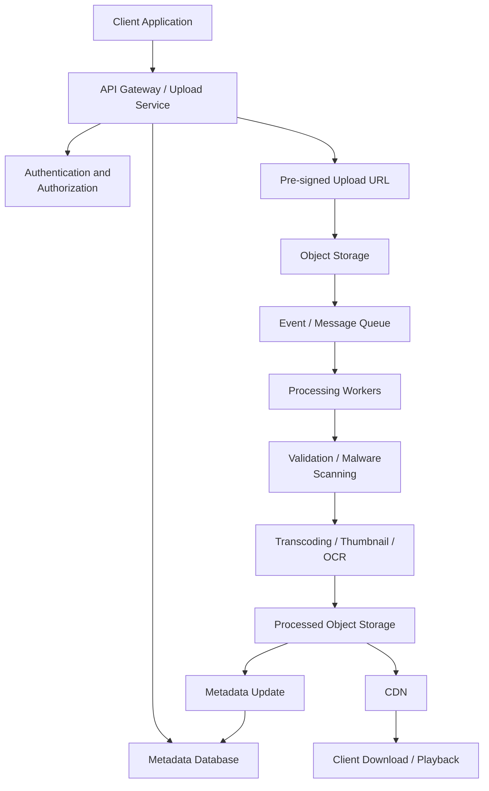

# Pattern: File Storage, Media Processing, and CDN Delivery

This is an important HLD system design pattern because it covers systems that need to accept files or media, store them reliably, process them asynchronously, and deliver them efficiently to users across devices and regions.

The pattern appears in cloud storage, social media, messaging, video streaming, document management, and video conferencing products.

I have grouped the problems into six categories so you can understand which ones are core problems, which are variations, and which introduce additional design concepts.

# 1. Cloud file storage and synchronization

These are the foundational problems in this pattern. They focus on uploading, storing, organizing, downloading, sharing, and synchronizing files.

## 1.1 Dropbox — Cloud file storage and synchronization

Must solve

Problem: Design a cloud-based file storage system like Dropbox.

Users should be able to upload files, organize them into folders, download them, share them, and synchronize changes across multiple devices.

Core requirements:

- Upload and download files of different sizes.
- Organize files into folders.
- Synchronize file changes across devices.
- Support file versioning and recovery.
- Share files and folders with other users.
- Support large files and interrupted uploads.

Important design challenges:

- Chunked and resumable uploads.
- File metadata versus actual binary storage.
- Delta synchronization and change detection.
- Conflict resolution when multiple devices modify a file.
- File versioning and deduplication.
- Consistency between devices.
- Notifications when files change.

What this problem tests: Object storage, metadata databases, synchronization protocols, distributed locking or conflict resolution, event-driven architecture, and access control.

## 1.2 Google Drive — Cloud storage and file sharing

Must solve

Problem: Design a cloud storage platform like Google Drive.

Users can upload documents, images, videos, and other files. They can organize files, search for them, share them, and access them from different devices.

Core requirements:

- Upload and download files.
- Create folders and organize files.
- Share files with users or groups.
- Support public and restricted sharing.
- Search files by name, type, owner, and other metadata.
- Maintain versions and file activity history.
- Synchronize changes across devices.

Important design challenges:

- Hierarchical folder representation.
- Permission inheritance from folders.
- File ownership and sharing permissions.
- Metadata indexing and search.
- Version history and recovery.
- Concurrent updates.
- Access control for shared links.

What makes it different from Dropbox: Google Drive puts additional emphasis on sharing, permissions, searching, and integration with document collaboration.

## 1.3 OneDrive / Box — Enterprise cloud file storage

Problem: Design an enterprise file storage platform like Microsoft OneDrive or Box.

Organizations need to store, access, share, and manage documents securely.

Core requirements:

- Personal and organization-level storage.
- Team folders and shared workspaces.
- Role-based access control.
- External file sharing.
- File versioning and recovery.
- Audit logs and activity tracking.
- Retention policies.

Important design challenges:

- Organization and tenant isolation.
- Fine-grained permissions.
- Access revocation.
- Data encryption and key management.
- Auditability and compliance.
- Data retention and deletion policies.
- Integration with enterprise identity providers.

What makes it different: Enterprise security, multi-tenancy, compliance, and administrative controls become central to the design.

## 1.4 File sharing service — Share files through links

Problem: Design a service that allows users to upload files and generate shareable URLs.

Think of the file-sharing functionality in Dropbox, Google Drive, or services such as WeTransfer.

Core requirements:

- Upload files.
- Generate unique sharing links.
- Configure link expiration.
- Set download limits.
- Support password-protected links.
- Allow users to revoke access.

Important design challenges:

- Secure token generation.
- Public versus private access.
- Signed URLs.
- Link expiration.
- Abuse prevention and rate limiting.
- Download tracking.
- Revocation and caching.

What this problem tests: Secure file delivery, access control, URL-based authorization, and CDN integration.

## 1.5 Cloud backup service — iCloud / Google One

Problem: Design a cloud backup service that automatically backs up user data from phones, computers, or other devices.

Examples: iCloud and Google One.

Core requirements:

- Automatically back up files and device data.
- Support incremental backups.
- Restore data to a device.
- Maintain backup history.
- Support scheduled backups.
- Manage storage limits.

Important design challenges:

- Incremental and differential backups.
- Snapshot management.
- Deduplication.
- Backup consistency.
- Data encryption.
- Storage lifecycle management.
- Restore performance.
- Backup retention and deletion.

What makes it different: The focus is on reliable recovery and efficient incremental storage, rather than frequent interactive file sharing.

## 1.6 Amazon S3-style object storage

Problem: Design a distributed object storage service similar to Amazon S3.

Users and applications should be able to store and retrieve arbitrary objects at massive scale.

Core requirements:

- Upload and download objects.
- Organize objects using buckets and keys.
- Support large objects.
- Provide durability and availability.
- Support access policies.
- Support object versioning and lifecycle policies.

Important design challenges:

- Object storage architecture.
- Metadata management.
- Data replication and erasure coding.
- Partitioning and storage distribution.
- Consistency guarantees.
- Multipart uploads.
- Storage tiers.
- Durability and disaster recovery.

What makes it different: This is a foundational infrastructure problem rather than an end-user file synchronization product.

# 2. Photo and image storage systems

These problems introduce image ingestion, image processing, thumbnail generation, transformations, and optimized delivery.

## 2.1 Instagram — Photo upload and sharing

Must solve

Problem: Design the photo upload and sharing functionality of Instagram.

Users should be able to upload photos, apply transformations, publish posts, and view images uploaded by other users.

Core requirements:

- Upload single or multiple images.
- Support different image formats and sizes.
- Generate thumbnails and optimized versions.
- Store original images.
- Publish images to followers.
- Deliver images quickly across regions.

Important design challenges:

- Direct image uploads to object storage.
- Asynchronous image processing.
- Thumbnail and resolution generation.
- Image compression and format conversion.
- CDN integration.
- Feed image delivery.
- Handling viral images and hot content.

What makes it different: Image ingestion and processing are closely integrated with a social feed. The feed itself is a separate but related system design problem.

## 2.2 Google Photos — Photo backup and gallery

High priority

Problem: Design a photo management and backup service like Google Photos.

Users can automatically back up photos and videos, organize them, search for them, and access them across devices.

Core requirements:

- Automatic photo and video backup.
- Organize media by date, location, and album.
- Generate thumbnails.
- Search photos.
- Share albums.
- Delete or restore media.
- Access media across devices.

Important design challenges:

- Background uploads from mobile devices.
- Duplicate detection.
- Metadata extraction, such as EXIF.
- Face and object recognition.
- Geolocation-based organization.
- Thumbnail generation.
- Efficient media search.
- Storage quotas and retention.

What makes it different: It combines file storage with metadata extraction, AI-based indexing, and personal media organization.

## 2.3 Snapchat — Ephemeral photo and video sharing

Problem: Design the media sharing and Stories functionality of Snapchat.

Users send photos and videos that may disappear after viewing or after a defined period.

Core requirements:

- Upload images and videos.
- Send media to individuals or groups.
- Support view-once or limited-view media.
- Create time-limited Stories.
- Expire media automatically.

Important design challenges:

- Expiration management.
- Temporary access tokens.
- Media deletion and retention.
- View-state tracking.
- Caching of temporary content.
- Preventing unauthorized access after expiration.

What makes it different: Content lifecycle and expiration are key parts of the system.

## 2.4 Image hosting and transformation service — Cloudinary

Problem: Design an image hosting and transformation platform like Cloudinary.

Applications upload images once and request different optimized versions on demand.

Core requirements:

- Upload and store images.
- Generate different resolutions.
- Crop, resize, and compress images.
- Convert image formats.
- Deliver optimized images through a CDN.
- Cache transformed versions.

Important design challenges:

- On-demand versus pre-generated transformations.
- Transformation pipelines.
- Cache key design.
- Duplicate transformation avoidance.
- CDN cache invalidation.
- Image format negotiation.
- Processing cost management.

What makes it different: The core problem is building an image processing and delivery platform that other applications can consume.

## 2.5 Pinterest — Image ingestion and visual discovery

Problem: Design the image storage and media processing side of Pinterest.

Users save images and links from different sources into boards and discover visual content.

Core requirements:

- Ingest images from URLs and user uploads.
- Generate image thumbnails.
- Organize images into boards.
- Search and discover images.
- Serve different image resolutions.

Important design challenges:

- URL-based image ingestion.
- Handling unreliable external image sources.
- Deduplication.
- Metadata extraction.
- Image resizing.
- CDN distribution.
- Image indexing and search.

What makes it different: It adds externally sourced media ingestion and visual discovery to the standard image storage workflow.

# 3. Video storage, processing, and streaming systems

This is one of the most important categories for HLD interviews. Video systems introduce large-scale uploads, transcoding, adaptive bitrate streaming, content distribution, and playback.

## 3.1 YouTube — User-generated video platform

Must solve

Problem: Design YouTube.

Users upload videos, the platform processes them, and viewers stream videos from different devices.

Core requirements:

- Upload large video files.
- Support resumable uploads.
- Process videos into multiple resolutions.
- Generate thumbnails.
- Support video metadata and search.
- Stream videos to users globally.
- Track views, likes, and engagement.

Important design challenges:

- Large file uploads.
- Multipart and resumable upload.
- Video transcoding pipelines.
- Multiple codecs and resolutions.
- Adaptive bitrate streaming.
- HLS/DASH manifests and segments.
- CDN-based delivery.
- Asynchronous processing.
- Viral video traffic and hot content.

What this problem tests: End-to-end media architecture, object storage, asynchronous processing, distributed queues, transcoding, and CDN delivery.

## 3.2 Netflix — Video-on-demand streaming

Must solve

Problem: Design a video streaming platform like Netflix.

Users browse a catalog of movies and TV shows and stream content on different devices.

Core requirements:

- Browse and search video catalog.
- Stream movies and TV episodes.
- Support different resolutions.
- Resume playback across devices.
- Support subtitles and multiple audio tracks.
- Support regional availability.
- Control access through subscriptions.

Important design challenges:

- Content ingestion and transcoding.
- Adaptive bitrate streaming.
- Global CDN distribution.
- Regional content delivery.
- DRM and content protection.
- Playback authorization.
- Watch progress synchronization.
- Pre-positioning popular content.
- Managing peak demand.

What makes it different from YouTube:

| YouTube                                       | Netflix                                      |
| --------------------------------------------- | -------------------------------------------- |
| Primarily user-generated content              | Primarily licensed or produced catalog       |
| Continuous content uploads                    | More controlled content ingestion            |
| Huge variety of upload formats                | More controlled encoding requirements        |
| Monetization and creator workflows            | Subscription and entitlement management      |
| Large number of independently uploaded videos | Catalog and regional availability management |

Both share a similar media processing and playback architecture, but their business requirements are different.

## 3.3 TikTok / Instagram Reels — Short-video platform

Problem: Design a short-video upload and streaming platform like TikTok or Instagram Reels.

Users upload short videos, watch an endless feed, and interact with content.

Core requirements:

- Upload short videos.
- Process and transcode videos.
- Generate video thumbnails.
- Support continuous video playback.
- Provide personalized video feeds.
- Track engagement.

Important design challenges:

- High-volume video ingestion.
- Fast transcoding.
- Preloading the next videos.
- Adaptive bitrate streaming.
- CDN caching.
- Personalized content delivery.
- Low startup latency.
- Video moderation.

What makes it different: The playback experience and recommendation feed are especially important. A good media pipeline alone is not sufficient.

## 3.4 Twitch — Live video streaming

Problem: Design a live streaming platform like Twitch.

Creators broadcast live video, and viewers watch streams in near real time.

Core requirements:

- Stream live video from creators.
- Support thousands or millions of viewers.
- Provide low-latency playback.
- Support live chat.
- Allow stream recording and replay.
- Support creator and viewer interactions.

Important design challenges:

- Live video ingestion.
- Real-time transcoding.
- Segmentation and packaging.
- Low-latency HLS or other live delivery protocols.
- CDN distribution.
- Stream fan-out.
- Viewer synchronization.
- Live stream failure recovery.

What makes it different: Unlike YouTube and Netflix, media is produced and consumed simultaneously. Latency and live fan-out become important.

## 3.5 YouTube Live — Live streaming at massive scale

Problem: Design a platform that allows users to broadcast live videos to a massive audience.

Core requirements:

- Accept live video streams.
- Convert incoming streams into multiple quality levels.
- Distribute streams to viewers globally.
- Handle sudden viewer spikes.
- Support recording and replay.

Important design challenges:

- Stream ingestion endpoints.
- Transcoding and packaging.
- Live stream distribution.
- CDN edge delivery.
- Stream health monitoring.
- Latency versus scalability trade-offs.
- Live-to-VOD conversion.

Difference from Twitch: The core architecture overlaps heavily. The emphasis may vary depending on whether the interviewer focuses on creator streaming, live events, or large-scale broadcasts.

## 3.6 Video-on-demand platform — Generic VOD service

Problem: Design a video-on-demand platform where content providers upload videos and customers stream them.

Core requirements:

- Upload video assets.
- Process and encode them.
- Maintain video catalog metadata.
- Stream different quality levels.
- Provide content access control.

Important design challenges:

- Media ingestion.
- Encoding profiles.
- Transcoding queues.
- Manifest generation.
- Segment storage.
- CDN caching.
- Playback session management.

Why include this separately: It is a useful way to practise video processing and streaming architecture without Netflix-specific subscription and catalog complexity.

## 3.7 Offline video downloads

Problem: Design offline video downloads for a streaming application.

Users can download videos on their devices and watch them without an internet connection.

Core requirements:

- Download selected content.
- Support resumable downloads.
- Track download status.
- Enforce download expiration.
- Allow content deletion.
- Support multiple devices.

Important design challenges:

- Download authorization.
- DRM and encrypted offline content.
- Local storage management.
- Download synchronization.
- Expiry and license renewal.
- Partial download recovery.

What makes it different: It combines CDN delivery with client-side storage, licensing, and synchronization.

# 4. Messaging and collaboration media systems

These systems primarily use file and media storage as part of messaging or collaboration workflows.

## 4.1 WhatsApp — Media sharing in messaging

Must solve

Problem: Design the media upload, storage, and delivery functionality of WhatsApp.

Users send photos, videos, documents, voice notes, and other files in conversations.

Core requirements:

- Send and receive media attachments.
- Support images, videos, documents, and audio.
- Upload media efficiently.
- Deliver media to multiple recipients.
- Support media downloads.
- Support retrying failed uploads and downloads.
- Support disappearing media where applicable.

Important design challenges:

- Media metadata and message metadata separation.
- Asynchronous media uploads.
- Object storage.
- CDN or regionally optimized delivery.
- Encryption and authorization.
- Thumbnail and preview generation.
- Media expiration and deletion.
- Group message fan-out.
- Delivery and download status.

What this problem tests: How to integrate media storage and delivery with a distributed messaging system.

## 4.2 Telegram — Large file sharing and messaging

Problem: Design Telegram's file and media sharing infrastructure.

Users can send large files and media attachments through individual and group conversations.

Core requirements:

- Upload and share large files.
- Support different media types.
- Download files on multiple devices.
- Access previously shared media.
- Support groups and channels.

Important design challenges:

- Large file upload and download.
- Distributed object storage.
- File identifiers and metadata.
- Chunked downloads.
- Access authorization.
- Multi-device synchronization.
- Caching popular files.

What makes it different: Large-file sharing and cross-device accessibility are especially important.

## 4.3 Slack — File attachments and sharing

Problem: Design the file-sharing functionality of Slack.

Users upload documents, images, videos, and other files and share them in conversations and channels.

Core requirements:

- Upload files.
- Attach files to messages.
- Share files with individuals and channels.
- Preview files.
- Search shared files.
- Enforce workspace permissions.

Important design challenges:

- Workspace and tenant isolation.
- Message-to-file references.
- Permission inheritance.
- File preview generation.
- Search indexing.
- Retention policies.
- Secure downloads.

What makes it different: File access is closely tied to workspace membership, channels, and message permissions.

## 4.4 Discord — Media and attachment delivery

Problem: Design Discord's media and file attachment infrastructure.

Users share images, videos, and files in channels and direct messages.

Core requirements:

- Upload attachments.
- Share them in messages.
- Preview media.
- Support large numbers of concurrent users.
- Enforce upload limits.

Important design challenges:

- Upload throughput.
- CDN delivery.
- Media previews.
- Permission checks.
- Content moderation.
- Storage quotas and retention.

## 4.5 Email attachment service

Problem: Design a scalable email attachment storage and delivery system.

Users should be able to send and receive emails containing attachments.

Core requirements:

- Upload attachments.
- Associate attachments with email messages.
- Support large attachments.
- Download attachments.
- Scan attachments for malware.
- Enforce attachment size limits.

Important design challenges:

- Attachment storage versus email body storage.
- Malware scanning.
- Attachment deduplication.
- Secure access.
- Download links for large attachments.
- Retention and deletion.
- Message delivery integration.

What makes it different: Email delivery and attachment storage have different lifecycles and reliability requirements.

# 5. Document processing and meeting recordings

These problems are especially relevant to enterprise and productivity system design.

## 5.1 Document upload and management system

Must solve

Problem: Design a generic document upload and management platform.

Users upload PDFs, Word documents, Excel files, images, and other documents. The system processes, stores, and makes them accessible.

Core requirements:

- Upload different document types.
- Store original documents.
- Generate document previews.
- Download and share documents.
- Search document metadata.
- Maintain version history.

Important design challenges:

- File validation.
- Content-type detection.
- Malware scanning.
- Metadata extraction.
- Preview generation.
- OCR for scanned documents.
- Full-text indexing.
- Version management.
- Access control.

What this problem tests: A combination of cloud file storage, asynchronous processing, document metadata, and secure access.

## 5.2 Document processing pipeline — PDF/OCR processing

Problem: Design a document processing service that accepts uploaded files and extracts useful information.

For example, users upload scanned PDFs, invoices, contracts, or business documents.

Core requirements:

- Accept document uploads.
- Validate document formats.
- Extract text and metadata.
- Perform OCR when necessary.
- Generate previews.
- Store extracted content.
- Notify users when processing finishes.

Important design challenges:

- Asynchronous processing.
- OCR workers.
- Document classification.
- Processing retries.
- Large-document handling.
- Queue management.
- Idempotency.
- Dead-letter queues.
- Search indexing.
- Tracking processing status.

What makes it different: The main focus is not media delivery, but a reliable document-processing pipeline.

This is also a useful foundation for document intelligence and RAG platforms.

## 5.3 Zoom — Cloud meeting recordings

High priority

Problem: Design cloud recording functionality for Zoom.

Users record meetings, upload recordings, and access them later.

Core requirements:

- Record audio and video.
- Upload recordings to cloud storage.
- Support large recording files.
- Process and publish recordings.
- Generate playback links.
- Support recording downloads.
- Control recording access.

Important design challenges:

- Large video file uploads.
- Interrupted recording uploads.
- Audio/video synchronization.
- Asynchronous transcoding.
- Thumbnail generation.
- Recording metadata.
- Playback authorization.
- Recording retention.
- Download and streaming delivery.

What makes it different: Recording starts with a live meeting, but the resulting content enters a VOD-like processing and delivery pipeline.

## 5.4 Google Meet / Microsoft Teams — Meeting recording

Problem: Design a cloud meeting recording service for Google Meet or Microsoft Teams.

Core requirements:

- Record meetings.
- Store audio and video recordings.
- Generate playable recordings.
- Support meeting transcripts.
- Share recordings with participants.
- Apply retention policies.

Important design challenges:

- Recording orchestration.
- Meeting participant authorization.
- Audio/video processing.
- Transcription pipelines.
- Recording access permissions.
- Storage lifecycle.
- Searchable transcripts.

Difference from Zoom: The system may emphasize meeting collaboration, identity, organization-level policies, and integration with documents and transcripts.

## 5.5 E-signature and document workflows — DocuSign

Problem: Design a document upload, signing, and storage service like DocuSign.

Users upload documents, request signatures, and access finalized documents.

Core requirements:

- Upload documents.
- Create signing workflows.
- Allow multiple participants to sign.
- Maintain document versions.
- Generate finalized documents.
- Store signed documents securely.
- Track document history.

Important design challenges:

- Document version integrity.
- Workflow orchestration.
- Access control.
- Audit logs.
- Secure document delivery.
- Signature verification.
- Retention policies.

What makes it different: The important part is maintaining an auditable, secure document lifecycle, not just storing and serving files.

## 5.6 Enterprise content management — SharePoint

Problem: Design an enterprise content management platform like SharePoint.

Organizations store, organize, share, and manage documents across teams.

Core requirements:

- Document libraries.
- Team folders.
- Permissions.
- Version history.
- Document search.
- Approval workflows.
- Retention and compliance.

Important design challenges:

- Multi-tenant architecture.
- Permission inheritance.
- Document lifecycle.
- Audit logs.
- Metadata indexing.
- Workflow processing.
- Compliance and retention.

# 6. Media infrastructure and specialized system design problems

These are not always standalone product design questions, but they are important interview topics. They may be asked independently or as deeper parts of Dropbox, YouTube, Netflix, Instagram, and WhatsApp.

## 6.1 CDN design — Content Delivery Network

Must understand

Problem: Design a global CDN that delivers static files, images, videos, and other content to users with low latency.

Core requirements:

- Distribute content across edge locations.
- Serve content from nearby locations.
- Cache frequently accessed content.
- Support cache expiration and invalidation.
- Support origin servers.
- Handle cache misses.

Important design challenges:

- Cache hierarchy.
- Origin shielding.
- Cache invalidation.
- Cache key design.
- Hot content.
- Geographic routing.
- Edge storage capacity.
- Availability and failover.
- Signed URLs and access control.

What this problem tests: Distributed caching, networking, geographic routing, and large-scale content delivery.

## 6.2 Media transcoding service

Problem: Design a distributed service that converts uploaded media into different formats, sizes, resolutions, and bitrates.

Core requirements:

- Accept media-processing jobs.
- Process media asynchronously.
- Generate multiple output formats.
- Track job status.
- Retry failed jobs.
- Store generated output.

Important design challenges:

- Worker pools.
- Job queues.
- CPU/GPU-intensive processing.
- Parallel processing.
- Job prioritization.
- Idempotency.
- Retry and dead-letter handling.
- Processing orchestration.
- Output metadata management.

What this problem tests: Event-driven architecture, distributed job processing, scalability, and fault tolerance.

## 6.3 Resumable large-file upload service

Problem: Design an upload service that reliably accepts files ranging from a few megabytes to several gigabytes, even when clients have unstable connections.

Core requirements:

- Multipart upload.
- Resume interrupted uploads.
- Track upload progress.
- Validate uploaded parts.
- Finalize uploaded files.
- Expire abandoned uploads.

Important design challenges:

- Chunk sizing.
- Upload sessions.
- Part identifiers and checksums.
- Parallel uploads.
- Retry behavior.
- Idempotent completion.
- Partial upload cleanup.
- Temporary storage management.

Why this deserves a separate problem: It is a frequently reused building block in Dropbox, YouTube, Google Drive, and Zoom.

## 6.4 Malware scanning and file validation service

Problem: Design a service that scans files uploaded by users before making them available.

Core requirements:

- Validate file type and size.
- Scan for malware.
- Quarantine suspicious files.
- Track scanning status.
- Reject unsafe content.
- Notify users of failures.

Important design challenges:

- Isolated scanning workers.
- Asynchronous processing.
- Quarantine storage.
- Processing timeouts.
- Retry behavior.
- Virus signature updates.
- File lifecycle management.
- Preventing access before scanning completes.

What this problem tests: Secure ingestion pipelines and asynchronous processing.

## 6.5 Media moderation pipeline

Problem: Design a moderation service that examines uploaded images and videos for policy violations before or after publication.

Core requirements:

- Process uploaded images and videos.
- Identify prohibited or inappropriate content.
- Support automated and human review.
- Track moderation status.
- Prevent restricted media from being published.

Important design challenges:

- Asynchronous moderation.
- Video frame extraction.
- Content classification.
- Human review queues.
- Moderation status management.
- Reprocessing and appeals.
- Publishing gates.

What makes it different: The system must integrate processing results into the media publication lifecycle.

## 6.6 Audio streaming platform — Spotify / SoundCloud

Problem: Design an audio upload and streaming platform like Spotify or SoundCloud.

Core requirements:

- Upload and store audio files.
- Transcode audio into different formats and bitrates.
- Stream audio to users.
- Support playlists and libraries.
- Resume playback.
- Deliver audio globally.

Important design challenges:

- Audio encoding.
- Segment-based delivery.
- CDN caching.
- Playback sessions.
- Audio metadata.
- Regional content restrictions.
- Offline downloads.
- Content licensing and authorization.

What makes it different: Similar to video streaming, but audio introduces different encoding, bandwidth, and playback requirements.

## 6.7 Podcast hosting and distribution

Problem: Design a platform that allows creators to upload podcast episodes and distribute them to listeners.

Core requirements:

- Upload audio episodes.
- Generate different audio formats.
- Store episode metadata.
- Publish RSS feeds.
- Stream and download episodes.
- Track analytics.

Important design challenges:

- Audio processing.
- RSS feed generation.
- CDN delivery.
- Episode versioning.
- Feed updates.
- Analytics and download tracking.
- Large-scale distribution.

What makes it different: Content publishing and RSS distribution are important alongside audio streaming.

# 7. Complete problem catalogue and interview priority

Here is the consolidated list. The priority indicates how much attention I would give each problem when preparing for general senior backend/system design interviews. It is a preparation recommendation, not a claim about a particular company's interview frequency.

| #  | Problem                                       | Category           | Priority        |
| -- | --------------------------------------------- | ------------------ | --------------- |
| 1  | Dropbox — Cloud file storage and sync         | Cloud storage      | Must solve      |
| 2  | Google Drive — File storage and sharing       | Cloud storage      | Must solve      |
| 3  | OneDrive / Box — Enterprise file storage      | Cloud storage      | Important       |
| 4  | File sharing through secure links             | Cloud storage      | Important       |
| 5  | Amazon S3 — Object storage                    | Infrastructure     | Important       |
| 6  | Cloud backup — iCloud / Google One            | Cloud storage      | Important       |
| 7  | Google Photos — Photo backup and gallery      | Images             | Important       |
| 8  | Instagram — Photo upload and sharing          | Images             | Must solve      |
| 9  | Snapchat — Ephemeral media sharing            | Images / messaging | Additional      |
| 10 | Cloudinary — Image hosting and transformation | Images             | Important       |
| 11 | Pinterest — Image ingestion and discovery     | Images             | Additional      |
| 12 | YouTube — User-generated video platform       | Video              | Must solve      |
| 13 | Netflix — Video-on-demand streaming           | Video              | Must solve      |
| 14 | TikTok / Reels — Short-video platform         | Video              | Important       |
| 15 | Twitch — Live video streaming                 | Video              | Important       |
| 16 | YouTube Live — Live video streaming           | Video              | Important       |
| 17 | Generic VOD platform                          | Video              | Important       |
| 18 | Offline video downloads                       | Video              | Additional      |
| 19 | WhatsApp — Media sharing                      | Messaging          | Must solve      |
| 20 | Telegram — Large file sharing                 | Messaging          | Additional      |
| 21 | Slack — File attachments                      | Collaboration      | Important       |
| 22 | Discord — Media attachments                   | Collaboration      | Additional      |
| 23 | Email attachment service                      | Collaboration      | Additional      |
| 24 | Document upload and management                | Documents          | Must solve      |
| 25 | PDF / OCR document processing pipeline        | Documents          | Important       |
| 26 | Zoom — Cloud meeting recordings               | Recordings         | Important       |
| 27 | Google Meet / Teams — Meeting recordings      | Recordings         | Additional      |
| 28 | DocuSign — Signing and document workflows     | Documents          | Additional      |
| 29 | SharePoint — Enterprise content management    | Documents          | Additional      |
| 30 | CDN — Global content delivery                 | Infrastructure     | Must understand |
| 31 | Distributed media transcoding service         | Infrastructure     | Must understand |
| 32 | Resumable large-file upload service           | Infrastructure     | Must understand |
| 33 | Malware scanning and file validation          | Infrastructure     | Important       |
| 34 | Media moderation pipeline                     | Infrastructure     | Important       |
| 35 | Spotify / SoundCloud — Audio streaming        | Audio              | Additional      |
| 36 | Podcast hosting and distribution              | Audio              | Additional      |

# 8. Recommended preparation order

I would not recommend solving all 36 as completely independent systems. Many share the same underlying architecture. Instead, master the foundational problems and then practise the variations.

| Order | Problem                         | Concepts you should master                       |
| ----- | ------------------------------- | ------------------------------------------------ |
| 1     | Dropbox                         | File storage, metadata, sync, versioning         |
| 2     | Google Drive                    | Folder hierarchy, sharing, permissions, search   |
| 3     | Resumable upload service        | Multipart upload, checksums, retries             |
| 4     | Instagram photo upload          | Image processing, thumbnails, CDN                |
| 5     | Google Photos                   | Automatic backup, metadata, deduplication        |
| 6     | YouTube                         | Video ingestion, transcoding, streaming          |
| 7     | Netflix                         | VOD, adaptive bitrate, global CDN, DRM           |
| 8     | WhatsApp media                  | Message attachments, secure delivery             |
| 9     | Document processing pipeline    | OCR, asynchronous workers, indexing              |
| 10    | Zoom recordings                 | Recording ingestion, processing, playback        |
| 11    | CDN                             | Distributed caching, edge delivery, invalidation |
| 12    | Twitch                          | Live streaming, low latency, fan-out             |
| 13    | Cloudinary                      | Image transformations, cache management          |
| 14    | Enterprise file storage         | Tenant isolation, permissions, compliance        |
| 15    | Malware scanning and moderation | Secure ingestion and publishing workflows        |

This sequence deliberately starts with file storage, moves to images and video, and then covers media delivery and processing infrastructure.

# 9. Architecture concepts you should master across this pattern

The most important preparation insight is that these problems share a common set of architectural building blocks.

A typical media ingestion and delivery architecture looks like this:

You should be comfortable explaining the following concepts and the trade-offs involved.

| Area            | Concepts to master                                                                   |
| --------------- | ------------------------------------------------------------------------------------ |
| Upload          | Direct upload, pre-signed URLs, multipart uploads, resumable uploads                 |
| Storage         | Object storage, metadata database, replication, durability                           |
| Processing      | Message queues, worker pools, asynchronous processing, retries                       |
| Media           | Transcoding, compression, thumbnails, image transformations                          |
| Streaming       | HLS, MPEG-DASH, adaptive bitrate streaming, segmentation                             |
| Delivery        | CDN, edge caching, origin servers, cache invalidation                                |
| Synchronization | File versions, change detection, delta sync, conflict resolution                     |
| Security        | Signed URLs, authentication, authorization, encryption, malware scanning             |
| Reliability     | Idempotency, retries, dead-letter queues, processing status                          |
| Lifecycle       | Expiration, retention, deletion, archival, storage tiering                           |
| Scalability     | Hot objects, traffic spikes, partitioning, regional distribution                     |
| Observability   | Upload success rates, processing latency, playback startup time, CDN cache hit ratio |

## 10. Important distinctions: problems that look similar but test different concepts

These distinctions are particularly useful during interviews because they help you identify the actual problem instead of designing the same architecture for every question.

| Similar problems                       | Key difference                                                              |
| -------------------------------------- | --------------------------------------------------------------------------- |
| Dropbox vs Google Drive                | Synchronization and versioning vs sharing, permissions, and collaboration   |
| Dropbox vs Amazon S3                   | End-user file experience vs underlying object storage infrastructure        |
| Instagram vs Google Photos             | Social publishing and feed delivery vs personal backup and organization     |
| YouTube vs Netflix                     | User-generated media ingestion vs controlled VOD content distribution       |
| YouTube vs TikTok                      | Video hosting and search vs short-video playback and personalized discovery |
| Netflix vs Twitch                      | On-demand streaming vs live streaming                                       |
| WhatsApp vs Slack                      | Personal/group messaging attachments vs workspace and channel permissions   |
| Zoom recordings vs YouTube             | Meeting-generated recordings vs user-generated video publishing             |
| Cloudinary vs CDN                      | Media transformation and optimization vs content delivery and caching       |
| Document upload vs document processing | Secure ingestion and storage vs extraction, OCR, and indexing               |
| File sharing vs Dropbox                | Secure link-based delivery vs full file synchronization and management      |

## My recommendation

For a senior backend/system design interview, I would prioritize these 10 foundational problems:

1. Dropbox
2. Google Drive
3. Instagram Photo Upload
4. YouTube
5. Netflix
6. WhatsApp Media Sharing
7. Generic Document Upload and Processing
8. Zoom Cloud Recordings
9. CDN
10. Resumable Large File Upload

Once you can design these thoroughly, most of the remaining problems become variations of concepts you have already mastered.

The goal should not be to memorize 36 architectures. It should be to understand the shared lifecycle:

Ingest → Validate → Store → Process → Index → Authorize → Deliver → Expire/Delete.

That lifecycle, combined with the differences in synchronization, media processing, access control, and delivery requirements, is the foundation of this entire HLD pattern.

