## 1. Opening hook

In 2008, a database corruption stopped Netflix from shipping DVDs for three days. That outage pushed them off their own data centers and onto AWS. A few years later, streaming had a bigger problem: Netflix was roughly a third of US evening internet traffic, and ISPs were buckling under it. So Netflix built its own CDN, Open Connect, and put the servers inside the ISPs' networks.

## 2. Clarifying questions

Each question has one line on how the answer changes the design.

1. **Is the scope viewer-side only, or does it include studio ingest and transcoding?**
   Viewer-only keeps us on delivery and metadata. Including ingest adds a DAG-style workflow pipeline and a big compute fleet.

2. **Is live streaming in scope, or only on-demand?**
   On-demand lets us pre-position files before anyone watches. Live forces a real-time push pipeline and kills most of the caching tricks.

3. **Can we place our own cache servers inside ISPs, or must we use a third-party CDN?**
   Own boxes push us toward a purpose-built tiered CDN with off-peak fill. A third-party CDN reduces this to cache-control headers and cost tuning.

4. **How skewed is viewing?** Does a small head of titles take most traffic, or is the long tail significant?
   A heavy head means pre-positioning popular titles near viewers. A heavy tail means more cache misses and a deeper origin tier.

5. **Which devices and networks must we support?**
   Mixed TVs, phones, and flaky Wi-Fi mean multiple codecs and adaptive bitrate ladders. A single device class would simplify packaging a lot.

6. **How strict are licensing, DRM, and geo-restrictions?**
   Per-region catalogs and a license-key service put an auth step on every playback start. Without them, the playback path is much thinner.

7. **How fresh must watch history and resume position be across devices?**
   "Resume within a few seconds on a different device" means a write-heavy, low-latency store. "Eventually correct" lets us batch writes.

8. **Is the home page personalized in real time, or precomputed?**
   Precomputed rows mean we serve from a fast key-value store and treat the recommender as a black box. Real-time ranking pulls an online inference tier into scope.

9. **If the control plane (catalog, auth, recommendations) is down, should playback still work?**
   Yes means graceful degradation, with fallbacks and a client that can keep streaming. No means we can lean on simpler, strongly dependent calls.

## 3. Scope (draft, assuming defaults)

If you say "assume defaults," I'll take these answers: on-demand only, our own ISP-embedded CDN, a heavy-head popularity skew, many device types, and DRM and regional catalogs on. Home-page rows are precomputed, and playback survives a control-plane outage.

**P0**
- Play a title with fast startup and adaptive quality, worldwide.
- Browse a personalized home page and open a title's details.

**P1**
- Ingest a studio master and transcode it into many renditions.
- Track watch history and resume position across devices.

**P2, cut**
- **Live streaming:** a different pipeline entirely.
- **Search:** a separate indexing problem.
- **Billing and subscriptions:** a well-known payment flow, not unique to Netflix.
- **Recommendation model training:** we consume its output, not build it.
- **Downloads and ads tier:** extensions of the playback path.

**The crux: global video delivery.** Getting terabytes of video to millions of viewers without crushing the origin or the ISPs generates the most distributed-systems discussion. The questions are what content lives where, how it gets there, and how a client picks a server. Most of our time goes here.

Send me your answers, or say "assume defaults," and confirm or adjust the scope. Then I'll start V0.


-----------------------------------------------------------------------------------------------------------------------
-----------------------------------------------------------------------------------------------------------------------
-----------------------------------------------------------------------------------------------------------------------
-----------------------------------------------------------------------------------------------------------------------


## V0: the dumbest thing that works

Scope assumed: on-demand only, own ISP-embedded CDN, heavy-head popularity, many device types, DRM and regional catalogs on, precomputed home rows, playback survives a control-plane outage. In V0 we build only the P0 slice: browse a catalog and press play.

Picture a student named Dev who builds this over a weekend. He has 200 movie files, a Postgres database, and one server. That is V0.

**What V0 guarantees that later versions will trade away:**
- One source of truth. Every viewer sees the same catalog, instantly.
- Strong consistency. A title added in the database is visible on the next request.
- Nothing to debug except three boxes.

**What V0 deliberately skips:**
- Personalization. Every viewer gets the same genre rows.
- Multiple bitrates. Each title is one MP4 file.
- A CDN. Video comes straight from the blob store.
- DRM and regional catalogs. We add these later.

### Why these two storage classes

**Relational (Postgres) for the catalog.** Titles, genres and users are small, structured, and joined together. We need transactions and constraints, and the whole dataset fits on one machine.

**Blob store (S3) for video files.** A movie is a multi-gigabyte immutable file. We need cheap, durable bytes with HTTP range reads. A database is the wrong tool for that.

### Schema (first appearance, so shown in full)

```sql
-- Postgres, primary instance
CREATE TABLE users (
  user_id       BIGSERIAL PRIMARY KEY,
  email         TEXT UNIQUE NOT NULL,
  password_hash TEXT NOT NULL
);

CREATE TABLE titles (
  title_id        BIGSERIAL PRIMARY KEY,
  name            TEXT NOT NULL,
  synopsis        TEXT,
  release_year    INT,
  duration_sec    INT NOT NULL,
  maturity_rating TEXT,
  poster_key      TEXT NOT NULL,   -- S3 key for the poster image
  video_key       TEXT NOT NULL    -- S3 key for the single MP4
);

CREATE TABLE genres (
  genre_id SERIAL PRIMARY KEY,
  name     TEXT UNIQUE NOT NULL
);

CREATE TABLE title_genres (
  title_id BIGINT REFERENCES titles,
  genre_id INT    REFERENCES genres,
  PRIMARY KEY (title_id, genre_id)
);
```

### Who writes, who reads, where it lives

| Store | Lives in | Who writes, and when | Who reads, and when |
|---|---|---|---|
| Postgres `titles`, `genres`, `title_genres` | One RDS instance | A manual admin script, when a title is added | API Server, on every home or detail request |
| Postgres `users` | Same RDS instance | API Server, at signup | API Server, at login |
| S3 bucket `video-origin` | One AWS region | The admin script, once per title | The client app, directly, through a signed URL |
| S3 bucket `posters` | Same region | The admin script, once per title | The client app, directly, through a signed URL |

### Implement it

**Flow 1: browse the home page.**

```
GET /v1/home
Authorization: Bearer <jwt>
```

1. API Server validates the JWT. It is signed with a server secret, so there is no lookup.
2. API Server runs one query against Postgres:

```sql
SELECT g.name AS row_name, t.title_id, t.name, t.poster_key
FROM genres g
JOIN title_genres tg ON tg.genre_id = g.genre_id
JOIN titles t        ON t.title_id  = tg.title_id
ORDER BY g.name, t.release_year DESC;
```

3. API Server groups the rows by genre and signs a poster URL for each title.
4. API Server returns:

```json
{"rows":[{"name":"Thrillers","titles":[
  {"id":4411,"name":"Night Train","poster":"https://s3.../p/4411.jpg?X-Amz-Signature=..."}]}]}
```

**Flow 2: press play.**

```
POST /v1/titles/4411/playback
Authorization: Bearer <jwt>
```

1. API Server validates the JWT.
2. API Server reads `video_key` from `titles` for `title_id = 4411`.
3. API Server signs a 6-hour S3 URL:

```python
url = s3.generate_presigned_url(
    "get_object",
    Params={"Bucket": "video-origin", "Key": video_key},
    ExpiresIn=6 * 3600,
)
return {"url": url}
```

4. The client hands that URL to its video player.
5. The player fetches the file with HTTP range requests, such as `Range: bytes=0-1048575`. Seeking just means asking for a different byte range.

Our servers never touch video bytes. Only the small signed-URL call goes through them.

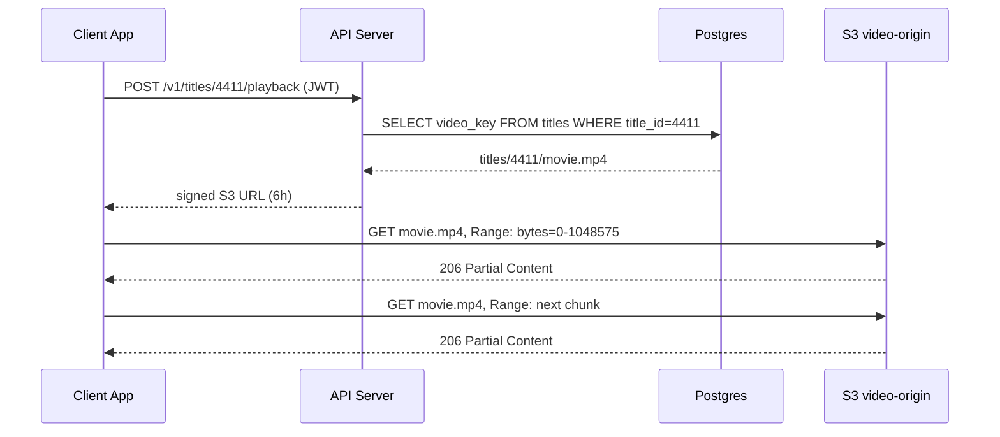

### Solve it: the trade in this design

- ✅ **What we gained:** it ships this weekend. Consistency is perfect. Video bytes skip our servers, so the API tier stays tiny.
- ⚠️ **What we gave up:**
  - Every viewer pulls from one S3 region, however far away they are.
  - One bitrate per title means a slow connection simply stalls.
  - The same hot file is served from origin to everyone.
  - Home rows are not personalized.
  - Nothing enforces licensing or DRM.
- ❌ **What we considered and rejected:**
  - Streaming video bytes through the API server. Our servers become the bottleneck for no benefit.
  - Storing video in Postgres. Wrong tool for huge immutable blobs.
  - Public, unsigned S3 URLs. Anyone could share a link and watch for free.

One more number, because it shapes everything. A 2-hour movie at 5 Mbps is about 4.5 GB. That is the unit we will be moving around.

### Current state after V0

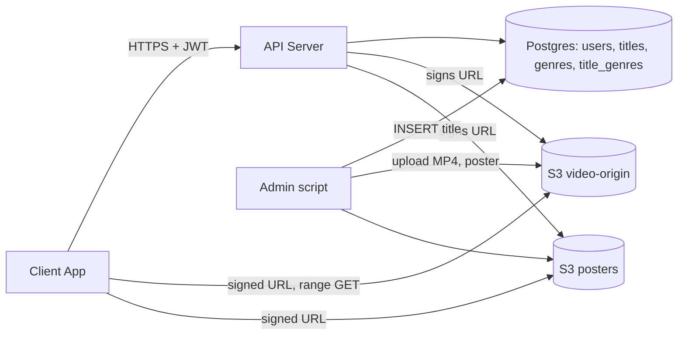

Everything above is new in V0.

**Every current flow:**
1. **Browse:** Client calls `GET /v1/home`. API Server runs the genre join on Postgres and signs poster URLs. It returns rows.
2. **Play:** Client calls `POST /v1/titles/{id}/playback`. API Server reads `video_key` and returns a signed S3 URL. Client range-reads the MP4 from S3 directly.
3. **Add a title (manual):** Admin script uploads the MP4 and poster to S3, then inserts into `titles` and `title_genres`.

### Interview follow-ups

**Why not stream video through your API servers?**
Video is gigabytes per viewer. Our servers would need to be sized for bandwidth rather than logic. Signed URLs keep our tier small and let storage serve bytes directly.

**Why range requests and not one big download?**
A viewer might seek, pause or quit at minute 10. Range reads fetch only what is needed, so the player starts fast and wastes nothing.

### Recap

| Concept | The Insight |
|---|---|
| Control plane vs data plane | API Server decides who may watch. Storage moves the bytes. Keeping them apart is the foundation of the whole design. |
| Signed URL | Authorization happens once, at the API. The expiring link carries that permission to the storage layer. |
| Range request | Playback is "give me bytes N to M." That is what makes seeking and fast startup possible. |
| Blob vs relational | Small structured metadata goes in Postgres. Huge immutable files go in object storage. |

**Interview-arc sentence:** *"The first Netflix is a catalog in Postgres plus MP4s in S3, with the API handing out signed URLs so video bytes never cross our servers. That is correct and simple, but every viewer pulls from one region at one bitrate."*

**Next:** Maria in Mumbai hits play on a 4.5 GB file hosted in Virginia, on a shaky 3G connection. Say "next" and we break V0 and fix it.


-----------------------------------------------------------------------------------------------------------------------
-----------------------------------------------------------------------------------------------------------------------
-----------------------------------------------------------------------------------------------------------------------
-----------------------------------------------------------------------------------------------------------------------


## V1: adaptive bitrate (one file becomes a ladder of short segments)

V0 broke in two ways for Maria in Mumbai: she is far from the server, and her connection is slow. This version fixes only the slow connection. Distance comes next, and the CDN will only help once the bytes themselves are the right shape.

### Break it

Maria is on a 3G connection that gives her about 1.5 Mbps. Our single MP4 is 5 Mbps.

- To watch 10 minutes, she must download 375 MB.
- At 1.5 Mbps, that takes about 33 minutes.
- So she spends roughly 23 of her first 33 minutes staring at a spinner.

It gets worse mid-stream. She walks into a lift and her speed drops to 400 kbps. One MP4 has no way to say "send me something smaller." The player can only stall.

Dev, on fibre, has the opposite problem. He could watch 4K, but we only have one bitrate to offer him.

### The idea, in plain language

Cut every movie into small pieces, a few seconds each. Encode the whole movie several times at different quality levels. Now the player can pick the quality for each piece, one piece at a time.

On a good connection it asks for the sharp version. When the connection drops, it asks for the next piece at lower quality. The picture gets blurrier, but it never freezes.

This is **adaptive bitrate streaming (ABR)**. The set of quality levels is called the **bitrate ladder**. Each level is a **rung**.

### Options considered

Asha and Ravi are debating the cheap fix.

> **Asha:** Just encode everything at 480p. Slow users are fine. Done.
> **Ravi:** Then Dev's 4K TV shows a blurry movie. And Maria's lift ride at 400 kbps still stalls.

| Option | Fast on slow links | Sharp on fast links | Adapts mid-stream | Cost |
|---|---|---|---|---|
| One low-bitrate file | Sometimes | No | No | Cheapest |
| Several whole files, user picks | Yes | Yes | No, switching restarts playback | Low |
| Segments plus a ladder, client picks per segment | Yes | Yes | Yes | Storage and transcode compute |

We take the third row. The second fails because a switch means seeking into a file at a byte offset that is not aligned to a keyframe.

### Implement it

**The ladder.** Five rungs, H.264 only for now.

| Rung | Resolution | Bitrate |
|---|---|---|
| 240p | 426x240 | 235 kbps |
| 360p | 640x360 | 560 kbps |
| 480p | 854x480 | 1050 kbps |
| 720p | 1280x720 | 2350 kbps |
| 1080p | 1920x1080 | 4300 kbps |

**Segment length is 4 seconds.** A 2-hour title is 1,800 segments per rung. That is 9,000 objects per title across five rungs. Total size is about 7.7 GB per title, versus 4.5 GB in V0. Keep the 9,000 in mind, because it matters later.

**S3 layout (first appearance, shown in full).**

```
video-origin/titles/4411/master.m3u8
video-origin/titles/4411/720p/playlist.m3u8
video-origin/titles/4411/720p/init.mp4
video-origin/titles/4411/720p/seg_00001.m4s
video-origin/titles/4411/720p/seg_00002.m4s
...
masters/4411/studio_master.mov
```

We use fragmented MP4 segments with HLS playlists. HLS is required for Apple devices. A DASH manifest can later be generated over the same segments.

**Schema delta (Postgres).**

```sql
ALTER TABLE titles DROP COLUMN video_key;
ALTER TABLE titles ADD COLUMN manifest_key TEXT;
-- e.g. 'titles/4411/master.m3u8'. NULL until the Packager finishes.
```

The rungs themselves live in the playlist files, not in Postgres. S3 is the source of truth for them.

**Step 1: the Packager (an ffmpeg script on one big box).** It runs once per title. Here is one rung:

```bash
ffmpeg -i studio_master.mov \
  -vf scale=-2:720 -c:v libx264 -b:v 2350k -maxrate 2500k -bufsize 5000k \
  -g 96 -keyint_min 96 -sc_threshold 0 \
  -c:a aac -b:a 128k \
  -f hls -hls_time 4 -hls_segment_type fmp4 -hls_playlist_type vod \
  -hls_fmp4_init_filename init.mp4 \
  -hls_segment_filename "720p/seg_%05d.m4s" 720p/playlist.m3u8
```

The flag `-g 96` at 24 fps forces a keyframe every 4 seconds. Every rung does this. Segment boundaries therefore line up across rungs, so the player can switch quality at any boundary without a visual glitch.

After all five rungs finish, the Packager does three things:
1. Uploads the segments and playlists to S3 `video-origin`.
2. Writes `master.m3u8` listing the rungs.
3. Runs `UPDATE titles SET manifest_key = 'titles/4411/master.m3u8' WHERE title_id = 4411`.

The master playlist, as stored in S3:

```
#EXTM3U
#EXT-X-STREAM-INF:BANDWIDTH=235000,RESOLUTION=426x240
240p/playlist.m3u8
#EXT-X-STREAM-INF:BANDWIDTH=560000,RESOLUTION=640x360
360p/playlist.m3u8
#EXT-X-STREAM-INF:BANDWIDTH=1050000,RESOLUTION=854x480
480p/playlist.m3u8
#EXT-X-STREAM-INF:BANDWIDTH=2350000,RESOLUTION=1280x720
720p/playlist.m3u8
#EXT-X-STREAM-INF:BANDWIDTH=4300000,RESOLUTION=1920x1080
1080p/playlist.m3u8
```

A media playlist, as stored:

```
#EXTM3U
#EXT-X-VERSION:7
#EXT-X-TARGETDURATION:4
#EXT-X-MAP:URI="init.mp4"
#EXTINF:4.000,
seg_00001.m4s
#EXTINF:4.000,
seg_00002.m4s
...
#EXT-X-ENDLIST
```

**Step 2: the signed-URL problem.** In V0, one presigned URL covered one file. Now a stream is about 1,800 separate objects, and the player fetches them as it goes. One URL no longer covers the stream.

Our fix is for the API Server to rewrite playlists on the way out. It fetches the stored playlist, swaps every relative path for a presigned S3 URL, and returns the result. Signing is an HMAC, so 1,800 signatures cost only milliseconds. This is a stopgap. Once a CDN exists, tokens replace per-segment signing.

**New API.**

```
POST /v1/titles/4411/playback
Authorization: Bearer <jwt>
-> {"manifest_url": "https://api.example.com/v1/titles/4411/master.m3u8?t=<token>"}
```

```python
def make_token(user_id, title_id):
    exp = int(time.time()) + 6 * 3600
    payload = f"{user_id}.{title_id}.{exp}"
    sig = hmac.new(SECRET, payload.encode(), "sha256").hexdigest()
    return f"{payload}.{sig}"
```

```
GET /v1/titles/4411/master.m3u8?t=<token>
GET /v1/titles/4411/720p/playlist.m3u8?t=<token>
```

Both endpoints verify the token's signature, expiry, and that its `title_id` matches the path. Then:

```python
def rewrite_master(body, title_id, token):
    return re.sub(
        r"^(\w+)/playlist\.m3u8$",
        lambda m: f"https://api.example.com/v1/titles/{title_id}/{m[1]}/playlist.m3u8?t={token}",
        body, flags=re.M)

def rewrite_media(body, title_id, rung):
    def sign(m):
        key = f"titles/{title_id}/{rung}/{m[1]}"
        return s3.generate_presigned_url(
            "get_object", Params={"Bucket": "video-origin", "Key": key},
            ExpiresIn=6 * 3600)
    return re.sub(r'(?<=URI=")([^"]+)(?=")|^(seg_\d+\.m4s)$', sign, body, flags=re.M)
```

**Step 3: the client decides the rung.** The server is deliberately dumb. All the intelligence runs in the player:

```
start at the lowest rung             # first segment is ~117 KB, so startup is fast
after each segment:
    measured = segment_bits / download_seconds
    ewma     = 0.8 * ewma + 0.2 * measured
    target   = highest rung with bitrate <= 0.8 * ewma
    if buffer_seconds < 10: target = one rung lower   # panic guard
    if target > current:    step up by one rung at most
    request the next segment from `target`
```

The 0.8 factor keeps 20% headroom. The one-rung-up rule stops the picture oscillating.

**Maria, replayed.**
- The first segment at 235 kbps is about 117 KB. At 1.5 Mbps that arrives in about 0.6 seconds, so she starts quickly.
- Her EWMA settles near 1.5 Mbps. The 480p rung (1050 kbps) fits under 0.8 × 1500 = 1200 kbps, so she gets 480p.
- In the lift, throughput falls to 400 kbps. The buffer shrinks, and the player drops to 240p. She sees a blur for a minute, with no stall.

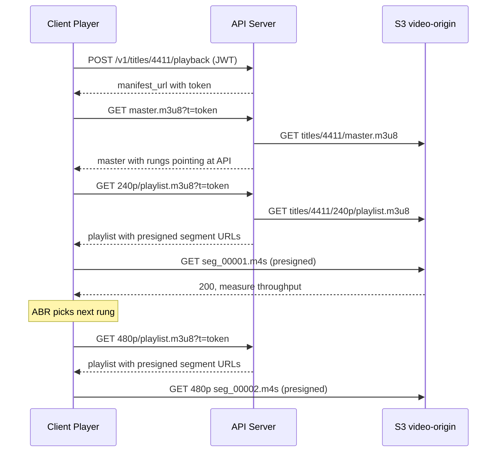

### Who writes, who reads

| Store | Lives in | Who writes, and when | Who reads, and when |
|---|---|---|---|
| S3 `masters` | One AWS region | Admin script, at title upload | Packager, once per title |
| S3 `video-origin` segments and playlists | Same region | Packager, after encoding | API Server (playlists, per play) and Client (segments, throughout playback) |
| Postgres `titles.manifest_key` | Same RDS instance | Packager, when packaging finishes | API Server, at playback start |

`masters` is a plain blob store, chosen for the same reason as `video-origin`: huge immutable files.

### Solve it: the trade in this design

- ✅ **What we gained:** Maria's stalls are gone. Quality follows the network second by second. Startup is fast because the first piece is tiny. The server stays simple, because all adaptation lives in the client.
- ⚠️ **What we gave up:**
  - About 1.7x more storage per title, and 9,000 objects instead of 1.
  - Transcoding takes hours on one box. It is manual and a bottleneck.
  - The API Server is now on the playback path for playlists. The bytes are small, but it is no longer only "sign once."
  - Everything still comes from one region, so Maria's round trip to Virginia is unchanged.
  - One ladder for every title. A cartoon and a dark thriller get the same bitrates.
- ❌ **What we considered and rejected:**
  - One low-bitrate file, which hurts the fast users and still stalls on a bad link.
  - Several whole files with a manual picker, because switching mid-stream breaks.
  - Server-side bitrate choice. The server cannot see the client's real network, and it would carry per-viewer state.

Per-title ladders and more codecs are later optimizations. They don't change the shape of the design.

### Current state after V1

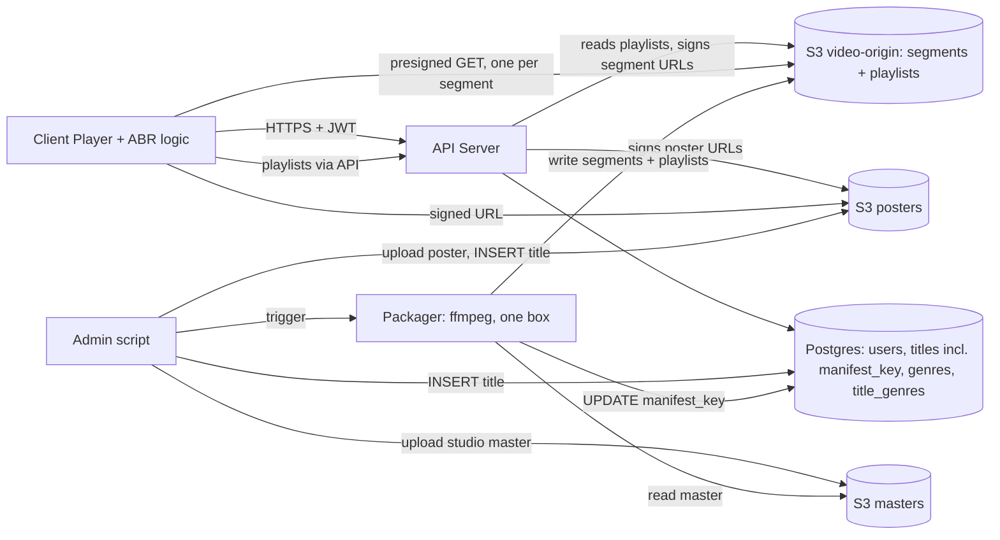

New in V1: the Packager, the `masters` bucket, `manifest_key`, segmented content in `video-origin`, and the ABR logic in the client.

**Every current flow:**
1. **Browse:** unchanged from V0. Client calls `GET /v1/home`, API Server runs the genre join, signs poster URLs, and returns rows.
2. **Play (changed):**
   1. Client calls `POST /v1/titles/{id}/playback` and gets a tokenized manifest URL.
   2. Client fetches the master playlist from the API Server, which rewrites rung paths to API URLs.
   3. Client fetches the media playlist for its chosen rung from the API Server, which rewrites segments to presigned S3 URLs.
   4. Client downloads segments directly from S3, measures throughput, and picks the rung for the next segment.
3. **Add a title (changed):**
   1. Admin script uploads the master to `masters` and the poster to `posters`, then inserts the `titles` row with `manifest_key` NULL.
   2. Packager encodes five rungs, uploads everything to `video-origin`, and sets `manifest_key`.

### Interview follow-ups

**Why does the client choose the bitrate, not the server?**
Only the client sees its real network and buffer. Client-side choice also keeps the server stateless per viewer. Millions of players can each run the same small loop with no coordination.

**Why 4-second segments and aligned keyframes?**
Shorter segments adapt faster but add more requests and lower compression efficiency. Longer ones are the reverse. About 4 seconds is a common middle. Aligned keyframes let the player switch rungs at any segment boundary without a glitch.

### Recap

| Concept | The Insight |
|---|---|
| Bitrate ladder | Encode the same movie at several quality levels so one title serves a lift and a 4K TV. |
| Segments | Short pieces make switching cheap. The player can change quality at every boundary. |
| Keyframe alignment | Every rung cuts at identical timestamps, so switching never breaks the picture. |
| Client-side ABR | The server publishes a menu. The player measures its own network and orders accordingly. |
| Many objects, many signatures | One presigned URL per file stopped working once a stream became 1,800 files. |

**Interview-arc sentence:** *"If asked how you stop a slow user stalling: a single MP4 can't adapt, so we pre-encode a ladder of 4-second segments, publish a manifest, and let the client pick a rung per segment from its measured throughput."*

**Next:** Maria no longer stalls, but every one of her 1,800 segments still travels from Virginia. On Friday night a million viewers will hit the same S3 bucket for the same hit series. Say "next" and we break that.


-----------------------------------------------------------------------------------------------------------------------
-----------------------------------------------------------------------------------------------------------------------
-----------------------------------------------------------------------------------------------------------------------
-----------------------------------------------------------------------------------------------------------------------


## V2: put a cache in front of the origin

V1 fixed the slow link. This version fixes only the shared origin. Distance to the viewer is partly solved here, but the deeper placement problem is V3.

### Break it

It is Friday, 9 pm. A new season of a hit series drops. 200,000 people press play within ten minutes.

Every one of them fetches a segment every 4 seconds. That is 50,000 GET requests per second against a handful of S3 key prefixes.

S3 supports roughly 5,500 GET/s per prefix. The rest get `503 SlowDown`. Players retry, retries add load, and the stream stalls for everyone.

The bandwidth is the second problem. One million concurrent viewers at about 3 Mbps is 3 Tbps leaving a single region. And the same 4 MB segment is being read 200,000 times.

### The idea, in plain language

A popular segment never changes. So fetch it from the origin once, keep a copy close to viewers, and serve the next 199,999 people from the copy.

That is a **cache**. A cache that fetches from the origin on a miss is a **pull-through cache**. A fleet of them near viewers is a **CDN**.

### The crux, first pass: three naive attempts

This is the crux of the whole design, so we walk the attempts.

**Attempt 1: scale up the origin.** Spread keys across more prefixes and add more S3 capacity.
It looked reasonable because S3 scales well.
It breaks on two things. Every byte still travels from Virginia to Mumbai, so latency is unchanged. And egress cost is paid 200,000 times for one segment.

**Attempt 2: replicate the entire catalog to every region.**

> **Asha:** Copy S3 to twenty regions. Everyone reads locally.
> **Ravi:** Each title is 7.7 GB. With 15,000 titles that is about 115 TB per region, times twenty. And 80% of it is never watched in a given region.

It looked reasonable because reads become local. It breaks on cost and on the long tail. We would pay to store and sync files nobody opens.

**Attempt 3: rely on the player's local cache.**
It looked reasonable because players already buffer. It breaks because viewers do not share caches. Dev's cached segment does nothing for Maria.

**What survives:** copy only what is actually watched, only where it is watched, and only when the first viewer asks. That is a pull-through cache with a heavy-head workload. Our skew assumption makes this pay off. About 500 titles at 7.7 GB is around 4 TB per edge node. We assume that covers about 90% of views.

| Option | Fixes origin load | Fixes distance | Storage cost | Handles long tail |
|---|---|---|---|---|
| Scale up origin | Partly | No | Low | Yes |
| Replicate everything everywhere | Yes | Yes | Very high | Wasteful |
| Client cache only | No | No | None | No |
| Pull-through edge cache | Yes | Mostly | Low, only hot data | Yes, via miss fills |

We take the last row. We decide explicitly to use a CDN here, because 200,000 identical reads of immutable files is the best case for one.

### Why segments are the perfect cache objects

V1 made every object small and immutable. A segment never changes after the Packager writes it. So there is nothing to invalidate. We just give it a very long TTL.

If we re-encode a title, we write it under a new versioned path. Old paths simply age out. This avoids the hardest problem in caching.

### Implement it

**Topology.** Two cache tiers, both run by us:
- **Edge cache:** a fleet in about 20 metro PoPs.
- **Shield cache:** one tier in the origin region, between all edges and S3.

A miss goes edge, then shield, then S3. The shield means S3 sees one request per segment, not twenty.

**Schema delta (Postgres).**

```sql
ALTER TABLE titles ADD COLUMN asset_version INT NOT NULL DEFAULT 1;
-- manifest_key becomes 'titles/4411/v1/master.m3u8'
```

The Packager now writes under `titles/{id}/v{asset_version}/...`.

**Auth moves from per-segment signing to one token.** In V1 the API rewrote playlists and signed up to 1,800 URLs per stream. That breaks with a CDN, because every viewer's URLs would be unique, so nothing could be shared.

New rule: playlists contain plain relative paths. The viewer proves access with one playback token, sent as a header on every request.

```
POST /v1/titles/4411/playback
Authorization: Bearer <jwt>
-> {"manifest_url": "https://cdn.example.com/titles/4411/v1/master.m3u8",
    "playback_token": "u9021.4411.1730851200.ab12..."}
```

The token is the same HMAC as V1 (`user.title.exp.sig`). The player sends `X-Playback-Token: <token>` on every manifest and segment request. The key point is that the cache key ignores the token.

**Edge cache config (nginx, one rung shown).**

```nginx
proxy_cache_path /ssd/cache levels=1:2 keys_zone=video:512m
                 max_size=4t inactive=7d use_temp_path=off;

location ~ ^/titles/(?<tid>\d+)/ {
    access_by_lua_block {                       # runs on hit AND miss
        local tok = ngx.var.http_x_playback_token
        if not verify_hmac(tok, ngx.var.tid) then return ngx.exit(403) end
    }
    proxy_cache            video;
    proxy_cache_key        $uri;                # no token, no query
    proxy_cache_lock       on;                  # request coalescing
    proxy_cache_lock_timeout 5s;
    proxy_cache_use_stale  error timeout updating http_503;
    proxy_cache_valid      200 206 30d;
    proxy_pass             https://shield.internal;
}
```

The shield uses the same config and points at S3 through an origin access identity. S3 is no longer public, and no presigned URLs exist.

**Cache headers set at the origin (Packager upload).**

```
segments (.m4s, init.mp4):  Cache-Control: public, max-age=31536000, immutable
media playlists (VOD):      Cache-Control: public, max-age=86400
master.m3u8:                Cache-Control: public, max-age=3600
```

Because paths are versioned, a re-encode lands at `/v2/...`. The master playlist URL comes from `titles.manifest_key`, which the API returns at playback start. That means nothing is ever purged.

### Known sub-problem: cache stampede on a cold segment

At 9:00:00 the new episode's segments are on no edge. Ten thousand viewers ask for segment 1 in the same second. Without protection, all ten thousand miss together and go to origin.

Three real fixes:

**1. Request coalescing.** The first miss fetches. The rest wait for its result.
```nginx
proxy_cache_lock on;
```
Fits here. It costs a short wait for the followers.

**2. Origin shield tier.** Twenty edges miss, but only the shield talks to S3.
```
edge_miss -> shield -> (shield_miss) -> S3
```
Fits here. It adds one hop on a cold miss.

**3. Stale-while-revalidate.** Serve the old copy while one background request refreshes it.
```nginx
proxy_cache_use_stale updating;
proxy_cache_background_update on;
```
It is useful for playlists that change. It does little for immutable segments.

We use 1 and 2 together. Coalescing protects each cache node. The shield protects S3 from all nodes. Pre-warming, which avoids the cold miss entirely, comes in V3.

### Flow: play a segment, hit and miss

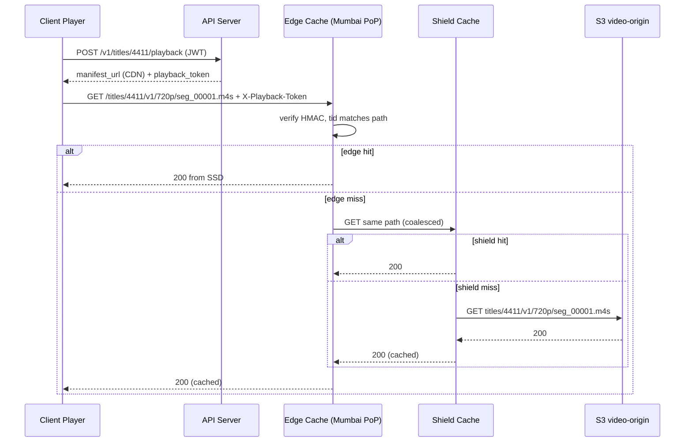

### Who writes, who reads

| Structure | Lives in | Who writes, and when | Who reads, and when |
|---|---|---|---|
| Edge cache (SSD) | About 20 metro PoPs | Edge node, on a miss fill | Client Player, every segment request |
| Shield cache (SSD) | Origin region | Shield node, on a miss fill | Edge nodes, on their misses |
| `video-origin` | One region | Packager, at encode time | Shield only, on shield misses |
| `titles.asset_version` | RDS | Packager, at encode completion | API Server, at playback start |

The cache class is local SSD with LRU eviction. The access pattern is hot, read-only, and immutable. That suits a disk cache better than any shared database.

### Solve it: the trade in this design

- ✅ **What we gained:**
  - S3 request rate drops from 50,000/s to the shield's miss rate, which is a few hundred per second.
  - Playback bytes now come from a PoP near the viewer.
  - The API leaves the playlist path entirely. It signs one token per play.
  - Immutable, versioned objects mean zero invalidation logic.
- ⚠️ **What we gave up:**
  - A cold miss is slower. The first viewer of a title in a PoP pays for edge, shield and S3.
  - Edge auth must be correct. A bug there leaks content to anyone.
  - The HMAC secret is now on every edge node. Rotation becomes an operations task.
  - The edge PoPs are still outside the ISPs. Traffic still crosses the public internet and ISP transit links.
  - A client must be pointed at the right PoP. Right now we assume DNS does it.
- ❌ **What we considered and rejected:**
  - Presigned S3 URLs through a CDN. Unique URLs per viewer destroy the cache hit rate.
  - A TTL with purge-on-change. Versioned paths remove the need for purges.
  - Caching with the token in the cache key. It makes every viewer a separate cache entry.

### Current state after V2

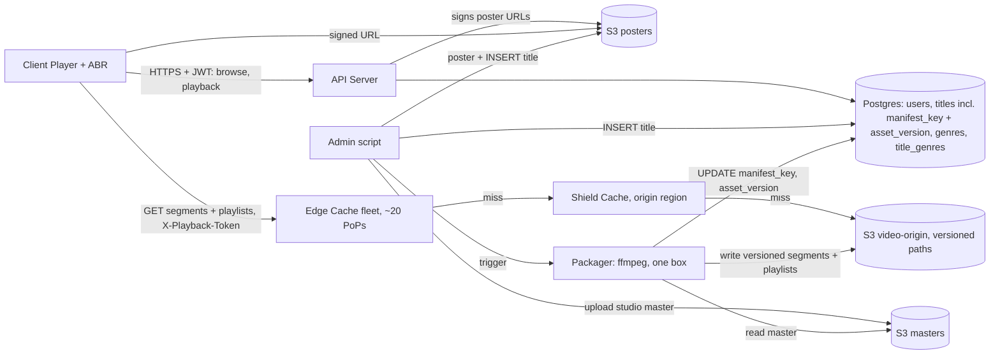

New in V2: the edge tier, the shield tier, playback-token auth, and versioned S3 paths. The API no longer rewrites playlists.

**Every current flow:**
1. **Browse:** unchanged from V1. `GET /v1/home` runs the genre join and signs poster URLs.
2. **Play (changed):**
   1. Client calls `POST /v1/titles/{id}/playback`. API returns a CDN manifest URL and a playback token.
   2. Client fetches the master and media playlists from its Edge Cache, with the token in a header.
   3. Edge verifies the token, then serves from SSD or fills from the Shield, which fills from S3 on a miss.
   4. Client downloads segments from the Edge, measures throughput, and picks the next rung as in V1.
3. **Add a title:** unchanged from V1, except the Packager writes under `titles/{id}/v{n}/` and sets `asset_version`.

### Interview follow-ups

**Why not purge the CDN when content changes?**
Purges are slow, unreliable at scale, and race with in-flight requests. Immutable objects under versioned paths never need one. A change is just a new path.

**What if the edge cache is down?**
The client falls back to another PoP and, last of all, the shield. That needs a steering decision, which we build properly later. The origin stays protected because the shield still coalesces.

### Recap

| Concept | The Insight |
|---|---|
| Pull-through cache | Fetch from origin only on the first request. Everyone after is served from a nearby copy. |
| Immutable plus versioned paths | A change is a new path, so there is nothing to invalidate. |
| Cache key excludes auth | One token per viewer, one cache entry per segment. Per-viewer URLs would kill the hit rate. |
| Coalescing plus shield | Coalescing protects each node. The shield protects the origin from all nodes. |
| Heavy head | Caching only works because a small set of titles takes most views. |

**Interview-arc sentence:** *"If asked how you survive a premiere: 200,000 viewers asking S3 for the same immutable segment overloads one prefix, so segments get versioned paths and long TTLs behind an edge and shield cache, with coalescing so only one request ever reaches the origin."*

**Next:** our PoPs sit in metro areas, but Maria's bytes still cross her ISP's transit link to reach us. On Friday night every ISP in the country is paying for that traffic, and the ISPs are complaining. Say "next" and we break that.


-----------------------------------------------------------------------------------------------------------------------
-----------------------------------------------------------------------------------------------------------------------
-----------------------------------------------------------------------------------------------------------------------
-----------------------------------------------------------------------------------------------------------------------


## V3: put the caches inside the ISPs, and fill them at night

V2 solved the shared origin. This version fixes only where the bytes live relative to the ISP. How a client finds the right box comes next, so for now we use a simple DNS stopgap.

### Break it

Friday, 9 pm, Mumbai. FiberNet is an ISP with 2 million subscribers.

- 400,000 of them are streaming at about 3 Mbps. That is 1.2 Tbps of demand.
- Our metro PoP connects to FiberNet over a 300 Gbps peering link.
- The link runs at 100% for three hours. That covers only a quarter of the demand.

Every viewer gets pushed down the ladder, because ABR from V1 sees the throughput collapse. Maria watches 360p on a fibre line that could do 1080p. FiberNet's other traffic shares the same link, so their customers' web pages slow down too.

FiberNet's network team calls us. They are paying for this traffic, and they are not happy.

### The crux: what lives where, and how it gets there

This is the heart of the design. Here are the attempts.

**Attempt 1: buy a bigger peering link.**
It looked reasonable because the cache already works. The link is just too small.
It breaks on cost and physics. We would need 4x the capacity, and FiberNet pays for its side of it. The same segment still crosses the link 200,000 times.

**Attempt 2: add more metro PoPs.**
It looked reasonable because more PoPs means shorter paths.
It breaks because the PoP is still outside FiberNet. Every byte still crosses FiberNet's interconnect to reach their subscribers. We moved the problem sideways.

**Attempt 3: put V2-style pull-through caches inside FiberNet.**

> **Asha:** Same nginx config, just racked inside their data centre. Done.
> **Ravi:** At 9 pm the new episode isn't on the box. Ten thousand viewers miss, and all the fills cross the congested link at the worst possible minute.
> **Asha:** Only the first miss pays, though.
> **Ravi:** Per title, per box, per rung. And at a 90% hit rate, 10% of 1.2 Tbps is still 120 Gbps crossing at peak.

It looked reasonable because it is the right location. It breaks because filling happens when viewers ask, which is exactly when the link is busiest.

**What survives:** the catalog is known in advance. We know tomorrow's release at 9 pm. We also know which titles each region watched this week. So we don't wait for viewers to ask. We predict what will be watched, and push it into the ISP at 3 am, when the link is empty.

| Option | Peak load on ISP link | Fill timing | Cost to ISP | Handles a premiere |
|---|---|---|---|---|
| Bigger peering link | Same bytes, bigger pipe | Peak | High | Yes, but costly |
| More metro PoPs | Same | Peak | High | Partly |
| Pull-through in ISP | Fills at peak | Peak | Low | Cold at start |
| Predicted off-peak fill in ISP | Near zero for the head | 2-8 am local | Lowest | Yes, pre-warmed |

We take the last row. This is why on-demand content can use tricks that live streaming cannot.

### Implement it

**The box.** An **appliance** is a server we ship to the ISP. They give it rack space, power and a network port. It holds about 100 TB and pushes about 100 Gbps.

For FiberNet, 1.2 Tbps means about a dozen appliances, plus one spare. Every box in a site holds the same title set for now. DNS returns several box IPs, so load spreads across them.

**Fill Controller (new service).** It runs nightly and builds a per-appliance list of titles to hold.

**Schema delta (Postgres, control plane).**

```sql
ALTER TABLE titles ADD COLUMN release_at TIMESTAMPTZ;

CREATE TABLE appliances (
  appliance_id   BIGSERIAL PRIMARY KEY,
  isp_asn        INT NOT NULL,          -- e.g. FiberNet's AS number
  site           TEXT NOT NULL,         -- 'fibernet-mumbai-1'
  region         TEXT NOT NULL,         -- 'IN-MH'
  ip_addr        INET NOT NULL,
  capacity_gb    INT NOT NULL,
  status         TEXT NOT NULL,         -- 'active' | 'draining'
  last_heartbeat TIMESTAMPTZ
);

CREATE TABLE fill_plan (
  appliance_id  BIGINT REFERENCES appliances,
  title_id      BIGINT REFERENCES titles,
  asset_version INT NOT NULL,
  priority      INT NOT NULL,
  PRIMARY KEY (appliance_id, title_id)
);
```

Postgres is still right here. This is small, structured control data, with a few thousand appliances and about 15,000 titles.

**The planning job (runs 22:00 UTC).**

```python
def build_plan(appliance):
    plays = plays_last_7d(appliance.region)        # {title_id: count}, from log counts
    now = utcnow()
    scored = []
    for t in all_titles():
        score = plays.get(t.title_id, 0)
        if t.release_at and now <= t.release_at <= now + timedelta(hours=72):
            score += 10**9                         # upcoming releases always win
        scored.append((score, t))
    scored.sort(reverse=True, key=lambda x: x[0])

    budget, plan = appliance.capacity_gb * 0.9, []
    for score, t in scored:
        if t.size_gb > budget: continue
        plan.append((appliance.appliance_id, t.title_id, t.asset_version, score))
        budget -= t.size_gb
    replace_fill_plan(appliance.appliance_id, plan)
```

The upcoming-release boost is the pre-warming we deferred from V2. The premiere is already on every box before anyone presses play.

**The fill agent (runs on each appliance).**

```python
def fill_loop():
    plan = http_get(f"{CONTROL}/v1/fill-plan?appliance_id={ME}").json()
    want = {(p["title_id"], p["asset_version"]) for p in plan}
    have = local_inventory()
    for key in sorted(want - have, key=lambda k: -priority[k]):
        if not in_window(start="02:00", end="08:00", tz=LOCAL_TZ):
            break                                  # resume tomorrow night
        fetch_title(key, source=POP_EDGE, rate_limit_gbps=5)
    for key in have - want:
        evict(key)
```

It fetches from the metro PoP edge tier, not S3 directly. So an appliance fill is a normal V2 pull-through hit or fill, only now it happens off-peak.

**Serving config on the appliance (nginx).**

```nginx
location ~ ^/titles/(?<tid>\d+)/v\d+/ {
    access_by_lua_block { verify_ed25519(ngx.var.http_x_playback_token, ngx.var.tid) }
    root /data/video;
    try_files $uri @pop;                 # held locally, else fall back
}
location @pop {
    proxy_pass https://pop-bom.cdn.example.com;   # tail miss, logged, not stored
}
```

A miss is proxied to the PoP but not stored. The next nightly plan decides whether the title deserves a place.

**Token change: HMAC becomes a public-key signature.** In V2 the HMAC secret sat on our own edge nodes. Appliances now sit in third-party racks, so a stolen box must not be able to mint tokens.

```python
# API Server, holds the private key only
payload = f"{user_id}.{title_id}.{exp}"
sig = ed25519_private.sign(payload.encode())
token = f"{payload}.{b64(sig)}"

# Appliance and edge, hold the public key only
ed25519_public.verify(sig, payload.encode())
```

The cache key still ignores the token, as in V2.

**Logs feed the planner.** Edges and appliances ship access logs to a new S3 bucket, `cdn-logs`, every hour. The planner counts `master.m3u8` requests per region per title. A blob store is right because logs are append-only and read in bulk once a night.

**Steering stopgap.** `cdn.example.com` is answered by our authoritative DNS server, which looks up the resolver's AS number in `appliances.isp_asn`. If an appliance site exists for that ASN, it returns that site's IPs. Otherwise it returns the PoP.

This is known to be crude. It uses the ISP's resolver location, not the client's, and it knows nothing about load or failures. V4 replaces it.

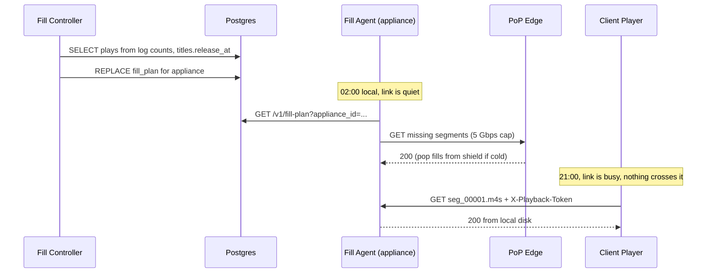

### Who writes, who reads

| Structure | Lives in | Who writes, and when | Who reads, and when |
|---|---|---|---|
| `appliances` | RDS | Ops tooling, at install. Heartbeat updates `last_heartbeat` | Fill Controller nightly. DNS stopgap on each lookup |
| `fill_plan` | RDS | Fill Controller, nightly | Fill agent, hourly poll |
| `titles.release_at` | RDS | Admin script, at title creation | Fill Controller, nightly |
| Appliance disk | ISP rack | Fill agent, in the 02:00-08:00 window | Client Player, every segment |
| S3 `cdn-logs` | Origin region | Edges and appliances, hourly | Fill Controller, nightly |

### Solve it: the trade in this design

- ✅ **What we gained:**
  - Peak-hour video traffic stays inside FiberNet's network. The peering link carries only fills (at night) and the tail.
  - Premieres are on every box before the first viewer arrives.
  - The ISP saves transit cost, so they are happy to host us.
  - Appliances never hold the token-signing secret.
- ⚠️ **What we gave up:**
  - We now own hardware in other people's data centres. That means logistics, repairs, and security.
  - The plan is a prediction. A surprise hit that nobody predicted is a tail miss until the next plan.
  - The DNS stopgap cannot see load or failure. A dead appliance still gets traffic.
  - Every box in a site holds the same set, which wastes disk. We accept it until numbers say otherwise.
  - Protecting content on a box we don't physically control is only half-solved. DRM comes later.
- ❌ **What we considered and rejected:**
  - A bigger peering link, because it moves the cost to the ISP and the same bytes still cross it.
  - More metro PoPs alone, because the last interconnect stays congested.
  - Pull-through inside the ISP, because it fills at peak.
  - Pushing the whole catalog to every box. Most of it is never watched in a given region.

### Current state after V3

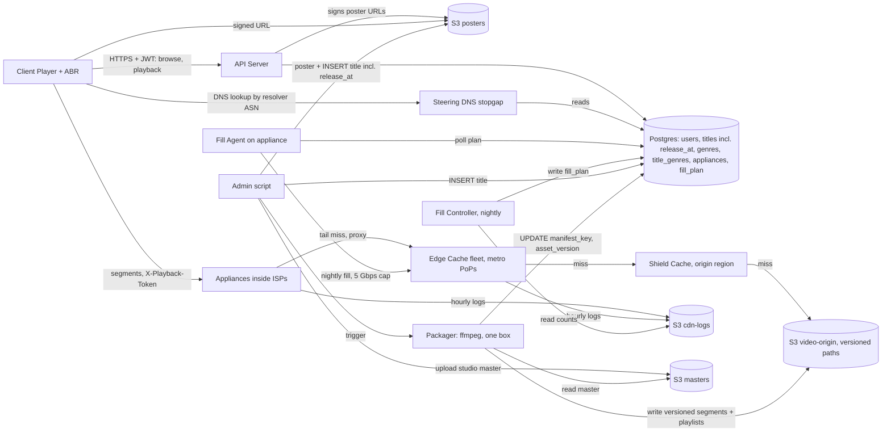

New in V3: appliances, the Fill Controller and fill agent, `appliances` and `fill_plan` tables, `release_at`, `cdn-logs`, the steering DNS stopgap, and public-key tokens.

**Every current flow:**
1. **Browse:** unchanged from V2.
2. **Play (changed):**
   1. Client calls `POST /v1/titles/{id}/playback`. API returns a manifest URL on `cdn.example.com` and an Ed25519-signed token.
   2. Client resolves `cdn.example.com`. The DNS stopgap returns appliance IPs for the client's ISP, or the PoP if none exists.
   3. Client fetches playlists and segments from the appliance, with the token in a header. The appliance verifies it with the public key.
   4. Held title: served from local disk. Not held: proxied to the PoP edge, which serves from SSD or fills from the Shield and S3 as in V2.
   5. Client measures throughput and picks the next rung as in V1.
3. **Fill (new):**
   1. Each night the Fill Controller counts plays from `cdn-logs`, adds upcoming releases, and writes `fill_plan`.
   2. Each appliance's fill agent polls the plan, and in its local 02:00-08:00 window fetches missing titles from the PoP edge and evicts the rest.
4. **Add a title:** unchanged from V2, except the admin script also sets `release_at`.

### Interview follow-ups

**Why not just rent a third-party CDN?**
That is a valid start. But a third-party CDN still delivers over the ISP's peering links. Embedding our own boxes removes those bytes from the ISP's interconnect entirely. At our traffic share, that is worth the operational cost.

**What if a title goes viral and nobody predicted it?**
The first viewers hit a tail miss, which the appliance proxies to the PoP. We count that miss in the logs. An hourly urgent-plan job promotes any title whose miss rate spikes. Those titles may fill outside the night window, at a throttled rate.

### Recap

| Concept | The Insight |
|---|---|
| Embed the cache in the ISP | The cheapest byte is one that never leaves the ISP's own network. |
| Predicted, off-peak fill | On-demand content is known in advance, so we move it when the link is idle, not when viewers ask. |
| Pre-warming premieres | Release dates feed the fill plan, so day-one demand never hits a cold box. |
| Public-key tokens | Boxes in third-party racks verify tokens but can never mint them. |
| Tail falls back | The box holds the head. Everything else falls through to the PoP tier from V2. |

**Interview-arc sentence:** *"If asked how you stop Netflix swamping ISPs: pull-through caches fill at the busiest moment, so we put appliances inside the ISP and fill them overnight from a demand-and-release-date plan, which keeps peak traffic inside the ISP's own network."*

**Next:** Maria's phone asks DNS where to stream, and her ISP's resolver answers for the whole city. One Mumbai appliance dies at 9:05 pm, and DNS keeps sending people to it. Say "next" and we build a proper steering service.


-----------------------------------------------------------------------------------------------------------------------
-----------------------------------------------------------------------------------------------------------------------
-----------------------------------------------------------------------------------------------------------------------
-----------------------------------------------------------------------------------------------------------------------


## V4: a steering service replaces the DNS stopgap

V3 put the bytes inside the ISP. This version fixes only how a client picks which box to talk to. Making the boxes hold different titles, and getting content onto them faster, are separate problems for later.

### Break it

Friday, 9:05 pm, Mumbai. FiberNet has 12 active appliances and the new episode is playing on all of them.

Appliance `bom1-fnet-07` loses a power supply and goes dark.

- DNS still lists its IP in every answer. The record TTL is 300 seconds.
- 1 in 12 lookups returns the dead box. That is about 33,000 viewers connecting to nothing.
- Each one waits through a connect timeout, then retries the same cached answer.
- It takes five minutes before resolvers drop the stale record, and some never do.

There are two more cracks.

**Wrong location.** About 20% of viewers, Maria included, use a public resolver like 8.8.8.8. Our DNS sees Google's address, not FiberNet's. It cannot find the appliance site, so it returns the PoP. Those viewers bypass the appliances and put 240 Gbps back on the peering link.

**Blind to load.** Round-robin DNS has no idea that box 03 is at 98 Gbps while box 11 is at 40. Overloaded boxes push their viewers down the ladder for no reason.

### The crux continues: how does a client pick a server?

**Attempt 1: shorten the DNS TTL to 5 seconds.**
It looked reasonable because stale answers would age out quickly.
It breaks because many resolvers ignore TTLs below 30 to 60 seconds. DNS query volume also jumps 60x. And DNS still cannot see load, health or the real client.

**Attempt 2: let the client retry across all the IPs it was given.**

> **Asha:** The player gets all 12 IPs. If one times out, it tries the next.
> **Ravi:** 33,000 players all time out on box 07 at once. They all try "the next one," which is box 08.
> **Asha:** So rotate randomly.
> **Ravi:** Random is better. But every one of them paid a timeout in the middle of a movie, and nobody checked whether box 08 even holds the title.

It looked reasonable because the client sees failures first-hand. It breaks because a timeout costs seconds of buffer. It also gives the client no information about load or inventory.

**Attempt 3: anycast.** Announce one IP from every box. BGP routes each client to the nearest one.
It looked reasonable because there is no steering logic at all.
It breaks because BGP cannot see load. A dead box takes time to withdraw its route. And a route change mid-segment resets the TCP connection.

**What survives:** we already have a moment when we know the real client and the real title. That moment is `POST /v1/titles/{id}/playback`. It is an HTTPS call straight from the player, so the source address is the viewer's real IP, not a resolver's. We make the steering decision there and return an ordered list. The client still retries, but it retries along a list we chose.

| Option | Sees real client | Sees health | Sees load | Sees inventory | Failover cost |
|---|---|---|---|---|---|
| Round-robin DNS (V3) | No, resolver only | No | No | No | Minutes |
| Short-TTL DNS | No | No | No | No | Tens of seconds |
| Client retries a list | Yes | Only after a timeout | No | No | A timeout per failure |
| Anycast | Roughly | Slowly | No | No | Route convergence |
| Steering at playback start | Yes | Yes | Yes | Yes | Seconds, with a pre-filtered list |

We take the last row. Peak is about 330 playback starts per second. That is one small stateless service, so this is cheap.

### Implement it

**Static names, no steering in DNS.** Every box gets its own permanent hostname, like `bom1-fnet-07.cdn.example.com`. DNS now just maps a name to one IP. It makes no decisions.

**Storage: a key-value store for live state.** Health and inventory are tiny, change every few seconds, and must expire on their own when a box goes silent. That is a key-value access pattern with TTLs. Postgres would mean thousands of writes per second for data that is stale in 30 seconds. So we add Redis in the origin region.

**Schema delta.**

```sql
-- Postgres, replaces the DNS stopgap's lookup
CREATE TABLE ip_prefix_map (
  cidr     CIDR PRIMARY KEY,   -- '49.36.0.0/14'
  isp_asn  INT  NOT NULL,
  site     TEXT NOT NULL       -- 'fibernet-mumbai-1'
);

ALTER TABLE appliances DROP COLUMN last_heartbeat;   -- liveness moves to Redis
ALTER TABLE appliances ADD COLUMN hostname TEXT NOT NULL;
```

```
# Redis (new)
health:{appliance_id}   HASH  {status, egress_gbps, ts}     TTL 30s
inv:{appliance_id}      SET   {title_id, title_id, ...}     no TTL
```

**Steering Service (new).** It is stateless. At startup, and every 60 seconds, it loads `appliances` and `ip_prefix_map` into memory as a radix trie keyed by CIDR.

**Heartbeats go through the Steering Service, not straight to Redis.** Appliances sit in third-party racks, so they get no Redis credentials. They call the service over mTLS with a per-box certificate.

```
POST /v1/appliances/bom1-fnet-07/heartbeat      (every 10 s)
{"status":"active","egress_gbps":71.4}
```

```python
def heartbeat(appliance_id, body):
    redis.hset(f"health:{appliance_id}", mapping={**body, "ts": now()})
    redis.expire(f"health:{appliance_id}", 30)
```

If a box misses three beats, its key expires and it vanishes from steering. The fill agent from V3 reports inventory the same way:

```
POST /v1/appliances/bom1-fnet-07/inventory
{"added":[4411],"removed":[2098]}
```
```python
redis.sadd(f"inv:{appliance_id}", *added)
redis.srem(f"inv:{appliance_id}", *removed)
```

**The steering decision.**

```python
def steer(client_ip, title_id, exclude=()):
    site = prefix_trie.lookup(client_ip)             # None if no appliance site
    picks = []
    if site:
        boxes = [b for b in site_boxes[site] if b.id not in exclude]
        health = redis.pipeline_hgetall([f"health:{b.id}" for b in boxes])
        held   = redis.pipeline_sismember([f"inv:{b.id}" for b in boxes], title_id)
        util, ok = {}, []
        for b, h, has in zip(boxes, health, held):
            if not h or h["status"] != "active" or not has: continue
            u = float(h["egress_gbps"]) / b.capacity_gbps
            if u < 0.85:
                util[b.id] = u; ok.append(b)
        for _ in range(2):                           # up to two appliance candidates
            if not ok: break
            a, c = random.sample(ok, min(2, len(ok)))
            best = a if util[a.id] <= util[c.id] else c
            picks.append(best); ok.remove(best)
    picks.append(nearest_pop(client_ip))             # always the last resort
    return picks
```

### Known sub-problem: herding on stale load data

Heartbeats are 10 seconds old. If every request goes to the least-loaded box, all of them pick the same one until the next heartbeat. That box overloads, then everyone flips to a new one. Three real fixes:

**1. Always pick the least-loaded box.** Simple, and it herds. At 330 starts per second, one box gets about 3,000 assignments in a 10-second window. It does not fit.

**2. Weighted random by headroom.**
```python
weights = [b.capacity_gbps - egress(b) for b in ok]
pick = random.choices(ok, weights)[0]
```
It spreads load smoothly. It still over-weights an empty box that just joined.

**3. Power of two choices.** Sample two boxes at random and take the less loaded.
```python
a, c = random.sample(ok, 2)
best = a if util[a.id] <= util[c.id] else c
```
It is almost as balanced as least-loaded, with no herd, and it is three lines. This is what the code above uses.

**The playback response.**

```
POST /v1/titles/4411/playback
Authorization: Bearer <jwt>
-> {
  "manifest_urls": [
    "https://bom1-fnet-03.cdn.example.com/titles/4411/v1/master.m3u8",
    "https://bom1-fnet-09.cdn.example.com/titles/4411/v1/master.m3u8",
    "https://pop-bom.cdn.example.com/titles/4411/v1/master.m3u8"
  ],
  "playback_token": "u9021.4411.1730851200.<ed25519 sig>"
}
```

**Client failover rule.**

```
try manifest_urls[0] with connect timeout 2s
on connect error, timeout, or HTTP 5xx:
    move to the next URL and keep the current buffer
if all three fail, or the list is older than 10 minutes:
    POST /v1/titles/4411/steer  {"failed": ["bom1-fnet-03"]}  -> a fresh list
```

The first failure costs at most 2 seconds, and the viewer's buffer is usually longer than that. The failed host goes into `exclude`, so a retry never hands back the same dead box.

**When steering itself is unreachable.** The client keeps using its cached list and token. Existing streams continue. For a new start, the API Server falls back to a static per-site list from config, with no health filtering. That keeps playback alive through a control-plane outage, as the scope requires.

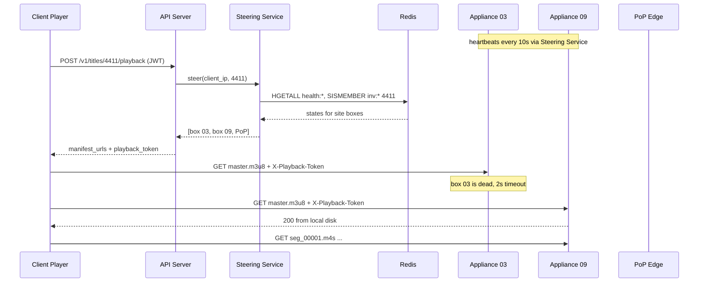

### Who writes, who reads

| Structure | Lives in | Who writes, and when | Who reads, and when |
|---|---|---|---|
| `health:{id}` | Redis, origin region | Steering Service, on each appliance heartbeat (10s) | Steering Service, on every steer call |
| `inv:{id}` | Redis, origin region | Steering Service, when the fill agent reports an added or removed title | Steering Service, on every steer call |
| `ip_prefix_map` | RDS | Ops tooling, when an ISP updates its prefixes | Steering Service, loaded into memory every 60s |
| `appliances` | RDS | Ops tooling, at install or drain | Fill Controller nightly. Steering Service every 60s |

### Solve it: the trade in this design

- ✅ **What we gained:**
  - A dead box leaves the list within 30 seconds. Clients already holding it fail over in about 2.
  - Steering uses the real client IP, so public-resolver users get their ISP's appliances.
  - Load and inventory shape every decision. No viewer is sent to a box that lacks the title.
  - DNS becomes boring: static names, long TTLs.
- ⚠️ **What we gave up:**
  - Steering is now on the playback-start path. It needs its own availability story, which the cached list and static fallback only partly cover.
  - The IP-to-site map needs upkeep. Mobile carriers, VPNs and CGNAT users may land on the PoP.
  - Heartbeat data is up to 10 seconds stale. Power of two choices softens this but cannot remove it.
  - A new Redis dependency. If it is down, steering degrades to unfiltered per-site lists.
- ❌ **What we considered and rejected:**
  - Short-TTL DNS, because resolvers ignore it and it still sees neither load nor client.
  - Client-only retries, because each failure costs a timeout and the order is blind.
  - Anycast, because BGP cannot see load and route changes reset connections.
  - Least-loaded selection, because it herds on stale data.

### Current state after V4

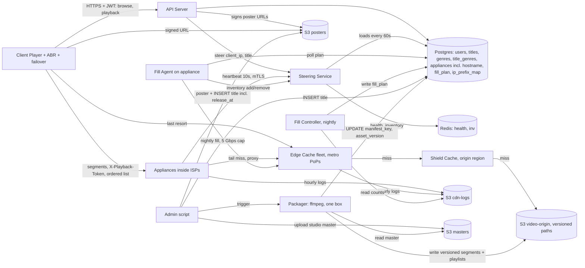

New in V4: Steering Service, Redis (`health`, `inv`), `ip_prefix_map`, per-box hostnames, heartbeat and inventory reporting, and client failover. The DNS steering stopgap is gone.

**Every current flow:**
1. **Browse:** unchanged from V3.
2. **Play (changed):**
   1. Client calls `POST /v1/titles/{id}/playback`. API Server asks the Steering Service, passing the client IP and title.
   2. Steering maps the IP to a site, filters boxes on health, inventory and load, picks two by power of two choices, and appends the nearest PoP.
   3. API returns the ordered `manifest_urls` and an Ed25519 token.
   4. Client fetches playlists and segments from the first URL, with the token in a header. The appliance verifies it with the public key.
   5. Held title: served from disk. Not held: proxied to the PoP edge, as in V3.
   6. On error or a 2-second timeout, the client moves down the list. If the list is exhausted or stale, it calls `/steer` again.
   7. Client picks the next rung as in V1.
3. **Heartbeat (new):** each appliance posts health every 10 seconds. The Steering Service writes `health:{id}` with a 30-second TTL.
4. **Fill (changed):** same nightly plan and 02:00-08:00 window as V3. The fill agent now also reports `inv` changes to the Steering Service.
5. **Add a title:** unchanged from V3.

### Interview follow-ups

**Why not use managed DNS with geo or latency routing?**
It routes by the resolver's location and gives coarse health checks. We need the real client IP, per-title inventory and load-aware choice. Only the playback call has all three.

**What if the Steering Service or Redis goes down?**
Running streams keep their cached list and token. New starts fall back to a static per-site list from config, and the client's failover rule handles dead boxes. Quality may dip, but playback survives.

### Recap

| Concept | The Insight |
|---|---|
| Steer at playback start | That one call sees the real client IP, the title, and live fleet state. DNS sees none of them. |
| Ordered list plus client failover | The server picks the best candidates. The client handles the seconds between a failure and the next heartbeat. |
| Heartbeat with TTL | A dead box removes itself from steering by going silent. No one has to declare it dead. |
| Power of two choices | Two random samples give near-optimal balance without herding on stale data. |
| Inventory in the decision | A box that lacks the title is not a candidate, however idle it is. |

**Interview-arc sentence:** *"If asked how a client finds the right cache: DNS sees the resolver, not the viewer, and cannot see health or load, so steering moves into the playback call, which returns an ordered list of healthy, under-loaded boxes that hold the title, with the PoP last and the client failing down the list."*

**Next:** the studio delivers ten episodes on Tuesday for a Friday 9 pm release, and the fills need them by Thursday night. Our single ffmpeg box takes about 6 hours per episode, and a crash at hour 5 starts over. Say "next" and we rebuild the Packager.


-----------------------------------------------------------------------------------------------------------------------
-----------------------------------------------------------------------------------------------------------------------
-----------------------------------------------------------------------------------------------------------------------
-----------------------------------------------------------------------------------------------------------------------


## V5: rebuild the Packager as a parallel transcoding pipeline

V4 finished the viewer side. This version fixes only the ingest side: turning a studio master into a ladder, fast and safely. Per-title ladders, more codecs, and quality checks are later optimizations.

### Break it

Tuesday 9 am. The studio delivers ten episodes of a series that releases Friday at 9 pm.

- One episode takes about 6 hours on the Packager box. That is five rungs, run one after another.
- Ten episodes in a row is 60 hours.
- The Fill Controller from V3 needs them by Thursday night for the 02:00 fill window. That leaves about 40 hours.

We miss the deadline by 20 hours, before anything goes wrong.

Now something goes wrong. At hour 5 of episode 3, the box runs out of disk. ffmpeg dies. There is no checkpoint, so episode 3 restarts from zero. The premiere slips a day.

### The idea, in plain language

A 60-minute episode doesn't have to be encoded as one piece. Cut it into one-minute chunks. Encode every chunk at every rung as its own small job. Hundreds of workers run those jobs at once.

If a worker dies, we lose one minute of work, not five hours. A wide fleet also turns 60 hours into under an hour.

### Attempts (a lighter walk, since delivery was the crux)

**Attempt 1: a bigger box.** It looked reasonable because it is a one-line change. It breaks because a 2x faster box still needs 30 hours, and a crash still restarts a whole episode.

**Attempt 2: one box per episode.**

> **Asha:** Ten episodes, ten boxes. Each takes 6 hours. Done by Tuesday afternoon.
> **Ravi:** And when the studio sends a fixed cut of episode 4 on Thursday morning, that's 6 hours on one box again. Plus a crash at hour 5 still costs hour 5.

It fixes the total but not the per-episode latency or the crash cost.

**Attempt 3: chunk-parallel encoding.** It wins on all three counts: total time, crash cost, and urgent re-cuts.

| Option | 10 episodes finish in | Cost of one crash | Urgent re-cut of one episode |
|---|---|---|---|
| Bigger single box | About 30 hours | Up to a whole episode | About 3 hours |
| One box per episode | About 6 hours | Up to a whole episode | About 6 hours |
| Chunk-parallel on a fleet | About 40 minutes | One chunk, about 1 minute | About 5 minutes with the fleet free |

We take the third row.

### Why chunking is cheap here

Two facts from V1 make this easy.

**Studio masters are intra-coded.** Formats like ProRes store every frame on its own. We can cut at any frame boundary with a plain stream copy, no re-encoding.

**Segments are already independent.** Each 4-second fMP4 segment starts on a keyframe. A 60-second chunk is exactly 15 segments. So a worker's output is a set of finished segments. There is no stitching step. We just number them correctly.

### Implement it

**New components.**
- **Ingest Coordinator:** a stateless service. It owns the job state in Postgres and is the only component that talks to Postgres.
- **Encode queue:** SQS, `encode-tasks`, plus a dead-letter queue `encode-tasks-dlq`.
- **Encode workers:** stateless ffmpeg workers on spot instances. They hold no database credentials.
- **S3 `chunks`:** scratch space for the cut chunks, with a 7-day expiry rule.

Why a queue: the tasks are independent, we want the fleet to pull work at its own speed, and a crashed worker's task must reappear by itself. A queue's visibility timeout does that for free. Postgres tables hold the job state, because it is small, relational and needs transactions.

**Schema delta (Postgres, first appearance, shown in full).**

```sql
CREATE TABLE transcode_jobs (
  job_id        BIGSERIAL PRIMARY KEY,
  title_id      BIGINT REFERENCES titles,
  asset_version INT NOT NULL,
  master_key    TEXT NOT NULL,
  status        TEXT NOT NULL,   -- 'splitting' | 'encoding' | 'done' | 'failed'
  total_tasks   INT,             -- NULL until the split reports its chunk count
  done_tasks    INT NOT NULL DEFAULT 0,
  updated_at    TIMESTAMPTZ NOT NULL DEFAULT now()
);

CREATE TABLE transcode_tasks (
  job_id    BIGINT REFERENCES transcode_jobs,
  chunk_idx INT  NOT NULL,
  rung      TEXT NOT NULL,       -- '240p' ... '1080p'
  status    TEXT NOT NULL,       -- 'pending' | 'done'
  PRIMARY KEY (job_id, chunk_idx, rung)
);
```

**Step 1: start a job.** The admin script no longer launches ffmpeg.

```
POST /v1/ingest/jobs
{"title_id":4411,"master_key":"masters/4411/ep01.mov"}
-> {"job_id":812}
```

The Coordinator inserts a `transcode_jobs` row with status `splitting`. It enqueues one message:

```json
{"kind":"split","job_id":812,"master_key":"masters/4411/ep01.mov"}
```

**Step 2: split.** A worker takes the message and runs:

```bash
ffmpeg -i ep01.mov -c copy -f segment -segment_time 60 \
  -reset_timestamps 1 chunk_%04d.mov
```

It uploads each file to `chunks/812/0031.mov` and calls the Coordinator:

```
POST /v1/ingest/jobs/812/chunks   {"count":60}
```

The Coordinator inserts 60 × 5 = 300 rows into `transcode_tasks`, sets `total_tasks = 300` and status `encoding`, and enqueues 300 messages:

```json
{"kind":"encode","job_id":812,"title_id":4411,"asset_version":1,
 "chunk_idx":31,"rung":"720p"}
```

**Step 3: encode one task.** The worker downloads only its 60-second chunk, not the 100 GB master.

```python
def handle(msg):
    ci, rung = msg["chunk_idx"], msg["rung"]
    s3.download(f"chunks/{msg['job_id']}/{ci:04d}.mov", "in.mov")
    run(["ffmpeg", "-i", "in.mov",
         "-vf", f"scale=-2:{HEIGHT[rung]}",
         "-c:v", "libx264", "-b:v", BITRATE[rung], "-maxrate", MAXRATE[rung],
         "-bufsize", BUFSIZE[rung], "-g", "96", "-keyint_min", "96",
         "-sc_threshold", "0", "-c:a", "aac", "-b:a", "128k",
         "-output_ts_offset", str(ci * 60),        # timeline continues across chunks
         "-f", "hls", "-hls_time", "4", "-hls_segment_type", "fmp4",
         "-hls_playlist_type", "vod",
         "-start_number", str(ci * 15 + 1),        # chunk 31 -> seg_00466 ...
         "-hls_segment_filename", f"out/seg_%05d.m4s", "out/tmp.m3u8"])
    base = f"titles/{msg['title_id']}/v{msg['asset_version']}/{rung}/"
    for f in glob("out/seg_*.m4s"):
        s3.put(base + basename(f), f, CacheControl=IMMUTABLE)
    if ci == 0:
        s3.put(base + "init.mp4", "out/init.mp4", CacheControl=IMMUTABLE)
    coordinator.post(f"/v1/ingest/jobs/{msg['job_id']}/tasks/{ci}/{rung}/done")
    sqs.delete(msg)            # only after the Coordinator says 200
```

Two details matter here. The `-output_ts_offset` keeps timestamps continuous across chunks. And only chunk 0 uploads `init.mp4`, so every segment in a rung shares one init segment.

**Step 4: record completion, idempotently.** Messages can be delivered twice, so the same task may report twice. The Coordinator guards with a conditional update:

```sql
WITH t AS (
  UPDATE transcode_tasks SET status = 'done'
  WHERE job_id = 812 AND chunk_idx = 31 AND rung = '720p' AND status <> 'done'
  RETURNING 1)
UPDATE transcode_jobs
SET done_tasks = done_tasks + (SELECT count(*) FROM t), updated_at = now()
WHERE job_id = 812
RETURNING done_tasks, total_tasks;
```

A duplicate adds zero. Duplicate S3 writes are harmless because the key is deterministic, so a retry overwrites the same object.

**Step 5: finalize.** When `done_tasks = total_tasks`, the Coordinator runs this once:

1. It lists S3 under `titles/4411/v1/{rung}/` and checks each rung has exactly 900 segments.
2. It writes each `playlist.m3u8` and the `master.m3u8` from that known count, with the V2 cache headers.
3. It runs one transaction:

```sql
UPDATE titles
SET manifest_key = 'titles/4411/v1/master.m3u8', asset_version = 1
WHERE title_id = 4411;
UPDATE transcode_jobs SET status = 'done' WHERE job_id = 812;
```

Playlists are written last and the manifest pointer is flipped last. So a half-encoded title is never visible to viewers.

**Failure handling.**

| Failure | What happens |
|---|---|
| Worker dies or spot node is reclaimed | The message's visibility timeout (10 minutes) expires. SQS redelivers it. |
| Task fails | Retried up to 3 times with exponential backoff and jitter. |
| Poison chunk (a corrupt frame) | After 3 failures SQS moves it to `encode-tasks-dlq`. An alert fires. The job stays `encoding`. |
| Job stalls | The Coordinator marks it `failed` if `updated_at` hasn't moved for 30 minutes. |

**Autoscaling and observability.** The fleet scales on queue depth. We watch three numbers: queue depth, age of the oldest message, and DLQ count. At 3,000 tasks the job counter is a single hot row, but a few thousand updates in under an hour is nothing for Postgres.

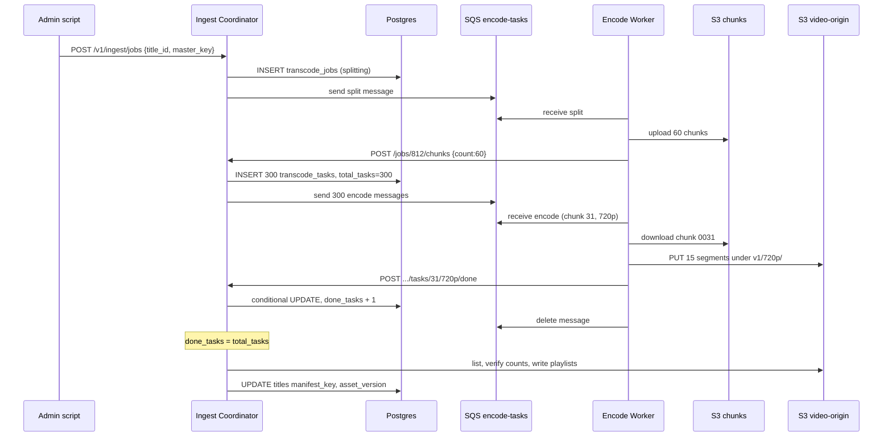

### Who writes, who reads

| Structure | Lives in | Who writes, and when | Who reads, and when |
|---|---|---|---|
| `transcode_jobs` | RDS | Coordinator: at job start, at split-done, at each task-done, at finalize | Coordinator: on each completion and in the stall watchdog |
| `transcode_tasks` | RDS | Coordinator: inserts at split-done, marks done on worker callback | Coordinator: on each completion |
| SQS `encode-tasks` | AWS, origin region | Coordinator: enqueues split and encode messages | Encode Workers, continuously |
| SQS `encode-tasks-dlq` | Same | SQS, after 3 failed receives | Ops alert and manual replay |
| S3 `chunks` | Origin region | Worker running the split | Workers running encode tasks |
| S3 `video-origin` | Origin region | Encode Workers (segments), Coordinator (playlists) | Shield cache, on misses |
| `titles.manifest_key`, `asset_version` | RDS | Coordinator, at finalize (replaces the old Packager) | API Server, at playback start |

### Solve it: the trade in this design

- ✅ **What we gained:**
  - Ten episodes finish in about 40 minutes on about 100 workers, down from 60 hours.
  - A crash costs one chunk, about a minute, not hours.
  - An urgent re-cut finishes in minutes.
  - Spot instances are safe to use, because interruption just means redelivery.
  - Workers are stateless and hold no database credentials.
- ⚠️ **What we gave up:**
  - More moving parts: a queue, a coordinator, two state tables, and a DLQ to watch.
  - Rate control restarts at each chunk boundary, so bitrate can wobble slightly there. Fixed 60-second chunks and VBV caps keep it small.
  - Delivery is at-least-once. Everything must stay idempotent.
  - Every title still gets the same ladder and one codec.
- ❌ **What we considered and rejected:**
  - A bigger single box, which only halves the time and keeps the crash cost.
  - One box per episode, which doesn't help an urgent re-cut and loses hours on a crash.
  - Scene-based variable chunks. They would break the fixed 15-segments-per-chunk numbering that lets workers write segments with no coordination.
  - A full workflow engine like Temporal or Step Functions. It is a reasonable production choice, but our graph is only three stages, so a queue and two tables are enough here.

### Current state after V5

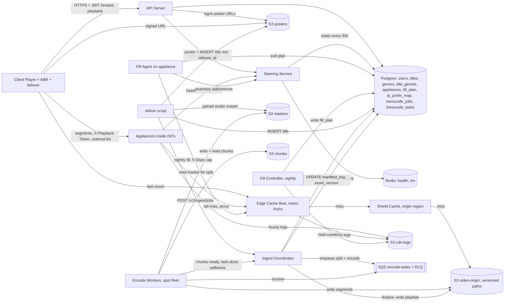

New in V5: Ingest Coordinator, SQS queue and DLQ, Encode Workers, `chunks` bucket, and `transcode_jobs` and `transcode_tasks`. The single-box Packager is gone.

**Every current flow:**
1. **Browse:** unchanged from V4.
2. **Play:** unchanged from V4. The API asks the Steering Service for an ordered list, returns it with an Ed25519 token, and the client streams from the first healthy appliance and fails down the list.
3. **Heartbeat and inventory:** unchanged from V4.
4. **Fill:** unchanged from V4.
5. **Add a title (changed):**
   1. Admin script uploads the master to `masters` and the poster to `posters`, and inserts the `titles` row with `release_at`.
   2. Admin script calls `POST /v1/ingest/jobs`. The Coordinator records the job and enqueues a split.
   3. A worker cuts 60 one-minute chunks into `chunks` and reports the count. The Coordinator creates 300 tasks and enqueues them.
   4. Workers encode one chunk at one rung each, write segments under `titles/{id}/v{n}/{rung}/`, and report done.
   5. When the last task reports, the Coordinator verifies counts, writes the playlists, and sets `manifest_key` and `asset_version`.

### Interview follow-ups

**Why not encode one rung per worker instead of chunking?**
A rung is still 60 minutes of serial work, so one crash costs an hour and the slowest rung sets the finish time. Chunking caps both the crash cost and the wall-clock time by task size.

**What if two workers encode the same chunk?**
Both write the same deterministic S3 keys, so the last write wins and either output is valid. The conditional SQL update counts the completion once. At-least-once delivery plus idempotent writes is what we rely on, not exactly-once.

### Recap

| Concept | The Insight |
|---|---|
| Chunk-parallel encoding | Cut the master into one-minute pieces and encode each as its own job. Wall time becomes task time, not movie time. |
| Segments are already independent | A chunk is exactly 15 segments, so there is no stitching, only correct numbering and timestamps. |
| Queue plus visibility timeout | A dead worker's task reappears by itself. No one has to detect the crash. |
| Idempotent by key and by SQL | Deterministic S3 keys and a conditional update make duplicate delivery harmless. |
| Flip the pointer last | Playlists and `manifest_key` are written after every segment is verified, so viewers never see a half-built title. |

**Interview-arc sentence:** *"If asked how you ingest a season in time: one box encoding sequentially takes 60 hours and loses hours to a crash, so we cut the intra-coded master into 60-second chunks that map to 15 segments each and encode every chunk-and-rung as an idempotent queue task, then flip the manifest pointer only when every segment is verified."*

**Next:** Dev pauses at minute 41 on his phone and opens the TV. It starts from zero, and every player's progress ping is hammering one Postgres. Say "next" and we build watch history and resume.


-----------------------------------------------------------------------------------------------------------------------
-----------------------------------------------------------------------------------------------------------------------
-----------------------------------------------------------------------------------------------------------------------
-----------------------------------------------------------------------------------------------------------------------


These questions expose real gaps in V5. I'll answer each one, then list the corrections V5 needs.

## 1. Why 60-second chunks?

Chunk size trades lost work and parallelism against overhead.

| Chunk size | Tasks per 2-hour title (5 rungs) | Cost of one crash | Overhead |
|---|---|---|---|
| 4 seconds | 9,000 | Seconds | Startup, download and queue overhead dominate. Rate control resets every 4 seconds. |
| 60 seconds | 600 | About a minute | Small. A task runs about 1-2 minutes. |
| 10 minutes | 60 | 10+ minutes | Tiny, but parallelism is capped and the tail is slow. |

60 seconds works for three reasons.
- It is a whole number of GOPs. The GOP (group of pictures) is the 4-second keyframe-to-keyframe unit from V1, so a chunk is exactly 15 segments.
- A task is long enough that startup cost disappears.
- A task is short enough that a spot reclaim costs almost nothing.

One correction. At 23.976 fps, 96 frames is 4.004 seconds, so "60 seconds" is not a whole number of frames. Production defines a chunk by frame count: 15 GOPs × 96 frames = 1,440 frames. The `-segment_time 60` in my V5 code is a simplification.

## 2. Who splits, and what if it fails midway?

A worker from the same fleet splits. It consumes a `split` message from SQS `encode-tasks`. The Coordinator never touches video bytes.

Failure scenarios:
- **Worker dies mid-split.** It never calls the Coordinator or deletes the message. The visibility timeout expires and another worker redoes the split.
- **Partial chunks in S3.** The new attempt writes the same keys (`chunks/812/0031.mov`), so it overwrites them. An S3 PUT is all-or-nothing, so a half-written object cannot exist.
- **Duplicate "chunks ready" callbacks.** The Coordinator must guard this, which V5 didn't spell out:

```sql
UPDATE transcode_jobs SET status = 'encoding'
WHERE job_id = 812 AND status = 'splitting'
RETURNING job_id;          -- zero rows: duplicate, enqueue nothing
INSERT INTO transcode_tasks (...) VALUES (...) ON CONFLICT DO NOTHING;
```

Only the caller that wins the status flip enqueues the 300 encode messages.

## 3. A 3-hour, 50 GB movie

Encoding is unaffected, because task size stays 60 seconds whatever the movie length. A 3-hour title is 180 chunks × 5 rungs = 900 tasks. On 100 workers that is about 9 waves of 1-2 minutes, so roughly 10-15 minutes.

The split becomes the bottleneck. One worker streaming 50 GB with `-c copy` takes a few minutes. A 500 GB ProRes master would take far longer, and the whole job waits on it.

Two changes fix it:
1. **Never download the master.** ffmpeg reads it from S3 with range requests, and each chunk is uploaded as soon as it is cut.
2. **Fan out the split.** At job start, the Coordinator runs `ffprobe` to get the duration and computes `total_tasks` up front. It enqueues one split task per 20 minutes of film.

```bash
ffmpeg -ss 1200 -t 1200 -i "$PRESIGNED_MASTER" -c copy -f segment ... \
       -segment_start_number 60 chunk_%04d.mov    # global chunk index
```

Seeking and stream-copying are exact only when the master is intra-coded or has a fixed GOP. Intake validation must reject masters that aren't, or run a normalize step first. Otherwise chunk boundaries drift and "15 segments per chunk" breaks.

## 4. Why SQS and not Kafka?

This workload is a task queue, not an event log. We want each task handled by exactly one worker, retried on failure, and dead-lettered if poisonous.

| Need | SQS | Kafka |
|---|---|---|
| Per-task ack and retry | Built in (delete or redeliver) | Offsets are per partition, so one stuck task blocks those behind it |
| Tasks that run minutes | Visibility timeout, extendable | Slow processing exceeds `max.poll.interval.ms` (default 5 min), which triggers a rebalance |
| Parallelism | Any number of workers | Capped by partition count in the consumer group |
| Dead-letter queue | Native redrive policy | Hand-built retry and DLT topics |
| Autoscale on depth | Queue depth is a native metric | Consumer lag, with more wiring |
| Replay and multiple consumers | No | Yes |
| Throughput | Plenty (3,000 messages per episode) | Far beyond what we need |

Kafka's strengths are replay, ordering and huge throughput, and we need none of them here. SQS costs us ordering and replay, which this design never uses. Kafka is the right choice for the playback-event and log pipeline we'll hit in watch history.

## 5. How do we know a worker is alive, and what if it isn't?

SQS doesn't know. It only has a timer. A received message becomes invisible for the visibility timeout. If nobody deletes it in that time, it reappears.

The V5 text said "10-minute timeout", which is wrong for two reasons. It is slow to detect a crash, and it duplicates work when a task runs long. The fix is a short timeout plus a heartbeat.

```python
# initial VisibilityTimeout = 180s
def extend_loop(receipt, proc, stop):
    last = ffmpeg_progress_ms(proc)               # from ffmpeg -progress pipe
    while not stop.wait(60):
        now = ffmpeg_progress_ms(proc)
        if now == last:                           # alive but hung
            proc.kill(); return                   # stop extending, let SQS redeliver
        last = now
        sqs.change_message_visibility(QueueUrl=Q, ReceiptHandle=receipt,
                                      VisibilityTimeout=180)
```

The heartbeat extends only while ffmpeg's output time advances. A process that is up but stuck stops being extended.

| Scenario | What happens |
|---|---|
| Normal | Encode, upload, callback returns 200, delete message. |
| Worker crashes (OOM, spot reclaim) | Heartbeat stops. The message reappears within 3 minutes and another worker takes it. |
| Spot 2-minute warning | The worker stops ffmpeg and sets visibility to 0. Redelivery is immediate. |
| Worker slow but healthy | The heartbeat keeps extending. No duplicate starts. |
| ffmpeg hung, process alive | No progress, so the watchdog kills ffmpeg and extensions stop. Redelivery follows. |
| Dies after upload, before callback | Redelivered. It re-encodes and overwrites the same keys. The callback is idempotent. |
| Callback succeeded, delete failed | Redelivered. The Coordinator says "already done", and the worker deletes. |
| Coordinator down | The worker doesn't delete. The message retries later. |
| Poison chunk | After `maxReceiveCount` receives it goes to the DLQ and alerts. |

Two details matter.
- Spot reclaims also count as receives. With `maxReceiveCount = 3`, a healthy chunk could hit the DLQ from bad luck. Set it to 5, and treat DLQ entries as "investigate", not "bad data".
- On redelivery, the worker first asks the Coordinator whether the task is already `done`. If so, it deletes the message and skips the work.

The Coordinator doesn't track in-flight tasks. The job-level watchdog (no `updated_at` movement for 30 minutes) is the only backstop. Alert on oldest-message age too, so a slow queue isn't mistaken for a stalled job.

## 6. All rungs per chunk at once, or one task per rung?

V5 runs one task per (chunk, rung). Both designs are defensible.

| | One task per (chunk, rung) | One task per chunk, all 5 rungs |
|---|---|---|
| Tasks per 2-hour title | 600 | 120 |
| Chunk download and decode | 5 times | Once, then 5 outputs from one ffmpeg run |
| Compute efficiency | Lower | Higher |
| One rung fails | Retry only that rung | Retry all five |
| Task duration | About 1 minute | About 3-5 minutes (1080p dominates) |
| Parallelism | Finer | Coarser |

I chose per-rung for retry granularity and simplicity. The cost is decoding each chunk five times. Many real pipelines pick the per-chunk variant for efficiency, and the Coordinator and idempotency design stay the same either way.

Failure handling is identical in both. Each task has its own row in `transcode_tasks` and its own message. A failed task retries alone with backoff and jitter. Completed tasks are never repeated.

## 7. Who makes the title ready, and how?

The Ingest Coordinator finalizes. It runs inside the handler of the last task-done callback.

1. **Claim, so only one finalizer runs.**
```sql
UPDATE transcode_jobs SET status = 'finalizing'
WHERE job_id = 812 AND status = 'encoding' AND done_tasks = total_tasks
RETURNING job_id;       -- exactly one caller gets a row
```
2. **Verify.** List S3 under `titles/4411/v1/{rung}/`. Expect `init.mp4` plus N segments per rung. If any are missing, work out which chunk indexes are absent and re-enqueue only those tasks.
3. **Write playlists.** Write each rung's `playlist.m3u8` with `EXTINF` entries and `ENDLIST`, then `master.m3u8`, with the V2 cache headers.
4. **Flip the pointer, last.**
```sql
UPDATE titles SET manifest_key = 'titles/4411/v1/master.m3u8', asset_version = 1
WHERE title_id = 4411 AND asset_version <= 1;
UPDATE transcode_jobs SET status = 'done' WHERE job_id = 812;
```
5. **Downstream pickup.** The Fill Controller's nightly plan includes only titles where `manifest_key IS NOT NULL`. The browse query filters the same way. Nothing else needs notifying.

If the Coordinator crashes mid-finalize, the job stays `finalizing`. A watchdog reruns any job stuck there for 5 minutes. Every step is idempotent, so rerunning is safe.

## V5 amendments

- Split fan-out, with `total_tasks` computed from `ffprobe` at job start.
- Chunks defined by frame count, not seconds.
- Status-flip guards on the split callback and on finalize.
- Visibility timeout of 180 seconds with a progress-gated heartbeat.
- `maxReceiveCount` of 5.
- A skip-if-already-done check on redelivery.
- A `finalizing` status with a watchdog.

**Next:** Dev pauses at minute 41 on his phone and opens the TV. It starts from zero, and every player's progress ping is hammering one Postgres. Say "next" for watch history and resume.


-----------------------------------------------------------------------------------------------------------------------
-----------------------------------------------------------------------------------------------------------------------
-----------------------------------------------------------------------------------------------------------------------
-----------------------------------------------------------------------------------------------------------------------


## The complete write flow: from studio master to viewer-ready title

This is the ingest path, with every V5 amendment applied. One running example throughout:

- Title 4411, episode 1, 60 minutes, 24 fps.
- Job 812, asset version 1.
- A chunk is 1,440 frames. That is 15 GOPs of 96 frames, which is 15 segments.
- 60 minutes gives 60 chunks, 300 encode tasks, and 900 segments per rung.

### Schema delta (on top of V5)

```sql
ALTER TABLE transcode_jobs
  ADD COLUMN split_total INT,                 -- number of split tasks
  ADD COLUMN split_done  INT NOT NULL DEFAULT 0,
  ADD COLUMN chunk_count INT,
  ADD COLUMN total_frames BIGINT;
-- status now: 'planning' | 'splitting' | 'encoding' | 'finalizing' | 'done' | 'failed'

CREATE TABLE transcode_splits (
  job_id    BIGINT REFERENCES transcode_jobs,
  split_idx INT NOT NULL,
  first_chunk INT NOT NULL,
  last_chunk  INT NOT NULL,
  status    TEXT NOT NULL,                    -- 'pending' | 'done'
  PRIMARY KEY (job_id, split_idx)
);
```

## Phase A: get the inputs in place

**Step 1. The studio delivers the master.**
The studio uploads `ep01.mov` (about 100 GB, ProRes) to S3 `masters` as a multipart upload. The path is `masters/4411/ep01.mov`. S3 verifies each part's checksum, so a corrupt upload fails here.

**Step 2. Admin uploads the poster.**
The admin script puts `4411.jpg` into S3 `posters`. This is independent of video and can happen any time.

**Step 3. Admin creates the title row.**
```sql
INSERT INTO titles (name, synopsis, duration_sec, release_year,
                    maturity_rating, poster_key, release_at, asset_version)
VALUES ('Night Train S1E1', '...', 3600, 2026, 'TV-14',
        'posters/4411.jpg', '2026-11-06 21:00+05:30', 1);
-- manifest_key stays NULL
```
`manifest_key = NULL` is the "not ready" flag. Browse, steering and the Fill Controller all ignore the title until it is set.

## Phase B: plan the job

**Step 4. Admin starts the job.**
```
POST /v1/ingest/jobs
{"title_id":4411,"asset_version":1,"master_key":"masters/4411/ep01.mov"}
```

**Step 5. The Ingest Coordinator validates the master.**
The Coordinator is the only component that writes job state to Postgres. It never touches video bytes beyond a header read.
1. It runs `HEAD` on the S3 object to confirm it exists and has a size.
2. It runs `ffprobe` against a presigned URL. ffprobe reads only the header with range requests.
3. It extracts fps, total frames, codec and GOP structure.
4. It rejects the master if it is not intra-coded or fixed-GOP. Otherwise chunk boundaries would not land on keyframes.
5. It marks the job `failed` with a reason on rejection, so the admin sees why.

**Step 6. The Coordinator computes the plan.**
```
total_frames = 86,400          (3600 s × 24 fps)
chunk_count  = ceil(86,400 / 1,440) = 60
total_tasks  = 60 × 5 rungs = 300
split_total  = ceil(60 / 20) = 3   (one split task per 20 chunks)
```
Fixing `total_tasks` now means we always know the finish line.

**Step 7. The Coordinator writes the whole plan in one transaction.**
```sql
INSERT INTO transcode_jobs (title_id, asset_version, master_key, status,
                            total_frames, chunk_count, total_tasks, split_total)
VALUES (4411, 1, 'masters/4411/ep01.mov', 'splitting', 86400, 60, 300, 3)
RETURNING job_id;                                   -- 812

INSERT INTO transcode_splits VALUES (812,0,0,19,'pending'),
                                    (812,1,20,39,'pending'),
                                    (812,2,40,59,'pending');
INSERT INTO transcode_tasks (job_id, chunk_idx, rung, status)
SELECT 812, c, r, 'pending'
FROM generate_series(0,59) c, unnest(ARRAY['240p','360p','480p','720p','1080p']) r;
```
All 300 task rows exist as `pending` from the start.

**Step 8. The Coordinator enqueues three split messages** to SQS `encode-tasks`, after the commit:
```json
{"kind":"split","job_id":812,"split_idx":1,"first_chunk":20,"last_chunk":39,
 "master_key":"masters/4411/ep01.mov"}
```
If the Coordinator crashes between commit and enqueue, a startup sweep re-enqueues splits that are still `pending`. Duplicate split messages are harmless, as Step 11 shows.

## Phase C: split into chunks (3 workers in parallel)

**Step 9. A worker receives a split message.**
SQS hides the message for 180 seconds. The worker starts a heartbeat thread that extends the timeout every 60 seconds, but only while ffmpeg's output time advances.

**Step 10. The worker cuts its slice.**
```bash
ffmpeg -ss 1200.0 -t 1201.2 -i "$PRESIGNED_MASTER_URL" \
  -c copy -f segment -segment_time 60.06 -reset_timestamps 1 \
  -segment_start_number 20 chunk_%04d.mov
```
- The master is read with range requests. It is never downloaded whole.
- `-c copy` copies frames without re-encoding. That is why this takes minutes, not hours.
- `60.06` seconds is 1,440 frames at 23.976 fps. Chunk boundaries come from frame counts.
- `-segment_start_number 20` gives chunks their global index.

**Step 11. The worker uploads each chunk as soon as it is cut.**
Keys are `chunks/812/0020.mov` through `chunks/812/0039.mov`. Keys are deterministic, so a retry overwrites the same objects. An S3 PUT is all-or-nothing, so there are no half-written chunks.

**Step 12. The worker reports the split done.**
```
POST /v1/ingest/jobs/812/splits/1/done
```

**Step 13. The Coordinator handles the callback idempotently.**
```sql
UPDATE transcode_splits SET status='done'
WHERE job_id=812 AND split_idx=1 AND status='pending'
RETURNING first_chunk, last_chunk;
```
- Zero rows means a duplicate. The Coordinator returns 200 and enqueues nothing.
- One row means this caller won. It enqueues 20 chunks × 5 rungs = 100 encode messages:
```json
{"kind":"encode","job_id":812,"title_id":4411,"asset_version":1,
 "chunk_idx":31,"rung":"720p"}
```
- It also runs `UPDATE transcode_jobs SET split_done = split_done + 1, status = 'encoding'`.
- Encoding of chunks 20-39 starts while the other splits are still running.

**Step 14. The worker deletes the split message** after the Coordinator returns 200.

**Split failures**

| Failure | Result |
|---|---|
| Worker dies mid-split | Heartbeat stops. The message reappears within 3 minutes. The new worker overwrites the same chunk keys. |
| Spot reclaim warning | Worker sets visibility to 0. Redelivery is immediate. |
| Duplicate callback | The conditional update returns zero rows. Nothing is enqueued twice. |
| Bad master region (corrupt frames) | ffmpeg errors. After 5 receives the message goes to the DLQ and an alert fires. |

## Phase D: encode (300 independent tasks)

**Step 15. A worker receives an encode message** for chunk 31, rung 720p. Visibility is 180 seconds, with the same progress-gated heartbeat.

**Step 16. The worker asks whether the task is already done.**
```
GET /v1/ingest/jobs/812/tasks/31/720p   -> {"status":"pending"}
```
If it returns `done`, the worker deletes the message and stops. This cheaply absorbs redeliveries.

**Step 17. The worker downloads only its chunk.**
`chunks/812/0031.mov` is about 1.7 GB for a 60-second ProRes chunk, not the 100 GB master.

**Step 18. The worker runs ffmpeg for one rung.**
- Scale to 1280x720. H.264 at 2350 kbps, maxrate 2500k, bufsize 5000k.
- `-g 96 -keyint_min 96 -sc_threshold 0` forces a keyframe every 4 seconds.
- `-start_number 466` is chunk 31 × 15 + 1, so segment names are globally correct.
- `-output_ts_offset 1861.86` is chunk 31 × 60.06 seconds. This keeps the timeline continuous across chunks.
- Output is 15 fMP4 segments, `seg_00466.m4s` through `seg_00480.m4s`.

**Step 19. The worker uploads the segments.**
```
titles/4411/v1/720p/seg_00466.m4s  ...  seg_00480.m4s
Cache-Control: public, max-age=31536000, immutable
```
Chunk 0 also uploads `init.mp4` for that rung. No other chunk does, so there is one init segment per rung. The worker discards ffmpeg's temporary playlist.

**Step 20. The worker reports the task done.**
```
POST /v1/ingest/jobs/812/tasks/31/720p/done
```
It reports only after every upload succeeded.

**Step 21. The Coordinator records it idempotently.**
```sql
WITH t AS (
  UPDATE transcode_tasks SET status='done'
  WHERE job_id=812 AND chunk_idx=31 AND rung='720p' AND status<>'done'
  RETURNING 1)
UPDATE transcode_jobs
SET done_tasks = done_tasks + (SELECT count(*) FROM t), updated_at = now()
WHERE job_id=812
RETURNING done_tasks, total_tasks;
```
A duplicate adds zero. If the returned `done_tasks` now equals `total_tasks`, this handler continues into finalize (Step 25).

**Step 22. The worker deletes the encode message** after the 200.

**Encode failures**

| Failure | Result |
|---|---|
| Worker crashes before upload | Heartbeat stops. Redelivery within 3 minutes. Another worker redoes only this task. |
| Crashes after upload, before callback | Redelivery. Re-encode overwrites the same keys. Callback is idempotent. |
| Callback succeeded, delete failed | Redelivery. Step 16 sees `done`, so the worker just deletes. |
| ffmpeg hangs | No progress, so the watchdog kills ffmpeg and stops extending. Redelivery follows. |
| Coordinator is down | Worker does not delete. The message returns later and retries. |
| Poison chunk | After 5 receives it goes to `encode-tasks-dlq`. The job stays `encoding` and an alert fires. |
| Whole job stalls | No `updated_at` movement for 30 minutes marks it `failed` and alerts. |

## Phase E: finalize (make it ready)

The Coordinator runs this inside the handler that saw `done_tasks = total_tasks`.

**Step 23. Claim the finalizer role.**
```sql
UPDATE transcode_jobs SET status='finalizing'
WHERE job_id=812 AND status='encoding' AND done_tasks=total_tasks
RETURNING job_id;
```
Exactly one caller gets a row. The rest stop.

**Step 24. Verify S3.**
For each of the five rungs, list `titles/4411/v1/{rung}/`. Expect `init.mp4` plus 900 segments, numbered 1 to 900.

**Step 25. Repair if anything is missing.**
- Work out which chunk indexes are absent from the segment numbers.
- Set those tasks back to `pending`, decrement `done_tasks`, set the job back to `encoding`.
- Re-enqueue only those tasks. Stop here until they finish.

**Step 26. Write the media playlists.**
For each rung, write `playlist.m3u8`:
```
#EXTM3U
#EXT-X-VERSION:7
#EXT-X-TARGETDURATION:5
#EXT-X-MAP:URI="init.mp4"
#EXTINF:4.004,
seg_00001.m4s
...
#EXT-X-ENDLIST
```
`EXTINF` uses the real duration (96 frames at 23.976 fps is 4.004 s). The last segment may be shorter. Cache header is `max-age=86400`.

**Step 27. Write `master.m3u8`** with the five `STREAM-INF` entries, header `max-age=3600`.

**Step 28. Flip the pointer, last.**
```sql
BEGIN;
UPDATE titles SET manifest_key='titles/4411/v1/master.m3u8', asset_version=1
WHERE title_id=4411 AND asset_version <= 1;
UPDATE transcode_jobs SET status='done' WHERE job_id=812;
COMMIT;
```
Before this commit, viewers cannot see the title. After it, they can. There is no half-built state.

**Finalize failure.** If the Coordinator dies mid-finalize, the job sits in `finalizing`. A watchdog reruns any job stuck there for 5 minutes. Every step is idempotent, so rerunning is safe.

## Phase F: the title reaches viewers

**Step 29. Browse picks it up.** The home query adds `WHERE t.manifest_key IS NOT NULL`. Playback start on this title now works.

**Step 30. The Fill Controller plans (22:00 UTC).**
It reads `titles` where `manifest_key IS NOT NULL` and `release_at` is within 72 hours. These get the +10⁹ score, so they top every appliance's `fill_plan`. This is why the Thursday-night deadline exists: a title that is not finalized cannot be in Thursday's plan.

**Step 31. Each fill agent fetches it, 02:00-08:00 local.**
1. The agent polls `GET /v1/fill-plan?appliance_id=...` and sees title 4411, version 1.
2. It reads the master playlist, then each rung playlist, to list every object.
3. It fetches them from the metro PoP edge, capped at 5 Gbps.
4. On a cold PoP the edge asks the Shield, and the Shield asks S3 `video-origin`.
5. The agent writes files to local disk under `/data/video/titles/4411/v1/...`.

**Step 32. The agent reports inventory.**
```
POST /v1/appliances/bom1-fnet-07/inventory   {"added":[4411],"removed":[]}
```
The Steering Service runs `SADD inv:{id} 4411`. From this moment the box is a steering candidate for title 4411.

**Step 33. Friday 21:00, the first viewer presses play.** Steering returns appliances that hold 4411, and the read path from V4 takes over.

## The whole write flow in one diagram

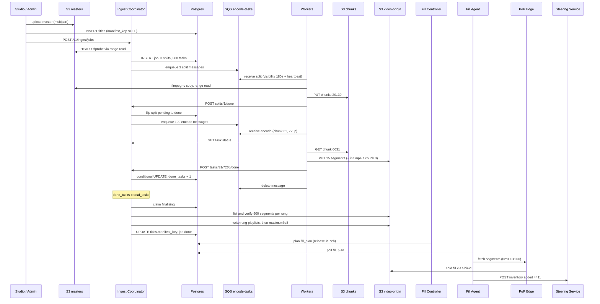

## Who writes, who reads, in this flow

| Structure | Who writes, and when | Who reads, and when |
|---|---|---|
| S3 `masters` | Studio, at delivery | Coordinator (ffprobe), split workers |
| `titles` row | Admin script (create). Coordinator (`manifest_key`, at finalize) | API Server, Fill Controller, browse query |
| `transcode_jobs`, `transcode_splits`, `transcode_tasks` | Coordinator only: plan, split callbacks, task callbacks, finalize | Coordinator, status check by workers via API |
| SQS `encode-tasks` | Coordinator, at plan and split-done | Workers |
| S3 `chunks` | Split workers | Encode workers |
| S3 `video-origin` segments | Encode workers | Coordinator (verify), Shield cache |
| S3 `video-origin` playlists | Coordinator, at finalize only | Shield cache, then edges and appliances |
| `fill_plan` | Fill Controller, nightly | Fill agents |
| Appliance disk | Fill agents | Clients |
| Redis `inv:{id}` | Steering Service, on inventory report | Steering Service, on every steer |

## Rough timeline for this 60-minute episode

| Phase | Time |
|---|---|
| Validate and plan (Steps 4-8) | A few seconds |
| Split, 3 workers in parallel (Steps 9-14) | 1-2 minutes |
| Encode, 300 tasks on about 100 workers (Steps 15-22) | 6-10 minutes |
| Finalize (Steps 23-28) | Under a minute |
| Wait for nightly fill (Steps 30-32) | Until the next 02:00 local |

**Three rules hold the whole flow together.** Every worker write uses a deterministic key, so retries overwrite. Every state change uses a conditional update, so duplicates add zero. The `manifest_key` flip happens last, so viewers never see a half-built title.

**Next:** Dev pauses at minute 41 on his phone and opens the TV. Say "next" for watch history and resume.


-----------------------------------------------------------------------------------------------------------------------
-----------------------------------------------------------------------------------------------------------------------
-----------------------------------------------------------------------------------------------------------------------
-----------------------------------------------------------------------------------------------------------------------


## V6: watch history and resume position

V5 finished the ingest side. This version adds one thing: remembering where each viewer stopped, across devices. How that write load scales is the next problem, so V6 deliberately uses the simplest store that is correct.

### Break it

Dev is watching episode 1 on his phone. He pauses at 41:00, which is 2,460 seconds. He walks to the living room and opens the TV app.

- The TV has no idea he watched anything.
- The home page shows no "Continue Watching" row.
- He opens the title and playback starts at 0:00.
- He scrubs through a 60-minute timeline trying to find minute 41.

Every playback in V5 is stateless. The server forgets the viewer the moment the signed token is issued. Nothing records that Dev ever watched anything.

### The idea, in plain language

Think of a physical bookmark. The reader puts it in at the page they stopped on. Whoever opens the book next, in any room, sees the bookmark.

Here the bookmark is one row per (user, title). The player updates it while playing. The next device reads it before starting.

### Options considered

> **Asha:** Store the position on the device. Zero server work.
> **Ravi:** Dev's phone and his TV are different devices. The TV can't read the phone's storage.

| Option | Cross-device | Survives a dead phone battery | Server writes |
|---|---|---|---|
| Position stored on the device only | No | Yes, but only on that device | None |
| Server bookmark, written only on pause or stop | Yes | No. A crash or killed app loses the whole session | Very low |
| Server bookmark, heartbeat every 30s plus pause and stop events | Yes | Loses at most 30 seconds | Moderate |

We take the third row. A killed app is common on phones, so pause-only is not enough.

### Implement it

**Schema (Postgres, first appearance, shown in full).** It is the same RDS instance, because this is small, keyed relational data and the load is still modest.

```sql
CREATE TABLE watch_progress (
  user_id      BIGINT REFERENCES users,
  title_id     BIGINT REFERENCES titles,
  position_sec INT     NOT NULL,
  duration_sec INT     NOT NULL,
  completed    BOOLEAN NOT NULL DEFAULT false,
  session_id   TEXT    NOT NULL,   -- one per play session, set by the client
  seq          INT     NOT NULL,   -- increases within a session
  device_type  TEXT,               -- 'phone' | 'tv' | 'web'
  updated_at   TIMESTAMPTZ NOT NULL DEFAULT now(),
  PRIMARY KEY (user_id, title_id)
);
CREATE INDEX wp_recent ON watch_progress (user_id, updated_at DESC);
```

One row per (user, title) doubles as the history. We keep only the latest position, not every ping.

**Step 1: the client reports progress.**

```
PUT /v1/progress/4411
Authorization: Bearer <jwt>
{"position_sec":2460,"duration_sec":3600,
 "session_id":"s-9f2","seq":83,"event":"pause","device_type":"phone"}
```

The player sends this:
- Every 30 seconds while playing, with `event: "heartbeat"`.
- On pause, with `event: "pause"`.
- On stop, background or close, with `event: "stop"`.

**Step 2: the API Server writes it.** The write is an upsert with an ordering guard.

```sql
INSERT INTO watch_progress
  (user_id, title_id, position_sec, duration_sec, completed,
   session_id, seq, device_type, updated_at)
VALUES ($1, $2, $3, $4, ($3 >= 0.95 * $4), $5, $6, $7, now())
ON CONFLICT (user_id, title_id) DO UPDATE SET
  position_sec = EXCLUDED.position_sec,
  duration_sec = EXCLUDED.duration_sec,
  completed    = EXCLUDED.completed,
  session_id   = EXCLUDED.session_id,
  seq          = EXCLUDED.seq,
  device_type  = EXCLUDED.device_type,
  updated_at   = now()
WHERE watch_progress.session_id <> EXCLUDED.session_id
   OR watch_progress.seq < EXCLUDED.seq;
```

The `WHERE` clause does two jobs:
- **Same session, out of order.** If a retried heartbeat with `seq` 80 arrives after `seq` 83, the guard rejects it. Position never jumps backwards from a stale packet.
- **Different session.** If Dev's TV session writes after his phone session, the TV wins. Arrival time at the server decides, and the server uses its own `now()`, not the device clock. Device clocks can be wrong, so we never trust them for ordering across devices.

The API returns 204 either way. A rejected stale write is not an error.

**Step 3: playback start reads the bookmark.** `POST /v1/titles/4411/playback` gains one lookup:

```sql
SELECT position_sec, completed FROM watch_progress
WHERE user_id = $1 AND title_id = 4411;
```

```python
def resume_point(row):
    if row is None or row.completed or row.position_sec < 30:
        return 0
    return max(0, row.position_sec - 5)       # rewind 5s for context
```

The response adds one field:

```json
{"manifest_urls":["https://bom1-fnet-03.cdn.example.com/titles/4411/v1/master.m3u8", "..."],
 "playback_token":"u9021.4411.1730851200.<sig>",
 "resume_position_sec":2455}
```

The player starts at segment `floor(2455 / 4.004) + 1 = 614`. It requests that segment directly from the appliance. It never fetches segments 1 to 613.

**Step 4: the home page gets a new row.** `GET /v1/home` runs one more query:

```sql
SELECT t.title_id, t.name, t.poster_key, wp.position_sec, wp.duration_sec
FROM watch_progress wp
JOIN titles t ON t.title_id = wp.title_id
WHERE wp.user_id = $1 AND NOT wp.completed AND t.manifest_key IS NOT NULL
ORDER BY wp.updated_at DESC
LIMIT 20;
```

It becomes the first row in the response, with a progress bar computed from `position_sec / duration_sec`.

**Dev, replayed.**
- 41:00 on the phone. He pauses, and the phone sends `PUT /v1/progress/4411` with `position_sec: 2460` and `event: "pause"`.
- He opens the TV app. `GET /v1/home` shows "Night Train S1E1" first, 68% through.
- He presses play. The response carries `resume_position_sec: 2455`.
- The TV starts at segment 614, five seconds before where he stopped.

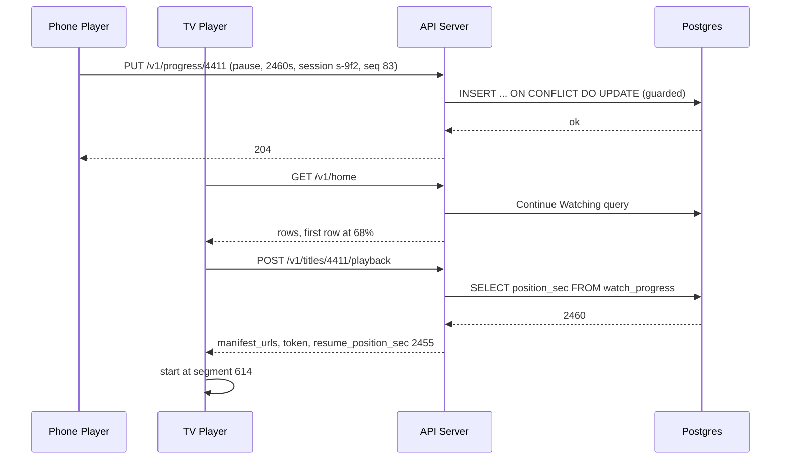

### Who writes, who reads

| Structure | Lives in | Who writes, and when | Who reads, and when |
|---|---|---|---|
| `watch_progress` | Same RDS instance | API Server, on each `PUT /v1/progress` (30s heartbeat, pause, stop) | API Server: at playback start, and in the Continue Watching query on each home load |

### Solve it: the trade in this design

- ✅ **What we gained:**
  - Cross-device resume works, with at most 30 seconds lost on a crash.
  - A Continue Watching row, which is also the history.
  - Stale or duplicate pings cannot move the position backwards.
  - Playback start stays fast. It is one primary-key read.
- ⚠️ **What we gave up:**
  - Every playing viewer now writes to Postgres every 30 seconds. At 1 million concurrent viewers that is about 33,000 writes per second, which one RDS primary cannot absorb. V7 fixes this.
  - Playback start now has a database read on the critical path.
  - Cross-device ordering is last-arrival-wins. Two devices playing the same title at once will overwrite each other.
  - We keep only the latest position, so there is no full event history for analytics or recommendations.
- ❌ **What we considered and rejected:**
  - Device-local storage, because other devices cannot see it.
  - Pause-only writes, because a killed app loses the session.
  - Trusting device clocks for ordering, because skew would make old positions win.
  - Storing every ping as an event row. The table would grow at 33,000 rows per second for data nobody reads.

### Current state after V6

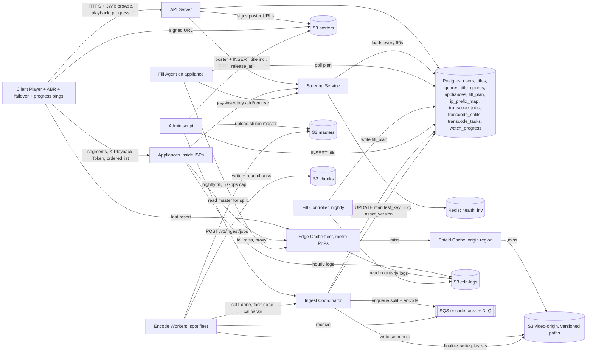

New in V6: the `watch_progress` table, the progress ping path from the client through the API Server, and the Continue Watching row. Nothing else changed.

**Every current flow:**
1. **Browse (changed):** Client calls `GET /v1/home`. API Server runs the Continue Watching query and the genre join (both filtered to `manifest_key IS NOT NULL`), signs poster URLs, and returns the rows with Continue Watching first.
2. **Play (changed):**
   1. Client calls `POST /v1/titles/{id}/playback`.
   2. API Server reads `watch_progress` and computes `resume_position_sec`.
   3. API Server asks the Steering Service for an ordered list, as in V4.
   4. API returns the list, an Ed25519 token and the resume position.
   5. Client streams from the first healthy appliance starting at the resume segment, and fails down the list as in V4.
   6. Client picks the next rung as in V1.
3. **Progress (new):**
   1. While playing, the client sends `PUT /v1/progress/{id}` every 30 seconds, and on pause and stop.
   2. API Server runs the guarded upsert into `watch_progress`.
4. **Heartbeat and inventory:** unchanged from V4.
5. **Fill:** unchanged from V4.
6. **Add a title:** unchanged from V5 (job plan, split, encode, finalize).

### Interview follow-ups

**Why a heartbeat every 30 seconds, not every second?**
Resume only needs to be close, and a user will happily rewind a few seconds. A 30-second heartbeat cuts write volume 30x compared with a one-second ping. Pause and stop events capture the exact position in the normal case.

**Two devices play the same title at once. Which position wins?**
The most recent write by server time wins, because the guard only rejects stale pings from the same session. That is last-write-wins and it is acceptable here. The cost of a wrong position is a few seconds of scrubbing, not data loss.

### Recap

| Concept | The Insight |
|---|---|
| Server-side bookmark | One row per (user, title) is the whole feature, and it doubles as watch history. |
| Heartbeat plus events | The 30-second heartbeat bounds lost progress on a crash. Pause and stop give the exact position. |
| Guarded upsert | Session and sequence number make late or duplicate pings harmless. |
| Server time orders devices | Device clocks drift, so the server decides which device wrote last. |
| Resume at playback start | The playback call returns the position and the player jumps straight to the right segment. |

**Interview-arc sentence:** *"If asked how resume works across devices: device-local storage can't be seen by the TV, so the player heartbeats its position to a per-(user, title) row with a guarded upsert, and the playback call returns the resume point so the new device starts at the right segment."*

**Next:** Friday 9:30 pm, 1 million people are watching. That is about 33,000 progress writes per second against one Postgres primary, and the same database also serves every login and home page. Say "next" and we move this write path onto a store built for it.


-----------------------------------------------------------------------------------------------------------------------
-----------------------------------------------------------------------------------------------------------------------
-----------------------------------------------------------------------------------------------------------------------
-----------------------------------------------------------------------------------------------------------------------


## V7: shard the watch-progress store

V6 made resume work. This version fixes only the write volume: spreading `watch_progress` across many machines. Copies of each shard for durability and failover are V8, so for now treat each shard as one logical node.

### Break it

Friday, 9:30 pm. One million people are watching.

- Each player pings every 30 seconds. That is about 33,000 writes per second.
- Each write is an upsert into `watch_progress` on one Postgres primary.
- Each upsert touches the row, the primary-key index, and the `wp_recent` index. It also writes WAL.
- Because `updated_at` is indexed, Postgres can't do cheap in-place updates. Each write leaves a dead tuple behind for vacuum.

A well-tuned primary sustains about 10,000 of these per second. At 33,000, the write queue grows and API threads block waiting on the database.

The same database serves logins and the home page. Dev's login times out. The app retries the heartbeat, which adds more load.

### The idea, in plain language

One writer has a ceiling. So split the keyspace into slices and give each slice its own machine. A viewer's bookmark lives on exactly one slice, chosen by a function of the key.

That is **sharding**, also called partitioning. Every write goes to one shard, so shards work in parallel and capacity grows by adding machines.

### The crux of this version: three naive attempts

**Attempt 1: a bigger primary.** It is a one-line change. It breaks on the ceiling: 2x hardware gives about 20,000 writes per second, and next year's audience is bigger.

**Attempt 2: buffer in Redis, flush to Postgres in batches.**

> **Asha:** Players write to Redis. A job flushes the latest position per user to Postgres every minute.
> **Ravi:** Redis now holds the only copy of the last minute. If it restarts, every viewer loses progress at once. And the flush still sends 1 million rows a minute at one primary.

It looked reasonable because batching amortises cost. It breaks on durability, and it adds a second store holding the same data without removing the ceiling.

**Attempt 3: shard Postgres by hand with `user_id % 8`.**
It looked reasonable because every tool already exists. It works at 8 shards. It breaks when we add a ninth. `user_id % 9` moves almost every key, so resharding is a near-total data migration.

### Choosing the store class

The access pattern is narrow:
- Write one row by key, about 33,000 times a second.
- Read one row by key at playback start.
- Read all of one user's rows for the Continue Watching row.
- No joins, no cross-user queries.

That is a key-partitioned wide-column store. We pick **Cassandra** (ScyllaDB or DynamoDB are equivalent here). It is built for write-heavy keyed workloads. Its writes append to a log and a memtable, so there is no read-modify-write and no vacuum. It also places data on a hash ring, which fixes Attempt 3's resharding cost.

| Option | Write headroom | Adding capacity | Joins available | Ops cost |
|---|---|---|---|---|
| Bigger Postgres primary | About 2x | Downtime, hardware swap | Yes | Low |
| Redis buffer in front | High, but not durable | Same as Postgres | No | Medium, two stores |
| Hand-sharded Postgres (mod N) | Linear | Near-total rehash | Within a shard | High, app-level routing |
| Consistent-hash wide-column store | Linear | About 1/N of keys move | No | Medium, a new system |

Sharded Postgres with Citus or Vitess is a defensible alternative. We take the last row because nothing here needs a join, and online resharding is built in.

### Choosing the shard key

| Candidate key | What it optimises | What it breaks |
|---|---|---|
| `title_id` | Per-title analytics | Hotspot. 200,000 viewers of one premiere all write to one shard. |
| `(user_id, title_id)` | Perfect write spread | The Continue Watching read must scatter across every shard. |
| `user_id` | One user's rows sit together, so home is one single-shard read | A user with huge write volume is a hot key, which a cap handles. |

We take `user_id`. Traffic is naturally spread, because every human sends about 2 writes a minute. A partition stays small, at most a few hundred rows, so reading it whole is cheap.

### Implement it

**Schema (first appearance in this store, shown in full).**

```sql
-- CQL, Cassandra cluster in the origin region
CREATE TABLE watch_progress_by_user (
  user_id      bigint,
  title_id     bigint,
  position_sec int,
  duration_sec int,
  completed    boolean,
  session_id   text,
  device_type  text,
  updated_at   timestamp,
  PRIMARY KEY ((user_id), title_id)
);
```

`user_id` is the partition key, which decides the shard. `title_id` is the clustering key, so one user's titles sit together on disk, sorted by title.

There is no second index and no recency ordering. A user's whole partition is small, so the API sorts by `updated_at` in memory. That keeps one write per ping, where a recency table would need two.

**The ring (what picks the shard).**

```
token = murmur3_64(user_id)            # 64-bit hash
owner = first node clockwise from token on the ring
```
```
          node A (256 vnodes)
       .-' ''-.
  node D       node B
       '-.  .-'
          node C
```

Each node owns 256 small, scattered arcs of the ring (virtual nodes). We start with 12 nodes. That is about 3,000 writes per second each at peak, well under their comfortable limit, and about 60 GB each for roughly 10 billion small rows. The sizing leaves room for growth.

Adding a 13th node takes about 1/13 of the keys, streamed from its neighbours. The other 12/13 stay where they are. That is the bounded blast radius.

**Write ordering without lightweight transactions.** V6's guarded upsert needs a compare-and-set. In Cassandra that is a lightweight transaction (LWT), which costs several round trips. Instead we use the store's own rule: when two writes hit the same cell, the higher write timestamp wins.

We make the write timestamp carry the ordering. The playback call now mints the session:

```
POST /v1/titles/4411/playback
-> {..., "session_id":"1730849400123-x7f", "resume_position_sec":2455}
```

`session_id` is `<server_start_ms>-<random>`, minted by the API Server, not the device. Then:

```python
def write_ts_micros(session_id, seq):
    start_ms = int(session_id.split("-")[0])
    return start_ms * 1000 + min(seq, 999)   # microseconds
```

Within a session, a higher `seq` always wins, so a late retry of seq 80 cannot overwrite seq 83. Across sessions, the session that started later always wins. Sessions are capped at about 8 hours, after which the client starts a new one.

**Step 1: the client reports progress** (unchanged shape from V6).
```
PUT /v1/progress/4411
{"position_sec":2460,"duration_sec":3600,
 "session_id":"1730849400123-x7f","seq":83,"event":"pause","device_type":"phone"}
```

**Step 2: the API Server writes it.**
```sql
INSERT INTO watch_progress_by_user
  (user_id, title_id, position_sec, duration_sec, completed,
   session_id, device_type, updated_at)
VALUES (9021, 4411, 2460, 3600, false,
        '1730849400123-x7f', 'phone', toTimestamp(now()))
USING TIMESTAMP 1730849400123083;   -- start_ms*1000 + seq 83
```
One `USING TIMESTAMP` applies to every column in the statement. So the whole row wins or loses together. The driver is token-aware. It hashes `user_id = 9021` itself and sends the write straight to the owning node, with no extra hop. The API returns 204.

**Step 3: playback start reads one row.**
```sql
SELECT position_sec, completed FROM watch_progress_by_user
WHERE user_id = 9021 AND title_id = 4411;
```
`resume_point()` from V6 is unchanged.

**Step 4: Continue Watching reads one partition.**
```sql
SELECT title_id, position_sec, duration_sec, completed, updated_at
FROM watch_progress_by_user WHERE user_id = 9021;
```
```python
rows = [r for r in rows if not r.completed]
rows.sort(key=lambda r: r.updated_at, reverse=True)
top = rows[:20]
titles = pg.query(
  "SELECT title_id, name, poster_key FROM titles "
  "WHERE title_id = ANY(%s) AND manifest_key IS NOT NULL",
  [r.title_id for r in top])
```
The home page now joins in the API layer, because the two stores are separate. The `titles` lookup is a 20-key primary-key read.

### Known sub-problem: a hot key

Our partition key is spread well, but one `user_id` can still be hammered. A bot, a buggy client in a retry loop, or a shared test account could send thousands of writes a second to one shard. Three real fixes:

**1. Per-user rate limit at the API.** Allow one write per 10 seconds per (user, title) except pause and stop events.
```python
if not limiter.allow(f"wp:{user_id}:{title_id}", rate=0.1, burst=3):
    return 204   # drop silently, the next heartbeat will carry the position
```
Fits here. A dropped heartbeat costs nothing, because the next one overwrites it.

**2. Key salting.** Append a bucket to the key: `(user_id, salt)`. It spreads one user across shards. It makes the home read scatter, so it only suits keys that are hot because of volume, not because of reads. We don't need it.

**3. Per-partition row cap.** Reject new titles for a user with more than 2,000 rows, and expire completed rows after 2 years with a TTL. It stops giant partitions. It fits as hygiene, but it does not stop write floods.

We use 1 and 3. Fix 2 is the answer only if a real-world hotspot appears.

### Migration (one-line version of how we get there)

1. Create the Cassandra table. Start dual-writing from the API: Postgres first, then Cassandra.
2. Backfill old rows with `USING TIMESTAMP 0`, so any live write beats them.
3. Switch reads to Cassandra. Fall back to Postgres on a miss.
4. Stop writing Postgres. Drop `watch_progress` after a week.

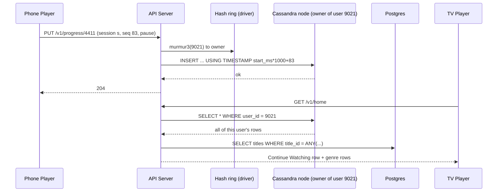

### Who writes, who reads

| Structure | Lives in | Who writes, and when | Who reads, and when |
|---|---|---|---|
| `watch_progress_by_user` | Cassandra, 12 nodes, origin region | API Server: each `PUT /v1/progress` | API Server: at playback start (one row) and on each home load (one partition) |
| Per-user rate limit counters | In API Server memory, per instance | API Server, on each progress write | API Server, on each progress write |
| `titles` | Postgres | Admin script, Ingest Coordinator | API Server, for the home row join and playback |

### Solve it: the trade in this design

- ✅ **What we gained:**
  - 33,000 writes per second spread over 12 nodes, about 3,000 each.
  - Capacity grows by adding nodes, and only about 1/N of the data moves.
  - Writes are appends, so there is no vacuum and no read-modify-write.
  - Stale or duplicate pings lose by timestamp, with no LWT.
  - Postgres is free of the heaviest write path, so logins and catalog reads are healthy again.
- ⚠️ **What we gave up:**
  - No joins. The home row now makes two reads on two stores.
  - A new system to operate, with its own compaction, repair and upgrades.
  - Cross-device ordering now favours the later-started session, not the later arrival. That is a deliberate change from V6.
  - Each shard is still a single copy. A dead node loses its slice of bookmarks and its availability. That is V8.
  - No ad hoc queries for analytics. That waits for the event pipeline.
- ❌ **What we considered and rejected:**
  - A bigger primary, which only doubles the ceiling.
  - A Redis buffer in front, because the last minute lives in one volatile place and the flush still floods Postgres.
  - `user_id % N` sharding, because adding a node rehashes nearly everything.
  - `title_id` as the shard key, because a premiere makes one shard take all the traffic.
  - Lightweight transactions for ordering, because they cost several round trips on a 33,000 per second path.

### Current state after V7

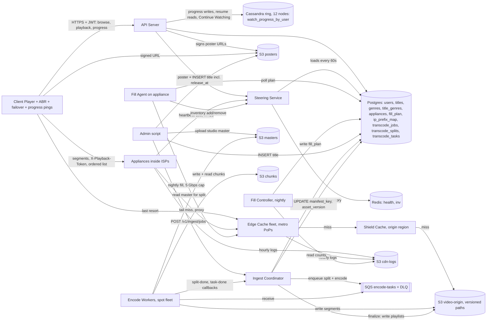

New in V7: the Cassandra ring and `watch_progress_by_user`, session IDs minted by the API, timestamp-based write ordering, and the per-user rate limit. `watch_progress` has left Postgres.

**Every current flow:**
1. **Browse (changed):**
   1. Client calls `GET /v1/home`.
   2. API reads the user's whole partition from Cassandra, filters out completed rows, sorts by `updated_at`, and keeps 20.
   3. API runs the `titles` lookup for those 20 ids, and the genre join, in Postgres.
   4. API signs poster URLs and returns Continue Watching first.
2. **Play (changed):**
   1. Client calls `POST /v1/titles/{id}/playback`.
   2. API reads one row from Cassandra and computes `resume_position_sec`.
   3. API mints `session_id`, asks the Steering Service for an ordered list, and returns the list, the Ed25519 token, the session and the resume point.
   4. Client streams from the first healthy appliance at the resume segment, and fails down the list as in V4.
   5. Client picks the next rung as in V1.
3. **Progress (changed):**
   1. Client sends `PUT /v1/progress/{id}` every 30 seconds, and on pause and stop, with `session_id` and `seq`.
   2. API applies the rate limit, then runs a timestamped insert on the owning Cassandra node.
4. **Heartbeat and inventory:** unchanged from V4.
5. **Fill:** unchanged from V4.
6. **Add a title:** unchanged from V5.

### Interview follow-ups

**Why not shard by `(user_id, title_id)` for the best spread?**
Our write load is already spread, because people are spread. That key would make the home page a scatter-gather across every shard, which is a read tax with no write benefit. `user_id` keeps every read single-shard.

**What happens when you add a node?**
The new node takes tokens from its neighbours and streams in about 1/N of the data. Reads and writes continue throughout. A `user_id % N` scheme would have moved almost everything.

### Recap

| Concept | The Insight |
|---|---|
| Shard key = access pattern | Every hot read is by user, so `user_id` keeps reads on one shard and spreads writes by population. |
| Consistent-hash ring | Adding a node moves about 1/N of the keys, not all of them. |
| Append-only store | Heartbeats are overwrites of tiny rows, which an append-only engine handles without vacuum. |
| Timestamp as ordering | A session-derived write timestamp resolves stale pings with no compare-and-set. |
| Cost of leaving SQL | The home row now joins two stores in the API layer. |

**Interview-arc sentence:** *"If asked how you scale watch-progress writes: one Postgres primary tops out near 10,000 upserts a second against 33,000 heartbeats, and `mod N` sharding rehashes everything on growth, so we partition by `user_id` on a consistent-hash ring in a wide-column store, with the session start time baked into the write timestamp for ordering."*

**Next:** at 9:41 pm one Cassandra node loses its disk. Every bookmark it owned, about 1/12 of all users, is gone and unreadable until it's rebuilt. Say "next" and we add replication.


-----------------------------------------------------------------------------------------------------------------------
-----------------------------------------------------------------------------------------------------------------------
-----------------------------------------------------------------------------------------------------------------------
-----------------------------------------------------------------------------------------------------------------------


## V8: replicate the watch-progress store

V7 spread the writes across 12 nodes. This version fixes only durability and availability: each bookmark gets more than one copy. Multi-region is separate, so V8 stays inside one region.

### Break it

Friday, 9:41 pm. Node `cass-07` loses its disk. The cluster is at RF=1, so each row lives on exactly one node.

- `cass-07` owned about 1/12 of the ring. With 200 million accounts, that is roughly 16 million users.
- Their bookmarks are gone. There is no copy to rebuild from.
- About 2,750 progress writes per second fail, because their owner is down.
- Playback start reads `watch_progress_by_user` on the critical path. For those users, the read errors out and playback fails to start.

Two problems show up.
- **Availability.** One dead node blocks 8% of viewers, even though the video path is healthy.
- **Durability.** The data is permanently lost, not just unreachable. Dev's phone bookmark is among them.

### Do we need replicas for reads?

No. The read:write ratio here is lopsided the other way. Writes are about 33,000 per second. Reads are about 330 playback starts per second plus home loads. Replicas are not justified by read throughput.

They are justified by durability and availability. That changes which options matter.

### The idea, in plain language

Keep three copies of every row on three different machines, in three different failure domains. If one machine dies, two copies remain. Reads and writes carry on.

The hard part is keeping the copies agreeing. That is what the options below trade off.

### Options considered

> **Asha:** Put a standby behind each node. It copies everything. If the node dies, promote the standby.
> **Ravi:** Who notices the node died? Who promotes? And what if the standby is a few seconds behind? We just lost the last few heartbeats, and the promotion has to be coordinated.

| Option | Failover | Data loss on node death | Write latency | Operational cost |
|---|---|---|---|---|
| Primary-replica per shard, async | Needs detection plus promotion, seconds to minutes | The unreplicated tail | Lowest | Needs a failover controller |
| Consensus per shard (Raft, Paxos) | Automatic, a few seconds | None | A leader hop plus a majority | Complex to run in-house |
| Leaderless quorum (Cassandra-style) | None needed, any replica answers | None, if a majority acked | One round trip to the slowest of two replicas | Repair jobs |

We take leaderless quorum. We are already on Cassandra, there is no leader to elect, and a dead node needs no failover event.

### Implement it

**Placement.** The cluster stays at 12 nodes, spread across 3 availability zones, 4 nodes per zone. Replication factor (RF) is 3. The ring picks a row's first replica as in V7. The next two replicas are the next nodes clockwise that sit in different zones. A whole zone can fail and every row still has two copies.

**Keyspace (first appearance, shown in full).**

```sql
CREATE KEYSPACE progress
WITH replication = {
  'class': 'NetworkTopologyStrategy',
  'ap-south-1': 3         -- one replica per AZ, snitch maps rack = AZ
};
```

Sizing changes in one line. Replica writes triple to about 100,000 per second, so each node takes about 8,300. Disk per node grows from about 60 GB to about 180 GB. Both fit comfortably.

**Consistency levels.** RF=3, so QUORUM is 2.

| Operation | Level | Why |
|---|---|---|
| Progress write (heartbeat, pause, stop) | QUORUM | A write acked by 2 of 3 survives any single failure |
| Resume read at playback start | QUORUM | R + W > RF, so the read overlaps the latest acked write |
| Continue Watching read | QUORUM | Dev pauses on the phone, then opens the TV home page. Staleness here is visible. |

The overlap rule: W + R = 2 + 2 = 4, which is greater than 3. Any 2 replicas a read contacts include at least one that acked the latest write.

Staleness would hurt in exactly one flow. Dev pauses on his phone and opens the TV within seconds. A stale read would show the wrong progress bar and resume point. That is why reads use QUORUM too, even though we rarely read.

**Driver config (API Server).**

```python
cluster = Cluster(
    contact_points=CASS_SEEDS,
    load_balancing_policy=TokenAwarePolicy(DCAwareRoundRobinPolicy(local_dc="ap-south-1")),
    default_retry_policy=RetryPolicy(),
)
WRITE_CL = ConsistencyLevel.LOCAL_QUORUM
READ_CL  = ConsistencyLevel.LOCAL_QUORUM
```

`LOCAL_QUORUM` equals QUORUM today. We use it so that adding a region later does not change the code.

**Write path.** `PUT /v1/progress/4411` runs the same insert as V7, with `USING TIMESTAMP` carrying the session ordering. What changes is what happens inside the cluster:

1. The driver hashes `user_id = 9021` and sends the write to any of its 3 replicas. That node is the coordinator.
2. The coordinator sends the write to all 3 replicas in parallel.
3. Each replica appends to its commit log and memtable, then acks.
4. The coordinator acks the API Server as soon as 2 replicas have acked. The third write continues in the background.
5. The API returns 204.

**Read path, with a fallback.** Playback start reads one row at QUORUM with a 150 ms timeout. If that read fails:

```python
def read_resume(user_id, title_id):
    try:
        return cass.execute(SELECT, [user_id, title_id], consistency=LOCAL_QUORUM, timeout=0.15)
    except (Unavailable, ReadTimeout):
        try:
            return cass.execute(SELECT, [user_id, title_id], consistency=LOCAL_ONE, timeout=0.15)
        except Exception:
            return None            # resume_position_sec = 0, playback still starts
```

Stale resume beats no resume, and resume at 0 beats no playback. This keeps the scope rule that playback survives a control-plane failure.

### Known sub-problem: replicas that drift apart

A replica that was down or slow misses writes. Three real fixes exist, and Cassandra uses all three in layers.

**1. Hinted handoff.** When a replica is down, the coordinator stores the missed write as a hint. It replays the hint when the replica returns.
```
coordinator: hints/cass-07 += (row, timestamp)
on cass-07 up: replay hints in timestamp order
```
It is fast and covers short outages. Hints stop after 3 hours, so a longer outage needs fix 3.

**2. Read repair.** On a QUORUM read, the coordinator compares the replies. If one has an older timestamp, it writes the winning value back.
```
replicas reply: A(ts=900), B(ts=900), C(ts=700)  ->  write ts=900 back to C
```
It heals hot rows for free. It never touches rows nobody reads.

**3. Anti-entropy repair.** A scheduled job compares Merkle trees of each token range between replicas and streams differences.
```
nodetool repair -pr        # weekly, one node at a time
```
It covers cold rows and long outages. It must finish within `gc_grace_seconds` (10 days), or deleted or expired rows can come back from a stale replica.

We use all three. Hints and read repair handle the common case. Weekly repair is the backstop.

### Failure scenarios

**Replaying 9:41 pm.** `cass-07` dies. For its token ranges, two replicas remain.

| Event | What happens |
|---|---|
| Write to a row owned by `cass-07` | Coordinator gets 2 acks from the live replicas, returns 204. A hint is stored for `cass-07`. |
| Playback start read | QUORUM reads the two live replicas and succeeds. |
| Dev's bookmark | Two copies survive on other nodes. Nothing is lost. |
| `cass-07` comes back within 3 hours | Hints replay. Read repair mops up anything left. |
| `cass-07` is gone for good | Ops starts a replacement node with `replace_address_first_boot=<dead ip>`. It streams its ranges from the other two replicas. |
| Two replicas of one range down | QUORUM is impossible. The playback read falls back to `LOCAL_ONE`. Writes fail until a second replica returns. |
| A whole availability zone down | Each range still has 2 replicas in the other zones, so QUORUM still works. |
| A slow node (not dead) | The coordinator takes the first 2 acks. A slow third replica doesn't add latency. |

Writes lose their guarantee only when 2 of 3 replicas are down at once, which is why they sit in different zones.

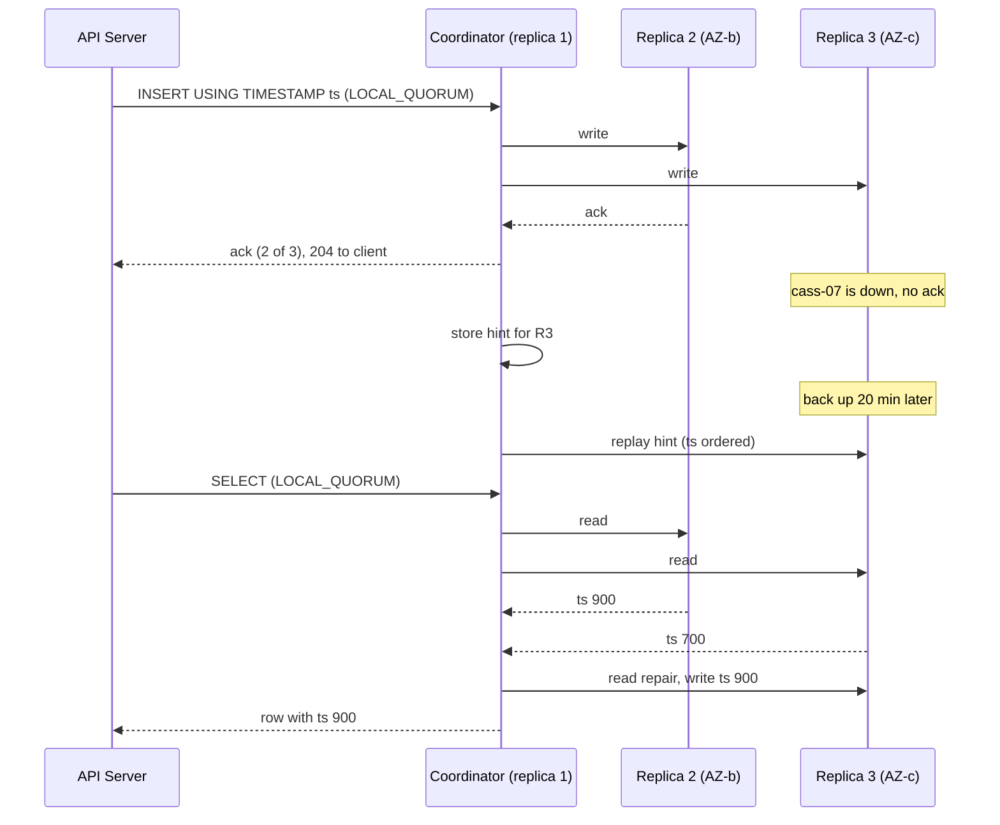

### Who writes, who reads

| Structure | Lives in | Who writes, and when | Who reads, and when |
|---|---|---|---|
| `watch_progress_by_user` replicas (3 per row) | Cassandra, 12 nodes across 3 AZs, origin region | Coordinator node on each API write, fanning out to 3 replicas | API Server: playback start (1 row) and home load (1 partition), via QUORUM |
| Hints | Local disk on the coordinator | Coordinator, when a replica misses a write | The same coordinator, replaying them on recovery |
| Repair jobs | Cron on the ops host | Anti-entropy `nodetool repair`, weekly | Replicas, comparing Merkle trees |

### Solve it: the trade in this design

- ✅ **What we gained:**
  - A node or a whole zone can die with no data loss and no failover event.
  - Writes and reads keep working through a single failure, with no leader to elect.
  - A new node rebuilds itself from the other two replicas.
  - Dev's pause followed by the TV open still reads his latest position, because reads overlap the last acked write.
- ⚠️ **What we gave up:**
  - 3x storage and 3x write amplification on the cluster.
  - Write latency is now that of the second-fastest replica, not one node.
  - Repair is a recurring operational job. A missed repair window can resurrect expired rows.
  - If two replicas of a range are down together, we are back to degraded reads and failing writes.
  - Concurrent writes from two devices still resolve by timestamp. Replication didn't change that.
- ❌ **What we considered and rejected:**
  - A primary-replica standby per shard. It needs failure detection and promotion, and async copying loses the unreplicated tail.
  - Per-shard consensus (Raft). It is safe, but it adds a leader hop to a 33,000 writes per second path that can tolerate last-write-wins.
  - Write at `ONE` for heartbeats. An ack from a single node that then dies loses the write, with no copy anywhere.
  - Read at `ONE` to save latency. Dev's TV could show the position from before his pause.
  - Read replicas as a scaling tool. Reads are about 330 per second, which one replica could serve alone.

### Current state after V8

```mermaid
graph LR
    Client[Client Player + ABR + failover + progress pings] -->|HTTPS + JWT: browse, playback, progress| API[API Server]
    API --> PG[(Postgres: users, titles, genres, title_genres, appliances, fill_plan, ip_prefix_map, transcode_jobs, transcode_splits, transcode_tasks)]
    API -->|LOCAL_QUORUM writes and reads, 150ms read timeout, fallback ONE| CASS
    subgraph CASS[Cassandra: watch_progress_by_user, RF=3, 12 nodes]  
        AZA[AZ-a: 4 nodes]  
        AZB[AZ-b: 4 nodes]  
        AZC[AZ-c: 4 nodes]  
    end
    API -->|steer client_ip, title| STEER[Steering Service]
    STEER -->|health, inventory| REDIS[(Redis: health, inv)]
    STEER -->|loads every 60s| PG
    API -->|signs poster URLs| S3P[(S3 posters)]
    Client -->|segments, X-Playback-Token, ordered list| APP[Appliances inside ISPs]
    Client -->|last resort| EDGE
    APP -->|tail miss, proxy| EDGE[Edge Cache fleet, metro PoPs]
    EDGE -->|miss| SHIELD[Shield Cache, origin region]
    SHIELD -->|miss| S3V[(S3 video-origin, versioned paths)]
    APP -->|heartbeat 10s, mTLS| STEER
    FA[Fill Agent on appliance] -->|nightly fill, 5 Gbps cap| EDGE
    FA -->|poll plan| PG
    FA -->|inventory add/remove| STEER
    APP -->|hourly logs| LOGS[(S3 cdn-logs)]
    EDGE -->|hourly logs| LOGS
    FC[Fill Controller, nightly] -->|read counts| LOGS
    FC -->|write fill_plan| PG
    Client -->|signed URL| S3P
    Admin[Admin script] -->|upload studio master| S3M[(S3 masters)]
    Admin -->|poster + INSERT title incl. release_at| S3P
    Admin -->|INSERT title| PG
    Admin -->|POST /v1/ingest/jobs| CO[Ingest Coordinator]
    CO -->|job, split, task state| PG
    CO -->|enqueue split + encode| Q[[SQS encode-tasks + DLQ]]
    W[Encode Workers, spot fleet] -->|receive| Q
    W -->|read master for split| S3M
    W -->|write + read chunks| S3C[(S3 chunks)]
    W -->|write segments| S3V
    W -->|split-done, task-done callbacks| CO
    CO -->|finalize: write playlists| S3V
    CO -->|UPDATE manifest_key, asset_version| PG
    OPS[Ops cron: weekly nodetool repair] -->|anti-entropy| CASS
```

New in V8: RF=3 across three availability zones, quorum read and write levels, the read fallback, hinted handoff, read repair, and the weekly repair job.

**Every current flow:**
1. **Browse:**
   1. Client calls `GET /v1/home`.
   2. API reads the user's partition from Cassandra at LOCAL_QUORUM, from any 2 of 3 replicas.
   3. API filters, sorts and keeps 20, then runs the `titles` lookup and genre join in Postgres.
   4. API signs poster URLs and returns Continue Watching first. If the Cassandra read fails, it returns the home page without that row.
2. **Play (changed):**
   1. Client calls `POST /v1/titles/{id}/playback`.
   2. API reads one row at LOCAL_QUORUM, then `LOCAL_ONE`, then falls back to resume 0.
   3. API mints `session_id`, asks the Steering Service for an ordered list, and returns the list, the Ed25519 token, the session and the resume point.
   4. Client streams from the first healthy appliance at the resume segment, and fails down the list as in V4.
   5. Client picks the next rung as in V1.
3. **Progress (changed):**
   1. Client sends `PUT /v1/progress/{id}` every 30 seconds, and on pause and stop.
   2. API applies the rate limit, then writes at LOCAL_QUORUM. The coordinator fans out to 3 replicas and acks after 2. A missing replica gets a hint.
4. **Repair (new):** hints replay on recovery. Read repair fixes stale replicas on reads. A weekly anti-entropy repair covers the rest.
5. **Heartbeat, inventory and fill:** unchanged from V4.
6. **Add a title:** unchanged from V5.

### Interview follow-ups

**Why not read at `ONE` since you almost never read?**
Reads are rare, so QUORUM costs nothing in throughput. The flow that matters is "pause on the phone, open the TV." QUORUM reads overlap the latest quorum write, so the TV sees that pause. `ONE` could return a replica that missed it.

**What if two replicas are down at once?**
Writes at QUORUM fail for the affected ranges. Playback reads fall back to `ONE`, then to resume at 0, so nobody is blocked from watching. Zone-aware placement makes this need two simultaneous failures in different zones.

### Recap

| Concept | The Insight |
|---|---|
| Replication isn't for reads here | Reads are about 330 per second. Copies exist for durability and availability. |
| Leaderless quorum | With RF=3 and W=R=2, every read overlaps the latest acked write, and no failover event is ever needed. |
| Zone-aware placement | One replica per AZ means a whole zone can fail with no loss. |
| Three repair layers | Hints for short outages, read repair for hot rows, weekly repair for the cold rest. |
| Degrade, never block | A failed read falls back to a stale one, then to resume 0. Playback starts regardless. |

**Interview-arc sentence:** *"If asked how you keep bookmarks safe when a node dies: RF=1 loses 1/12 of users and blocks their playback, and a standby per shard needs failure detection and loses the unreplicated tail, so we run RF=3 across three zones with quorum reads and writes, which survive any single failure with no failover and no data loss."*

**Next:** Friday 9 pm, every home load runs a Cassandra partition read, a Postgres genre join over every title row, and a signed-URL pass for dozens of posters. The catalog barely changes, but we recompute it every time. Say "next" and we cache it.


-----------------------------------------------------------------------------------------------------------------------
-----------------------------------------------------------------------------------------------------------------------
-----------------------------------------------------------------------------------------------------------------------
-----------------------------------------------------------------------------------------------------------------------


## V9: cache the home page

V8 made the bookmarks durable. This version fixes only the repeated work behind `GET /v1/home`: the genre join and the poster signing. Multi-region is separate, so everything stays in one region.

### Break it

Friday, 9:00 pm. A million people are in the app, and the new episode just dropped. About 2,000 of them open the home page every second.

Each `GET /v1/home` still runs the V0 genre query. That query has never had a `LIMIT`.

- It joins about 15,000 titles to their genres. That is about 30,000 rows, at about 40 ms of CPU.
- 2,000 per second × 40 ms is 80 cores of work. The Postgres primary has 32.
- Each request then signs poster URLs. Only a few hundred are shown, but the code signs every row it fetched.
- The same Postgres serves logins, the titles lookup for Continue Watching, the Steering Service reload, and Ingest Coordinator writes.

Dev's login times out. The app retries the home call, which adds more load.

The cruel part is that the answer barely changes. The genre rows were identical for every viewer in India at 8:59 and at 9:01. We recompute them 2,000 times a second.

### Do we need a cache here?

Yes, and the read pattern says why.

- The genre rows are the same for every viewer in a region.
- The catalog changes a few times a day, when a title finalizes.
- Reads are about 2,000 per second. Writes are a few per day.

That is a read-to-write ratio of about 10 million to 1. A cache fits.

### The idea, in plain language

A restaurant doesn't re-print the menu for every customer. It prints one, hands copies out, and reprints when a dish changes.

Here the menu is the list of genre rows for a region. We build it once, keep it in memory, and rebuild it only when the catalog changes.

### Attempts (a lighter walk, since delivery was the crux)

**Attempt 1: add indexes and tune the query.** It might get 40 ms down to 10 ms. It still burns 20 cores at 2,000 per second, and it still competes with logins.

**Attempt 2: cache with a 5-minute TTL only.**

> **Asha:** Put the JSON in Redis with a 5-minute expiry. Done.
> **Ravi:** The episode finalizes at 8:58. Viewers see the old menu until 9:03, five minutes into the premiere. And when the key expires, 2,000 requests per second all miss together.

It looked reasonable because it is three lines. It breaks on freshness at release time, and on a synchronized miss.

**Attempt 3: cache the whole response per user.**
It looked reasonable because it is the simplest key. It breaks because Continue Watching is per user. With 200 million accounts we would store 200 million near-identical blobs, each invalidated by every heartbeat.

**What survives:** split the page. The genre rows are shared and cacheable. Continue Watching is personal and stays a live read, as in V8. The cache key carries a catalog version, so a release changes the key instead of needing a purge. That is the same idea as the versioned segment paths in V2.

### Which layer caches what

| Layer | What it holds | Decision |
|---|---|---|
| Client | Last home response, shown while loading | Yes, as a display convenience only. Not covered further here. |
| CDN or edge for the API response | Nothing | No. The response mixes shared and per-user data. |
| In-process memory in each API instance (L1) | Shared genre rows, 30 seconds | Yes |
| Redis (L2) | Shared genre rows, per region, versioned key | Yes |
| Postgres | Source of truth | Only on a miss |
| Edge tier for poster images | Poster files | Yes, see below |

We decide explicitly not to put a CDN in front of `/v1/home`. Its body is personalized, so a shared cache would leak one viewer's row to another.

**The L1 earns its place with one number.** The shared rows are about 90 KB. At 2,000 requests per second, Redis would push 180 MB/s for one tiny key set. A 30-second in-process copy cuts that to a few requests per second per API instance.

### Posters get a different answer

In V0 we signed poster URLs per viewer. A signed URL is unique, so it can't sit in a shared cache. It is also pointless: a poster is not licensed content, and anyone may see it.

So posters stop being signed.
- `poster_key` becomes versioned and immutable, like `posters/4411-3.jpg`.
- The S3 `posters` bucket becomes private behind the V2 Shield and edge tier.
- Poster requests skip the token check, with `Cache-Control: public, max-age=31536000, immutable`.
- Cached rows now contain plain URLs. No signing step is left on the home path.

### Implement it

**Schema delta (Postgres).**
```sql
CREATE TABLE title_regions (
  title_id BIGINT REFERENCES titles,
  region   TEXT   NOT NULL,          -- 'IN', 'US', ...
  PRIMARY KEY (title_id, region)
);
```
Regional catalogs from our scope are now an explicit input to the rows, so region sits in the cache key.

**Redis keys (new store class: key-value cache).** The class fits the access pattern: whole-value reads by key, a few dozen keys, and an expiry on each.
```
catalog:version              INT      no TTL
home:v{ver}:{region}         STRING   JSON, about 90 KB, TTL 600 s
home:lock:{region}           STRING   SET NX, TTL 5 s
```
Redis lives in the origin region, next to the one from V4. It is a separate cluster, so a cache problem can't affect steering.

**The builder query (runs on a miss only).** It now has a limit.
```sql
SELECT genre, title_id, name, poster_key FROM (
  SELECT g.name AS genre, t.title_id, t.name, t.poster_key,
         row_number() OVER (PARTITION BY g.genre_id
                            ORDER BY t.release_at DESC) AS rn
  FROM genres g
  JOIN title_genres tg ON tg.genre_id = g.genre_id
  JOIN titles t        ON t.title_id  = tg.title_id
  JOIN title_regions r ON r.title_id  = t.title_id AND r.region = $1
  WHERE t.manifest_key IS NOT NULL
) x WHERE rn <= 20;
```
It returns about 600 rows, not 30,000.

**Reading the rows.**
```python
def shared_rows(region):
    ver = redis.get("catalog:version")                    # tiny, 2,000/s is fine
    key = f"home:v{ver}:{region}"
    if (v := l1.get(key)) is not None:
        return v                                           # L1 hit, 30 s TTL
    if (raw := redis.get(key)) is not None:
        v = json.loads(raw); l1.set(key, v, ttl=30); return v   # L2 hit
    return rebuild(region, ver)                            # miss

def home(user, region):
    rows   = shared_rows(region)                           # cached
    cw     = continue_watching(user)                       # live, Cassandra + titles lookup
    rows   = [r for r in rows if r.rating <= user.max_rating]   # JWT claim, in memory
    return {"rows": [cw] + rows}
```
Maturity filtering happens in memory per request. It is a cheap list filter, so it stays out of the key.

**Invalidation: bump a version, never delete.**

The Ingest Coordinator already flips `manifest_key` at finalize (V5, Step 28). One line is added after that commit:
```
redis> INCR catalog:version
```
Admin changes to `title_regions` or genres run the same `INCR`. The next request builds the key for the new version. Old keys age out through their 600-second TTL. No cache purge exists, and none can race.

If the `INCR` is lost, the TTL is the backstop. The menu is then stale for at most 10 minutes.

### Known sub-problem: the miss stampede at release time

The version bumps at 8:58. At that instant every `home:v{new}:{region}` key is cold. 2,000 requests per second miss together.

Three real fixes:

**1. Single-flight lock.** The first miss builds. The rest wait for it.
```python
if redis.set(f"home:lock:{region}", 1, nx=True, px=5000):
    build_and_store()
else:
    sleep(0.05)   # then re-check Redis, up to 3 tries
```
Fits. It costs followers a short wait.

**2. Stale-while-revalidate.** Serve the previous version's rows while one request rebuilds.
```python
stale = redis.get(f"home:v{ver-1}:{region}")
```
Fits. Slightly old rows for a second or two is fine, and nobody waits.

**3. Probabilistic early refresh.** Each hit has a small chance, rising near expiry, of rebuilding before the key expires.
```python
if random() < exp(-remaining_ttl / beta): rebuild_async()
```
Useful for TTL-only expiry. We invalidate by version, so it adds little.

We use 1 and 2 together. The lock makes sure only one rebuild hits Postgres per region. The stale copy means nobody waits for it. If there is no stale copy (a cold start), followers wait up to 150 ms, then run a single direct query rather than fail.

**Warm-up.** After the `INCR`, the Coordinator calls `POST /internal/home/warm?region=IN` for each region. The first build happens before viewers arrive.

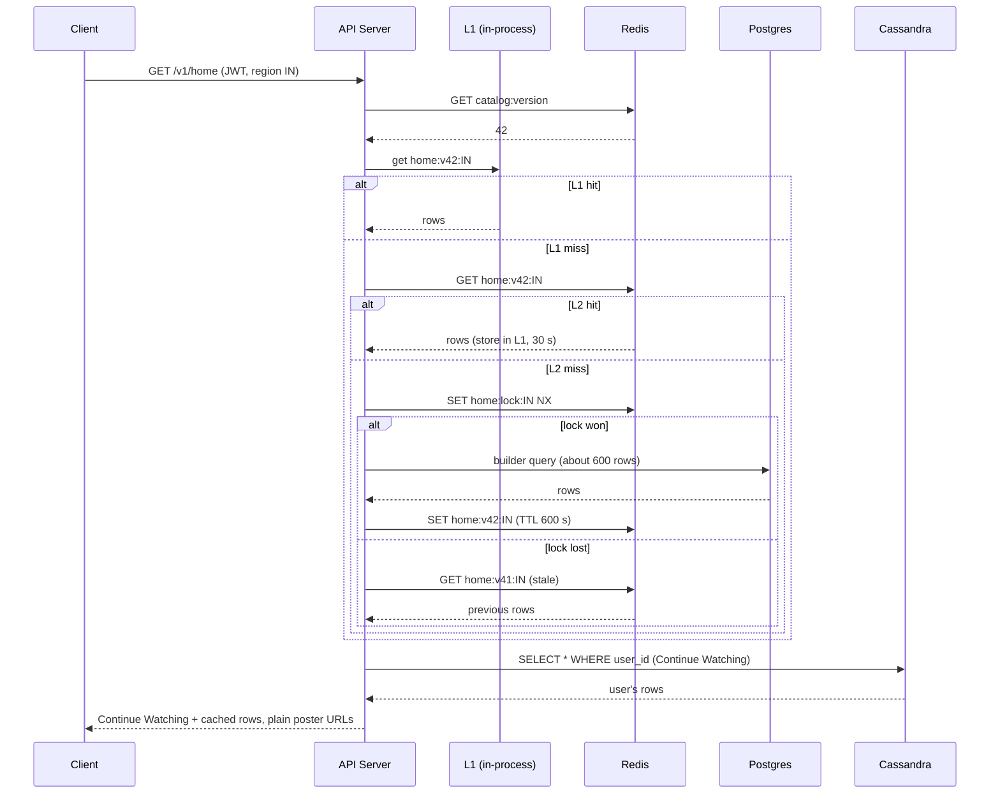

### Who writes, who reads

| Structure | Lives in | Who writes, and when | Who reads, and when |
|---|---|---|---|
| `catalog:version` | Redis (cache cluster) | Ingest Coordinator: `INCR` after each finalize. Admin tooling on catalog edits | API Server, on every home request |
| `home:v{ver}:{region}` | Redis (cache cluster) | API Server: the lock winner on a miss, plus the warm-up call | API Server: on every L1 miss |
| `home:lock:{region}` | Redis (cache cluster) | API Server, `SET NX` on a miss | Same, to check ownership |
| L1 rows | In-process memory, each API instance | API Server, after an L2 hit or a build | API Server, on every home request |
| `title_regions` | Postgres | Admin tooling | API Server, in the builder query |
| Poster objects | S3 `posters`, then Shield and edge SSD | Admin script, at upload | Client, via the edge |

### Solve it: the trade in this design

- ✅ **What we gained:**
  - Postgres sees about one build per region per catalog change, not 2,000 queries per second.
  - A release shows up within seconds, because the key changes with the version.
  - There is no purge and no invalidation race.
  - Poster signing disappears from the request path, and posters are cached near the viewer.
- ⚠️ **What we gave up:**
  - Staleness. Viewers can see a menu up to 30 seconds old (L1) after a bump, or 10 minutes old if the `INCR` is lost.
  - A new dependency on the home path. If Redis is down, API instances use their L1 and then a rate-limited direct build.
  - Posters are now publicly fetchable by anyone who knows the URL. That is acceptable for artwork, not for video.
  - Every personalized row is still live. Continue Watching costs a Cassandra read per home load.
  - The version counter is one hot key, though a few thousand tiny reads per second is far below Redis limits.
- ❌ **What we considered and rejected:**
  - Tuning the query alone, because it leaves 20 cores busy for a cacheable result.
  - TTL-only expiry, because releases would lag by minutes and expiry would synchronize misses.
  - A per-user cache of the whole response, because 200 million blobs would be invalidated by every heartbeat.
  - A CDN in front of `/v1/home`, because the body is personalized.
  - Purging by key on release, because versioned keys remove the race for free.

### Current state after V9

```mermaid
graph LR
    Client[Client Player + ABR + failover + progress pings] -->|HTTPS + JWT: browse, playback, progress| API[API Server + L1 cache]
    API -->|builder query on miss only| PG[(Postgres: users, titles, genres, title_genres, title_regions, appliances, fill_plan, ip_prefix_map, transcode_jobs, transcode_splits, transcode_tasks)]
    API -->|version, home rows, lock| CACHE[(Redis cache: catalog:version, home:v:region, home:lock)]
    API -->|LOCAL_QUORUM writes and reads, 150ms read timeout, fallback ONE| CASS
    subgraph CASS[Cassandra: watch_progress_by_user, RF=3, 12 nodes]
        AZA[AZ-a: 4 nodes]
        AZB[AZ-b: 4 nodes]
        AZC[AZ-c: 4 nodes]
    end
    API -->|steer client_ip, title| STEER[Steering Service]
    STEER -->|health, inventory| REDIS[(Redis: health, inv)]
    STEER -->|loads every 60s| PG
    Client -->|plain poster URLs, no token| EDGE
    Client -->|segments, X-Playback-Token, ordered list| APP[Appliances inside ISPs]
    Client -->|last resort| EDGE
    APP -->|tail miss, proxy| EDGE[Edge Cache fleet, metro PoPs]
    EDGE -->|miss| SHIELD[Shield Cache, origin region]
    SHIELD -->|miss| S3V[(S3 video-origin, versioned paths)]
    SHIELD -->|poster miss| S3P[(S3 posters, versioned, private)]
    APP -->|heartbeat 10s, mTLS| STEER
    FA[Fill Agent on appliance] -->|nightly fill, 5 Gbps cap| EDGE
    FA -->|poll plan| PG
    FA -->|inventory add/remove| STEER
    APP -->|hourly logs| LOGS[(S3 cdn-logs)]
    EDGE -->|hourly logs| LOGS
    FC[Fill Controller, nightly] -->|read counts| LOGS
    FC -->|write fill_plan| PG
    Admin[Admin script] -->|upload studio master| S3M[(S3 masters)]
    Admin -->|poster upload + INSERT title incl. release_at| S3P
    Admin -->|INSERT title, title_regions| PG
    Admin -->|POST /v1/ingest/jobs| CO[Ingest Coordinator]
    CO -->|job, split, task state| PG
    CO -->|enqueue split + encode| Q[[SQS encode-tasks + DLQ]]
    W[Encode Workers, spot fleet] -->|receive| Q
    W -->|read master for split| S3M
    W -->|write + read chunks| S3C[(S3 chunks)]
    W -->|write segments| S3V
    W -->|split-done, task-done callbacks| CO
    CO -->|finalize: write playlists| S3V
    CO -->|UPDATE manifest_key, asset_version| PG
    CO -->|INCR catalog:version, warm-up call| CACHE
    OPS[Ops cron: weekly nodetool repair] -->|anti-entropy| CASS
```

New in V9: the Redis cache cluster, the in-process L1, `title_regions`, versioned cache keys, the `INCR` and warm-up after finalize, and unsigned versioned posters served through the edge tier.

**Every current flow:**
1. **Browse (changed):**
   1. Client calls `GET /v1/home`.
   2. API reads `catalog:version` from Redis, then looks up `home:v{ver}:{region}` in L1, then Redis.
   3. On a miss, one request wins the lock, runs the builder query on Postgres and stores the result. Others serve the previous version's rows, or wait briefly.
   4. API reads the user's partition from Cassandra at LOCAL_QUORUM, filters completed rows, and runs the `titles` lookup for 20 ids.
   5. API filters the shared rows by the user's maturity cap and returns Continue Watching first, with plain poster URLs.
   6. The client fetches posters from the edge. A miss goes to the Shield, then to S3 `posters`.
2. **Play:** unchanged from V8.
3. **Progress:** unchanged from V8.
4. **Repair, heartbeat, inventory and fill:** unchanged.
5. **Add a title (changed):** unchanged through finalize. After the `manifest_key` commit, the Coordinator runs `INCR catalog:version` and calls the warm-up endpoint per region.

### Interview follow-ups

**Why not cache the whole home response in a CDN?**
It mixes shared genre rows with per-user Continue Watching. A shared cache would serve one viewer's row to another. Splitting the page lets the shared part be cached hard while the personal part stays live.

**What if Redis goes down?**
Each API instance keeps serving from its L1 for up to 30 seconds. After that, a rate-limited single-flight build per instance hits Postgres directly. The page degrades to slower, not broken. Playback doesn't touch this cache at all.

### Recap

| Concept | The Insight |
|---|---|
| Split the page | Shared genre rows are cacheable. Continue Watching is personal and stays live. |
| Version in the key | A release bumps a counter, so the new key is built on demand and nothing is purged. |
| Two cache layers | Redis holds one copy. The in-process L1 stops 2,000 requests per second from becoming 180 MB/s. |
| Stampede control | A lock gives one rebuild, and a stale copy means nobody waits for it. |
| Posters need no signature | Artwork isn't licensed content, so versioned public URLs let the edge cache it. |

**Interview-arc sentence:** *"If asked how you keep the home page fast: recomputing a 30,000-row join for 2,000 viewers a second saturates Postgres for an answer that changes a few times a day, so we cache the shared rows per region under a version-stamped key in Redis behind a short in-process cache, bump the version on release, and use single-flight with a stale copy to survive the rebuild."*

**Next:** every API call, Cassandra ring and Redis cluster still lives in one region. A viewer in Frankfurt pays 130 ms per API round trip, and a regional outage takes the whole control plane down. Say "next" and we go multi-region.


-----------------------------------------------------------------------------------------------------------------------
-----------------------------------------------------------------------------------------------------------------------
-----------------------------------------------------------------------------------------------------------------------
-----------------------------------------------------------------------------------------------------------------------


## V10: go multi-region

V9 cached the home page. This version fixes only the geography: where the control plane runs and who is allowed to write what. DRM and licensing are a separate concern, so V10 touches nothing about content protection.

### Break it

Friday, 9:00 pm. Anna is a viewer in Frankfurt. Every API call she makes lands in Mumbai.

- The round trip is about 130 ms.
- A cold connection costs TCP, TLS and the first request: 3 round trips, or about 390 ms before the server does any work.
- Her home load plus playback start adds two more round trips at 130 ms each.

The video path is already local, because Frankfurt appliances serve the bytes. The control plane is what drags.

Then the second problem arrives. At 9:20 pm the Mumbai region has a networking fault.

- The API fleet, Cassandra, both Redis clusters, Postgres and the Steering Service all live there.
- Streams already playing survive. The appliances hold the content and tokens are valid for 6 hours.
- Every new playback, home load and progress write fails, worldwide. Appliance heartbeats fail too, so steering data goes stale.

Everything is correct in one place, and that place is a single point of failure for 1 million viewers.

### The idea, in plain language

Run a full copy of the control plane in three regions: Mumbai, Frankfurt and Virginia. Each viewer talks to the nearest one. If a region dies, viewers move to the next.

The hard part is data. Two regions must never disagree in a way that hurts. So for every kind of data we decide one thing: who is allowed to write it.

### Options for write ownership

| Option | Fixes latency | Survives region loss | Write conflicts | Cost |
|---|---|---|---|---|
| Active-passive: all in Mumbai, warm standby elsewhere | No | Yes, after a manual cutover | None | Low |
| Single home region per user, writes routed there | Reads yes, writes no | Needs ownership reassignment on failure | None | Medium |
| Active-active, write anywhere, last-write-wins | Yes | Yes, no cutover | Possible, resolved by timestamp | High |

There is no single answer, because the data differs. So we decide per data class.

| Data class | Write pattern | Decision |
|---|---|---|
| Catalog (`titles`, `genres`, `title_regions`) and `users` in Postgres | A few writes a day, from admin and ingest | Single writer in Mumbai. Read replicas in the other regions. |
| Ingest pipeline (SQS, workers, `transcode_*`, S3 `chunks`) | Batch, internal | Mumbai only. If it is down, a premiere is delayed, but playback is untouched. |
| Video and poster objects in S3 | Written once, immutable | Written in Mumbai, copied to the other regions. |
| `watch_progress_by_user` | 33,000 writes per second, from everywhere | Active-active across three Cassandra DCs, last-write-wins by timestamp. |
| Redis `health` and `inv`, Steering Service | Ephemeral, tied to physical boxes | Regional. Never replicated. |
| Redis home cache | Derived data | Regional. Built from the local Postgres replica. |

The crux of this version is the progress row, because it is the only hot, multi-writer data. Everything else has one writer or is derived.

### Known sub-problem: the same row written in two regions

Dev's phone is in Frankfurt. His TV is in Mumbai. Both can write his row within the same second.

Three real fixes:

**1. Last-write-wins by timestamp.** The higher write timestamp wins, per cell.
```
write A: USING TIMESTAMP 1730849400123083   (phone, session started first)
write B: USING TIMESTAMP 1730850000456012   (TV, session started later)
winner: B
```
Fits. Our V7 timestamp already encodes "later session wins, higher seq wins within a session". The loser costs Dev a few seconds of scrubbing.

**2. Home region per user.** Route every write for a user to their home region.
```python
region = home_region[user_id]      # lookup table, mutable
if region != LOCAL: forward(request, region)
```
It removes conflicts. It adds a cross-region hop on every ping and needs an ownership handover when a region fails. It doesn't fit a 33,000 writes per second path whose conflicts are harmless.

**3. Version vectors and an app-level merge.** Each write carries a per-region counter. Concurrent writes are detected, then merged by code.
```
{in:12, eu:3} vs {in:11, eu:4}  ->  concurrent, call merge()
```
It is right when merging matters, such as a shopping cart. Here the "merge" is "pick the later position", which is exactly what option 1 does.

We use option 1. It works across regions without change, because the session ID is minted by whichever API handles playback, and the timestamp comes from that session.

### Implement it

**Step 1: stand up the regional stacks.** Frankfurt (`eu-central-1`) and Virginia (`us-east-1`) each get:
- An API fleet with its L1 cache.
- The cache Redis from V9.
- The steering Redis and Steering Service from V4.
- A Cassandra DC of 12 nodes, 4 per AZ.
- A Postgres read replica.
- A Shield cache and an S3 bucket.

Each region is sized for 50% of global peak, so any two regions can carry the whole load. That is 1.5x its normal one-third share.

**Step 2: add the Cassandra DCs.** The V8 driver already uses `LOCAL_QUORUM`, so no application code changes.

```sql
ALTER KEYSPACE progress WITH replication = {
  'class': 'NetworkTopologyStrategy',
  'ap-south-1': 3, 'eu-central-1': 3, 'us-east-1': 3
};
```
```
# on each new-DC node (started with auto_bootstrap=false), after the ALTER:
nodetool rebuild -- ap-south-1
```
New writes replicate immediately. `rebuild` streams the old data in. Each DC gets every write, so each is sized for the global write stream, about 100,000 replica writes per second. At about 200 bytes per row, the cross-DC link carries only a few MB per second. Hints and the weekly repair from V8 now work across DCs.

**Step 3: route Postgres by operation.**
```python
def read_pool():  return LOCAL_REPLICA     # titles, genres, title_regions, users
def write_pool(): return PRIMARY           # Mumbai, cross-region when needed

def login(email):
    row = read_pool().fetch_user(email)
    return row or write_pool().fetch_user(email)    # replica lag right after signup
```
Signups and password changes go to the primary and pay 130 ms. They are rare. The Ingest Coordinator, admin tooling and Fill Controller write to the primary only. Replica lag is typically under a second, which the catalog tolerates.

**Step 4: copy objects across regions.** S3 Cross-Region Replication from `video-origin` and `posters` to `video-origin-eu` and `video-origin-us`, with Replication Time Control. Each Shield's origin is its local bucket, with Mumbai as a backup.

```nginx
upstream origin {
    server video-origin-eu.s3.eu-central-1.amazonaws.com;
    server video-origin.s3.ap-south-1.amazonaws.com backup;
}
proxy_next_upstream error timeout http_404;
```
A title can look ready in Frankfurt before every object has replicated. The 404 falls through to Mumbai for that one object, which is then cached. Correctness comes from the fallback. Replication just keeps cold fills local.

**Step 5: make catalog version a database fact.** V9's `INCR` hit one region's Redis, so the other regions would never see it. The version now lives in Postgres and replicates with the data.

```sql
CREATE TABLE catalog_meta (id INT PRIMARY KEY DEFAULT 1, version BIGINT NOT NULL);
-- inside the finalize transaction (V5, Step 28), with the manifest_key update:
UPDATE catalog_meta SET version = version + 1;
```
A small Invalidator in each region polls its own replica:
```python
while True:
    v = replica.query("SELECT version FROM catalog_meta")
    if str(v) != redis.get("catalog:version"):
        redis.set("catalog:version", v)
        warm(region)                  # builds home:v{v}:{region} once
    sleep(2)
```
Because the version is read from the same replica that serves the builder query, a region never advertises a version its data hasn't reached. The Coordinator no longer touches Redis. This also removes V9's "lost `INCR`" failure.

**Step 6: send viewers to the nearest region.**
```
api.example.com  ALIAS  latency-based routing, TTL 30 s
   ap-south-1 -> alb-in   health check GET /healthz, every 10 s, fail after 3
   eu-central-1 -> alb-eu
   us-east-1    -> alb-us
```
We rejected DNS for steering in V4, and this is different. That decision needed the real client, the title and live load. This one only needs the nearest healthy region, which is coarse and tolerates a stale answer. Fine-grained steering still happens inside each region at playback start.

The client does not wait for DNS to notice a failure:
```
endpoints = [api.example.com, api-eu.example.com, api-us.example.com, api-in.example.com]
on 2 consecutive connect errors or 5xx: rotate to the next endpoint
progress pings keep the same session_id and a rising seq
```
Reusing `session_id` is what makes failover safe. A ping that lands in a different region still beats its own earlier pings and loses to any later session.

**Step 7: appliances get a second steering endpoint.**
```
steering_endpoints: [steer.eu.example.com (primary), steer.in.example.com (secondary)]
after 3 failed heartbeats (30 s): switch to the secondary
```
When the primary region is gone, the boxes report to the next region, and its Redis learns their health. If a client reaches a region that doesn't hold its site's health data, steering returns the PoP list rather than guessing.

The signing key for playback tokens is replicated through multi-region KMS, so every region's API can mint tokens. Appliances only hold the public key, as before.

### Failure scenarios

**Replaying 9:20 pm, Mumbai region down.**

| Event | What happens |
|---|---|
| Existing streams | Unaffected. Appliances serve from disk. Tokens are valid for 6 hours. |
| New API calls from Mumbai viewers | The client fails over to Frankfurt after 2 failed attempts, about 4 seconds. DNS follows within about 60 seconds. |
| Home page | Frankfurt builds rows from its Postgres replica. They can be a few seconds behind. |
| Resume position | Frankfurt's Cassandra DC holds a full copy. A write made in Mumbai in the last ~200 ms may be missing. |
| Progress writes | Go to Frankfurt at `LOCAL_QUORUM` with the same `session_id`. Ordering is unchanged. |
| Appliance heartbeats | After 30 seconds, boxes switch to the secondary region's Steering Service. Until then, viewers get the PoP list. |
| Ingest and catalog writes | Halted, because Mumbai is the only writer. |
| Postgres primary promotion | Ops promotes the Frankfurt replica, which takes minutes and is manual. New titles finalize only after that. |
| Mumbai returns | Hints and repair reconcile Cassandra. The old primary rejoins Postgres as a replica, never as a primary. |
| One non-primary region down | Its viewers move to the nearest other region. Nothing else changes. |
| Cross-DC link slow or cut | Each DC keeps serving locally. Hints queue up for up to 3 hours, then weekly repair catches up. |

The accepted cost is that catalog writes stop during a Mumbai outage. They happen a few times a day and are planned days ahead, so Thursday's finalize protects Friday's premiere.

```mermaid
sequenceDiagram
    participant PH as Dev's phone (Frankfurt)
    participant AE as API eu-central-1
    participant CE as Cassandra DC eu
    participant CI as Cassandra DC ap-south-1
    participant AI as API ap-south-1
    participant TV as Dev's TV (Mumbai)
    PH->>AE: PUT /v1/progress/4411 (pause, 2460s, session s, seq 83)
    AE->>CE: INSERT USING TIMESTAMP (LOCAL_QUORUM)
    CE-->>AE: ack (2 of 3 local replicas)
    AE-->>PH: 204
    CE-)CI: async cross-DC replication (about 150 ms)
    Note over TV: seconds later
    TV->>AI: POST /v1/titles/4411/playback
    AI->>CI: SELECT (LOCAL_QUORUM)
    CI-->>AI: position 2460
    AI-->>TV: resume_position_sec 2455, steered list, token
```

### Who writes, who reads (changes only)

| Structure | Lives in | Who writes, and when | Who reads, and when |
|---|---|---|---|
| Postgres primary | Mumbai | Admin tooling, Ingest Coordinator, signup, Fill Controller | Same writers, plus login fallback on a replica miss |
| Postgres replicas | Frankfurt, Virginia | Postgres replication | Regional API (catalog, login), Invalidator, fill-plan reads, steering reload |
| `catalog_meta.version` | Postgres, replicated | Ingest Coordinator, in the finalize transaction | Regional Invalidator, every 2 s |
| `catalog:version`, `home:v:region` | Regional Redis cache | Regional Invalidator and API (build) | Regional API |
| `watch_progress_by_user` | Cassandra, 3 DCs × 12 nodes | Local API, via a local coordinator, then async to other DCs | Local API, `LOCAL_QUORUM` |
| `health`, `inv` | Regional steering Redis | Regional Steering Service, on appliance heartbeats | Regional Steering Service |
| S3 `video-origin`, `posters` copies | One bucket per region | S3 replication from Mumbai | Regional Shield cache |

### Solve it: the trade in this design

- ✅ **What we gained:**
  - A Frankfurt viewer's cold API connection drops from about 390 ms to about 45 ms, and every later call is local.
  - A whole region can fail with no cutover for viewers, no lost bookmarks, and playback still starting.
  - Cross-device resume still works across continents, within about a second of replication lag.
  - Catalog versioning is now atomic with the release, so the lost-`INCR` case is gone.
- ⚠️ **What we gave up:**
  - Cassandra cost triples to 36 nodes, with every DC sized for the global write stream.
  - Catalog and ingest writes have a single home. A Mumbai outage pauses new releases until a manual promotion.
  - A position written in one region can be a few hundred milliseconds stale in another. Two devices playing at once still overwrite each other.
  - Operating three regions: replication lag, per-region config and a cross-region repair that must finish inside `gc_grace_seconds`.
  - Clients and DNS decide failover, so a bad health check can send viewers to a far region.
- ❌ **What we considered and rejected:**
  - Active-passive, because it fixes neither latency nor failover time. A manual cutover would be minutes of downtime.
  - A home region per user for progress, because it adds a cross-region hop to every ping and needs ownership handover on failure.
  - Version vectors, because "pick the later position" is all the merge we need.
  - `QUORUM` across DCs, which would put 130 ms on every read and write.
  - Multi-master Postgres for the catalog, because a few writes a day don't justify the conflict handling.

### Current state after V10

```mermaid
graph TB
    Client[Client Player + ABR + failover + progress pings + region endpoint list]
    DNS[Latency DNS api.example.com, health checked, TTL 30s]
    Client --> DNS
    subgraph IN[ap-south-1 Mumbai: home region, sole catalog and ingest writer]
        APIin[API Server + L1]
        CACHEin[(Redis cache: catalog:version, home rows, lock)]
        INVin[Invalidator, polls version every 2s]
        STin[Steering Service]
        HRin[(Redis: health, inv)]
        CASin[(Cassandra DC ap-south-1, RF=3, 12 nodes)]
        PGp[(Postgres PRIMARY: users, titles, genres, title_genres, title_regions, catalog_meta, appliances, fill_plan, ip_prefix_map, transcode_jobs, transcode_splits, transcode_tasks)]
        SHin[Shield Cache]
        S3in[(S3 video-origin, posters)]
        CO[Ingest Coordinator]
        Q[[SQS encode-tasks + DLQ]]
        W[Encode Workers, spot fleet]
        S3M[(S3 masters)]
        S3C[(S3 chunks)]
        FC[Fill Controller, nightly]
        LOGS[(S3 cdn-logs)]
        Admin[Admin script]
    end
    subgraph EU[eu-central-1 Frankfurt: same stack as US, no ingest]
        APIeu[API Server + L1]
        CACHEeu[(Redis cache)]
        INVeu[Invalidator]
        STeu[Steering Service]
        HReu[(Redis: health, inv)]
        CASeu[(Cassandra DC eu-central-1, RF=3, 12 nodes)]
        PGr[(Postgres read replica)]
        SHeu[Shield Cache]
        S3eu[(S3 video-origin-eu, posters-eu)]
    end
    US[us-east-1 Virginia: identical to EU]
    DNS --> APIin
    DNS --> APIeu
    DNS --> US
    APIin --> CACHEin
    APIin -->|local reads at LOCAL_QUORUM| CASin
    APIin -->|steer| STin
    STin --> HRin
    APIin -->|catalog reads, builder query on miss| PGp
    INVin -->|poll catalog_meta| PGp
    INVin -->|set version, warm| CACHEin
    APIeu --> CACHEeu
    APIeu -->|LOCAL_QUORUM| CASeu
    APIeu -->|steer| STeu
    STeu --> HReu
    APIeu -->|catalog and login reads| PGr
    APIeu -->|signup, password change| PGp
    INVeu -->|poll catalog_meta| PGr
    INVeu --> CACHEeu
    CASin <-->|async cross-DC replication, hints, weekly repair| CASeu
    PGp -->|streaming replication| PGr
    S3in -->|S3 replication, RTC| S3eu
    SHeu --> S3eu
    SHeu -.->|404 fallback| S3in
    Client -->|segments, X-Playback-Token, ordered list| APP[Appliances inside ISPs]
    Client -->|plain poster URLs, no token| EDGE
    APP -->|tail miss, proxy| EDGE[Edge Cache fleet, metro PoPs]
    EDGE -->|miss| SHin
    EDGE -->|miss, EU PoPs| SHeu
    SHin -->|miss| S3in
    APP -->|heartbeat 10s mTLS, primary then secondary region| STin
    APP -->|heartbeat, EU boxes| STeu
    FA[Fill Agent on appliance] -->|nightly fill, 5 Gbps cap| EDGE
    FA -->|poll plan via regional replica| PGr
    FA -->|inventory add/remove| STin
    APP -->|hourly logs| LOGS
    EDGE -->|hourly logs| LOGS
    FC -->|read counts| LOGS
    FC -->|write fill_plan| PGp
    Admin -->|upload master| S3M
    Admin -->|INSERT title, title_regions| PGp
    Admin -->|poster upload| S3in
    Admin -->|POST /v1/ingest/jobs| CO
    CO -->|job, split, task state; flip manifest_key and catalog_meta.version| PGp
    CO -->|enqueue| Q
    W -->|receive| Q
    W -->|read master| S3M
    W -->|chunks| S3C
    W -->|write segments| S3in
    W -->|callbacks| CO
    CO -->|write playlists| S3in
    OPS[Ops cron: weekly nodetool repair, all DCs] --> CASin
```

New in V10: two more regional stacks, three Cassandra DCs, Postgres read replicas, `catalog_meta` and the per-region Invalidator, S3 replication with a Shield fallback, latency DNS plus the client's endpoint list, and a secondary steering endpoint on each appliance. The Coordinator no longer touches Redis.

**Every current flow:**
1. **Browse (changed):**
   1. Client resolves `api.example.com` to its nearest healthy region and calls `GET /v1/home`.
   2. Regional API reads `catalog:version` from local Redis, then L1, then local Redis rows. On a miss, one request wins the lock and runs the builder query on the local Postgres replica.
   3. API reads the user's partition from the local Cassandra DC at `LOCAL_QUORUM`, then looks up 20 titles on the replica.
   4. API filters by maturity and returns Continue Watching first, with plain poster URLs.
2. **Play (changed):**
   1. Client calls `POST /v1/titles/{id}/playback` on its regional API.
   2. API reads one row from the local DC (`LOCAL_QUORUM`, then `LOCAL_ONE`, then resume 0) and mints `session_id`.
   3. API asks its regional Steering Service. If the client's site isn't held there, it returns the PoP list.
   4. API returns the ordered list, the Ed25519 token, the session and the resume point.
   5. Client streams from the first healthy appliance as in V4, picks rungs as in V1, and fails down the list.
3. **Progress (changed):** client sends `PUT /v1/progress/{id}` to its regional API, which writes at `LOCAL_QUORUM` with the V7 timestamp. The coordinator replicates to the other two DCs asynchronously.
4. **Region failover (new):** the client rotates endpoints after 2 failures. DNS health checks follow. Appliances switch to their secondary steering endpoint after 3 missed heartbeats.
5. **Catalog update (changed):** the finalize transaction flips `manifest_key` and bumps `catalog_meta.version` on the Mumbai primary. Replicas apply it. Each regional Invalidator sees the new version within about 2 seconds, sets its local key, and warms the cache.
6. **Add a title:** unchanged from V5, except segments and playlists are also replicated to the regional buckets.
7. **Fill, heartbeat and inventory:** unchanged from V4, except each appliance talks to its own region's Steering Service.
8. **Repair:** unchanged from V8, now across all three DCs.

### Interview follow-ups

**Why not make Postgres multi-master so every region can write the catalog?**
The catalog changes a few times a day, and a Mumbai-only writer makes ordering trivial. Multi-master would add conflict handling for writes that barely happen. The price is a paused release pipeline during a Mumbai outage, which we plan around by finalizing premieres days early.

**How do you stop a user's position jumping backwards across regions?**
Each write carries a timestamp derived from the session start and its sequence number, and the store keeps the highest. A stale ping from the same session loses, and a later session wins. A write in either region needs no cross-region coordination.

### Recap

| Concept | The Insight |
|---|---|
| Decide ownership per data class | Catalog has one writer, progress is write-anywhere, health and cache are regional. One rule for everything would be wrong. |
| `LOCAL_QUORUM` pays off | V8's local consistency level meant adding DCs was a keyspace change, not a code change. |
| Last-write-wins is safe here | The row is "latest position", so a lost update costs seconds of scrubbing and nothing else. |
| Version lives in the database | Putting the catalog version in Postgres makes it travel with the data and removes the lost-`INCR` failure. |
| Client-driven failover | The client rotates endpoints in seconds, while DNS catches up in a minute. |

**Interview-arc sentence:** *"If asked how you go multi-region: one region gives a 130 ms tax and a single point of failure, but a single global write path would put that tax on 33,000 pings a second, so catalog writes keep one home with read replicas, progress goes active-active across Cassandra DCs with session-derived timestamps, and ephemeral state stays regional, which lets any region die without a cutover."*

**Next:** last Tuesday an ISP technician pulled a disk from an appliance rack and copied title 4411's segments. They play in any browser, because the bytes on disk are plain. Say "next" and we add encryption and a license service.


-----------------------------------------------------------------------------------------------------------------------
-----------------------------------------------------------------------------------------------------------------------
-----------------------------------------------------------------------------------------------------------------------
-----------------------------------------------------------------------------------------------------------------------


## V11: encrypt the content and add a license service

V10 spread the control plane across regions. This version fixes only one thing: the bytes on disk and on the wire are playable by anyone who can copy them. Per-viewer forensic watermarking, offline downloads, and concurrent-stream limits are cut from scope for now.

### Break it

Last Tuesday, an ISP technician at a FiberNet site swapped a failing disk in appliance `bom1-fnet-07`. Before returning it, he copied `/data/video/titles/4411/v1/`.

- That is 900 segments per rung, plus the playlists, in plain fMP4.
- He opened `master.m3u8` in any browser player and watched the unreleased episode.
- By Wednesday it was on a file-sharing site.

The token from V2 didn't help. It guards HTTP requests, not bytes at rest. And anyone with a valid 6-hour token can run a curl loop over 4,500 URLs and rebuild the full-quality file offline.

Studios license content to us on one condition: the bytes must be useless without a key we control, and HD keys must only go to devices with hardware protection. Without that, no premiere.

### The idea, in plain language

Lock every segment once, at packaging time. Keep the key in a separate vault. Hand the key to a viewer's device only after we check who they are, where they are, and what hardware they have.

The locked files can sit on any disk, in any rack, in any cache. Stealing them gets you noise.

### The crux of this version: where does the key live, and who can get it?

**Attempt 1: encrypt the appliance disk, key on the box.**
It looked reasonable because it directly stops the disk-copy story.
It breaks because the box must decrypt to serve. It then sends plain bytes to anyone holding a token, and the key sits in the box's memory. A technician with root reads it. We also never solved the curl-loop scraper.

**Attempt 2: encrypt per viewer at the edge.**

> **Asha:** Each stream gets its own key. A leaked stream only exposes one viewer.
> **Ravi:** Then every viewer's bytes are unique. That is the V2 problem again. The cache hit rate drops to zero, and a 100 Gbps appliance must now run AES for every byte.

It looked reasonable because it limits the damage of one leak. It breaks because it destroys everything V2 and V3 built.

**Attempt 3: HLS AES-128 with the key behind our token.**

> **Asha:** Encrypt once. Put the key URL in the playlist, guarded by the same token. Every player supports it.
> **Ravi:** The key comes back as plain bytes over HTTPS, into JavaScript or app memory. Anyone with a token fetches the key and the segments, and ffmpeg decrypts offline. We just moved the scraper one step.

It looked reasonable because it is built into HLS. It breaks because the key lands in software the viewer controls.

**What survives:** encrypt once, with the same bytes for everyone. Keep keys away from caches and appliances. Deliver a key only inside a license that is wrapped for one device's hardware-backed decryption module, called the **CDM**. The key never appears in plain form where the viewer can read it.

| Option | Cacheable | Disk theft useless | Token scraper useless | Key reaches viewer in plain form | Studio-acceptable |
|---|---|---|---|---|---|
| Encrypt disk, key on box | Yes | Partly | No | n/a | No |
| Per-viewer edge encryption | No | Yes | Yes | No | Yes, but it kills the CDN |
| HLS AES-128, key URL | Yes | Yes | No | Yes | No |
| Encrypt once, license wrapped to the CDM | Yes | Yes | Yes | No | Yes |

We take the last row. This is **DRM** (digital rights management).

### Which format

We use **CENC**, common encryption, with the `cbcs` scheme.
- One set of encrypted segments plays under three DRM systems: Widevine (Android, Chrome), PlayReady (Windows, many TVs) and FairPlay (Apple).
- Only the small license wrapper differs per system.
- Storage does not double.

Segments stay fMP4 from V1. The encryption lives inside the file, and the HLS playlist names which DRM systems can unlock it.

### Implement it

**Key tiers.** One key per (title, version, tier), not one per title.

| Tier | Rungs | Who may get it |
|---|---|---|
| SD | 240p, 360p, 480p | Any certified device, including software-only DRM |
| HD | 720p, 1080p | Only hardware-backed devices (Widevine L1, PlayReady SL3000, FairPlay) |

This follows the studio's rule. A software-only device that leaks its keys exposes only SD.

**Schema delta (Postgres, primary in Mumbai, replicated).**

```sql
CREATE TABLE content_keys (
  title_id      BIGINT REFERENCES titles,
  asset_version INT  NOT NULL,
  tier          TEXT NOT NULL,          -- 'SD' | 'HD'
  kid           UUID NOT NULL UNIQUE,   -- key ID, public, goes in playlists
  wrapped_key   BYTEA NOT NULL,         -- 128-bit key, encrypted under a KMS master key
  PRIMARY KEY (title_id, asset_version, tier)
);
```

The row stores only the wrapped key. The unwrapping key lives in AWS KMS, multi-region, and never leaves it. Postgres is right here: a few thousand rows, relational, written a few times a day.

**Step 1: the plan creates keys (extends V5, Step 7).**
In the same transaction that inserts the job, the Coordinator creates two keys:

```python
for tier in ("SD", "HD"):
    key = os.urandom(16)
    kid = uuid4()
    wrapped = kms.encrypt(KeyId=MASTER, Plaintext=key)["CiphertextBlob"]
    insert("content_keys", title_id, asset_version, tier, kid, wrapped)
```

**Step 2: encode workers encrypt as they package.**
A worker fetches the keys for its task, over mTLS, from the Coordinator.

```
GET /v1/ingest/jobs/812/keys    (worker role, mTLS)
-> {"SD":{"kid":"3f2a...","key":"<hex>"}, "HD":{"kid":"9b1c...","key":"<hex>"}}
```

After ffmpeg's encode step, the same task runs a packager step over the chunk's output. This example uses Shaka Packager. Exact flags vary by tool.

```bash
packager in=out/720p.mp4,stream=video,init_segment=init.mp4,segment_template=seg_$Number%05d$.m4s,label=HD \
  --protection_scheme cbcs \
  --enable_raw_key_encryption \
  --keys label=HD:key_id=9b1c...:key=<hex> \
  --clear_lead 0
```

Four rules keep the V5 guarantees intact:
- The key sits in worker memory for the task. It is never written to disk and never logged.
- The IV is constant per rung and written into `init.mp4`. So a retried task produces byte-identical output, and V5's idempotency still holds.
- Segment numbers and timestamps follow V5, so there is still no stitching.
- The `init.mp4` from chunk 0 now carries the `pssh` and `tenc` boxes. They hold the KID, never the key.

**Step 3: finalize writes DRM lines into the playlists.**
The Coordinator's finalize step (V5, Steps 26-27) adds one block per DRM system to each media playlist:

```
#EXT-X-KEY:METHOD=SAMPLE-AES,URI="data:text/plain;base64,<pssh>",
  KEYFORMAT="urn:uuid:edef8ba9-79d6-4ace-a3c8-27dcd51d21ed",KEYID=0x9b1c...
#EXT-X-KEY:METHOD=SAMPLE-AES,URI="skd://9b1c...",
  KEYFORMAT="com.apple.streamingkeydelivery",KEYFORMATVERSIONS="1"
```

The PlayReady line follows the same shape. Clients that need DASH get a generated MPD over the same segments, as noted in V1.

**Step 4: the playback call hands out a license ticket.**
`POST /v1/titles/4411/playback` gains one field:

```json
{"manifest_urls":["..."],"playback_token":"...","session_id":"...","resume_position_sec":2455,
 "license":{"url":"https://lic.eu.example.com/v1/license",
            "token":"<ed25519 JWT>"}}
```

```python
license_token = ed25519_sign({
  "user_id": 9021, "title_id": 4411, "asset_version": 2,
  "session_id": sid, "max_tier": plan_to_tier(user.plan),   # 'SD' or 'HD'
  "region": user_region, "exp": now() + 300})                # 5 minutes
```

The API checks the account's plan here. The license token is short-lived, because it only needs to survive until the player's first license request.

**Step 5: the player asks for the key.**
The player downloads `init.mp4`, reads the `pssh`, and hands it to the browser or OS DRM API. The CDM builds a challenge, which includes its device certificate and the requested KIDs. The player sends it, in parallel with fetching the first segment:

```
POST https://lic.eu.example.com/v1/license
X-License-Token: <jwt>
<binary DRM challenge>
```

**Step 6: the License Service decides.**
It is a new stateless service, run in all three regions.

```python
def license(req):
    tok = verify_ed25519(req.header["X-License-Token"])      # signature + exp
    ch  = drm_sdk.parse(req.body)                            # device cert, KIDs, security level
    geo = geoip(req.client_ip)                               # country code
    if geo not in title_regions(tok.title_id):               # local replica, cached 60 s
        return deny("region")
    granted = []
    for kid in ch.kids:
        row = content_keys_by_kid(kid)                       # local replica, primary on miss
        if row.title_id != tok.title_id or row.asset_version != tok.asset_version:
            return deny("kid_mismatch")
        if row.tier == "HD" and not (tok.max_tier == "HD" and ch.security_level == "HW"):
            continue                                         # leave HD out, grant SD only
        key = kms_unwrap(row.wrapped_key)                    # cached in memory 5 min
        granted.append((kid, key))
    if not granted: return deny("no_keys")
    return drm_sdk.build_license(ch, granted,
                                 license_duration=24*3600, hdcp="2.2" if has_hd(granted) else None)
```

The response is encrypted to the device's public key, so only that device's CDM can open it. The License Service never logs keys. It does log each decision (user, title, tier granted, security level, outcome) to hourly files in `cdn-logs`.

**Step 7: the player adapts to what it was granted.**
If a device got only SD keys, the CDM reports no keys for the HD KID. The player removes 720p and 1080p from the ABR ladder. A weaker device plays at 480p at most, and nothing stalls.

**Step 8: segment fetching stays exactly as before.**
Appliances, edges and the Shield serve ciphertext. They hold no keys and cannot decrypt. V4's steering and the Ed25519 `playback_token` are unchanged. The token now only controls bandwidth. The license controls content.

**Migrating the existing catalog.** Titles already encoded are clear under `v1`. We don't re-transcode them.
1. A job of kind `repackage` reads the clear `v1` segments and writes encrypted ones under `v2`. It uses the same queue, tasks, idempotency and finalize as V5.
2. Finalize flips `manifest_key` and `asset_version` to `v2` and bumps `catalog_meta.version` (V10).
3. The nightly fill plan lists `v2`. Each appliance fetches it and evicts `v1`, using V3's "have minus want" rule.

Versioned paths make this safe. Old and new coexist until the flip.

**If a key is ever compromised.** We generate new keys and run `repackage` into a new asset version. It uses the same mechanism as migration, and nothing is purged.

```mermaid
sequenceDiagram
    participant P as Player + CDM
    participant A as API Server (eu)
    participant L as License Service (eu)
    participant PG as Postgres replica
    participant K as KMS
    participant AP as Appliance
    P->>A: POST /v1/titles/4411/playback (JWT)
    A-->>P: manifest_urls, playback_token, license.url, license.token
    P->>AP: GET master.m3u8, init.mp4 (X-Playback-Token)
    AP-->>P: playlists and init (contains pssh with KID)
    P->>P: CDM builds challenge (device cert, KIDs)
    P->>L: POST /v1/license (X-License-Token, challenge)
    L->>L: verify token, geoip vs title_regions
    L->>PG: SELECT content_keys WHERE kid in (...)
    PG-->>L: wrapped keys, tiers
    L->>K: unwrap (cached 5 min)
    K-->>L: keys
    L->>L: HD only if token max_tier=HD and device is hardware-backed
    L-->>P: license wrapped to this device's CDM
    P->>AP: GET seg_00614.m4s (ciphertext)
    AP-->>P: 200
    Note over P: CDM decrypts inside the secure path
```

### Who writes, who reads

| Structure | Lives in | Who writes, and when | Who reads, and when |
|---|---|---|---|
| `content_keys` | Postgres primary (Mumbai), replicated to all regions | Ingest Coordinator, in the job-plan transaction | License Service (on each license request, cached). Coordinator, serving keys to workers |
| KMS master key | AWS KMS, multi-region key | Ops, at setup and rotation | Coordinator (wrap), License Service (unwrap) |
| Encrypted segments and `init.mp4` (with `pssh`) | S3 `video-origin`, then Shield, edge, appliance disk | Encode workers (segments), Coordinator (playlists) | Same readers as V10. They only ever see ciphertext. |
| Content keys in memory | Encode worker, License Service | Fetched per task or per cache miss | Packager step, license builder. Never persisted. |
| License token | Minted by API Server, in flight only | API Server, at playback start | License Service, on each license request |
| License decision log | S3 `cdn-logs` | License Service, hourly | Abuse and compliance review |

### Solve it: the trade in this design

- ✅ **What we gained:**
  - A stolen disk, a copied bucket, or a scraped token yields only ciphertext.
  - Caches, appliances and the Shield stay unchanged. They serve the same bytes to everyone, so V2 and V3's hit rates survive.
  - HD keys reach only hardware-backed devices, as studios require.
  - One encrypted copy serves all three DRM systems, so storage doesn't double.
  - Region rules are enforced where keys are issued, not just in the catalog.
- ⚠️ **What we gave up:**
  - A new service on the playback-start path. If every region's License Service is down, a new start can't get keys. This is the one place we can't degrade to clear. Streams already playing keep working for the 24-hour license life, and replays on the same device reuse the cached license.
  - One extra round trip at startup, about 50 ms locally. It runs in parallel with the first segment fetch, so most of it is hidden.
  - A new secret to guard. The KMS master key and the Coordinator's key endpoint become high-value targets.
  - DRM can't stop screen recording or camera capture.
  - A rooted device might leak its tier's keys. The SD and HD split limits the damage to SD.
  - The packager step adds CPU to every encode task, and there is a one-time repackage of the whole catalog.
  - GeoIP is imperfect. VPN users may pass the region check, or legitimate travelers may fail it.
- ❌ **What we considered and rejected:**
  - Disk encryption alone, because the box still serves plain bytes to anyone with a token.
  - Per-viewer encryption at the edge, because it destroys cacheability and puts AES on every appliance.
  - HLS AES-128 with a key URL, because the key reaches the viewer in plain form.
  - One key per title. A single leak from a weak device would expose 1080p.
  - Putting keys in Redis or on appliances, because those are the machines in third-party racks.

### Current state after V11

```mermaid
graph TB
    Client[Client Player + CDM + ABR + failover + progress pings + region endpoint list]
    DNS[Latency DNS api.example.com, health checked, TTL 30s]
    Client --> DNS
    subgraph IN[ap-south-1 Mumbai: home region, sole catalog and ingest writer]
        APIin[API Server + L1]
        LICin[License Service, new in V11]
        CACHEin[(Redis cache: catalog:version, home rows, lock)]
        INVin[Invalidator, polls version every 2s]
        STin[Steering Service]
        HRin[(Redis: health, inv)]
        CASin[(Cassandra DC ap-south-1, RF=3, 12 nodes)]
        PGp[(Postgres PRIMARY: users, titles, genres, title_genres, title_regions, catalog_meta, content_keys new, appliances, fill_plan, ip_prefix_map, transcode_jobs, transcode_splits, transcode_tasks)]
        SHin[Shield Cache]
        S3in[(S3 video-origin: encrypted segments, posters)]
        CO[Ingest Coordinator + key endpoint]
        Q[[SQS encode-tasks + DLQ]]
        W[Encode Workers: ffmpeg + packager step, spot fleet]
        S3M[(S3 masters)]
        S3C[(S3 chunks)]
        FC[Fill Controller, nightly]
        LOGS[(S3 cdn-logs incl. license decisions)]
        Admin[Admin script]
        KMS[(KMS multi-region master key, new)]
    end
    subgraph EU[eu-central-1 Frankfurt: same stack as US, no ingest]
        APIeu[API Server + L1]
        LICeu[License Service]
        CACHEeu[(Redis cache)]
        INVeu[Invalidator]
        STeu[Steering Service]
        HReu[(Redis: health, inv)]
        CASeu[(Cassandra DC eu-central-1, RF=3, 12 nodes)]
        PGr[(Postgres read replica incl. content_keys)]
        SHeu[Shield Cache]
        S3eu[(S3 video-origin-eu, posters-eu)]
    end
    US[us-east-1 Virginia: identical to EU]
    DNS --> APIin
    DNS --> APIeu
    DNS --> US
    APIin --> CACHEin
    APIin -->|local reads at LOCAL_QUORUM| CASin
    APIin -->|steer| STin
    APIin -->|mint license token| LICin
    STin --> HRin
    APIin -->|catalog reads, builder query on miss| PGp
    Client -->|license challenge + license token| LICin
    LICin -->|content_keys by KID| PGp
    LICin -->|unwrap| KMS
    LICin -->|decision logs| LOGS
    Client -->|license challenge, EU viewers| LICeu
    LICeu -->|content_keys by KID| PGr
    LICeu -->|unwrap| KMS
    INVin -->|poll catalog_meta| PGp
    INVin -->|set version, warm| CACHEin
    APIeu --> CACHEeu
    APIeu -->|LOCAL_QUORUM| CASeu
    APIeu -->|steer| STeu
    STeu --> HReu
    APIeu -->|catalog and login reads| PGr
    APIeu -->|signup, password change| PGp
    INVeu -->|poll catalog_meta| PGr
    INVeu --> CACHEeu
    CASin <-->|async cross-DC replication, hints, weekly repair| CASeu
    PGp -->|streaming replication| PGr
    S3in -->|S3 replication, RTC| S3eu
    SHeu --> S3eu
    SHeu -.->|404 fallback| S3in
    Client -->|encrypted segments, X-Playback-Token, ordered list| APP[Appliances inside ISPs: ciphertext only]
    Client -->|plain poster URLs, no token| EDGE
    APP -->|tail miss, proxy| EDGE[Edge Cache fleet, metro PoPs]
    EDGE -->|miss| SHin
    EDGE -->|miss, EU PoPs| SHeu
    SHin -->|miss| S3in
    APP -->|heartbeat 10s mTLS, primary then secondary region| STin
    APP -->|heartbeat, EU boxes| STeu
    FA[Fill Agent on appliance] -->|nightly fill, 5 Gbps cap| EDGE
    FA -->|poll plan via regional replica| PGr
    FA -->|inventory add/remove| STin
    APP -->|hourly logs| LOGS
    EDGE -->|hourly logs| LOGS
    FC -->|read counts| LOGS
    FC -->|write fill_plan| PGp
    Admin -->|upload master| S3M
    Admin -->|INSERT title, title_regions| PGp
    Admin -->|poster upload| S3in
    Admin -->|POST /v1/ingest/jobs, kind encode or repackage| CO
    CO -->|job, split, task state, content_keys; flip manifest_key and catalog_meta.version| PGp
    CO -->|wrap new keys| KMS
    CO -->|enqueue| Q
    W -->|receive| Q
    W -->|fetch job keys, mTLS| CO
    W -->|read master| S3M
    W -->|chunks| S3C
    W -->|write encrypted segments| S3in
    W -->|callbacks| CO
    CO -->|write playlists with DRM key lines| S3in
    OPS[Ops cron: weekly nodetool repair, all DCs] --> CASin
```

New in V11: the License Service in every region, `content_keys`, the KMS master key, the packager step in encode workers, DRM lines in playlists, license tokens, and the `repackage` job kind. Appliances, edges and the Shield now hold ciphertext only.

**Every current flow:**
1. **Browse:** unchanged from V10.
2. **Play (changed):**
   1. Client calls `POST /v1/titles/{id}/playback` on its regional API.
   2. API reads one resume row (`LOCAL_QUORUM`, then `LOCAL_ONE`, then 0) and mints `session_id`.
   3. API asks its regional Steering Service for an ordered list, and mints the playback token and a 5-minute license token with `max_tier`.
   4. Client fetches playlists and `init.mp4` from the first healthy appliance. The `pssh` names the KIDs.
   5. Client sends the CDM's challenge and the license token to the regional License Service, in parallel with the first segment fetch.
   6. License Service checks signature, region and device level, unwraps the keys, and returns a license wrapped to that device.
   7. Client trims its ABR ladder to the tiers it was granted, then streams ciphertext and decrypts in the CDM.
3. **License renewal (new):** the license lasts 24 hours. A playing device renews before it expires, through the same call.
4. **Progress:** unchanged from V10.
5. **Add a title (changed):**
   1. The job plan also creates the SD and HD keys, wrapped by KMS, in the same transaction.
   2. Each encode task fetches the keys, encodes, and packages with `cbcs`.
   3. Finalize writes DRM key lines into the playlists, then flips `manifest_key` and bumps the catalog version.
6. **Repackage an existing title (new):** the same pipeline reads clear `v1` segments and writes encrypted `v2`. No transcode happens. The fill plan then moves appliances from `v1` to `v2`.
7. **Catalog update, fill, heartbeat, inventory, repair and failover:** unchanged from V10.

### Interview follow-ups

**Why not just HTTPS plus a short-lived token?**
A token controls who can fetch. It does not control what they do with the bytes after. A valid viewer can save every segment, and a stolen disk needs no token at all. DRM keeps the bytes useless unless the device's own decryption module opens them.

**What if the License Service is down?**
Streams in progress keep playing, because licenses last 24 hours. Devices that already hold a license for the title can start it again. A brand-new start needs a license, so it depends on at least one healthy region. The service is stateless and runs in three regions. The client rotates endpoints exactly as it does for the API.

### Recap

| Concept | The Insight |
|---|---|
| Encrypt once, same bytes for all | Everyone gets identical ciphertext, so caches and appliances keep working. |
| Keys never touch the cache tier | Only the License Service and the packager see keys. Boxes in third-party racks hold nothing worth stealing. |
| License wrapped to the device | The key reaches the CDM, not the app, so there is no plain key to scrape. |
| Key tiers match device trust | SD keys go to any device. HD keys go only to hardware-backed ones. A leak at the low end exposes only SD. |
| Versioned paths again | Migration and key rotation are just a new `asset_version`, with no purge. |

**Interview-arc sentence:** *"If asked how you stop content theft: a token guards the request but not the bytes, and encrypting per viewer kills the CDN, so we encrypt once with CENC cbcs and keep the keys in KMS, release them only through a regional license service that checks region and device security level, and wrap each license to the device's hardware CDM."*

**Next:** after the Mumbai failover, Frankfurt's API fleet absorbed 1.5x its normal load with retries from every client at once. The V7 rate limiter lives in each instance's memory, so a user's pings spread across 40 instances all pass it. Say "next" and we scale the API tier properly.


-----------------------------------------------------------------------------------------------------------------------
-----------------------------------------------------------------------------------------------------------------------
-----------------------------------------------------------------------------------------------------------------------
-----------------------------------------------------------------------------------------------------------------------


## V12: scale the API tier, and move its last piece of local state

V11 locked the content. This version fixes only the API tier: how it grows past one machine, and what state has to leave each machine for that to work. Overload behavior (timeouts, retry storms, load shedding) is the next problem, so V12 only touches it where scaling forces us to.

### Break it

Friday, 9:23 pm. Mumbai is down and Frankfurt is absorbing its viewers.

- Frankfurt's normal evening peak is about 12,000 requests per second. Under failover it takes about 18,000, which is the 1.5x we sized for in V10.
- One 8-vCPU API instance handles about 800 requests per second of our mix.
- The autoscaler has pushed the fleet from 30 to 40 instances, and is still climbing.

Now the V7 rate limiter shows its flaw. It keeps counters in each instance's memory.

- A buggy client on Dev's old phone loops, sending 100 heartbeats per second for one title.
- The limit is 0.1 per second, burst 3, per (user, title).
- The load balancer spreads the loop across 40 instances. Each one lets 3 through, then 0.1 per second.
- Result: 120 writes in the first second, then about 4 per second forever. The intended limit was 0.1.

The limit gets looser every time the fleet grows. At 60 instances it is 60x too loose. That is the visible bug. Underneath it is a rule: any fact an instance remembers locally breaks when requests for the same user land on different instances.

### The idea, in plain language

One machine has a ceiling. Vertical scaling raises the ceiling by buying a bigger machine. Horizontal scaling adds more identical machines behind a load balancer.

Horizontal scaling only works if any machine can serve any request. That means no machine may hold a fact that the next machine will need. Everything shared has to live somewhere all of them can reach.

### Vertical versus horizontal, with our numbers

**Attempt 1: a bigger instance.** A 96-vCPU box handles about 9,600 requests per second. Frankfurt needs 18,000, so it still doesn't fit. It is also one machine: a crash drops the whole region's API, and every deploy needs a restart.

**Attempt 2: more instances, leave everything else alone.** This is what we have, and the rate limiter shows where it breaks.

| Option | Ceiling | Single point of failure | Deploys | Requires |
|---|---|---|---|---|
| Vertical: one big instance | About 9,600 req/s | Yes | Downtime | Nothing |
| Horizontal, state left local | Grows with N | No | Rolling | Nothing, but local state silently misbehaves |
| Horizontal, no local state that matters | Grows with N | No | Rolling | A state audit and one shared store |

We take the third row.

### What state does an API instance hold?

| State | Where it lives now | Verdict |
|---|---|---|
| JWT validation | Public key in memory | Fine. No lookup, and the key is the same everywhere. |
| `session_id` | Minted from server time plus random bits, carried by the client | Fine. No server-side session table exists. |
| L1 home cache (V9) | Process memory | Fine. It is derived data. A new instance fills it from Redis. |
| Cassandra driver pool and token map (V7) | Process memory | Fine. Rebuilt at startup in about a second. |
| Rate-limit counters (V7) | Process memory | Broken. Must move out. |

One piece fails the audit, so one piece moves.

### Load balancing: which algorithm, and why

A home load costs about 10x a progress ping. So requests are not equal.

| Algorithm | What it optimises | What it breaks here |
|---|---|---|
| Round robin | Simplicity | Ignores cost. An instance that draws a run of home loads queues up while others idle. |
| Least connections | Fewer open sockets | Clients use HTTP/2, so one connection carries many requests. Connection count says little about work. |
| Least outstanding requests | Fewer in-flight requests per instance | Can flood a brand-new, cold instance |
| Consistent hash on `user_id` | Keeps per-user state local | Hot users, lopsided load, and a failover reshuffle |

We use **least outstanding requests**. An instance with 12 requests in flight gets fewer new ones than an instance with 3. Cost differences balance themselves, because slow requests stay in flight longer. The cold-instance flood is fixed with a 60-second slow start.

Consistent hashing would be the answer only if state had to stay local. Once the limiter moves out, nothing needs affinity.

### Implement it

**Step 1: the fleet (per region, Frankfurt shown).**

```
Auto Scaling Group  api-eu
  AZs:        eu-central-1a, 1b, 1c     (even spread)
  min/max:    30 / 60
  scheduled:  min = 30 from 17:00 local, min = 8 from 02:00 local
  policy:     target tracking, average CPU = 50%
  instance:   8 vCPU, no local disk state, logs go to stdout
```

Two numbers matter here. Viewing is diurnal, and a new instance takes about 2 minutes to launch, pass health checks and finish slow start. So the evening floor is set by schedule, not by reaction.

The 50% target is deliberate. At a normal 12,000 requests per second, 30 instances run at 50%. A failover surge of 1.5x lands them at 75%, not 100%. That buys the minutes the autoscaler needs.

**Step 2: the load balancer (the ALB from V10, now configured).**

```
target group attributes
  load_balancing.algorithm.type            = least_outstanding_requests
  slow_start.duration_seconds              = 60
  deregistration_delay.timeout_seconds     = 30
  cross-zone load balancing                = on
health check
  GET /healthz   interval 10 s   unhealthy after 3 failures   healthy after 2
```

**`/healthz` is shallow on purpose.** It returns 200 if the process is alive and its event loop responds. It does not check Cassandra, Redis or Postgres. If it did, a Redis blip would mark every instance unhealthy at once, and the load balancer would take the whole region out. A dependency failure should degrade a feature, not remove the fleet.

**Step 3: rolling deploys.** The deploy replaces up to 25% of instances at a time. The ALB stops sending new requests to a draining instance, and lets in-flight ones finish for up to 30 seconds. Clients already retry on 5xx, so a rare request caught mid-drain is retried.

**Step 4: move the limiter.** We add a Redis cluster per region, `redis-limiter`. It is separate from the cache cluster (V9) and the steering cluster (V4). A counter flood must not evict home rows or heartbeats. Redis fits the access pattern: tiny values, one read-modify-write per request, and an expiry on every key.

```
rl:wp:{user_id}:{title_id}    HASH  {tokens, ts}    TTL 60 s
```

The token bucket runs atomically inside Redis, as a Lua script. Redis takes the time, so instance clocks never matter.

```lua
-- KEYS[1] = rl:wp:9021:4411    ARGV: rate=0.1, burst=3
local t   = redis.call('TIME')
local now = t[1] * 1000 + math.floor(t[2] / 1000)
local d   = redis.call('HMGET', KEYS[1], 'tokens', 'ts')
local tokens = tonumber(d[1]) or tonumber(ARGV[2])
local ts     = tonumber(d[2]) or now
tokens = math.min(tonumber(ARGV[2]), tokens + (now - ts) / 1000 * tonumber(ARGV[1]))
local ok = 0
if tokens >= 1 then tokens = tokens - 1; ok = 1 end
redis.call('HSET', KEYS[1], 'tokens', tokens, 'ts', now)
redis.call('PEXPIRE', KEYS[1], 60000)
return ok
```

The API calls it with a tight timeout and a fallback:

```python
async def allow_heartbeat(user_id, title_id):
    try:
        ok = await redis_rl.evalsha(SHA, 1, f"rl:wp:{user_id}:{title_id}", 0.1, 3, timeout=0.02)
        return ok == 1
    except (TimeoutError, ConnectionError):
        return local_bucket.allow(user_id, title_id)    # the V7 limiter, now only a fallback
```

Pause and stop events skip the limiter, as in V7.

**Progress write, as it stands now.**

1. Client sends `PUT /v1/progress/4411` with `event: "heartbeat"`.
2. The ALB picks the instance with the fewest outstanding requests.
3. The instance validates the JWT. No lookup happens.
4. It runs the Lua script on `redis-limiter`.
5. If denied, it returns 204 and writes nothing. The next heartbeat carries the position.
6. If allowed, it runs the V8 `LOCAL_QUORUM` insert with the V7 timestamp, then returns 204.

```mermaid
sequenceDiagram
    participant C as Client
    participant LB as ALB (least outstanding requests)
    participant A as API instance k of 40
    participant R as Redis limiter
    participant CN as Cassandra coordinator
    C->>LB: PUT /v1/progress/4411 (heartbeat)
    LB->>A: pick fewest in-flight
    A->>A: validate JWT, no lookup
    A->>R: EVALSHA token bucket rl:wp:9021:4411
    alt allowed
        R-->>A: 1
        A->>CN: INSERT USING TIMESTAMP (LOCAL_QUORUM)
        CN-->>A: ack
        A-->>C: 204
    else denied
        R-->>A: 0
        A-->>C: 204 (dropped)
    else Redis timeout over 20 ms
        A->>A: local bucket fallback
        A-->>C: 204
    end
```

### Known sub-problem: a limit that every instance must share

Four real fixes exist.

**1. Sticky routing by `user_id`.** The LB hashes the user to one instance, so local counters are correct.
```
target = instances[hash(user_id) % N]
```
It loses the balancing from the previous section. A hot user pins one instance, and every fleet resize or failover reshuffles users. We rejected it.

**2. Divide the quota by N.** Each instance enforces `limit / N`.
```python
local_rate = 0.1 / fleet_size
```
It needs no network call. But 0.1 / 40 is 0.0025 per second per instance, and a user's requests don't spread evenly. It also goes wrong whenever N changes mid-surge.

**3. Central counter in Redis.** One atomic bucket per key, as built above. It is exact for any N, at the cost of about 0.5 ms and a dependency.

**4. Approximate sync between instances.** Each instance gossips its counts. It saves the Redis hop but adds a protocol and a window of error. A 0.5 ms Redis call is cheaper than that complexity at our volume.

We use fix 3. The fallback on failure is the old local bucket. That fails open: during a Redis outage the limit loosens but writes continue. This limiter protects Cassandra from floods, so a loose limit is a better failure than refusing every heartbeat.

The limit is per region, not global. A client that fails over to another region gets a fresh budget. That is acceptable, because a flood in one region cannot exceed that region's limit.

### Who writes, who reads

| Structure | Lives in | Who writes, and when | Who reads, and when |
|---|---|---|---|
| `rl:wp:{user}:{title}` | `redis-limiter`, per region | API instance, via the Lua script on each heartbeat | The same Lua script, on the next heartbeat for that key |
| ASG desired capacity | AWS Auto Scaling | Target-tracking policy, plus scheduled actions | ALB target group, to add or remove targets |
| Target health | ALB | ALB health checker, every 10 s | ALB routing, on each request |
| L1 home cache | Each instance's memory | The instance, after a Redis hit or a build | The same instance |

### Solve it: the trade in this design

- ✅ **What we gained:**
  - Capacity grows by adding instances, with no ceiling at one machine.
  - The limit is exact at 0.1 per second whether the fleet has 8 instances or 60.
  - Instances are disposable. A crash, a deploy or a scale-in loses nothing.
  - Mixed request costs balance themselves, because the LB counts in-flight work.
  - A 1.5x surge lands at 75% CPU, which buys time for scale-out.
- ⚠️ **What we gave up:**
  - A new dependency on the heartbeat path, with about 0.5 ms added.
  - During a limiter outage the limit is loose again.
  - A 50% CPU target means paying for about 60% more instances than an 80% target would.
  - Autoscaling still lags about 2 minutes. A bigger or faster surge would still overload the fleet. V13 handles that.
  - The limit resets when a client fails over across regions.
  - One more cluster to operate.
- ❌ **What we considered and rejected:**
  - A bigger instance, which tops out below Frankfurt's load and stays a single point of failure.
  - Sticky routing, because it trades a limiter bug for hot instances and reshuffles on every resize.
  - Round robin, which ignores the 10x cost gap between request types.
  - Deep health checks, because a shared dependency blip would remove the entire fleet.
  - Dividing the quota by N, because N changes during exactly the surges we care about.

### Current state after V12

```mermaid
graph TB
    Client[Client Player + CDM + ABR + failover + progress pings + region endpoint list]
    DNS[Latency DNS api.example.com, health checked, TTL 30s]
    Client --> DNS
    subgraph IN[ap-south-1 Mumbai: home region, sole catalog and ingest writer]
        ALBin[ALB: least outstanding requests, slow start 60s, new in V12]
        APIin[API fleet 30 to 60 instances across 3 AZs, stateless plus L1, new in V12]
        RLin[(Redis limiter: token buckets, new in V12)]
        LICin[License Service]
        CACHEin[(Redis cache: catalog:version, home rows, lock)]
        INVin[Invalidator, polls version every 2s]
        STin[Steering Service]
        HRin[(Redis: health, inv)]
        CASin[(Cassandra DC ap-south-1, RF=3, 12 nodes)]
        PGp[(Postgres PRIMARY: users, titles, genres, title_genres, title_regions, catalog_meta, content_keys, appliances, fill_plan, ip_prefix_map, transcode_jobs, transcode_splits, transcode_tasks)]
        SHin[Shield Cache]
        S3in[(S3 video-origin: encrypted segments, posters)]
        CO[Ingest Coordinator + key endpoint]
        Q[[SQS encode-tasks + DLQ]]
        W[Encode Workers: ffmpeg + packager step, spot fleet]
        S3M[(S3 masters)]
        S3C[(S3 chunks)]
        FC[Fill Controller, nightly]
        LOGS[(S3 cdn-logs incl. license decisions)]
        Admin[Admin script]
        KMS[(KMS multi-region master key)]
    end
    subgraph EU[eu-central-1 Frankfurt: same stack as US, no ingest]
        ALBeu[ALB]
        APIeu[API fleet + L1]
        RLeu[(Redis limiter)]
        LICeu[License Service]
        CACHEeu[(Redis cache)]
        INVeu[Invalidator]
        STeu[Steering Service]
        HReu[(Redis: health, inv)]
        CASeu[(Cassandra DC eu-central-1, RF=3, 12 nodes)]
        PGr[(Postgres read replica incl. content_keys)]
        SHeu[Shield Cache]
        S3eu[(S3 video-origin-eu, posters-eu)]
    end
    US[us-east-1 Virginia: identical to EU]
    DNS --> ALBin
    DNS --> ALBeu
    DNS --> US
    ALBin --> APIin
    ALBeu --> APIeu
    APIin -->|heartbeat limit check, 20ms timeout, local fallback| RLin
    APIeu -->|heartbeat limit check| RLeu
    APIin --> CACHEin
    APIin -->|local reads and writes at LOCAL_QUORUM| CASin
    APIin -->|steer| STin
    APIin -->|mint license token| LICin
    STin --> HRin
    APIin -->|catalog reads, builder query on miss| PGp
    Client -->|license challenge + license token| LICin
    LICin -->|content_keys by KID| PGp
    LICin -->|unwrap| KMS
    LICin -->|decision logs| LOGS
    Client -->|license challenge, EU viewers| LICeu
    LICeu -->|content_keys by KID| PGr
    LICeu -->|unwrap| KMS
    INVin -->|poll catalog_meta| PGp
    INVin -->|set version, warm| CACHEin
    APIeu --> CACHEeu
    APIeu -->|LOCAL_QUORUM| CASeu
    APIeu -->|steer| STeu
    STeu --> HReu
    APIeu -->|catalog and login reads| PGr
    APIeu -->|signup, password change| PGp
    INVeu -->|poll catalog_meta| PGr
    INVeu --> CACHEeu
    CASin <-->|async cross-DC replication, hints, weekly repair| CASeu
    PGp -->|streaming replication| PGr
    S3in -->|S3 replication, RTC| S3eu
    SHeu --> S3eu
    SHeu -.->|404 fallback| S3in
    Client -->|encrypted segments, X-Playback-Token, ordered list| APP[Appliances inside ISPs: ciphertext only]
    Client -->|plain poster URLs, no token| EDGE
    APP -->|tail miss, proxy| EDGE[Edge Cache fleet, metro PoPs]
    EDGE -->|miss| SHin
    EDGE -->|miss, EU PoPs| SHeu
    SHin -->|miss| S3in
    APP -->|heartbeat 10s mTLS, primary then secondary region| STin
    APP -->|heartbeat, EU boxes| STeu
    FA[Fill Agent on appliance] -->|nightly fill, 5 Gbps cap| EDGE
    FA -->|poll plan via regional replica| PGr
    FA -->|inventory add/remove| STin
    APP -->|hourly logs| LOGS
    EDGE -->|hourly logs| LOGS
    FC -->|read counts| LOGS
    FC -->|write fill_plan| PGp
    Admin -->|upload master| S3M
    Admin -->|INSERT title, title_regions| PGp
    Admin -->|poster upload| S3in
    Admin -->|POST /v1/ingest/jobs, kind encode or repackage| CO
    CO -->|job, split, task state, content_keys; flip manifest_key and catalog_meta.version| PGp
    CO -->|wrap new keys| KMS
    CO -->|enqueue| Q
    W -->|receive| Q
    W -->|fetch job keys, mTLS| CO
    W -->|read master| S3M
    W -->|chunks| S3C
    W -->|write encrypted segments| S3in
    W -->|callbacks| CO
    CO -->|write playlists with DRM key lines| S3in
    OPS[Ops cron: weekly nodetool repair, all DCs] --> CASin
```

New in V12: the ALB configuration (least outstanding requests, slow start, draining), the auto-scaled API fleet, a `redis-limiter` cluster per region, and the shallow `/healthz`. Every API call now enters through the regional ALB.

**Every current flow:**
1. **Browse:** unchanged from V10, except the request reaches an instance through the ALB. The instance holds only its L1 cache.
2. **Play:** unchanged from V11, through the ALB. Any instance can serve it, because `session_id` and tokens carry their own state.
3. **Progress (changed):**
   1. Client sends `PUT /v1/progress/{id}` every 30 seconds, and on pause and stop.
   2. ALB routes to the instance with the fewest in-flight requests.
   3. For heartbeats, the instance runs the token-bucket script on `redis-limiter`. A denied heartbeat returns 204 with no write. A Redis timeout falls back to the local bucket.
   4. An allowed write runs the `LOCAL_QUORUM` insert from V8 with the V7 timestamp.
4. **Scaling (new):** CPU above 50% adds instances. Scheduled actions raise the floor before evening peak. New instances take traffic gradually over 60 seconds.
5. **Deploy (new):** rolling replacement, with 30-second connection draining.
6. **Region failover, license, catalog update, add a title, repackage, fill, heartbeat, inventory and repair:** unchanged from V11.

### Interview follow-ups

**Why not sticky sessions, so each user's counters stay on one instance?**
It makes the limiter correct and breaks three other things. Hot users pin one instance. Every scale event or failover reshuffles users. And the fleet loses the freedom to treat instances as interchangeable. A 0.5 ms shared counter keeps balancing, deploys and failover simple.

**Why fail open if the limiter's Redis dies?**
The limiter protects Cassandra from floods. It does not protect anything we'd lose by letting a few extra heartbeats through. Failing closed would reject every progress write in the region over a counting failure, so Dev's resume position would silently stop saving. A loose limit is the smaller failure.

### Recap

| Concept | The Insight |
|---|---|
| Stateless means "audit the state" | List what each instance remembers. Derived data can stay. Anything that must be shared moves out. |
| A local limit scales with the fleet | A per-instance limit gets N times looser as N grows. Only a shared counter stays exact. |
| Least outstanding requests | When request costs differ by 10x, balance on work in flight, not on arrival order. |
| Shallow health checks | A dependency blip should degrade a feature, not remove the fleet from the load balancer. |
| Headroom is a number | A 50% CPU target means a 1.5x surge lands at 75%, which covers the 2-minute scale-out lag. |

**Interview-arc sentence:** *"If asked how you scale the API tier: one big box tops out below regional load and is a single point of failure, but adding instances only works if no instance holds a fact the next one needs, so we audited local state, moved the one broken piece (the rate limiter) into a per-region Redis token bucket, and balanced on least outstanding requests with CPU headroom for the autoscaler's lag."*

**Next:** at 9:31 pm one Frankfurt Cassandra node doesn't die but gets slow. Each API call now waits 5 seconds on it, every instance's worker pool fills with waiting requests, clients time out and retry together, and the ALB marks the whole fleet unhealthy. Say "next" and we add timeouts, backoff with jitter, circuit breakers and bulkheads.


-----------------------------------------------------------------------------------------------------------------------
-----------------------------------------------------------------------------------------------------------------------
-----------------------------------------------------------------------------------------------------------------------
-----------------------------------------------------------------------------------------------------------------------


## V13: contain a slow dependency (timeouts, retries, breakers, bulkheads, shedding)

V12 made the API tier scale out. This version fixes only what happens when something the API depends on gets slow instead of dying. Better visibility into the failure is the next problem, so V13 only adds the signals the defenses themselves need.

### Break it

Friday, 9:31 pm, Frankfurt. Mumbai is still down, and Frankfurt is carrying about 18,000 requests per second.

Cassandra node `cass-eu-05` has not died. Its disk is degraded, and calls that touch it now take 5 seconds.

- About 60% of requests touch Cassandra. That is about 270 requests per second per instance.
- About 12% of those wait on `cass-eu-05`. That is about 32 requests per second per instance, each stuck for 5 seconds.
- Each instance caps in-flight requests at 128. Normal need is about 9, because requests take about 20 ms.
- Stuck requests pile up at 32 per second. The 128 slots are full in about 4 seconds.

Every request now queues, including the 88% that never touched the slow node. Then the cascade runs:

1. Clients time out at 5 seconds and retry immediately, up to 3 times. Load becomes 4x, or 72,000 requests per second against 32,000 of capacity.
2. The server doesn't cancel a request when the client gives up. The slots stay occupied.
3. `/healthz` lives on the same saturated server. It starts failing, and after 3 misses the ALB marks every instance unhealthy.
4. The region returns 503. DNS health checks (V10) fail Frankfurt over to Virginia, which now takes its own load plus Frankfurt's. The same thing happens there.

Anna in Frankfurt opens the app. She gets a spinner, then an error. One slow disk in one rack has taken out three regions.

### The idea, in plain language

Think of supermarket checkout lanes. There are 4 lanes and each customer takes 1 minute. Capacity is 4 customers a minute. Now a few customers each need 5 minutes. They hold lanes while everyone else waits. The store isn't broken, but it behaves as if it were.

This is Little's law: **slots needed = arrival rate × time per request**. At 32 requests per second and 5 seconds each, we need 160 slots. We have 128. A slow dependency is worse than a dead one, because a dead one fails instantly and frees the slot.

The defenses all do one of three things: make requests finish sooner (timeouts, hedging), stop sending to something known-bad (breakers), or stop one bad dependency from using every slot (bulkheads and shedding).

### The crux: three naive attempts

**Attempt 1: scale out and enlarge the pool.**
It looked reasonable because we are out of slots, and V12 already scales.
It breaks on Little's law. At 5 seconds per stuck request, the instance needs about 160 slots, and next week's surge needs more. Scale-out takes about 2 minutes. CPU also stays low while requests wait on I/O, so the CPU-based autoscaler never fires. More instances also send more load at the slow node.

**Attempt 2: retry harder.**

> **Asha:** If a call times out, the client retries immediately, three times. One will land on a good instance.
> **Ravi:** Every retry lands on the same saturated fleet. 18,000 becomes 72,000. And the retries come at the same instant, so it is a spike on top of a spike.

It looked reasonable because retries fix transient failures. It breaks because overload is not transient, and retries multiply it.

**Attempt 3: a deep health check, so unhealthy instances leave.**
It looked reasonable because the load balancer would route around the problem.
It breaks, as we saw in V12. All 40 instances depend on the same Cassandra ring, so they all go unhealthy together. The LB removes the whole fleet.

**What survives:** bound every call, spend retries from a budget, stop calling a dependency that is failing, give each dependency its own slots, and when still over capacity, shed the least important work first.

| Option | Frees slots fast | Stops retry storms | Isolates one dependency | Keeps playback alive |
|---|---|---|---|---|
| Scale out and bigger pool | No, 2-minute lag | No | No | No |
| Immediate client retries | No | Makes it worse | No | No |
| Deep health check | No | No | No | No, removes the fleet |
| Timeouts, budgeted retries, breakers, bulkheads, shedding | Yes, in milliseconds | Yes | Yes | Yes |

We take the last row.

### Implement it

**Step 1: a deadline on every request, passed down.**
The client sets a total budget and sends it as an absolute time:

```
PUT /v1/progress/4411
X-Deadline-Ms: 1730851203000        # now + 3 s for progress, 5 s home, 6 s playback
```

Each API instance enforces it and passes the remainder to its dependencies:

```python
@app.middleware("http")
async def deadline_mw(request, call_next):
    dl = min(int(request.headers.get("X-Deadline-Ms", now_ms() + 5000)), now_ms() + 8000)
    request.state.deadline = dl
    if dl - now_ms() < 50:
        return Response(status_code=504)         # no point starting work nobody will read
    return await call_next(request)

def remaining(request): return (request.state.deadline - now_ms()) / 1000
```

Work for a client that has already given up is wasted slots. This stops it at the door.

**Step 2: a timeout on every dependency.** Each is set near 10x that dependency's normal p99, and never longer than the remaining deadline.

| Dependency | Normal p99 | Timeout |
|---|---|---|
| Cassandra read or write | 15 ms | 300 ms |
| Redis cache and steering | 3 ms | 50 ms |
| Redis limiter | 1 ms | 20 ms (V12) |
| Postgres replica | 20 ms | 200 ms |
| Steering Service | 10 ms | 100 ms |

**Step 3: hedge Cassandra calls.** If a call has not answered in 50 ms, send it to a second coordinator. First answer wins.

```python
profile = ExecutionProfile(
    request_timeout=0.3,
    load_balancing_policy=TokenAwarePolicy(DCAwareRoundRobinPolicy(local_dc=LOCAL_DC)),
    speculative_execution_policy=ConstantSpeculativeExecutionPolicy(delay=0.05, max_attempts=2),
    retry_policy=FallthroughRetryPolicy(),        # no driver retries on timeout
)
INSERT_PROGRESS = SimpleStatement(CQL, is_idempotent=True)   # same USING TIMESTAMP, safe to repeat
```

Hedging is safe only for idempotent calls. Our progress upsert is idempotent, because both attempts carry the same V7 timestamp. The slow node still answers eventually, but nobody waits for it. The cost is about 12% more Cassandra requests, only on calls that are already slow.

**Step 4: bulkheads, one pool of slots per dependency.**

```
instance in-flight cap:      128
  Cassandra bulkhead:         70
  Postgres bulkhead:          24
  Redis family bulkhead:      24     (cache, limiter, steering)
  headroom, no dependency:    10
```

```python
class Bulkhead:
    def __init__(self, n): self.sem = asyncio.Semaphore(n)
    async def run(self, fn, wait=0.01):
        try: await asyncio.wait_for(self.sem.acquire(), wait)
        except asyncio.TimeoutError: raise Rejected()      # fail fast, never queue
        try: return await fn()
        finally: self.sem.release()
```

Worst case, every Cassandra call runs to its 300 ms timeout: 270 requests per second × 0.3 s = 81 slots. The bulkhead caps this at 70, so a Cassandra brownout can never take Postgres, Redis or `/healthz` slots. Excess requests are rejected in 10 ms instead of queueing.

**Step 5: the circuit breaker, one per dependency, in each instance's memory.**

```python
class Breaker:
    # closed -> open: >= 20 calls in the last 10 s and >= 50% failed
    # open -> half_open: after 5 s
    # half_open -> closed: 5 probe calls succeed.  Any probe failure -> open again
    def allow(self):
        if self.state == "open":
            if now() - self.opened_at < 5: return False
            self.state, self.probes_left, self.probes_ok = "half_open", 5, 0
        if self.state == "half_open":
            if self.probes_left <= 0: return False
            self.probes_left -= 1
        return True

    def record(self, ok):
        if self.state == "half_open":
            if not ok: self.trip()
            else:
                self.probes_ok += 1
                if self.probes_ok == 5: self.close()
        else:
            self.window.add(ok)                           # rolling 10 s counters
            if self.window.calls >= 20 and self.window.fail_ratio >= 0.5: self.trip()
```

One wrapper puts timeout, bulkhead, breaker and fallback together:

```python
async def call(dep, fn, fallback, request):
    if not dep.breaker.allow():
        return fallback("open")                           # instant, no slot used
    try:
        r = await dep.bulkhead.run(
            lambda: asyncio.wait_for(fn(), timeout=min(dep.timeout, remaining(request))))
        dep.breaker.record(True); return r
    except Rejected:
        return fallback("bulkhead")                       # our own limit, not counted as a failure
    except (asyncio.TimeoutError, DriverError):
        dep.breaker.record(False); return fallback("error")
```

Each dependency has a fallback decided in advance:

| Dependency failing | Fallback |
|---|---|
| Cassandra read at playback start | `LOCAL_ONE`, then resume 0 (V8). Playback still starts. |
| Cassandra read for Continue Watching | Home page without that row |
| Cassandra write, heartbeat | Return 204 and drop. The next heartbeat carries the position. |
| Cassandra write, pause or stop | Return 503 with `Retry-After`. The player keeps its position and retries. |
| Redis cache | L1, then a rate-limited direct build (V9) |
| Redis limiter | Fail open to the local bucket (V12) |
| Steering Service | Static per-site list (V4) |
| Postgres replica, catalog | Serve from L1 or last good rows |
| License Service | No degrade is possible (V11). Fail fast with 503 so the client rotates region. |

**Step 6: shed load by priority when slots run out.**

```python
PRIORITY = {"playback": 0, "progress_final": 0, "home": 1, "heartbeat": 2}
SHED_AT  = {0: 1.00, 1: 0.85, 2: 0.70}          # fraction of the 128 in-flight cap

def admit(kind):
    return inflight / 128 < SHED_AT[PRIORITY[kind]]

# on reject:
#   503  Retry-After: <random 2..6 s>
```

Heartbeats go first, because the next one covers them. Home loads go next, because the client shows its cached copy. Starting a stream and saving a final pause position go last.

**Step 7: protect `/healthz`, and scale on the right signal.**

```
ALB health check:   port 8081   GET /healthz   (own listener, own thread, still shallow)
autoscaling:        second target-tracking policy on in-flight per instance = 40% of cap (about 51)
                    metric published to CloudWatch every 10 s
```

The health check stays shallow, as in V12. It now runs on its own listener, so a full request pool can't starve it. The in-flight policy matters because CPU stays low while requests wait on I/O.

**Step 8: the client backs off with full jitter.**

```python
def retry_delay(attempt, retry_after=0):
    cap = min(30.0, 0.5 * 2 ** attempt)           # 0.5, 1, 2, 4 ... capped at 30 s
    return max(random.uniform(0, cap), retry_after)
```

```
retry on: connect error, 503, 429, timeout     (never 4xx other than 429)
max 3 attempts per request
heartbeats: no retries at all, the next ping is the retry
pause/stop: up to 3 attempts, then keep the position and send it with the next call
```

### Known sub-problem: retry storms

Three real fixes, and we use all three at different layers.

**1. Exponential backoff with full jitter.** Each retry waits a random time between 0 and an exponentially growing cap.
```
no jitter:  10,000 clients all retry at +0.5 s, +1.5 s, +3.5 s
jitter:     the same retries spread over each window
```
Without jitter, retries stay synchronized and arrive as spikes. Jitter turns each spike into a smear. Client side.

**2. Retry budget.** Retries may use only a fixed share of normal traffic.
```python
def can_retry(self):                  # per instance, per dependency, 10 s window
    return self.retries.rate < 0.10 * self.requests.rate
```
At 10%, load can grow at most 1.1x from retries, not 4x. Internal calls (to Steering, Postgres) use this. Heartbeats use a budget of zero.

**3. Retry at one layer only.** If client, API and driver each retry 3 times, one failure becomes 27 attempts. The client retries. The API does not retry its dependencies, except for the one hedge. Each layer has one job.

### Replaying 9:31 pm with these defenses

| Event | What happens |
|---|---|
| `cass-eu-05` slows | Calls that touch it as coordinator pass 50 ms, get hedged to another coordinator, and finish in about 70 ms. Stuck slots drop from about 162 to about 2. |
| Whole Cassandra DC browns out | Every call times out at 300 ms. The bulkhead caps stuck slots at 70. After 20 calls in 10 s at 50% failure, the breaker opens and fallbacks answer in microseconds. |
| Breaker open | Resume reads fall to 0, home drops the Continue Watching row, heartbeats drop, pause and stop return 503 with `Retry-After`. Playback starts. |
| Breaker half-open | After 5 s, 5 probes go through. Success closes it. Failure reopens it. |
| Traffic exceeds capacity | At 70% in-flight, heartbeats are shed. At 85%, home loads. Playback is last. |
| Redis cache slow | 50 ms timeout, then L1 serves. |
| Client sees 503 | It waits a jittered delay, at least `Retry-After`. No synchronized spike. |
| `/healthz` | Still answers on port 8081. The ALB keeps every instance. |

In the single-slow-node case, hedging resolves everything and the breaker never opens. The breaker is for the harder case, where both the call and its hedge fail.

```mermaid
sequenceDiagram
    participant C as Client
    participant A as API instance
    participant R as Redis limiter
    participant B as Cassandra bulkhead and breaker
    participant N1 as Coordinator cass-05 (slow)
    participant N2 as Coordinator cass-09
    C->>A: PUT /v1/progress/4411 (X-Deadline-Ms)
    A->>A: deadline check, shed check (heartbeat sheds at 70%)
    A->>R: token bucket (20 ms timeout)
    R-->>A: allowed
    A->>B: breaker allow? bulkhead slot?
    B->>N1: INSERT USING TIMESTAMP (300 ms timeout)
    Note over N1: no reply after 50 ms
    B->>N2: hedge, same statement and timestamp
    N2-->>B: ack (20 ms)
    B-->>A: ok, breaker records success
    A-->>C: 204
    Note over N1: answers at 5 s, result ignored
```

```mermaid
stateDiagram-v2
    [*] --> Closed
    Closed --> Open: 20+ calls in 10 s and 50% failed
    Open --> HalfOpen: after 5 s
    HalfOpen --> Closed: 5 probe calls succeed
    HalfOpen --> Open: any probe fails
```

### Who writes, who reads

| Structure | Lives in | Who writes, and when | Who reads, and when |
|---|---|---|---|
| Breaker state and 10 s window, one per dependency | API instance memory | The instance, after each dependency call | The same instance, before each call |
| Bulkhead semaphores | API instance memory | Request handler: acquire and release around each call | Same handler |
| In-flight counter | API instance memory | Middleware: increment and decrement per request | Shedder on each request, metric publisher every 10 s |
| Retry-budget counters | API instance memory | The instance, per call and per retry | The same instance, before a retry |
| `X-Deadline-Ms` | In flight, on each request | Client sets it. Each hop passes it on. | Each hop, to size its own timeout |
| In-flight metric | CloudWatch | API instance, every 10 s | ASG in-flight policy |
| Client retry state | Player memory | Player, per request | Player, to pick the next delay |

Breaker state is deliberately per instance. In V12 the limiter had to be shared, because it counts one user across many instances. A breaker protects only its own instance, so independent breakers are correct. They converge within about a second, and a shared one would need a call to another system while that system is failing.

### Solve it: the trade in this design

- ✅ **What we gained:**
  - One slow Cassandra node now costs about 2 slots, not 162.
  - Retry amplification falls from 4x to about 1.1x, and retries are spread by jitter.
  - A dependency brownout turns into a missing feature (no resume, no Continue Watching row), not a regional outage.
  - Playback start is protected, because it sheds last and `/healthz` can't be starved.
  - Dead calls fail in microseconds, so they free slots instead of holding them.
- ⚠️ **What we gave up:**
  - Hedging adds about 12% to Cassandra load on calls that are already slow.
  - Timeouts are tuned numbers. Too tight causes false failures, too loose brings the problem back, so each needs periodic review.
  - Fallbacks mean degraded answers: resume at 0, dropped heartbeats, a home page with fewer rows.
  - Shedding rejects real requests. A heartbeat shed at 70% is a lost position update.
  - Per-instance breakers can disagree for a second or two, and can flap if thresholds are wrong.
  - Many more code paths. They only stay correct if we test them with injected faults.
- ❌ **What we considered and rejected:**
  - Scale-out and a larger pool alone, because slots needed grow with latency and scale-out lags 2 minutes.
  - Immediate retries, because they turn 18,000 requests per second into 72,000.
  - Deep health checks, because a shared dependency would remove the whole fleet.
  - Queueing excess requests, because a deep queue adds latency to everyone and keeps working on abandoned requests. We fail fast instead.
  - A breaker shared through Redis, because it adds a network call and a new dependency to the path that is already failing.
  - Retrying at every layer, because 3 layers of 3 retries make 27 attempts.

### Current state after V13

```mermaid
graph TB
    Client[Client Player + CDM + ABR + failover + progress pings + deadlines + jittered backoff, new in V13]
    DNS[Latency DNS api.example.com, health checked, TTL 30s]
    Client --> DNS
    subgraph IN[ap-south-1 Mumbai: home region, sole catalog and ingest writer]
        ALBin[ALB: least outstanding requests, slow start 60s, health check on port 8081]
        APIin[API fleet 30 to 60 instances: deadlines, timeouts, hedged Cassandra calls, bulkheads, breakers, priority shedding, new in V13]
        CWin[(CloudWatch in-flight metric, new in V13)]
        RLin[(Redis limiter: token buckets)]
        LICin[License Service]
        CACHEin[(Redis cache: catalog:version, home rows, lock)]
        INVin[Invalidator, polls version every 2s]
        STin[Steering Service]
        HRin[(Redis: health, inv)]
        CASin[(Cassandra DC ap-south-1, RF=3, 12 nodes)]
        PGp[(Postgres PRIMARY: users, titles, genres, title_genres, title_regions, catalog_meta, content_keys, appliances, fill_plan, ip_prefix_map, transcode_jobs, transcode_splits, transcode_tasks)]
        SHin[Shield Cache]
        S3in[(S3 video-origin: encrypted segments, posters)]
        CO[Ingest Coordinator + key endpoint]
        Q[[SQS encode-tasks + DLQ]]
        W[Encode Workers: ffmpeg + packager step, spot fleet]
        S3M[(S3 masters)]
        S3C[(S3 chunks)]
        FC[Fill Controller, nightly]
        LOGS[(S3 cdn-logs incl. license decisions)]
        Admin[Admin script]
        KMS[(KMS multi-region master key)]
    end
    subgraph EU[eu-central-1 Frankfurt: same stack as US, no ingest]
        ALBeu[ALB]
        APIeu[API fleet with the same V13 defenses]
        RLeu[(Redis limiter)]
        LICeu[License Service]
        CACHEeu[(Redis cache)]
        INVeu[Invalidator]
        STeu[Steering Service]
        HReu[(Redis: health, inv)]
        CASeu[(Cassandra DC eu-central-1, RF=3, 12 nodes)]
        PGr[(Postgres read replica incl. content_keys)]
        SHeu[Shield Cache]
        S3eu[(S3 video-origin-eu, posters-eu)]
    end
    US[us-east-1 Virginia: identical to EU]
    DNS --> ALBin
    DNS --> ALBeu
    DNS --> US
    ALBin --> APIin
    ALBeu --> APIeu
    APIin -->|in-flight metric every 10s, drives scaling| CWin
    APIin -->|heartbeat limit check, 20ms timeout, local fallback| RLin
    APIeu -->|heartbeat limit check| RLeu
    APIin -->|50ms timeout, L1 fallback| CACHEin
    APIin -->|LOCAL_QUORUM, 300ms timeout, hedge at 50ms, bulkhead 70| CASin
    APIin -->|steer, 100ms timeout, static fallback| STin
    APIin -->|mint license token| LICin
    STin --> HRin
    APIin -->|catalog reads, 200ms timeout, bulkhead 24| PGp
    Client -->|license challenge + license token| LICin
    LICin -->|content_keys by KID| PGp
    LICin -->|unwrap| KMS
    LICin -->|decision logs| LOGS
    Client -->|license challenge, EU viewers| LICeu
    LICeu -->|content_keys by KID| PGr
    LICeu -->|unwrap| KMS
    INVin -->|poll catalog_meta| PGp
    INVin -->|set version, warm| CACHEin
    APIeu --> CACHEeu
    APIeu -->|LOCAL_QUORUM| CASeu
    APIeu -->|steer| STeu
    STeu --> HReu
    APIeu -->|catalog and login reads| PGr
    APIeu -->|signup, password change| PGp
    INVeu -->|poll catalog_meta| PGr
    INVeu --> CACHEeu
    CASin <-->|async cross-DC replication, hints, weekly repair| CASeu
    PGp -->|streaming replication| PGr
    S3in -->|S3 replication, RTC| S3eu
    SHeu --> S3eu
    SHeu -.->|404 fallback| S3in
    Client -->|encrypted segments, X-Playback-Token, ordered list| APP[Appliances inside ISPs: ciphertext only]
    Client -->|plain poster URLs, no token| EDGE
    APP -->|tail miss, proxy| EDGE[Edge Cache fleet, metro PoPs]
    EDGE -->|miss| SHin
    EDGE -->|miss, EU PoPs| SHeu
    SHin -->|miss| S3in
    APP -->|heartbeat 10s mTLS, primary then secondary region| STin
    APP -->|heartbeat, EU boxes| STeu
    FA[Fill Agent on appliance] -->|nightly fill, 5 Gbps cap| EDGE
    FA -->|poll plan via regional replica| PGr
    FA -->|inventory add/remove| STin
    APP -->|hourly logs| LOGS
    EDGE -->|hourly logs| LOGS
    FC -->|read counts| LOGS
    FC -->|write fill_plan| PGp
    Admin -->|upload master| S3M
    Admin -->|INSERT title, title_regions| PGp
    Admin -->|poster upload| S3in
    Admin -->|POST /v1/ingest/jobs, kind encode or repackage| CO
    CO -->|job, split, task state, content_keys; flip manifest_key and catalog_meta.version| PGp
    CO -->|wrap new keys| KMS
    CO -->|enqueue| Q
    W -->|receive| Q
    W -->|fetch job keys, mTLS| CO
    W -->|read master| S3M
    W -->|chunks| S3C
    W -->|write encrypted segments| S3in
    W -->|callbacks| CO
    CO -->|write playlists with DRM key lines| S3in
    OPS[Ops cron: weekly nodetool repair, all DCs] --> CASin
```

New in V13: deadlines, per-dependency timeouts, hedged Cassandra calls, per-dependency bulkheads, breakers with fallbacks, priority shedding, the isolated health-check listener, an in-flight scaling metric, and client-side jittered backoff. No new data stores were added. These are behaviors inside the API tier and the client.

**Every current flow:**
1. **Browse (changed):**
   1. Client sends `GET /v1/home` with a deadline. The instance sheds it above 85% in-flight.
   2. Version and rows come from L1 or Redis (50 ms timeout), with the V9 build as fallback.
   3. Continue Watching reads Cassandra (300 ms, hedged, breaker). If that fails, the row is omitted.
   4. API filters by maturity and returns the page.
2. **Play (changed):**
   1. Client sends `POST /v1/titles/{id}/playback` with a deadline. Playback sheds last.
   2. The resume read falls back from `LOCAL_QUORUM` to `LOCAL_ONE` to 0, and an open breaker skips straight to 0.
   3. Steering returns a list (100 ms timeout). If it fails, API uses the static per-site list.
   4. API returns the list, tokens, session and resume point, as in V11.
   5. License and streaming are unchanged from V11.
3. **Progress (changed):**
   1. Client sends a heartbeat (no retries), or a pause or stop (up to 3 retries with jitter).
   2. Instance checks the deadline and the shed threshold (heartbeats shed at 70%).
   3. Limiter check (20 ms, fail open), then the Cassandra write with 300 ms timeout and a 50 ms hedge.
   4. If the breaker is open, a heartbeat returns 204 and is dropped. A pause or stop returns 503 with `Retry-After`.
4. **Overload handling (new):** timeout, then bulkhead reject, then breaker open, then fallback. Above 70% in-flight, shed by priority. Clients wait for a jittered delay before retrying. Scaling follows in-flight load as well as CPU.
5. **Region failover, license, catalog update, add a title, repackage, fill, heartbeat, inventory and repair:** unchanged from V12.

### Interview follow-ups

**Why not just retry at every layer to be safe?**
Retries multiply across layers. Three layers of 3 attempts turn one failed call into 27. During overload, that multiplication is the outage. We retry at one layer, the client, with jitter and a cap. Internal calls get a budget of about 10% extra load.

**If there are timeouts, why do you also need a circuit breaker?**
A timeout bounds each request, but you still pay the full timeout every time. With 300 ms timeouts and 270 calls a second, a dead dependency would hold about 81 slots for nothing. A breaker learns that the dependency is failing and answers from the fallback instantly. It then tests again with a few probes, so recovery is automatic.

### Recap

| Concept | The Insight |
|---|---|
| Slow beats dead | A dead dependency fails fast and frees slots. A slow one holds them. Slots needed = arrival rate × latency. |
| Deadlines flow downward | Each hop gets the remaining time. Work for a client that has given up is never started. |
| Retries need a budget and jitter | Immediate retries turned 18,000 requests per second into 72,000. Jitter spreads them, a 10% budget bounds them, heartbeats don't retry. |
| Bulkhead plus breaker | The bulkhead limits how many slots one dependency can take. The breaker stops paying for a dependency known to be failing. |
| Decide the fallback in advance | Each dependency has a degraded answer, so a brownout loses a feature and playback still starts. |
| Shed by value | Heartbeats go first because the next one covers them. Starting a stream goes last. |

**Interview-arc sentence:** *"If asked how you survive a slow dependency: a slow node holds request slots for seconds, clients retry into the pile, and the load balancer then removes a fleet that is merely waiting, so we bound every call with a propagated deadline, hedge idempotent calls, give each dependency its own bulkhead and breaker with a pre-decided fallback, retry only from a budget with jitter, and shed heartbeats before playback."*

**Next:** at 9:31 pm the on-call engineer learned about the Frankfurt problem four minutes later, from a viewer's post. Metrics were per-instance logs that nobody aggregated, and no alert was tied to what viewers feel. Say "next" and we add observability: the few signals that would have paged us in 30 seconds.


-----------------------------------------------------------------------------------------------------------------------
-----------------------------------------------------------------------------------------------------------------------
-----------------------------------------------------------------------------------------------------------------------
-----------------------------------------------------------------------------------------------------------------------


## V14: observability, the few signals that page us in 30 seconds

V13 contained the slow node. This version fixes only how fast we find out something is wrong, and how fast we find where. Automated remediation (auto-failover, auto-rollback) is cut from scope. V14 ends with a human paged, holding the right dashboard.

### Break it

Friday, 9:31 pm, Frankfurt. `cass-eu-05` starts answering in 5 seconds.

- Each API instance writes request logs to stdout. Nobody aggregates them.
- The only alarm is the ALB's unhealthy-host count. It fires when hosts leave the fleet, which is the last stage of the cascade.
- The ALB did not remove hosts until 9:35. That is four minutes of spinners.
- At 9:35 the on-call engineer, Meera, gets a page that says `UnHealthyHostCount > 0`.
- She has no idea if the cause is the API, Cassandra, Redis, the network or a bad deploy. She SSHes into instances one at a time, greps logs, and finds the slow node at 9:52.

Viewers noticed at 9:31. We noticed at 9:35. We understood at 9:52. That is 21 minutes of impact, and 17 of them were spent searching.

Three separate gaps hide in that story:
- **Detection.** The alarm watched a late symptom, not what viewers feel.
- **Triage.** No view said which dependency was slow.
- **Drill-down.** No way to follow one slow request through the system.

### The idea, in plain language

A car has a few dashboard lights, not ten thousand gauges. One light says "engine problem." A mechanic then plugs in a reader to find which cylinder.

We do the same in three layers. Alerts say something is wrong. Dashboards say where. Traces and logs say why.

The lights must watch what a viewer feels, not what a machine feels. Viewers feel failed playback starts and rebuffering, not CPU.

### The crux: what do you alert on?

**Attempt 1: alert on host metrics (CPU, memory, disk).**
It looked reasonable because those are easy to collect.
It breaks on the exact failure we just had. CPU was low, because requests were waiting on I/O. Every host metric looked healthy while viewers saw spinners.

**Attempt 2: alert on every dependency's error rate.**

> **Asha:** Page on Cassandra errors, Redis errors, Postgres errors, steering errors. Cover everything.
> **Ravi:** V13 made those failures invisible on purpose. The breaker opens, fallbacks answer, and playback starts. We'd be paged all night for things viewers can't see, and learn to ignore the pager.

It looked reasonable because more alarms sounds safer. It breaks on noise. V13's fallbacks mean a dependency error is a cause, not a symptom.

**Attempt 3: alert on averages.**
It looked reasonable because an average latency chart is easy to read.
It breaks because averages hide tails. At 18,000 requests per second with 12% stuck on the slow node, mean latency is about 0.65 s. That looks like a mild slowdown. p99 is 5 seconds.

**What survives:** page on symptoms users feel, measured as ratios and percentiles, against a target. Keep causes on dashboards, not on the pager. Use traces to follow a single bad request.

| Option | Sees the Cassandra case | Noise | Says where | Cost |
|---|---|---|---|---|
| Host metrics | No, CPU was low | Low | No | Low |
| Alert per dependency | Yes, but also fires on harmless blips | Very high | Yes | Low |
| Average latency | Barely | Low | No | Low |
| User-facing SLO burn alerts, plus dashboards and traces | Yes, in about 30 s | Low | Yes, via dashboard and trace | Medium |

We take the last row.

### Implement it

**Step 1: pick the SLIs, the few numbers that stand for viewer experience.**

| SLI | Definition | Target (SLO) |
|---|---|---|
| Playback start success | `POST /playback` returns 2xx, and the first segment is fetched within 8 s | 99.9% |
| Playback start latency | Time from the tap to the first frame, p95 | under 2 s |
| Rebuffer ratio | Seconds stalled ÷ seconds watched, per session | under 0.5% |
| Home load success | `GET /v1/home` returns 2xx within its deadline | 99.5% |
| Progress save success | Final pause or stop write succeeds | 99.9% |

Two of these, start success and rebuffer ratio, can only be measured at the player. The server can return 200 and the viewer still sees a spinner.

**Step 2: client telemetry.** The player sends small batched events:

```
POST /v1/telemetry          (batched every 30 s and on stop, sampled 100% for errors, 10% for the rest)
{"session_id":"1730849400123-x7f","region":"eu","isp_asn":3320,"device":"tv-x",
 "app":"7.4.1","appliance":"fra1-tele-03","trace_id":"4bf9...",
 "events":[{"t":"start","ttff_ms":1900},
           {"t":"stall","ms":850,"rung":"480p"},
           {"t":"error","code":"manifest_timeout","host":"fra1-tele-03"}]}
```

It flows through a new ingestion path, because 1 million viewers send an event batch every 30 seconds. That is about 33,000 events per second of pure append, read only by dashboards and alerts. So:

- API Server validates and publishes to **Kafka** topic `telemetry`.
- This is the point where Kafka is right and SQS was not (V5): high volume, several independent consumers, and replay.
- Consumers: a **Flink** job that computes the SLIs, and a **ClickHouse** sink for the explorer.

**Step 3: server metrics, in the same shape.** Every API instance exposes counters and histograms. We use RED for services (rate, errors, duration) and USE for resources (utilization, saturation, errors).

```python
REQ_LATENCY = Histogram("http_request_seconds", ["route","status_class"],
                        buckets=[.01,.025,.05,.1,.25,.5,1,2.5,5,8])
DEP_LATENCY = Histogram("dep_call_seconds", ["dep","outcome"], buckets=[...])
BREAKER     = Gauge("breaker_state", ["dep"])            # 0 closed, 1 half_open, 2 open
BULKHEAD    = Gauge("bulkhead_in_use", ["dep"])
SHED        = Counter("shed_total", ["kind"])
INFLIGHT    = Gauge("inflight_requests")
```

Labels are small, fixed sets. We never label by `user_id` or `session_id`. A label with 200 million values would blow up the metrics store. High-cardinality detail belongs in traces and logs.

Prometheus in each region scrapes every 15 s. Thanos ships blocks to S3 and answers queries across regions. The metrics store is a time-series database because the access pattern is append-only numbers, queried by time range and label.

Every dependency boundary already exists as a wrapper (V13's `call()`), so instrumenting it is one place:

```python
t = time.monotonic()
...
DEP_LATENCY.labels(dep.name, outcome).observe(time.monotonic() - t)
```

**Step 4: structured logs with a trace ID.** One JSON line per request, never a free-text string.

```json
{"ts":"2026-11-06T21:31:07Z","region":"eu","route":"progress","status":204,
 "dur_ms":5012,"trace_id":"4bf9...","user_hash":"a91c","dep":"cassandra",
 "outcome":"timeout","coordinator":"cass-eu-05","breaker":"closed"}
```

Logs go through Vector to S3 and a log index with 7-day retention. `user_hash` is a salted hash, so logs carry no raw user ids. `trace_id` links a log line to a trace.

**Step 5: distributed traces, sampled.** The client creates a `trace_id`, and every hop passes it on in a header (W3C `traceparent`). Each hop records a span: its name, start, duration and outcome.

```
GET /v1/home   trace 4bf9   5012 ms
 ├ api.handler                          5012
 │  ├ redis.cache.get                      2
 │  ├ cassandra.read (continue watching) 5001   coordinator=cass-eu-05
 │  └ postgres.titles_lookup               9
```

Sampling is tail-based. Each service sends all spans to a collector, which keeps 100% of traces that errored or ran over 1 s, and 1% of the rest. At 18,000 requests per second, keeping everything is too much. Keeping only slow and failed ones is exactly the ones we want.

**Step 6: the alert rules.** We alert on burn rate, which is how fast the error budget is being spent.

A 99.9% target allows 0.1% failures. Burn rate 1 means spending the budget exactly on schedule. Burn rate 14.4 spends 2% of a 30-day budget in one hour.

```yaml
# Page: fast burn, both windows must agree
- alert: PlaybackStartFastBurn
  expr: |
    (1 - sli:playback_start_success:ratio_rate5m)  > 14.4 * 0.001
    and
    (1 - sli:playback_start_success:ratio_rate1h)  > 14.4 * 0.001
  for: 1m
  labels: {severity: page}

# Ticket: slow burn, not urgent
- alert: PlaybackStartSlowBurn
  expr: |
    (1 - sli:playback_start_success:ratio_rate6h) > 6 * 0.001
    and
    (1 - sli:playback_start_success:ratio_rate30m) > 6 * 0.001
  labels: {severity: ticket}

- alert: RebufferRatioHigh
  expr: sli:rebuffer_ratio:ratio_rate5m > 0.02       # 4x the target
  for: 2m
  labels: {severity: page}
```

Two windows per alert cut false pages. The long window shows it is sustained. The short window shows it is still happening, so the alert clears quickly after recovery.

Our Frankfurt failure moves `POST /playback` p95 from about 90 ms to over 3 seconds. Playback start success falls through the 8-second first-segment rule. The 5-minute window crosses the threshold in about 30 seconds of real failure, and the page fires after `for: 1m`. Meera is paged around 9:32, not 9:35.

**Cause-based alerts exist, but as warnings only:**

```yaml
- alert: BreakerOpen
  expr: max by (dep, region) (breaker_state) == 2
  for: 2m
  labels: {severity: ticket}      # never pages by itself
- alert: AppliancesSilent
  expr: count(appliance_heartbeat_age_seconds > 60) / count(appliance_heartbeat_age_seconds) > 0.05
  labels: {severity: page}        # appliances are the capacity we can't see otherwise
- alert: CassandraHintsGrowing
  expr: rate(cassandra_hints_created[10m]) > 0
  for: 30m
  labels: {severity: ticket}
- alert: RepairOverdue
  expr: time() - cassandra_last_repair_success_ts > 8 * 86400   # gc_grace is 10 days
  labels: {severity: page}
```

The `RepairOverdue` page protects the V8 invariant that repair must finish inside `gc_grace_seconds`.

**Step 7: the dashboard Meera opens, one page per tier.**

```
Row 1  Viewer experience    start success, start p95, rebuffer ratio, home success (by region)
Row 2  Traffic and errors   requests/s, 5xx by route, shed_total by kind
Row 3  Dependencies         dep_call p50/p99 by dep, breaker_state, bulkhead_in_use
Row 4  Saturation           inflight vs cap, Cassandra pending compactions, per-node read latency
Row 5  Delivery             cache hit ratio per tier, appliance egress vs capacity, stalls by ISP
```

At 9:32 the rows read: row 1 red, row 3 shows `cassandra` p99 at 5 s and every other dependency flat, row 4 shows one Cassandra node's read latency at 5 s while the other 11 sit at 4 ms. Meera finds the node in about a minute. She opens one of the saved slow traces to confirm `coordinator=cass-eu-05`, then drains the node.

**Step 8: tie it into operations.**
- **Pager:** the `severity: page` alerts go to the on-call rotation, with a link to the dashboard and a runbook.
- **Runbooks:** one short page per page-alert. "Playback start burn: open row 3. If one node is slow, run `nodetool drain`. If a region is red, check DNS failover."
- **Synthetic probe:** every minute, a probe in each region performs a full playback start against a test title. It runs even at 4 am with no viewers. Without it, an empty region looks the same as a healthy one.
- **Deploy markers:** every release writes an annotation on the dashboards. A graph that bends at a deploy tells you the cause immediately.

```mermaid
sequenceDiagram
    participant P as Player
    participant A as API instance
    participant K as Kafka telemetry
    participant F as Flink SLI job
    participant PM as Prometheus + Thanos
    participant AM as Alertmanager
    participant ON as On-call (Meera)
    participant TR as Trace collector
    P->>A: POST /playback (traceparent)
    A->>TR: spans (tail-sampled: keep if slow or error)
    A->>PM: histograms scraped every 15 s
    P->>A: POST /v1/telemetry (start, stall, error)
    A->>K: publish batch
    K->>F: consume
    F->>PM: write sli:* series (start success, rebuffer ratio)
    PM->>AM: burn rate over threshold for 1 m
    AM->>ON: page with dashboard + runbook link
    ON->>PM: open dashboard, row 3 and row 4
    ON->>TR: open slow trace, coordinator=cass-eu-05
```

### Who writes, who reads

| Structure | Lives in | Who writes, and when | Who reads, and when |
|---|---|---|---|
| Kafka `telemetry` | Regional Kafka cluster | API Server, on each `POST /v1/telemetry` batch | Flink SLI job, ClickHouse sink |
| `sli:*` series | Prometheus and Thanos (S3) | Flink job (viewer SLIs), Prometheus rules (server SLIs) | Alertmanager rules, dashboards |
| Service metrics | Prometheus per region, Thanos for global queries | API instances expose them. Prometheus scrapes every 15 s. | Dashboards and alert rules |
| Spans | Trace store, 7-day retention | Each service, to the collector. The collector keeps slow and failed traces. | On-call, drilling down from a dashboard |
| Structured logs | S3 and the log index, 7-day retention | Every service, through Vector | On-call and engineers, searched by `trace_id` |
| Telemetry events | ClickHouse, 30-day retention | ClickHouse sink | Analysts, for stalls by ISP and device |
| Alert state | Alertmanager (HA pair) | Prometheus rule evaluation | Pager and ticket integrations |
| Synthetic probe results | Prometheus | Probe runner in each region | Alert rules |

### Solve it: the trade in this design

- ✅ **What we gained:**
  - Detection moves from 4 minutes to about 30-90 seconds, and the alert measures what viewers feel.
  - A one-page dashboard shows which dependency and which node, so triage takes about a minute, not 17.
  - A slow request can be followed through every hop by `trace_id`.
  - Few pages, each backed by a runbook, so the pager stays trusted.
  - A 4 am probe catches an empty region that viewers would not report until morning.
- ⚠️ **What we gave up:**
  - A large new surface to run: Kafka, Flink, Prometheus and Thanos, a trace collector, a log index, ClickHouse.
  - Client telemetry costs battery and bandwidth, and it is personal data. It needs sampling, a retention limit and consent handling.
  - Tail-based tracing needs a collector that holds spans in memory until a trace finishes. It is a new component that can itself fail.
  - SLO thresholds are judgment calls. Wrong ones either page too much or miss slow burns.
  - Cardinality discipline must be enforced by review, because one bad label can take the metrics store down.
  - The telemetry path itself is a dependency. It must fail open and never block playback.
- ❌ **What we considered and rejected:**
  - Host-metric alerts, because CPU was low during the real failure.
  - A page for every dependency error, because V13's fallbacks make most of them invisible to viewers.
  - Mean latency, because 12% of requests stuck at 5 s only moves the average to about 0.65 s.
  - Logging every request's full trace, because at 18,000 requests per second it costs more than the rest of the system's observability combined.
  - Labelling metrics by user or session, because that cardinality would crash the metrics store.

### Current state after V14

```mermaid
graph TB
    Client[Client Player + CDM + ABR + failover + progress pings + deadlines + jittered backoff + telemetry and trace headers, new in V14]
    DNS[Latency DNS api.example.com, health checked, TTL 30s]
    Client --> DNS
    subgraph IN[ap-south-1 Mumbai: home region, sole catalog and ingest writer]
        ALBin[ALB: least outstanding requests, slow start 60s, health check on port 8081]
        APIin[API fleet 30 to 60 instances: deadlines, timeouts, hedging, bulkheads, breakers, shedding, metrics, structured logs, spans, new in V14]
        CWin[(CloudWatch in-flight metric)]
        RLin[(Redis limiter: token buckets)]
        LICin[License Service]
        CACHEin[(Redis cache: catalog:version, home rows, lock)]
        INVin[Invalidator, polls version every 2s]
        STin[Steering Service]
        HRin[(Redis: health, inv)]
        CASin[(Cassandra DC ap-south-1, RF=3, 12 nodes)]
        PGp[(Postgres PRIMARY: users, titles, genres, title_genres, title_regions, catalog_meta, content_keys, appliances, fill_plan, ip_prefix_map, transcode_jobs, transcode_splits, transcode_tasks)]
        SHin[Shield Cache]
        S3in[(S3 video-origin: encrypted segments, posters)]
        CO[Ingest Coordinator + key endpoint]
        Q[[SQS encode-tasks + DLQ]]
        W[Encode Workers: ffmpeg + packager step, spot fleet]
        S3M[(S3 masters)]
        S3C[(S3 chunks)]
        FC[Fill Controller, nightly]
        LOGS[(S3 cdn-logs incl. license decisions)]
        Admin[Admin script]
        KMS[(KMS multi-region master key)]
        KAF[[Kafka telemetry, new in V14]]
        FLK[Flink SLI job, new in V14]
        PROM[(Prometheus + Thanos on S3: service metrics and sli series, new in V14)]
        AMG[Alertmanager HA pair, new in V14]
        TRC[Trace collector, tail sampling, new in V14]
        LGX[(Log index, 7 days, via Vector, new in V14)]
        CLK[(ClickHouse telemetry explorer, 30 days, new in V14)]
        PRB[Synthetic probe, every minute, new in V14]
    end
    subgraph EU[eu-central-1 Frankfurt: same stack as US, no ingest]
        ALBeu[ALB]
        APIeu[API fleet with the same V13 defenses and V14 instrumentation]
        RLeu[(Redis limiter)]
        LICeu[License Service]
        CACHEeu[(Redis cache)]
        INVeu[Invalidator]
        STeu[Steering Service]
        HReu[(Redis: health, inv)]
        CASeu[(Cassandra DC eu-central-1, RF=3, 12 nodes)]
        PGr[(Postgres read replica incl. content_keys)]
        SHeu[Shield Cache]
        S3eu[(S3 video-origin-eu, posters-eu)]
        OBSeu[Regional Kafka, Prometheus, trace collector, probe]
    end
    US[us-east-1 Virginia: identical to EU]
    DNS --> ALBin
    DNS --> ALBeu
    DNS --> US
    ALBin --> APIin
    ALBeu --> APIeu
    APIin -->|in-flight metric every 10s, drives scaling| CWin
    APIin -->|heartbeat limit check, 20ms timeout, local fallback| RLin
    APIeu -->|heartbeat limit check| RLeu
    APIin -->|50ms timeout, L1 fallback| CACHEin
    APIin -->|LOCAL_QUORUM, 300ms timeout, hedge at 50ms, bulkhead 70| CASin
    APIin -->|steer, 100ms timeout, static fallback| STin
    APIin -->|mint license token| LICin
    STin --> HRin
    APIin -->|catalog reads, 200ms timeout, bulkhead 24| PGp
    APIin -->|POST /v1/telemetry batches, fail open| KAF
    KAF --> FLK
    KAF --> CLK
    FLK -->|sli series| PROM
    APIin -->|scraped every 15s| PROM
    APIin -->|spans| TRC
    APIin -->|JSON logs via Vector| LGX
    PROM -->|burn rate rules| AMG
    AMG -->|page or ticket + runbook link| ONC[On-call engineer]
    PRB -->|full playback start test| ALBin
    PRB -->|results| PROM
    Client -->|license challenge + license token| LICin
    LICin -->|content_keys by KID| PGp
    LICin -->|unwrap| KMS
    LICin -->|decision logs| LOGS
    Client -->|license challenge, EU viewers| LICeu
    LICeu -->|content_keys by KID| PGr
    LICeu -->|unwrap| KMS
    INVin -->|poll catalog_meta| PGp
    INVin -->|set version, warm| CACHEin
    APIeu --> CACHEeu
    APIeu -->|LOCAL_QUORUM| CASeu
    APIeu -->|steer| STeu
    STeu --> HReu
    APIeu -->|catalog and login reads| PGr
    APIeu -->|signup, password change| PGp
    APIeu -->|telemetry, metrics, spans, logs| OBSeu
    OBSeu -->|Thanos ships blocks, global queries| PROM
    INVeu -->|poll catalog_meta| PGr
    INVeu --> CACHEeu
    CASin <-->|async cross-DC replication, hints, weekly repair| CASeu
    PGp -->|streaming replication| PGr
    S3in -->|S3 replication, RTC| S3eu
    SHeu --> S3eu
    SHeu -.->|404 fallback| S3in
    Client -->|encrypted segments, X-Playback-Token, ordered list| APP[Appliances inside ISPs: ciphertext only]
    Client -->|plain poster URLs, no token| EDGE
    APP -->|tail miss, proxy| EDGE[Edge Cache fleet, metro PoPs]
    EDGE -->|miss| SHin
    EDGE -->|miss, EU PoPs| SHeu
    SHin -->|miss| S3in
    APP -->|heartbeat 10s mTLS, primary then secondary region| STin
    APP -->|heartbeat, EU boxes| STeu
    FA[Fill Agent on appliance] -->|nightly fill, 5 Gbps cap| EDGE
    FA -->|poll plan via regional replica| PGr
    FA -->|inventory add/remove| STin
    APP -->|hourly logs| LOGS
    EDGE -->|hourly logs| LOGS
    FC -->|read counts| LOGS
    FC -->|write fill_plan| PGp
    Admin -->|upload master| S3M
    Admin -->|INSERT title, title_regions| PGp
    Admin -->|poster upload| S3in
    Admin -->|POST /v1/ingest/jobs, kind encode or repackage| CO
    CO -->|job, split, task state, content_keys; flip manifest_key and catalog_meta.version| PGp
    CO -->|wrap new keys| KMS
    CO -->|enqueue| Q
    W -->|receive| Q
    W -->|fetch job keys, mTLS| CO
    W -->|read master| S3M
    W -->|chunks| S3C
    W -->|write encrypted segments| S3in
    W -->|callbacks| CO
    CO -->|write playlists with DRM key lines| S3in
    OPS[Ops cron: weekly nodetool repair, all DCs] --> CASin
```

New in V14: client telemetry and trace headers, Kafka `telemetry`, the Flink SLI job, Prometheus and Thanos, Alertmanager and on-call routing, the trace collector with tail sampling, the structured-log index, ClickHouse, and the synthetic probe. No change to the data path.

**Every current flow:**
1. **Browse, Play, Progress, License:** unchanged from V13. Each request now also carries a `traceparent` header and emits a metric sample, a JSON log line and, if slow or failed, a kept trace.
2. **Telemetry (new):**
   1. The player batches start, stall and error events every 30 seconds and on stop.
   2. It sends `POST /v1/telemetry`. API validates and publishes to Kafka, failing open if Kafka is slow.
   3. Flink computes start success and rebuffer ratio per region, ISP and device class, and writes `sli:*` series. ClickHouse stores raw events.
3. **Alerting (new):**
   1. Prometheus evaluates burn-rate rules every 15 seconds.
   2. A breach held for 1 minute goes to Alertmanager, which pages the on-call with a dashboard and runbook link.
   3. Cause alerts (breaker open, hints growing) create tickets. Appliance silence and overdue repair page.
4. **Triage (new):** the on-call opens the dashboard, moves from viewer rows to dependency rows, then opens a saved slow trace by `trace_id` and jumps to its logs.
5. **Synthetic probe (new):** each region runs a full playback start every minute and records success and latency.
6. **Region failover, catalog update, add a title, repackage, fill, heartbeat, inventory and repair:** unchanged from V13.

### Interview follow-ups

**Why not alert on every error so you never miss anything?**
Because most errors are now handled by fallbacks and viewers never see them. Paging on them teaches the on-call to ignore pages. We page on symptoms that users feel, and show causes on a dashboard to find them quickly.

**Why burn-rate alerts instead of a fixed threshold like "error rate over 1%"?**
A fixed threshold either fires on brief blips or misses a slow leak. Burn rate ties the alert to the error budget. A fast burn over both 5 minutes and 1 hour pages immediately. A slow burn over 6 hours opens a ticket. The two windows stop flapping.

### Recap

| Concept | The Insight |
|---|---|
| Alert on symptoms | Viewers feel failed starts and stalls. CPU was low during the real outage. |
| Percentiles, not averages | 12% of requests at 5 s moved the mean to 0.65 s but p99 to 5 s. |
| Three layers | Alerts say something is wrong. Dashboards say where. Traces and logs say why. |
| Burn-rate with two windows | Fast burns page in about a minute and slow burns open tickets, without flapping. |
| Measure at the player | Server 200s can hide spinners, so start success and rebuffer come from client telemetry. |
| Tail-sampled traces | Keep every slow or failed trace and 1% of the rest. |

**Interview-arc sentence:** *"If asked how you'd monitor this: host metrics looked healthy while viewers saw spinners, and per-dependency alerts fire on faults that fallbacks already hide, so we measure SLIs at the player, page on error-budget burn rate over two windows, keep cause alerts as tickets, and use dashboards plus tail-sampled traces joined by trace ID to find the failing node in a minute."*

**Next:** the design is complete for the scoped requirements. Say "next" and I'll deliver the final wrap-up: the full architecture, every end-to-end path with sequence diagrams, the "why not X" arsenal, the stitched master recap table, and the offer to drill deeper or run a mock interview.


-----------------------------------------------------------------------------------------------------------------------
-----------------------------------------------------------------------------------------------------------------------
-----------------------------------------------------------------------------------------------------------------------
-----------------------------------------------------------------------------------------------------------------------


## Final wrap-up: Netflix HLD, V0 to V14

The design is interview-complete for the scoped requirements. Playback, browse, resume, ingest, DRM and operations are all covered.

## 1. Full architecture

One diagram. Mumbai is shown in full. Frankfurt and Virginia run the same regional stack, minus ingest.

```mermaid
graph TB
    Client["Client: player + ABR + CDM + failover list + deadlines + jittered backoff + telemetry"]
    DNS["Latency DNS, health checked, TTL 30s"]
    Client --> DNS

    subgraph REGION["Per region (Mumbai shown; Frankfurt and Virginia identical, no ingest)"]
        ALB["ALB: least outstanding requests, slow start, health check on own port"]
        API["API fleet 30 to 60 instances: L1 cache, deadlines, hedging, bulkheads, breakers, shedding"]
        LIC["License Service"]
        STEER["Steering Service"]
        RDS_H[("Redis steering: health, inv")]
        RDS_C[("Redis cache: catalog:version, home rows, lock")]
        RDS_L[("Redis limiter: token buckets")]
        INV["Invalidator: polls catalog_meta every 2s"]
        CASS[("Cassandra DC, RF=3, 12 nodes, 3 AZs: watch_progress_by_user")]
        PG[("Postgres: primary in Mumbai, replicas elsewhere")]
        SHIELD["Shield cache"]
        S3V[("S3 video-origin: encrypted segments, playlists, posters; replicated")]
    end

    DNS --> ALB --> API
    API -->|limit check| RDS_L
    API -->|home rows| RDS_C
    API -->|progress, resume, Continue Watching| CASS
    API -->|catalog, login| PG
    API -->|steer| STEER --> RDS_H
    API -->|mint license token| LIC
    LIC -->|content_keys by KID| PG
    LIC -->|unwrap| KMS[("KMS multi-region master key")]
    INV --> PG
    INV --> RDS_C
    CASS <-->|async cross-DC replication, hints, weekly repair| CASS2[("Other regions' Cassandra DCs")]

    Client -->|license challenge + license token| LIC
    Client -->|ciphertext segments + X-Playback-Token| APP["Appliances inside ISPs"]
    Client -->|plain poster URLs| EDGE
    APP -->|tail miss| EDGE["Edge cache, metro PoPs"]
    EDGE --> SHIELD --> S3V
    APP -->|heartbeat 10s mTLS, inventory| STEER
    FA["Fill agent"] -->|nightly, 02:00 to 08:00 local| EDGE
    FA -->|poll fill_plan| PG
    FC["Fill Controller nightly"] -->|write fill_plan| PG
    FC -->|read play counts| LOGS[("S3 cdn-logs")]
    APP --> LOGS
    EDGE --> LOGS
    LIC --> LOGS

    subgraph INGEST["Mumbai only: ingest and catalog writes"]
        ADMIN["Admin / studio"]
        CO["Ingest Coordinator + key endpoint"]
        Q[["SQS encode-tasks + DLQ"]]
        W["Encode workers, spot: ffmpeg + packager"]
        S3M[("S3 masters")]
        S3C[("S3 chunks")]
    end
    ADMIN --> S3M
    ADMIN -->|INSERT title| PG
    ADMIN -->|start job| CO
    CO -->|plan, state, keys, manifest flip, version bump| PG
    CO -->|wrap keys| KMS
    CO --> Q --> W
    W --> S3M
    W --> S3C
    W -->|write encrypted segments| S3V
    W -->|callbacks| CO
    CO -->|write playlists last| S3V

    subgraph OBS["Observability"]
        KAF[["Kafka telemetry"]]
        FLK["Flink SLI job"]
        PROM[("Prometheus + Thanos")]
        AM["Alertmanager"]
        TRC["Trace collector, tail sampling"]
        PRB["Synthetic probe"]
    end
    Client -->|POST /v1/telemetry| API
    API --> KAF --> FLK --> PROM
    API -->|metrics, spans, logs| PROM
    API --> TRC
    PRB --> ALB
    PROM --> AM --> ONC["On-call"]
```

## 2. Every end-to-end path

### Path A: browse the home page

1. Client calls `GET /v1/home` with a JWT and a deadline. DNS has already picked the nearest healthy region.
2. The ALB routes to the instance with the fewest in-flight requests. The instance sheds the request if in-flight is above 85%.
3. The instance reads `catalog:version`, then looks up `home:v{ver}:{region}` in L1, then in Redis.
4. On a miss, one request wins the lock and runs the builder query on the local Postgres replica. Others serve the previous version's rows.
5. The instance reads the user's partition from the local Cassandra DC at `LOCAL_QUORUM`, with a 300 ms timeout and a hedge at 50 ms.
6. It filters out completed rows, sorts by `updated_at`, keeps 20, and looks those titles up in Postgres.
7. It filters shared rows by the user's maturity cap and returns Continue Watching first, with plain poster URLs.
8. If Cassandra fails, the page returns without Continue Watching.
9. The client fetches posters from the edge. A miss goes to the Shield, then S3.

### Path B: press play

```mermaid
sequenceDiagram
    participant C as Client + CDM
    participant A as API instance
    participant CA as Cassandra DC
    participant S as Steering Service
    participant AP as Appliance
    participant L as License Service
    C->>A: POST /v1/titles/4411/playback (JWT, deadline)
    A->>CA: SELECT resume row (LOCAL_QUORUM, fallback ONE, then 0)
    A->>S: steer(client_ip, 4411)
    S-->>A: ordered list: box, box, PoP
    A->>A: mint session_id, playback token, license token
    A-->>C: manifest_urls, tokens, session_id, resume_position_sec
    C->>AP: GET master.m3u8 + init.mp4 (X-Playback-Token)
    AP-->>C: playlists, init with pssh and KID
    par license
        C->>L: challenge + license token
        L-->>C: license wrapped to this CDM
    and first segment
        C->>AP: GET seg_00614.m4s
        AP-->>C: ciphertext
    end
    Note over C: ABR picks rung per segment, CDM decrypts
    Note over C,AP: on error or 2 s timeout, move down the list
```

1. Client calls the playback endpoint. The API reads the resume row and mints `session_id`.
2. The API asks Steering for an ordered list: up to two healthy, under-loaded appliances that hold the title, then the nearest PoP.
3. The API returns the list, an Ed25519 playback token, a 5-minute license token and `resume_position_sec`.
4. The client fetches playlists and `init.mp4` from the first appliance. A miss is proxied to the PoP edge, then the Shield, then S3.
5. In parallel, the CDM sends its challenge to the License Service. The service checks the signature, region and device security level. It grants SD keys to any device and HD keys only to hardware-backed ones.
6. The client trims its ABR ladder to the granted tiers and starts at segment `floor(resume / 4.004) + 1`.
7. After each segment, the client measures throughput and picks the next rung.

### Path C: save progress

```mermaid
sequenceDiagram
    participant C as Client
    participant A as API instance
    participant R as Redis limiter
    participant CN as Cassandra coordinator
    C->>A: PUT /v1/progress/4411 (session, seq, event)
    A->>A: deadline check, shed check (heartbeat sheds at 70%)
    A->>R: token bucket, 20 ms timeout
    alt denied
        A-->>C: 204, dropped
    else allowed
        A->>CN: INSERT USING TIMESTAMP start_ms*1000+seq (LOCAL_QUORUM, hedge 50 ms)
        CN-->>A: ack from 2 of 3 replicas
        A-->>C: 204
    end
    CN-)CN: async replication to other DCs
```

1. The client sends a heartbeat every 30 seconds, plus pause and stop events. Heartbeats never retry. Pause and stop retry up to 3 times with jitter.
2. The limiter allows one write per 10 seconds per (user, title). Pause and stop skip it. A limiter outage fails open to a local bucket.
3. The write timestamp is derived from the session start and `seq`. A later session beats an earlier one, and a late retry loses to a newer ping.
4. If the Cassandra breaker is open, a heartbeat returns 204 and is dropped. A pause or stop returns 503 with `Retry-After`.

### Path D: add a title (write path)

```mermaid
sequenceDiagram
    participant AD as Admin
    participant CO as Coordinator
    participant PG as Postgres
    participant Q as SQS
    participant W as Workers
    participant S3V as S3 video-origin
    AD->>PG: INSERT titles (manifest_key NULL)
    AD->>CO: POST /v1/ingest/jobs
    CO->>CO: ffprobe, validate intra-coded master
    CO->>PG: INSERT job, splits, 300 tasks, content_keys (one transaction)
    CO->>Q: enqueue split messages
    W->>Q: receive split (visibility 180 s + progress heartbeat)
    W->>CO: splits/n/done
    CO->>Q: enqueue encode messages (guarded by status flip)
    W->>CO: GET keys, check task not done
    W->>S3V: PUT encrypted segments (deterministic keys)
    W->>CO: task done (conditional UPDATE)
    CO->>PG: claim finalizing when done = total
    CO->>S3V: verify counts, write playlists, then master
    CO->>PG: UPDATE manifest_key, catalog_meta.version + 1 (one transaction)
```

1. Admin uploads the master, the poster and the `titles` row. `manifest_key` stays NULL, which hides the title everywhere.
2. The Coordinator validates the master and writes the whole plan in one transaction: job, splits, tasks and wrapped keys.
3. Split workers cut 1,440-frame chunks with stream copy. Encode workers do one chunk and one rung per task, encrypt with `cbcs`, and write under `titles/{id}/v{n}/{rung}/`.
4. Every worker write uses a deterministic key. Every callback is a conditional update. Redelivery is harmless.
5. The last callback claims `finalizing`, verifies segment counts, writes playlists, then flips `manifest_key` and bumps `catalog_meta.version` in one commit.

### Path E: repackage an existing title

The same pipeline runs with kind `repackage`. It reads clear `v1` segments and writes encrypted `v2`, with no transcode. Finalize flips to `v2`. Key rotation uses the same path.

### Path F: reach the viewer (fill, steering, health)

1. Each night the Fill Controller scores titles by 7-day regional plays, adds a large boost for releases within 72 hours, and writes `fill_plan`.
2. Each fill agent polls its plan and, between 02:00 and 08:00 local, fetches missing titles from the PoP edge at up to 5 Gbps. It evicts titles not in the plan.
3. The agent reports inventory changes to Steering, which updates `inv:{id}`.
4. Each appliance heartbeats every 10 seconds. A silent box's `health:{id}` expires after 30 seconds and it leaves steering.
5. After 3 missed heartbeats, a box switches to its secondary region's Steering Service.

### Path G: catalog update across regions

1. The finalize transaction bumps `catalog_meta.version` on the Mumbai primary.
2. Replicas apply it. Each regional Invalidator sees the new version within about 2 seconds, sets its local `catalog:version`, and warms the home rows.
3. The next request builds the new versioned key. Old keys expire. Nothing is purged.

### Path H: region failure

1. Streams in progress continue. Appliances serve from disk, and tokens last 6 hours.
2. The client rotates to the next regional endpoint after 2 failures. DNS health checks follow in about a minute.
3. The new region uses its own Cassandra DC. A write in the last ~200 ms may be missing.
4. Catalog and ingest writes pause until ops promotes a replica. That is acceptable because premieres are finalized days early.

### Path I: overload and alerting

1. Every call has a propagated deadline and a timeout. Idempotent Cassandra calls hedge at 50 ms.
2. Each dependency has its own bulkhead and breaker with a pre-decided fallback.
3. Above 70% in-flight, heartbeats shed. Above 85%, home loads shed. Playback sheds last.
4. Clients retry once per layer, with full jitter and a 10% budget.
5. Player telemetry flows through Kafka and Flink into SLI series. Burn-rate rules page on-call within about 30 to 90 seconds, with a dashboard and runbook link.

## 3. The "why not X" arsenal

**Why not a third-party CDN only?**
It still delivers over the ISP's peering links. Our appliances keep peak traffic inside the ISP's own network, and off-peak fills keep it off the interconnect.

**Why not encrypt per viewer?**
Unique bytes per viewer give a zero cache hit rate and put AES on every appliance. Encrypting once and wrapping only the key per device keeps V2 and V3 intact.

**Why not HLS AES-128 with a key URL?**
The key reaches the viewer in plain form, so one scraper decrypts offline. A CDM-wrapped license keeps the key out of software the viewer controls.

**Why not Kafka for the transcode queue?**
Tasks are minutes long, need per-task retry and a DLQ, and want parallelism beyond partition count. Kafka's offsets block behind a slow task. It is the right tool for telemetry.

**Why not shard watch history by `title_id`, or `user_id % N`?**
`title_id` makes a premiere a hot shard. `% N` rehashes nearly everything when a node is added. `user_id` on a consistent-hash ring spreads writes and keeps every read on one shard.

**Why not Raft per shard, or a primary with standbys?**
Standbys need failure detection, promotion and lose the unreplicated tail. Raft adds a leader hop on a 33,000-per-second path whose conflicts are harmless. Leaderless quorum has no failover event.

**Why not steer with DNS or anycast?**
DNS sees the resolver, not the viewer, and cannot see health, load or inventory. Anycast cannot see load and resets connections on route changes. The playback call has the real client, the title and live fleet state.

**Why not a deep health check, or retry at every layer?**
A deep check removes the whole fleet when one shared dependency blips. Three layers of three retries make 27 attempts. We keep checks shallow and retry only at the client, with jitter and a budget.

## 4. Master recap table

| Version | Concept | The Insight |
|---|---|---|
| V0 | Control plane vs data plane | The API decides who may watch. Storage moves the bytes. |
| V0 | Signed URL | Authorize once at the API, and let an expiring link carry that permission to storage. |
| V0 | Range request | Playback is "bytes N to M", which gives seeking and fast startup. |
| V0 | Blob vs relational | Small structured metadata in Postgres, huge immutable files in object storage. |
| V1 | Bitrate ladder | Several quality levels let one title serve a lift and a 4K TV. |
| V1 | Segments and keyframe alignment | Short pieces cut at identical timestamps make switching glitch-free. |
| V1 | Client-side ABR | The server publishes a menu. The player measures its network and orders. |
| V1 | Many objects, many signatures | Per-file signing stopped working once a stream became 1,800 files. |
| V2 | Pull-through cache | Fetch from origin once, serve every later viewer from a nearby copy. |
| V2 | Immutable plus versioned paths | A change is a new path, so nothing is ever invalidated. |
| V2 | Cache key excludes auth | One token per viewer and one cache entry per segment. |
| V2 | Coalescing plus shield | Coalescing protects each node. The shield protects the origin from all nodes. |
| V3 | Embed the cache in the ISP | The cheapest byte never leaves the ISP's own network. |
| V3 | Predicted off-peak fill | On-demand content is known in advance, so move it when the link is idle. |
| V3 | Pre-warm premieres | Release dates feed the fill plan, so day one never hits a cold box. |
| V3 | Public-key tokens | Boxes in third-party racks verify tokens but can never mint them. |
| V4 | Steer at playback start | That call sees the real client, the title and live fleet state. DNS sees none. |
| V4 | Ordered list plus client failover | The server picks candidates. The client covers the gap before the next heartbeat. |
| V4 | Heartbeat with TTL | A dead box removes itself by going silent. |
| V4 | Power of two choices | Two random samples balance load without herding on stale data. |
| V5 | Chunk-parallel encoding | Wall time becomes task time, not movie time. |
| V5 | Queue plus visibility timeout | A dead worker's task reappears by itself. |
| V5 | Idempotent by key and by SQL | Deterministic S3 keys and conditional updates make duplicates harmless. |
| V5 | Flip the pointer last | Viewers never see a half-built title. |
| V6 | Server-side bookmark | One row per (user, title) is the feature and the history. |
| V6 | Heartbeat plus events | The 30 s heartbeat bounds lost progress. Pause and stop give the exact position. |
| V6 | Server time orders devices | Device clocks drift, so the server decides who wrote last. |
| V7 | Shard key = access pattern | `user_id` keeps reads on one shard and spreads writes by population. |
| V7 | Consistent-hash ring | Adding a node moves about 1/N of the keys. |
| V7 | Timestamp as ordering | A session-derived write timestamp resolves stale pings with no compare-and-set. |
| V7 | Cost of leaving SQL | The home row now joins two stores in the API layer. |
| V8 | Replicas for durability, not reads | Reads are about 330 per second. Copies exist to survive failure. |
| V8 | Leaderless quorum | With RF=3 and W=R=2, reads overlap the last acked write and no failover is needed. |
| V8 | Zone-aware placement | One replica per AZ survives a whole zone. |
| V8 | Three repair layers | Hints, read repair and weekly anti-entropy cover short, hot and cold drift. |
| V8 | Degrade, never block | A failed read falls back to a stale one, then to resume 0. |
| V9 | Split the page | Shared genre rows are cacheable. Continue Watching stays live. |
| V9 | Version in the key | A release bumps a counter. Nothing is purged. |
| V9 | Two cache layers | Redis holds one copy. L1 stops 2,000 req/s becoming 180 MB/s. |
| V9 | Stampede control | A lock gives one rebuild, and a stale copy means nobody waits. |
| V10 | Ownership per data class | Catalog has one writer, progress is write-anywhere, health and cache are regional. |
| V10 | `LOCAL_QUORUM` pays off | Adding DCs was a keyspace change, not a code change. |
| V10 | Last-write-wins is safe here | A lost update costs seconds of scrubbing. |
| V10 | Version lives in the database | It travels with the data and removes the lost-`INCR` failure. |
| V10 | Client-driven failover | Clients rotate endpoints in seconds while DNS catches up in a minute. |
| V11 | Encrypt once, same bytes for all | Caches and appliances keep working on identical ciphertext. |
| V11 | Keys never touch the cache tier | Only the License Service and packager see keys. |
| V11 | License wrapped to the device | The key reaches the CDM, not the app. |
| V11 | Key tiers | SD keys go to any device and HD only to hardware-backed ones. |
| V12 | Audit the state | Derived data can stay local. Anything shared moves out. |
| V12 | Local limit scales with the fleet | Only a shared counter stays exact as N grows. |
| V12 | Least outstanding requests | With 10x cost differences, balance on work in flight. |
| V12 | Shallow health checks | A dependency blip should degrade a feature, not remove the fleet. |
| V13 | Slow beats dead | Slots needed = arrival rate × latency. |
| V13 | Deadlines flow downward | Work for a client that gave up is never started. |
| V13 | Retries need a budget and jitter | Immediate retries turned 18,000 req/s into 72,000. |
| V13 | Bulkhead plus breaker | One limits what a dependency can take. The other stops paying for a failing one. |
| V13 | Shed by value | Heartbeats go first and playback starts last. |
| V14 | Alert on symptoms | CPU was low during the real outage. Viewers felt spinners. |
| V14 | Percentiles, not averages | 12% of requests at 5 s moved the mean to 0.65 s but p99 to 5 s. |
| V14 | Burn rate with two windows | Fast burns page and slow burns ticket, without flapping. |
| V14 | Measure at the player | Server 200s can hide spinners. |

## 5. How to carry this into the room

The whole design is one story in five moves.

1. Keep the control plane small and let storage move the bytes.
2. Shape the bytes for adaptation, then for caching, then place them inside the ISP and fill them at night.
3. Make ingest parallel and idempotent, and flip the pointer last.
4. Split state by access pattern: shard, replicate, cache and spread across regions, each with its own ownership rule.
5. Protect it: encrypt once, scale statelessly, contain slow dependencies, and page on what viewers feel.

## What next?

**(a) Drill deeper** into one piece. Good candidates are the CDN fill planner, the Cassandra timestamp ordering, DRM and license flow, or the transcode pipeline.

**(b) Mock interview.** I play the interviewer, start from "design Netflix" with a 45-minute clock, and pressure-test your design with follow-ups. I'll score you on structure, depth at the crux, and trade-off clarity.

Which would you like?


-----------------------------------------------------------------------------------------------------------------------
-----------------------------------------------------------------------------------------------------------------------
-----------------------------------------------------------------------------------------------------------------------
-----------------------------------------------------------------------------------------------------------------------


-----------------------------------------------------------------------------------------------------------------------
-----------------------------------------------------------------------------------------------------------------------
-----------------------------------------------------------------------------------------------------------------------
-----------------------------------------------------------------------------------------------------------------------


-----------------------------------------------------------------------------------------------------------------------
-----------------------------------------------------------------------------------------------------------------------
-----------------------------------------------------------------------------------------------------------------------
-----------------------------------------------------------------------------------------------------------------------


-----------------------------------------------------------------------------------------------------------------------
-----------------------------------------------------------------------------------------------------------------------
-----------------------------------------------------------------------------------------------------------------------
-----------------------------------------------------------------------------------------------------------------------


-----------------------------------------------------------------------------------------------------------------------
-----------------------------------------------------------------------------------------------------------------------
-----------------------------------------------------------------------------------------------------------------------
-----------------------------------------------------------------------------------------------------------------------


